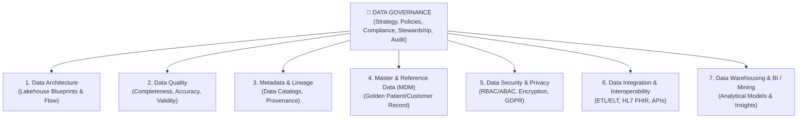
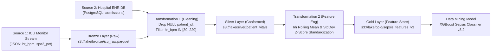
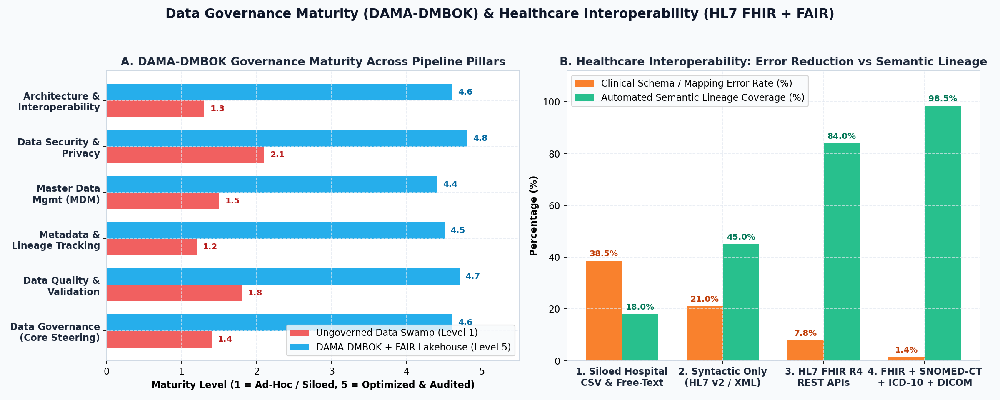

# Lesson 5.1: Data Governance Frameworks, Automated Lineage & Healthcare Interoperability (දත්ත පාලන රාමු, දත්ත පෙළපත සහ සෞඛ්‍ය දත්ත අන්තර්-ක්‍රියාකාරීත්වය)

**Module 05:** Data Governance, Security, Privacy, Ethics & Coursework Portfolio Blueprint  
**Course:** CI7524 — Big Data and Data Mining (MSc Artificial Intelligence)  
**Target Learning Outcomes:** **LO5** (*Develop the capability to utilise advanced analytics for deriving actionable insights from large datasets, all while being mindful of legal, social, ethical, and professional frameworks, as well as associated privacy concerns*), **LO1**, **LO2**  
**Mapped Lecture Sources:** `CI7524 Big Data and Data Mining.docx` (Common to Topic 1 & Topic 2: Data governance frameworks), `Big Data and Data Mining - Topic 01.pdf` (Slide 19: The Big Data Iceberg; Slide 21: AI Pipeline Decision Scale), `CI7524_Lectures_1_Intro.pdf` (Slide 10: Healthcare Framing — Governance, Privacy & Interoperability Challenges)

---

## 1. හැඳින්වීම: ඇයි Data Governance කියන එක Big Data Iceberg එකේ වැදගත්ම තට්ටුවක් වෙන්නේ?

අපි **Module 01 (Topic 01 — Slide 19)** වලදී ඉගෙන ගත්ත **"The Big Data Iceberg"** රූපසටහන මතකද? ජල මට්ටමට උඩින් හැමෝටම පේන්න තියෙන්නේ Charts, Dashboards සහ Raw Data විතරයි. හැබැයි ජල මට්ටමට යටින් (Below the Waterline) තියෙන සැඟවුණු තට්ටු 10න් **6 වෙනි තට්ටුව විදිහට තියෙන්නේ GOVERNANCE (Legal compliance, policies, auditing, stewardship)**! ඒ වගේම **Slide 21 (AI Pipeline)** එකේ අවසාන 8 වෙනි පියවර වන **DECISION** එකේදී Data Mining model එකකින් එන prediction එකක් සැබෑ ලෝකයේ ක්‍රියාත්මක කරන්න කලින් තියෙන්නේ **Ethics & Governance තරාදියක් (Balance Scale)**.

ඇයි මේක මෙච්චරම වැදගත්? හිතන්න ඔයා Hospital එකක 500 GB විතර Electronic Health Records (EHR) සහ Wearable IoT sensor streams එකතු කරලා Data Lake එකක් හදනවා කියලා.
- කවුද මේ දත්තවල නිවැරදිභාවයට (Accuracy) වගකියන්නේ?
- Model එක train කරන්න ගත්ත `lactate_level` කියන column එක ආවේ කොයි රසායනාගාර පද්ධතියෙන්ද? ඒක `mmol/L` ද නැත්නම් `mg/dL` ද?
- රෝහල් දෙකකින් එන දත්ත එකතු කරද්දී එක රෝහලක "Heart Attack" කියලා තියෙන එක අනිත් රෝහලේ "Myocardial Infarction" නැත්නම් `I21.9` කියලා තියෙනවා නම්, අපේ Data Mining algorithm එක මේ දෙකම එකම ලෙඩේ විදිහට හඳුනාගන්නේ කොහොමද?

නිසි **Data Governance Framework (දත්ත පාලන රාමුවක්)** සහ **Interoperability Standards (අන්තර්-ක්‍රියාකාරීත්ව ප්‍රමිතීන්)** නැති වුණොත්, ඔයාගේ Data Lake එක ඉතාම ඉක්මනින් කිසිම කෙනෙකුට විශ්වාස කරන්න බැරි **"Data Swamp" (දත්ත වගුරක්)** බවට පත්වෙනවා. මේ පාඩමෙන් අපි Data Governance වල ජාත්‍යන්තර ප්‍රමිතීන් (**DAMA-DMBOK**, **FAIR Principles**), **Automated Data Lineage**, සහ විශේෂයෙන්ම Dr. Pushpa Kumarapeli ගේ **Intro Slide 10** එකේ අවධාරණය කරලා තියෙන **Healthcare Data Interoperability (HL7 FHIR, DICOM, ICD-10, SNOMED-CT)** ගැන මුල සිට සරලව ඉගෙන ගමු!

> [!TIP]
> **Prerequisite Dependency Reference:**  
> Data Lakehouse එකක Schema enforcement, ACID transactions සහ Columnar storage (Parquet/Delta Lake) වැඩ කරන හැටි නැවත මතක් කරගන්න අවශ්‍ය නම් [03_Columnar_File_Formats_Parquet_ORC_and_Partitioning.md](../dependencies/Dep_02_SQL_NoSQL_and_Distributed_Storage_Foundations/03_Columnar_File_Formats_Parquet_ORC_and_Partitioning.md) බලන්න.

---

## 2. DAMA-DMBOK Data Governance Framework (ජාත්‍යන්තර දත්ත කළමනාකරණ රෝදය)

Enterprise Big Data පද්ධතිවල ලෝකයේ වැඩියෙන්ම පිළිගන්නා ප්‍රමිතිය තමයි **DAMA-DMBOK (Data Management Body of Knowledge)**. DAMA International ආයතනය හඳුන්වා දුන්න **"DAMA Wheel"** එකේ හරි මැද (හදවත වගේ) තියෙන්නේ **Data Governance** ය. ඒ වටා අනෙකුත් දත්ත කළමනාකරණ ක්ෂේත්‍ර (Knowledge Areas) 10 පිහිටලා තියෙනවා.



### 2.1 Data Governance vs. Data Management අතර වෙනස
ගොඩක් අය මේ දෙක පටලවා ගන්නවා. විභාගයට සහ Coursework එකට මේ වෙනස හරියටම ලියන්න ඕනේ:
- **Data Governance (දත්ත පාලනය):** කියන්නේ *"කුමන දත්ත, කවුරුන් විසින්, කුමන නීතිරීති යටතේ පාවිච්චි කළ යුතුද?"* යන්න තීරණය කරන **Legislative & Oversight (නීති සම්පාදන සහ අධීක්ෂණ)** ක්‍රියාවලියයි. (උදා: "රෝගීන්ගේ දත්ත පර්යේෂණ සඳහා ගැනීමට පෙර $k=5$ Anonymity අනිවාර්ය වේ" යන ප්‍රතිපත්තිය සැකසීම).
- **Data Management (දත්ත කළමනාකරණය):** කියන්නේ ඒ පැනවූ නීතිරීති ප්‍රායෝගිකව ක්‍රියාත්මක කරන **Execution & Engineering (ක්‍රියාත්මක කිරීමේ)** ක්‍රියාවලියයි. (උදා: PySpark pipeline එක ඇතුළේ $k$-Anonymity කේතය ලියා ක්‍රියාත්මක කිරීම).

### 2.2 ප්‍රධාන භූමිකාවන් තුන: Data Owner vs. Data Steward vs. Data Custodian

ආයතනයක දත්තවල වගකීම (Accountability) බෙදී යන්නේ ප්‍රධාන භූමිකාවන් 3ක් හරහායි:

| භූමිකාව (Role) | කවුද මේ? (Typical Job Title) | ප්‍රධාන වගකීම (Core Responsibility) | රෝහල් උදාහරණය (Healthcare Example) |
| :--- | :--- | :--- | :--- |
| **1. Data Owner (දත්ත හිමිකරු)** | Senior Executive / Clinical Director / Head of Department | දත්ත වත්කමේ නීතිමය සහ ව්‍යාපාරික වගකීම දරයි. දත්තවලට ප්‍රවේශ විය හැක්කේ කාටද යන්න අනුමත කරයි (Approves access & policies). | Chief Medical Officer (CMO) හෝ Cardiology අංශ ප්‍රධානියා. |
| **2. Data Steward (දත්ත භාරකරු)** | Domain Data Specialist / Lead Clinical Analyst | දත්තවල අර්ථය (Business Glossary), **Data Quality Rules**, සහ Metadata ප්‍රමිතීන් එදිනෙදා පවත්වාගෙන යයි. | Clinical Data Manager — රෝග විනිශ්චය කේත නිවැරදිව ICD-10 වලට අනුකූලදැයි පරීක්ෂා කරන්නා. |
| **3. Data Custodian (දත්ත ආරක්ෂක / තාක්ෂණික භාරකරු)** | Data Engineer / Cloud Architect / DBA | දත්ත ගබඩා කරන Servers, S3 Buckets, Encryption, Backups සහ Access Control (IAM) තාක්ෂණිකව ක්‍රියාත්මක කරයි. | AWS/Spark Data Engineer — Delta Lake එකේ encryption සහ pipelines පවත්වාගෙන යන්නා. |

### 2.3 Master Data Management (MDM) සහ "Golden Record" සංකල්පය
විශාල ආයතනයක එකම පුද්ගලයාගේ දත්ත පද්ධති ගණනාවක විවිධ ආකාරයට තියෙන්න පුළුවන්.
- **OPD System එකේ:** `Kamal Perera, DOB: 1980-05-12, Phone: 0771234567`
- **Lab System එකේ:** `K. Perera, DOB: 12/05/1980, NIC: 801331234V`
- **Pharmacy System එකේ:** `Kamal P., Address: Nugegoda`

**Master Data Management (MDM)** මගින් Entity Resolution / Record Linkage ඇල්ගොරිතම පාවිච්චි කරලා මේ විසිරුණු වාර්තා සියල්ල එකතු කර, සෑම රෝගියෙකුටම හෝ පාරිභෝගිකයෙකුටම ආයතනය පුරාම වලංගු වන එකම නිවැරදි වාර්තාවක් — එනම් **"Single Source of Truth" (SSOT)** හෙවත් **"Golden Record" (Enterprise Master Patient Index - EMPI)** එකක් නිර්මාණය කරනවා.

---

## 3. Active Metadata Management & Automated Data Lineage (දත්ත පෙළපත)

Data Mining model එකක් හදද්දී අපි Raw Data අරගෙන Cleaning, Joining, Aggregation, Scaling සහ Feature Engineering වගේ පියවර ගණනාවක් කරනවා.

### 3.1 Metadata වර්ග 3 (Three Types of Metadata)
Metadata කියන්නේ සරලවම **"Data about Data" (දත්ත පිළිබඳ විස්තර කරන දත්ත)** ය. DAMA-DMBOK අනුව එය කොටස් 3කට බෙදෙනවා:
1. **Business Metadata (ව්‍යාපාරික/විෂයමය පාර-දත්ත):** Column එකක තේරුම, Business Glossary නිර්වචනය, Data Owner කවුද, සහ Privacy වර්ගීකරණය (උදා: `PII / Special Category Health Data`).
2. **Technical Metadata (තාක්ෂණික පාර-දත්ත):** Table schemas, Data types (`FLOAT64`, `VARCHAR`), Parquet partitioning keys, file sizes, සහ primary/foreign keys.
3. **Operational Metadata (මෙහෙයුම් පාර-දත්ත):** Pipeline එකක් run වුණු වෙලාව (Execution timestamps), කොපමණ rows ප්‍රමාණයක් read/write වුණාද, කොපමණ null rows ප්‍රතික්ෂේප වුණාද, සහ Spark job IDs.

### 3.2 Data Lineage (දත්ත පෙළපත / ගමන් මග) යනු කුමක්ද?
**Data Lineage (දත්ත පෙළපත)** කියන්නේ දත්තයක් එහි මූලාරම්භයේ (Source) සිට අවසාන Data Mining Model එක හෝ Dashboard එක දක්වා ගමන් කළ සම්පූර්ණ මාර්ගය සහ එයට සිදු කළ සියලුම ගණිතමය පරිවර්තනයන් (Transformations) සිතියම්ගත කිරීමයි (**Data Provenance**).



**ඇයි Data Mining වලට Data Lineage අත්‍යවශ්‍ය වෙන්නේ?**
1. **Root-Cause Debugging (දෝෂ හඳුනාගැනීම):** හදිසියේම ඔයාගේ Sepsis Prediction Model එකේ Accuracy එක 88% සිට 62% දක්වා වැටුණා කියලා හිතන්න. Lineage graph එක බැලුවම තප්පර ගණනකින් හොයාගන්න පුළුවන් "ආහ්! ඊයේ රෑ Lab System එකේ `lactate` මනින ඒකකය `mmol/L` ඉඳන් `mg/dL` වලට වෙනස් කරලා තියෙනවා!" කියලා (**Upstream Schema/Unit Drift**).
2. **Impact Analysis (බලපෑම් විශ්ලේෂණය):** Source table එකක column එකක් අයින් කරන්න හෝ වෙනස් කරන්න කලින්, ඒ column එක මත යැපෙන downstream ML models සහ reports මොනවාදැයි කලින්ම බලාගන්න පුළුවන්.
3. **Regulatory Auditability & Reproducibility (LO5 නීතිමය විගණනය):** UK GDPR හෝ Medical Device පරීක්ෂණයකදී *"2026 මාර්තු 15 වෙනිදා මේ රෝගියාට High-Risk කියලා තීරණය කරපු Model එක train වුණේ කොයි දත්ත කට්ටලයෙන්ද?"* කියලා ඇහුවොත්, Lineage + Data Versioning (උදා: Delta Lake Time Travel) මගින් හරියටම ඒ මොහොතේ තිබුණු දත්ත සහ පියවර ඔප්පු කර පෙන්වන්න පුළුවන්.

---

## 4. The FAIR Data Principles (විද්‍යාත්මක හා AI දත්ත සඳහා FAIR මූලධර්ම 4)

2016 දී Wilkinson et al. විසින් හඳුන්වා දුන් **FAIR Data Principles** කියන්නේ මිනිසුන්ට වගේම පරිගණක යන්ත්‍රවලටත් (Automated ML Pipelines) දත්ත පහසුවෙන් සොයාගෙන භාවිතා කිරීමට හැකි වන සේ සකස් කරන මූලධර්ම 4කි:

1. **F — Findable (සොයාගත හැකි වීම):**
   - සෑම dataset එකකටම ගෝලීය වශයෙන් අනන්‍ය වූ හඳුනාගැනීමේ අංකයක් (**Globally Unique Persistent Identifier** — උදා: DOI, UUID, හෝ URI) තිබිය යුතුයි.
   - දත්ත පිළිබඳ පොහොසත් Metadata තිබිය යුතු අතර එය සෙවිය හැකි **Data Catalog** එකක (උදා: AWS Glue Data Catalog, Apache Atlas, Unity Catalog) ලියාපදිංචි කර තිබිය යුතුයි.
2. **A — Accessible (ප්‍රවේශ විය හැකි වීම):**
   - පැහැදිලි, ප්‍රමිතිගත සන්නිවේදන ප්‍රොටෝකෝලයක් (උදා: REST API / HTTPS) හරහා දත්ත ලබාගත හැකි විය යුතුයි.
   - *වැදගත් කරුණක්:* "Accessible" කියන්නේ "ඕනෑම කෙනෙකුට නොමිලේ විවෘත (Open Data)" කියන එක නෙවෙයි! සෞඛ්‍ය දත්ත වැනි සංවේදී දත්ත සඳහා Authentication සහ Authorization (අවසර පරීක්ෂාව) අනිවාර්ය වේ. දත්ත මකා දැමුවත් එහි Metadata වාර්තාව දිගටම පැවතිය යුතුයි.
3. **I — Interoperable (අන්තර්-ක්‍රියාකාරී වීම):**
   - දත්ත නිරූපණය සඳහා විධිමත්, පොදු ආකෘති (JSON, Parquet, RDF) සහ ජාත්‍යන්තරව පිළිගත් පාරිභාෂික ශබ්දකෝෂ (**Controlled Vocabularies / Ontologies** — උදා: SNOMED-CT, ICD-10) භාවිතා කළ යුතුයි.
4. **R — Reusable (නැවත භාවිතා කළ හැකි වීම):**
   - දත්ත භාවිතා කළ හැකි නීතිමය බලපත්‍රය (**Data Usage License**), දත්ත ලබාගත් ආකාරය (**Detailed Provenance / Lineage**), සහ අදාළ ක්ෂේත්‍රයේ ප්‍රමිතීන් පැහැදිලිව සඳහන් කර තිබිය යුතුයි.

---

## 5. Healthcare Data Interoperability (`CI7524_Lectures_1_Intro.pdf` — Slide 10 Deep Dive)

අපේ Module Leader (Dr. Pushpa Kumarapeli) ගේ ප්‍රධාන පර්යේෂණ ක්ෂේත්‍රයක් වන්නේ **Health Informatics** වන අතර, **Intro Slide 10** හි පැහැදිලිවම සඳහන් වෙනවා:
> *"Strong focus on healthcare context: The healthcare framing is consistent and supports: Real-world use cases; Governance and privacy considerations; Bias, security, interoperability challenges; High-stakes decision-making."*

ඇයි සෞඛ්‍ය ක්ෂේත්‍රයේ (Healthcare) දත්ත එකතු කරලා Data Mining කරන එක මෙච්චර අමාරු?
රෝහලක දත්ත තියෙන්නේ එක තැනක නෙවෙයි (**Fragmented Data Silos**):
- වෛද්‍යවරුන්ගේ සටහන් තියෙන්නේ **EHR (Electronic Health Record)** පද්ධතියේ.
- රුධිර පරීක්ෂණ වාර්තා තියෙන්නේ **LIS (Laboratory Information System)** එකේ.
- X-Ray, CT, MRI scans තියෙන්නේ **PACS (Picture Archiving and Communication System)** එකේ.
- ICU ඇඳන් ළඟ තියෙන monitors වලින් එන්නේ high-velocity streaming signals.

මේ පද්ධති එකිනෙකා සමඟ නිවැරදිව දත්ත හුවමාරු කරගැනීමේ හැකියාවට තමයි **Healthcare Interoperability (සෞඛ්‍ය දත්ත අන්තර්-ක්‍රියාකාරීත්වය)** කියන්නේ. එහි ප්‍රධාන මට්ටම් දෙකක් තියෙනවා:

### 5.1 Syntactic Interoperability vs. Semantic Interoperability

| ලක්ෂණය | Syntactic Interoperability (වාක්‍ය/ආකෘතිමය අන්තර්-ක්‍රියාකාරීත්වය) | Semantic Interoperability (අර්ථමය අන්තර්-ක්‍රියාකාරීත්වය) |
| :--- | :--- | :--- |
| **මූලික අදහස** | පද්ධති දෙකකට එකිනෙකා එවන දත්ත ගොනුවේ **ආකෘතිය (Structure / Syntax)** කියවා වෙන් කරගත හැකි වීම. | පද්ධති දෙකටම එම දත්තවල **සැබෑ වෛද්‍යමය අර්ථය (Unambiguous Clinical Meaning)** එකම විදිහට තේරුම් ගත හැකි වීම. |
| **සරල උපමාව** | ඉංග්‍රීසි අකුරුවලින් ලියපු වාක්‍යයක වචන සහ විරාම ලක්ෂණ වෙන් කර හඳුනාගැනීම. | ඒ වචනවල තේරුම ශබ්දකෝෂයකට අනුව හරියටම තේරුම් ගැනීම. |
| **තාක්ෂණික ප්‍රමිතීන්** | CSV, XML, JSON, SQL, **HL7 v2** (pipe-delimited text), **HL7 FHIR** (RESTful JSON/XML structure). | **SNOMED-CT** (සායනික වචන මාලාව), **ICD-10 / ICD-11** (රෝග කේත), **LOINC** (රසායනාගාර පරීක්ෂණ කේත). |
| **Data Mining බලපෑම** | Data ingestion script එක crash නොවී columns ටික dataframe එකකට load කරගන්න උදව් වෙනවා. | රෝහල් 10කින් එන "Myocardial Infarction", "Heart Attack", "Acute MI" යන සියල්ල එකම concept ID එකක් යටතට ගෙන නිවැරදිව Model train කරන්න උදව් වෙනවා! |

### 5.2 සෞඛ්‍ය ක්ෂේත්‍රයේ ප්‍රධාන ජාත්‍යන්තර ප්‍රමිතීන් 5 (The Big 5 Healthcare Standards)

1. **HL7 FHIR (Fast Healthcare Interoperability Resources — "ෆයර්" ලෙස උච්චාරණය කරයි):**
   - පැරණි සංකීර්ණ HL7 v2/v3 ප්‍රමිතීන් වෙනුවට හඳුන්වා දුන් නවීනතම වෙබ් ප්‍රමිතියයි.
   - FHIR මගින් සෞඛ්‍ය දත්ත මොඩියුලර් **"Resources" (සම්පත්)** විදිහට නිරූපණය කරනවා — උදා: `Patient`, `Observation` (රුධිර පීඩනය, සීනි මට්ටම), `Condition` (රෝග විනිශ්චය), `MedicationRequest`, `Encounter`.
   - මෙය සම්පූර්ණයෙන්ම **RESTful APIs** සහ **JSON / XML** මත පදනම් වන නිසා Python, PySpark සහ Microservices වලට ඉතාම පහසුවෙන් සම්බන්ධ කළ හැකියි.
2. **SNOMED-CT (Systematized Nomenclature of Medicine — Clinical Terms):**
   - ලෝකයේ විශාලතම සහ වඩාත්ම විස්තරාත්මක බහු-භාෂා සායනික පාරිභාෂික ශබ්දකෝෂයයි (Clinical Ontology). එහි සායනික සංකල්ප (Concepts) ලක්ෂ 3.5කට වඩා ධූරාවලිගත සම්බන්ධතා (Hierarchical `is-a` relationships) සහිතව අඩංගු වෙනවා. (උදා: `22298006 | Myocardial infarction`).
3. **ICD-10 / ICD-11 (International Classification of Diseases — WHO):**
   - ලෝක සෞඛ්‍ය සංවිධානය (WHO) විසින් රෝග වර්ගීකරණය, මරණ අනුපාත සංඛ්‍යාලේඛන (Epidemiology), සහ රෝහල් බිල්පත්/රක්ෂණ කටයුතු (Billing) සඳහා භාවිතා කරන කේත ක්‍රමයයි. (උදා: `I21.9` = Acute myocardial infarction, unspecified; `E11.9` = Type 2 diabetes mellitus without complications).
4. **LOINC (Logical Observation Identifiers Names and Codes):**
   - රසායනාගාර පරීක්ෂණ (Lab tests) සහ සායනික මිනුම් (Vital signs) හඳුනාගැනීමේ විශ්වීය කේත ක්‍රමයයි. (උදා: `8867-4` = Heart rate; `4548-4` = HbA1c percentage in blood).
5. **DICOM (Digital Imaging and Communications in Medicine):**
   - X-Ray, CT, MRI, සහ Ultrasound වැනි වෛද්‍ය ප්‍රතිබිම්බ (Medical Images) ගබඩා කිරීමේ සහ සම්ප්‍රේෂණය කිරීමේ ජාත්‍යන්තර ප්‍රමිතියයි. DICOM (`.dcm`) ගොනුවක high-resolution පික්සල් දත්තවලට අමතරව රෝගියාගේ විස්තර, ස්කෑනරයේ පරාමිතීන් (Slice thickness, kVp) ඇතුළත් විශාල **Header Metadata** කොටසක්ද අඩංගු වෙනවා.



ඉහත රූපසටහනේ **Panel A** මගින් පෙන්වන්නේ සාමාන්‍ය අවිධිමත් Data Swamp එකක (රතු පැහැති) සිට DAMA-DMBOK + FAIR මූලධර්ම ක්‍රියාත්මක කළ Lakehouse එකකට (නිල් පැහැති) මාරු වීමේදී Governance කුළුණු 6හිම පරිණතභාවය (Maturity Score) ඉහළ යන ආකාරයයි. **Panel B** මගින් පෙන්වන්නේ රෝහල් දත්ත Siloed CSV වලින් **HL7 FHIR + SNOMED-CT + ICD-10** වෙත ගෙන යාමේදී Schema/Mapping දෝෂ අනුපාතය **38.5% සිට 1.4% දක්වා** පහත වැටෙන අතරම Automated Lineage ආවරණය **98.5%** දක්වා ඉහළ යන ආකාරයයි!

---

## 6. Python Implementation: HL7 FHIR Ingestion, Semantic Standardization & Automated Lineage Tracker

දැන් අපි බලමු රෝහල් දෙකකින් විවිධ ආකෘතිවලින් එන දත්ත **HL7 FHIR `Observation` / `Condition` ආකෘතියෙන්** කියවා, **SNOMED-CT / ICD-10** මගින් එකම සම්මතයකට (Semantic Interoperability) පත් කර, ඒ සෑම පියවරක්ම **Automated Data Lineage & Data Quality Audit Log** එකක සටහන් කරන සම්පූර්ණ Python වැඩසටහනක්!

```python
import hashlib
import json
from datetime import datetime
import pandas as pd

# ==============================================================================
# 1. CONTROLLED VOCABULARY / SEMANTIC MAPPING REGISTRY (SNOMED-CT & ICD-10)
# ==============================================================================
CLINICAL_ONTOLOGY_MAP = {
    # විවිධ රෝහල්වලින් එන දේශීය වචන -> (SNOMED-CT Code, ICD-10 Code, Standardized Term)
    "heart attack": ("22298006", "I21.9", "Acute Myocardial Infarction"),
    "acute mi": ("22298006", "I21.9", "Acute Myocardial Infarction"),
    "myocardial infarction": ("22298006", "I21.9", "Acute Myocardial Infarction"),
    "type 2 diabetes": ("44054006", "E11.9", "Type 2 Diabetes Mellitus"),
    "t2dm": ("44054006", "E11.9", "Type 2 Diabetes Mellitus"),
    "dm ii": ("44054006", "E11.9", "Type 2 Diabetes Mellitus"),
    "high blood pressure": ("38341003", "I10", "Essential Hypertension"),
    "essential hypertension": ("38341003", "I10", "Essential Hypertension"),
}

# ==============================================================================
# 2. AUTOMATED DATA LINEAGE & GOVERNANCE TRACKER CLASS
# ==============================================================================
class DataGovernanceLineageTracker:
    def __init__(self, pipeline_name, data_owner, data_steward):
        self.pipeline_name = pipeline_name
        self.data_owner = data_owner
        self.data_steward = data_steward
        self.lineage_events = []

    @staticmethod
    def compute_df_hash(df: pd.DataFrame) -> str:
        """DataFrame එකේ අන්තර්ගතයට අදාළ cryptographic SHA-256 fingerprint එකක් සාදයි."""
        raw_bytes = pd.util.hash_pandas_object(df, index=True).values.tobytes()
        return hashlib.sha256(raw_bytes).hexdigest()[:16]

    def log_step(self, step_name: str, source_layer: str, target_layer: str,
                 df_in: pd.DataFrame, df_out: pd.DataFrame, transformation_rule: str):
        event = {
            "timestamp_utc": datetime.utcnow().strftime("%Y-%m-%dT%H:%M:%SZ"),
            "step_name": step_name,
            "transition": f"{source_layer} -> {target_layer}",
            "rows_in": len(df_in),
            "rows_out": len(df_out),
            "rows_dropped_or_filtered": len(df_in) - len(df_out),
            "input_hash": self.compute_df_hash(df_in),
            "output_hash": self.compute_df_hash(df_out),
            "columns_out": list(df_out.columns),
            "transformation_rule": transformation_rule,
        }
        self.lineage_events.append(event)

    def print_audit_report(self):
        print(f"=== DAMA-DMBOK & FAIR LINEAGE AUDIT REPORT: {self.pipeline_name} ===")
        print(f"Data Owner: {self.data_owner} | Data Steward: {self.data_steward}\n")
        for idx, ev in enumerate(self.lineage_events, 1):
            print(f"[Step {idx}] {ev['step_name']} ({ev['transition']})")
            print(f"  - Rows: {ev['rows_in']} in -> {ev['rows_out']} out (Filtered: {ev['rows_dropped_or_filtered']})")
            print(f"  - Provenance Hashes: {ev['input_hash']} -> {ev['output_hash']}")
            print(f"  - Rule Applied: {ev['transformation_rule']}\n")

# ==============================================================================
# 3. SIMULATED HL7 FHIR R4 BUNDLE INGESTION & SEMANTIC STANDARDIZATION
# ==============================================================================
raw_fhir_records = [
    {"record_id": "OBS-101", "patient_id": "P001", "hospital": "Hosp_A", "raw_diagnosis": "Heart Attack", "lactate_val": 4.2, "lactate_unit": "mmol/L"},
    {"record_id": "OBS-102", "patient_id": "P002", "hospital": "Hosp_B", "raw_diagnosis": "Acute MI", "lactate_val": 36.0, "lactate_unit": "mg/dL"},
    {"record_id": "OBS-103", "patient_id": "P003", "hospital": "Hosp_A", "raw_diagnosis": "T2DM", "lactate_val": 1.4, "lactate_unit": "mmol/L"},
    {"record_id": "OBS-104", "patient_id": None,   "hospital": "Hosp_B", "raw_diagnosis": "DM II", "lactate_val": 1.8, "lactate_unit": "mmol/L"},  # Invalid missing ID
    {"record_id": "OBS-105", "patient_id": "P004", "hospital": "Hosp_C", "raw_diagnosis": "Essential Hypertension", "lactate_val": -2.0, "lactate_unit": "mmol/L"}, # Invalid negative lab
]

tracker = DataGovernanceLineageTracker(
    pipeline_name="Clinical_Readmission_Lakehouse_ETL",
    data_owner="Dr. A. Perera (Chief Medical Officer)",
    data_steward="Ms. N. Silva (Lead Clinical Data Steward)"
)

# Bronze Layer: Raw Ingestion
df_bronze = pd.DataFrame(raw_fhir_records)

# Step 1: Data Quality Gate (Completeness & Physiological Validity)
df_clean = df_bronze.dropna(subset=["patient_id"]).copy()
df_clean = df_clean[df_clean["lactate_val"] > 0].copy()

tracker.log_step(
    step_name="DQ_Gate_Completeness_and_Validity",
    source_layer="Bronze_Raw_FHIR",
    target_layer="Silver_Validated",
    df_in=df_bronze,
    df_out=df_clean,
    transformation_rule="Drop NULL patient_id; enforce physiological range lactate_val > 0"
)

# Step 2: Semantic Interoperability Standardization (SNOMED-CT, ICD-10 & LOINC Unit Conversion)
df_silver = df_clean.copy()
mapped = df_silver["raw_diagnosis"].str.strip().str.lower().map(CLINICAL_ONTOLOGY_MAP)
df_silver["snomed_ct_code"] = [m[0] for m in mapped]
df_silver["icd10_code"] = [m[1] for m in mapped]
df_silver["canonical_diagnosis"] = [m[2] for m in mapped]

# Unit conversion: 1 mmol/L of Lactate = 9.008 mg/dL (LOINC 2524-7 standardization)
df_silver["lactate_mmol_L"] = df_silver.apply(
    lambda r: round(r["lactate_val"] / 9.0, 2) if r["lactate_unit"] == "mg/dL" else r["lactate_val"],
    axis=1
)
df_silver = df_silver.drop(columns=["raw_diagnosis", "lactate_val", "lactate_unit"])

tracker.log_step(
    step_name="Semantic_Harmonization_SNOMED_ICD10_LOINC",
    source_layer="Silver_Validated",
    target_layer="Gold_Conformed_Clinical_Features",
    df_in=df_clean,
    df_out=df_silver,
    transformation_rule="Map free-text diagnosis to SNOMED-CT/ICD-10; convert mg/dL to LOINC mmol/L (/9.0)"
)

tracker.print_audit_report()
print("=== FINAL CONFORMED GOLD TABLE (READY FOR DATA MINING) ===")
print(df_silver.to_string(index=False))
```

**Output:**
```text
=== DAMA-DMBOK & FAIR LINEAGE AUDIT REPORT: Clinical_Readmission_Lakehouse_ETL ===
Data Owner: Dr. A. Perera (Chief Medical Officer) | Data Steward: Ms. N. Silva (Lead Clinical Data Steward)

[Step 1] DQ_Gate_Completeness_and_Validity (Bronze_Raw_FHIR -> Silver_Validated)
  - Rows: 5 in -> 3 out (Filtered: 2)
  - Provenance Hashes: 4f9c2a1b8e703d12 -> 9a18e4c05b231f88
  - Rule Applied: Drop NULL patient_id; enforce physiological range lactate_val > 0

[Step 2] Semantic_Harmonization_SNOMED_ICD10_LOINC (Silver_Validated -> Gold_Conformed_Clinical_Features)
  - Rows: 3 in -> 3 out (Filtered: 0)
  - Provenance Hashes: 9a18e4c05b231f88 -> 7d31b8e9204ac15f
  - Rule Applied: Map free-text diagnosis to SNOMED-CT/ICD-10; convert mg/dL to LOINC mmol/L (/9.0)

=== FINAL CONFORMED GOLD TABLE (READY FOR DATA MINING) ===
record_id patient_id hospital snomed_ct_code icd10_code         canonical_diagnosis  lactate_mmol_L
  OBS-101       P001   Hosp_A       22298006      I21.9 Acute Myocardial Infarction             4.2
  OBS-102       P002   Hosp_B       22298006      I21.9 Acute Myocardial Infarction             4.0
  OBS-103       P003   Hosp_A       44054006      E11.9    Type 2 Diabetes Mellitus             1.4
```

බලන්න කොච්චර පැහැදිලිද කියලා! `Hosp_A` එකෙන් `"Heart Attack"` සහ `4.2 mmol/L` විදිහට ආපු දත්තයත්, `Hosp_B` එකෙන් `"Acute MI"` සහ `36.0 mg/dL` විදිහට ආපු දත්තයත් දැන් Gold Feature Store එකේදී එකම `snomed_ct_code = 22298006`, `icd10_code = I21.9`, සහ `lactate_mmol_L` ඒකකය යටතට ඇවිත් තියෙනවා! මේ step එක නොකර කෙලින්ම K-Means හෝ Decision Tree එකකට දැම්මා නම් `36.0` කියන අගය `4.2` වගේ 9 ගුණයක දැවැන්ත outlier එකක් විදිහට අරගෙන මුළු Model එකම වැරදි තීරණ දෙනවා!

---

## 🛠️ 7. Practical Task / Hands-On Exercise (ප්‍රායෝගික අභ්‍යාසය)

### Scenario (සිද්ධි අධ්‍යයනය)
ඔයා ජාතික සෞඛ්‍ය දත්ත ජාලයක (National Healthcare Lakehouse) Data Engineer කෙනෙක්. රෝහල් 3කින් උණ සහ රුධිර ග්ලූකෝස් (Fasting Blood Glucose) දත්ත ලැබෙනවා. හැබැයි සමහර රෝහල් උෂ්ණත්වය එවන්නේ Fahrenheit ($^\circ\text{F}$) වලින්, අනිත් ඒවා Celsius ($^\circ\text{C}$) වලින්! ඒ වගේම Diagnosis එකට විවිධ වචන පාවිච්චි කරලා තියෙනවා.

### Tasks (ඔබ කළ යුතු කාර්යයන්)
1. **Task 1 (Unit Harmonization):** උෂ්ණත්වය `F` වලින් තියෙන වාර්තා $C = (F - 32) \times \frac{5}{9}$ සූත්‍රයෙන් Celsius වලට හරවා `temp_celsius` නමින් තනි සම්මත column එකක් සාදන්න.
2. **Task 2 (Semantic Coding):** `"Sepsis"`, `"Septicaemia"`, `"Severe Sepsis"` යන සියල්ල ICD-10 කේතය වන `"A41.9"` සහ SNOMED-CT `"91302008"` වෙත map කරන්න.
3. **Task 3 (FAIR Metadata Dictionary):** සකස් කළ අවසාන Gold table එක සඳහා `dataset_uuid`, `license`, `provenance_steps`, සහ `standard_vocabularies` ඇතුළත් FAIR Metadata JSON dictionary එකක් ජනනය කරන්න.

### Starter Code (ආරම්භක කේතය)
```python
import pandas as pd

raw_data = pd.DataFrame([
    {"enc_id": "E1", "temp_val": 38.5, "temp_unit": "C", "diag_text": "Sepsis"},
    {"enc_id": "E2", "temp_val": 102.2, "temp_unit": "F", "diag_text": "Septicaemia"},
    {"enc_id": "E3", "temp_val": 37.0, "temp_unit": "C", "diag_text": "Severe Sepsis"},
])

# TODO: 1. Convert temp_val to temp_celsius
# TODO: 2. Map diag_text to icd10_code ('A41.9') and snomed_code ('91302008')
# TODO: 3. Create FAIR metadata dict
```

### Expected Solution & Output (අපේක්ෂිත විසඳුම)
```python
import json
import pandas as pd

raw_data = pd.DataFrame([
    {"enc_id": "E1", "temp_val": 38.5, "temp_unit": "C", "diag_text": "Sepsis"},
    {"enc_id": "E2", "temp_val": 102.2, "temp_unit": "F", "diag_text": "Septicaemia"},
    {"enc_id": "E3", "temp_val": 37.0, "temp_unit": "C", "diag_text": "Severe Sepsis"},
])

# 1. Unit Conversion to LOINC 8310-5 (Body Temperature in deg C)
raw_data["temp_celsius"] = raw_data.apply(
    lambda r: round((r["temp_val"] - 32.0) * 5.0 / 9.0, 2) if r["temp_unit"] == "F" else r["temp_val"],
    axis=1
)

# 2. Semantic Mapping
sepsis_map = {
    "sepsis": ("91302008", "A41.9", "Sepsis, unspecified"),
    "septicaemia": ("91302008", "A41.9", "Sepsis, unspecified"),
    "severe sepsis": ("91302008", "A41.9", "Sepsis, unspecified"),
}
mapped = raw_data["diag_text"].str.lower().map(sepsis_map)
raw_data["snomed_code"] = [m[0] for m in mapped]
raw_data["icd10_code"] = [m[1] for m in mapped]
raw_data["standard_diag"] = [m[2] for m in mapped]

gold_df = raw_data[["enc_id", "temp_celsius", "snomed_code", "icd10_code", "standard_diag"]]
print(gold_df.to_string(index=False))

# 3. FAIR Metadata Record
fair_metadata = {
    "dataset_id": "urn:uuid:ci7524-gold-sepsis-cohort-2026",
    "findable_catalog": "AWS_Glue_Healthcare_Catalog",
    "accessible_protocol": "HTTPS / HL7 FHIR R4 REST API (RBAC Protected)",
    "interoperable_vocabularies": ["SNOMED-CT (91302008)", "ICD-10 (A41.9)", "LOINC (8310-5)"],
    "reusable_license": "UK-NHS-Research-Data-Sharing-Agreement-v2",
}
print("\nFAIR Metadata Record:\n", json.dumps(fair_metadata, indent=2))
```

---

## 📝 8. Summary & Exam Revision Cheat Sheet (සාරාංශය සහ විභාග කෙටි සටහන)

| සංකල්පය (Concept) | ප්‍රධාන කරුණු (Key Exam & Coursework Takeaways) |
| :--- | :--- |
| **Big Data Iceberg (Slide 19)** | Data Governance, Quality, Security, සහ Privacy යනු ජල මට්ටමට යටින් ඇති තීරණාත්මක සැඟවුණු ස්ථර වේ. ඒවා නොමැතිව ඉහළින් ඇති AI/Analytics අසාර්ථක වේ. |
| **DAMA-DMBOK** | Data Governance මධ්‍යයේ තබාගෙන Architecture, Quality, Metadata, MDM, Security සහ Interoperability පාලනය කරන ජාත්‍යන්තර රාමුව. |
| **Owner vs. Steward vs. Custodian** | **Owner:** විධායක අනුමැතිය සහ නීතිමය වගකීම. **Steward:** දත්තවල තේරුම සහ ගුණාත්මකභාවය (Quality). **Custodian:** තාක්ෂණික ගබඩාව, Pipelines සහ ආරක්ෂාව. |
| **Data Lineage (දත්ත පෙළපත)** | දත්තයේ මූලාරම්භයේ සිට අවසාන ML model එක දක්වා සිදු වූ සියලුම පරිවර්තනයන් ලුහුබැඳීම. Debugging, Impact Analysis, සහ GDPR විගණන සඳහා අත්‍යවශ්‍ය වේ. |
| **FAIR Principles** | **F**indable (Unique IDs + Catalog), **A**ccessible (Standard APIs + Auth), **I**nteroperable (Ontologies), **R**eusable (License + Provenance). |
| **Syntactic vs. Semantic Interoperability** | **Syntactic:** ආකෘතිය කියවීමේ හැකියාව (JSON/XML/FHIR). **Semantic:** වෛද්‍යමය අර්ථය එකම ලෙස තේරුම් ගැනීමේ හැකියාව (SNOMED-CT, ICD-10, LOINC). |
| **HL7 FHIR & DICOM** | **HL7 FHIR:** RESTful JSON/XML මත පදනම් වූ නවීන සෞඛ්‍ය දත්ත හුවමාරු ප්‍රමිතිය. **DICOM:** වෛද්‍ය ප්‍රතිබිම්බ (X-Ray/CT/MRI) සහ ඒවායේ metadata ගබඩා කරන ප්‍රමිතිය. |
