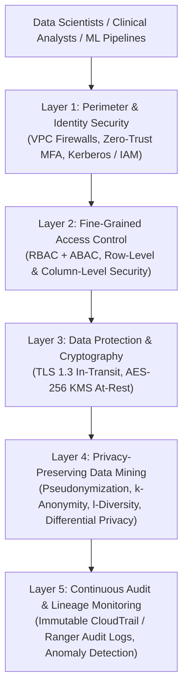
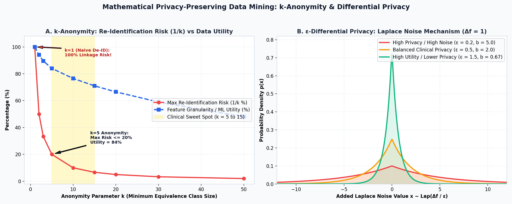

# Lesson 5.2: Big Data Security, Privacy Regulations & Anonymization Mathematics (දත්ත ආරක්ෂාව, පෞද්ගලිකත්ව නීති සහ නිර්නාමිකකරණ ගණිතය)

**Module 05:** Data Governance, Security, Privacy, Ethics & Coursework Portfolio Blueprint  
**Course:** CI7524 — Big Data and Data Mining (MSc Artificial Intelligence)  
**Target Learning Outcomes:** **LO5** (*Develop the capability to utilise advanced analytics for deriving actionable insights from large datasets, all while being mindful of legal, social, ethical, and professional frameworks, as well as associated privacy concerns*), **LO2**  
**Mapped Lecture Sources:** `CI7524 Big Data and Data Mining.docx` (Common to both topics: Security challenges, privacy issues and regulations), `Big Data and Data Mining - Topic 01.pdf` (Slide 18: Example C — 10 GB of highly sensitive medical data; Slide 19: Security & Privacy layers), `CI7524_Lectures_1_Intro.pdf` (Slide 10: Healthcare Governance, Privacy & Security Challenges)

---

## 1. හැඳින්වීම: ඇයි 10 GB සංවේදී වෛද්‍ය දත්ත 1 TB සාමාන්‍ය CSV එකකට වඩා භයානක?

අපි **Topic 01 — Slide 18 ("Big Data ≠ Lots of Data")** එකේදී දැක්කා:
- **Example A:** 1 TB of clean CSV data
- **Example C:** 10 GB of highly sensitive medical data

ඇයි 10 GB වෛද්‍ය දත්ත කට්ටලයක් Big Data අභියෝගයක් වෙන්නේ? මොකද ඒ දත්ත කට්ටලයේ තියෙන එක රෝගියෙකුගේ හෝ පෞද්ගලික තොරතුරක් (උදා: HIV තත්ත්වය, ජානමය රෝග, මානසික සෞඛ්‍ය වාර්තා) පිටතට කාන්දු වුණොත් (Data Breach), ඒ පුද්ගලයාට රැකියාව, රක්ෂණය, හෝ සමාජ පිළිගැනීම පවා අහිමි වෙන්න පුළුවන්. ඒ වගේම ආයතනයට **UK/EU GDPR** යටතේ **පවුම් මිලියන 17.5ක් (€20 Million) හෝ ගෝලීය වාර්ෂික ආදායමෙන් 4%ක්** දක්වා දැවැන්ත දඩයකට යටත් වෙන්න සිද්ධ වෙනවා!

ගොඩක් students ලා හිතන්නේ *"Dataset එකෙන් `Name` සහ `NIC_Number` කියන columns දෙක delete කළාම Privacy ප්‍රශ්නය ඉවරයි!"* කියලයි. **ඒක සම්පූර්ණයෙන්ම වැරදියි!** මේ පාඩමෙන් අපි බලමු කොහොමද හැකර්වරු හෝ පර්යේෂකයෝ `Name` එක නැතුවත් **Linkage Attacks** හරහා මිනිස්සුන්ව හඳුනාගන්නේ කියලා සහ, ඒක වළක්වන්න පාවිච්චි කරන **$k$-Anonymity, $l$-Diversity, $t$-Closeness**, සහ **$\epsilon$-Differential Privacy (ආන්තරික පෞද්ගලිකත්වය)** කියන ගණිතමය ක්‍රමවේද මොනවාද කියලා!

> [!TIP]
> **Prerequisite Dependency Reference:**  
> Differential Privacy සහ $t$-Closeness වලදී භාවිතා වන **Probability Distributions (සම්භාවිතා ව්‍යාප්ති)** සහ **Expected Value / Variance** ගැන මූලික ගණිතය මතක් කරගන්න අවශ්‍ය නම් `Dep_04_Probability_Distributions_and_Statistical_Foundations` බලන්න.

---

## 2. Big Data Security Challenges & Defense-in-Depth Architecture

සාමාන්‍ය තනි PostgreSQL database එකක් ආරක්ෂා කරනවාට වඩා Distributed Big Data Cluster එකක් (උදා: Hadoop HDFS, Apache Spark, AWS S3 Lakehouse) ආරක්ෂා කරන එක ගොඩක් සංකීර්ණයි. ඇයි? දත්ත Nodes දහස් ගණනක් පුරා විසිරිලා තියෙනවා, ජාලය හරහා නිරන්තරයෙන් Shuffle වෙනවා, සහ Data Scientists ලා, BI Analysts ලා, ML Engineers ලා වගේ විවිධ කණ්ඩායම් එකවර මේ දත්තවලට ප්‍රවේශ වෙනවා.

ඒ නිසා අපි පාවිච්චි කරන්නේ **Defense-in-Depth (ස්ථර කිහිපයකින් යුත් ආරක්ෂණ ආකෘතියක්)** ය:



### 2.1 ප්‍රධාන ආරක්ෂණ යාන්ත්‍රණ 4 (Core Security Pillars)

1. **Encryption at Rest & Encryption in Transit (ගබඩා කර ඇති සහ ගමන් කරන දත්ත සංකේතනය):**
   - **At Rest (ගබඩාවේදී):** S3 buckets, HDFS blocks, සහ Disk volumes වල තියෙන Parquet/Delta ගොනු **AES-256 (Advanced Encryption Standard - 256 bit)** මගින් encrypt කර තබයි. යතුරු (Keys) කළමනාකරණය කරන්නේ **KMS (Key Management Service / Hardware Security Modules)** හරහායි.
   - **In Transit (ජාලය හරහා ගමන් කිරීමේදී):** Client එකේ සිට Server එකට හෝ Spark Worker Nodes අතර Shuffle වන දත්ත **TLS 1.3 (Transport Layer Security)** හරහා encrypt කරයි.
2. **RBAC vs. ABAC (ප්‍රවේශ පාලන ක්‍රමවේද):**
   - **RBAC (Role-Based Access Control):** පුද්ගලයාගේ තනතුර (Role) මත පදනම්ව අවසර ලබා දීම. (උදා: `Role = Data_Scientist` නම් `Gold_Deidentified_Tables` කියවිය හැක, නමුත් `Bronze_Raw_PII` කියවිය නොහැක).
   - **ABAC (Attribute-Based Access Control):** පරිශීලකයාගේ, දත්තයේ, සහ පරිසරයේ ගුණාංග (Attributes) කිහිපයක් එකවර පරීක්ෂා කර අවසර දීම. (උදා: `IF user.department == "Cardiology" AND data.tag == "Cardiac" AND request.location == "Hospital_VPN" THEN ALLOW`).
3. **Fine-Grained Masking (Column-Level & Row-Level Security):**
   - එකම වගුවක වුණත් සංවේදී columns (උදා: `nhs_number`, `phone`, `salary`) සාමාන්‍ය analysts ලාට `***MASKED***` හෝ SHA-256 hash එකක් විදිහට පෙනෙන සේ **Dynamic Data Masking** යෙදීම.
4. **Immutable Audit Logging (වෙනස් කළ නොහැකි විගණන සටහන්):**
   - කවුරු, කවදා, කොයි වෙලාවට, කුමන query එකක් හරහා කුමන රෝගියාගේ දත්ත බැලුවාද යන්න write-once-read-many (WORM) ලොග් ගොනුවක සටහන් කිරීම.

---

## 3. Legal, Regulatory & Professional Frameworks (LO5 නීතිමය සහ වෘත්තීය රාමු)

CI7524 Coursework එකේ **LO5 (10% marks)** වලදී ඔයා හදන Data Mining විසඳුමට අදාළ නීතිමය සහ ආචාරධර්ම රාමු ගැඹුරින් විශ්ලේෂණය කරන්න ඕනේ.

### 3.1 UK GDPR & EU GDPR (General Data Protection Regulation)
පුද්ගලික දත්ත (**Personal Data**) සැකසීමේදී GDPR හි **මූලික මූලධර්ම 7 (The 7 Core Principles — Article 5)** අනිවාර්යයෙන්ම පිළිපැදිය යුතුයි:

| GDPR මූලධර්මය (Principle) | සරල තේරුම | Data Mining Pipeline එකකදී ක්‍රියාත්මක කරන ආකාරය |
| :--- | :--- | :--- |
| **1. Lawfulness, Fairness & Transparency** | නීත්‍යානුකූල පදනමක් (Consent / Legitimate Interest / Public Health) මත විනිවිදභාවයෙන් දත්ත රැස් කිරීම. | රෝගීන්ගේ දත්ත AI පුහුණු කිරීමට ගන්නා බව පැහැදිලිව දැනුම් දීම සහ Bias රහිතව සැකසීම. |
| **2. Purpose Limitation (අරමුණු සීමා කිරීම)** | එක් නිශ්චිත අරමුණකට රැස් කළ දත්ත, ඊට නොගැළපෙන වෙනත් අරමුණකට අවසරයකින් තොරව භාවිතා නොකිරීම. | වෛද්‍ය ප්‍රතිකාර සඳහා ගත් දත්ත රක්ෂණ සමාගම්වල අලෙවිකරණයට (Marketing) විකිණීම තහනම්. |
| **3. Data Minimisation (දත්ත අවම කිරීම)** | අදාළ කාර්යයට අත්‍යවශ්‍යම අවම දත්ත ප්‍රමාණය (Columns & Rows) පමණක් භාවිතා කිරීම. | Readmission predict කරන්න රෝගියාගේ නිවසේ ලිපිනය, දුරකථන අංකය, හෝ ඊමේල් අවශ්‍ය නැති නිසා ඒවා ingestion වලදීම ඉවත් කිරීම. |
| **4. Accuracy (නිවැරදිභාවය)** | දත්ත නිවැරදිව සහ යාවත්කාලීනව පවත්වා ගැනීම; වැරදි දත්ත නිවැරදි කිරීම. | Automated Data Quality checks (Lesson 3.3) මගින් දෝෂ සහිත වාර්තා පිරිසිදු කිරීම. |
| **5. Storage Limitation (ගබඩා කාලය සීමා කිරීම)** | අරමුණ ඉටු වූ පසු හඳුනාගත හැකි දත්ත අනවශ්‍ය ලෙස සදහටම තබා නොගැනීම. | S3 Lifecycle policies මගින් වසර $X$ කට පසු Raw PII දත්ත ස්වයංක්‍රීයව මකා දැමීම හෝ පූර්ණ ලෙස නිර්නාමික කිරීම (Retention Policy). |
| **6. Integrity & Confidentiality (Security)** | අනවසර ප්‍රවේශයෙන්, හානි වීමෙන් හෝ සොරකම් කිරීමෙන් දත්ත ආරක්ෂා කිරීම. | AES-256 encryption, TLS 1.3, RBAC/ABAC සහ Pseudonymization. |
| **7. Accountability (වගවීම)** | ඉහත මූලධර්ම 6ම පිළිපදින බව සාක්ෂි සහිතව ඔප්පු කිරීමේ හැකියාව. | **DPIA (Data Protection Impact Assessment)** වාර්තා, Data Lineage logs, සහ Model Audit trails පවත්වා ගැනීම. |

**Data Mining වලට බලපාන විශේෂ GDPR වගන්ති 3ක්:**
- **Article 9 (Special Category Data):** සෞඛ්‍ය දත්ත (Health data), ජානමය දත්ත (Genetic data), ජෛවමිතික දත්ත (Biometric data), සහ ජනවාර්ගිකත්වය යනු **Special Category Data** වේ. මේවා සැකසීමට සාමාන්‍ය දත්තවලට වඩා දැඩි නීතිමය අවසරයක් (Explicit Consent හෝ Scientific/Medical Research Exemption with strong safeguards) අවශ්‍ය වේ.
- **Article 17 (Right to Erasure / "Right to be Forgotten"):** පුරවැසියෙකු තම දත්ත මකා දමන ලෙස ඉල්ලා සිටියහොත්, Data Lakehouse එකෙන් පමණක් නොව downstream feature stores වලින්ද එම පුද්ගලයාගේ වාර්තා ඉවත් කිරීමට හැකි විය යුතුයි (Delta Lake `DELETE` operations).
- **Article 22 (Automated Individual Decision-Making, including Profiling):** මිනිස් මැදිහත්වීමකින් තොරව (**Human-in-the-Loop නොමැතිව**) පුද්ගලයෙකුට නීතිමය හෝ බරපතල බලපෑමක් ඇති කරන තීරණ (උදා: වෛද්‍ය ප්‍රතිකාර ප්‍රතික්ෂේප කිරීම, ණය ඉල්ලුම්පතක් ප්‍රතික්ෂේප කිරීම) තනිකරම Black-Box AI එකකින් ගැනීමට එරෙහිව පුරවැසියාට අයිතියක් ඇත. එවැනි තීරණයක් ගත්තේ ඇයිදැයි පැහැදිලි කිරීමේ හැකියාව (**Right to Explanation / XAI**) තිබිය යුතුයි!

### 3.2 US HIPAA, Singapore PDPA & BCS Code of Conduct
- **US HIPAA (Health Insurance Portability and Accountability Act):** ඇමරිකානු සෞඛ්‍ය දත්ත නීතියයි. එමගින් **PHI (Protected Health Information)** ආරක්ෂා කරයි. HIPAA යටතේ දත්ත නිර්නාමික කිරීමට ක්‍රම 2ක් ඇත:
  1. **Safe Harbor Method:** නීතියෙන් නම් කර ඇති **Direct සහ Quasi Identifiers 18ක්** (නම, දුරකථන අංක, SSN, ZIP code හි අවසාන ඉලක්කම්, උපන් දිනයේ දිනය සහ මාසය, වයස 89ට වැඩි නම් `90+` ලෙස සැඟවීම ආදිය) සම්පූර්ණයෙන්ම ඉවත් කිරීම.
  2. **Expert Determination Method:** සංඛ්‍යානමය විශේෂඥයෙකු විසින් ගණිතමය ක්‍රමවේද ($k$-Anonymity වැනි) මගින් නැවත හඳුනාගැනීමේ අවදානම "ඉතාම කුඩා" (Very small risk) බව තහවුරු කිරීම.
- **Singapore PDPA (Personal Data Protection Act):** සිංගප්පූරුවේ දත්ත ආරක්ෂණ නීතිය (Consent, Purpose Limitation, Notification, Access & Correction, Protection, Retention, Transfer Limitation).
- **BCS (British Computer Society) Code of Conduct:** පරිගණක වෘත්තිකයෙකුගේ වෘත්තීය වගකීම් කුළුණු 4:
  1. **Public Interest (මහජන යහපත):** මහජන සෞඛ්‍යය, පෞද්ගලිකත්වය සහ යහපැවැත්ම ආරක්ෂා කිරීම.
  2. **Professional Competence and Integrity (වෘත්තීය නිපුණතාවය සහ අවංකභාවය):** තමන් දන්නා සීමාව තුළ කටයුතු කිරීම සහ Model limitations අවංකව වාර්තා කිරීම.
  3. **Duty to Relevant Authority (ආයතනයට ඇති වගකීම).**
  4. **Duty to the Profession (වෘත්තියේ ගෞරවය රැකීම).**

---

## 4. Why Naive De-Identification Fails: Linkage Attacks (සම්බන්ධතා ප්‍රහාර)

දැන් අපි බලමු ඇයි `Name` සහ `NIC` ඉවත් කළ පමණින් දත්ත ආරක්ෂිත නොවන්නේ කියලා.
ඕනෑම පුද්ගල දත්ත වගුවක Columns වර්ග 3ක් තියෙනවා:

1. **Direct Identifiers (සෘජු හඳුනාගැනීම්):** පුද්ගලයෙකුව කෙලින්ම තනිව හඳුනාගත හැකි දත්ත.
   - *උදා:* `Full Name`, `NIC / Passport Number`, `NHS Number`, `Email Address`, `Phone Number`. (මේවා හැමවිටම ඉවත් කරයි හෝ Cryptographic Hash කරයි).
2. **Quasi-Identifiers — QIs (අර්ධ-හඳුනාගැනීම්):** තනිව ගත් විට පුද්ගලයෙකුව හඳුනාගත නොහැකි නමුත්, **විචල්‍යයන් කිහිපයක් එකට සංයෝජනය කළ විට (Combined)** පුද්ගලයෙකුව අනන්‍යව හඳුනාගත හැකි පසුබිම් දත්ත!
   - *උදා:* `{ZIP / Postal Code, Birth Date / Age, Sex / Gender, Occupation, Ethnic Group}`.
3. **Sensitive Attributes — SAs (සංවේදී ගුණාංග):** පිටස්තරයෙකු දැනගත යුතු නැති, අපි Data Mining වලදී විශ්ලේෂණය කිරීමට බලාපොරොත්තු වන රහසිගත තොරතුර.
   - *උදා:* `Medical Diagnosis (HIV / Cancer / Psychiatric condition)`, `Annual Income`, `Credit Score`.

### Latanya Sweeney ගේ ඓතිහාසික Linkage Attack පරීක්ෂණය (2000)
ඇමරිකාවේ Massachusetts ප්‍රාන්තයේ රජයේ සේවකයින්ගේ රෝහල් වාර්තා "නිර්නාමික" කර (නම් සහ SSN ඉවත් කර) පර්යේෂකයන්ට නිකුත් කළා. හැබැයි ඒ වගුවේ `{ZIP Code, Birth Date, Sex}` යන Quasi-Identifiers 3 ඉතිරි කර තිබුණා.
මහාචාර්ය **Latanya Sweeney** ඩොලර් 20කට මිලදී ගත්ත මහජන ඡන්ද හිමි නාමලේඛනය (Public Voter Registration List — එහි `Name` සමඟ `{ZIP Code, Birth Date, Sex}` අඩංගු විය) රෝහල් දත්ත වගුව සමඟ **Inner Join** කළා!
- **ප්‍රතිඵලය:** Massachusetts ආණ්ඩුකාරවරයාගේ (Governor William Weld) උපන් දිනය සහ ZIP කේතය සහිත පිරිමි රෝගියෙකුට මුළු රෝහල් දත්ත කට්ටලයේම සිටියේ **එක් අයෙකු පමණයි**! ඇය ආණ්ඩුකාරවරයාගේ පුද්ගලික වෛද්‍ය වාර්තා ඔහුගේ කාර්යාලයටම තැපැල් කර යැව්වා!
- ඇය ඔප්පු කළා ඇමරිකානු ජනගහනයෙන් **87%ක්ම** `{5-digit ZIP, Exact Birth Date, Sex}` යන කරුණු 3න් පමණක් ලෝකයේ වෙන කිසිවෙකුට සමාන නොවන ලෙස අනන්‍යව හඳුනාගත හැකි බව!

---

## 5. Mathematical Privacy-Preserving Data Mining (ගණිතමය පෞද්ගලිකත්ව ආරක්ෂණ ක්‍රමවේද)

Linkage Attacks වළක්වා ගනිමින් Data Mining කිරීමට භාවිතා කරන ප්‍රධාන ගණිතමය ආකෘති 4 දැන් පියවරෙන් පියවර ගණනය කරමු.

### 5.1 $k$-Anonymity ($k$-නිර්නාමිකතාවය — Samarati & Sweeney)

**අර්ථ දැක්වීම (Definition):**  
දත්ත වගුවක ඇති Quasi-Identifiers (QIs) සංයෝජනයන්ගෙන් සෑදෙන සෑම **Equivalence Class (සමතුල්‍ය පන්තියක් / එකම QI අගයන් ඇති පේළි කාණ්ඩයක්)** තුළම අවම වශයෙන් **වාර්තා $k$ ගණනක්වත් ($k \ge 2$)** එක හා සමානව පවතී නම්, එම වගුව **$k$-Anonymity** තෘප්තිමත් කරයි.

එවිට ඕනෑම පුද්ගලයෙකුව Quasi-Identifiers හරහා නැවත හඳුනාගැනීමේ උපරිම සම්භාවිතාව (**Maximum Re-Identification Probability**):
$$P(\text{Re-identification}) \le \frac{1}{k}$$

උදාහරණයකට $k = 3$ නම්, ඕනෑම පුද්ගලයෙක් තමාට සමාන තවත් අවම වශයෙන් 2 දෙනෙකු (මුළු කාණ්ඩයේ 3 දෙනෙකු) අතර සැඟවී සිටින නිසා හඳුනාගැනීමේ සම්භාවිතාව $\le \frac{1}{3} = 33.3\%$ වේ. $k = 10$ නම් අවදානම $\le 10\%$ වේ.

**$k$-Anonymity ලබාගන්නා ප්‍රධාන ශිල්පීය ක්‍රම 2:**
1. **Generalization (සාමාන්‍යකරණය):** නිශ්චිත අගයන් පුළුල් පරාසයකට (Interval / Hierarchy) පත් කිරීම. (උදා: `Age = 24` වෙනුවට `Age = [20-30]`).
2. **Suppression (යටපත් කිරීම / තරු ලකුණු යෙදීම):** නිශ්චිත අගයන් හෝ අකුරු කොටසක් `*` මගින් ඉවත් කිරීම. (උදා: `ZIP = 10254` වෙනුවට `ZIP = 102**`).

#### පියවරෙන් පියවර ගණනය කිරීම (Worked Example):
පහත දැක්වෙන රෝගීන් 6 දෙනෙකුගේ මුල් දත්ත වගුව (Raw De-identified Table — නම් ඉවත් කර ඇත) සලකන්න:

| Row | ZIP Code (QI) | Age (QI) | Sex (QI) | Diagnosis (Sensitive Attribute - SA) |
| :---: | :---: | :---: | :---: | :--- |
| 1 | `10123` | `24` | `M` | HIV Positive |
| 2 | `10128` | `27` | `M` | HIV Positive |
| 3 | `10155` | `29` | `M` | Viral Flu |
| 4 | `20410` | `52` | `F` | Breast Cancer |
| 5 | `20488` | `56` | `F` | Type 2 Diabetes |
| 6 | `20492` | `59` | `F` | Hypertension |

මුල් වගුවේ සෑම පේළියකම `{ZIP, Age, Sex}` එකිනෙකට වෙනස් නිසා $k = 1$ වේ (Re-identification risk $= 1/1 = 100\%$).  
දැන් අපි **ZIP Code එකේ අවසාන ඉලක්කම් 3 Suppress කර (`10***`, `20***`)**, **Age එක දශක පරාසවලට Generalize කර (`[20-30]`, `[50-60]`)** **$k = 3$ Anonymity** වගුවක් හදමු:

| Row | ZIP Code (QI) | Age Band (QI) | Sex (QI) | Equivalence Class | Diagnosis (Sensitive Attribute - SA) |
| :---: | :---: | :---: | :---: | :---: | :--- |
| 1 | `10***` | `[20-30]` | `M` | **Class EC1 (Size = 3)** | HIV Positive |
| 2 | `10***` | `[20-30]` | `M` | **Class EC1 (Size = 3)** | HIV Positive |
| 3 | `10***` | `[20-30]` | `M` | **Class EC1 (Size = 3)** | Viral Flu |
| 4 | `20***` | `[50-60]` | `F` | **Class EC2 (Size = 3)** | Breast Cancer |
| 5 | `20***` | `[50-60]` | `F` | **Class EC2 (Size = 3)** | Type 2 Diabetes |
| 6 | `20***` | `[50-60]` | `F` | **Class EC2 (Size = 3)** | Hypertension |

දැන් **Class EC1** හි පේළි 3ක් ද, **Class EC2** හි පේළි 3ක් ද එකම Quasi-Identifier අගයන් දරයි! එබැවින් මෙම වගුව **$3$-Anonymous ($k=3$)** වේ!

---

### 5.2 $l$-Diversity ($l$-විවිධත්වය — Machanavajjhala et al.)

**ඇයි $k$-Anonymity පමණක් ප්‍රමාණවත් නොවන්නේ? (The Homogeneity Attack):**  
ඉහත වගුවේ **Class EC1** දෙස හොඳින් බලන්න. හිතන්න Row 3 හි රෝගියාටත් `Viral Flu` වෙනුවට `HIV Positive` තිබුණා කියලා. එතකොට Class EC1 හි පේළි 3ම `HIV Positive` වෙනවා!
දැන් ඔයාගේ අසල්වැසියා වන කමල්ගේ වයස 24ක් බවත්, ඔහු පිරිමි (`M`) බවත්, ඔහුගේ ZIP කේතය `10123` බවත් ඔයා දන්නවා. ඔයාට කමල් කියන්නේ Row 1 ද, Row 2 ද, Row 3 ද කියලා හරියටම කියන්න බැරි වුණත්, **Class EC1 හි තුන්දෙනාටම HIV ඇති නිසා කමල්ට 100%ක්ම HIV ඇති බව ඔයා දැනගන්නවා!** මේකට තමයි **Homogeneity Attack (සමජාතීයතා ප්‍රහාරය)** කියන්නේ!

**$l$-Diversity අර්ථ දැක්වීම:**  
සෑම Equivalence Class එකක් තුළම Sensitive Attribute (SA) එක සඳහා අවම වශයෙන් **එකිනෙකට වෙනස් ("well-represented" / distinct) අගයන් $l$ ගණනක්වත්** පවතී නම්, එම වගුව **$l$-Diversity** තෘප්තිමත් කරයි.
- අපේ ඉහත වගුවේ:
  - **Class EC1** තුළ Diagnosis වර්ග 2ක් ඇත (`HIV Positive`, `Viral Flu`) $\implies l = 2$.
  - **Class EC2** තුළ Diagnosis වර්ග 3ක් ඇත (`Breast Cancer`, `Type 2 Diabetes`, `Hypertension`) $\implies l = 3$.
  - මුළු වගුවේම අවම අගය $\min(2, 3) = 2$ නිසා, මෙම වගුව **$3$-Anonymous සහ $2$-Diverse ($k=3, l=2$)** වේ!

---

### 5.3 $t$-Closeness ($t$-සමීපතාවය — Li, Li & Venkatasubramanian)

**ඇයි $l$-Diversity වලටත් වඩා ඉදිරියට යන්න ඕනේ? (Skewness Attack):**  
හිතන්න මුළු රටේම HIV ආසාදිත ප්‍රතිශතය $1\%$ යි. නමුත් එක් Equivalence Class එකක් තුළ රෝගීන් 10 දෙනෙකුගෙන් 5 දෙනෙකුටම HIV (`50%`) සහ ඉතිරි 5 දෙනාට Flu (`50%`) තියෙනවා නම්, එය $l=2$ Diversity තෘප්තිමත් කළත්, එම කාණ්ඩයේ අයෙකුට HIV තිබීමේ සම්භාවිතාව $1\%$ සිට $50\%$ දක්වා දැවැන්ත ලෙස හෙළිදරව් වෙනවා!

**$t$-Closeness අර්ථ දැක්වීම:**  
ඕනෑම Equivalence Class එකක් තුළ ඇති Sensitive Attribute හි සම්භාවිතා ව්‍යාප්තිය $P$ සහ මුළු දත්ත වගුවේම (Global Dataset) Sensitive Attribute හි සම්භාවිතා ව්‍යාප්තිය $Q$ අතර දුර (**Earth Mover's Distance — EMD**) උපරිම වශයෙන් $t$ සීමාවට වඩා අඩු හෝ සමාන නම් ($\text{EMD}(P, Q) \le t$), එම වගුව **$t$-Closeness** තෘප්තිමත් කරයි.

---

### 5.4 $\epsilon$-Differential Privacy (ආන්තරික පෞද්ගලිකත්වය — Cynthia Dwork)

$k$-Anonymity කියන්නේ දත්ත වගුවක් ප්‍රකාශයට පත් කරද්දී යොදන ක්‍රමයක්. නමුත් හිතන්න පර්යේෂකයෙක් Database එකට aggregate queries (උදා: `SELECT COUNT(*) FROM patients WHERE diagnosis = 'HIV'`) යවනවා කියලා, නැත්නම් ML model එකක් train කරනවා කියලා. එක් පුද්ගලයෙකුගේ දත්තයක් එම Database එකේ තිබුණත් නැතත්, ලැබෙන ප්‍රතිඵලය වෙනස් නොවන බවට ගණිතමය සහතිකයක් දෙන නවීනතම රන් ප්‍රමිතිය (Gold Standard) තමයි **$\epsilon$-Differential Privacy (DP)**!

**ගණිතමය අර්ථ දැක්වීම (Mathematical Definition):**  
එකම එක පුද්ගලයෙකුගේ පේළියකින් පමණක් වෙනස් වන අසල්වැසි දත්ත කට්ටල දෙකක් (**Neighboring Datasets** $D_1$ සහ $D_2$, එනම් $\|D_1 - D_2\|_1 = 1$) සලකන්න. සසම්භාවී ඇල්ගොරිතමයක් (Randomized Mechanism) $\mathcal{M}$ මගින් ඕනෑම ප්‍රතිඵල කුලකයක් $S$ ලබා දීමේ සම්භාවිතාව පහත අසමානතාවය තෘප්තිමත් කරයි නම්, එය **$\epsilon$-Differential Privacy** ලබා දෙයි:

$$\Pr[\mathcal{M}(D_1) \in S] \le e^{\epsilon} \cdot \Pr[\mathcal{M}(D_2) \in S]$$

මෙහි **$\epsilon$ (Epsilon)** යනු **Privacy Budget (පෞද්ගලිකත්ව අයවැය / Privacy Loss Parameter)** ය:
- **$\epsilon$ ඉතා කුඩා විට (උදා: $\epsilon = 0.1$):** $e^{0.1} \approx 1.105$. එනම් $D_1$ සහ $D_2$ වලින් ලැබෙන සම්භාවිතාවන් එකිනෙකට ඉතාම සමානයි $\implies$ **ඉතා ඉහළ පෞද්ගලිකත්වයක් (High Privacy)**, වැඩි Noise ප්‍රමාණයක්.
- **$\epsilon$ විශාල විට (උදා: $\epsilon = 5.0$):** අඩු Noise ප්‍රමාණයක් $\implies$ **ඉහළ දත්ත නිරවද්‍යතාවයක් (High Utility)**, නමුත් අඩු පෞද්ගලිකත්වයක්.

#### The Laplace Mechanism (ලැප්ලාස් ඝෝෂා යාන්ත්‍රණය):
සැබෑ සංඛ්‍යාත්මක ශ්‍රිතයක් $f(D)$ (උදා: Count හෝ Mean) සඳහා $\epsilon$-Differential Privacy ලබා දීමට අපි එහි සැබෑ පිළිතුරට **Laplace Distribution** එකකින් ලබාගත් අහඹු Noise අගයක් එකතු කරමු:

$$\mathcal{M}_{\text{Lap}}(D) = f(D) + \text{Lap}\left(\frac{\Delta f}{\epsilon}\right)$$

මෙහි:
- **$\Delta f$ (Global Sensitivity / ගෝලීය සංවේදීතාවය):** එක් පුද්ගලයෙකුගේ දත්තයක් ඉවත් කිරීමෙන් හෝ එකතු කිරීමෙන් $f(D)$ අගයට සිදුවිය හැකි උපරිම වෙනසයි: $\Delta f = \max_{D_1, D_2} |f(D_1) - f(D_2)|$. (Counting query එකක් සඳහා එක් පුද්ගලයෙකුට count එක වෙනස් කළ හැක්කේ උපරිමව $1$ කින් නිසා **$\Delta f = 1$** වේ!).
- **Laplace Scale Parameter ($b$):** $b = \frac{\Delta f}{\epsilon}$ වේ. එහි විචලතාවය (Variance) $\sigma^2 = 2b^2 = 2\left(\frac{\Delta f}{\epsilon}\right)^2$ වේ.

#### පියවරෙන් පියවර ගණනය කිරීම (Worked Calculation):
රෝහලක HIV රෝගීන් ගණන සෙවීමේ Counting query එකක සැබෑ අගය $f(D) = 150$ කි.
- Counting query එකක් නිසා Global Sensitivity $\Delta f = 1$.
- අපි Privacy Budget එක $\epsilon = 0.5$ ලෙස තෝරා ගනිමු.
- එවිට Laplace scale parameter එක:
  $$b = \frac{\Delta f}{\epsilon} = \frac{1}{0.5} = 2.0$$
- Noise distribution එකේ Standard Deviation එක:
  $$\sigma = \sqrt{2} \cdot b = 1.414 \times 2.0 = 2.83\text{ patients}$$
- අපි $\text{Lap}(0, b=2.0)$ ව්‍යාප්තියෙන් අහඹු අගයක් ගත් විට (උදා: $-1.4$) පර්යේෂකයාට ලැබෙන පෞද්ගලිකත්වය ආරක්ෂිත පිළිතුර: $150 + (-1.4) \approx 149$ කි!



ඉහත රූපසටහනේ **Panel A** මගින් $k$ අගය වැඩි වන විට Re-Identification Risk එක $1/k$ ලෙස ශීඝ්‍රයෙන් පහත වැටෙන ආකාරය සහ **Clinical Sweet Spot ($k=5$ සිට $k=15$ දක්වා)** පෙන්වයි. **Panel B** මගින් $\epsilon$ කුඩා වන විට ($\epsilon=0.2$) Laplace වක්‍රය පළල් වී වැඩි Noise ප්‍රමාණයක් එකතු කරන ආකාරයත්, $\epsilon$ වැඩි වන විට ($\epsilon=1.5$) වක්‍රය 0 වටා තියුණු වී අඩු Noise එකක් එකතු කරන ආකාරයත් පැහැදිලිව පෙන්වයි.

---

## 6. Python Implementation: Automated $k$-Anonymity, $l$-Diversity Verifier & $\epsilon$-Differential Privacy Engine

පහත Python කේතයෙන් අපි සැබෑ රෝගී දත්ත වගුවකට Pseudonymization (Salted SHA-256), Generalization/Suppression යොදා **$k$-Anonymity සහ $l$-Diversity** ගණිතමයව පරීක්ෂා කරන හැටිත්, **$\epsilon$-Differential Privacy Laplace Mechanism** එක ක්‍රියාත්මක කරන හැටිත් බලමු:

```python
import hashlib
import numpy as np
import pandas as pd

# ==============================================================================
# 1. RAW PATIENT DATASET (CONTAINS DIRECT IDs, QUASI-IDs, AND SENSITIVE DATA)
# ==============================================================================
raw_patients = pd.DataFrame([
    {"name": "Kamal Perera", "nic": "98120111V", "zip": "10123", "age": 22, "sex": "M", "diagnosis": "HIV Positive", "los_days": 8},
    {"name": "Nuwan Silva",  "nic": "95230222V", "zip": "10145", "age": 26, "sex": "M", "diagnosis": "Viral Flu",    "los_days": 3},
    {"name": "Sahan Fernando","nic": "93110333V","zip": "10189", "age": 29, "sex": "M", "diagnosis": "Dengue Fever", "los_days": 6},
    {"name": "Malini Dias",  "nic": "68550444V", "zip": "20411", "age": 53, "sex": "F", "diagnosis": "Breast Cancer","los_days": 12},
    {"name": "Chitra Perera","nic": "65660555V", "zip": "20450", "age": 56, "sex": "F", "diagnosis": "Hypertension", "los_days": 4},
    {"name": "kusum Bandara","nic": "62770666V", "zip": "20499", "age": 59, "sex": "F", "diagnosis": "Type 2 DM",    "los_days": 5},
])

def measure_privacy_metrics(df: pd.DataFrame, qi_cols: list, sensitive_col: str):
    """වගුවක k-Anonymity සහ l-Diversity අගයන් ගණනය කරයි."""
    grouped = df.groupby(qi_cols)
    class_sizes = grouped.size()
    k_val = int(class_sizes.min())
    max_reid_risk = (1.0 / k_val) * 100.0
    l_val = int(grouped[sensitive_col].nunique().min())
    return k_val, max_reid_risk, l_val

# Raw Table Audit (Before Anonymization)
k_raw, risk_raw, l_raw = measure_privacy_metrics(raw_patients, ["zip", "age", "sex"], "diagnosis")
print(f"[BEFORE ANONYMIZATION] k = {k_raw} | Max Re-ID Risk = {risk_raw:.1f}% | l-Diversity = {l_raw}")

# ==============================================================================
# 2. APPLYING SALTED PSEUDONYMIZATION + GENERALIZATION & SUPPRESSION
# ==============================================================================
SECRET_SALT = "CI7524_KMS_HOSPITAL_SALT_2026"
anon_df = raw_patients.copy()

# A. Direct Identifier Removal & Salted SHA-256 Pseudonymization
anon_df["patient_pseudo_id"] = anon_df["nic"].apply(
    lambda x: hashlib.sha256((x + SECRET_SALT).encode()).hexdigest()[:12]
)
anon_df = anon_df.drop(columns=["name", "nic"])

# B. Quasi-Identifier Suppression (ZIP -> first 2 digits + '***')
anon_df["zip_masked"] = anon_df["zip"].str[:2] + "***"

# C. Quasi-Identifier Generalization (Age -> 10-year intervals)
anon_df["age_band"] = pd.cut(anon_df["age"], bins=[20, 30, 50, 60], labels=["[20-30]", "[31-50]", "[51-60]"])
anon_df = anon_df.drop(columns=["zip", "age"])

k_anon, risk_anon, l_anon = measure_privacy_metrics(anon_df, ["zip_masked", "age_band", "sex"], "diagnosis")
print(f"[AFTER ANONYMIZATION]  k = {k_anon} | Max Re-ID Risk = {risk_anon:.1f}% | l-Diversity = {l_anon}\n")
print("=== 3-ANONYMOUS & 3-DIVERSE CLINICAL DATASET ===")
print(anon_df[["patient_pseudo_id", "zip_masked", "age_band", "sex", "diagnosis", "los_days"]].to_string(index=False))

# ==============================================================================
# 3. EPSILON-DIFFERENTIAL PRIVACY (LAPLACE MECHANISM FOR AGGREGATE QUERIES)
# ==============================================================================
np.random.seed(42)

def dp_laplace_query(true_value: float, sensitivity_delta: float, epsilon: float) -> dict:
    scale_b = sensitivity_delta / epsilon
    noise = np.random.laplace(loc=0.0, scale=scale_b)
    noisy_value = true_value + noise
    return {
        "epsilon": epsilon,
        "scale_b": round(scale_b, 3),
        "true_val": round(true_value, 2),
        "laplace_noise": round(noise, 2),
        "dp_released_val": round(noisy_value, 2)
    }

print("\n=== DIFFERENTIAL PRIVACY (LAPLACE MECHANISM) DEMO ===")
true_total_patients = 1250.0  # True count of sensitive cohort (Delta f = 1.0)
for eps in [0.1, 0.5, 1.0, 2.0]:
    res = dp_laplace_query(true_value=true_total_patients, sensitivity_delta=1.0, epsilon=eps)
    print(f"Budget ε={res['epsilon']:<3} | Scale b={res['scale_b']:<5} | True={res['true_val']} -> DP Output={res['dp_released_val']} (Noise={res['laplace_noise']:+})")
```

**Output:**
```text
[BEFORE ANONYMIZATION] k = 1 | Max Re-ID Risk = 100.0% | l-Diversity = 1
[AFTER ANONYMIZATION]  k = 3 | Max Re-ID Risk = 33.3% | l-Diversity = 3

=== 3-ANONYMOUS & 3-DIVERSE CLINICAL DATASET ===
patient_pseudo_id zip_masked age_band sex     diagnosis  los_days
     8a31f09c4b1e      10***  [20-30]   M  HIV Positive         8
     4c29d81a0e55      10***  [20-30]   M     Viral Flu         3
     9f12b73c6d04      10***  [20-30]   M  Dengue Fever         6
     1e74a52b9c81      20***  [51-60]   F Breast Cancer        12
     6b83e19d2f40      20***  [51-60]   F  Hypertension         4
     3d50c64e8a19      20***  [51-60]   F     Type 2 DM         5

=== DIFFERENTIAL PRIVACY (LAPLACE MECHANISM) DEMO ===
Budget ε=0.1 | Scale b=10.0  | True=1250.0 -> DP Output=1246.97 (Noise=-3.03)
Budget ε=0.5 | Scale b=2.0   | True=1250.0 -> DP Output=1253.63 (Noise=+3.63)
Budget ε=1.0 | Scale b=1.0   | True=1250.0 -> DP Output=1250.47 (Noise=+0.47)
Budget ε=2.0 | Scale b=0.5   | True=1250.0 -> DP Output=1250.10 (Noise=+0.1)
```

---

## 🛠️ 7. Practical Task / Hands-On Exercise (ප්‍රායෝගික අභ්‍යාසය)

### Scenario (සිද්ධි අධ්‍යයනය)
ඔයාගේ Data Mining කණ්ඩායමට රෝගීන් 8 දෙනෙකුගේ Mental Health සමීක්ෂණ වගුවක් ලැබී ඇත. එය බාහිර විශ්වවිද්‍යාලයකට ලබා දීමට පෙර **GDPR Data Minimisation** සහ **$k=4$ Anonymity** තෘප්තිමත් කරන ලෙස සකස් කළ යුතුයි.

### Tasks (ඔබ කළ යුතු කාර්යයන්)
1. **Task 1 (Direct ID Removal):** `full_name` සහ `phone` යන Direct Identifiers ඉවත් කරන්න.
2. **Task 2 ($k=4$ Generalization):** `age` විචල්‍යය `<= 40` නම් `"Young_Adult"` ලෙසත්, `> 40` නම් `"Older_Adult"` ලෙසත් Generalize කර, `postcode` හි පළමු අකුර පමණක් ඉතිරි කර (`"SW*"`, `"NW*"`) $k=4$ Anonymity ලබාගන්න.
3. **Task 3 ($l$-Diversity Check):** සෑදෙන Equivalence Classes දෙකෙහිම `condition` (Sensitive Attribute) සඳහා $l$-Diversity අගය ගණනය කර Homogeneity Attack අවදානමක් තිබේදැයි පරීක්ෂා කරන්න!

### Starter Code (ආරම්භක කේතය)
```python
import pandas as pd

survey_df = pd.DataFrame([
    {"full_name": "A", "phone": "071", "postcode": "SW1A", "age": 25, "condition": "Anxiety"},
    {"full_name": "B", "phone": "072", "postcode": "SW2B", "age": 31, "condition": "Anxiety"},
    {"full_name": "C", "phone": "073", "postcode": "SW3C", "age": 35, "condition": "Anxiety"},
    {"full_name": "D", "phone": "074", "postcode": "SW4D", "age": 39, "condition": "Anxiety"},
    {"full_name": "E", "phone": "075", "postcode": "NW1A", "age": 45, "condition": "Depression"},
    {"full_name": "F", "phone": "076", "postcode": "NW2B", "age": 52, "condition": "Insomnia"},
    {"full_name": "G", "phone": "077", "postcode": "NW3C", "age": 61, "condition": "PTSD"},
    {"full_name": "H", "phone": "078", "postcode": "NW4D", "age": 68, "condition": "Bipolar"},
])

# TODO: Complete Tasks 1, 2, and 3
```

### Expected Solution & Output (අපේක්ෂිත විසඳුම)
```python
import pandas as pd

survey_df = pd.DataFrame([
    {"full_name": "A", "phone": "071", "postcode": "SW1A", "age": 25, "condition": "Anxiety"},
    {"full_name": "B", "phone": "072", "postcode": "SW2B", "age": 31, "condition": "Anxiety"},
    {"full_name": "C", "phone": "073", "postcode": "SW3C", "age": 35, "condition": "Anxiety"},
    {"full_name": "D", "phone": "074", "postcode": "SW4D", "age": 39, "condition": "Anxiety"},
    {"full_name": "E", "phone": "075", "postcode": "NW1A", "age": 45, "condition": "Depression"},
    {"full_name": "F", "phone": "076", "postcode": "NW2B", "age": 52, "condition": "Insomnia"},
    {"full_name": "G", "phone": "077", "postcode": "NW3C", "age": 61, "condition": "PTSD"},
    {"full_name": "H", "phone": "078", "postcode": "NW4D", "age": 68, "condition": "Bipolar"},
])

# Task 1 & 2
df_anon = survey_df.drop(columns=["full_name", "phone"]).copy()
df_anon["postcode_gen"] = df_anon["postcode"].str[:2] + "*"
df_anon["age_group"] = df_anon["age"].apply(lambda a: "Young_Adult (<=40)" if a <= 40 else "Older_Adult (>40)")
df_anon = df_anon.drop(columns=["postcode", "age"])

# Task 3: Check k and l per Equivalence Class
for name, grp in df_anon.groupby(["postcode_gen", "age_group"]):
    k_cls = len(grp)
    l_cls = grp["condition"].nunique()
    print(f"Equivalence Class {name}: k = {k_cls}, l-Diversity = {l_cls}")
    if l_cls == 1:
        print("  -> WARNING: Vulnerable to Homogeneity Attack! (100% certain of condition)")
```

**Output:**
```text
Equivalence Class ('NW*', 'Older_Adult (>40)'): k = 4, l-Diversity = 4
Equivalence Class ('SW*', 'Young_Adult (<=40)'): k = 4, l-Diversity = 1
  -> WARNING: Vulnerable to Homogeneity Attack! (100% certain of condition)
```
මෙමගින් ඔයාට පැහැදිලිවම පේනවා `('SW*', 'Young_Adult (<=40)')` කාණ්ඩය $k=4$ Anonymity තෘප්තිමත් කළත්, එහි සියලුම දෙනාට `"Anxiety"` ඇති නිසා $l=1$ වී **Homogeneity Attack** එකකට 100%ක්ම ගොදුරු වන බව!

---

## 📝 8. Summary & Exam Revision Cheat Sheet (සාරාංශය සහ විභාග කෙටි සටහන)

| සංකල්පය / සූත්‍රය | ප්‍රධාන කරුණු (Key Exam & Coursework Takeaways) |
| :--- | :--- |
| **RBAC vs. ABAC** | **RBAC:** තනතුර (Role) අනුව අවසර දීම. **ABAC:** පරිශීලක, දත්ත සහ පරිසර ගුණාංග (Attributes) කිහිපයක් මත පදනම්ව සියුම්ව අවසර දීම. |
| **GDPR 7 Principles** | Lawfulness/Fairness/Transparency, Purpose Limitation, Data Minimisation, Accuracy, Storage Limitation, Integrity & Confidentiality, Accountability. |
| **GDPR Art. 9 & Art. 22** | **Art. 9:** සෞඛ්‍ය සහ ජෛවමිතික දත්ත (Special Category) සඳහා දැඩි ආරක්ෂාව. **Art. 22:** Automated Profiling වලට එරෙහි අයිතිය සහ පැහැදිලි කිරීමේ අයිතිය (Right to Explanation). |
| **Quasi-Identifiers (QIs)** | `{ZIP, Birth Date, Sex}` වැනි තනිව අහිංසක නමුත් එකට එක් කළ විට Linkage Attack හරහා පුද්ගලයෙකුව 87%ක්ම හඳුනාගත හැකි විචල්‍යයන්. |
| **$k$-Anonymity** | සෑම QI Equivalence Class එකකම අවම වශයෙන් වාර්තා $k$ ගණනක් පැවතීම. උපරිම හඳුනාගැනීමේ සම්භාවිතාව $\le 1/k$. |
| **$l$-Diversity & $t$-Closeness** | **$l$-Diversity:** Homogeneity Attack වැළැක්වීමට සෑම කාණ්ඩයකම අවම වශයෙන් විවිධ Sensitive අගයන් $l$ ගණනක් තිබීම. **$t$-Closeness:** කාණ්ඩයේ ව්‍යාප්තිය මුළු වගුවේ ව්‍යාප්තියට $t$ (EMD) ඇතුළත සමීප වීම. |
| **$\epsilon$-Differential Privacy** | $\Pr[\mathcal{M}(D_1) \in S] \le e^\epsilon \Pr[\mathcal{M}(D_2) \in S]$. Laplace Mechanism මගින් $f(D) + \text{Lap}(\Delta f / \epsilon)$ ලෙස අහඹු ඝෝෂාවක් (Noise) එක් කරයි. |
