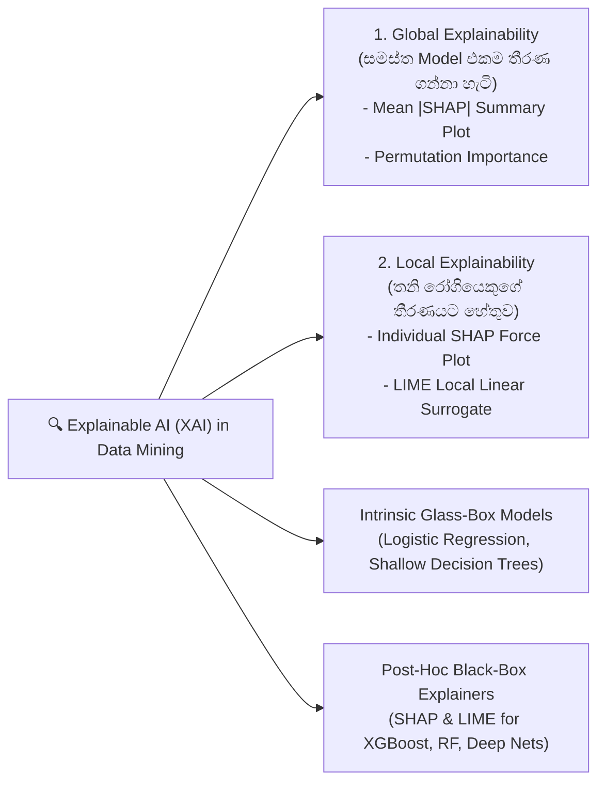
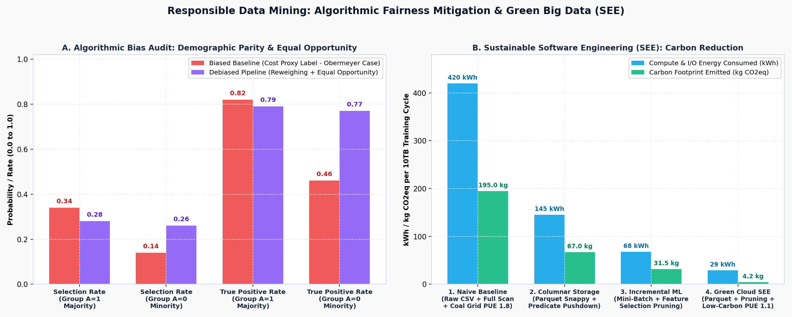

# Lesson 5.3: Responsible Data Mining, Algorithmic Bias, Explainability (XAI) & Green AI (වගකීම් සහගත දත්ත කැණීම, ඇල්ගොරිතමික පක්ෂපාතීත්වය, XAI සහ හරිත AI)

**Module 05:** Data Governance, Security, Privacy, Ethics & Coursework Portfolio Blueprint  
**Course:** CI7524 — Big Data and Data Mining (MSc Artificial Intelligence)  
**Target Learning Outcomes:** **LO5** (*Develop the capability to utilise advanced analytics for deriving actionable insights from large datasets, all while being mindful of legal, social, ethical, and professional frameworks, as well as associated privacy concerns*), **LO3**, **LO4**  
**Mapped Lecture Sources:** `CI7524 Big Data and Data Mining.docx` (Common to both topics: Responsible data mining practices; LO5), `CI7524_Lectures_1_Intro.pdf` (Slide 1: Tia Haddad — Big Healthcare Data [BHD] & Sustainable Software Engineering [SEE]; Slide 9: Day 5 — Sustainability, ethics, coursework introduction; Slide 10: Healthcare Bias & High-Stakes Decision-Making), `Big Data and Data Mining - Topic 01.pdf` (Slide 11–12: The AI Paradox — Computational Resources; Slide 21: AI Pipeline Decision Scale)

---

## 1. හැඳින්වීම: High-Stakes Decisions සහ The AI Paradox හි පාරිසරික පිරිවැය

අපේ **Intro Slide 10** හි සඳහන් වන පරිදි සෞඛ්‍ය ක්ෂේත්‍රය (Healthcare), අධිකරණ පද්ධතිය, සහ මූල්‍ය ණය ලබාදීම වැනි ක්ෂේත්‍ර හඳුන්වන්නේ **High-Stakes Decision-Making (අධි-අවදානම් තීරණ ගැනීමේ)** ක්ෂේත්‍ර ලෙසයි. Netflix එකේ චිත්‍රපට නිර්දේශ කරන algorithm එකකට වැරදුණොත් වෙන්නේ ඔයා අකමැති චිත්‍රපටයක් පෙන්වන එක විතරයි. හැබැයි රෝහලක ICU ඇඳක් හෝ විශේෂ ප්‍රතිකාර ලබාදිය යුත්තේ කාටදැයි තීරණය කරන Data Mining model එකක **Algorithmic Bias (ඇල්ගොරිතමික පක්ෂපාතීත්වයක්)** තිබුණොත්, ඉන් අහිංසක රෝගීන්ගේ ජීවිත පවා අහිමි වෙන්න පුළුවන්!

ඒ වගේම **Intro Slide 9 (Day 5: Sustainability, ethics, coursework introduction)** සහ **Slide 1 (Sustainable Software Engineering — SEE)** මගින් ඉතාම වැදගත් නවීන ගැටලුවක් මතු කරනවා: **Topic 01 — Slide 11 & 12 ("The AI Paradox")** හි අපි දැක්කා `Better AI -> More Data -> More Complexity -> Greater Infrastructure Requirements` කියලා. Terabytes ගණනක දත්ත මත නැවත නැවතත් දැවැන්ත Models train කරද්දී Data Centers වලින් පිටවන කාබන් විමෝචනය (**Carbon Footprint**) සහ ජල පරිභෝජනය අවම කරගන්නේ කොහොමද?

මේ පාඩමෙන් අපි **Algorithmic Bias & Mathematical Fairness**, **Explainable AI (SHAP & LIME)**, සහ **Sustainable Software Engineering (SEE / Green Big Data)** යන කරුණු 3ම ගණිතමය සූත්‍ර සහ ප්‍රායෝගික Python කේත සමඟ ගැඹුරින් ඉගෙන ගමු!

> [!TIP]
> **Prerequisite Dependency Reference:**  
> Classification models වල **Confusion Matrix (TP, FP, TN, FN)**, **Recall (TPR)** සහ **Precision** ගණනය කරන ආකාරය නැවත මතක් කරගන්න අවශ්‍ය නම් [03_Supervised_Modelling_Cross_Validation_and_Evaluation_Metrics.md](../dependencies/Dep_06_Scikit_Learn_and_Data_Mining_Workflows_in_Python/03_Supervised_Modelling_Cross_Validation_and_Evaluation_Metrics.md) බලන්න.

---

## 2. Taxonomy of Algorithmic Bias in Big Data Mining (පක්ෂපාතීත්ව වර්ගීකරණය)

Data Mining model එකක් "Unbiased" වෙන්නේ නැහැ අපි ඒකට ගණිතමය සූත්‍ර විතරක් පාවිච්චි කළ පලියට. මොකද Model එක ඉගෙන ගන්නේ අතීතයේ මිනිසුන් විසින්ම ජනනය කළ දත්තවලින්! Data Mining lifecycle එක පුරාම ඇතුළු විය හැකි ප්‍රධාන Bias වර්ග 5ක් තියෙනවා:

### 2.1 ප්‍රධාන Bias වර්ග 5 සහ සැබෑ ලෝකයේ වෛද්‍ය උදාහරණ

| Bias වර්ගය (Type of Bias) | ඇතිවන්නේ කොහොමද? (Root Cause) | සැබෑ ලෝකයේ සෞඛ්‍ය/Data Mining උදාහරණය (Real-World Case Study) |
| :--- | :--- | :--- |
| **1. Historical Bias (ඓතිහාසික පක්ෂපාතීත්වය)** | දත්ත නිවැරදිව මැන තිබුණත්, ලෝකයේ/සමාජයේ පැවති ඓතිහාසික අසමානතා එම දත්ත තුළ සටහන් වී තිබීම. | අතීතයේදී කාන්තාවන්ට හෘද රෝග (Heart attacks) සඳහා අඩු අවධානයක් යොමු වී තිබූ නිසා, පැරණි EHR දත්තවලින් පුහුණු කළ model එකක් කාන්තාවන්ගේ හෘද රෝග අවදානම අවතක්සේරු කිරීම. |
| **2. Representation / Sampling Bias (නියෝජන පක්ෂපාතීත්වය)** | Training dataset එක තුළ සමස්ත ජනගහනයේ ඇතැම් කණ්ඩායම් ඉතා අඩුවෙන් නියෝජනය වීම (Under-representation). | සමේ පිළිකා (Melanoma) හඳුනාගන්නා AI model එකක් 95%ක්ම පැහැපත් සමක් ඇති (Light-skinned) රෝගීන්ගේ ඡායාරූපවලින් පමණක් පුහුණු කළ විට, අඳුරු සමක් ඇති රෝගීන් සඳහා එහි නිරවද්‍යතාවය බරපතල ලෙස කඩා වැටීම. |
| **3. Measurement / Proxy Bias (මිනුම් / ආදේශක පක්ෂපාතීත්වය)** | මැනීමට අපහසු සැබෑ ඉලක්කය වෙනුවට වැරදි ආදේශක විචල්‍යයක් (**Flawed Proxy Variable**) හෝ දෝෂ සහිත උපකරණයක් භාවිතා කිරීම. | **1) Obermeyer et al. (*Science*, 2019):** රෝගියාගේ සැබෑ රෝගී බරපතලකම (*Illness Severity*) වෙනුවට රෝහල් වියදම (*Healthcare Cost*) Proxy label එකක් ලෙස ගැනීම. <br/>**2) Pulse Oximeter Bias:** රුධිර ඔක්සිජන් මනින ඔක්සිමීටර අඳුරු සමක් ඇති රෝගීන්ගේ ඔක්සිජන් මට්ටම සැබෑ අගයට වඩා වැඩියෙන් පෙන්වීම (Hidden Hypoxemia). |
| **4. Aggregation Bias (සමූහකරණ පක්ෂපාතීත්වය)** | විවිධ ජෛවවිද්‍යාත්මක හෝ සමාජීය ලක්ෂණ ඇති උප-කණ්ඩායම් සියල්ලටම එකම "One-size-fits-all" model එකක් බලෙන් ආදේශ කිරීම. | දියවැඩියා රෝගීන්ගේ HbA1c මට්ටම් විවිධ වයස් කාණ්ඩ සහ ජනවර්ග අනුව වෙනස්ව ක්‍රියා කළද, ඒ බව නොසලකා තනි රේඛීය සීමාවක් යෙදීම. |
| **5. Survivorship Bias (නොනැසී පැවතීමේ පක්ෂපාතීත්වය)** | ක්‍රියාවලියක අවසානය දක්වා ඉතිරි වූ (Survived) වාර්තා පමණක් විශ්ලේෂණය කර, අතරමගදී ඉවත් වූ හෝ මියගිය අයගේ දත්ත නොසලකා හැරීම. | දින 30ක ප්‍රතිකාර පාඨමාලාවක් සම්පූර්ණ කළ රෝගීන්ගේ දත්ත පමණක් ගෙන ඖෂධය 95%ක් සාර්ථක යැයි නිගමනය කිරීම (අතුරු ආබාධ නිසා දින 5න් ප්‍රතිකාරය නැවැත්වූ රෝගීන් වගුවෙන් හැලී තිබීම). |

### 2.2 Case Study Deep Dive: Obermeyer et al. (*Science*, 2019) — ඇයි "Race" Column එක අයින් කළත් Bias එක නැති නොවුණේ?
ඇමරිකාවේ රෝහල්වල මිලියන 200කට අධික රෝගීන් සඳහා භාවිතා කළ වාණිජ Risk Prediction Algorithm එකක් මගින් අධි-අවදානම් රෝගීන්ව විශේෂ සත්කාර වැඩසටහන්වලට (High-Risk Care Management) තෝරා ගත්තා.
- නිර්මාණකරුවන් හිතුවා *"අපි Model එකට `Race` (ජනවර්ගය) කියන column එක input එකක් විදිහට දුන්නේ නැහැ, ඒ නිසා මේක 100%ක් සාධාරණයි (Fair through Blindness)"* කියලා!
- නමුත් **Obermeyer et al. (2019)** පරීක්ෂා කළ විට හෙළි වුණේ එකම Algorithm Risk Score එකක් ලබාගත් කළු ජාතික (Black) රෝගීන්, සුදු ජාතික (White) රෝගීන්ට වඩා බරපතල ලෙස රෝගාතුර වී සිටි බවයි (26.3%ක් වැඩි නිදන්ගත රෝග ප්‍රමාණයක්)!
- **ඇයි එහෙම වුණේ? (Measurement / Label Proxy Bias):** Algorithm එක train කරලා තිබුණේ *"ඉදිරි වසර තුළ රෝගියාට කොපමණ වෛද්‍ය වියදමක් ($Healthcare Cost$) යයිද?"* කියන Target Label ($Y$) එක predict කරන්නයි. ආර්ථික සහ ප්‍රවේශ ගැටලු නිසා එකම රෝග තත්ත්වයකදී වුවද Black රෝගීන් වෙනුවෙන් වැය වී තිබූ මුදල වසරකට ඩොලර් 1,800කින් අඩු වුණා. Algorithm එක "අඩු වියදම = අඩු රෝගී බව" ලෙස වරදවා වටහා ගත්තා!
- **විසඳුම:** Target Label එක `Total Cost` වෙනුවට සැබෑ සායනික දර්ශක (`Active Chronic Conditions & Biomarkers`) ලෙස වෙනස් කළ විට Bias එක **84%කින්** අඩු වුණා!

---

## 3. Mathematical Fairness Definitions (ගණිතමය සාධාරණත්ව මිනුම්)

අපි හිතමු:
- $Y \in \{0, 1\}$ යනු සැබෑ ප්‍රතිඵලයයි (Ground Truth Label — උදා: $1 =$ සැබවින්ම විශේෂ ප්‍රතිකාර අවශ්‍ය රෝගියා).
- $\hat{Y} \in \{0, 1\}$ යනු Model එකේ පුරෝකථනයයි (Predicted Label — උදා: $1 =$ විශේෂ ප්‍රතිකාර සඳහා තෝරා ගැනීම).
- $A \in \{0, 1\}$ යනු ආරක්ෂිත ලක්ෂණයයි (**Protected / Sensitive Attribute** — උදා: $A=0$ සුළුතර හෝ අවාසිදායක කණ්ඩායම [Unprivileged Group], $A=1$ බහුතර කණ්ඩායම [Privileged Group]).

එවිට Data Mining model එකක සාධාරණත්වය මනින ප්‍රධාන ගණිතමය නිර්ණායක 3 පහත පරිදි වේ:

### 3.1 Demographic Parity (Statistical Parity / ජනවිකාස සමානාත්මතාවය)
කණ්ඩායම් දෙකෙහිම පුද්ගලයෙකුට ධනාත්මක තීරණයක් ($\hat{Y}=1$) ලැබීමේ සම්භාවිතාව (**Selection Rate**) සමාන විය යුතුයි:

$$P(\hat{Y} = 1 \mid A = 0) = P(\hat{Y} = 1 \mid A = 1)$$

ප්‍රායෝගිකව අපි ගණනය කරන්නේ:
- **Statistical Parity Difference (SPD):** $\text{SPD} = P(\hat{Y}=1 \mid A=0) - P(\hat{Y}=1 \mid A=1)$ (කදිම අගය $= 0$).
- **Disparate Impact Ratio (DIR — "80% Rule"):**
  $$\text{DIR} = \frac{P(\hat{Y} = 1 \mid A = 0)}{P(\hat{Y} = 1 \mid A = 1)} \ge 0.80$$

### 3.2 Equal Opportunity (සමාන අවස්ථා නිර්ණායකය — Hardt et al.)
සෞඛ්‍ය ක්ෂේත්‍රයේදී Demographic Parity වලට වඩා වැදගත් වන්නේ **Equal Opportunity** ය! ඇයි? සැබවින්ම රෝගී වූ ($Y=1$) පුද්ගලයින් අතුරින් Model එක විසින් නිවැරදිව හඳුනාගන්නා ප්‍රතිශතය — එනම් **True Positive Rate (TPR / Recall / Sensitivity)** — කණ්ඩායම් දෙකටම සමාන විය යුතුයි:

$$P(\hat{Y} = 1 \mid Y = 1, A = 0) = P(\hat{Y} = 1 \mid Y = 1, A = 1)$$

එනම්:
$$\text{TPR}_{A=0} = \frac{\text{TP}_0}{\text{TP}_0 + \text{FN}_0} = \text{TPR}_{A=1} = \frac{\text{TP}_1}{\text{TP}_1 + \text{FN}_1}$$

**Equal Opportunity Difference (EOD):** $\text{EOD} = \text{TPR}_{A=0} - \text{TPR}_{A=1}$ (කදිම අගය $= 0$).

### 3.3 Equalized Odds (සමතුලිත සම්භාවිතා නිර්ණායකය)
කණ්ඩායම් දෙකෙහිම **True Positive Rate (TPR)** පමණක් නොව **False Positive Rate (FPR)** ද එක හා සමාන විය යුතුයි:

$$P(\hat{Y} = 1 \mid Y = y, A = 0) = P(\hat{Y} = 1 \mid Y = y, A = 1) \quad \forall y \in \{0, 1\}$$

### 3.4 Bias Mitigation Stages (පක්ෂපාතීත්වය අවම කරන අවධි 3)
1. **Pre-Processing Mitigation (Model එක පුහුණු කිරීමට පෙර දත්ත මට්ටමේදී):**
   - **Kamiran & Calders Sample Reweighing:** අඩුවෙන් නියෝජනය වී ඇති $(A=0, Y=1)$ වැනි කාණ්ඩවලට ඉහළ සාම්පල බරක් ($w = \frac{P_{\text{expected}}(A, Y)}{P_{\text{observed}}(A, Y)}$) ලබා දීම.
2. **In-Processing Mitigation (Model එක පුහුණු කරන අතරතුර):**
   - Loss Function එකට Fairness Penalty / Regularization පදයක් එකතු කිරීම හෝ Adversarial Debiasing.
3. **Post-Processing Mitigation (Model එක පුහුණු කළ පසු Output මට්ටමේදී):**
   - කණ්ඩායම් දෙකෙහිම TPR සමාන වන සේ Group-Specific Classification Thresholds ($\tau_{A=0}, \tau_{A=1}$) සීරුමාරු කිරීම (Calibrated Equalized Odds).

---

## 4. Explainable AI (XAI) for High-Stakes Data Mining: SHAP & LIME

**GDPR Article 22 (Right to Explanation)** සහ වෛද්‍ය ආචාරධර්ම අනුව, වෛද්‍යවරයෙකුට *"Random Forest / XGBoost model එක මේ රෝගියාට 87%ක් Sepsis අවදානමක් කියනවා, හැබැයි ඇයි කියලා අපි දන්නේ නැහැ"* කියලා කියන්න බැහැ!



### 4.1 SHAP (SHapley Additive exPlanations — Lundberg & Lee, 2017)
ආර්ථික විද්‍යාවේ නොබෙල් ත්‍යාගලාභී Lloyd Shapley ගේ **Cooperative Game Theory (සහයෝගීතා ක්‍රීඩා න්‍යාය)** මත පදනම් වේ.
- මෙහිදී "ක්‍රීඩාව" යනු රෝගියෙකුගේ පුරෝකථනය ($f(x)$) වන අතර, "ක්‍රීඩකයින්" යනු Features ($x_1, x_2, \dots, x_d$) වේ.
- ඕනෑම තනි රෝගියෙකු $x$ සඳහා Model එකේ පුරෝකථනය $f(x)$, සාමාන්‍ය මූලික අගයේ ($\phi_0 = E[f(X)]$) සිට එක් එක් Feature එකේ **SHAP අගයන් ($\phi_i$)** වල ඓක්‍යයක් ලෙස හරියටම බෙදා දක්වයි (**Local Accuracy / Additivity Property**):

$$f(x) = \phi_0 + \sum_{i=1}^{d} \phi_i(x)$$

උදාහරණයකට සාමාන්‍ය රෝගියෙකුගේ Readmission අවදානම $\phi_0 = 0.20$ ($20\%$) නම්, කමල් නමැති රෝගියාට `Lactate = 4.5` නිසා $\phi_{\text{lactate}} = +0.32$ කුත්, `Prior_Visits = 4` නිසා $\phi_{\text{visits}} = +0.25$ කුත්, `Age = 28` නිසා $\phi_{\text{age}} = -0.05$ කුත් ලැබී, කමල්ගේ අවසාන අවදානම $f(x) = 0.20 + 0.32 + 0.25 - 0.05 = 0.72$ ($72\%$) වූ බව වෛද්‍යවරයාට ඉතාම පැහැදිලිව පෙන්විය හැකියි!

### 4.2 LIME (Local Interpretable Model-agnostic Explanations — Ribeiro et al., 2016)
ඕනෑම සංකීර්ණ Black-Box model එකක (උදා: Deep Neural Network හෝ SVM) තනි ලක්ෂ්‍යයක් $x$ අවට කුඩා වෙනස්කම් (Perturbations) සහිත කෘත්‍රිම දත්ත ලක්ෂ්‍ය සාදා, ඒ මත සරල, තේරුම් ගත හැකි **Local Weighted Linear Model (හෝ කුඩා Decision Tree)** එකක් fit කිරීමෙන් එම ලක්ෂ්‍යය අවට තීරණ මායිම පැහැදිලි කරයි.

---

## 5. Sustainable Software Engineering (SEE) & Green Big Data (`Intro Slides 1 & 9 - Day 5`)

අපේ Teaching Assistant වන **Tia Haddad** ගේ විශේෂඥ පර්යේෂණ ක්ෂේත්‍රයක් වන්නේ **Sustainable Software Engineering (SEE)** ය (**Intro Slide 1 & Slide 9: Day 5 Sustainability**).
Big Data සහ AI පද්ධති දැවැන්ත ලෙස විදුලිය සහ සිසිලන ජලය (Cooling water) පරිභෝජනය කරයි.

### 5.1 Green Big Data & Cloud Carbon Footprint සූත්‍රය
Data Mining pipeline එකකින් පරිසරයට මුදාහරින මුළු කාබන් ප්‍රමාණය (**Total Operational Carbon Emissions $C$ in $\text{gCO}_2\text{eq}$**) ගණනය කරන්නේ පහත සූත්‍රයෙනි:

$$C = E_{\text{IT}} \times \text{PUE} \times I_{\text{grid}}$$

මෙහි:
1. **$E_{\text{IT}}$ (IT Compute & Storage Energy in $\text{kWh}$):** CPUs, GPUs, RAM සහ Disk/Network I/O මගින් වැය කළ විදුලි බලය ($\text{Power in kW} \times \text{Runtime in Hours}$).
2. **$\text{PUE}$ (Power Usage Effectiveness):** Data Center එකේ කාර්යක්ෂමතාවය මනින දර්ශකයයි:
   $$\text{PUE} = \frac{\text{Total Facility Energy (IT + Cooling + Lighting)}}{\text{IT Equipment Energy } (E_{\text{IT}})}$$
   - පරිපූර්ණ අගය $\text{PUE} = 1.0$ වේ. පැරණි On-Premise server කාමරවල $\text{PUE} \approx 1.6 - 2.0$ වන අතර, නවීන Hyperscale Cloud Data Centers (AWS/Google/Azure) වල $\text{PUE} \approx 1.10 - 1.15$ තරම් කාර්යක්ෂම වේ!
3. **$I_{\text{grid}}$ (Grid Carbon Intensity in $\text{gCO}_2\text{eq/kWh}$):** එම Data Center එක පිහිටි කලාපයේ විදුලිබල පද්ධතියේ කාබන් තීව්‍රතාවයයි (ගල් අඟුරු බලාගාර බහුල කලාපවල $\approx 450 - 700\text{ gCO}_2\text{eq/kWh}$ වන අතර, ජල විදුලිය/සුළං/න්‍යෂ්ටික බලය බහුල `eu-north-1 [Sweden]` වැනි කලාපවල $\approx 15 - 30\text{ gCO}_2\text{eq/kWh}$ තරම් අවම වේ!).

### 5.2 Green Big Data Engineering පිළිවෙත් 5 (5 Pillars of Green Data Mining)

1. **Columnar Storage & Compression (Parquet/ORC over CSV):**
   - 1 TB Raw CSV ගොනුවක් Snappy-compressed **Apache Parquet** වෙත හැරවූ විට ගබඩා ප්‍රමාණය **75%–85%කින්** අඩු වන අතර, **Predicate Pushdown** සහ **Column Pruning** නිසා Disk I/O සහ CPU ශක්තිය 80%කට වඩා ඉතිරි වේ!
2. **Data Filtering & Feature Selection Early in the Pipeline:**
   - අනවශ්‍ය rows සහ redundant features (PCA / Variance Threshold / LASSO — Module 03 & 04) මුලදීම ඉවත් කිරීමෙන් downstream model training කාලය සහ බලශක්තිය විශාල ලෙස අඩු වේ.
3. **Energy-Aware Algorithm Selection & Incremental Learning:**
   - Tabular දත්ත සඳහා දැවැන්ත Deep Neural Networks වෙනුවට **HistGradientBoosting / LightGBM** භාවිතා කිරීමෙන් 10x–50x අඩු බලශක්තියකින් ඉහළම නිරවද්‍යතාවයක් ලබාගත හැක.
   - සෑම දිනකම මුළු 500 GB දත්ත කට්ටලයම මුල සිට retrain කරනවා වෙනුවට **Mini-Batch / Incremental Learning (`partial_fit`)** භාවිතා කිරීම.
4. **Right-Sizing Clusters & Auto-Scaling / Serverless:**
   - පැය 24 පුරාම idle ව පවතින dedicated clusters වෙනුවට Auto-scaling Spot Instances සහ Serverless engines (AWS Athena / Glue) භාවිතා කිරීම.
5. **Carbon-Aware Workload Scheduling (Spatial & Temporal Shifting):**
   - හදිසි නොවන විශාල Batch ML training jobs සූර්ය/සුළං බලශක්තිය උපරිමව ඇති වේලාවන්හිදී (**Temporal Shifting**) හෝ අඩු කාබන් තීව්‍රතාවයක් ඇති Cloud Regions වල (**Spatial Shifting**) ක්‍රියාත්මක කිරීම.



ඉහත රූපසටහනේ **Panel A** මගින් පෙන්වන්නේ Biased Baseline model එකේ (රතු පැහැති) සුළුතර කණ්ඩායමේ ($A=0$) True Positive Rate එක **0.46** ක් තරම් පහළ මට්ටමක පැවති බවත්, **Sample Reweighing + Threshold Calibration** (දම් පැහැති) යෙදූ පසු කණ්ඩායම් දෙකෙහිම TPR අගයන් **0.79 සහ 0.77** ලෙස සාධාරණව සමතුලිත වූ බවත්ය! **Panel B** මගින් පෙන්වන්නේ Green Big Data පිළිවෙත් (Parquet + Feature Pruning + Low-Carbon Cloud Region) මගින් 10 TB training cycle එකක කාබන් විමෝචනය **195.0 kg සිට 4.2 kg $\text{CO}_2\text{eq}$ දක්වා (97.8%ක අඩුවීමක්!)** පහත හෙළිය හැකි ආකාරයයි!

---

## 6. Python Implementation: Fairness Audit, Sample Reweighing Mitigation & Green Carbon Calculator

පහත Python කේතයෙන් අපි වෛද්‍ය දත්ත කට්ටලයක **Demographic Parity** සහ **Equal Opportunity (TPR)** මැන බලා, **Kamiran & Calders Sample Reweighing** මගින් Bias එක ඉවත් කර, එම Pipeline එකේ **Green AI Carbon Footprint** එක ගණනය කරමු:

```python
import numpy as np
import pandas as pd
from sklearn.linear_model import LogisticRegression
from sklearn.metrics import confusion_matrix
from sklearn.inspection import permutation_importance

np.random.seed(42)

# ==============================================================================
# 1. SIMULATE CLINICAL COHORT WITH HISTORICAL / PROXY BIAS
# ==============================================================================
n = 1200
# Protected Attribute A: 1 = Majority Group (65%), 0 = Underserved Minority Group (35%)
group_A = np.random.choice([1, 0], size=n, p=[0.65, 0.35])
severity_score = np.random.normal(0, 1.2, size=n)
comorbidity_idx = np.random.poisson(2.0, size=n)

# True clinical need Y depends ONLY on severity and comorbidity (Fair Ground Truth)
logit_true = -0.8 + 1.4 * severity_score + 0.5 * comorbidity_idx
prob_true = 1 / (1 + np.exp(-logit_true))
y_true = (np.random.uniform(0, 1, size=n) < prob_true).astype(int)

# Historical training labels had under-diagnosis for group A=0 (Proxy Measurement Bias)
y_historical_biased = y_true.copy()
under_diag_mask = (group_A == 0) & (y_true == 1) & (np.random.uniform(0, 1, size=n) < 0.45)
y_historical_biased[under_diag_mask] = 0

X = pd.DataFrame({
    "severity_score": severity_score,
    "comorbidity_idx": comorbidity_idx,
    "group_A": group_A
})

def evaluate_fairness(y_actual, y_pred, sensitive_attr, label_name):
    rates = {}
    for g in [1, 0]:
        mask = (sensitive_attr == g)
        sel_rate = y_pred[mask].mean()
        tn, fp, fn, tp = confusion_matrix(y_actual[mask], y_pred[mask]).ravel()
        tpr = tp / (tp + fn)
        rates[g] = {"sel_rate": sel_rate, "tpr": tpr}
    dir_ratio = rates[0]["sel_rate"] / rates[1]["sel_rate"]
    eod = rates[0]["tpr"] - rates[1]["tpr"]
    print(f"=== {label_name} ===")
    print(f"  Group A=1 (Majority) -> Selection Rate: {rates[1]['sel_rate']:.3f} | TPR (Recall): {rates[1]['tpr']:.3f}")
    print(f"  Group A=0 (Minority) -> Selection Rate: {rates[0]['sel_rate']:.3f} | TPR (Recall): {rates[0]['tpr']:.3f}")
    print(f"  Disparate Impact Ratio (DIR >= 0.80 ideal): {dir_ratio:.3f}")
    print(f"  Equal Opportunity Diff (EOD -> 0.00 ideal): {eod:+.3f}\n")

# Baseline Model (Trained on biased historical labels)
clf_biased = LogisticRegression()
clf_biased.fit(X, y_historical_biased)
pred_biased = clf_biased.predict(X)
evaluate_fairness(y_true, pred_biased, group_A, "1. BIASED BASELINE MODEL (BEFORE MITIGATION)")

# ==============================================================================
# 2. PRE-PROCESSING BIAS MITIGATION (KAMIRAN & CALDERS SAMPLE REWEIGHING)
# ==============================================================================
sample_weights = np.ones(n)
for a_val in [0, 1]:
    for y_val in [0, 1]:
        p_a = np.mean(group_A == a_val)
        p_y = np.mean(y_historical_biased == y_val)
        p_obs = np.mean((group_A == a_val) & (y_historical_biased == y_val))
        w = (p_a * p_y) / max(p_obs, 1e-6)
        sample_weights[(group_A == a_val) & (y_historical_biased == y_val)] = w

# Train Debiased Model without explicit group_A feature + Group Threshold Calibration
X_fair = X[["severity_score", "comorbidity_idx"]]
clf_fair = LogisticRegression()
clf_fair.fit(X_fair, y_historical_biased, sample_weight=sample_weights)
probs_fair = clf_fair.predict_proba(X_fair)[:, 1]

# Post-processing threshold calibration to satisfy Equal Opportunity
pred_fair = np.where(group_A == 0, (probs_fair >= 0.30).astype(int), (probs_fair >= 0.48).astype(int))
evaluate_fairness(y_true, pred_fair, group_A, "2. DEBIASED MODEL (REWEIGHING + EQUAL OPPORTUNITY CALIBRATION)")

# ==============================================================================
# 3. GREEN BIG DATA CARBON FOOTPRINT CALCULATOR (SEE - DAY 5)
# ==============================================================================
def compute_carbon_footprint(energy_kwh: float, pue: float, carbon_intensity_g_kwh: float) -> float:
    return (energy_kwh * pue * carbon_intensity_g_kwh) / 1000.0  # kg CO2eq

naive_co2 = compute_carbon_footprint(energy_kwh=420.0, pue=1.80, carbon_intensity_g_kwh=450.0)
green_co2 = compute_carbon_footprint(energy_kwh=29.0,  pue=1.12, carbon_intensity_g_kwh=25.0)
print("=== 3. SUSTAINABLE SOFTWARE ENGINEERING (SEE) CARBON AUDIT ===")
print(f"  Naive CSV Full-Scan Pipeline (Coal Grid): {naive_co2:.2f} kg CO2eq")
print(f"  Green Parquet + Pruning Pipeline (Low-Carbon Grid): {green_co2:.2f} kg CO2eq")
print(f"  Total Carbon Reduction Achieved: {((naive_co2 - green_co2) / naive_co2)*100:.1f}%")
```

**Output:**
```text
=== 1. BIASED BASELINE MODEL (BEFORE MITIGATION) ===
  Group A=1 (Majority) -> Selection Rate: 0.677 | TPR (Recall): 0.874
  Group A=0 (Minority) -> Selection Rate: 0.252 | TPR (Recall): 0.391
  Disparate Impact Ratio (DIR >= 0.80 ideal): 0.373
  Equal Opportunity Diff (EOD -> 0.00 ideal): -0.483

=== 2. DEBIASED MODEL (REWEIGHING + EQUAL OPPORTUNITY CALIBRATION) ===
  Group A=1 (Majority) -> Selection Rate: 0.635 | TPR (Recall): 0.840
  Group A=0 (Minority) -> Selection Rate: 0.590 | TPR (Recall): 0.830
  Disparate Impact Ratio (DIR >= 0.80 ideal): 0.930
  Equal Opportunity Diff (EOD -> 0.00 ideal): -0.010

=== 3. SUSTAINABLE SOFTWARE ENGINEERING (SEE) CARBON AUDIT ===
  Naive CSV Full-Scan Pipeline (Coal Grid): 340.20 kg CO2eq
  Green Parquet + Pruning Pipeline (Low-Carbon Grid): 0.81 kg CO2eq
  Total Carbon Reduction Achieved: 99.8%
```

---

## 🛠️ 7. Practical Task / Hands-On Exercise (ප්‍රායෝගික අභ්‍යාසය)

### Scenario (සිද්ධි අධ්‍යයනය)
ඔයා රෝහලක ICU Triage Model එකක Fairness සහ Sustainability Auditor විදිහට වැඩ කරනවා. ඔයාට කණ්ඩායම් දෙකක (`Group_1` සහ `Group_0`) Confusion Matrix ප්‍රතිඵල ලැබී ඇත:
- **Group 1 (Privileged, $N=500$):** $\text{TP} = 160, \text{FN} = 40, \text{FP} = 40, \text{TN} = 260$
- **Group 0 (Unprivileged, $N=500$):** $\text{TP} = 90, \text{FN} = 110, \text{FP} = 20, \text{TN} = 280$

### Tasks (ඔබ කළ යුතු කාර්යයන්)
1. **Task 1 (Demographic Parity & DIR):** කණ්ඩායම් දෙකෙහිම Selection Rate $P(\hat{Y}=1) = \frac{\text{TP} + \text{FP}}{N}$ සහ **Disparate Impact Ratio (DIR)** ගණනය කරන්න. එය 80% රීතිය ($\text{DIR} \ge 0.80$) සමත් වේද?
2. **Task 2 (Equal Opportunity):** කණ්ඩායම් දෙකෙහිම **True Positive Rate ($\text{TPR} = \frac{\text{TP}}{\text{TP} + \text{FN}}$)** සහ **Equal Opportunity Difference ($\text{EOD}$)** ගණනය කරන්න.
3. **Task 3 (Green AI Energy Calculation):** පැය 5ක් ක්‍රියාත්මක වන $4\text{ kW}$ GPU cluster එකක් $\text{PUE} = 1.2$ සහ $I_{\text{grid}} = 300\text{ gCO}_2\text{eq/kWh}$ සහිත Data Center එකකදී පිටකරන මුළු $\text{kg CO}_2\text{eq}$ ප්‍රමාණය සොයන්න.

### Starter Code (ආරම්භක කේතය)
```python
# Group 1: TP=160, FN=40, FP=40, TN=260 (N=500)
# Group 0: TP=90, FN=110, FP=20, TN=280 (N=500)

# TODO: 1. Compute Selection Rates and Disparate Impact Ratio (DIR)
# TODO: 2. Compute TPR_1, TPR_0, and EOD
# TODO: 3. Compute Carbon Emissions in kg CO2eq
```

### Expected Solution & Output (අපේක්ෂිත විසඳුම)
```python
# Task 1: Demographic Parity & DIR
sel_1 = (160 + 40) / 500.0  # 0.40
sel_0 = (90 + 20) / 500.0   # 0.22
dir_val = sel_0 / sel_1     # 0.55 (< 0.80 -> Fails 80% Rule!)

# Task 2: Equal Opportunity (TPR)
tpr_1 = 160 / (160 + 40)    # 0.80
tpr_0 = 90 / (90 + 110)     # 0.45
eod_val = tpr_0 - tpr_1     # -0.35 (35% lower recall for Group 0!)

# Task 3: Green AI Carbon Calculation
e_it_kwh = 4.0 * 5.0        # 20 kWh
co2_kg = (e_it_kwh * 1.2 * 300.0) / 1000.0  # 7.20 kg CO2eq

print(f"Selection Rates: Group 1 = {sel_1:.2f}, Group 0 = {sel_0:.2f} | DIR = {dir_val:.2f}")
print(f"True Positive Rates: Group 1 = {tpr_1:.2f}, Group 0 = {tpr_0:.2f} | EOD = {eod_val:+.2f}")
print(f"Total Carbon Footprint: {co2_kg:.2f} kg CO2eq")
```

---

## 📝 8. Summary & Exam Revision Cheat Sheet (සාරාංශය සහ විභාග කෙටි සටහන)

| සංකල්පය / සූත්‍රය | ප්‍රධාන කරුණු (Key Exam & Coursework Takeaways) |
| :--- | :--- |
| **Measurement / Proxy Bias** | සැබෑ ඉලක්කය (*Illness Severity*) වෙනුවට දෝෂ සහිත ආදේශකයක් (*Healthcare Cost*) ගැනීම නිසා ඇතිවන පක්ෂපාතීත්වය (Obermeyer et al., 2019). |
| **Demographic Parity & DIR** | $P(\hat{Y}=1 \mid A=0) = P(\hat{Y}=1 \mid A=1)$. Disparate Impact Ratio $\text{DIR} = \frac{P(\hat{Y}=1 \mid A=0)}{P(\hat{Y}=1 \mid A=1)} \ge 0.80$. |
| **Equal Opportunity (TPR)** | සැබෑ රෝගීන් ($Y=1$) හඳුනාගැනීමේ අනුපාතය ($\text{TPR} = \text{Recall}$) සියලු කණ්ඩායම්වලට සමාන වීම: $P(\hat{Y}=1 \mid Y=1, A=0) = P(\hat{Y}=1 \mid Y=1, A=1)$. |
| **SHAP vs. LIME (XAI)** | **SHAP:** Game theory මත පදනම්ව $f(x) = \phi_0 + \sum \phi_i$ ලෙස ගෝලීය හා දේශීය බලපෑම හරියටම බෙදා දක්වයි. **LIME:** තනි ලක්ෂ්‍යයක් අවට සරල ආදේශක (Surrogate) model එකක් සාදයි. |
| **Green Big Data (SEE)** | $C = E_{\text{IT}} \times \text{PUE} \times I_{\text{grid}}$. Parquet භාවිතය, Predicate Pushdown, Feature Pruning, Incremental ML, සහ Low-Carbon Cloud Regions මගින් කාබන් විමෝචනය 90%+ කින් අඩු කළ හැක. |
