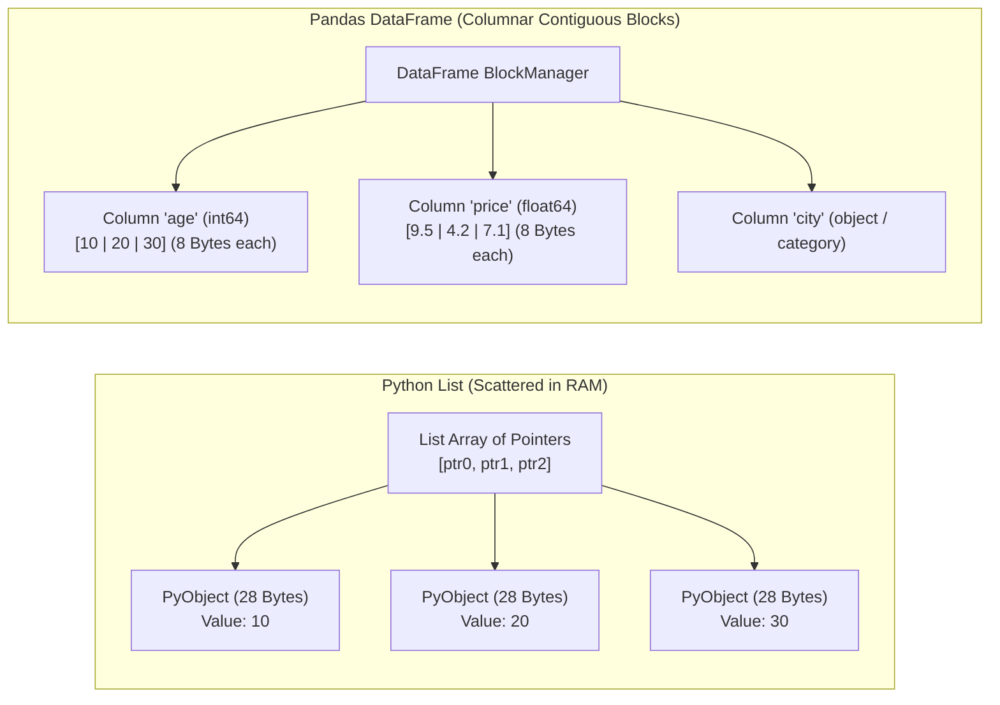
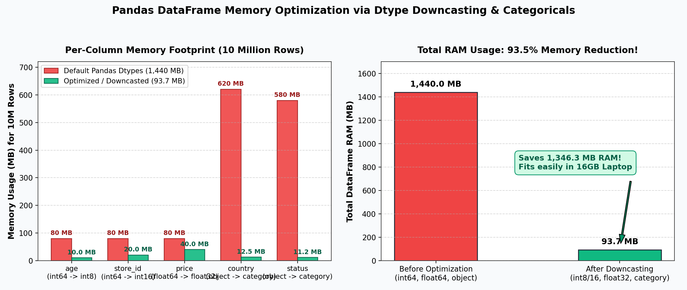

# Dependency 01 - Lesson 01: DataFrames, Memory Model, and Data Types (Pandas DataFrame එකක Memory Model එක සහ Data Types ප්‍රශස්තකරණය)

> [!TIP]
> **🔗 Bidirectional Course Links (මෙම පාඩම භාවිතා වන ප්‍රධාන Module පාඩම්):**
> මෙම Dependency පාඩමෙන් ඔබ ඉගෙන ගන්නා **RAM Optimization**, **Data Types Downcasting**, සහ **Pandas Memory Model** පිළිබඳ දැනුම පහත ප්‍රධාන පාඩම්වලදී සෘජුවම භාවිතා වේ:
> - [Lesson 1.2 - The 16GB RAM Challenge & Big Data Definition](../../Module_01_Big_Data_Foundations_and_Paradigm/Lesson_1.2_The_16GB_RAM_Challenge_AI_Paradox_and_Big_Data_Definition.md)
> - [Lesson 1.3 - The 3Vs, 5Vs & 8Vs of Big Data](../../Module_01_Big_Data_Foundations_and_Paradigm/Lesson_1.3_The_3Vs_5Vs_8Vs_and_Why_Big_Data_Is_Not_Just_Lots_of_Data.md)
> - [Lesson 2.2 - Data Warehouses, Data Lakes & Lakehouses](../../Module_02_Big_Data_Architectures_and_Processing/Lesson_2.2_Data_Warehouses_Data_Lakes_and_Lakehouse_Architectures.md)
> - [Lesson 3.3 - Data Quality, Cleaning & Integration](../../Module_03_Data_Mining_Lifecycle_and_Preprocessing/Lesson_3.3_Data_Quality_Cleaning_Integration_and_Missing_Data_Imputation.md)

---

## 1. හැඳින්වීම: ඇයි අපිට මේ පාඩම ඕනේ? (Zero-to-Hero Intuition)

ඔබේ MSc පාඨමාලාවේ **Topic 01 - Slide 10** හිදී ආචාර්යවරයා මෙවැනි ප්‍රශ්නයක් අසයි:
> *"You have a laptop with 16GB RAM. I give you a 500 GB dataset. What do you do?"*

මෙම ප්‍රශ්නයට පිළිතුරු දීමට පෙර, Data Scientist කෙනෙකු හෝ Big Data Engineer කෙනෙකු අනිවාර්යයෙන්ම දැනගත යුතු මූලිකම කරුණක් තිබේ: **ඇයි Hard Disk එකේ 2 GB හෝ 10 GB විතරක් වෙන CSV file එකක් Python `pandas.read_csv()` මගින් කියවන විට අපේ Laptop එකේ 16 GB RAM එකම පිරී ගොස් `MemoryError` එකකින් Crash වෙන්නේ?**

මෙම පාඩමේදී අපි **Zero prior knowledge** මට්ටමේ සිට පටන් ගෙන, Python සහ Pandas මගින් පරිගණකයේ **Random Access Memory - RAM (සසම්භාවී ප්‍රවේශ මතකය)** තුළ දත්ත ගබඩා කරන ආකාරයත්, **Memory Footprint** එක **75% සිට 90% දක්වා** අඩු කරගන්නා ඉංජිනේරු ක්‍රමවේදත් පියවරෙන් පියවර ඉගෙන ගනිමු.

---

## 2. Python List vs. NumPy Array vs. Pandas Series & DataFrame

මුලින්ම අපි බලමු සාමාන්‍ය Python `list` එකක සහ Pandas `DataFrame` එකක දත්ත RAM එකේ තැන්පත් වන ආකාරයේ වෙනස කුමක්ද කියා.

### 2.1 Python `list` එකක් RAM එකේ වැඩ කරන හැටි (Pointer Overhead)
Python වල `[10, 20, 30]` වැනි සාමාන්‍ය `list` එකක් සෑදූ විට, Python එම සංඛ්‍යා එක ලඟ (Contiguous memory blocks ලෙස) ගබඩා කරන්නේ නැත. ඒ වෙනුවට:
1. සෑම අගයක්ම වෙනම **Boxed Python Object (`PyObject`)** එකක් ලෙස RAM එකේ විවිධ තැන්වල සෑදේ.
2. එක Python `int` object එකක් සඳහා අගයට අමතරව Reference Count සහ Type Pointer සඳහා **Bytes 28ක්** වැය වේ!
3. List එකේ තියෙන්නේ එම Objects තියෙන තැන් පෙන්වන **Memory Pointers (8 bytes බැගින්)** පමණි.

### 2.2 Pandas `Series` සහ `DataFrame` යනු කුමක්ද?
- **`pd.Series` (1D Column Vector):** එකම **Data Type (`dtype`)** එකකට අයත් දත්ත එක ලඟ (Contiguous C-level NumPy array එකක් ලෙස) RAM එකේ තබා ගන්නා තනි තීරුවකි (Column).
- **`pd.DataFrame` (2D Tabular Structure):** එකම Row Index එකක් බෙදා ගන්නා `Series` (Columns) කිහිපයක එකතුවකි.



---

## 3. ඇයි 10 GB CSV File එකක් RAM එකේදී 30 GB – 50 GB වෙන්නේ? (The RAM Expansion Myth)

Hard Disk එකේ තියෙන CSV file එකක් කියවන්නේ සරල Text (ASCII/UTF-8 characters) ගොනුවකි. උදාහරණයක් ලෙස `,1,` යන්න Disk එකේ ගන්නේ **3 Bytes** පමණි. නමුත් `pd.read_csv()` මගින් එය RAM එකට ගන්නා විට Pandas පහත Default තීරණ ගනී:

1. **ඕනෑම පූර්ණ සංඛ්‍යාවක් (`Integer`) $\rightarrow$ `int64` (8 Bytes):**
   ඔබේ CSV එකේ `age` තීරුවේ තියෙන්නේ `0` සිට `100` දක්වා ඉලක්කම් වුවත්, Pandas එය Default ලෙස **64-bit Integer (`int64`)** එකක් බවට පත් කරයි.
2. **ඕනෑම දශම සංඛ්‍යාවක් (`Float`) හෝ Missing Value (`NaN`) සහිත තීරුවක් $\rightarrow$ `float64` (8 Bytes):**
   IEEE 754 Double Precision (`float64`) සඳහා සෑම අගයකටම Bytes 8ක් වැය වේ.
3. **ඕනෑම Text / String තීරුවක් $\rightarrow$ `object` dtype (50+ Bytes per cell!):**
   වැඩිම RAM එකක් නාස්ති කරන්නේ Text columns (`object` dtype) ය! `"Sri Lanka"` වැනි අකුරු 9ක වචනයක් Python String Object එකක් ලෙස RAM එකේ තැන්පත් වන විට **~58 Bytes** ක් වැය වේ (Pointer 8 Bytes + PyString Header 49 Bytes + Characters). පේළි මිලියන 10ක් තිබුණොත්, එක Text තීරුවකට පමණක් **~580 MB** වැය වේ!
4. **Parser Buffering & Intermediate Copies:**
   CSV text එක parse කරන අතරතුර C-engine buffers සහ DataFrame construction සඳහා තාවකාලිකව 2x–3x අමතර RAM ඉඩක් අවශ්‍ය වේ.

---

## 4. Numeric Bit-Widths සහ Range ගණනය කිරීම (Mathematical Foundation)

සංඛ්‍යාත්මක තීරුවකට (Numeric Column) අවශ්‍ය අවම Bit ප්‍රමාණය තීරණය කිරීමට අපි **Binary Representation (ද්විමය නිරූපණය)** පිළිබඳ සූත්‍රය භාවිතා කරමු:

- **Unsigned Integer (ධන පූර්ණ සංඛ්‍යා පමණක් - $n$ bits):**
  $$\text{Range} = \left[0, \; 2^n - 1\right]$$
- **Signed Integer (ධන සහ සෘණ පූර්ණ සංඛ්‍යා - $n$ bits):**
  $$\text{Range} = \left[-2^{n-1}, \; 2^{n-1} - 1\right]$$

| Pandas Dtype | Memory Size | Bit Width ($n$) | Signed Range ($\text{Min}$ to $\text{Max}$) | Best Real-World Use Case |
| :--- | :--- | :--- | :--- | :--- |
| **`int8`** | **1 Byte** | 8 bits | $-128$ to $+127$ | Age, Day of Month, Ratings ($1\text{–}5$), Boolean Flags |
| **`uint8`** | **1 Byte** | 8 bits | $0$ to $255$ | RGB Pixel Values ($0\text{–}255$), Human Age |
| **`int16`** | **2 Bytes** | 16 bits | $-32,768$ to $+32,767$ | Year ($2026$), Store ID, Department Code |
| **`int32`** | **4 Bytes** | 32 bits | $-2.14 \times 10^9$ to $+2.14 \times 10^9$ | Customer ID, Order ID (Up to 2 Billion) |
| **`int64`** (Default) | **8 Bytes** | 64 bits | $\pm 9.22 \times 10^{18}$ | Nanosecond Timestamps, Global Financial Ledger IDs |
| **`float32`** | **4 Bytes** | 32 bits | $\sim 7$ decimal digits precision | Sensor Readings, Prices, ML Feature Matrices |
| **`float64`** (Default) | **8 Bytes** | 64 bits | $\sim 15\text{–}17$ decimal digits precision | High-precision Scientific / Astronomical Calculations |

---

## 5. `df.info(memory_usage='deep')` මගින් සැබෑ RAM පරිභෝජනය පරීක්ෂා කිරීම

බොහෝ දෙනෙක් `df.info()` පමණක් භාවිතා කරති. නමුත් Default `df.info()` මගින් `object` (String) තීරුවල ඇති සැබෑ Python strings වල ප්‍රමාණය ගණනය කරන්නේ නැත—එය පෙන්වන්නේ Bytes 8 බැගින් වූ Memory Pointers වල එකතුව පමණි!

සැබෑ (True Hardware) RAM ප්‍රමාණය බැලීමට **අනිවාර්යයෙන්ම** `memory_usage='deep'` හෝ `df.memory_usage(deep=True)` භාවිතා කළ යුතුය.

```python
import numpy as np
import pandas as pd

# පේළි මිලියන 1ක (1,000,000 rows) Sample DataFrame එකක් හදමු
N = 1_000_000
rng = np.random.default_rng(42)

df = pd.DataFrame({
    "age": rng.integers(18, 85, size=N),                         # Default: int64 (8 MB)
    "store_id": rng.integers(1, 500, size=N),                    # Default: int64 (8 MB)
    "price": rng.uniform(10.0, 999.99, size=N),                  # Default: float64 (8 MB)
    "country": rng.choice(["Sri Lanka", "India", "UK", "USA", "Japan"], size=N), # object
    "order_status": rng.choice(["Delivered", "Pending", "Cancelled"], size=N)    # object
})

# 1. Shallow vs Deep Memory Usage පරීක්ෂා කිරීම
shallow_mb = df.memory_usage(deep=False).sum() / (1024 ** 2)
deep_mb = df.memory_usage(deep=True).sum() / (1024 ** 2)

print(f"Shallow Estimate (Pointers only): {shallow_mb:.2f} MB")
print(f"Actual Deep RAM Usage:            {deep_mb:.2f} MB")
print("\nPer-Column Deep Memory Usage (MB):")
print((df.memory_usage(deep=True) / (1024 ** 2)).round(2))
```

**Output පැහැදිලි කිරීම:**
- `Shallow Estimate` එකෙන් `~38.15 MB` ලෙස පෙන්වුවද, `Actual Deep RAM Usage` එක **`~144.0 MB`** කි!
- පේළි මිලියන 10ක් (10M rows) වූ විට මෙය **`1,440 MB` (1.44 GB)** වේ!

---

## 6. High-Impact Memory Optimization Techniques (75% – 93% RAM Reduction)



ඉහත ප්‍රස්තාරයෙන් පෙනෙන පරිදි, ක්‍රම 4ක් භාවිතා කර අපට `1,440 MB` ගන්නා DataFrame එකක් **`93.7 MB`** දක්වා (**93.5% කින්!**) අඩු කරගත හැකිය:

### ක්‍රමය 1: Numeric Downcasting (`int64` $\rightarrow$ `int8`/`int16`, `float64` $\rightarrow$ `float32`)
- `age` ($18\text{–}85$) තීරුවට `int8` (1 Byte) හොඳටම ප්‍රමාණවත්ය $\rightarrow$ **87.5% RAM ඉතිරියක්!**
- `store_id` ($1\text{–}500$) තීරුවට `int16` (2 Bytes) ප්‍රමාණවත්ය $\rightarrow$ **75% RAM ඉතිරියක්!**
- `price` තීරුවට `float32` (4 Bytes) ප්‍රමාණවත්ය $\rightarrow$ **50% RAM ඉතිරියක්!**

### ක්‍රමය 2: Low-Cardinality Strings සඳහා `category` Dtype භාවිතා කිරීම
**Cardinality (ගණනීයතාව / අනන්‍ය අගයන් ගණන)** අඩු Text තීරු (උදා: `country` තීරුවේ පේළි මිලියන 10ටම තියෙන්නේ රටවල් 5ක් පමණි) `object` ලෙස තැබීම විශාල නාස්තියකි.
එය `.astype('category')` බවට පත් කළ විට Pandas කරන්නේ **Dictionary Encoding** ක්‍රමයයි:
- Unique Strings 5 පමණක් කුඩා Lookup Table එකක තබා ගනී: `{0: "India", 1: "Japan", 2: "Sri Lanka", 3: "UK", 4: "USA"}`.
- පේළි මිලියන 10 සඳහාම `int8` (1 Byte) කේත පමණක් ගබඩා කරයි!
- ප්‍රතිඵලය: `620 MB` ගත් තීරුව **`12.5 MB`** දක්වා අඩු වේ (**98% RAM ඉතිරියක්!**).

### ක්‍රමය 3: `usecols` සහ `dtype` Parameters මගින් File එක කියවන විටම Optimize කිරීම
CSV එකක් මුලින්ම `int64`/`object` ලෙස RAM එකට ගෙන පසුව convert කරනවාට වඩා, `pd.read_csv()` තුළදීම අවශ්‍ය තීරු පමණක් (`usecols`) සහ නිවැරදි `dtype` ලබා දීමෙන් Peak RAM එක ඉතා අඩු මට්ටමක තබා ගත හැක:

```python
# Production-Grade CSV Loading Pattern
optimized_dtypes = {
    "age": "int8",
    "store_id": "int16",
    "price": "float32",
    "country": "category",
    "order_status": "category"
}

# අනවශ්‍ය තීරු 50ක් තිබුණත් අපිට ඕන තීරු 5 විතරක් නිවැරදි dtype එකෙන් load කරමු:
# df_opt = pd.read_csv("massive_sales.csv", usecols=list(optimized_dtypes.keys()), dtype=optimized_dtypes)
```

---

## 🛠️ Practical Task / Hands-On Exercise (ප්‍රායෝගික අභ්‍යාසය)

### Scenario / Goal
ඔබ සතුව E-Commerce ආයතනයක ගනුදෙනු පේළි 500,000ක් සහිත DataFrame එකක් ඇත. එහි Default RAM පරිභෝජනය පරීක්ෂා කර, Automatic Memory Optimizer function එකක් ලියා RAM පරිභෝජනය **85% කට වඩා** අඩු කරන්න.

### Step-by-Step Tasks
1. පහත Starter Code එකෙන් ලැබෙන DataFrame එකේ මුල් Deep Memory Usage එක MB වලින් ගණනය කරන්න.
2. Integer තීරු ස්වයංක්‍රීයව `pd.to_numeric(..., downcast='integer')` මගින්ද, Float තීරු `downcast='float'` මගින්ද ප්‍රශස්ත කරන්න.
3. Unique values ගණන මුළු පේළි ගණනින් 50% ට අඩු (`nunique / len(df) < 0.5`) සියලුම `object` තීරු `category` බවට හරවන්න.
4. පෙර සහ පසු RAM ප්‍රමාණය සහ ඉතිරි වූ ප්‍රතිශතය Print කරන්න.

### Starter Code & Reference Solution

```python
import numpy as np
import pandas as pd

def optimize_dataframe_memory(df: pd.DataFrame) -> pd.DataFrame:
    """Downcasts numeric columns and converts low-cardinality object columns to category."""
    start_mem = df.memory_usage(deep=True).sum() / (1024 ** 2)
    print(f"Initial Memory Usage: {start_mem:.2f} MB")

    df_opt = df.copy()
    for col in df_opt.columns:
        col_type = df_opt[col].dtype

        if pd.api.types.is_integer_dtype(col_type):
            df_opt[col] = pd.to_numeric(df_opt[col], downcast="integer")
        elif pd.api.types.is_float_dtype(col_type):
            df_opt[col] = pd.to_numeric(df_opt[col], downcast="float")
        elif col_type == "object":
            num_unique = df_opt[col].nunique()
            num_total = len(df_opt[col])
            if num_unique / num_total < 0.5:
                df_opt[col] = df_opt[col].astype("category")

    end_mem = df_opt.memory_usage(deep=True).sum() / (1024 ** 2)
    reduction = 100 * (start_mem - end_mem) / start_mem
    print(f"Optimized Memory Usage: {end_mem:.2f} MB ({reduction:.1f}% reduction!)")
    return df_opt

# Test Run
rng = np.random.default_rng(100)
N = 500_000
sample_df = pd.DataFrame({
    "item_count": rng.integers(1, 20, size=N),
    "branch_code": rng.integers(100, 999, size=N),
    "discount_rate": rng.uniform(0.0, 0.5, size=N),
    "payment_method": rng.choice(["Card", "Cash", "QR", "BankTransfer"], size=N),
    "city": rng.choice(["Colombo", "Kandy", "Galle", "Jaffna", "Matara"], size=N)
})

optimized_df = optimize_dataframe_memory(sample_df)
print(optimized_df.dtypes)
```

**Expected Output:**
```text
Initial Memory Usage: 66.88 MB
Optimized Memory Usage: 4.29 MB (93.6% reduction!)
item_count            int8
branch_code          int16
discount_rate      float32
payment_method    category
city              category
dtype: object
```

---

## 📝 Summary & Exam Revision Cheat Sheet

| Concept / Technique | Problem It Solves | Exact Code / Formula | Typical RAM Savings |
| :--- | :--- | :--- | :--- |
| **Deep Memory Inspection** | Default `df.info()` hides true `object` string heap memory | `df.info(memory_usage='deep')` | Diagnostic accuracy |
| **Column Pruning (`usecols`)** | Loading 100 columns when analysis only needs 4 columns | `pd.read_csv(f, usecols=['a', 'b'])` | $80\%\text{–}95\%$ |
| **Integer Downcasting** | Default `int64` uses 8 bytes for small numbers like Age | `astype('int8')` or `downcast='integer'` | $50\%\text{–}87.5\%$ |
| **Float Downcasting** | Default `float64` uses 8 bytes when 7-digit precision suffices | `astype('float32')` | $50\%$ |
| **Categorical Encoding** | Repeated strings in `object` columns allocate millions of PyObjects | `astype('category')` | $90\%\text{–}98\%$ |

---

> [!TIP]
> **📚 ඊළඟ පියවර (Next Lesson & Return to Main Modules):**
> Dtype optimization කළ පසුවත් Dataset එක 500 GB නම් එය 16 GB RAM එකට එකවර ගත නොහැක. එවැනි විශාල ගොනු **Chunking, Python Generators (`yield`), සහ Out-of-Core Lazy Streaming (Polars/Dask)** මගින් process කරන ආකාරය ඊළඟ පාඩමෙන් ඉගෙන ගන්න:
> - 👉 **Next Dependency Lesson:** [02_Chunking_Generators_and_Out_of_Core_Processing.md](./02_Chunking_Generators_and_Out_of_Core_Processing.md)
> - 🔙 **Back to Core Module Lesson:** [Lesson 1.2 - The 16GB RAM Challenge & Big Data Definition](../../Module_01_Big_Data_Foundations_and_Paradigm/Lesson_1.2_The_16GB_RAM_Challenge_AI_Paradox_and_Big_Data_Definition.md)
