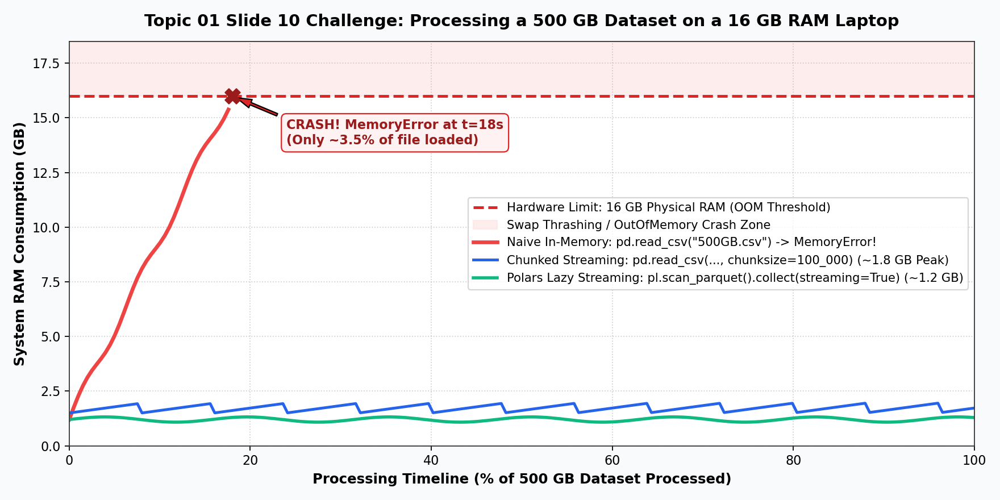
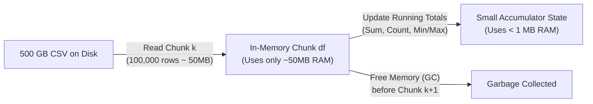
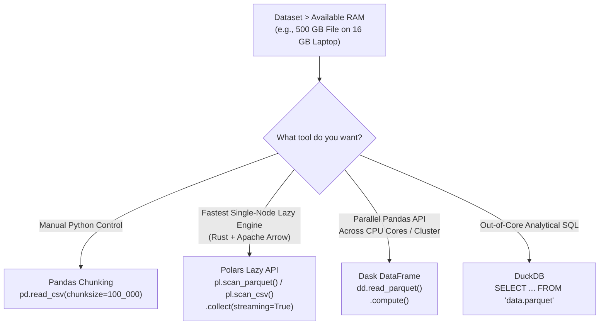

# Dependency 01 - Lesson 02: Chunking, Generators, and Out-of-Core Processing (16GB RAM එකකින් 500GB Dataset එකක් Process කරන ප්‍රායෝගික ක්‍රමවේද)

> [!TIP]
> **🔗 Bidirectional Course Links (මෙම පාඩම භාවිතා වන ප්‍රධාන Module පාඩම්):**
> මෙම පාඩම මගින් **Topic 01 - Slide 10 ("16GB RAM vs 500GB Dataset")** ගැටලුවට අදාළ සම්පූර්ණ ප්‍රායෝගික Python කේත සහ Out-of-Core Processing ආකෘති ආවරණය කරයි:
> - [Lesson 1.2 - The 16GB RAM Challenge & Big Data Definition](../../Module_01_Big_Data_Foundations_and_Paradigm/Lesson_1.2_The_16GB_RAM_Challenge_AI_Paradox_and_Big_Data_Definition.md)
> - [Lesson 1.3 - The 3Vs, 5Vs & 8Vs of Big Data](../../Module_01_Big_Data_Foundations_and_Paradigm/Lesson_1.3_The_3Vs_5Vs_8Vs_and_Why_Big_Data_Is_Not_Just_Lots_of_Data.md)
> - [Lesson 2.2 - Data Warehouses, Data Lakes & Lakehouses](../../Module_02_Big_Data_Architectures_and_Processing/Lesson_2.2_Data_Warehouses_Data_Lakes_and_Lakehouse_Architectures.md)
> - [Lesson 3.3 - Data Quality, Cleaning & Integration](../../Module_03_Data_Mining_Lifecycle_and_Preprocessing/Lesson_3.3_Data_Quality_Cleaning_Integration_and_Missing_Data_Imputation.md)

---

## 1. හැඳින්වීම: The 16GB RAM vs. 500GB Dataset Problem

ඔබේ Laptop එකේ තියෙන්නේ **16 GB RAM** එකකි. නමුත් ඔබට විශ්ලේෂණය කිරීමට ලැබී ඇති Dataset එක **500 GB** විශාලත්වයකින් යුක්තය.
ඔබ සාමාන්‍ය පරිදි `df = pd.read_csv("transactions_500gb.csv")` ලෙස කේතය ලිව්වොත් කුමක් සිදුවේද?

1. තත්පර කිහිපයක් ඇතුළත RAM එක 100% (16 GB) දක්වා පිරී යයි.
2. Operating System එක **Swap Disk / Virtual Memory** පාවිච්චි කිරීමට උත්සාහ කර පරිගණකය සම්පූර්ණයෙන්ම Freeze වේ (**Disk Thrashing**).
3. අවසානයේ Python ක්‍රියාවලිය `MemoryError` හෝ Linux `OOM Killer (SIGKILL)` මගින් නතර කර දමයි.



මෙය ජයගැනීමේ මූලධර්මය හඳුන්වන්නේ **Out-of-Core Processing (හෝ External Memory Processing)** ලෙසයි. එහි අදහස සරලය:
> **"සම්පූර්ණ 500 GB ගොනුවම එකවර RAM එකට ගන්නේ නැතිව, වරකට කුඩා කොටසක් (Chunk / Stream) බැගින් RAM එකට ගෙන, එය Process කර, අවශ්‍ය Summary ප්‍රතිඵලය පමණක් තබාගෙන, පැරණි කොටස RAM එකෙන් ඉවත් කිරීම (Garbage Collection)."**

---

## 2. Python Generators & Lazy Evaluation (`yield` vs `return`)

Out-of-Core processing තේරුම් ගැනීමට පෙර Python හි **Eager Evaluation** සහ **Lazy Evaluation (Generators)** අතර වෙනස තේරුම් ගනිමු.

- **Eager Function (`return`):** සියලුම පේළි මිලියන 100ම එකවර list එකකට දමා RAM එකේ තබාගෙන ආපසු ලබා දෙයි.
- **Generator Function (`yield`):** වරකට **එක පේළියක් හෝ එක කුඩා කොටසක් (Chunk)** පමණක් නිපදවා (`yield`), ඊළඟ කොටස ඉල්ලන තුරු (`next()`) තමන් සිටි තැන මතක තබාගෙන නතර වී සිටියි!

```python
# ❌ BAD (Eager): සම්පූර්ණ file එකේම පේළි RAM එකේ list එකකට ගනී -> MemoryError!
def read_lines_eager(filepath):
    with open(filepath, "r") as f:
        return [line.strip() for line in f]

# ✅ GOOD (Lazy Generator): 500GB file එකක් වුණත් RAM එකේ ගන්නේ එක පේළියක ඉඩ (Bytes කිහිපයක්) පමණි!
def read_lines_lazy(filepath):
    with open(filepath, "r") as f:
        for line in f:
            yield line.strip()
```

---

## 3. Pandas Chunking (`pd.read_csv(..., chunksize=100_000)`)

Pandas හි `pd.read_csv()` ශ්‍රිතයට `chunksize` parameter එක ලබා දුන් විට, එය සම්පූර්ණ DataFrame එකක් ලබා දෙනවා වෙනුවට **`TextFileReader` Iterator (Generator)** එකක් ලබා දෙයි.



### 3.1 Streaming Aggregation Mathematical Rules (Online / Chunked Statistics)
Chunk එකෙන් Chunk එක කියවන විට සම්පූර්ණ Dataset එකේම **Global Mean (සමස්ත මධ්‍යන්‍යය)** සහ **Global Variance (සමස්ත විචලතාව)** නිවැරදිව ගණනය කරන්නේ කෙසේද?

> [!WARNING]
> **වැදගත් ගණිතමය නීතියක්:** එක් එක් Chunk එකේ Mean අගයන් ගෙන ඒවායේ සාමාන්‍යය ගැනීම (`mean of means`) අවසාන Chunk එකේ පේළි ගණන වෙනස් වුවහොත් වැරදි අගයක් ලබා දෙයි! නිවැරදි ක්‍රමය නම් **Sufficient Statistics (ප්‍රමාණවත් සංඛ්‍යාති)** වන $N$ (මුළු ගණන), $\sum x$ (මුළු එකතුව), සහ $\sum x^2$ (වර්ගවල එකතුව) එකතු කර ගැනීමයි:

1. **Global Mean (සමස්ත මධ්‍යන්‍යය - $\mu$):**
   $$\mu = \frac{\sum_{k=1}^{K} S_k}{\sum_{k=1}^{K} N_k} \quad \text{where } S_k = \sum_{i \in \text{Chunk } k} x_i$$

2. **Global Variance (සමස්ත විචලතාව - $\sigma^2$) from Running Sums:**
   $$\sigma^2 = \frac{\sum_{k=1}^{K} Q_k}{N_{\text{total}}} - \mu^2 \quad \text{where } Q_k = \sum_{i \in \text{Chunk } k} x_i^2$$

### 3.2 Complete Runnable Python Pattern for Chunked Processing

```python
import numpy as np
import pandas as pd
from collections import Counter

# උදාහරණය සඳහා Demo CSV එකක් නිර්මාණය කරමු (සැබෑ ජීවිතයේදී මෙය 500GB CSV එකකි)
rng = np.random.default_rng(42)
demo_path = "/tmp/demo_transactions.csv"
pd.DataFrame({
    "region": rng.choice(["Colombo", "Kandy", "Galle", "Jaffna"], size=250_000),
    "amount": rng.uniform(100.0, 5000.0, size=250_000).round(2)
}).to_csv(demo_path, index=False)

# =====================================================================
# STREAMING CHUNK AGGREGATION (Constant ~20MB RAM regardless of file size!)
# =====================================================================
total_count = 0
total_sum = 0.0
total_sq_sum = 0.0
region_revenue = Counter()

# වරකට පේළි 50,000 බැගින් පමණක් RAM එකට ගනී
chunk_iterator = pd.read_csv(
    demo_path,
    chunksize=50_000,
    dtype={"region": "category", "amount": "float64"}
)

for chunk_idx, chunk in enumerate(chunk_iterator, start=1):
    # 1. Update sufficient statistics for Global Mean & Std Dev
    total_count += len(chunk)
    total_sum += chunk["amount"].sum()
    total_sq_sum += (chunk["amount"] ** 2).sum()

    # 2. Update GroupBy totals across chunks
    grouped_chunk = chunk.groupby("region", observed=True)["amount"].sum()
    for reg, val in grouped_chunk.items():
        region_revenue[reg] += val

global_mean = total_sum / total_count
global_var = (total_sq_sum / total_count) - (global_mean ** 2)
global_std = np.sqrt(global_var)

print(f"Processed {total_count:,} rows across {chunk_idx} chunks!")
print(f"Global Mean: {global_mean:.2f} | Global Std Dev: {global_std:.2f}")
print("Total Revenue by Region:", dict(region_revenue))
```

---

## 4. Modern Out-of-Core Engines: Polars, Dask & DuckDB

Pandas Chunking වලදී අපට `for chunk in ...` ලූපය අතින් ලිවීමට සිදුවේ. නමුත් නූතන Big Data පරිසරවලදී මෙය ස්වයංක්‍රීයව (Multi-threaded C++/Rust engines හරහා) සිදු කරන Out-of-Core මෙවලම් 3ක් ඇත:



### 4.1 Polars Lazy Execution (`pl.scan_csv` / `pl.scan_parquet`)
**Polars** යනු Rust භාෂාවෙන් ලියන ලද, Apache Arrow මත පදනම් වූ අතිශය වේගවත් DataFrame පුස්තකාලයකි.
- `pl.read_csv()` වෙනුවට **`pl.scan_csv()`** හෝ **`pl.scan_parquet()`** භාවිතා කළ විට එය දත්ත කිසිවක් RAM එකට ගන්නේ නැත!
- එය මුලින්ම **Query Execution Plan** එකක් සාදා, **Predicate Pushdown** (අවශ්‍ය පේළි පමණක් තේරීම) සහ **Projection Pushdown** (අවශ්‍ය තීරු පමණක් කියවීම) සිදු කර, `.collect(streaming=True)` මගින් Out-of-Core chunks ලෙස සියලුම CPU Cores භාවිතා කරමින් ක්‍රියාත්මක කරයි:

```python
# Polars Out-of-Core Streaming Pattern (Pseudo/Reference Code)
# import polars as pl
#
# lazy_query = (
#     pl.scan_csv("transactions_500gb.csv")
#     .filter(pl.col("amount") > 1000)                  # Predicate Pushdown
#     .group_by("region")
#     .agg([
#         pl.len().alias("tx_count"),
#         pl.col("amount").mean().alias("avg_amount")
#     ])
# )
# # streaming=True මගින් 16GB RAM එක ඇතුළත 500GB ගොනුව process කරයි!
# result_df = lazy_query.collect(streaming=True)
```

### 4.2 Dask DataFrame (`dask.dataframe`)
**Dask** මගින් විශාල DataFrame එකක් කුඩා Pandas DataFrames රාශියකින් සැදුණු **Task Graph (DAG)** එකක් බවට පත් කරයි. `.compute()` කැඳවන තුරු කිසිදු ගණනය කිරීමක් සිදු නොවේ:

```python
# Dask Out-of-Core Pattern (Reference Code)
# import dask.dataframe as dd
#
# ddf = dd.read_csv("transactions_500gb.csv", blocksize="64MB")
# summary = ddf[ddf["amount"] > 1000].groupby("region")["amount"].mean()
# final_result = summary.compute()  # Runs in parallel across CPU cores with bounded RAM!
```

---

## 🛠️ Practical Task / Hands-On Exercise (ප්‍රායෝගික අභ්‍යාසය)

### Scenario / Goal
ඔබට IoT Smart Meters වලින් ලැබුණු විශාල CSV ගොනුවක් ඇත. සම්පූර්ණ ගොනුවම එකවර RAM එකට නොගෙන (`chunksize=20_000` භාවිතා කර), එක් එක් `district` එක සඳහා **Average Power Consumption (`kWh`)** සහ `kWh > 500` වූ **High-Usage Alert Count** එක ගණනය කරන්න.

### Step-by-Step Tasks
1. පහත Starter Code එකෙන් සාදන CSV ගොනුව `chunksize=20_000` මගින් කියවන්න.
2. සෑම Chunk එකකදීම `kWh > 500` වන පේළි ගණන ගණනය කර මුළු එකතුවට (`high_usage_alerts`) එකතු කරන්න.
3. සෑම `district` එකකටම අදාළ මුළු `kWh` එකතුව (`district_sum`) සහ පේළි ගණන (`district_count`) වෙන වෙනම Dictionary/Counter දෙකක පවත්වා ගන්න.
4. සියලුම Chunks අවසන් වූ පසු `district_sum[d] / district_count[d]` මගින් එක් එක් දිස්ත්‍රික්කයේ සැබෑ Global Mean එක ගණනය කරන්න.

### Starter Code & Reference Solution

```python
import numpy as np
import pandas as pd
from collections import Counter

# Generate sample dataset on disk
rng = np.random.default_rng(7)
csv_file = "/tmp/smart_meter_stream.csv"
pd.DataFrame({
    "meter_id": rng.integers(10000, 99999, size=100_000),
    "district": rng.choice(["Colombo", "Gampaha", "Kalutara"], size=100_000),
    "kwh": rng.gamma(shape=2.5, scale=120.0, size=100_000).round(2)
}).to_csv(csv_file, index=False)

# Reference Solution: Streaming Chunk Processor
district_sum = Counter()
district_count = Counter()
high_usage_alerts = 0

for chunk in pd.read_csv(csv_file, chunksize=20_000, usecols=["district", "kwh"]):
    # Count high-usage alerts (> 500 kWh)
    high_usage_alerts += int((chunk["kwh"] > 500.0).sum())

    # Aggregate sum and count per district
    agg = chunk.groupby("district")["kwh"].agg(["sum", "count"])
    for dist, row in agg.iterrows():
        district_sum[dist] += row["sum"]
        district_count[dist] += int(row["count"])

print(f"Total High-Usage Alerts (>500 kWh): {high_usage_alerts:,}")
print("\nExact District Mean kWh (Computed Out-of-Core):")
for dist in sorted(district_sum.keys()):
    exact_mean = district_sum[dist] / district_count[dist]
    print(f"  {dist:10s}: {exact_mean:.2f} kWh (n = {district_count[dist]:,})")
```

---

## 📝 Summary & Exam Revision Cheat Sheet

| Strategy / Tool | Execution Model | How It Handles 500GB on 16GB RAM | Best Used When |
| :--- | :--- | :--- | :--- |
| **`pd.read_csv(f)`** | Eager In-Memory | ❌ Fails with `MemoryError` at ~3–4 GB CSV size | Small datasets ($< 1\text{ GB}$) |
| **Python `yield` Generator** | Lazy Row-by-Row | Streams 1 line at a time ($\sim \text{KB}$ RAM) | Custom unstructured log parsing |
| **`pd.read_csv(f, chunksize=N)`** | Batch Iterator | Processes $N$ rows at a time; updates sufficient stats | Standard Python/Pandas installations |
| **Polars (`pl.scan_parquet`)** | Lazy + Streaming | Multi-threaded Rust engine with query optimization | High-speed single-machine Big Data |
| **Dask DataFrame** | Lazy Task Graph (DAG) | Splits file into partitions across CPU cores / cluster | Scaling Pandas code to multi-node clusters |

---

> [!TIP]
> **📚 ඊළඟ පියවර (Next Lesson & Return to Main Modules):**
> දත්ත RAM එකට හෝ Chunks ලෙස ගත් පසු ඒවා Filter කරන, Clean කරන, Tables දෙකක් Join (`pd.merge`) කරන සහ **Split-Apply-Combine (`groupby`)** මගින් විශ්ලේෂණය කරන ආකාරය ඊළඟ පාඩමෙන් ඉගෙන ගන්න:
> - 👉 **Next Dependency Lesson:** [03_Data_Wrangling_Merging_and_Aggregations_at_Scale.md](./03_Data_Wrangling_Merging_and_Aggregations_at_Scale.md)
> - 🔙 **Back to Core Module Lesson:** [Lesson 1.2 - The 16GB RAM Challenge & Big Data Definition](../../Module_01_Big_Data_Foundations_and_Paradigm/Lesson_1.2_The_16GB_RAM_Challenge_AI_Paradox_and_Big_Data_Definition.md)
