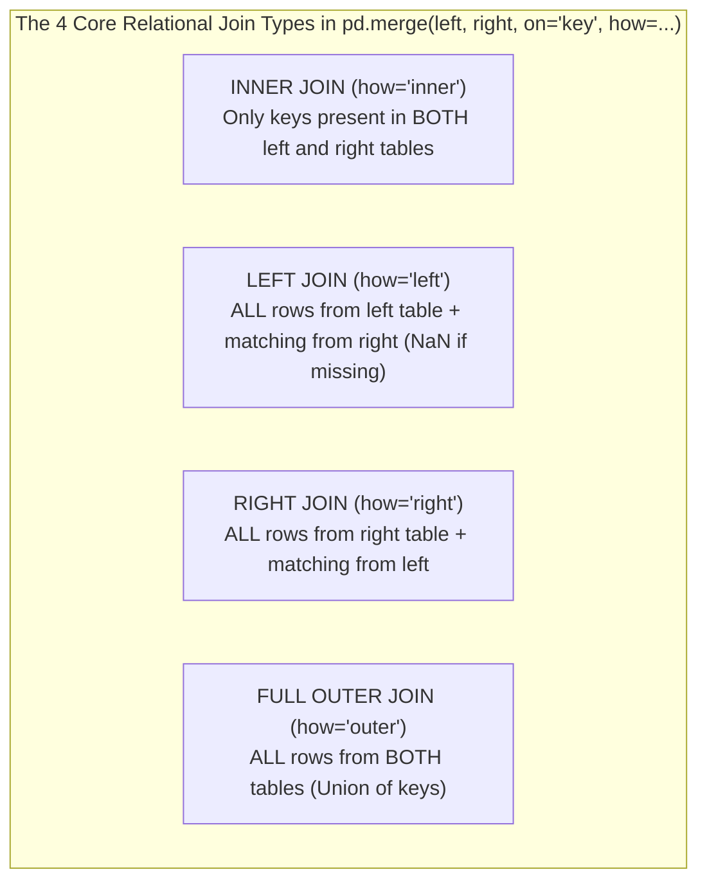
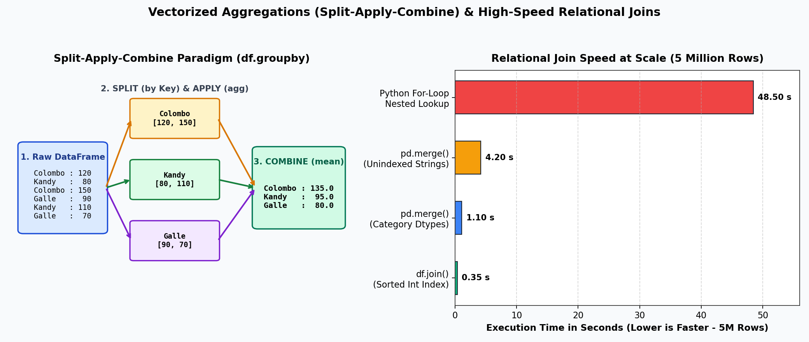

# Dependency 01 - Lesson 03: Data Wrangling, Merging, and Aggregations at Scale (මහා පරිමාණ දත්ත පිරිසිදු කිරීම, Joins සහ Split-Apply-Combine)

> [!TIP]
> **🔗 Bidirectional Course Links (මෙම පාඩම භාවිතා වන ප්‍රධාන Module පාඩම්):**
> Data Mining Lifecycle එකේදී අපතේ යන කාලයෙන් 80%ක්ම වැය වන්නේ **Data Cleaning, Integration (Merging), සහ Feature Aggregation** සඳහාය. මෙම පාඩම පහත ප්‍රධාන පාඩම් සමඟ සෘජුවම සම්බන්ධ වේ:
> - [Lesson 1.2 - The 16GB RAM Challenge & Big Data Definition](../../Module_01_Big_Data_Foundations_and_Paradigm/Lesson_1.2_The_16GB_RAM_Challenge_AI_Paradox_and_Big_Data_Definition.md)
> - [Lesson 1.3 - The 3Vs, 5Vs & 8Vs of Big Data](../../Module_01_Big_Data_Foundations_and_Paradigm/Lesson_1.3_The_3Vs_5Vs_8Vs_and_Why_Big_Data_Is_Not_Just_Lots_of_Data.md)
> - [Lesson 2.2 - Data Warehouses, Data Lakes & Lakehouses](../../Module_02_Big_Data_Architectures_and_Processing/Lesson_2.2_Data_Warehouses_Data_Lakes_and_Lakehouse_Architectures.md)
> - [Lesson 3.3 - Data Quality, Cleaning & Integration](../../Module_03_Data_Mining_Lifecycle_and_Preprocessing/Lesson_3.3_Data_Quality_Cleaning_Integration_and_Missing_Data_Imputation.md)

---

## 1. හැඳින්වීම: ඇයි Python `for` Loops වලින් Dataframes Process කරන්න එපා කියන්නේ? (Vectorization)

ආධුනික සිසුන් බොහෝ විට DataFrame එකක පේළි හරහා යාමට `for index, row in df.iterrows():` භාවිතා කරති. පේළි මිලියන 10ක Dataset එකක `iterrows()` භාවිතා කළහොත් එය අවසන් වීමට **මිනිත්තු 15–30ක්** ගත විය හැක!

ඊට විසඳුම **Vectorization (දෛශිකකරණය)** යි. Vectorized operation එකකදී Python loop එකක් වෙනුවට C/C++ මට්ටමේ **SIMD (Single Instruction, Multiple Data)** CPU උපදෙස් මගින් මුළු තීරුවම එකවර ගණනය කරයි. එය `for` loop එකකට වඩා **100x සිට 1,000x දක්වා වේගවත්ය!**

---

## 2. Vectorized Boolean Filtering, String & Datetime Accessors

### 2.1 Boolean Masking & `.query()`
Pandas වල කොන්දේසි කිහිපයක් එකවර යෙදීමේදී `and`, `or`, `not` වෙනුවට Bitwise Operators වන **`&` (AND)**, **`|` (OR)**, සහ **`~` (NOT)** භාවිතා කළ යුතු අතර, සෑම කොන්දේසියක්ම වරහන් `(...)` තුළ ලිවීම අනිවාර්ය වේ:

```python
import pandas as pd

# Vectorized Boolean Filtering
high_value_colombo = df[(df["city"] == "Colombo") & (df["amount"] >= 5000.0) & (~df["is_cancelled"])]

# හෝ වඩාත් පැහැදිලි SQL-style .query() syntax එක:
high_value_colombo = df.query("city == 'Colombo' and amount >= 5000.0 and not is_cancelled")
```

### 2.2 `.str` සහ `.dt` Vectorized Accessors
- **String Operations (`.str`):** `df["email"].str.lower()`, `df["phone"].str.replace("-", "")`, `df["product"].str.contains("Pro", na=False)`
- **Datetime Operations (`.dt`):**
  ```python
  df["timestamp"] = pd.to_datetime(df["timestamp"])
  df["year"] = df["timestamp"].dt.year
  df["day_of_week"] = df["timestamp"].dt.day_name()
  df["hour"] = df["timestamp"].dt.hour
  ```

---

## 3. Missing Values (`NaN` / `NA`) හඳුනා ගැනීම සහ Imputation (අගයන් ආදේශ කිරීම)

සැබෑ ලෝකයේ දත්තවල (Dirty Data) සංවේදක දෝෂ හෝ පෝරම අසම්පූර්ණ වීම් නිසා හිස් අගයන් (**Missing Values - `NaN`**) බහුලව පවතී.

1. **Detection:** `df.isna().sum()` (එක් එක් තීරුවේ ඇති හිස් අගයන් ගණන) හෝ `df.isna().mean() * 100` (ප්‍රතිශතය).
2. **Deletion (`dropna`):** `df.dropna(subset=["customer_id"])` (අත්‍යවශ්‍ය Primary Key එකක් නැති පේළි ඉවත් කිරීම).
3. **Group-Aware Imputation (කාණ්ඩයට අදාළ මධ්‍යස්ථයෙන් පිරවීම):**
   සමස්ත Dataset එකේම **Mean (මධ්‍යන්‍යය)** එකෙන් හිස්තැන් පුරවනවාට වඩා, අදාළ කාණ්ඩයේ **Median (මධ්‍යස්ථය)** මගින් පිරවීම Outliers (ආන්තික අගයන්) වලට ඔරොත්තු දෙන නිවැරදිම ක්‍රමයයි:

```python
# එක් එක් Product Category එකේ Median මිල මගින් එම Category එකේ Missing Prices පිරවීම:
df["price"] = df["price"].fillna(
    df.groupby("category")["price"].transform("median")
)
```

---

## 4. Relational Joins at Scale (`pd.merge`)

Data Integration අදියරේදී වෙනස් Tables දෙකක් (උදා: `orders` සහ `customers`) පොදු Key එකක් (`customer_id`) මත පදනම්ව එකතු කිරීමට `pd.merge()` භාවිතා වේ.



| Join Type (`how=`) | Mathematical Set Equivalent | Row Behavior | Common Data Mining Use Case |
| :--- | :--- | :--- | :--- |
| **`'inner'`** | Intersection ($L \cap R$) | Drops unmatched rows from both sides | Strict matching where both records must exist |
| **`'left'`** | $L \cup (L \cap R)$ | Preserves 100% of Left table (`fact_table`) | Enriching transactions (`left`) with customer demographics (`right`) |
| **`'right'`** | $R \cup (L \cap R)$ | Preserves 100% of Right table | Symmetric opposite of Left Join |
| **`'outer'`** | Union ($L \cup R$) | Preserves all rows from both tables | Auditing data discrepancies across two systems |

> [!CAUTION]
> **The Many-to-Many Cartesian Explosion Trap (RAM Crash අවදානම!):**
> ඔබ Join කරන Key එක වගු දෙකේම Duplicate වී තිබුණහොත් (**Many-to-Many Join**), වම් වගුවේ එකම Key එක සහිත පේළි 1,000ක් සහ දකුණු වගුවේ පේළි 1,000ක් එකතු වී පේළි $1,000 \times 1,000 = 1,000,000$ ක් සෑදේ! මෙය වැළැක්වීමට සැමවිටම `validate` පරාමිතිය භාවිතා කරන්න:
> `pd.merge(orders, customers, on="customer_id", how="left", validate="many_to_one")`

---

## 5. The Split-Apply-Combine Paradigm (`df.groupby`)

Big Data Analytics සහ Feature Engineering වල හදවත බඳු සංකල්පය වන්නේ Hadley Wickham විසින් හඳුන්වා දුන් **Split-Apply-Combine** ආකෘතියයි.



1. **SPLIT (බෙදීම):** ලබා දුන් Categorical Key එකකට (`city` හෝ `customer_id`) අනුව DataFrame එක කාණ්ඩවලට වෙන් කරයි.
2. **APPLY (ක්‍රියාත්මක කිරීම):** එක් එක් කාණ්ඩය මත ස්වාධීනව ගණනය කිරීමක් (`sum`, `mean`, `std`, `count`, `min`, `max`) සිදු කරයි.
3. **COMBINE (එකතු කිරීම):** ලැබුණු ප්‍රතිඵල සියල්ල නැවත තනි Summary DataFrame එකක් බවට පත් කරයි.

### 5.1 Named Aggregations (`.agg()`) සහ `.transform()` vs `.agg()` වෙනස
- **`.agg()` (Reduces Rows):** කාණ්ඩ ගණනට සමාන පේළි ගණනක් සහිත කුඩා Summary Table එකක් ලබා දෙයි.
- **`.transform()` (Preserves Original Row Count):** කාණ්ඩයේ අගය ගණනය කර, මුල් DataFrame එකේම පේළි ගණනට Broadcast කරයි (උදා: එක් එක් ගනුදෙනුව අදාළ නගරයේ සාමාන්‍ය අගයට වඩා කොපමණ වැඩිදැයි බැලීමට).

```python
import numpy as np
import pandas as pd

# 1. Named Aggregation (.agg) - Clean MSc/Production Standard
city_summary = df.groupby("city", observed=True).agg(
    total_orders=("order_id", "count"),
    total_revenue=("amount", "sum"),
    avg_order_value=("amount", "mean"),
    std_order_value=("amount", "std"),
    unique_customers=("customer_id", "nunique")
).reset_index()

# 2. Window Broadcast (.transform) - Feature Engineering without changing row count!
df["city_mean_amount"] = df.groupby("city")["amount"].transform("mean")
df["amount_zscore_in_city"] = (
    (df["amount"] - df["city_mean_amount"]) / df.groupby("city")["amount"].transform("std")
)
```

### 5.2 Pivot Tables & Rolling Time-Series Windows
- **Pivot Table (`pd.pivot_table`):** Rows සහ Columns දෙකම ඔස්සේ Cross-tabulation සාරාංශයක් ලබා ගැනීමට:
  `pd.pivot_table(df, values="amount", index="city", columns="payment_method", aggfunc="sum", fill_value=0)`
- **Rolling Windows (`.rolling()`):** කාල ශ්‍රේණි (Time-Series) දත්තවල Moving Average ගණනය කිරීමට:
  `df["rolling_7d_avg"] = df.groupby("store_id")["daily_sales"].transform(lambda s: s.rolling(7, min_periods=1).mean())`

---

## 🛠️ Practical Task / Hands-On Exercise (ප්‍රායෝගික අභ්‍යාසය)

### Scenario / Goal
ඔබට සුපිරි වෙළඳසැල් ජාලයක `transactions` වගුවක් සහ `stores` වගුවක් ලබා දී ඇත. `transactions` වගුවේ සමහර `amount` අගයන් `NaN` වී ඇත. ඔබ කළ යුත්තේ දත්ත පිරිසිදු කර, වගු දෙක Join කර, එක් එක් පළාතේ (`province`) කාර්යසාධනය ගණනය කිරීමයි.

### Step-by-Step Tasks
1. `transactions` වගුවේ `amount` හි ඇති `NaN` අගයන් අදාළ `store_id` එකේ **Median (`median`)** අගයෙන් පුරවන්න (`groupby` + `transform`).
2. `transactions` වගුව සහ `stores` වගුව `store_id` මත **Left Join (`how='left'`, `validate='many_to_one'`)** කරන්න.
3. එක් එක් `province` එක සඳහා Named Aggregation මගින් `tx_count`, `total_sales`, සහ `max_sale` ගණනය කරන්න.

### Starter Code & Reference Solution

```python
import numpy as np
import pandas as pd

stores = pd.DataFrame({
    "store_id": [101, 102, 103, 104],
    "province": ["Western", "Western", "Central", "Southern"]
})

transactions = pd.DataFrame({
    "tx_id": [1, 2, 3, 4, 5, 6, 7, 8],
    "store_id": [101, 101, 101, 102, 102, 103, 103, 104],
    "amount": [1000.0, np.nan, 1400.0, 500.0, 700.0, 2000.0, np.nan, 900.0]
})

# Step 1: Group-aware Median Imputation
transactions["amount"] = transactions["amount"].fillna(
    transactions.groupby("store_id")["amount"].transform("median")
)

# Step 2: Safe Left Join with Cardinality Validation
merged_df = pd.merge(
    transactions,
    stores,
    on="store_id",
    how="left",
    validate="many_to_one"
)

# Step 3: Split-Apply-Combine Named Aggregation
province_report = merged_df.groupby("province", as_index=False).agg(
    tx_count=("tx_id", "count"),
    total_sales=("amount", "sum"),
    avg_sale=("amount", "mean"),
    max_sale=("amount", "max")
).sort_values("total_sales", ascending=False)

print(province_report.to_string(index=False))
```

**Expected Output:**
```text
province  tx_count  total_sales  avg_sale  max_sale
 Western         5       4800.0     960.0    1400.0
 Central         2       4000.0    2000.0    2000.0
Southern         1        900.0     900.0     900.0
```

---

## 📝 Summary & Exam Revision Cheat Sheet

| Operation | Function / Syntax | Key Engineering Rule |
| :--- | :--- | :--- |
| **Boolean Filtering** | `df[(df['a'] > 5) & (df['b'] == 'X')]` | Always use `&`, `|`, `~` with parentheses `()` or `df.query()` |
| **Group Imputation** | `df['x'].fillna(df.groupby('g')['x'].transform('median'))` | Avoids global mean distortion; preserves group distribution |
| **Safe Relational Join** | `pd.merge(L, R, on='id', how='left', validate='many_to_one')` | `validate` prevents accidental Cartesian memory explosion |
| **Summary Aggregation** | `df.groupby('g').agg(new_col=('col', 'sum'))` | Collapses rows to 1 row per unique group key |
| **Window Broadcast** | `df.groupby('g')['col'].transform('mean')` | Keeps original row count; ideal for group-relative features |

---

> [!TIP]
> **📚 ඊළඟ Dependency පාඩම් මාලාව (Next Series & Return to Main Modules):**
> ඔබ දැන් **Dependency Series 01 (Python, Pandas & Out-of-Core Data Processing)** සාර්ථකව අවසන් කර ඇත! මීළඟට Big Data ගබඩා කරන **SQL, NoSQL (Document, Key-Value, Columnar, Graph), සහ Apache Parquet** පිළිබඳව **Dependency Series 02** වෙතින් හෝ ප්‍රධාන පාඩම්වලින් ඉගෙන ගන්න:
> - 👉 **Next Dependency Series (`Dep_02`):** [01_Relational_Databases_SQL_and_ACID_vs_BASE.md](../Dep_02_SQL_NoSQL_and_Distributed_Storage_Foundations/01_Relational_Databases_SQL_and_ACID_vs_BASE.md)
> - 🔙 **Back to Core Module Lessons:**
>   - [Lesson 1.2 - The 16GB RAM Challenge & Big Data Definition](../../Module_01_Big_Data_Foundations_and_Paradigm/Lesson_1.2_The_16GB_RAM_Challenge_AI_Paradox_and_Big_Data_Definition.md)
>   - [Lesson 3.3 - Data Quality, Cleaning & Integration](../../Module_03_Data_Mining_Lifecycle_and_Preprocessing/Lesson_3.3_Data_Quality_Cleaning_Integration_and_Missing_Data_Imputation.md)
