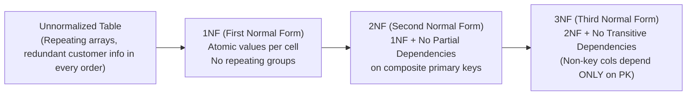
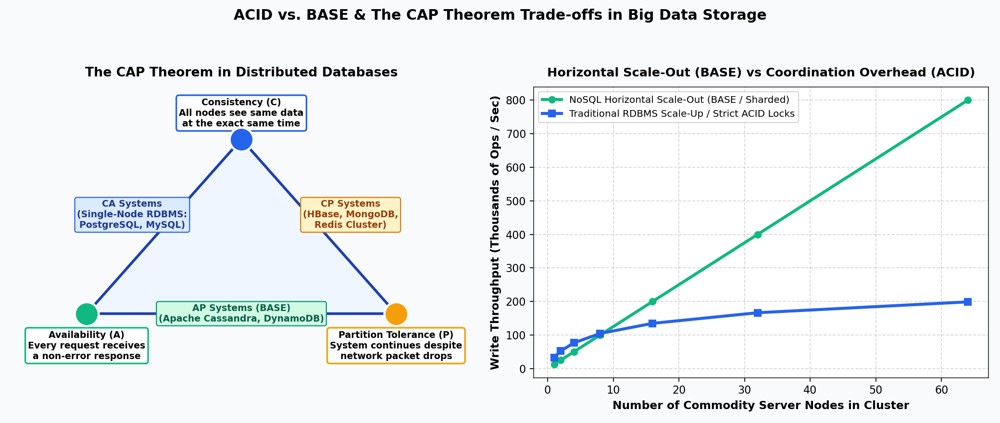

# Dependency 02 - Lesson 01: Relational Databases, SQL, and ACID vs. BASE (RDBMS, Analytical SQL, CAP Theorem සහ ACID vs. BASE)

> [!TIP]
> **🔗 Bidirectional Course Links (මෙම පාඩම භාවිතා වන ප්‍රධාන Module පාඩම්):**
> මෙම පාඩමෙන් ඔබ ඉගෙන ගන්නා **Relational Databases (RDBMS)**, **Analytical SQL**, **ACID Transactions**, **CAP Theorem**, සහ **BASE** පිළිබඳ මූලිකාංග පහත ප්‍රධාන පාඩම්වලදී සෘජුවම භාවිතා වේ:
> - [Lesson 1.2 - The 16GB RAM Challenge & Big Data Definition](../../Module_01_Big_Data_Foundations_and_Paradigm/Lesson_1.2_The_16GB_RAM_Challenge_AI_Paradox_and_Big_Data_Definition.md)
> - [Lesson 1.3 - The 3Vs, 5Vs & 8Vs of Big Data](../../Module_01_Big_Data_Foundations_and_Paradigm/Lesson_1.3_The_3Vs_5Vs_8Vs_and_Why_Big_Data_Is_Not_Just_Lots_of_Data.md)
> - [Lesson 2.2 - Data Warehouses, Data Lakes & Lakehouses](../../Module_02_Big_Data_Architectures_and_Processing/Lesson_2.2_Data_Warehouses_Data_Lakes_and_Lakehouse_Architectures.md)
> - [Lesson 3.3 - Data Quality, Cleaning & Integration](../../Module_03_Data_Mining_Lifecycle_and_Preprocessing/Lesson_3.3_Data_Quality_Cleaning_Integration_and_Missing_Data_Imputation.md)

---

## 1. හැඳින්වීම: Relational Databases (RDBMS) නිර්මාණය වූයේ ඇයි?

1970 දී IBM හි **Edgar F. Codd** විසින් **Relational Model (සම්බන්ධතා ආකෘතිය)** හඳුන්වා දීමට පෙර, දත්ත ගබඩා කළේ Flat Files හෝ සංකීර්ණ Tree ව්‍යුහයන් තුළය. එහිදී එකම පාරිභෝගිකයාගේ ලිපිනය ස්ථාන 50ක ලියැවී තිබුණි (**Data Redundancy - දත්ත අතිරික්තතාව**).

**RDBMS (Relational Database Management System)** එකක් (උදා: PostgreSQL, MySQL, Oracle, SQLite, SQL Server) මගින් දත්ත වගු (**Tables / Relations**) ලෙස සංවිධානය කරයි:
- **Row (Tuple / Record):** එක තනි විෂයයකට හෝ ගනුදෙනුවකට අදාළ සම්පූර්ණ දත්ත පේළිය.
- **Column (Attribute / Field):** නිශ්චිත Data Type එකක් (`INT`, `VARCHAR`, `DECIMAL`, `TIMESTAMP`) සහිත ගුණාංගයක්.
- **Primary Key (PK):** වගුවක සෑම පේළියක්ම අනන්‍යව (Uniquely) හඳුනා ගන්නා තීරුව (උදා: `customer_id`). මෙය කිසිවිටෙක `NULL` හෝ Duplicate විය නොහැක.
- **Foreign Key (FK):** වෙනත් වගුවක Primary Key එකකට යොමු වන (Reference කරන) තීරුව. මෙය වගු දෙකක් අතර **Referential Integrity** ආරක්ෂා කරයි.

---

## 2. Database Normalization (1NF, 2NF, 3NF) vs. Denormalization

දත්ත අනුපිටපත් වීම (Redundancy) සහ Update Anomalies වැළැක්වීමට වගු විධිමත්ව බෙදා වෙන් කිරීමේ ක්‍රියාවලිය **Normalization (සාමාන්‍යකරණය)** ලෙස හැඳින්වේ:



1. **First Normal Form (1NF):** සෑම කොටුවකම (Cell) තිබිය හැක්කේ එක තනි අගයක් (**Atomic Value**) පමණි (එක කොටුවක් ඇතුළත `"077123, 071456"` ලෙස ලැයිස්තු තිබිය නොහැක).
2. **Second Normal Form (2NF):** 1NF සම්පූර්ණ විය යුතු අතර, සියලුම Non-key තීරු සම්පූර්ණ Primary Key එක මතම රඳා පැවතිය යුතුය.
3. **Third Normal Form (3NF):** *"Every non-key attribute must provide a fact about the key, the whole key, and nothing but the key."* (Transitive dependency නොතිබිය යුතුය—උදා: `orders` වගුවේ `customer_city` තබා ගන්නවා වෙනුවට එය `customers` වගුවේ තබා `customer_id` මගින් Link කිරීම).

> [!IMPORTANT]
> **OLTP vs. OLAP (Big Data Context):**
> - එදිනෙදා බැංකු/වෙළඳ ගනුදෙනු කරන **OLTP (Online Transaction Processing)** පද්ධතිවලදී **3NF Normalization** භාවිතා කරයි.
> - නමුත් Data Warehouses (**OLAP - Online Analytical Processing**) වලදී වගු 10ක් JOIN කිරීමට යන කාලය ඉතිරි කර ගැනීමට හිතාමතාම දත්ත **Denormalize (Star Schema / Snowflake Schema)** කරනු ලැබේ!

---

## 3. Core Analytical SQL (Runnable Python `sqlite3` Masterclass)

Big Data සහ Data Mining වලදී SQL භාවිතා වන්නේ දත්ත ඇතුළත් කිරීමට වඩා **Analytical Queries (`GROUP BY`, `HAVING`, `JOIN`, සහ `Window Functions`)** සඳහාය.

SQL Query එකක් අප ලියන පිළිවෙළ (Lexical Order) සහ Database Engine එක එය ඇත්තටම ක්‍රියාත්මක කරන පිළිවෙළ (**Logical Execution Order**) එකිනෙකට වෙනස්ය:
1. `FROM` & `JOIN` (වගු එකතු කිරීම)
2. `WHERE` (පේළි මට්ටමින් Filter කිරීම — Aggregation කිරීමට **පෙර**)
3. `GROUP BY` (කාණ්ඩවලට වෙන් කිරීම)
4. `HAVING` (කාණ්ඩ/Group මට්ටමින් Filter කිරීම — Aggregation කිරීමට **පසුව**)
5. `SELECT` (තීරු සහ Window Functions ගණනය කිරීම)
6. `ORDER BY` & `LIMIT` (පෙළගැස්වීම සහ සීමා කිරීම)

පහත Python කේතය මගින් වෙනම Database Server එකක් නොමැතිව Python තුළම ඇති `sqlite3` මගින් **Analytical SQL සහ Window Functions (`OVER (PARTITION BY ...)`)** ක්‍රියාත්මක කරන ආකාරය බලන්න:

```python
import sqlite3
import pandas as pd

# 1. Create an In-Memory SQLite RDBMS
conn = sqlite3.connect(":memory:")
cur = conn.cursor()

# 2. Create Normalized 3NF Tables (customers & orders) with Foreign Key
cur.executescript("""
CREATE TABLE customers (
    customer_id INTEGER PRIMARY KEY,
    name TEXT NOT NULL,
    city TEXT NOT NULL
);

CREATE TABLE orders (
    order_id INTEGER PRIMARY KEY,
    customer_id INTEGER NOT NULL,
    order_date TEXT NOT NULL,
    amount REAL NOT NULL,
    FOREIGN KEY (customer_id) REFERENCES customers(customer_id)
);

INSERT INTO customers VALUES
    (1, 'Kasun', 'Colombo'),
    (2, 'Nimali', 'Kandy'),
    (3, 'Ruwan', 'Colombo'),
    (4, 'Dilani', 'Galle');

INSERT INTO orders VALUES
    (101, 1, '2026-10-01', 4500.0),
    (102, 1, '2026-10-05', 8200.0),
    (103, 2, '2026-10-02', 3100.0),
    (104, 3, '2026-10-03', 6000.0),
    (105, 3, '2026-10-08', 9500.0),
    (106, 4, '2026-10-09', 1200.0);
""")

# 3. Analytical Query 1: JOIN + GROUP BY + HAVING
query_group = """
SELECT
    c.city,
    COUNT(o.order_id) AS total_orders,
    SUM(o.amount) AS total_revenue,
    ROUND(AVG(o.amount), 2) AS avg_order
FROM customers c
INNER JOIN orders o ON c.customer_id = o.customer_id
WHERE o.amount > 1000.0
GROUP BY c.city
HAVING SUM(o.amount) >= 3000.0
ORDER BY total_revenue DESC;
"""
print("=== 1. GROUP BY + HAVING Analytical Summary ===")
print(pd.read_sql_query(query_group, conn).to_string(index=False))

# 4. Analytical Query 2: SQL Window Functions (OVER PARTITION BY)
query_window = """
SELECT
    o.order_id,
    c.name,
    c.city,
    o.amount,
    ROUND(AVG(o.amount) OVER (PARTITION BY c.city), 2) AS city_avg_amount,
    RANK() OVER (PARTITION BY c.city ORDER BY o.amount DESC) AS rank_in_city
FROM orders o
JOIN customers c ON o.customer_id = c.customer_id;
"""
print("\n=== 2. SQL Window Functions (OVER PARTITION BY) ===")
print(pd.read_sql_query(query_window, conn).to_string(index=False))
```

---

## 4. ACID Transactions vs. The CAP Theorem & BASE



### 4.1 ACID Transactions (සාම්ප්‍රදායික RDBMS වල විශ්වසනීයත්ව සහතිකය)
බැංකු ගිණුමකින් තවත් ගිණුමකට රු. 10,000ක් යවන විට (Account A `-10,000` සහ Account B `+10,000`), අතරමගදී විදුලිය විසන්ධි වුවහොත් මුදල් අතුරුදහන් විය නොහැක. ඒ සඳහා RDBMS මගින් **ACID ගුණාංග 4** සහතික කරයි:

1. **Atomicity (පරමාණුක බව - "All or Nothing"):** ගනුදෙනුවේ (Transaction) සියලුම පියවර 100%ක්ම සාර්ථක විය යුතුය (`COMMIT`), නැතහොත් එක පියවරක් හෝ අසමත් වුවහොත් සියල්ලම මුල් තත්ත්වයට ආපසු හැරවිය යුතුය (`ROLLBACK`).
2. **Consistency (සංගතතාව):** ගනුදෙනුවකට පෙර සහ පසු Database එකේ සියලුම නීති (Primary Keys, Foreign Keys, `CHECK balance >= 0`) ආරක්ෂා විය යුතුය.
3. **Isolation (හුදකලා බව):** එකවර ගනුදෙනු දහසක් (Concurrent Transactions) සිදු වුවද, එක ගනුදෙනුවක අතරමැදි තත්ත්වයන් වෙනත් ගනුදෙනුවකට බාධා නොකළ යුතුය.
4. **Durability (කල්පැවැත්ම):** ගනුදෙනුවක් `COMMIT` වූ පසු, තත්පරයකින් Server එකේ විදුලිය විසන්ධි වුවද, **Write-Ahead Log (WAL)** මගින් එම දත්ත ස්ථිරවම Disk එකේ ආරක්ෂා වී පවතී.

---

### 4.2 ඇයි Big Data වලදී Strict ACID අමාරු වෙන්නේ? — The CAP Theorem
ඔබේ දත්ත ටෙරාබයිට් 500ක් වන විට එය තනි පරිගණකයක (**Vertical Scaling / Scale-Up**) තබා ගත නොහැක. එය ලොව පුරා පිහිටි Server Nodes 100ක් හරහා බෙදා හැරීමට (**Horizontal Scaling / Scale-Out / Sharding**) සිදුවේ.

**Eric Brewer ගේ CAP Theorem (CAP ප්‍රමේයය)** මගින් ඔප්පු කරන්නේ Distributed Data Store එකකට පහත ගුණාංග 3න් **එකවර ලබා දිය හැක්කේ උපරිම වශයෙන් ගුණාංග 2ක් පමණක්** බවයි:

- **C — Consistency (Linearizability / සංගතතාව):** Cluster එකේ ඕනෑම Node එකකින් දත්ත කියවන විට, අවසානයටම Write කළ නවතම දත්තයම සැමට එකවර පෙනිය යුතුය.
- **A — Availability (ලබාගත හැකි බව):** ක්‍රියාත්මක වන ඕනෑම Node එකකට ලැබෙන සෑම Request එකකටම Error එකක් නොමැතිව ප්‍රතිචාරයක් ලැබිය යුතුය.
- **P — Partition Tolerance (ජාල බිඳවැටීම් දරාගැනීමේ හැකියාව):** Nodes අතර Network Cable එකක් හෝ පණිවිඩ හුවමාරුවක් තාවකාලිකව බිඳ වැටුණද (**Network Partition**), පද්ධතිය දිගටම ක්‍රියාත්මක විය යුතුය.

> [!WARNING]
> **CAP Theorem හි ප්‍රායෝගික යථාර්ථය (CP vs. AP):**
> Distributed ජාලයක Network Partitions (`P`) අනිවාර්යයෙන්ම සිදුවිය හැක. එබැවින් `P` අත්හැරිය නොහැක! Network Partition එකක් සිදු වූ මොහොතේදී ඔබට තෝරා ගැනීමට සිදුවන්නේ:
> 1. **CP (Consistency + Partition Tolerance):** දත්ත වැරදි වීම වැළැක්වීමට Partition එක නිවැරදි වන තුරු Writes/Reads ප්‍රතික්ෂේප කරයි (උදා: **HBase, MongoDB, Redis Cluster** — බැංකු සහ Inventory සඳහා).
> 2. **AP (Availability + Partition Tolerance):** පද්ධතිය කිසිවිටෙක නතර නොකර සියලුම Reads/Writes භාර ගනී; තත්පර කිහිපයකට පසු සියලුම Nodes එකම අගයට යාවත්කාලීන වේ (උදා: **Apache Cassandra, Amazon DynamoDB** — Social Media Likes, Shopping Carts, IoT Sensors සඳහා).

---

### 4.3 BASE Philosophy (NoSQL AP Systems වල පදනම)
ACID වලට ප්‍රතිවිරුද්ධව මහා පරිමාණ Distributed NoSQL පද්ධති භාවිතා කරන ආකෘතිය **BASE** ලෙස හැඳින්වේ:
- **BA — Basically Available:** පද්ධතිය සැමවිටම ප්‍රතිචාර දක්වයි ($99.999\%$ Uptime).
- **S — Soft State:** පරිශීලකයෙකු අලුතින් දත්ත ඇතුළත් නොකළද, පසුබිමෙන් Nodes අතර දත්ත Sync වන නිසා පද්ධතියේ තත්ත්වය කාලයත් සමඟ වෙනස් විය හැක.
- **E — Eventual Consistency (අවසානාත්මක සංගතතාව):** අලුත් Write එකක් කළ විගසම ලෝකයේ අනෙක් කෙළවරේ ඇති Node එකකට පැරණි අගය තත්පර භාගයකට පෙනිය හැකි වුවත්, මිලි-තත්පර කිහිපයකින් සියලුම Replicas එකම නිවැරදි අගයට පත් වේ!

---

## 🛠️ Practical Task / Hands-On Exercise (ප්‍රායෝගික අභ්‍යාසය)

### Scenario / Goal
ඔබ සතුව බැංකුවක `accounts` සහ `transactions` වගු සහිත SQLite Database එකක් ඇත. ඔබ කළ යුත්තේ:
1. **ACID Atomic Transaction** එකක් මගින් ගිණුම් දෙකක් අතර මුදල් හුවමාරුවක් (`BEGIN` ... `COMMIT` / `ROLLBACK`) ආරක්ෂිතව සිදු කිරීම.
2. **SQL Window Function (`SUM(...) OVER (PARTITION BY account_id ORDER BY tx_id)`)** භාවිතා කර එක් එක් ගිණුමේ **Running Balance (ක්‍රමික ශේෂය)** ගණනය කිරීම.

### Starter Code & Reference Solution

```python
import sqlite3
import pandas as pd

conn = sqlite3.connect(":memory:")
cur = conn.cursor()

cur.executescript("""
CREATE TABLE accounts (
    account_id INT PRIMARY KEY,
    owner TEXT,
    balance REAL CHECK(balance >= 0)  -- Consistency Constraint: Balance cannot be negative!
);
CREATE TABLE ledger (
    tx_id INTEGER PRIMARY KEY AUTOINCREMENT,
    account_id INT,
    change_amount REAL
);
INSERT INTO accounts VALUES (1, 'Amila', 5000.0), (2, 'Bhanuka', 2000.0);
INSERT INTO ledger (account_id, change_amount) VALUES (1, 5000.0), (2, 2000.0);
""")

def atomic_transfer(conn, from_acc: int, to_acc: int, amount: float):
    try:
        with conn:  # Automatically runs COMMIT on success or ROLLBACK on exception!
            conn.execute("UPDATE accounts SET balance = balance - ? WHERE account_id = ?", (amount, from_acc))
            conn.execute("UPDATE accounts SET balance = balance + ? WHERE account_id = ?", (amount, to_acc))
            conn.execute("INSERT INTO ledger (account_id, change_amount) VALUES (?, ?)", (from_acc, -amount))
            conn.execute("INSERT INTO ledger (account_id, change_amount) VALUES (?, ?)", (to_acc, amount))
        print(f"[SUCCESS] Transferred {amount} from Acc {from_acc} to Acc {to_acc}")
    except sqlite3.IntegrityError as e:
        print(f"[ROLLED BACK!] Atomic Failure ({e}) - No money was lost!")

# Test 1: Valid transfer of 1500.0
atomic_transfer(conn, 1, 2, 1500.0)

# Test 2: Invalid transfer of 99999.0 (Violates CHECK(balance >= 0) -> Triggers ROLLBACK!)
atomic_transfer(conn, 1, 2, 99999.0)

# Running Balance using SQL Window Function
window_sql = """
SELECT
    tx_id,
    account_id,
    change_amount,
    SUM(change_amount) OVER (PARTITION BY account_id ORDER BY tx_id) AS running_balance
FROM ledger
ORDER BY account_id, tx_id;
"""
print("\n=== Ledger Running Balance via SQL Window Function ===")
print(pd.read_sql_query(window_sql, conn).to_string(index=False))
```

---

## 📝 Summary & Exam Revision Cheat Sheet

| Dimension | Traditional RDBMS (SQL / ACID) | Distributed NoSQL (BASE) |
| :--- | :--- | :--- |
| **Data Structure** | Rigid Tables (Rows & Columns, 3NF Normalized) | Flexible (JSON Documents, Key-Value, Column-Family, Graph) |
| **Schema Rule** | **Schema-on-Write** (Must define schema before inserting) | **Schema-on-Read** (Dynamic / Semi-structured fields) |
| **Scaling Strategy** | **Vertical Scaling (Scale-Up):** Bigger CPU/RAM server | **Horizontal Scaling (Scale-Out):** Sharding across 100s of nodes |
| **Transaction Guarantee** | **ACID** (Atomicity, Consistency, Isolation, Durability) | **BASE** (Basically Available, Soft state, Eventual consistency) |
| **CAP Classification** | Single-node **CA** (or strict **CP** in distributed SQL) | Tunable **CP** (MongoDB/HBase) or **AP** (Cassandra/DynamoDB) |

---

> [!TIP]
> **📚 ඊළඟ පියවර (Next Lesson & Return to Main Modules):**
> Big Data වල **Variety (JSON, Logs, Social Networks)** සහ **Velocity (IoT Streams)** හමුවේ RDBMS අසමත් වන තැන්වලදී භාවිතා කරන **NoSQL Database පවුල් 4 (Document, Key-Value, Wide-Column, Graph)** පිළිබඳව ඊළඟ පාඩමෙන් ගැඹුරින් ඉගෙන ගන්න:
> - 👉 **Next Dependency Lesson:** [02_NoSQL_Data_Models_Document_KeyValue_Columnar_Graph.md](./02_NoSQL_Data_Models_Document_KeyValue_Columnar_Graph.md)
> - 🔙 **Back to Core Module Lessons:**
>   - [Lesson 1.3 - The 3Vs, 5Vs & 8Vs of Big Data](../../Module_01_Big_Data_Foundations_and_Paradigm/Lesson_1.3_The_3Vs_5Vs_8Vs_and_Why_Big_Data_Is_Not_Just_Lots_of_Data.md)
>   - [Lesson 2.2 - Data Warehouses, Data Lakes & Lakehouses](../../Module_02_Big_Data_Architectures_and_Processing/Lesson_2.2_Data_Warehouses_Data_Lakes_and_Lakehouse_Architectures.md)
