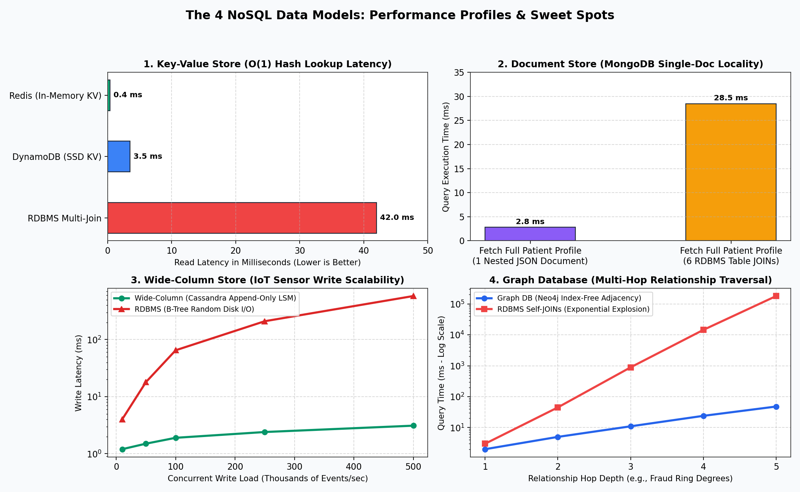
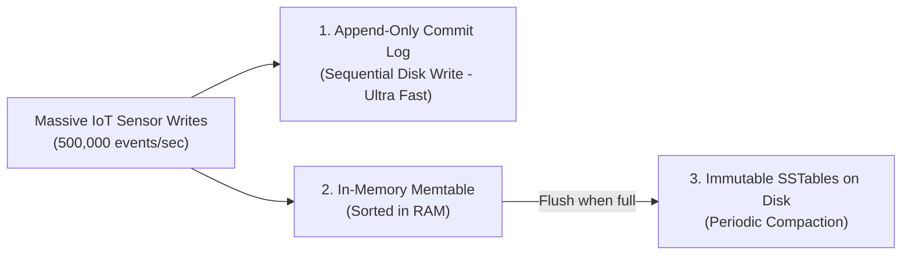

# Dependency 02 - Lesson 02: NoSQL Data Models — Document, Key-Value, Wide-Column, and Graph (NoSQL දත්ත ආකෘති 4 පිළිබඳ ගැඹුරු විමසුම)

> [!TIP]
> **🔗 Bidirectional Course Links (මෙම පාඩම භාවිතා වන ප්‍රධාන Module පාඩම්):**
> මෙම පාඩමෙන් ඔබ ඉගෙන ගන්නා **NoSQL ("Not Only SQL") Data Models 4** පිළිබඳ දැනුම **Topic 01 (Variety & Velocity in Big Data)** සහ **Topic 02 (Big Data Storage Architectures)** සමඟ සෘජුවම සම්බන්ධ වේ:
> - [Lesson 1.2 - The 16GB RAM Challenge & Big Data Definition](../../Module_01_Big_Data_Foundations_and_Paradigm/Lesson_1.2_The_16GB_RAM_Challenge_AI_Paradox_and_Big_Data_Definition.md)
> - [Lesson 1.3 - The 3Vs, 5Vs & 8Vs of Big Data](../../Module_01_Big_Data_Foundations_and_Paradigm/Lesson_1.3_The_3Vs_5Vs_8Vs_and_Why_Big_Data_Is_Not_Just_Lots_of_Data.md)
> - [Lesson 2.2 - Data Warehouses, Data Lakes & Lakehouses](../../Module_02_Big_Data_Architectures_and_Processing/Lesson_2.2_Data_Warehouses_Data_Lakes_and_Lakehouse_Architectures.md)
> - [Lesson 3.3 - Data Quality, Cleaning & Integration](../../Module_03_Data_Mining_Lifecycle_and_Preprocessing/Lesson_3.3_Data_Quality_Cleaning_Integration_and_Missing_Data_Imputation.md)

---

## 1. හැඳින්වීම: ඇයි Big Data වලදී RDBMS විතරක් ප්‍රමාණවත් නැත්තේ?

පසුගිය පාඩමෙන් අපි RDBMS සහ SQL ගැන ඉගෙන ගත්තෙමු. නමුත් 2000 දශකයේ මැද භාගයේදී Google, Amazon, සහ Facebook වැනි ආයතනවලට සාම්ප්‍රදායික RDBMS මගින් විසඳිය නොහැකි ගැටලු 3ක් මතු විය:

1. **The Variety Problem (Schema Rigidity):**
   රෝහලක Electronic Health Record (EHR) පද්ධතියක් හෝ E-Commerce අඩවියක් සිතන්න. එක භාණ්ඩයකට (Laptop) `ram_gb`, `cpu_model` වැනි ගුණාංග ඇති අතර, තවත් භාණ්ඩයකට (T-Shirt) ඇත්තේ `fabric`, `collar_size` වැනි ගුණාංගයි. RDBMS වගුවක මේ සියල්ල දැමුවහොත් 90%ක්ම `NULL` කොටු සහිත **Sparse Matrix** එකක් සෑදේ; නැතහොත් වගු 50ක් JOIN කිරීමට සිදුවේ (**Object-Relational Impedance Mismatch**).
2. **The Velocity & Volume Problem (Horizontal Sharding):**
   තත්පරයකට IoT Sensor readings ලක්ෂ 5ක් ලියන විට තනි RDBMS Master Server එකක Disk I/O සහ B-Tree Index Locks හිර වේ.
3. **The Deep Graph Traversal Problem:**
   සමාජ ජාලයක හෝ මූල්‍ය වංචා ජාලයක (Fraud Ring) 5-වන මට්ටමේ සම්බන්ධතා (`Friends of Friends of Friends...`) සෙවීමට SQL වලදී Self-JOINs 5ක් ලිවීමට සිදුවන අතර එය Exponential ලෙස මන්දගාමී වේ.

මෙම ගැටලු විසඳීමට නිර්මාණය වූ පද්ධති පොදුවේ **NoSQL ("Not Only SQL")** ලෙස හැඳින්වේ. ඒවා ප්‍රධාන **Data Models 4කට** බෙදේ:



---

## 2. Model 1: Key-Value Stores (Redis, Amazon DynamoDB)

### 2.1 ක්‍රියාත්මක වන ආකාරය
මෙය සරලම සහ වේගවත්ම NoSQL ආකෘතියයි. එය හරියටම Python `dict` එකක් හෝ Giant Distributed **Hash Table** එකක් මෙන් ක්‍රියා කරයි:
- සෑම දත්තයකටම අනන්‍ය **Key** එකක් (උදා: `"session:user_9821"`) සහ ඊට අදාළ **Value** එකක් (String, JSON blob, Binary, හෝ Hash) ඇත.
- **Time Complexity:** Key එක මගින් දත්ත සෙවීම (`GET`), ඇතුළත් කිරීම (`SET`), හෝ මැකීම (`DEL`) සඳහා ගතවන්නේ **$O(1)$ Constant Time** (මිලි-තත්පර 1ට අඩු කාලයක්!) පමණි.

### 2.2 කේත උදාහරණය සහ භාවිතා වන අවස්ථා
```python
# Key-Value Store (Redis-style) Conceptual Simulation in Python
kv_store = {}

# SET with O(1) hash lookup (e.g., caching user session & shopping cart)
kv_store["session:usr_1042"] = {
    "jwt_token": "eyJhbGciOi...",
    "cart_items": ["sku_88", "sku_19"],
    "ttl_seconds": 3600
}

# GET in O(1) sub-millisecond time
user_session = kv_store.get("session:usr_1042")
```
- **Best Use Cases:** Real-time Caching (Redis), User Session Management, Shopping Carts, High-speed Leaderboards, Feature Stores for Real-time ML Inference.
- **Limitation:** Value එක ඇතුළත ඇති තනි attribute එකක් මගින් (`WHERE cart_items CONTAINS ...`) සෙවීමට නොහැක (Full Scan කිරීමට සිදුවේ).

---

## 3. Model 2: Document Databases (MongoDB, Couchbase, Firestore)

### 3.1 ක්‍රියාත්මක වන ආකාරය
Key-Value store එකක Value එක Database එකට නොපෙනෙන "Black Box" එකක් වුවද, **Document Database** එකකදී දත්ත ගබඩා කරන්නේ ව්‍යුහගත **JSON / BSON (Binary JSON)** Documents ලෙසය.
- **Data Locality (දත්ත එකම තැනක පැවතීම):** RDBMS එකකදී රෝගියෙකුගේ මූලික තොරතුරු, Lab Reports, සහ Allergies වගු 4ක තබා JOIN කරනවා වෙනුවට, Document DB එකකදී ඒ සියල්ලම **තනි Nested JSON Document එකක්** ලෙස එකම තැනක ගබඩා කරයි!
- **Schema-on-Read:** එකම Collection එකේ ඇති Documents දෙකකට එකිනෙකට වෙනස් Fields තිබිය හැක.
- Document එක ඇතුළත ඇති ඕනෑම Nested Field එකකට (`patient.vitals.heart_rate`) **Secondary Indexes** දමා වේගයෙන් Query කළ හැක.

```json
{
  "_id": "PAT_2026_0089",
  "name": "Nimali Perera",
  "age": 54,
  "allergies": ["Penicillin", "Dust"],
  "wearable_vitals": {
    "resting_hr_bpm": 72,
    "spo2_percent": 98.4
  },
  "lab_history": [
    {"date": "2026-09-10", "test": "HbA1c", "value": 6.1},
    {"date": "2026-11-01", "test": "HbA1c", "value": 5.8}
  ]
}
```
- **Best Use Cases:** Product Catalogs, Healthcare Medical Records (FHIR/JSON), Content Management Systems, Mobile/Web Application Backends.

---

## 4. Model 3: Wide-Column / Column-Family Stores (Apache Cassandra, HBase, Google Bigtable)

### 4.1 ක්‍රියාත්මක වන ආකාරය
මෙය RDBMS වගුවකට මතුපිටින් සමාන වුවත්, ඇතුළතින් ක්‍රියා කරන්නේ **Two-Dimensional Nested Map** එකක් ලෙසය:
$$\left(\text{Row Key / Partition Key}, \; \text{Clustering Key / Timestamp}\right) \longrightarrow \text{Column Family Columns}$$

- **LSM-Tree (Log-Structured Merge-Tree) Architecture:**
  RDBMS එකකදී අලුත් පේළියක් ලියන විට Hard Disk එකේ B-Tree එකක් ඇතුළත Random Seek එකක් කළ යුතුය. නමුත් **Apache Cassandra** වැනි Wide-Column DB එකකදී සෑම Write එකක්ම RAM එකේ ඇති **Memtable** එකට සහ Disk එකේ **Append-Only Commit Log** එකට එකතු වේ. පසුව පසුබිමෙන් ඒවා **Immutable SSTables (Sorted String Tables)** ලෙස Disk එකට ලියැවේ.
- එම නිසා Cassandra හි **Write Throughput** එක අතිශයින්ම ඉහළ වන අතර, Masterless Ring Architecture එකක් නිසා **Single Point of Failure (SPOF)** එකක් නොමැත!



- **Best Use Cases:** Massive IoT Sensor Telemetry, Smart Meter Time-Series, Telecom Call Detail Records (CDRs), Messaging History (Discord/Netflix viewing history).

---

## 5. Model 4: Graph Databases (Neo4j, Amazon Neptune)

### 5.1 ක්‍රියාත්මක වන ආකාරය
දත්තවල වටිනාකම රඳා පවතින්නේ තනි තනි Records තුළ නොව **ඒවා අතර ඇති සම්බන්ධතා ජාලය (Interconnections / Topology)** තුළ නම්, RDBMS සහ අනෙකුත් NoSQL වර්ග සියල්ලම අසාර්ථක වේ.
**Property Graph Model** එකක ප්‍රධාන කොටස් 3ක් ඇත:
1. **Nodes (Vertices / ශීර්ෂ):** පුද්ගලයන්, බැංකු ගිණුම්, දුරකථන, හෝ ප්‍රෝටීන (`(:Customer {id: 'C1'})`).
2. **Edges (Relationships / දාර):** දිශාවක් (Direction) සහ නමක් සහිත සම්බන්ධතා (`-[:TRANSFERRED_TO {amount: 50000}]->`).
3. **Properties:** Nodes සහ Edges දෙකටම අදාළ Key-Value ගුණාංග.

### 5.2 Index-Free Adjacency (ඇයි Graph DB එකක් Joins වලට වඩා 1,000x වේගවත්?)
RDBMS එකකදී Table A සිට Table B ට යාමට Global B-Tree Index එකක් හරහා සෙවිය යුතුය ($O(\log N)$ per hop).
නමුත් Neo4j වැනි Native Graph DB එකකදී සෑම Node එකක්ම තමන්ට සම්බන්ධ අසල්වැසි Nodes වල **Direct Physical RAM/Disk Memory Pointers** තබා ගනී (**Index-Free Adjacency**). එබැවින් 4-hop හෝ 5-hop Fraud Ring එකක් සෙවීමේදී මුළු Database එකේ විශාලත්වය අදාළම නැත—එය Pointer hopping මගින් මිලි-තත්පර කිහිපයකින් සිදු කරයි!

```cypher
// Neo4j Cypher Query: Find circular money-laundering fraud rings (3 to 5 hops)
MATCH (a:Account)-[:TRANSFERRED*3..5]->(a)
RETURN a.account_id;
```

---

## 🛠️ Practical Task / Hands-On Exercise (ප්‍රායෝගික අභ්‍යාසය)

### Scenario / Goal
මූල්‍ය අපරාධ විමර්ශන ඒකකයකට (Financial Fraud Detection) සැකකටයුතු බැංකු ගිණුම් අතර සිදු වූ මුදල් හුවමාරු ජාලයක් ලැබී ඇත. ගිණුමකින් පිටත් වූ මුදල් වෙනත් ගිණුම් කිහිපයක් හරහා ගොස් නැවත මුල් ගිණුමටම පැමිණෙන **Circular Money Laundering Rings (Cycles)** හඳුනා ගැනීමට Python මගින් Graph Adjacency List Traversal එකක් ලියන්න.

### Starter Code & Reference Solution

```python
from collections import defaultdict

# Directed Graph Edges: (sender_account, receiver_account, amount_lkr)
transfers = [
    ("ACC_101", "ACC_202", 950_000),
    ("ACC_202", "ACC_303", 920_000),
    ("ACC_303", "ACC_101", 900_000),  # <-- Completes a 3-hop Fraud Ring back to ACC_101!
    ("ACC_202", "ACC_404", 15_000),
    ("ACC_404", "ACC_505", 12_000)
]

# Build Index-Free Adjacency List (Graph Representation)
adj_list = defaultdict(list)
for src, dst, amt in transfers:
    adj_list[src].append((dst, amt))

def find_fraud_cycles(start_node: str, max_hops: int = 4):
    """BFS/DFS Graph Traversal to detect circular money-laundering paths."""
    stack = [(start_node, [start_node])]
    while stack:
        curr, path = stack.pop()
        if len(path) - 1 >= max_hops:
            continue
        for neighbor, amt in adj_list[curr]:
            if neighbor == start_node and len(path) >= 3:
                return path + [neighbor]
            if neighbor not in path:
                stack.append((neighbor, path + [neighbor]))
    return None

cycle = find_fraud_cycles("ACC_101")
print("Detected Circular Fraud Ring:", " -> ".join(cycle))
```

**Expected Output:**
```text
Detected Circular Fraud Ring: ACC_101 -> ACC_202 -> ACC_303 -> ACC_101
```

---

## 📝 Summary & Exam Revision Cheat Sheet

| NoSQL Family | Core Data Representation | Flagship Engines | Primary Big Data Sweet Spot | When NOT to Use |
| :--- | :--- | :--- | :--- | :--- |
| **1. Key-Value** | `Key -> Opaque Value` (Hash Map) | **Redis, DynamoDB** | Sub-millisecond Caching, Session State, Shopping Carts | Complex filtering on internal value fields |
| **2. Document** | `Key -> Nested JSON/BSON Document` | **MongoDB, Couchbase** | Semi-structured Catalogs, Medical Records (EHR), Profiles | Multi-table cross-entity ACID transactions |
| **3. Wide-Column** | `RowKey -> Column Families (LSM-Tree)` | **Cassandra, HBase, Bigtable** | Massive high-velocity IoT Sensor & Time-Series Writes | Ad-hoc joins or arbitrary unindexed queries |
| **4. Graph** | `Nodes + Directed Edges + Properties` | **Neo4j, Amazon Neptune** | Fraud Rings, Social Networks, Recommendation Engines | Bulk tabular aggregations (`SUM` over 1B rows) |

---

> [!TIP]
> **📚 ඊළඟ පියවර (Next Lesson & Return to Main Modules):**
> Data Lakes සහ Lakehouses වලදී ටෙරාබයිට් ගණනක දත්ත ගබඩා කිරීමට CSV හෝ JSON වෙනුවට **Columnar File Formats (Apache Parquet & ORC)** භාවිතා කරන්නේ ඇයි? **Projection Pushdown, Predicate Pushdown, සහ Hive Partitioning** ගැන ඊළඟ පාඩමෙන් ඉගෙන ගන්න:
> - 👉 **Next Dependency Lesson:** [03_Columnar_File_Formats_Parquet_ORC_and_Partitioning.md](./03_Columnar_File_Formats_Parquet_ORC_and_Partitioning.md)
> - 🔙 **Back to Core Module Lessons:**
>   - [Lesson 1.3 - The 3Vs, 5Vs & 8Vs of Big Data](../../Module_01_Big_Data_Foundations_and_Paradigm/Lesson_1.3_The_3Vs_5Vs_8Vs_and_Why_Big_Data_Is_Not_Just_Lots_of_Data.md)
>   - [Lesson 2.2 - Data Warehouses, Data Lakes & Lakehouses](../../Module_02_Big_Data_Architectures_and_Processing/Lesson_2.2_Data_Warehouses_Data_Lakes_and_Lakehouse_Architectures.md)
