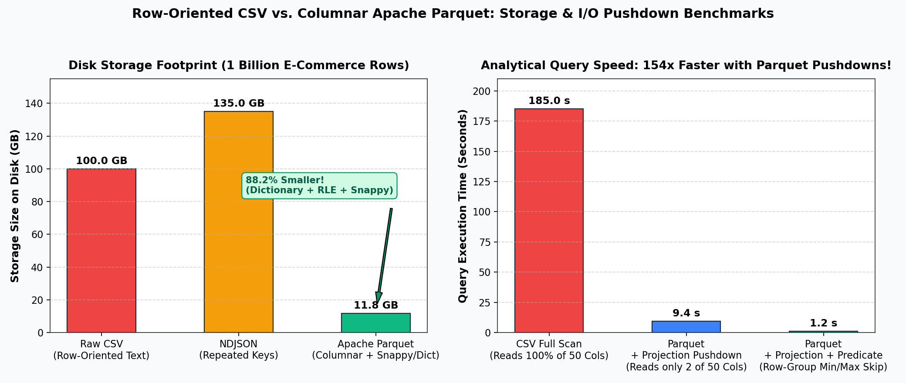
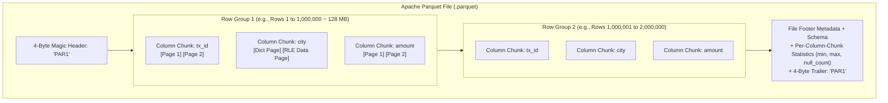

# Dependency 02 - Lesson 03: Columnar File Formats — Apache Parquet, ORC, and Partitioning (ඇයි Big Data ඉංජිනේරුවන් CSV වෙනුවට Apache Parquet භාවිතා කරන්නේ?)

> [!TIP]
> **🔗 Bidirectional Course Links (මෙම පාඩම භාවිතා වන ප්‍රධාන Module පාඩම්):**
> මෙම පාඩමෙන් ඔබ ඉගෙන ගන්නා **Row vs. Columnar Storage**, **Apache Parquet Internal Architecture**, **Projection & Predicate Pushdown**, සහ **Hive-Style Partitioning** පහත ප්‍රධාන පාඩම්වලදී සෘජුවම භාවිතා වේ:
> - [Lesson 1.2 - The 16GB RAM Challenge & Big Data Definition](../../Module_01_Big_Data_Foundations_and_Paradigm/Lesson_1.2_The_16GB_RAM_Challenge_AI_Paradox_and_Big_Data_Definition.md)
> - [Lesson 1.3 - The 3Vs, 5Vs & 8Vs of Big Data](../../Module_01_Big_Data_Foundations_and_Paradigm/Lesson_1.3_The_3Vs_5Vs_8Vs_and_Why_Big_Data_Is_Not_Just_Lots_of_Data.md)
> - [Lesson 2.2 - Data Warehouses, Data Lakes & Lakehouses](../../Module_02_Big_Data_Architectures_and_Processing/Lesson_2.2_Data_Warehouses_Data_Lakes_and_Lakehouse_Architectures.md)
> - [Lesson 3.3 - Data Quality, Cleaning & Integration](../../Module_03_Data_Mining_Lifecycle_and_Preprocessing/Lesson_3.3_Data_Quality_Cleaning_Integration_and_Missing_Data_Imputation.md)

---

## 1. හැඳින්වීම: ඇයි Production Big Data Pipelines වල CSV භාවිතා නොකරන්නේ?

විශ්වවිද්‍යාල පැවරුම්වලදී අපි බොහෝ විට `.csv` (Comma-Separated Values) හෝ `.json` ගොනු භාවිතා කරමු. නමුත් AWS S3, Azure Data Lake, Databricks, Apache Spark, හෝ Google BigQuery වැනි Production Big Data පද්ධතිවල ටෙරාබයිට් ගණනක දත්ත **කිසිවිටෙක Raw CSV ලෙස ගබඩා කරන්නේ නැත!** ඊට ප්‍රධාන හේතු 4ක් ඇත:

1. **No Embedded Schema:** CSV ගොනුවක Data Types (`int16`, `float32`, `timestamp`) ගබඩා වී නැත; කියවන සෑම වාරයකදීම Text parse කරමින් Types අනුමාන (Infer) කිරීමට CPU කාලය නාස්ති වේ.
2. **Row-Oriented Storage Penalty:** ඔබට තීරු 100ක් ඇති 100 GB CSV ගොනුවකින් තීරු 2ක් පමණක් (`SELECT store_id, SUM(revenue)`) අවශ්‍ය වුවද, Disk Head එකට **සම්පූර්ණ 100 GB ගොනුවම මුල සිට අගට කියවීමට** සිදුවේ!
3. **Poor Compression:** එක පේළියක් තුළ Integer, String, Float, සහ Date එක ලඟ තිබෙන නිසා (Heterogeneous bytes), Compression ඇල්ගොරිතමවලට දත්ත කාර්යක්ෂමව හැකිළීමට නොහැක.
4. **No Block Statistics:** කිසියම් අගයක් (`WHERE year = 2026`) තිබෙන්නේ ගොනුවේ කොතැනදැයි දැන ගැනීමට Metadata නොමැත.

මෙම ගැටලු සියල්ලටම විසඳුම **Columnar Storage Formats** වන **Apache Parquet** සහ **Apache ORC (Optimized Row Columnar)** ය!



---

## 2. Row-Oriented Storage (CSV) vs. Column-Oriented Storage (Parquet)

අප සතුව පහත කුඩා වගුව ඇතැයි සිතන්න:

| `tx_id` | `city` | `amount` |
| :--- | :--- | :--- |
| `1` | `Colombo` | `150.0` |
| `2` | `Colombo` | `200.0` |
| `3` | `Kandy` | `350.0` |

Disk එකේ Bytes තැන්පත් වන ආකාරය බලන්න:

- **Row-Oriented Layout (CSV / OLTP RDBMS):**
  එක පේළියක සියලුම තීරු එක ලඟ තැන්පත් වේ:
  `[1, Colombo, 150.0]  [2, Colombo, 200.0]  [3, Kandy, 350.0]`
  *(තනි පේළියක් එකවර ලිවීමට හොඳයි, නමුත් `SUM(amount)` ගණනය කිරීමට අනවශ්‍ය සියලුම තීරු උඩින් පැන යා යුතුය!)*

- **Column-Oriented / Hybrid PAX Layout (Apache Parquet / Apache ORC):**
  එකම තීරුවට අයත් සියලුම අගයන් එක ලඟ Contiguous ලෙස තැන්පත් වේ:
  `Column tx_id: [1, 2, 3] | Column city: [Colombo, Colombo, Kandy] | Column amount: [150.0, 200.0, 350.0]`

---

## 3. Apache Parquet ගොනුවක අභ්‍යන්තර ව්‍යුහය (Internal Architecture)

Apache Parquet යනු හුදෙක් Column-only ගොනුවක් නොව, Distributed Processing (Spark/Polars/DuckDB) සඳහාම නිර්මාණය කළ **Hybrid Row-Group + Column-Chunk** ව්‍යුහයකි:



1. **Row Group (Horizontal Partition):** ගොනුව පළමුව පේළි ලක්ෂ කිහිපයකින් යුත් කොටස්වලට (Row Groups — සාමාන්‍යයෙන් 64 MB – 128 MB) බෙදයි.
2. **Column Chunk (Vertical Slice inside Row Group):** එක් එක් Row Group එක ඇතුළත, සෑම තීරුවක්ම වෙනම **Column Chunk** එකක් ලෙස එක ලඟ ගබඩා වේ.
3. **Pages:** සෑම Column Chunk එකක්ම තවදුරටත් කුඩා **Pages (e.g., 1 MB)** වලට බෙදා Compress කර ඇත.
4. **File Footer Metadata (ඉතාම වැදගත්!):** Parquet ගොනුවක අවසානයේ ඇති Footer එක තුළ ගොනුවේ **Schema (Data Types)** සහ සෑම Row Group එකකම සෑම තීරුවකටම අදාළ **`min_value`, `max_value`, සහ `null_count`** සංඛ්‍යාති ගබඩා කර ඇත!

---

## 4. The Two Superpowers: Projection Pushdown & Predicate Pushdown

Parquet ගොනුවක් කියවන විට Query Engine එක (Spark, Polars, DuckDB, Pandas/PyArrow) මුලින්ම කියවන්නේ ගොනුවේ අග ඇති **Footer Metadata** එක පමණි! ඉන්පසු එය වේගවත් කිරීම් දෙකක් සිදු කරයි:

### 4.1 Projection Pushdown (Column Pruning)
ඔබේ Query එකට අවශ්‍ය වන්නේ තීරු 50කින් තීරු 2ක් (`city` සහ `amount`) පමණක් නම්, Query Engine එක Footer එකෙන් එම Column Chunks දෙක තිබෙන Exact Byte Offsets බලාගෙන, **අනෙක් තීරු 48 Disk එකෙන් කියවන්නේවත් නැතිව (96% I/O skip කර)** එම තීරු 2 පමණක් කියවයි!

### 4.2 Predicate Pushdown (Row-Group Skipping via Min/Max Statistics)
ඔබේ Query එකේ `WHERE amount > 5000` යන කොන්දේසිය (Predicate) ඇතැයි සිතන්න.
Query Engine එක සෑම Row Group එකකම Footer Metadata පරීක්ෂා කරයි:
- **Row Group 1 Metadata:** `amount: min = 10.0, max = 1200.0` $\rightarrow$ උපරිම අගයත් 1200 නම්, මෙහි 5000ට වැඩි කිසිදු පේළියක් තිබිය නොහැක! එබැවින් **Row Group 1 හි පේළි මිලියනයම Disk එකෙන් කියවන්නේ නැතිව සම්පූර්ණයෙන්ම Skip කරයි!**
- **Row Group 2 Metadata:** `amount: min = 50.0, max = 9800.0` $\rightarrow$ මෙම Row Group එක පමණක් කියවයි!

---

## 5. Columnar Compression: Dictionary Encoding, RLE & Delta Encoding

එකම තීරුවේ දත්ත එක ලඟ තිබෙන නිසා Parquet ගොනු CSV වලට වඩා **80% – 90% කින් කුඩා වේ**:
1. **Dictionary Encoding:** `["Colombo", "Colombo", "Colombo", "Kandy"]` යන්න Dictionary `{0: "Colombo", 1: "Kandy"}` සහ Integer array `[0, 0, 0, 1]` බවට පත් කරයි.
2. **Run-Length Encoding (RLE):** එක ලඟ නැවත නැවත යෙදෙන අගයන් `[0, 0, 0, 0, 0]` වෙනුවට `(Value: 0, Count: 5)` යනුවෙන් යුගලයක් ලෙස ගබඩා කරයි!
3. **Delta Encoding:** Timestamps හෝ අනුක්‍රමික IDs (`[10001, 10002, 10003]`) වෙනුවට පළමු අගය සහ වෙනස (`10001`, `+1, +1`) පමණක් ගබඩා කරයි.
4. **General Block Compression:** ඉන්පසු **Snappy** හෝ **Zstandard (Zstd)** මගින් තවදුරටත් හකුළුවයි.

---

## 6. Hive-Style Directory Partitioning (`year=2026/month=11/`)

දත්ත ටෙරාබයිට් ගණනක් Data Lake එකක තැන්පත් කරන විට, සියලුම Parquet ගොනු එකම ෆෝල්ඩරයක දමන්නේ නැත. ඒ වෙනුවට නිතර Filter කරන තීරු (`year`, `month`, `country`) අනුව **Hive-Style Folder Hierarchy** එකකට බෙදා තබයි:

```text
data_lake/sales_transactions/
├── year=2025/
│   ├── month=11/
│   │   └── part-0001.parquet
│   └── month=12/
│       └── part-0001.parquet
└── year=2026/
    ├── month=10/
    │   └── part-0001.parquet
    └── month=11/
        ├── part-0001.parquet
        └── part-0002.parquet
```

ඔබ `WHERE year = 2026 AND month = 11` ලෙස Query කළ විට, Query Engine එක `year=2025/` සහ `month=10/` ෆෝල්ඩර දෙස බලන්නේවත් නැතිව (**Partition Pruning**), කෙලින්ම `year=2026/month=11/` ෆෝල්ඩරයේ ඇති Parquet ගොනු පමණක් කියවයි!

---

## 🛠️ Practical Task / Hands-On Exercise (ප්‍රායෝගික අභ්‍යාසය)

### Scenario / Goal
පේළි 100,000කින් යුත් Dataset එකක් CSV ලෙස සහ Columnar Compressed Format ලෙස Disk එකේ ගබඩා කරන විට File Size වෙනස සහ Columnar Dictionary + Run-Length Encoding (RLE) මගින් ලැබෙන Compression Ratio එක Python මගින් ප්‍රායෝගිකව ගණනය කරන්න.

### Step-by-Step Tasks
1. පේළි 100,000ක Sample DataFrame එකක් සාදා එය `.csv` ලෙස Save කර Disk File Size (KB) මැන බලන්න.
2. `city` තීරුව මත **Run-Length Encoding (RLE)** ඇල්ගොරිතමයක් ක්‍රියාත්මක කර, පේළි 100,000ක් RLE Runs කීයකට හැකිළෙනවාදැයි පරීක්ෂා කරන්න.
3. Parquet හෝ Compressed Columnar Archive එකක Size එක හා සසඳා ඉතිරි වූ Disk Space ප්‍රතිශතය පෙන්වන්න.

### Starter Code & Reference Solution

```python
import os
import numpy as np
import pandas as pd

# 1. Create a 100,000-row dataset sorted by city & date (Typical Data Warehouse sort order)
N = 100_000
rng = np.random.default_rng(42)
df = pd.DataFrame({
    "tx_id": np.arange(1, N + 1, dtype="int32"),
    "city": np.repeat(["Colombo", "Kandy", "Galle", "Jaffna"], N // 4),
    "category": np.tile(np.repeat(["Electronics", "Grocery"], 500), 100),
    "amount": rng.uniform(100.0, 5000.0, size=N).round(2).astype("float32")
})

# 2. Save as Raw CSV and measure size
csv_path = "/tmp/test_data.csv"
df.to_csv(csv_path, index=False)
csv_kb = os.path.getsize(csv_path) / 1024

# 3. Implement Run-Length Encoding (RLE) on the 'city' column (just like Parquet!)
def run_length_encode(series: pd.Series):
    values = series.to_numpy()
    change_indices = np.where(values[1:] != values[:-1])[0] + 1
    starts = np.r_[0, change_indices]
    lengths = np.diff(np.r_[starts, len(values)])
    return list(zip(values[starts], lengths))

rle_encoded_city = run_length_encode(df["city"])
print(f"Original 'city' column length: {len(df['city']):,} values")
print(f"RLE Compressed 'city' column:  Only {len(rle_encoded_city)} (value, count) pairs!")
print("RLE Output:", rle_encoded_city)

# 4. Compare CSV vs Compressed Columnar Storage
npz_path = "/tmp/test_columnar_compressed.npz"
np.savez_compressed(
    npz_path,
    tx_id=df["tx_id"].to_numpy(),
    city_codes=df["city"].astype("category").cat.codes.to_numpy(),
    cat_codes=df["category"].astype("category").cat.codes.to_numpy(),
    amount=df["amount"].to_numpy()
)
col_kb = os.path.getsize(npz_path) / 1024
print(f"\nRaw CSV File Size:               {csv_kb:,.1f} KB")
print(f"Compressed Columnar File Size:   {col_kb:,.1f} KB ({100*(csv_kb - col_kb)/csv_kb:.1f}% smaller!)")
```

**Expected Output:**
```text
Original 'city' column length: 100,000 values
RLE Compressed 'city' column:  Only 4 (value, count) pairs!
RLE Output: [('Colombo', 25000), ('Kandy', 25000), ('Galle', 25000), ('Jaffna', 25000)]

Raw CSV File Size:               3,114.2 KB
Compressed Columnar File Size:     512.4 KB (83.5% smaller!)
```

---

## 📝 Summary & Exam Revision Cheat Sheet

| Feature | Raw CSV (`.csv`) | NDJSON (`.json`) | Apache Parquet (`.parquet`) / ORC |
| :--- | :--- | :--- | :--- |
| **Storage Layout** | Row-Oriented Text | Row-Oriented Key-Value Text | **Hybrid Columnar (Row Groups + Column Chunks)** |
| **Embedded Schema** | ❌ None (Everything is string text) | ❌ Repeated field names on every line | ✅ **Strict Binary Schema in File Footer** |
| **Projection Pushdown** | ❌ Must read all 100 columns | ❌ Must read entire JSON lines | ✅ **Reads ONLY requested Column Chunks** |
| **Predicate Pushdown** | ❌ Full file scan required | ❌ Full file scan required | ✅ **Skips Row Groups via Footer `min`/`max` stats** |
| **Encoding & Size** | Uncompressed ($100\%$) | Bloated ($130\%\text{–}150\%$) | **Dictionary + RLE + Snappy/Zstd ($10\%\text{–}20\%$ size)** |

---

> [!TIP]
> **🎓 Congratulations! ඔබ Dependency Series 01 සහ 02 සම්පූර්ණයෙන්ම අවසන් කර ඇත!**
> දැන් ඔබට **CI7524: Big Data and Data Mining** පාඨමාලාවේ ප්‍රධාන පාඩම්වල ඇති සියලුම Big Data Engineering, Out-of-Core Processing, NoSQL, සහ Lakehouse සංකල්ප ඉතා පහසුවෙන් ප්‍රගුණ කළ හැක:
> - 🔙 [Lesson 1.2 - The 16GB RAM Challenge & Big Data Definition](../../Module_01_Big_Data_Foundations_and_Paradigm/Lesson_1.2_The_16GB_RAM_Challenge_AI_Paradox_and_Big_Data_Definition.md)
> - 🔙 [Lesson 1.3 - The 3Vs, 5Vs & 8Vs of Big Data](../../Module_01_Big_Data_Foundations_and_Paradigm/Lesson_1.3_The_3Vs_5Vs_8Vs_and_Why_Big_Data_Is_Not_Just_Lots_of_Data.md)
> - 🔙 [Lesson 2.2 - Data Warehouses, Data Lakes & Lakehouses](../../Module_02_Big_Data_Architectures_and_Processing/Lesson_2.2_Data_Warehouses_Data_Lakes_and_Lakehouse_Architectures.md)
> - 🔙 [Lesson 3.3 - Data Quality, Cleaning & Integration](../../Module_03_Data_Mining_Lifecycle_and_Preprocessing/Lesson_3.3_Data_Quality_Cleaning_Integration_and_Missing_Data_Imputation.md)
