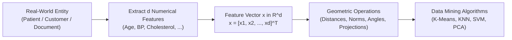
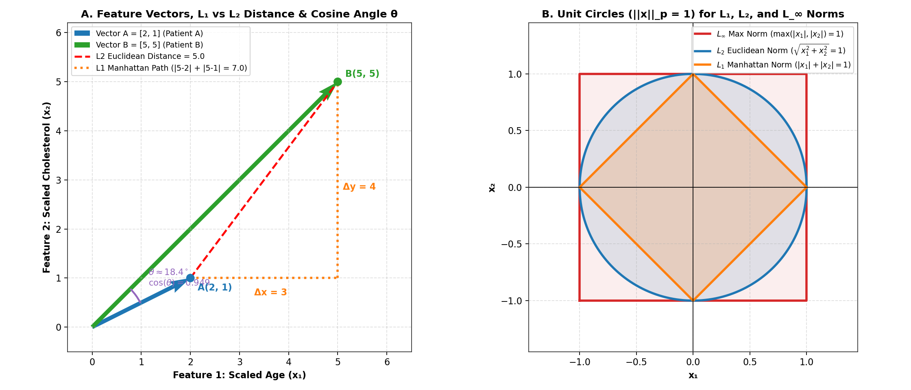

# Dependency Lesson 03.1: Vectors, High-Dimensional Spaces, and Vector Norms (දෛශික, බහු-මාන අවකාශ සහ දෛශික ප්‍රමාණක)

> [!TIP]
> **🔗 Related Core Module Lessons (මෙම පාඩම භාවිතා වන ප්‍රධාන පාඩම්):**
> මෙම Dependency පාඩමෙන් ඔබ ඉගෙන ගන්නා **Vectors (දෛශික)**, **Dot Product (තිත් ගුණිතය)**, **Vector Norms ($L_1, L_2, L_\infty$)**, සහ **Cosine Angle ($\cos\theta$)** පිළිබඳ මූලික ගණිතමය දැනුම පහත දැක්වෙන ප්‍රධාන CI7524 Data Mining පාඩම්වලදී සෘජුවම භාවිතා වේ:
> - [Lesson 3.2 - Mathematical Preliminaries & Distance Metrics](../../Module_03_Data_Mining_Lifecycle_and_Preprocessing/Lesson_3.2_Mathematical_Preliminaries_Distance_Metrics_and_Curse_of_Dimensionality.md)
> - [Lesson 3.4 - Feature Engineering, Scaling & Selection](../../Module_03_Data_Mining_Lifecycle_and_Preprocessing/Lesson_3.4_Feature_Engineering_Scaling_Encoding_and_Selection.md)
> - [Lesson 4.1 - Clustering Algorithms (K-Means, Hierarchical, DBSCAN)](../../Module_04_Data_Mining_Algorithms_and_Model_Selection/Lesson_4.1_Clustering_Algorithms_KMeans_Hierarchical_and_DBSCAN.md)
> - [Lesson 4.2 - Component Analysis & Dimensionality Reduction (PCA & SVD)](../../Module_04_Data_Mining_Algorithms_and_Model_Selection/Lesson_4.2_Component_Analysis_and_Dimensionality_Reduction_PCA_SVD_tSNE.md)
>
> **📚 Sibling Lessons in Dep_03 Series:**
> - **Current:** `01_Vectors_High_Dimensional_Spaces_and_Norms.md`
> - **Next:** [02_Matrices_Transformations_and_Covariance_Matrices.md](./02_Matrices_Transformations_and_Covariance_Matrices.md)
> - **Next:** [03_Eigenvalues_Eigenvectors_and_Matrix_Factorization.md](./03_Eigenvalues_Eigenvectors_and_Matrix_Factorization.md)

---

## 1. Zero-to-Hero Intuition: Data Mining වලදී Vector (දෛශිකය) එකක් කියන්නේ මොකක්ද?

බොහෝ දෙනෙක් උසස් පෙළ භෞතික විද්‍යාවේදී (Physics) ඉගෙන ගත්තේ **Vector (දෛශිකය)** කියන්නේ "විශාලත්වයක් (Magnitude) සහ දිශාවක් (Direction) තියෙන ඊතලයක්" (උදා: ප්‍රවේගය, බලය) කියලයි. හැබැයි **Data Mining**, **Machine Learning**, සහ **Big Data Analytics** වලදී අපි **Vector (දෛශිකය)** එකක් දිහා බලන්නේ ඊටත් වඩා ප්‍රායෝගික විදිහකටයි!

සිතන්න ඔබ රෝහලක Cardiology (හෘද රෝග) දත්ත පද්ධතියක වැඩ කරන Data Scientist කෙනෙක් කියලා. එක රෝගියෙක්ව (Patient A) විස්තර කරන්න ඔබ ළඟ සංඛ්‍යාත්මක ලක්ෂණ (**Numerical Features / Attributes**) 3ක් තියෙනවා:
1. `Age` (වයස): අවුරුදු $45$
2. `Systolic Blood Pressure` (රුධිර පීඩනය): $130\text{ mmHg}$
3. `Cholesterol` (කොලෙස්ටරෝල් මට්ටම): $210\text{ mg/dL}$

පරිගණකයකට "රෝගියා" කියන සංකල්පය තේරෙන්නේ නැහැ. නමුත් මේ අගයන් තුන නිශ්චිත පිළිවෙළකට (Ordered List of Numbers) කොටු වරහනක් ඇතුළේ ලිව්වොත්:

$$\mathbf{x} = \begin{bmatrix} x_1 \\ x_2 \\ x_3 \end{bmatrix} = \begin{bmatrix} 45 \\ 130 \\ 210 \end{bmatrix} \in \mathbb{R}^3$$

දැන් මේ රෝගියා කියන්නේ ත්‍රිමාණ අවකාශයේ (**3-Dimensional Real Coordinate Space — $\mathbb{R}^3$**) පිහිටි **එක ලක්ෂ්‍යයක් (Single Point in Space)** හෝ මූල ලක්ෂ්‍යයේ $(0,0,0)$ සිට එම ලක්ෂ්‍යයට ඇඳි **ඊතලයක් (Feature Vector)**!



### 1.1 $d$-Dimensional Feature Space ($\mathbb{R}^d$) යනු කුමක්ද?
- අපි ළඟ Features $2$ක් විතරක් තිබුණොත් ($\mathbf{x} = [x_1, x_2]^T$), අපිට ඒක සාමාන්‍ය කඩදාසියක $X$-$Y$ ප්‍රස්තාරයක (**2D Plane — $\mathbb{R}^2$**) ලක්ෂ්‍යයක් විදිහට අඳින්න පුළුවන්.
- Features $3$ක් තිබුණොත් ($\mathbf{x} = [x_1, x_2, x_3]^T$), ඒක කාමරයක දිග, පළල, උස වගේ ත්‍රිමාණ අවකාශයේ (**3D Space — $\mathbb{R}^3$**) ලක්ෂ්‍යයක්.
- හැබැයි E-commerce වෙබ් අඩවියක පාරිභෝගිකයෙක් ගැන Features $500$ක් තිබුණොත්? නැත්නම් ජාන පරීක්ෂණයක (Genomic Microarray) Gene Expression Features $20,000$ක් තිබුණොත්? අපේ ඇසට මවාගන්න බැරි වුණාට, ගණිතමය වශයෙන් එය **$d$-Dimensional Vector Space ($\mathbb{R}^d$)** එකක පිහිටි ලක්ෂ්‍යයක් ($\mathbf{x} \in \mathbb{R}^d$).
- **වාසිය:** $\mathbb{R}^2$ සහ $\mathbb{R}^3$ වලදී අපි භාවිතා කරන දුර සෙවීමේ, එකතු කිරීමේ, සහ කෝණ සෙවීමේ සමීකරණ **එලෙසම කිසිම වෙනසක් නැතුව** $\mathbb{R}^{20,000}$ වලදීත් ක්‍රියාත්මක වෙනවා! (Deisenroth et al., *Mathematics for Machine Learning*, Ch. 2; Blum, Hopcroft & Kannan, *Foundations of Data Science*, Ch. 2).

### 1.2 Column Vector (තීරු දෛශිකය) vs Row Vector (පේළි දෛශිකය)
Linear Algebra සම්මතයට අනුව, අපි තනි Vector එකක් ලියද්දී සෑමවිටම එය ඉහළ සිට පහළට ලියන **Column Vector (තීරු දෛශිකයක්)** ($d \times 1$ matrix) ලෙස සලකනවා. පේළියක් ලෙස ලිවීමට අවශ්‍ය වූ විට **Transpose (පෙරළුම — $T$)** සංකේතය භාවිතා කරනවා:

$$\mathbf{x} = \begin{bmatrix} x_1 \\ x_2 \\ \vdots \\ x_d \end{bmatrix} \quad \Longleftrightarrow \quad \mathbf{x}^T = \begin{bmatrix} x_1 & x_2 & \dots & x_d \end{bmatrix}$$

---

## 2. Basic Vector Operations (මූලික දෛශික ක්‍රියාකාරකම්)

අපි සරල 2D Feature Vectors දෙකක් උදාහරණයට ගනිමු. සිතන්න පරිමාණය කරන ලද (Scaled) `Age` සහ `Cholesterol` අගයන් සහිත රෝගීන් දෙදෙනෙක්:
- **Patient A:** $\mathbf{a} = \begin{bmatrix} 2 \\ 1 \end{bmatrix}$
- **Patient B:** $\mathbf{b} = \begin{bmatrix} 5 \\ 5 \end{bmatrix}$

### 2.1 Vector Addition & Subtraction (දෛශික එකතු කිරීම සහ අඩු කිරීම)
සමාන මානයන් ($d$) සහිත Vectors දෙකක් එකතු කිරීමේදී හෝ අඩු කිරීමේදී අනුරූප අවයව (**Element-wise / Component-wise**) එකතු කිරීම හෝ අඩු කිරීම සිදු කරයි:

$$\mathbf{a} + \mathbf{b} = \begin{bmatrix} a_1 + b_1 \\ a_2 + b_2 \end{bmatrix} = \begin{bmatrix} 2 + 5 \\ 1 + 5 \end{bmatrix} = \begin{bmatrix} 7 \\ 6 \end{bmatrix}$$

**Displacement Vector (විස්ථාපන දෛශිකය — $\mathbf{b} - \mathbf{a}$):**
Data Mining වලදී රෝගියා A ගේ සිට රෝගියා B දක්වා කොපමණ වෙනසක් (Difference) තිබේද යන්න දැක්වෙන්නේ $\mathbf{b} - \mathbf{a}$ මගිනි:

$$\mathbf{d} = \mathbf{b} - \mathbf{a} = \begin{bmatrix} 5 - 2 \\ 5 - 1 \end{bmatrix} = \begin{bmatrix} 3 \\ 4 \end{bmatrix}$$

මෙහි අර්ථය: A ගේ සිට B වෙත යාමට $x_1$ අක්ෂය දිගේ ඒකක $3$ක් ($\Delta x_1 = 3$) සහ $x_2$ අක්ෂය දිගේ ඒකක $4$ක් ($\Delta x_2 = 4$) ගමන් කළ යුතුය.

### 2.2 Scalar Multiplication (අදිශ ගුණිතය)
තනි සංඛ්‍යාවකින් (**Scalar** $c \in \mathbb{R}$) Vector එකක් ගුණ කළ විට එහි දිශාව වෙනස් නොවී දිග පමණක් $c$ ගුණයකින් දිගු වීම (Scaling / Stretching) හෝ හැකිලීම සිදු වේ ($c < 0$ නම් දිශාව ප්‍රතිවිරුද්ධ වේ):

$$3 \cdot \mathbf{a} = 3 \begin{bmatrix} 2 \\ 1 \end{bmatrix} = \begin{bmatrix} 3 \times 2 \\ 3 \times 1 \end{bmatrix} = \begin{bmatrix} 6 \\ 3 \end{bmatrix}$$

> [!NOTE]
> **K-Means Centroid ගණනයට මෙය වැදගත් වන්නේ ඇයි?**
> K-Means Clustering වලදී Cluster එකක මැද ලක්ෂ්‍යය (**Centroid / Mean Vector $\boldsymbol{\mu}$**) හොයන්නේ ඒ Cluster එකේ තියෙන සියලුම Vectors එකතු කරලා, එය $\frac{1}{n}$ කියන Scalar එකෙන් ගුණ කිරීමෙනුයි:
> $$\boldsymbol{\mu} = \frac{1}{2}(\mathbf{a} + \mathbf{b}) = 0.5 \begin{bmatrix} 7 \\ 6 \end{bmatrix} = \begin{bmatrix} 3.5 \\ 3.0 \end{bmatrix}$$

---

## 3. Dot Product / Inner Product (තිත් ගුණිතය / අභ්‍යන්තර ගුණිතය)

Linear Algebra සහ Machine Learning වල හදවත බඳු වැදගත්ම ගණිත කර්මය වන්නේ **Dot Product (තිත් ගුණිතය)** නොහොත් **Inner Product (අභ්‍යන්තර ගුණිතය)** යි.

### 3.1 Algebraic Definition (වීජීය අර්ථ දැක්වීම)
මානය $d$ වූ $\mathbf{x}, \mathbf{y} \in \mathbb{R}^d$ දෛශික දෙකක **Dot Product (තිත් ගුණිතය)** යනු අනුරූප අවයව එකිනෙක ගුණ කර ලැබෙන අගයන්ගේ එකතුවයි. මෙය $\mathbf{x} \cdot \mathbf{y}$, $\langle \mathbf{x}, \mathbf{y} \rangle$, හෝ Matrix ආකාරයෙන් $\mathbf{x}^T \mathbf{y}$ ලෙස ලියනු ලැබේ:

$$\mathbf{x} \cdot \mathbf{y} = \mathbf{x}^T \mathbf{y} = \sum_{i=1}^{d} x_i y_i = x_1 y_1 + x_2 y_2 + \dots + x_d y_d$$

**අතින් ගණනය කිරීම (Worked Hand Calculation):**
අපගේ Patient A ($\mathbf{a} = [2, 1]^T$) සහ Patient B ($\mathbf{b} = [5, 5]^T$) සඳහා:

$$\mathbf{a} \cdot \mathbf{b} = (2 \times 5) + (1 \times 5) = 10 + 5 = 15$$

වැදගත් කරුණක්: Vectors දෙකක Dot Product එකෙන් ලැබෙන පිළිතුර තවත් Vector එකක් නොව, **තනි සංඛ්‍යාවකි (Scalar)**!

### 3.2 Intuition: Dot Product එකෙන් ඇත්තටම කියවෙන්නේ කුමක්ද?
Dot Product එකෙන් මනින්නේ **"දෛශික දෙකක් කොපමණ දුරට එකම දිශාවකට යොමු වී ඇත්ද (Alignment / Directional Agreement)"** යන්නයි:
1. **$\mathbf{x} \cdot \mathbf{y} > 0$ (ධන අගයක්):** Vectors දෙක අතර කෝණය $\theta < 90^\circ$ (සමාන දිශාවකට නැඹුරු වී ඇත).
2. **$\mathbf{x} \cdot \mathbf{y} = 0$ (ශූන්‍යය):** Vectors දෙක එකිනෙකට අංශක $90^\circ$ කින් ලම්බක වේ! මෙයට **Orthogonal Vectors (ලම්බක දෛශික)** යැයි කියනු ලැබේ. උදාහරණයක් ලෙස $\mathbf{u} = [2, 1]^T$ සහ $\mathbf{v} = [-1, 2]^T$ ගත්තොත්:
   $$\mathbf{u} \cdot \mathbf{v} = (2 \times -1) + (1 \times 2) = -2 + 2 = 0 \implies \mathbf{u} \perp \mathbf{v}$$
3. **$\mathbf{x} \cdot \mathbf{y} < 0$ (ඍණ අගයක්):** Vectors දෙක අතර කෝණය $\theta > 90^\circ$ (ප්‍රතිවිරුද්ධ දිශාවන්ට යොමු වී ඇත).

---

## 4. Vector Norms ($L_p$ Norms — දෛශික ප්‍රමාණක) සහ දුර මැනීම

Vector එකක "විශාලත්වය" හෙවත් මූල ලක්ෂ්‍යයේ $\mathbf{0}$ සිට එම ලක්ෂ්‍යයට ඇති "දිග" (**Length / Magnitude**) මනින ගණිතමය ශ්‍රිතයට අපි **Vector Norm (දෛශික ප්‍රමාණකය — $\|\mathbf{x}\|$)** කියා හඳුන්වනවා.

සාමාන්‍යයෙන් ඕනෑම $p \ge 1$ අගයක් සඳහා **Minkowski $L_p$ Norm** එක පහත සූත්‍රයෙන් අර්ථ දැක්වේ:

$$\|\mathbf{x}\|_p = \left( \sum_{i=1}^{d} |x_i|^p \right)^{\frac{1}{p}}$$

Data Mining වලදී අපි නිතරම භාවිතා කරන ප්‍රධාන Norms 3 පියවරෙන් පියවර බලමු.



### 4.1 $L_1$ Norm — Manhattan Norm / Taxicab Norm (මැන්හැටන් ප්‍රමාණකය)
$p=1$ ආදේශ කළ විට ලැබෙන්නේ සියලුම සංරචකවල නිරපේක්ෂ අගයන්ගේ (**Absolute Values**) එකතුවයි:

$$\|\mathbf{x}\|_1 = \sum_{i=1}^{d} |x_i| = |x_1| + |x_2| + \dots + |x_d|$$

- **Intuition:** නිව්යෝර්ක් නගරයේ (Manhattan) කොටු හැඩැති මාර්ග පද්ධතියක කුලී රථයකට (Taxicab) ගොඩනැගිලි හරහා විකර්ණව (Diagonally) යන්න බැහැ; උතුරට/දකුණට සහ නැගෙනහිරට/බටහිරට පමණක් ගමන් කළ යුතුයි.
- **Patient A ($\mathbf{a} = [2, 1]^T$) හි $L_1$ Norm එක:**
  $$\|\mathbf{a}\|_1 = |2| + |1| = 3$$
- **Patient A සහ B අතර $L_1$ Manhattan Distance එක:**
  $$d_1(\mathbf{a}, \mathbf{b}) = \|\mathbf{b} - \mathbf{a}\|_1 = |5 - 2| + |5 - 1| = 3 + 4 = 7.0$$

### 4.2 $L_2$ Norm — Euclidean Norm (යුක්ලීඩීය ප්‍රමාණකය)
$p=2$ ආදේශ කළ විට අපිට හුරුපුරුදු පයිතගරස් ප්‍රමේයය (Pythagorean Theorem) මත පදනම් වූ සෘජු රේඛීය දිග ලැබේ:

$$\|\mathbf{x}\|_2 = \sqrt{\sum_{i=1}^{d} x_i^2} = \sqrt{x_1^2 + x_2^2 + \dots + x_d^2} = \sqrt{\mathbf{x}^T \mathbf{x}}$$

- **Patient A ($\mathbf{a} = [2, 1]^T$) හි $L_2$ Norm එක:**
  $$\|\mathbf{a}\|_2 = \sqrt{2^2 + 1^2} = \sqrt{4 + 1} = \sqrt{5} \approx 2.2361$$
- **Patient B ($\mathbf{b} = [5, 5]^T$) හි $L_2$ Norm එක:**
  $$\|\mathbf{b}\|_2 = \sqrt{5^2 + 5^2} = \sqrt{25 + 25} = \sqrt{50} \approx 7.0711$$
- **Patient A සහ B අතර $L_2$ Euclidean Distance එක:**
  $$d_2(\mathbf{a}, \mathbf{b}) = \|\mathbf{b} - \mathbf{a}\|_2 = \sqrt{(5 - 2)^2 + (5 - 1)^2} = \sqrt{3^2 + 4^2} = \sqrt{9 + 16} = \sqrt{25} = 5.0$$

### 4.3 $L_\infty$ Norm — Max Norm / Chebyshev Norm (උපරිම ප්‍රමාණකය)
$p \to \infty$ වන විට, විශාලතම අගය සහිත සංරචකය (Component) අනෙක් සියල්ල අභිබවා යයි:

$$\|\mathbf{x}\|_\infty = \max_{1 \le i \le d} |x_i|$$

- **Patient A සහ B අතර $L_\infty$ Chebyshev Distance එක:**
  $$d_\infty(\mathbf{a}, \mathbf{b}) = \|\mathbf{b} - \mathbf{a}\|_\infty = \max(|5 - 2|, |5 - 1|) = \max(3, 4) = 4.0$$
- **Intuition:** චෙස් පුවරුවක රජුට (King) තිරස්ව, සිරස්ව හෝ විකර්ණව එක වරකට එක කොටුවක් යා හැකි නිසා, කොටු දෙකක් අතර රජුට යාමට අවශ්‍ය අවම පියවර ගණන $L_\infty$ දුරට සමාන වේ!

### 4.4 Unit Balls ($\|\mathbf{x}\|_p = 1$) වල ජ්‍යාමිතික හැඩය
ඉහත රූපයේ **Panel B** හි දැක්වෙන පරිදි, මූල ලක්ෂ්‍යයේ සිට ඒකක $1$ක දුරින් පිහිටි සියලුම ලක්ෂ්‍යයන්ගේ එකතුව (**Unit Circle / Unit Ball** $\{ \mathbf{x} \in \mathbb{R}^2 : \|\mathbf{x}\|_p \le 1 \}$) ඇන්දොත්:
- **$L_1$ Unit Ball:** අංශක $45^\circ$ හැරුණු දියමන්ති හැඩයක් (**Diamond / Cross-Polytope**). එහි තියුණු මුලු (Corners) අක්ෂයන් මත පිහිටන නිසා **LASSO Regression ($L_1$ Regularization)** වලදී අනවශ්‍ය Features ස්වයංක්‍රීයව $0$ බවට පත් කරයි (**Feature Sparsity**)!
- **$L_2$ Unit Ball:** සම්පූර්ණ වෘත්තයක් (**Round Circle / Hypersphere**).
- **$L_\infty$ Unit Ball:** අක්ෂවලට සමාන්තර සමචතුරස්‍රයක් (**Square / Hypercube**).

---

## 5. Unit Vectors, Cosine Angle ($\cos\theta$), සහ Geometric Projection

### 5.1 Unit Vector (ඒකක දෛශිකය) සහ Normalization
දිග හරියටම $1$ක් වන ($\|\mathbf{\hat{u}}\|_2 = 1$) ඕනෑම දෛශිකයකට **Unit Vector (ඒකක දෛශිකයක්)** යැයි කියනු ලැබේ. ශූන්‍ය නොවන ඕනෑම $\mathbf{x}$ දෛශිකයක් එහි $L_2$ Norm එකෙන් බෙදීමෙන් එම දිශාවටම පවතින Unit Vector එක ලබාගත හැක (**$L_2$ Normalization**):

$$\mathbf{\hat{x}} = \frac{\mathbf{x}}{\|\mathbf{x}\|_2}$$

**Patient A ($\mathbf{a} = [2, 1]^T$) සඳහා Unit Vector එක:**
$$\mathbf{\hat{a}} = \frac{1}{\sqrt{5}} \begin{bmatrix} 2 \\ 1 \end{bmatrix} = \begin{bmatrix} 2 / 2.2361 \\ 1 / 2.2361 \end{bmatrix} \approx \begin{bmatrix} 0.8944 \\ 0.4472 \end{bmatrix}$$
පරීක්ෂාව: $\|\mathbf{\hat{a}}\|_2 = \sqrt{0.8944^2 + 0.4472^2} = \sqrt{0.8 + 0.2} = \sqrt{1} = 1.0$.

### 5.2 Cosine Similarity සහ Vectors දෙකක් අතර කෝණය ($\theta$)
Dot Product එකේ ජ්‍යාමිතික අර්ථ දැක්වීමට අනුව:

$$\mathbf{a} \cdot \mathbf{b} = \|\mathbf{a}\|_2 \|\mathbf{b}\|_2 \cos(\theta)$$

මෙයින් $\cos(\theta)$ උක්ත කළ විට Data Mining සහ Information Retrieval (Text Mining / NLP) වල අතිශයින්ම ජනප්‍රිය **Cosine Similarity (කොසයින සමානතාව)** සූත්‍රය ලැබේ:

$$\cos(\theta) = \frac{\mathbf{a} \cdot \mathbf{b}}{\|\mathbf{a}\|_2 \|\mathbf{b}\|_2} = \mathbf{\hat{a}} \cdot \mathbf{\hat{b}}$$

**අතින් ගණනය කිරීම (Worked Calculation for Patient A & B):**
1. $\mathbf{a} \cdot \mathbf{b} = 15$
2. $\|\mathbf{a}\|_2 = \sqrt{5} \approx 2.2361$
3. $\|\mathbf{b}\|_2 = \sqrt{50} \approx 7.0711$
4. $\cos(\theta) = \frac{15}{\sqrt{5} \times \sqrt{50}} = \frac{15}{\sqrt{250}} = \frac{15}{15.8114} \approx 0.9487$
5. කෝණය $\theta = \arccos(0.9487) \approx 18.43^\circ$

### 5.3 Orthogonal Projection (ලම්බක ප්‍රක්ෂේපණය)
PCA (Principal Component Analysis) වලදී අපි කරන්නේ දත්ත ලක්ෂ්‍යයන් ($\mathbf{b}$) යම්කිසි දිශා දෛශිකයක් ($\mathbf{a}$) මතට "සෙවණැල්ලක්" සේ ප්‍රක්ෂේපණය (**Projection**) කිරීමයි. $\mathbf{b}$ දෛශිකය $\mathbf{a}$ මතට ප්‍රක්ෂේපණය කළ විට ලැබෙන **Vector Projection ($\text{proj}_{\mathbf{a}}\mathbf{b}$)** සූත්‍රය:

$$\text{proj}_{\mathbf{a}}(\mathbf{b}) = \left( \frac{\mathbf{a} \cdot \mathbf{b}}{\|\mathbf{a}\|_2^2} \right) \mathbf{a}$$

අපගේ අගයන් ආදේශ කළ විට:
$$\text{proj}_{\mathbf{a}}(\mathbf{b}) = \left( \frac{15}{5} \right) \begin{bmatrix} 2 \\ 1 \end{bmatrix} = 3 \begin{bmatrix} 2 \\ 1 \end{bmatrix} = \begin{bmatrix} 6 \\ 3 \end{bmatrix}$$

---

## 6. Python (`NumPy`) Implementation: Complete Verification

ඉහත අපි අතින් හැදූ සියලුම ගණනය කිරීම් `numpy` භාවිතයෙන් තත්පරයකින් පරීක්ෂා කරන ආකාරය බලමු:

```python
import numpy as np

# 1. Define Feature Vectors a and b
a = np.array([2.0, 1.0])
b = np.array([5.0, 5.0])

# 2. Dot Product
dot_ab = np.dot(a, b)  # or a @ b

# 3. Vector Norms (L1, L2, L_inf)
l1_dist = np.linalg.norm(b - a, ord=1)
l2_dist = np.linalg.norm(b - a, ord=2)
linf_dist = np.linalg.norm(b - a, ord=np.inf)

# 4. Unit Vector & Cosine Angle
a_unit = a / np.linalg.norm(a)
cos_theta = dot_ab / (np.linalg.norm(a) * np.linalg.norm(b))
theta_deg = np.degrees(np.arccos(cos_theta))

# 5. Orthogonal Projection of b onto a
proj_a_b = (np.dot(a, b) / np.dot(a, a)) * a

print(f"Dot Product (a . b)       : {dot_ab:.4f}")
print(f"L1 Manhattan Distance     : {l1_dist:.4f}")
print(f"L2 Euclidean Distance     : {l2_dist:.4f}")
print(f"L_inf Chebyshev Distance  : {linf_dist:.4f}")
print(f"Unit Vector a_hat         : {np.round(a_unit, 4)}")
print(f"Cosine Similarity         : {cos_theta:.4f} (Angle = {theta_deg:.2f} deg)")
print(f"Projection of b onto a    : {proj_a_b}")
```

**Output:**
```text
Dot Product (a . b)       : 15.0000
L1 Manhattan Distance     : 7.0000
L2 Euclidean Distance     : 5.0000
L_inf Chebyshev Distance  : 4.0000
Unit Vector a_hat         : [0.8944 0.4472]
Cosine Similarity         : 0.9487 (Angle = 18.43 deg)
Projection of b onto a    : [6. 3.]
```

---

## 🛠️ Practical Task / Hands-On Exercise (ප්‍රායෝගික අභ්‍යාසය)

### Scenario / Goal
ඔබ E-commerce වෙබ් අඩවියක **Document / Customer Similarity Engine** එකක් නිර්මාණය කරයි. පාරිභෝගිකයන් තිදෙනෙකු භාණ්ඩ කාණ්ඩ 3ක් (`[Electronics, Books, Clothing]`) මිලදී ගත් වාර ගණන දැක්වෙන 3D Feature Vectors තුනක් පහත දැක්වේ:
- **Customer 1:** $\mathbf{c}_1 = [1, 2, 2]^T$ (සාමාන්‍ය පාරිභෝගිකයෙක්)
- **Customer 2:** $\mathbf{c}_2 = [10, 20, 20]^T$ (එම අනුපාතයෙන්ම 10 ගුණයක් භාණ්ඩ මිලදී ගන්නා තොග ගැනුම්කරුවෙක්)
- **Customer 3:** $\mathbf{c}_3 = [2, 2, 1]^T$ (Electronics වැඩියෙන් මිලදී ගන්නා සාමාන්‍ය පාරිභෝගිකයෙක්)

### Step-by-Step Tasks
1. **Task 1 (Hand Calculation):** $\mathbf{c}_1$ හි $L_2$ Norm එක ($\|\mathbf{c}_1\|_2$) සහ Unit Vector එක ($\mathbf{\hat{c}}_1$) අතින් ගණනය කරන්න.
2. **Task 2 (Distance Comparison):** $\mathbf{c}_1$ සහ $\mathbf{c}_2$ අතර $L_2$ Euclidean Distance එකත්, $\mathbf{c}_1$ සහ $\mathbf{c}_3$ අතර $L_2$ Euclidean Distance එකත් සොයන්න. $L_2$ දුර අනුව $\mathbf{c}_1$ ට වඩාත්ම සමාන කවුද?
3. **Task 3 (Cosine Similarity Insight):** $\cos(\mathbf{c}_1, \mathbf{c}_2)$ සහ $\cos(\mathbf{c}_1, \mathbf{c}_3)$ ගණනය කරන්න. හැසිරීම් රටාව (Purchase Preference Ratio) අනුව $\mathbf{c}_1$ සහ $\mathbf{c}_2$ අතර කෝණය කීයද?

### Starter Code
```python
import numpy as np

c1 = np.array([1.0, 2.0, 2.0])
c2 = np.array([10.0, 20.0, 20.0])
c3 = np.array([2.0, 2.0, 1.0])

# TODO: Compute L2 norms, L2 distances, and Cosine similarities
```

### Expected Output / Reference Solution
```python
import numpy as np

c1 = np.array([1.0, 2.0, 2.0])
c2 = np.array([10.0, 20.0, 20.0])
c3 = np.array([2.0, 2.0, 1.0])

# 1. L2 Norm of c1: sqrt(1^2 + 2^2 + 2^2) = sqrt(9) = 3.0
norm_c1 = np.linalg.norm(c1)
unit_c1 = c1 / norm_c1

# 2. Euclidean Distances
dist_1_2 = np.linalg.norm(c1 - c2)  # sqrt(9^2 + 18^2 + 18^2) = 27.0
dist_1_3 = np.linalg.norm(c1 - c3)  # sqrt((-1)^2 + 0^2 + 1^2) = sqrt(2) = 1.4142

# 3. Cosine Similarities
cos_1_2 = np.dot(c1, c2) / (np.linalg.norm(c1) * np.linalg.norm(c2))
cos_1_3 = np.dot(c1, c3) / (np.linalg.norm(c1) * np.linalg.norm(c3))

print(f"||c1||_2 = {norm_c1:.2f}, Unit c1 = {np.round(unit_c1, 4)}")
print(f"L2 Distance (c1, c2) = {dist_1_2:.4f} vs L2 Distance (c1, c3) = {dist_1_3:.4f}")
print(f"Cosine Sim  (c1, c2) = {cos_1_2:.4f} (Angle = 0.0 deg -> Identical Preference Pattern!)")
print(f"Cosine Sim  (c1, c3) = {cos_1_3:.4f}")
```

**Expected Output:**
```text
||c1||_2 = 3.00, Unit c1 = [0.3333 0.6667 0.6667]
L2 Distance (c1, c2) = 27.0000 vs L2 Distance (c1, c3) = 1.4142
Cosine Sim  (c1, c2) = 1.0000 (Angle = 0.0 deg -> Identical Preference Pattern!)
Cosine Sim  (c1, c3) = 0.8889
```

---

## 📝 Summary & Exam Revision Cheat Sheet

| Concept / Metric | Mathematical Formula | Range / Geometry | Key Data Mining Application |
| :--- | :--- | :--- | :--- |
| **Dot Product (තිත් ගුණිතය)** | $\mathbf{x} \cdot \mathbf{y} = \sum_{i=1}^d x_i y_i = \|\mathbf{x}\|_2 \|\mathbf{y}\|_2 \cos\theta$ | $(-\infty, +\infty)$ | Linear Classifiers, Neural Net Layers, Projections |
| **$L_1$ Manhattan Norm** | $\|\mathbf{x}\|_1 = \sum_{i=1}^d \|x_i\|$ | Diamond Unit Ball | High-dimensional sparse data, LASSO ($L_1$) feature selection |
| **$L_2$ Euclidean Norm** | $\|\mathbf{x}\|_2 = \sqrt{\sum_{i=1}^d x_i^2}$ | Spherical Unit Ball | K-Means Clustering, KNN, Ridge ($L_2$) regularization |
| **$L_\infty$ Max Norm** | $\|\mathbf{x}\|_\infty = \max_i \|x_i\|$ | Cube Unit Ball | Worst-case component deviation analysis |
| **Unit Vector (ඒකක දෛශිකය)** | $\mathbf{\hat{x}} = \frac{\mathbf{x}}{\|\mathbf{x}\|_2}$ | $\|\mathbf{\hat{x}}\|_2 = 1$ | Direction representation, PCA Eigenvectors |
| **Cosine Similarity** | $\cos(\theta) = \frac{\mathbf{x} \cdot \mathbf{y}}{\|\mathbf{x}\|_2 \|\mathbf{y}\|_2}$ | $[-1, +1]$ (Scale-invariant) | Text Mining (TF-IDF), Recommender Systems |

---

> [!TIP]
> **🔙 Return to Core Module Lessons (ආපසු ප්‍රධාන පාඩම් වෙත):**
> - [Lesson 3.2 - Mathematical Preliminaries & Distance Metrics](../../Module_03_Data_Mining_Lifecycle_and_Preprocessing/Lesson_3.2_Mathematical_Preliminaries_Distance_Metrics_and_Curse_of_Dimensionality.md)
> - [Lesson 3.4 - Feature Engineering, Scaling & Selection](../../Module_03_Data_Mining_Lifecycle_and_Preprocessing/Lesson_3.4_Feature_Engineering_Scaling_Encoding_and_Selection.md)
> - [Lesson 4.1 - Clustering Algorithms (K-Means, Hierarchical, DBSCAN)](../../Module_04_Data_Mining_Algorithms_and_Model_Selection/Lesson_4.1_Clustering_Algorithms_KMeans_Hierarchical_and_DBSCAN.md)
> - [Lesson 4.2 - Component Analysis & Dimensionality Reduction (PCA & SVD)](../../Module_04_Data_Mining_Algorithms_and_Model_Selection/Lesson_4.2_Component_Analysis_and_Dimensionality_Reduction_PCA_SVD_tSNE.md)
> - **Next Dependency Lesson:** [02_Matrices_Transformations_and_Covariance_Matrices.md](./02_Matrices_Transformations_and_Covariance_Matrices.md)
