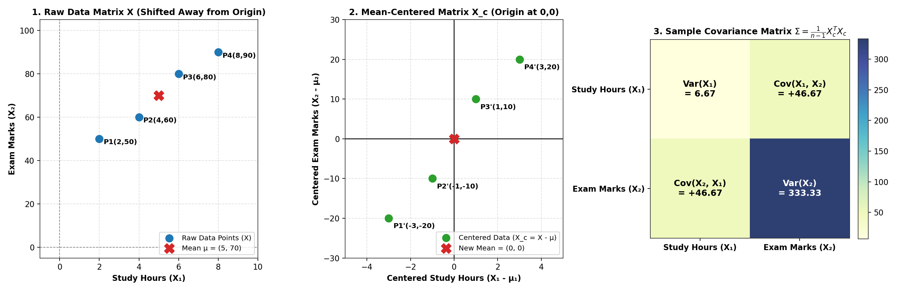
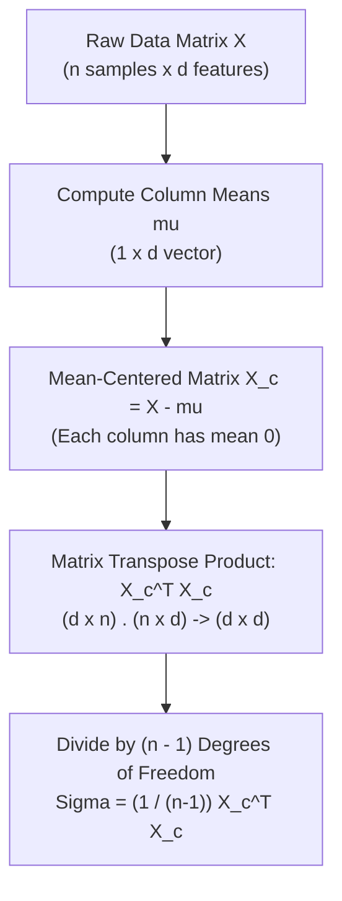

# Dependency Lesson 03.2: Matrices, Linear Operations, and Covariance Matrices (න්‍යාස, න්‍යාස ගුණිතය සහ සහවිචලතා න්‍යාසය)

> [!TIP]
> **🔗 Related Core Module Lessons (මෙම පාඩම භාවිතා වන ප්‍රධාන පාඩම්):**
> මෙම පාඩමෙන් ඔබ ඉගෙන ගන්නා **Design Matrix ($X$)**, **Matrix Multiplication ($AB$)**, **Mean-Centering ($X_c$)**, සහ **Covariance Matrix ($\Sigma = \frac{1}{n-1}X_c^T X_c$)** පිළිබඳ දැනුම පහත දැක්වෙන ප්‍රධාන CI7524 Data Mining පාඩම් තේරුම් ගැනීමට අත්‍යවශ්‍ය වේ:
> - [Lesson 3.2 - Mathematical Preliminaries & Distance Metrics](../../Module_03_Data_Mining_Lifecycle_and_Preprocessing/Lesson_3.2_Mathematical_Preliminaries_Distance_Metrics_and_Curse_of_Dimensionality.md)
> - [Lesson 3.3 - Data Quality, Cleaning & Missing Data Imputation](../../Module_03_Data_Mining_Lifecycle_and_Preprocessing/Lesson_3.3_Data_Quality_Cleaning_Integration_and_Missing_Data_Imputation.md)
> - [Lesson 3.4 - Feature Engineering, Scaling & Selection](../../Module_03_Data_Mining_Lifecycle_and_Preprocessing/Lesson_3.4_Feature_Engineering_Scaling_Encoding_and_Selection.md)
> - [Lesson 4.1 - Clustering Algorithms (K-Means, Hierarchical, DBSCAN)](../../Module_04_Data_Mining_Algorithms_and_Model_Selection/Lesson_4.1_Clustering_Algorithms_KMeans_Hierarchical_and_DBSCAN.md)
> - [Lesson 4.2 - Component Analysis & Dimensionality Reduction (PCA & SVD)](../../Module_04_Data_Mining_Algorithms_and_Model_Selection/Lesson_4.2_Component_Analysis_and_Dimensionality_Reduction_PCA_SVD_tSNE.md)
>
> **📚 Sibling Lessons in Dep_03 Series:**
> - **Previous:** [01_Vectors_High_Dimensional_Spaces_and_Norms.md](./01_Vectors_High_Dimensional_Spaces_and_Norms.md)
> - **Current:** `02_Matrices_Transformations_and_Covariance_Matrices.md`
> - **Next:** [03_Eigenvalues_Eigenvectors_and_Matrix_Factorization.md](./03_Eigenvalues_Eigenvectors_and_Matrix_Factorization.md)

---

## 1. Zero-to-Hero Intuition: Matrix (න්‍යාසය) එකක් කියන්නේ මොකක්ද?

පසුගිය පාඩමෙන් (`01_Vectors_High_Dimensional_Spaces_and_Norms.md`) අපි ඉගෙන ගත්තා **තනි රෝගියෙක්ව හෝ තනි ශිෂ්‍යයෙක්ව (Single Observation)** Features $d$ ක් සහිත **Vector (දෛශිකයක්)** ලෙස නිරූපණය කරන හැටි.

එහෙනම් අපි ළඟ ශිෂ්‍යයන් $n$ දෙනෙකුගේ සම්පූර්ණ Dataset එකක් (උදා: CSV table එකක් හෝ Pandas DataFrame එකක්) තිබුණොත් ඒක ගණිතමය වශයෙන් ලියන්නේ කොහොමද? ඒ සඳහා අපි භාවිතා කරන්නේ පේළි (**Rows — $n$**) සහ තීරු (**Columns — $d$**) වලින් සැදුම්ලත් සෘජුකෝණාස්‍රාකාර සංඛ්‍යා වගුවක් හෙවත් **Matrix (න්‍යාසය — $X \in \mathbb{R}^{n \times d}$)** එකකි!

### 1.1 The Data / Design Matrix ($X \in \mathbb{R}^{n \times d}$)
Data Mining වලදී සම්පූර්ණ Dataset එක හඳුන්වන්නේ **Data Matrix** හෝ **Design Matrix ($X$)** කියලයි:
- **සෑම පේළියක්ම (Row $i \in \{1, \dots, n\}$):** එක නිරීක්ෂණයක් / පුද්ගලයෙක් (**Instance / Sample / Record** $\mathbf{x}^{(i)}$).
- **සෑම තීරුවක්ම (Column $j \in \{1, \dots, d\}$):** එක විචල්‍යයක් / ලක්ෂණයක් (**Feature / Variable / Attribute** $X_j$).

උදාහරණයක් ලෙස ශිෂ්‍යයන් $n=4$ දෙනෙකුගේ `Study Hours` ($X_1$) සහ `Exam Marks` ($X_2$) දැක්වෙන $4 \times 2$ Data Matrix එක බලන්න:

$$X = \begin{bmatrix} x_{11} & x_{12} \\ x_{21} & x_{22} \\ x_{31} & x_{32} \\ x_{41} & x_{42} \end{bmatrix} = \begin{bmatrix} 2 & 50 \\ 4 & 60 \\ 6 & 80 \\ 8 & 90 \end{bmatrix}_{4 \times 2}$$

මෙහි $x_{32} = 80$ යනු **3 වන පේළියේ (3rd Student), 2 වන තීරුවේ (Exam Marks)** අගයයි. (සැමවිටම **Row First, Column Second** — $i, j$ පිළිවෙළ මතක තබා ගන්න!).

---

## 2. Essential Matrix Operations & Special Matrices (මූලික න්‍යාස ක්‍රියාකාරකම්)

### 2.1 Matrix Transpose (න්‍යාස පෙරළුම — $X^T$)
Matrix එකක පේළි සියල්ල තීරු බවටත්, තීරු සියල්ල පේළි බවටත් හුවමාරු කිරීමට **Transpose ($X^T$)** යැයි කියනු ලැබේ. $X$ හි හැඩය $n \times d$ නම්, $X^T$ හි හැඩය $d \times n$ වේ ($(X^T)_{ji} = X_{ij}$):

$$X = \begin{bmatrix} 2 & 50 \\ 4 & 60 \\ 6 & 80 \\ 8 & 90 \end{bmatrix}_{4 \times 2} \quad \implies \quad X^T = \begin{bmatrix} 2 & 4 & 6 & 8 \\ 50 & 60 & 80 & 90 \end{bmatrix}_{2 \times 4}$$

### 2.2 Matrix Multiplication (න්‍යාස ගුණිතය — $C = AB$)
බොහෝ සිසුන් වරද්දන තැනක් තමයි Matrix දෙකක් ගුණ කිරීම. Matrix ගුණිතය යනු අනුරූප අවයව ගුණ කිරීම (Element-wise multiplication) **නොවේ**! එය **Row-by-Column Dot Products** ගණනය කිරීමකි.

**නීතිය (Inner Dimension Rule):**
$A$ ($m \times k$) සහ $B$ ($k \times p$) න්‍යාස දෙකක් ගුණ කළ හැක්කේ **පළමු න්‍යාසයේ තීරු ගණන ($k$), දෙවන න්‍යාසයේ පේළි ගණනට ($k$) සමාන නම් පමණි!** ලැබෙන පිළිතුර $C$ හි හැඩය $(m \times p)$ වේ:

$$(m \times \mathbf{k}) \cdot (\mathbf{k} \times p) \longrightarrow (m \times p), \qquad C_{ij} = \sum_{r=1}^{k} A_{ir} B_{rj}$$

**අතින් ගණනය කිරීම (Worked Hand Calculation):**
පහත $2 \times 2$ න්‍යාස දෙක ගුණ කරමු:
$$A = \begin{bmatrix} 1 & 2 \\ 3 & 4 \end{bmatrix}, \qquad B = \begin{bmatrix} 5 & 6 \\ 7 & 8 \end{bmatrix}$$

- $C_{11}$ (1 වන පේළිය $\cdot$ 1 වන තීරුව): $(1 \times 5) + (2 \times 7) = 5 + 14 = 19$
- $C_{12}$ (1 වන පේළිය $\cdot$ 2 වන තීරුව): $(1 \times 6) + (2 \times 8) = 6 + 16 = 22$
- $C_{21}$ (2 වන පේළිය $\cdot$ 1 වන තීරුව): $(3 \times 5) + (4 \times 7) = 15 + 28 = 43$
- $C_{22}$ (2 වන පේළිය $\cdot$ 2 වන තීරුව): $(3 \times 6) + (4 \times 8) = 18 + 32 = 50$

$$AB = \begin{bmatrix} 19 & 22 \\ 43 & 50 \end{bmatrix}$$

> [!WARNING]
> **Matrix Multiplication is Not Commutative ($AB \neq BA$):**
> සාමාන්‍ය සංඛ්‍යා වලදී $3 \times 5 = 5 \times 3$ වුණාට, න්‍යාස වලදී $AB$ සහ $BA$ සමාන නොවේ!

### 2.3 Special Matrices in Data Science (විශේෂ න්‍යාස වර්ග)
1. **Identity Matrix (ඒකක න්‍යාසය — $I_d$):** ප්‍රධාන විකර්ණයේ (Main Diagonal) අගයන් $1$ සහ අනෙකුත් සියලුම අගයන් $0$ වන සමචතුරස්‍ර න්‍යාසයයි. සාමාන්‍ය ගණිතයේ $1$න් ගුණ කිරීම වගේම, $AI = IA = A$ වේ:
   $$I_2 = \begin{bmatrix} 1 & 0 \\ 0 & 1 \end{bmatrix}, \qquad I_3 = \begin{bmatrix} 1 & 0 & 0 \\ 0 & 1 & 0 \\ 0 & 0 & 1 \end{bmatrix}$$
2. **Diagonal Matrix (විකර්ණ න්‍යාසය — $\Lambda = \text{diag}(\lambda_1, \dots, \lambda_d)$):** ප්‍රධාන විකර්ණයේ පමණක් අගයන් පවතින අතර අනෙක් සියලුම ස්ථාන $0$ වේ. (PCA සහ SVD වල Eigenvalues සහ Singular Values ගබඩා වන්නේ Diagonal Matrix එකකයි!).
3. **Symmetric Matrix (සමමිතික න්‍යාසය):** $A^T = A$ වන න්‍යාසයකි (එනම් විකර්ණය වටා $A_{ij} = A_{ji}$ කැඩපත් ප්‍රතිබිම්බයක් සේ සමාන වේ). **සෑම Covariance Matrix එකක්ම සහ Correlation Matrix එකක්ම Symmetric Matrix එකකි!**
4. **Orthogonal Matrix (ලම්බක න්‍යාසය — $Q$):** සියලුම තීරු එකිනෙකට ලම්බක Unit Vectors (Orthonormal columns) වන සමචතුරස්‍ර න්‍යාසයකි. මෙහි විශේෂ ගුණය වන්නේ එහි ප්‍රතිලෝමය (**Inverse — $Q^{-1}$**) එහි **Transpose ($Q^T$)** එකටම සමාන වීමයි:
   $$Q^T Q = Q Q^T = I \implies Q^{-1} = Q^T$$

---

## 3. Mean-Centering a Data Matrix (දත්ත න්‍යාසයක් මධ්‍යන්‍යය වටා කේන්ද්‍රගත කිරීම — $X_c$)

PCA (Principal Component Analysis) හෝ Covariance Matrix ගණනය කිරීමට පෙර සිදු කළ යුතු **පළමු සහ අනිවාර්ය පියවර** වන්නේ දත්ත න්‍යාසයේ සෑම Feature තීරුවකම සාමාන්‍ය අගය (**Mean — $\mu_j$**) ශූන්‍යය $(0)$ බවට පත් වන සේ මූල ලක්ෂ්‍යය $(0,0)$ වෙත ගෙන ඒමයි. මෙයට **Mean-Centering** යැයි කියනු ලැබේ.



### 3.1 Step-by-Step Hand Calculation of Mean-Centering
අපගේ $4 \times 2$ ශිෂ්‍ය දත්ත න්‍යාසය $X$ ගනිමු:

$$X = \begin{bmatrix} 2 & 50 \\ 4 & 60 \\ 6 & 80 \\ 8 & 90 \end{bmatrix}$$

**පියවර 1: එක් එක් තීරුවේ Mean ($\mu_j$) සෙවීම:**
- Feature 1 (`Study Hours`) Mean: $\mu_1 = \frac{2 + 4 + 6 + 8}{4} = \frac{20}{4} = 5.0$
- Feature 2 (`Exam Marks`) Mean: $\mu_2 = \frac{50 + 60 + 80 + 90}{4} = \frac{280}{4} = 70.0$
- එබැවින් **Mean Vector** එක: $\boldsymbol{\mu} = [5, 70]$

**පියවර 2: සෑම පේළියකින්ම Mean Vector එක අඩු කිරීම ($X_c = X - \mathbf{1}\boldsymbol{\mu}$):**

$$X_c = \begin{bmatrix} 2 - 5 & 50 - 70 \\ 4 - 5 & 60 - 70 \\ 6 - 5 & 80 - 70 \\ 8 - 5 & 90 - 70 \end{bmatrix} = \begin{bmatrix} -3 & -20 \\ -1 & -10 \\ +1 & +10 \\ +3 & +20 \end{bmatrix}$$

ඉහත රූපයේ **Panel 1** සහ **Panel 2** සංසන්දනය කර බලන්න! දත්ත ලක්ෂ්‍ය 4 අතර පවතින සාපේක්ෂ පිහිටීම හෝ හැඩය පොඩ්ඩක්වත් වෙනස් වෙලා නැහැ; සිදු වී ඇත්තේ $(5, 70)$ හි පිහිටි මධ්‍ය ලක්ෂ්‍යය $(0, 0)$ මූල ලක්ෂ්‍යය මතට ගෙන ඒම පමණයි!

---

## 4. The Covariance Matrix (සහවිචලතා න්‍යාසය — $\Sigma$)

අපි ළඟ Features $d$ ක් ඇති විට, එක් එක් Feature එකේ තනි විසිරීම (**Variance — විචලතාව**) සහ Features දෙකක් එකිනෙකා සමඟ වෙනස් වන ආකාරය (**Covariance — සහවිචලතාව**) යන සියල්ලම එකම $d \times d$ සමචතුරස්‍ර න්‍යාසයකට කැටි කර දක්වන න්‍යාසය **Sample Covariance Matrix ($\Sigma$ හෝ $S$)** ලෙස හැඳින්වේ.



### 4.1 Matrix Formula for the Covariance Matrix
Mean-centered න්‍යාසය $X_c$ ($n \times d$) භාවිතයෙන් තනි න්‍යාස ගුණිතයකින් **Covariance Matrix (සහවිචලතා න්‍යාසය)** ලබා ගත හැක:

$$\Sigma = \frac{1}{n - 1} X_c^T X_c$$

මෙහි හැඩය පරීක්ෂා කරමු: $X_c^T$ යනු $(d \times n)$ වන අතර $X_c$ යනු $(n \times d)$ වේ. එබැවින් $(d \times n) \cdot (n \times d) = (d \times d)$ සමචතුරස්‍ර න්‍යාසයක් ලැබේ! (ශිෂ්‍යයන් මිලියනයක් $n=1,000,000$ සිටියත්, Features $d=2$ නම් Covariance Matrix එක $2 \times 2$ පමණි!).

### 4.2 Complete Hand Calculation of $\Sigma = \frac{1}{n-1} X_c^T X_c$
අපගේ $X_c$ න්‍යාසය භාවිතයෙන් $\Sigma$ අතින් ගණනය කරමු ($n = 4 \implies n - 1 = 3$):

$$X_c^T X_c = \begin{bmatrix} -3 & -1 & 1 & 3 \\ -20 & -10 & 10 & 20 \end{bmatrix}_{2 \times 4} \begin{bmatrix} -3 & -20 \\ -1 & -10 \\ 1 & 10 \\ 3 & 20 \end{bmatrix}_{4 \times 2}$$

Dot Products 4 ගණනය කරමු:
1. **ඉහළ වම් අවයවය (Row 1 $\cdot$ Col 1 — Sum of Squares of $X_1$):**
   $$(-3)(-3) + (-1)(-1) + (1)(1) + (3)(3) = 9 + 1 + 1 + 9 = 20$$
2. **ඉහළ දකුණු අවයවය (Row 1 $\cdot$ Col 2 — Cross-Product of $X_1, X_2$):**
   $$(-3)(-20) + (-1)(-10) + (1)(10) + (3)(20) = 60 + 10 + 10 + 60 = 140$$
3. **පහළ වම් අවයවය (Row 2 $\cdot$ Col 1 — Cross-Product of $X_2, X_1$):**
   $$(-20)(-3) + (-10)(-1) + (10)(1) + (20)(3) = 60 + 10 + 10 + 60 = 140$$
4. **පහළ දකුණු අවයවය (Row 2 $\cdot$ Col 2 — Sum of Squares of $X_2$):**
   $$(-20)^2 + (-10)^2 + (10)^2 + (20)^2 = 400 + 100 + 100 + 400 = 1000$$

දැන් $n - 1 = 3$ න් බෙදමු:

$$\Sigma = \frac{1}{3} \begin{bmatrix} 20 & 140 \\ 140 & 1000 \end{bmatrix} = \begin{bmatrix} 6.67 & 46.67 \\ 46.67 & 333.33 \end{bmatrix}$$

### 4.3 Covariance Matrix එකක් කියවන්නේ කොහොමද? (Anatomy of $\Sigma$)

$$\Sigma = \begin{bmatrix} \text{Var}(X_1) & \text{Cov}(X_1, X_2) \\ \text{Cov}(X_2, X_1) & \text{Var}(X_2) \end{bmatrix} = \begin{bmatrix} 6.67 & +46.67 \\ +46.67 & 333.33 \end{bmatrix}$$

- **Main Diagonal Elements ($\Sigma_{ii} = \text{Var}(X_i)$):** ප්‍රධාන විකර්ණයේ ඇත්තේ එක් එක් Feature එකේ **Variance (විචලතාව)** යි ($\text{Var}(X_1) = 6.67$, $\text{Var}(X_2) = 333.33$). විචලතාව කිසිවිටෙකත් ඍණ විය නොහැක ($\Sigma_{ii} \ge 0$).
- **Off-Diagonal Elements ($\Sigma_{ij} = \text{Cov}(X_i, X_j)$):** විකර්ණයෙන් පිටත ඇත්තේ Features දෙක අතර **Covariance (සහවිචලතාව)** යි:
  - **$\text{Cov}(X_1, X_2) > 0$ (ධන):** $X_1$ වැඩි වන විට $X_2$ ද වැඩි වේ (අපගේ උදාහරණයේ $+46.67$ — පාඩම් කරන පැය වැඩි වන විට ලකුණු වැඩි වේ).
  - **$\text{Cov}(X_1, X_2) < 0$ (ඍණ):** $X_1$ වැඩි වන විට $X_2$ අඩු වේ.
  - **$\text{Cov}(X_1, X_2) = 0$ (ශූන්‍ය):** විචල්‍ය දෙක අතර රේඛීය සම්බන්ධතාවක් නොමැත (Uncorrelated).

---

## 5. Python (`NumPy`) Implementation: Centering & Covariance Matrix

```python
import numpy as np

# 1. Create the 4x2 Data Matrix X
X = np.array([
    [2.0, 50.0],
    [4.0, 60.0],
    [6.0, 80.0],
    [8.0, 90.0]
])

# 2. Compute Column Mean Vector (axis=0 computes mean down the rows for each column)
mu = np.mean(X, axis=0)

# 3. Mean-Center the Matrix (NumPy broadcasting automatically subtracts mu from every row)
X_c = X - mu

# 4. Compute Covariance Matrix via Matrix Multiplication: (1/(n-1)) * X_c^T @ X_c
n = X.shape[0]
Sigma_manual = (X_c.T @ X_c) / (n - 1)

# 5. Verify with built-in np.cov (rowvar=False because columns are features)
Sigma_numpy = np.cov(X, rowvar=False, ddof=1)

print("Column Means (mu):", mu)
print("\nMean-Centered Matrix (X_c):\n", X_c)
print("\nCovariance Matrix (Manual X_c^T @ X_c / (n-1)):\n", np.round(Sigma_manual, 2))
print("\nCovariance Matrix (np.cov verification):\n", np.round(Sigma_numpy, 2))
```

**Output:**
```text
Column Means (mu): [ 5. 70.]

Mean-Centered Matrix (X_c):
 [[ -3. -20.]
 [ -1. -10.]
 [  1.  10.]
 [  3.  20.]]

Covariance Matrix (Manual X_c^T @ X_c / (n-1)):
 [[  6.67  46.67]
 [ 46.67 333.33]]

Covariance Matrix (np.cov verification):
 [[  6.67  46.67]
 [ 46.67 333.33]]
```

---

## 🛠️ Practical Task / Hands-On Exercise (ප්‍රායෝගික අභ්‍යාසය)

### Scenario / Goal
ඔබ Server Performance Dataset එකක් විශ්ලේෂණය කරයි. Servers $n=3$ ක `CPU Temp (C)` ($X_1$) සහ `Server Uptime Score` ($X_2$) දැක්වෙන $3 \times 2$ න්‍යාසය පහත දැක්වේ:
$$X = \begin{bmatrix} 60 & 90 \\ 70 & 80 \\ 80 & 70 \end{bmatrix}$$

### Step-by-Step Tasks
1. **Task 1:** $\mu_1$ සහ $\mu_2$ සොයා Mean-Centered Matrix එක ($X_c$) අතින් ගණනය කරන්න.
2. **Task 2:** $\Sigma = \frac{1}{n-1} X_c^T X_c$ සූත්‍රය භාවිතා කර $2 \times 2$ Covariance Matrix එක සොයන්න.
3. **Task 3:** Off-diagonal අගය ($\text{Cov}(X_1, X_2)$) ඍණ අගයක් වීමට හේතුව පැහැදිලි කර Python කේතයෙන් පරීක්ෂා කරන්න.

### Starter Code
```python
import numpy as np

X = np.array([
    [60.0, 90.0],
    [70.0, 80.0],
    [80.0, 70.0]
])

# TODO: Compute X_c and Covariance Matrix Sigma
```

### Expected Output / Reference Solution
```python
import numpy as np

X = np.array([
    [60.0, 90.0],
    [70.0, 80.0],
    [80.0, 70.0]
])

mu = np.mean(X, axis=0)         # [70., 80.]
X_c = X - mu                    # [[-10, +10], [0, 0], [+10, -10]]
n = X.shape[0]
Sigma = (X_c.T @ X_c) / (n - 1) # Divided by (3 - 1) = 2

print("Mean Vector:", mu)
print("Centered Matrix X_c:\n", X_c)
print("Covariance Matrix Sigma:\n", Sigma)
```

**Expected Output:**
```text
Mean Vector: [70. 80.]
Centered Matrix X_c:
 [[-10.  10.]
 [  0.   0.]
 [ 10. -10.]]
Covariance Matrix Sigma:
 [[ 100. -100.]
 [-100.  100.]]
```
*(පැහැදිලි කිරීම: $\text{Cov}(X_1, X_2) = -100$ ඍණ අගයක් ලැබෙන්නේ CPU උෂ්ණත්වය වැඩි වන විට Server Uptime Score එක ප්‍රතිලෝමව අඩු වන නිසාය!)*

---

## 📝 Summary & Exam Revision Cheat Sheet

| Matrix Operation / Concept | Mathematical Notation | Shape Transformation | Core Property / Use Case |
| :--- | :--- | :--- | :--- |
| **Design Matrix** | $X$ | $n \times d$ | $n$ observations (rows) $\times$ $d$ features (columns) |
| **Matrix Transpose** | $X^T$ | $(n \times d) \to (d \times n)$ | Flips rows and columns: $(X^T)_{ji} = X_{ij}$ |
| **Matrix Multiplication** | $C = AB$ | $(m \times k)(k \times p) \to (m \times p)$ | Inner dimensions $k$ must match; $AB \neq BA$ |
| **Mean-Centered Matrix** | $X_c = X - \mathbf{1}\boldsymbol{\mu}$ | $n \times d$ | Shifts origin to $(\mu_1, \dots, \mu_d)$ so column means $= 0$ |
| **Covariance Matrix** | $\Sigma = \frac{1}{n-1} X_c^T X_c$ | $d \times d$ (Symmetric) | Diagonal = $\text{Var}(X_i)$; Off-diagonal = $\text{Cov}(X_i, X_j)$ |
| **Orthogonal Matrix** | $Q^T Q = I$ | $d \times d$ | Preserves vector lengths and angles (Rotations in PCA/SVD) |

---

> [!TIP]
> **🔙 Return to Core Module Lessons (ආපසු ප්‍රධාන පාඩම් වෙත):**
> - [Lesson 3.2 - Mathematical Preliminaries & Distance Metrics](../../Module_03_Data_Mining_Lifecycle_and_Preprocessing/Lesson_3.2_Mathematical_Preliminaries_Distance_Metrics_and_Curse_of_Dimensionality.md)
> - [Lesson 3.3 - Data Quality, Cleaning & Missing Data Imputation](../../Module_03_Data_Mining_Lifecycle_and_Preprocessing/Lesson_3.3_Data_Quality_Cleaning_Integration_and_Missing_Data_Imputation.md)
> - [Lesson 3.4 - Feature Engineering, Scaling & Selection](../../Module_03_Data_Mining_Lifecycle_and_Preprocessing/Lesson_3.4_Feature_Engineering_Scaling_Encoding_and_Selection.md)
> - [Lesson 4.1 - Clustering Algorithms (K-Means, Hierarchical, DBSCAN)](../../Module_04_Data_Mining_Algorithms_and_Model_Selection/Lesson_4.1_Clustering_Algorithms_KMeans_Hierarchical_and_DBSCAN.md)
> - [Lesson 4.2 - Component Analysis & Dimensionality Reduction (PCA & SVD)](../../Module_04_Data_Mining_Algorithms_and_Model_Selection/Lesson_4.2_Component_Analysis_and_Dimensionality_Reduction_PCA_SVD_tSNE.md)
> - **Next Dependency Lesson:** [03_Eigenvalues_Eigenvectors_and_Matrix_Factorization.md](./03_Eigenvalues_Eigenvectors_and_Matrix_Factorization.md)
