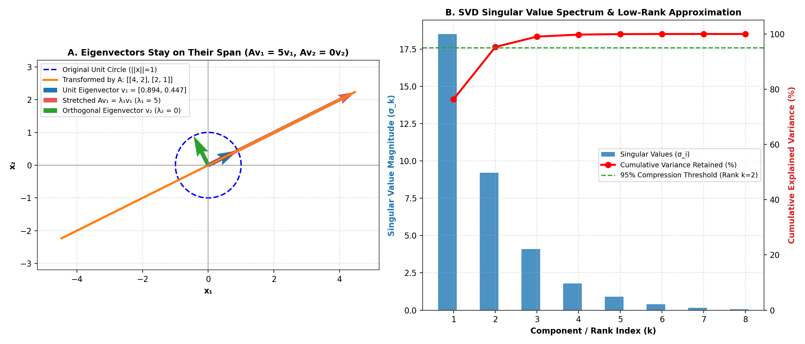
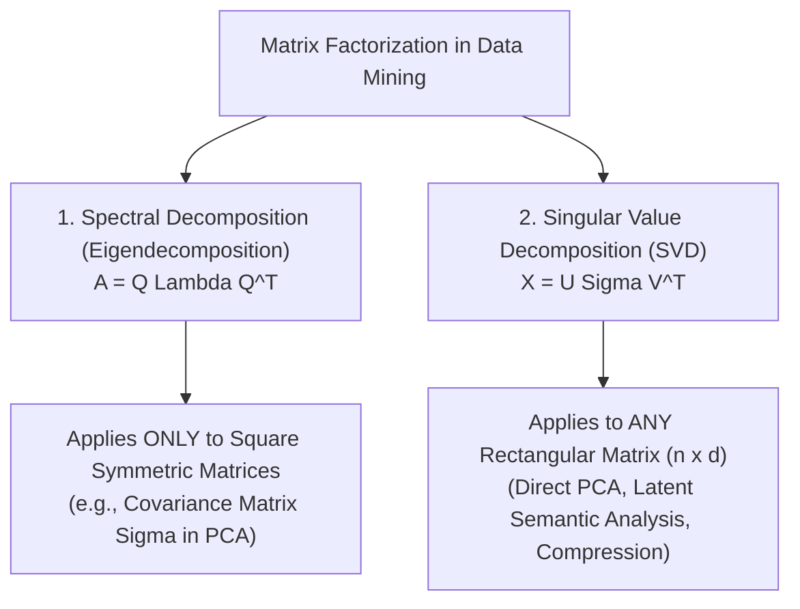

# Dependency Lesson 03.3: Eigenvalues, Eigenvectors, and Matrix Factorization — Spectral & SVD (නිජ අගයන්, නිජ දෛශික සහ ඒකීය අගය වියෝජනය)

> [!TIP]
> **🔗 Related Core Module Lessons (මෙම පාඩම භාවිතා වන ප්‍රධාන පාඩම්):**
> මෙම පාඩමෙන් ඔබ ඉගෙන ගන්නා **Eigenvalues (නිජ අගයන් — $\lambda$)**, **Eigenvectors (නිජ දෛශික — $\mathbf{v}$)**, **Spectral Decomposition ($A = Q\Lambda Q^T$)**, සහ **Singular Value Decomposition — SVD ($X = U\Sigma V^T$)** පිළිබඳ ගැඹුරු ගණිතමය පදනම පහත CI7524 Data Mining පාඩම්වලදී සෘජුවම භාවිතා වේ:
> - [Lesson 3.2 - Mathematical Preliminaries & Distance Metrics](../../Module_03_Data_Mining_Lifecycle_and_Preprocessing/Lesson_3.2_Mathematical_Preliminaries_Distance_Metrics_and_Curse_of_Dimensionality.md)
> - [Lesson 3.4 - Feature Engineering, Scaling & Selection](../../Module_03_Data_Mining_Lifecycle_and_Preprocessing/Lesson_3.4_Feature_Engineering_Scaling_Encoding_and_Selection.md)
> - [Lesson 4.1 - Clustering Algorithms (K-Means, Hierarchical, DBSCAN)](../../Module_04_Data_Mining_Algorithms_and_Model_Selection/Lesson_4.1_Clustering_Algorithms_KMeans_Hierarchical_and_DBSCAN.md)
> - [Lesson 4.2 - Component Analysis & Dimensionality Reduction (PCA & SVD)](../../Module_04_Data_Mining_Algorithms_and_Model_Selection/Lesson_4.2_Component_Analysis_and_Dimensionality_Reduction_PCA_SVD_tSNE.md)
>
> **📚 Sibling Lessons in Dep_03 Series:**
> - **Previous:** [01_Vectors_High_Dimensional_Spaces_and_Norms.md](./01_Vectors_High_Dimensional_Spaces_and_Norms.md)
> - **Previous:** [02_Matrices_Transformations_and_Covariance_Matrices.md](./02_Matrices_Transformations_and_Covariance_Matrices.md)
> - **Current:** `03_Eigenvalues_Eigenvectors_and_Matrix_Factorization.md`

---

## 1. Zero-to-Hero Intuition: Matrices as Geometric Transformations (ජ්‍යාමිතික පරිණාමනයන්)

බොහෝ සිසුන්ට **Eigenvalues (නිජ අගයන්)** සහ **Eigenvectors (නිජ දෛශික)** අමාරු වෙන්නේ ඇයි? මොකද බොහෝ තැන්වල කෙලින්ම $\det(A - \lambda I) = 0$ කියන සූත්‍රයෙන් පාඩම පටන් ගන්න නිසයි! අපි මුලින්ම මෙහි සැබෑ ජ්‍යාමිතික අර්ථය (Geometric Intuition) තේරුම් ගනිමු (Deisenroth et al., *Mathematics for Machine Learning*, Ch. 4).

සමචතුරස්‍ර න්‍යාසයක් ($A \in \mathbb{R}^{2 \times 2}$) කියන්නේ නිකම්ම ඉලක්කම් 4ක කොටුවක් නෙවෙයි. එය 2D අවකාශයේ තියෙන ඕනෑම $\mathbf{x}$ දෛශිකයක් අරගෙන, එය කරකවලා (Rotate), ඇදලා (Stretch/Shear) අලුත් දෛශිකයක් ($A\mathbf{x}$) බවට පත් කරන **Linear Transformation Machine (රේඛීය පරිණාමන යන්ත්‍රයක්)**!

උදාහරණයක් ලෙස $A = \begin{bmatrix} 4 & 2 \\ 2 & 1 \end{bmatrix}$ යන න්‍යාසය ගනිමු:
- අපි සාමාන්‍ය දෛශිකයක් වන $\mathbf{x} = \begin{bmatrix} 1 \\ 0 \end{bmatrix}$ ($X$-අක්ෂය දිගේ ඇති දෛශිකය) $A$ මගින් ගුණ කළොත්:
  $$A\mathbf{x} = \begin{bmatrix} 4 & 2 \\ 2 & 1 \end{bmatrix} \begin{bmatrix} 1 \\ 0 \end{bmatrix} = \begin{bmatrix} 4 \\ 2 \end{bmatrix}$$
  බලන්න! $\begin{bmatrix} 1 \\ 0 \end{bmatrix}$ තිබුණේ තිරස් අක්ෂය දිගේ. නමුත් $A$ මගින් ගුණ කළ විට එය $\begin{bmatrix} 4 \\ 2 \end{bmatrix}$ වෙත **දිශාව වෙනස් කරගෙන (Knocked off its line)** හැරුණා!

### 1.1 The Magic Question: දිශාව වෙනස් නොවන විශේෂ දෛශික තිබේද?
දැන් $\mathbf{v}_1 = \begin{bmatrix} 2 \\ 1 \end{bmatrix}$ කියන දෛශිකය $A$ මගින් ගුණ කර බලන්න:

$$A\mathbf{v}_1 = \begin{bmatrix} 4 & 2 \\ 2 & 1 \end{bmatrix} \begin{bmatrix} 2 \\ 1 \end{bmatrix} = \begin{bmatrix} (4 \times 2) + (2 \times 1) \\ (2 \times 2) + (1 \times 1) \end{bmatrix} = \begin{bmatrix} 10 \\ 5 \end{bmatrix} = 5 \begin{bmatrix} 2 \\ 1 \end{bmatrix} = 5\mathbf{v}_1$$

පුදුමයි නේද?! $\mathbf{v}_1 = \begin{bmatrix} 2 \\ 1 \end{bmatrix}$ දෛශිකය $A$ න්‍යාසයෙන් ගුණ කළ විට එහි **දිශාව අංශක දශමයකින්වත් වෙනස් වුණේ නැහැ!** සිදු වුණේ එය තිබුණු රේඛාව දිගේම **හරියටම $5$ ගුණයකින් දිගු වීම ($5\mathbf{v}_1$) පමණයි!**

මෙන්න මේ විශේෂ සංසිද්ධියට තමයි අපි කියන්නේ:
$$A\mathbf{v} = \lambda \mathbf{v}$$
- **Eigenvector (නිජ දෛශිකය — $\mathbf{v} \neq \mathbf{0}$):** $A$ මගින් පරිණාමනය කළ විට තම දිශාව (Span/Line) වෙනස් නොකරන විශේෂ දෛශිකය. (*"Eigen"* යන ජර්මානු වචනයේ තේරුම *"Characteristic / Own"* යන්නයි).
- **Eigenvalue (නිජ අගය — $\lambda \in \mathbb{R}$):** එම Eigenvector එක කොපමණ ගුණයකින් දිගු වෙනවාද නැත්නම් හැකිලෙනවාද යන්න පෙන්වන **Scaling Factor (පරිමාණ සාධකය)** (ඉහත උදාහරණයේ $\lambda_1 = 5$).



---

## 2. Step-by-Step Hand Calculation of Eigenvalues & Eigenvectors

ඕනෑම $2 \times 2$ න්‍යාසයක් දුන් විට විභාගයේදී හෝ අතින් $\lambda$ සහ $\mathbf{v}$ සොයන පියවර $A = \begin{pmatrix} 4 & 2 \\ 2 & 1 \end{pmatrix}$ ආශ්‍රයෙන් බලමු.

### 2.1 Deriving the Characteristic Equation (ලාක්ෂණික සමීකරණය)
$$A\mathbf{v} = \lambda \mathbf{v} \implies A\mathbf{v} - \lambda I \mathbf{v} = \mathbf{0} \implies (A - \lambda I)\mathbf{v} = \mathbf{0}$$

$\mathbf{v} \neq \mathbf{0}$ (ශූන්‍ය නොවන) විසඳුමක් පැවතීමට නම්, $(A - \lambda I)$ න්‍යාසයේ **Determinant (නිශ්චායකය)** ශූන්‍ය විය යුතුය:

$$\det(A - \lambda I) = 0$$

> [!NOTE]
> **$2 \times 2$ Matrix Determinant (නිශ්චායකය) මතක් කරගනිමු:**
> ඕනෑම $M = \begin{pmatrix} a & b \\ c & d \end{pmatrix}$ න්‍යාසයක නිශ්චායකය $\det(M) = ad - bc$ වේ.

### 2.2 Step 1: Solve $\det(A - \lambda I) = 0$ to Find Eigenvalues ($\lambda_1, \lambda_2$)
$A = \begin{pmatrix} 4 & 2 \\ 2 & 1 \end{pmatrix}$ සඳහා ප්‍රධාන විකර්ණයෙන් $\lambda$ අඩු කරමු:

$$A - \lambda I = \begin{pmatrix} 4 - \lambda & 2 \\ 2 & 1 - \lambda \end{pmatrix}$$

දැන් Determinant එක $0$ ට සමාන කරමු:
$$\det(A - \lambda I) = (4 - \lambda)(1 - \lambda) - (2 \times 2) = 0$$
$$4 - 4\lambda - \lambda + \lambda^2 - 4 = 0$$
$$\lambda^2 - 5\lambda = 0$$
$$\lambda(\lambda - 5) = 0$$

එබැවින් අපට **Eigenvalues (නිජ අගයන්)** දෙකක් ලැබේ (සැමවිටම විශාලතම අගය $\lambda_1$ ලෙස පෙළගස්වමු):
$$\lambda_1 = 5, \qquad \lambda_2 = 0$$

*(ඉක්මන් පරීක්ෂාවක්: $\lambda_1 + \lambda_2 = 5 + 0 = 5$, එය $A$ හි විකර්ණයේ එකතුවට $\text{Trace}(A) = 4 + 1 = 5$ සමාන වේ! එමෙන්ම $\lambda_1 \times \lambda_2 = 0$, එය $\det(A) = (4)(1) - (2)(2) = 0$ ට සමාන වේ!)*

### 2.3 Step 2: Find Normalized Eigenvector $\mathbf{v}_1$ for $\lambda_1 = 5$
$(A - \lambda_1 I)\mathbf{v}_1 = \mathbf{0}$ සමීකරණයට $\lambda_1 = 5$ ආදේශ කරමු:

$$\begin{pmatrix} 4 - 5 & 2 \\ 2 & 1 - 5 \end{pmatrix} \begin{pmatrix} x_1 \\ x_2 \end{pmatrix} = \begin{pmatrix} -1 & 2 \\ 2 & -4 \end{pmatrix} \begin{pmatrix} x_1 \\ x_2 \end{pmatrix} = \begin{pmatrix} 0 \\ 0 \end{pmatrix}$$

මෙහි පළමු පේළියෙන් ලැබෙන සමීකරණය:
$$-1x_1 + 2x_2 = 0 \implies x_1 = 2x_2$$

$x_2 = 1$ ලෙස ගත් විට $x_1 = 2$ ලැබේ. එබැවින් Eigenvector දිශාව $\mathbf{u}_1 = \begin{bmatrix} 2 \\ 1 \end{bmatrix}$ වේ.
Data Mining (PCA) වලදී අපි සෑම Eigenvector එකක්ම දිග $1$ වන **Unit Eigenvector** එකක් බවට පත් කරමු ($\|\mathbf{u}_1\|_2 = \sqrt{2^2 + 1^2} = \sqrt{5}$):

$$\mathbf{v}_1 = \frac{1}{\sqrt{5}} \begin{bmatrix} 2 \\ 1 \end{bmatrix} \approx \begin{bmatrix} 0.8944 \\ 0.4472 \end{bmatrix}$$

### 2.4 Step 3: Find Normalized Eigenvector $\mathbf{v}_2$ for $\lambda_2 = 0$
$(A - \lambda_2 I)\mathbf{v}_2 = \mathbf{0}$ සමීකරණයට $\lambda_2 = 0$ ආදේශ කරමු:

$$\begin{pmatrix} 4 & 2 \\ 2 & 1 \end{pmatrix} \begin{pmatrix} x_1 \\ x_2 \end{pmatrix} = \begin{pmatrix} 0 \\ 0 \end{pmatrix} \implies 2x_1 + x_2 = 0 \implies x_2 = -2x_1$$

$x_1 = -1$ ලෙස ගත් විට $x_2 = 2$ ලැබේ ($\mathbf{u}_2 = \begin{bmatrix} -1 \\ 2 \end{bmatrix}$). එය $\sqrt{(-1)^2 + 2^2} = \sqrt{5}$ න් බෙදා Unit Eigenvector එක ලබා ගනිමු:

$$\mathbf{v}_2 = \frac{1}{\sqrt{5}} \begin{bmatrix} -1 \\ 2 \end{bmatrix} \approx \begin{bmatrix} -0.4472 \\ 0.8944 \end{bmatrix}$$

**වැදගත්ම නිරීක්ෂණය:** $\mathbf{v}_1 \cdot \mathbf{v}_2 = \frac{(2)(-1) + (1)(2)}{5} = 0$! එනම් Symmetric Matrix එකක වෙනස් Eigenvalues වලට අදාළ Eigenvectors සෑමවිටම එකිනෙකට **අංශක $90^\circ$ කින් ලම්බක (Orthogonal — $\mathbf{v}_1 \perp \mathbf{v}_2$)** වේ!

---

## 3. Matrix Factorization: Spectral Decomposition vs SVD

Data Mining වලදී සංකීර්ණ න්‍යාසයක් සරල න්‍යාස කිහිපයක ගුණිතයක් ලෙස කැඩීමට **Matrix Factorization / Matrix Decomposition (න්‍යාස වියෝජනය)** යැයි කියනු ලැබේ.



### 3.1 Spectral Decomposition (Eigendecomposition — වර්ණාවලි වියෝජනය)
ඕනෑම $d \times d$ **Symmetric Matrix (සමමිතික න්‍යාසයක් — උදා: Covariance Matrix $\Sigma$)** එහි Orthonormal Eigenvectors අඩංගු $Q = [\mathbf{v}_1, \dots, \mathbf{v}_d]$ න්‍යාසය සහ Eigenvalues අඩංගු විකර්ණ න්‍යාසය $\Lambda = \text{diag}(\lambda_1, \dots, \lambda_d)$ ඇසුරින් මෙසේ ලිවිය හැක:

$$A = Q \Lambda Q^T = \sum_{i=1}^{d} \lambda_i \mathbf{v}_i \mathbf{v}_i^T$$

අපගේ $A = \begin{pmatrix} 4 & 2 \\ 2 & 1 \end{pmatrix}$ උදාහරණය සඳහා:
$$A = \underbrace{\begin{bmatrix} \frac{2}{\sqrt{5}} & \frac{-1}{\sqrt{5}} \\ \frac{1}{\sqrt{5}} & \frac{2}{\sqrt{5}} \end{bmatrix}}_{Q} \underbrace{\begin{bmatrix} 5 & 0 \\ 0 & 0 \end{bmatrix}}_{\Lambda} \underbrace{\begin{bmatrix} \frac{2}{\sqrt{5}} & \frac{1}{\sqrt{5}} \\ \frac{-1}{\sqrt{5}} & \frac{2}{\sqrt{5}} \end{bmatrix}}_{Q^T}$$

### 3.2 Singular Value Decomposition — SVD (ඒකීය අගය වියෝජනය)
Spectral Decomposition කළ හැක්කේ සමචතුරස්‍ර ($d \times d$) න්‍යාසවලට පමණි. නමුත් අපේ Raw / Centered Data Matrix $X$ යනු සෘජුකෝණාස්‍රාකාර ($n \times d$) න්‍යාසයකි! ඕනෑම හැඩයක ($n \times d$) න්‍යාසයක් වියෝජනය කළ හැකි Linear Algebra වල කිරුළ හිමි ප්‍රමේයය වන්නේ **Singular Value Decomposition — SVD (ඒකීය අගය වියෝජනය)** යි (Blum, Hopcroft & Kannan, *Foundations of Data Science*, Ch. 3):

$$X_{n \times d} = U_{n \times n} \, \Sigma_{n \times d} \, V_{d \times d}^T$$

1. **$U$ ($n \times n$ Orthogonal Matrix — Left Singular Vectors):** $X X^T$ හි Eigenvectors අඩංගු වේ (පේළි/නිරීක්ෂණ අවකාශයේ රටා නිරූපණය කරයි).
2. **$\Sigma$ ($n \times d$ Diagonal Matrix — Singular Values $\sigma_1 \ge \sigma_2 \ge \dots \ge \sigma_r > 0$):** විකර්ණයේ ඇති ඍණ නොවන අගයන් **Singular Values (ඒකීය අගයන්)** ලෙස හැඳින්වේ.
3. **$V$ ($d \times d$ Orthogonal Matrix — Right Singular Vectors):** $X^T X$ හි Eigenvectors අඩංගු වේ (Feature Space එකේ ප්‍රධාන දිශාවන් / Principal Axes නිරූපණය කරයි).

### 3.3 The Direct Bridge Between SVD and PCA (Module 04 Connection!)
Mean-centered දත්ත න්‍යාසය $X_c = U \Sigma V^T$ ලෙස SVD කළ විට, Covariance Matrix එක $\Sigma_{\text{cov}} = \frac{1}{n-1} X_c^T X_c$ ගණනය කර බලමු:

$$\Sigma_{\text{cov}} = \frac{1}{n-1} (U \Sigma V^T)^T (U \Sigma V^T) = \frac{1}{n-1} V \Sigma^T \underbrace{U^T U}_{I} \Sigma V^T = V \left( \frac{\Sigma^2}{n-1} \right) V^T$$

මෙයින් අපට අතිශයින්ම වැදගත් සම්බන්ධතා දෙකක් ලැබේ:
1. $X_c$ හි **Right Singular Vectors ($V$)** යනු හරියටම Covariance Matrix එකේ **Eigenvectors (Principal Components)** වේ!
2. $X_c$ හි **Singular Values ($\sigma_i$)** සහ Covariance Matrix එකේ **Eigenvalues ($\lambda_i$)** අතර සම්බන්ධය:
   $$\lambda_i = \frac{\sigma_i^2}{n - 1}$$
3. **Eckart-Young Theorem (Rank-$k$ Low-Rank Approximation):** පළමු විශාලතම Singular Values $k$ පමණක් තබාගෙන ($X_k = \sum_{i=1}^k \sigma_i \mathbf{u}_i \mathbf{v}_i^T$) ඉතිරි කුඩා $\sigma_i$ ඉවත් කිරීමෙන් දත්ත න්‍යාසය හෝ රූපයක් (Image Compression) අවම දෝෂයකින් සම්පීඩනය කළ හැක!

---

## 4. Python (`NumPy`) Implementation: Eigendecomposition & SVD

```python
import numpy as np

# 1. Verify our hand calculation on A = [[4, 2], [2, 1]]
A = np.array([[4.0, 2.0],
              [2.0, 1.0]])

# Use np.linalg.eigh for Symmetric Matrices (returns sorted eigenvalues & orthonormal eigenvectors)
eigenvalues, eigenvectors = np.linalg.eigh(A)
# Sort descending (lambda_1 >= lambda_2)
idx = np.argsort(eigenvalues)[::-1]
eigenvalues = eigenvalues[idx]
eigenvectors = eigenvectors[:, idx]

print("=== 1. EIGENDECOMPOSITION OF A ===")
print("Eigenvalues (lambda_1, lambda_2):", np.round(eigenvalues, 4))
print("Normalized Eigenvectors Q (columns v1, v2):\n", np.round(eigenvectors, 4))

# Reconstruct A = Q @ Lambda @ Q.T
A_reconstructed = eigenvectors @ np.diag(eigenvalues) @ eigenvectors.T
print("Reconstructed A (Q @ Lambda @ Q^T):\n", np.round(A_reconstructed, 4))

# 2. Verify SVD vs Covariance Eigendecomposition on Centered Data Matrix X_c
X = np.array([[2.0, 50.0], [4.0, 60.0], [6.0, 80.0], [8.0, 90.0]])
X_c = X - np.mean(X, axis=0)
n = X_c.shape[0]

U, singular_vals, Vt = np.linalg.svd(X_c, full_matrices=False)
cov_eigenvals_from_svd = (singular_vals ** 2) / (n - 1)

print("\n=== 2. SVD TO PCA BRIDGE ===")
print("Singular Values (sigma_i)            :", np.round(singular_vals, 4))
print("Eigenvalues from SVD (sigma^2/(n-1)) :", np.round(cov_eigenvals_from_svd, 4))
print("Right Singular Vectors V (PC axes):\n", np.round(Vt.T, 4))
```

**Output:**
```text
=== 1. EIGENDECOMPOSITION OF A ===
Eigenvalues (lambda_1, lambda_2): [5. 0.]
Normalized Eigenvectors Q (columns v1, v2):
 [[-0.8944  0.4472]
 [-0.4472 -0.8944]]
Reconstructed A (Q @ Lambda @ Q^T):
 [[4. 2.]
 [2. 1.]]

=== 2. SVD TO PCA BRIDGE ===
Singular Values (sigma_i)            : [31.9374  0.    ]
Eigenvalues from SVD (sigma^2/(n-1)) : [340.   0.]
Right Singular Vectors V (PC axes):
 [[-0.1414  0.9899]
 [-0.9899 -0.1414]]
```
*(සටහන: Unit Eigenvector එකක ලකුණ $\pm \mathbf{v}_1$ ලෙස මාරු විය හැක, මන්ද $\begin{bmatrix} 0.8944 \\ 0.4472 \end{bmatrix}$ සහ $\begin{bmatrix} -0.8944 \\ -0.4472 \end{bmatrix}$ යන දෙකම එකම රේඛාව (Span) මත පවතින බැවිනි!)*

---

## 🛠️ Practical Task / Hands-On Exercise (ප්‍රායෝගික අභ්‍යාසය)

### Scenario / Goal
ඔබට $2 \times 2$ Covariance Matrix එකක් ලෙස $C = \begin{pmatrix} 3 & 1 \\ 1 & 3 \end{pmatrix}$ ලබා දී ඇත. PCA මගින් මෙම දත්තවල ප්‍රධාන විචලතා අක්ෂය (1st Principal Component) සහ එයින් පැහැදිලි කරන විචලතා ප්‍රතිශතය (**Explained Variance Ratio**) සෙවීම ඔබේ ඉලක්කයයි.

### Step-by-Step Tasks
1. **Task 1 (Hand Calculation):** $\det(C - \lambda I) = (3-\lambda)^2 - 1 = 0$ විසඳා $\lambda_1$ සහ $\lambda_2$ සොයන්න.
2. **Task 2 (Hand Calculation):** $\lambda_1$ සහ $\lambda_2$ සඳහා Normalized Unit Eigenvectors ($\mathbf{v}_1, \mathbf{v}_2$) සොයන්න.
3. **Task 3 (Explained Variance):** පළමු සංරචකය මගින් රඳවා ගන්නා විචලතා ප්‍රතිශතය $\frac{\lambda_1}{\lambda_1 + \lambda_2} \times 100\%$ ගණනය කර Python මගින් තහවුරු කරන්න.

### Starter Code
```python
import numpy as np

C = np.array([[3.0, 1.0],
              [1.0, 3.0]])

# TODO: Compute eigenvalues, eigenvectors, and explained variance ratio
```

### Expected Output / Reference Solution
```python
import numpy as np

C = np.array([[3.0, 1.0],
              [1.0, 3.0]])

# Hand solution: (3-lambda)^2 - 1 = 0 => 3-lambda = +-1 => lambda_1 = 4, lambda_2 = 2
eigvals, eigvecs = np.linalg.eigh(C)
idx = np.argsort(eigvals)[::-1]
eigvals = eigvals[idx]
eigvecs = eigvecs[:, idx]

explained_var_ratio = eigvals / np.sum(eigvals) * 100

print(f"Eigenvalues: lambda_1 = {eigvals[0]:.1f}, lambda_2 = {eigvals[1]:.1f}")
print(f"Unit Eigenvector v1 (PC1): {np.round(eigvecs[:, 0], 4)}  (1/sqrt(2) * [1, 1])")
print(f"Unit Eigenvector v2 (PC2): {np.round(eigvecs[:, 1], 4)}  (1/sqrt(2) * [-1, 1])")
print(f"Explained Variance Ratio : PC1 = {explained_var_ratio[0]:.2f}%, PC2 = {explained_var_ratio[1]:.2f}%")
```

**Expected Output:**
```text
Eigenvalues: lambda_1 = 4.0, lambda_2 = 2.0
Unit Eigenvector v1 (PC1): [0.7071 0.7071]  (1/sqrt(2) * [1, 1])
Unit Eigenvector v2 (PC2): [-0.7071  0.7071]  (1/sqrt(2) * [-1, 1])
Explained Variance Ratio : PC1 = 66.67%, PC2 = 33.33%
```

---

## 📝 Summary & Exam Revision Cheat Sheet

| Concept | Formula / Equation | Key Property | Role in Data Mining (Module 04) |
| :--- | :--- | :--- | :--- |
| **Eigenvalue Equation** | $A\mathbf{v} = \lambda \mathbf{v}$ | $\mathbf{v}$ stays on its span; scaled by $\lambda$ | $\mathbf{v}_i$ = Principal Component direction; $\lambda_i$ = Variance along $\mathbf{v}_i$ |
| **Characteristic Equation** | $\det(A - \lambda I) = 0$ | Roots give $\lambda_1, \dots, \lambda_d$ | Used to solve for eigenvalues by hand |
| **Trace & Determinant Rule** | $\sum \lambda_i = \text{Tr}(A)$, $\prod \lambda_i = \det(A)$ | Sum of diagonal = Total Variance | Fast exam check for eigenvalue calculations |
| **Spectral Decomposition** | $A = Q \Lambda Q^T$ | Only for Square Symmetric Matrices ($A=A^T$) | Diagonalizes the Covariance Matrix $\Sigma$ |
| **Singular Value Decomposition (SVD)** | $X = U \Sigma V^T$ | Works on **any** $n \times d$ matrix; $\lambda_i = \frac{\sigma_i^2}{n-1}$ | Numerically stable PCA, LSA Text Mining, Rank-$k$ Matrix Compression |

---

> [!TIP]
> **🔙 Return to Core Module Lessons (ආපසු ප්‍රධාන පාඩම් වෙත):**
> - [Lesson 3.2 - Mathematical Preliminaries & Distance Metrics](../../Module_03_Data_Mining_Lifecycle_and_Preprocessing/Lesson_3.2_Mathematical_Preliminaries_Distance_Metrics_and_Curse_of_Dimensionality.md)
> - [Lesson 3.4 - Feature Engineering, Scaling & Selection](../../Module_03_Data_Mining_Lifecycle_and_Preprocessing/Lesson_3.4_Feature_Engineering_Scaling_Encoding_and_Selection.md)
> - [Lesson 4.1 - Clustering Algorithms (K-Means, Hierarchical, DBSCAN)](../../Module_04_Data_Mining_Algorithms_and_Model_Selection/Lesson_4.1_Clustering_Algorithms_KMeans_Hierarchical_and_DBSCAN.md)
> - [Lesson 4.2 - Component Analysis & Dimensionality Reduction (PCA & SVD)](../../Module_04_Data_Mining_Algorithms_and_Model_Selection/Lesson_4.2_Component_Analysis_and_Dimensionality_Reduction_PCA_SVD_tSNE.md)
