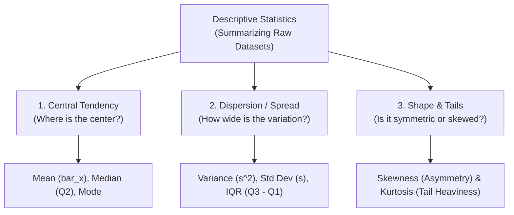
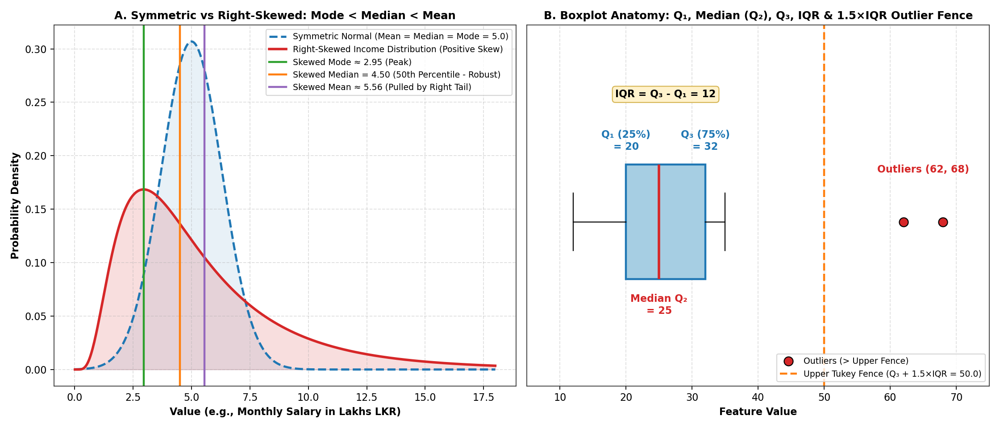

# Dependency Lesson 04.1: Descriptive Statistics — Central Tendency, Dispersion, IQR, Skewness & Kurtosis (විස්තරාත්මක සංඛ්‍යානය: කේන්ද්‍රීය ප්‍රවණතාව සහ විසිරුම් මිනුම්)

> [!TIP]
> **🔗 Related Core Module Lessons (මෙම පාඩම භාවිතා වන ප්‍රධාන පාඩම්):**
> මෙම Dependency පාඩමෙන් ඔබ ඉගෙන ගන්නා **Mean (මධ්‍යන්‍යය)**, **Median (මධ්‍යස්ථය)**, **Variance (විචලතාවය)**, **Standard Deviation (සම්මත අපගමනය)**, **Interquartile Range - IQR (අන්තර්-චතුර්ථක පරාසය)**, සහ **Skewness (කුටිකතාව)** පිළිබඳ මූලික සංඛ්‍යාන දැනුම පහත CI7524 Data Mining පාඩම්වලදී සෘජුවම භාවිතා වේ:
> - [Lesson 3.2 - Mathematical Preliminaries & Distance Metrics](../../Module_03_Data_Mining_Lifecycle_and_Preprocessing/Lesson_3.2_Mathematical_Preliminaries_Distance_Metrics_and_Curse_of_Dimensionality.md)
> - [Lesson 3.3 - Data Quality, Cleaning & Missing Data Imputation](../../Module_03_Data_Mining_Lifecycle_and_Preprocessing/Lesson_3.3_Data_Quality_Cleaning_Integration_and_Missing_Data_Imputation.md)
> - [Lesson 3.4 - Feature Engineering, Scaling & Selection](../../Module_03_Data_Mining_Lifecycle_and_Preprocessing/Lesson_3.4_Feature_Engineering_Scaling_Encoding_and_Selection.md)
> - [Lesson 4.1 - Clustering Algorithms (K-Means, Hierarchical, DBSCAN)](../../Module_04_Data_Mining_Algorithms_and_Model_Selection/Lesson_4.1_Clustering_Algorithms_KMeans_Hierarchical_and_DBSCAN.md)
> - [Lesson 4.2 - Component Analysis & Dimensionality Reduction (PCA & SVD)](../../Module_04_Data_Mining_Algorithms_and_Model_Selection/Lesson_4.2_Component_Analysis_and_Dimensionality_Reduction_PCA_SVD_tSNE.md)
>
> **📚 Sibling Lessons in Dep_04 Series:**
> - **Current:** `01_Descriptive_Statistics_Central_Tendency_and_Dispersion.md`
> - **Next:** [02_Probability_Normal_Distribution_and_Z_Scores.md](./02_Probability_Normal_Distribution_and_Z_Scores.md)
> - **Next:** [03_Correlation_Covariance_and_Hypothesis_Testing.md](./03_Correlation_Covariance_and_Hypothesis_Testing.md)

---

## 1. Zero-to-Hero Intuition: Descriptive Statistics (විස්තරාත්මක සංඛ්‍යානය) අවශ්‍ය ඇයි?

සිතන්න ඔබට බැංකුවක ගනුදෙනුකරුවන් මිලියනයකගේ ($n = 1,000,000$) මාසික ආදායම් දත්ත ලැබුණා කියලා. මේ ඉලක්කම් මිලියනය දිහා එකින් එක බලලා තීරණයක් ගන්න මිනිස් මොළයකට බැහැ. එබැවින් ඕනෑම Dataset එකක් ලැබුණු සැණින් Data Scientist කෙනෙක් මුලින්ම අසන ප්‍රශ්න 3ක් තියෙනවා:
1. **Where is the center? (කේන්ද්‍රය කොතැනද?):** දත්තවල සාමාන්‍ය හෝ මැද අගය කීයද? (**Measures of Central Tendency**)
2. **How spread out is the data? (විසිරීම කොපමණද?):** දත්ත සියල්ල මැද අගය වටා ළඟින්ම පොකුරු ගැසී තිබෙනවාද, නැත්නම් විශාල පරාසයක විසිරී තිබෙනවාද? (**Measures of Dispersion / Variability**)
3. **What is the shape of the distribution? (ව්‍යාප්තියේ හැඩය කුමක්ද?):** දත්ත දෙපැත්තට සමමිතිකද, නැත්නම් එක පැත්තකට ඇද වී (**Skewed**) හෝ අසාමාන්‍ය අගයන් (**Outliers**) සහිතද? (**Shape & Quartiles**)



---

## 2. Measures of Central Tendency (කේන්ද්‍රීය ප්‍රවණතා මිනුම්)

අපි සමාගමක සේවකයන් $5$ දෙනෙකුගේ මාසික වැටුප් (රුපියල් ලක්ෂ වලින්) දැක්වෙන කුඩා Dataset එකක් උදාහරණයට ගනිමු:
$$\text{Dataset A (Normal Employees): } X = \{2, 3, 3, 4, 8\}$$

### 2.1 Arithmetic Mean (සමාන්තර මධ්‍යන්‍යය — $\bar{x}$ හෝ $\mu$)
සියලුම අගයන්ගේ එකතුව, මුළු නිරීක්ෂණ ගණනින් ($n$) බෙදූ විට **Sample Mean ($\bar{x}$)** ලැබේ:

$$\bar{x} = \frac{1}{n} \sum_{i=1}^{n} x_i = \frac{x_1 + x_2 + \dots + x_n}{n}$$

- **අතින් ගණනය කිරීම:** $\bar{x} = \frac{2 + 3 + 3 + 4 + 8}{5} = \frac{20}{5} = 4.0\text{ Lakhs}$
- **භෞතික අර්ථය:** Mean යනු දත්ත රේඛාවේ **ගුරුත්ව කේන්ද්‍රය (Center of Gravity / Balance Point)** යි. සෑම ලක්ෂ්‍යයකම මධ්‍යන්‍යයේ සිට ඇති අපගමනයන්ගේ එකතුව සෑමවිටම ශූන්‍ය වේ: $\sum_{i=1}^n (x_i - \bar{x}) = (-2) + (-1) + (-1) + 0 + (+4) = 0$.

### 2.2 Median (මධ්‍යස්ථය — $Q_2$ / 50th Percentile)
දත්ත කුලකය කුඩාම අගයේ සිට විශාලතම අගය දක්වා **ආරෝහණ පිළිවෙළට (Sorted Order)** පෙළගැස්වූ පසු හරියටම මැදින් පිහිටන අගය **Median (මධ්‍යස්ථය)** වේ:
- $n$ ඔත්තේ (Odd) නම්: $\left(\frac{n+1}{2}\right)$ වන ස්ථානයේ අගය.
- $n$ ඉරට්ටේ (Even) නම්: මැද පිහිටි අගයන් දෙකේ සාමාන්‍යය: $\frac{x_{(n/2)} + x_{(n/2 + 1)}}{2}$.
- **අතින් ගණනය කිරීම:** $\{2, 3, \mathbf{3}, 4, 8\}$ හි මැද (3 වන) අගය $= 3.0\text{ Lakhs}$.

### 2.3 Mode (මාතය)
දත්ත කුලකයක **වැඩිම වාර ගණනක් යෙදෙන (Most Frequent)** අගය **Mode (මාතය)** ලෙස හැඳින්වේ.
- $\{2, \mathbf{3}, \mathbf{3}, 4, 8\}$ හි $3$ දෙවරක් යෙදී ඇති නිසා $\text{Mode} = 3.0$.
- **වැදගත්කම:** Categorical Features (උදා: `City = "Colombo"`, `Blood_Group = "O+"`) සඳහා Mean හෝ Median සෙවිය නොහැක! Categorical column එකක Missing Values (`NaN`) පිරවීමට (**Mode Imputation** in Lesson 3.3) භාවිතා කළ හැකි එකම මිනුම **Mode** පමණි!

### 2.4 Why Median Beats Mean When Outliers Exist! (Outlier Sensitivity)
දැන් සිතන්න ඉහත සේවකයන් 5 දෙනා සිටින කාමරයට මසකට රු. ලක්ෂ $100$ක් වැටුප් ගන්නා CEO (ප්‍රධාන විධායක නිලධාරියා) ඇතුළු වුණා කියලා ($\text{Dataset B} = \{2, 3, 3, 4, 8, 100\}$):
- **New Mean:** $\bar{x}_{\text{new}} = \frac{2 + 3 + 3 + 4 + 8 + 100}{6} = \frac{120}{6} = \mathbf{20.0\text{ Lakhs}}$! (සාමාන්‍ය සේවකයන් 5 දෙනාම ලක්ෂ 8ට අඩුවෙන් ගත්තත්, එකම එක Outlier එකක් නිසා Mean එක ලක්ෂ 4 සිට 20 දක්වා විකෘති විය!).
- **New Median:** මැද අගයන් දෙක $3$ සහ $4$ නිසා $\text{Median}_{\text{new}} = \frac{3 + 4}{2} = \mathbf{3.5\text{ Lakhs}}$!

> [!IMPORTANT]
> **Exam & Preprocessing Rule (Lesson 3.3 Missing Data Imputation):**
> - **Mean** යනු Outliers වලට අතිශයින් සංවේදී (**Non-robust**) මිනුමකි.
> - **Median** යනු Outliers මගින් වෙනස් නොවන (**Robust Statistic**) මිනුමකි. එබැවින් Skewed හෝ Outliers සහිත දත්තවල හිස්තැන් පිරවීමට සැමවිටම **Median Imputation** භාවිතා කරන්න!



---

## 3. Measures of Dispersion: Variance & Standard Deviation (විචලතාවය සහ සම්මත අපගමනය)

කේන්ද්‍රීය අගය සමාන වූ පමණින් දත්ත කුලක දෙකක් සමාන වන්නේ නැත. උදාහරණයකට:
- Class 1 ලකුණු: $\{49, 50, 51\} \implies \text{Mean} = 50$
- Class 2 ලකුණු: $\{0, 50, 100\} \implies \text{Mean} = 50$

මෙම විසිරීම මැනීමට අපි එක් එක් අගය මධ්‍යන්‍යයේ සිට කොපමණ දුරකින් පවතීද යන්න ($x_i - \bar{x}$) ගණනය කරමු. නමුත් $\sum (x_i - \bar{x}) = 0$ වන නිසා, ඍණ ලකුණු ඉවත් කිරීමට අපි එම අපගමනයන් **වර්ග කරමු ($(x_i - \bar{x})^2$)**.

### 3.1 Sample Variance (නියැදි විචලතාවය — $s^2$) සහ Bessel's Correction ($n-1$)
$$s^2 = \frac{1}{n - 1} \sum_{i=1}^{n} (x_i - \bar{x})^2$$

> [!NOTE]
> **ඇයි අපි $n$ වෙනුවට $(n - 1)$ න් බෙදන්නේ? (Bessel's Correction & Degrees of Freedom):**
> සම්පූර්ණ සංගහනයම (**Population** $\sigma^2 = \frac{1}{N}\sum(x_i - \mu)^2$) අප සතුව ඇති විට $N$ න් බෙදනු ලැබේ. නමුත් ප්‍රායෝගික Data Mining වලදී අප සතුව ඇත්තේ කුඩා නියැදියක් (**Sample**) පමණි. නියැදියේ දත්ත සැබෑ සංගහන මධ්‍යන්‍යය $\mu$ ට වඩා නියැදි මධ්‍යන්‍යය $\bar{x}$ ට සමීපව පවතින නිසා, $n$ න් බෙදුවහොත් සැබෑ විචලතාවය අවතක්සේරු (**Underestimate / Biased**) වේ. එමෙන්ම $\sum(x_i - \bar{x}) = 0$ වන නිසා නිදහසේ වෙනස් විය හැක්කේ අගයන් $n-1$ ක් පමණි (**Degrees of Freedom = $n-1$**). $n-1$ න් බෙදීමෙන් අපට **Unbiased Estimator** එකක් ලැබේ!

### 3.2 Standard Deviation (සම්මත අපගමනය — $s$ හෝ $\sigma$)
Variance ($s^2$) ගණනය කිරීමේදී අගයන් වර්ග කළ නිසා එහි ඒකකද වර්ග වී ඇත (උදා: වයස නම් $\text{Years}^2$, වැටුප් නම් $\text{Rupees}^2$). නැවත මුල් දත්තවල ඒකකයටම ගෙන ඒමට Variance එකේ වර්ගමූලය ගනු ලැබේ:

$$s = \sqrt{s^2} = \sqrt{\frac{1}{n - 1} \sum_{i=1}^{n} (x_i - \bar{x})^2}$$

### 3.3 Step-by-Step Hand Calculation of $s^2$ and $s$
අපගේ $\text{Dataset A} = \{2, 3, 3, 4, 8\}$ ($\bar{x} = 4.0$, $n = 5$) සඳහා පියවරෙන් පියවර ගණනය කරමු:

| Observation ($x_i$) | Deviation ($x_i - \bar{x}$) | Squared Deviation ($(x_i - \bar{x})^2$) |
| :---: | :---: | :---: |
| $2$ | $2 - 4 = -2$ | $(-2)^2 = 4$ |
| $3$ | $3 - 4 = -1$ | $(-1)^2 = 1$ |
| $3$ | $3 - 4 = -1$ | $(-1)^2 = 1$ |
| $4$ | $4 - 4 = 0$ | $(0)^2 = 0$ |
| $8$ | $8 - 4 = +4$ | $(+4)^2 = 16$ |
| **Sum ($\sum$)** | **$\sum(x_i - \bar{x}) = 0$** | **$\sum(x_i - \bar{x})^2 = 22$** |

1. **Sample Variance ($s^2$):**
   $$s^2 = \frac{22}{5 - 1} = \frac{22}{4} = 5.5\text{ Lakhs}^2$$
2. **Sample Standard Deviation ($s$):**
   $$s = \sqrt{5.5} \approx 2.3452\text{ Lakhs}$$

---

## 4. Quartiles, Interquartile Range (IQR), and Tukey's Boxplot Outlier Rule

Variance සහ Standard Deviation යන දෙකම Mean මත පදනම් වන නිසා Outliers වලට දැඩි ලෙස සංවේදී වේ. Outliers වලින් බලපෑමක් නොවන (**Robust**) විසිරුම් මිනුම වන්නේ **Interquartile Range - IQR (අන්තර්-චතුර්ථක පරාසය)** යි!

### 4.1 Quartiles ($Q_1, Q_2, Q_3$) සහ IQR
ආරෝහණ පිළිවෙළට සැකසූ දත්ත කුලකයක් සමාන කොටස් 4කට (25% බැගින්) බෙදන ලක්ෂ්‍ය 3 **Quartiles (චතුර්ථක)** ලෙස හැඳින්වේ:
- **$Q_1$ (First Quartile / 25th Percentile):** දත්තවලින් පහළම $25\%$ වෙන් කරන සීමාව.
- **$Q_2$ (Second Quartile / 50th Percentile):** **Median (මධ්‍යස්ථය)**.
- **$Q_3$ (Third Quartile / 75th Percentile):** දත්තවලින් පහළම $75\%$ (ඉහළම $25\%$) වෙන් කරන සීමාව.
- **Interquartile Range — IQR (අන්තර්-චතුර්ථක පරාසය):** මැද $50\%$ ක දත්ත පැතිරී ඇති පරාසයයි:
  $$\text{IQR} = Q_3 - Q_1$$

### 4.2 Tukey's $1.5 \times \text{IQR}$ Outlier Detection Rule (Lesson 3.3 Core Formula!)
Boxplot එකක Whiskers (වැටවල්/Fences) තීරණය කිරීමට John Tukey හඳුන්වා දුන් සම්මත නීතිය:
- **Lower Fence (පහළ සීමාව):** $L_{\text{fence}} = Q_1 - 1.5 \times \text{IQR}$
- **Upper Fence (ඉහළ සීමාව):** $U_{\text{fence}} = Q_3 + 1.5 \times \text{IQR}$

මෙම සීමාවන් දෙකෙන් පිටත පිහිටන ඕනෑම අගයක් ($x < L_{\text{fence}}$ හෝ $x > U_{\text{fence}}$) **Outlier (අසාමාන්‍ය අගයක්)** ලෙස හඳුනා ගැනේ!

**අතින් ගණනය කිරීම (Worked Calculation from Figure Panel B):**
Dataset ($n=13$, sorted): $\{12, 15, 18, \mathbf{20}, 22, 24, \mathbf{25}, 27, 30, \mathbf{32}, 35, 62, 68\}$
1. Median ($Q_2$, 7th value) $= 25$
2. $Q_1$ (25th percentile, 4th value) $= 20$
3. $Q_3$ (75th percentile, 10th value) $= 32$
4. $\text{IQR} = Q_3 - Q_1 = 32 - 20 = 12$
5. $\text{Lower Fence} = 20 - 1.5(12) = 20 - 18 = 2.0$
6. $\text{Upper Fence} = 32 + 1.5(12) = 32 + 18 = 50.0$
7. **Outliers:** $50.0$ ට වඩා වැඩි අගයන් වන **$62$ සහ $68$** පැහැදිලිවම Outliers වේ!

---

## 5. Distribution Shape: Skewness (කුටිකතාව) & Kurtosis (කකුදතාව)

### 5.1 Skewness (කුටිකතාව — 3rd Standardized Moment)
ව්‍යාප්තියක දෙපැත්තේ සමමිතික භාවය බිඳී ඇති ප්‍රමාණය සහ දිශාව **Skewness ($g_1$)** මගින් මනිනු ලැබේ:

$$\text{Skewness} = \frac{1}{n} \sum_{i=1}^{n} \left( \frac{x_i - \bar{x}}{s} \right)^3$$

1. **Symmetric Distribution ($\text{Skewness} \approx 0$):** වම් සහ දකුණු වලිග (Tails) සමාන වේ. $\text{Mean} \approx \text{Median} \approx \text{Mode}$.
2. **Right-Skewed / Positively Skewed ($\text{Skewness} > 0$):** දකුණු පැත්තට දිගු වලිගයක් ඇත (උදා: මිනිසුන්ගේ ආදායම, නිවාස මිල). ඉහත රූපයේ **Panel A** හි පරිදි විශාල අගයන් මගින් Mean එක දකුණට ඇදගෙන යන නිසා:
   $$\text{Mode} < \text{Median} < \text{Mean}$$
   *(Preprocessing Fix: $\log(1 + x)$ හෝ $\sqrt{x}$ පරිණාමනය යෙදීමෙන් Right-skewed දත්ත නැවත Normal හැඩයට ගෙන ආ හැක!)*
3. **Left-Skewed / Negatively Skewed ($\text{Skewness} < 0$):** වම් පැත්තට දිගු වලිගයක් ඇත (උදා: පහසු විභාගයක ලකුණු). මෙහිදී $\text{Mean} < \text{Median} < \text{Mode}$ වේ.

### 5.2 Kurtosis (කකුදතාව — 4th Standardized Moment)
ව්‍යාප්තියක මුදුනේ උල් බව සහ විශේෂයෙන්ම **වලිගවල ඝනකම (Tail Heaviness / Outlier Propensity)** මනින්නේ **Kurtosis** මගිනි:

$$\text{Excess Kurtosis} = \frac{1}{n} \sum_{i=1}^{n} \left( \frac{x_i - \bar{x}}{s} \right)^4 - 3$$

- **Mesokurtic ($\text{Excess Kurtosis} = 0$):** සාමාන්‍ය Normal Distribution එක (Raw Kurtosis $= 3$).
- **Leptokurtic ($\text{Excess Kurtosis} > 0$):** තියුණු මුදුනක් සහ **ඝනකම් වලිග (Fat / Heavy Tails)** ඇත — එනම් Extreme Outliers ඇතිවීමේ සම්භාවිතාව ඉතා ඉහළය (උදා: කොටස් වෙළඳපොළ ප්‍රතිලාභ).
- **Platykurtic ($\text{Excess Kurtosis} < 0$):** පැතලි මුදුනක් සහ තුනී වලිග (Thin Tails) ඇත (උදා: Uniform Distribution).

---

## 6. Python (`NumPy`) Implementation: Complete Descriptive Profile

```python
import numpy as np

data = np.array([12, 15, 18, 20, 22, 24, 25, 27, 30, 32, 35, 62, 68], dtype=float)

# 1. Central Tendency
mean_val = np.mean(data)
median_val = np.median(data)

# 2. Variance & Standard Deviation (CRITICAL: ddof=1 for Sample Statistics!)
sample_var = np.var(data, ddof=1)
sample_std = np.std(data, ddof=1)

# 3. Quartiles, IQR & Tukey Outlier Detection
q1, q2, q3 = np.percentile(data, [25, 50, 75])
iqr = q3 - q1
lower_fence = q1 - 1.5 * iqr
upper_fence = q3 + 1.5 * iqr
outliers = data[(data < lower_fence) | (data > upper_fence)]

# 4. Skewness & Excess Kurtosis
z_scores = (data - mean_val) / np.std(data, ddof=0)
skewness = np.mean(z_scores ** 3)
excess_kurtosis = np.mean(z_scores ** 4) - 3.0

print(f"Sample Mean   : {mean_val:.2f}  | Sample Median (Q2): {median_val:.2f}")
print(f"Sample Var s² : {sample_var:.2f} | Sample Std Dev s  : {sample_std:.2f}")
print(f"Q1 = {q1:.1f}, Q3 = {q3:.1f}, IQR = {iqr:.1f}")
print(f"Tukey Fences  : [{lower_fence:.1f}, {upper_fence:.1f}] -> Detected Outliers: {outliers}")
print(f"Skewness      : {skewness:+.3f} (Right-Skewed) | Excess Kurtosis: {excess_kurtosis:+.3f}")
```

**Output:**
```text
Sample Mean   : 30.00  | Sample Median (Q2): 25.00
Sample Var s² : 291.50 | Sample Std Dev s  : 17.07
Q1 = 20.0, Q3 = 32.0, IQR = 12.0
Tukey Fences  : [2.0, 50.0] -> Detected Outliers: [62. 68.]
Skewness      : +1.281 (Right-Skewed) | Excess Kurtosis: +0.625
```

> [!WARNING]
> **NumPy `ddof` Trap (විභාග සහ Coding වලදී වරදින තැනක්!):**
> `np.var(x)` සහ `np.std(x)` වල පෙරනිමි අගය (Default) වන්නේ `ddof=0` (එනම් $n$ න් බෙදීම) යි. Sample Variance ($n-1$ න් බෙදීම) ලබා ගැනීමට සැමවිටම `np.var(x, ddof=1)` සහ `np.std(x, ddof=1)` ලබා දිය යුතුය! (Pandas වල `.var()` සහ `.std()` වල පෙරනිමිය `ddof=1` වේ).

---

## 🛠️ Practical Task / Hands-On Exercise (ප්‍රායෝගික අභ්‍යාසය)

### Scenario / Goal
ඔබ වෙබ් අඩවියක Response Time (ms) දත්ත පිරිසිදු කරයි. නිරීක්ෂණ $9$ක දත්ත කුලකය පහත දැක්වේ:
$$\text{Latency (ms)} = [40, 42, 45, 48, 50, 52, 55, 58, 210]$$

### Step-by-Step Tasks
1. **Task 1:** මෙම දත්තවල Mean සහ Median අගයන් ගණනය කර, $210\text{ ms}$ නමැති Outlier එක නිසා Mean එක කොපමණ වෙනස් වී ඇත්දැයි පරීක්ෂා කරන්න.
2. **Task 2:** $Q_1, Q_3, \text{IQR}$ සහ Tukey Upper Fence ($Q_3 + 1.5\times\text{IQR}$) ගණනය කර $210$ යන්න Outlier එකක් බව තහවුරු කරන්න.
3. **Task 3:** Outlier එක ඉවත් කිරීමට පෙර සහ පසු Sample Standard Deviation ($s$, `ddof=1`) සංසන්දනය කරන්න.

### Starter Code
```python
import numpy as np

latency = np.array([40, 42, 45, 48, 50, 52, 55, 58, 210], dtype=float)

# TODO: Compute Mean, Median, IQR fences, and compare Std Dev before/after removing outliers
```

### Expected Output / Reference Solution
```python
import numpy as np

latency = np.array([40, 42, 45, 48, 50, 52, 55, 58, 210], dtype=float)

q1, q2, q3 = np.percentile(latency, [25, 50, 75])
iqr = q3 - q1
upper_fence = q3 + 1.5 * iqr
clean_latency = latency[latency <= upper_fence]

print(f"Raw Mean = {np.mean(latency):.2f} ms vs Robust Median = {q2:.2f} ms")
print(f"Q1 = {q1:.1f}, Q3 = {q3:.1f}, IQR = {iqr:.1f}, Upper Fence = {upper_fence:.1f} ms")
print(f"Raw Std Dev (with outlier)   : {np.std(latency, ddof=1):.2f} ms")
print(f"Clean Std Dev (no outlier)   : {np.std(clean_latency, ddof=1):.2f} ms")
```

**Expected Output:**
```text
Raw Mean = 66.67 ms vs Robust Median = 50.00 ms
Q1 = 45.0, Q3 = 55.0, IQR = 10.0, Upper Fence = 70.0 ms
Raw Std Dev (with outlier)   : 54.08 ms
Clean Std Dev (no outlier)   : 6.19 ms
```

---

## 📝 Summary & Exam Revision Cheat Sheet

| Statistic | Formula | Robust to Outliers? | When to Use in Data Mining |
| :--- | :--- | :---: | :--- |
| **Sample Mean ($\bar{x}$)** | $\frac{1}{n}\sum_{i=1}^n x_i$ | ❌ No | Symmetric, clean numerical features without extreme outliers |
| **Median ($Q_2$)** | Middle value of sorted data | ✅ Yes | Skewed distributions (income, prices) & Missing Value Imputation |
| **Mode** | Most frequent value | ✅ Yes | Categorical / Nominal features & discrete counts |
| **Sample Variance ($s^2$)** | $\frac{1}{n-1}\sum_{i=1}^n (x_i - \bar{x})^2$ | ❌ No | PCA variance maximization, ANOVA, Gaussian models |
| **Standard Deviation ($s$)** | $\sqrt{s^2}$ (same units as $X$) | ❌ No | Z-Score Standardization (`StandardScaler`) |
| **IQR ($Q_3 - Q_1$)** | $75\text{th} - 25\text{th}$ percentile | ✅ Yes | Boxplot outlier detection ($Q_1 - 1.5\text{IQR}, Q_3 + 1.5\text{IQR}$) & `RobustScaler` |
| **Skewness** | $\frac{1}{n}\sum \left(\frac{x_i-\bar{x}}{s}\right)^3$ | ❌ No | Checking if log/power transformation is required before modeling |

---

> [!TIP]
> **🔙 Return to Core Module Lessons (ආපසු ප්‍රධාන පාඩම් වෙත):**
> - [Lesson 3.2 - Mathematical Preliminaries & Distance Metrics](../../Module_03_Data_Mining_Lifecycle_and_Preprocessing/Lesson_3.2_Mathematical_Preliminaries_Distance_Metrics_and_Curse_of_Dimensionality.md)
> - [Lesson 3.3 - Data Quality, Cleaning & Missing Data Imputation](../../Module_03_Data_Mining_Lifecycle_and_Preprocessing/Lesson_3.3_Data_Quality_Cleaning_Integration_and_Missing_Data_Imputation.md)
> - [Lesson 3.4 - Feature Engineering, Scaling & Selection](../../Module_03_Data_Mining_Lifecycle_and_Preprocessing/Lesson_3.4_Feature_Engineering_Scaling_Encoding_and_Selection.md)
> - [Lesson 4.1 - Clustering Algorithms (K-Means, Hierarchical, DBSCAN)](../../Module_04_Data_Mining_Algorithms_and_Model_Selection/Lesson_4.1_Clustering_Algorithms_KMeans_Hierarchical_and_DBSCAN.md)
> - [Lesson 4.2 - Component Analysis & Dimensionality Reduction (PCA & SVD)](../../Module_04_Data_Mining_Algorithms_and_Model_Selection/Lesson_4.2_Component_Analysis_and_Dimensionality_Reduction_PCA_SVD_tSNE.md)
> - **Next Dependency Lesson:** [02_Probability_Normal_Distribution_and_Z_Scores.md](./02_Probability_Normal_Distribution_and_Z_Scores.md)
