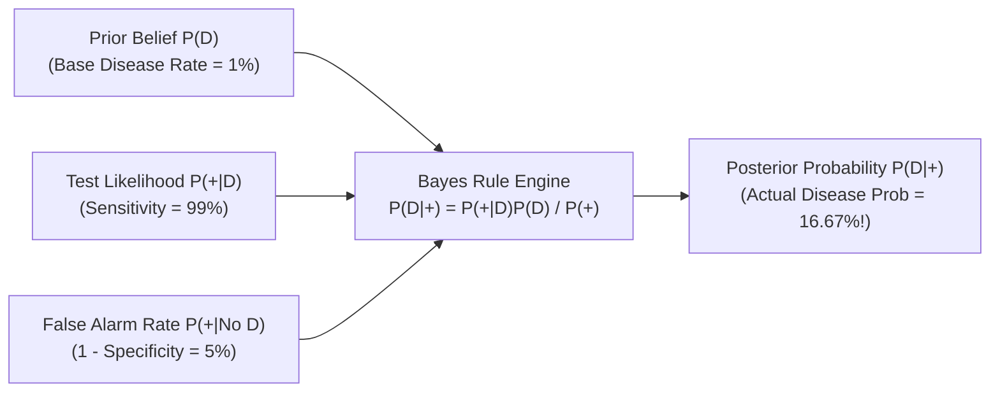
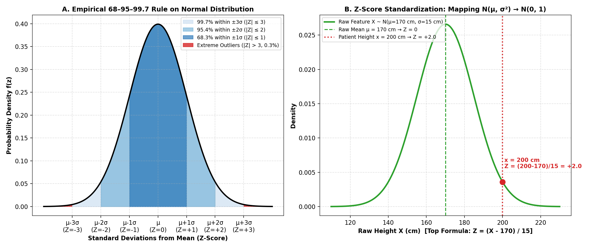

# Dependency Lesson 04.2: Probability, Bayes' Theorem, Normal Distribution, and Z-Scores (සම්භාවිතාව, බේස් ප්‍රමේයය, ප්‍රමත ව්‍යාප්තිය සහ සම්මත ලකුණු)

> [!TIP]
> **🔗 Related Core Module Lessons (මෙම පාඩම භාවිතා වන ප්‍රධාන පාඩම්):**
> මෙම පාඩමෙන් ඔබ ඉගෙන ගන්නා **Conditional Probability (කොන්දේසි සහිත සම්භාවිතාව)**, **Bayes' Theorem (බේස් ප්‍රමේයය)**, **Normal Distribution (ප්‍රමත ව්‍යාප්තිය — $\mathcal{N}(\mu, \sigma^2)$)**, **Empirical 68–95–99.7 Rule**, සහ **Z-Score Standardization ($z = \frac{x-\mu}{\sigma}$)** පහත CI7524 Data Mining පාඩම්වලදී සෘජුවම භාවිතා වේ:
> - [Lesson 3.2 - Mathematical Preliminaries & Distance Metrics](../../Module_03_Data_Mining_Lifecycle_and_Preprocessing/Lesson_3.2_Mathematical_Preliminaries_Distance_Metrics_and_Curse_of_Dimensionality.md)
> - [Lesson 3.3 - Data Quality, Cleaning & Missing Data Imputation](../../Module_03_Data_Mining_Lifecycle_and_Preprocessing/Lesson_3.3_Data_Quality_Cleaning_Integration_and_Missing_Data_Imputation.md)
> - [Lesson 3.4 - Feature Engineering, Scaling & Selection](../../Module_03_Data_Mining_Lifecycle_and_Preprocessing/Lesson_3.4_Feature_Engineering_Scaling_Encoding_and_Selection.md)
> - [Lesson 4.1 - Clustering Algorithms (K-Means, Hierarchical, DBSCAN)](../../Module_04_Data_Mining_Algorithms_and_Model_Selection/Lesson_4.1_Clustering_Algorithms_KMeans_Hierarchical_and_DBSCAN.md)
> - [Lesson 4.2 - Component Analysis & Dimensionality Reduction (PCA & SVD)](../../Module_04_Data_Mining_Algorithms_and_Model_Selection/Lesson_4.2_Component_Analysis_and_Dimensionality_Reduction_PCA_SVD_tSNE.md)
>
> **📚 Sibling Lessons in Dep_04 Series:**
> - **Previous:** [01_Descriptive_Statistics_Central_Tendency_and_Dispersion.md](./01_Descriptive_Statistics_Central_Tendency_and_Dispersion.md)
> - **Current:** `02_Probability_Normal_Distribution_and_Z_Scores.md`
> - **Next:** [03_Correlation_Covariance_and_Hypothesis_Testing.md](./03_Correlation_Covariance_and_Hypothesis_Testing.md)

---

## 1. Zero-to-Hero Probability Foundations (මූලික සම්භාවිතා සංකල්ප)

Data Mining සහ Machine Learning වලදී අපි නිතරම කටයුතු කරන්නේ අවිනිශ්චිතතාවය (**Uncertainty**) සමඟයි. "මෙම ඊමේල් පණිවිඩය Spam වීමේ සම්භාවිතාව කීයද?", "මෙම රෝගියාට දියවැඩියාව වැළඳීමේ සම්භාවිතාව කීයද?" වැනි ප්‍රශ්නවලට පිළිතුරු දීමට **Probability Theory (සම්භාවිතා න්‍යාය)** අත්‍යවශ්‍ය වේ.

### 1.1 Sample Space ($\Omega$), Events ($A, B$), and Axioms
- **Sample Space (නියැදි අවකාශය — $\Omega$):** සසම්භාවී පරීක්ෂණයකින් ලැබිය හැකි සියලුම ප්‍රතිඵලවල කුලකය (උදා: දාදු කැටයක් උඩ දැමීමේදී $\Omega = \{1, 2, 3, 4, 5, 6\}$).
- **Event (සිද්ධිය — $A \subseteq \Omega$):** නියැදි අවකාශයේ ඕනෑම උපකුලකයක් (උදා: ඉරට්ටේ අගයක් ලැබීම $A = \{2, 4, 6\}$).
- **Kolmogorov Axioms:** ඕනෑම සිද්ධියක සම්භාවිතාව $0 \le P(A) \le 1$ වන අතර $P(\Omega) = 1$ වේ.

### 1.2 Conditional Probability (කොන්දේසි සහිත සම්භාවිතාව — $P(A \mid B)$)
$B$ නමැති සිද්ධිය දැනටමත් සිදු වී ඇති බව අපි දන්නා විට (Given that $B$ has occurred), $A$ සිදුවීමේ සම්භාවිතාව **Conditional Probability (කොන්දේසි සහිත සම්භාවිතාව — $P(A \mid B)$)** ලෙස හැඳින්වේ:

$$P(A \mid B) = \frac{P(A \cap B)}{P(B)} \qquad (\text{where } P(B) > 0)$$

මෙහි $P(A \cap B)$ යනු $A$ සහ $B$ **දෙකම එකවර සිදුවීමේ සම්භාවිතාව (Joint Probability)** යි.
සිද්ධි දෙකක් එකිනෙකින් ස්වායත්ත (**Independent Events**) නම් පමණක්:
$$P(A \mid B) = P(A) \quad \Longleftrightarrow \quad P(A \cap B) = P(A) \cdot P(B)$$

---

## 2. Bayes' Theorem (බේස් ප්‍රමේයය) සහ Medical False-Positive Paradox

ඉහත Conditional Probability සූත්‍රය දෙපැත්තෙන්ම ලියූ විට:
$$P(A \cap B) = P(A \mid B) P(B) = P(B \mid A) P(A)$$

මෙයින් $P(A \mid B)$ උක්ත කළ විට Data Science, Naive Bayes Classifiers, සහ Bayesian Inference වල පදනම වන **Bayes' Theorem (බේස් ප්‍රමේයය)** ලැබේ:

$$P(A \mid B) = \frac{P(B \mid A) \cdot P(A)}{P(B)}$$

මෙහි පද 4 හි තේරුම:
- **$P(A)$ — Prior Probability (පූර්ව සම්භාවිතාව):** නව සාක්ෂිය ($B$) දැකීමට පෙර $A$ සත්‍ය වීමේ මූලික සම්භාවිතාව.
- **$P(B \mid A)$ — Likelihood (භව්‍යතාව):** $A$ සත්‍ය නම්, $B$ නමැති සාක්ෂිය නිරීක්ෂණය වීමේ සම්භාවිතාව.
- **$P(B)$ — Marginal Likelihood / Total Evidence:** $P(B) = P(B \mid A)P(A) + P(B \mid A^c)P(A^c)$.
- **$P(A \mid B)$ — Posterior Probability (අපර සම්භාවිතාව):** $B$ සාක්ෂිය දැකීමෙන් පසු යාවත්කාලීන කළ සම්භාවිතාව!



### 2.1 Step-by-Step Worked Calculation: The Medical Diagnostic Paradox
**ගැටලුව:** ජනගහනයෙන් $1\%$ කට පමණක් වැළඳෙන දුර්ලභ රෝගයක් ($D$) සලකමු: $P(D) = 0.01$, එබැවින් රෝගය නොමැති වීමේ සම්භාවිතාව $P(\neg D) = 0.99$.
රෝගය හඳුනා ගන්නා පරීක්ෂණයක නිරවද්‍යතාව මෙසේය:
- **Sensitivity / True Positive Rate:** රෝගියෙකුට පරීක්ෂණය Positive ($+$) වීමේ සම්භාවිතාව $P(+ \mid D) = 0.99$ ($99\%$).
- **False Positive Rate:** නිරෝගී අයෙකුට පරීක්ෂණය වැරදීමකින් Positive ($+$) වීමේ සම්භාවිතාව $P(+ \mid \neg D) = 0.05$ ($5\%$).

**ප්‍රශ්නය:** අහඹු පුද්ගලයෙකුගේ පරීක්ෂණ වාර්තාව Positive ($+$) විය. ඔහුට සැබවින්ම රෝගය තිබීමේ සම්භාවිතාව $P(D \mid +)$ කීයද? (බොහෝ අය $99\%$ යැයි සිතුවත් එය සම්පූර්ණයෙන්ම වැරදිය!).

**පියවර 1: මුළු Positive වීමේ සම්භාවිතාව $P(+)$ සෙවීම (Law of Total Probability):**
$$P(+) = P(+ \mid D)P(D) + P(+ \mid \neg D)P(\neg D)$$
$$P(+) = (0.99 \times 0.01) + (0.05 \times 0.99) = 0.0099 + 0.0495 = 0.0594$$

**පියවර 2: Bayes' Theorem ආදේශ කිරීම:**
$$P(D \mid +) = \frac{P(+ \mid D) P(D)}{P(+)} = \frac{0.0099}{0.0594} = \frac{1}{6} \approx 0.1667 \quad (\mathbf{16.67\%})$$

**Intuition (මිනිසුන් 10,000කින් බලමු):** මිනිසුන් $10,000$කින් රෝගීන් සිටින්නේ $100$ දෙනෙකි ($1\%$). ඉන් $99$ දෙනෙක් Positive වේ. නමුත් නිරෝගී $9,900$ දෙනාගෙන් $5\%$ ක් එනම් **$495$ දෙනෙක්** බොරුවට Positive (False Positives) වේ! එබැවින් මුළු Positive $99 + 495 = 594$ දෙනාගෙන් සැබෑ රෝගීන් සිටින්නේ $\frac{99}{594} = 16.67\%$ ක් පමණි! (Class Imbalance පවතින Fraud Detection සහ Anomaly Detection වලදී මෙය අතිශයින් වැදගත් වේ!).

---

## 3. Normal / Gaussian Distribution (ප්‍රමත ව්‍යාප්තිය — $\mathcal{N}(\mu, \sigma^2)$)

සන්තතික විචල්‍යයක (**Continuous Random Variable** $X$) සම්භාවිතාව ව්‍යාප්ත වී ඇති ආකාරය විස්තර කරන ශ්‍රිතයට **Probability Density Function - PDF (සම්භාවිතා ඝනත්ව ශ්‍රිතය)** යැයි කියනු ලැබේ. ස්වභාවධර්මයේ සහ Data Science වල වැදගත්ම PDF එක වන්නේ සීනුවක හැඩැති (**Bell-shaped Curve**) **Normal Distribution (ප්‍රමත ව්‍යාප්තිය)** හෙවත් **Gaussian Distribution** එකයි:

$$f(x \mid \mu, \sigma^2) = \frac{1}{\sigma \sqrt{2\pi}} \exp\left( -\frac{1}{2} \left( \frac{x - \mu}{\sigma} \right)^2 \right)$$

- **$\mu$ (Mean):** සීනුවේ මැද / මුදුන පිහිටන ස්ථානය ($\text{Mean} = \text{Median} = \text{Mode} = \mu$).
- **$\sigma$ (Standard Deviation):** සීනුවේ පළල තීරණය කරයි.
- වක්‍රය යට මුළු වර්ගඵලය සෑමවිටම $1$ වේ: $\int_{-\infty}^{+\infty} f(x)\,dx = 1$.



### 3.1 The Empirical 68–95–99.7 Rule (Three-Sigma Rule)
ඉහත රූපයේ **Panel A** හි දැක්වෙන පරිදි ඕනෑම Normal Distribution එකක:
1. **$\mu \pm 1\sigma$ පරාසය තුළ:** දත්තවලින් **$68.27\%$** ක් පවතී.
2. **$\mu \pm 2\sigma$ පරාසය තුළ:** දත්තවලින් **$95.45\%$** ක් පවතී (සම්මත $95\%$ සීමාව හරියටම $\mu \pm 1.96\sigma$ වේ).
3. **$\mu \pm 3\sigma$ පරාසය තුළ:** දත්තවලින් **$99.73\%$** ක් පවතී!
   - එනම් $\mu \pm 3\sigma$ න් පිටත පවතින්නේ දත්තවලින් **$0.27\%$ ක් (දහසකට 3ක්)** පමණි! එබැවින් $|z| > 3$ වන අගයන් **Outliers** ලෙස සැලකේ!

### 3.2 Central Limit Theorem — CLT (මධ්‍යම සීමා ප්‍රමේයය)
**ඇයි ස්වභාවධර්මයේ සහ Statistics වල හැමතැනම Normal Distribution එක මතු වෙන්නේ?**
**Central Limit Theorem (මධ්‍යම සීමා ප්‍රමේයය)** මගින් පවසන්නේ: මුල් සංගහනය කුමන හැඩයක (Skewed, Uniform, Bimodal) වුවත්, එයින් ප්‍රමාණවත් තරම් විශාල නියැදි ($n \ge 30$) ගෙන ඒවායේ **Sample Means ($\bar{X}$)** ප්‍රස්තාරගත කළහොත්, එම නියැදි මධ්‍යන්‍යයන්ගේ ව්‍යාප්තිය (**Sampling Distribution of the Mean**) ස්වයංක්‍රීයවම **Normal Distribution** එකකට ළඟා වන බවයි!

$$\bar{X} \sim \mathcal{N}\left( \mu, \, \frac{\sigma^2}{n} \right) \quad \implies \quad \text{Standard Error (SE)} = \frac{\sigma}{\sqrt{n}}$$

---

## 4. Z-Scores (සම්මත ලකුණු) & Feature Standardization

### 4.1 What is a Z-Score (සම්මත ලකුණ)?
යම් $x$ අගයක්, එහි මධ්‍යන්‍යයේ ($\mu$) සිට **Standard Deviations ($\sigma$) කීයක් දුරින් පිහිටා ඇත්ද** යන්න පෙන්වන ඒකක රහිත (Dimensionless) අගය **Z-Score (සම්මත ලකුණ)** ලෙස හැඳින්වේ:

$$z = \frac{x - \mu}{\sigma} \qquad \left(\text{Sample version: } z = \frac{x - \bar{x}}{s}\right)$$

ඕනෑම $X \sim \mathcal{N}(\mu, \sigma^2)$ විචල්‍යයක් Z-Score බවට පරිවර්තනය කළ විට එය මධ්‍යන්‍යය $0$ සහ සම්මත අපගමනය $1$ වන **Standard Normal Distribution ($Z \sim \mathcal{N}(0, 1)$)** බවට පත් වේ!

### 4.2 Two Critical Uses of Z-Scores in Data Mining (Module 03 Connections)
1. **Comparing Apples and Oranges & Feature Scaling (`StandardScaler` in Lesson 3.4):**
   - K-Means, KNN, SVM, සහ PCA වැනි ඇල්ගොරිතම වලදී `Salary` ($\sigma = 50,000$) සහ `Age` ($\sigma = 10$) එකට භාවිතා කළහොත් `Salary` මගින් Euclidean Distance එක සම්පූර්ණයෙන්ම යටපත් කරයි. Features සියල්ලටම $z = \frac{x - \bar{x}}{s}$ යෙදීමෙන් සෑම Feature එකක්ම $\text{Mean} = 0, \text{Std} = 1$ යන සමාන මට්ටමට ගෙන එයි!
2. **Z-Score Outlier Detection (Lesson 3.3):**
   - යම් දත්ත ලක්ෂ්‍යයක $|z| > 3.0$ නම් (එනම් මධ්‍යන්‍යයේ සිට $3\sigma$ කට වඩා ඈතින් පිහිටයි නම්), එය Outlier එකක් ලෙස ලකුණු කළ හැක.

**අතින් ගණනය කිරීම (Worked Calculation from Figure Panel B):**
රෝහලක වැඩිහිටියන්ගේ උස $\mu = 170\text{ cm}$ සහ $\sigma = 15\text{ cm}$ වේ.
- පුද්ගලයා P1 ගේ උස $x_1 = 200\text{ cm}$ නම්:
  $$z_1 = \frac{200 - 170}{15} = \frac{+30}{15} = +2.0$$
  (මධ්‍යන්‍යයට වඩා Standard Deviations $2$ක් උසින් වැඩිය; Empirical Rule අනුව ඔහු ජනගහනයේ උසම $2.5\%$ අතර සිටී!).
- පුද්ගලයා P2 ගේ උස $x_2 = 110\text{ cm}$ නම්:
  $$z_2 = \frac{110 - 170}{15} = \frac{-60}{15} = -4.0$$
  ($|z_2| = 4.0 > 3.0$ බැවින් මෙය පැහැදිලිවම **Extreme Outlier** එකකි!).

---

## 5. Python (`NumPy`) Implementation: Bayes' Rule & Z-Score Standardization

```python
import numpy as np

# 1. Bayes' Theorem Verification (Medical Paradox)
p_disease = 0.01
p_pos_given_disease = 0.99
p_pos_given_healthy = 0.05

p_pos_total = (p_pos_given_disease * p_disease) + (p_pos_given_healthy * (1 - p_disease))
p_disease_given_pos = (p_pos_given_disease * p_disease) / p_pos_total

print(f"Posterior P(Disease | Positive Test) = {p_disease_given_pos:.4f} ({p_disease_given_pos*100:.2f}%)\n")

# 2. Z-Score Standardization & Outlier Detection on a Feature Vector
heights = np.array([155, 162, 168, 170, 172, 175, 180, 185, 245], dtype=float)
mean_h = np.mean(heights)
std_h = np.std(heights, ddof=1)
z_scores = (heights - mean_h) / std_h

print("Raw Heights (cm):", heights)
print("Z-Scores        :", np.round(z_scores, 2))
print("Standardized Mean:", np.round(np.mean(z_scores), 6), "| Standardized Std:", np.round(np.std(z_scores, ddof=1), 6))
print("Detected Outliers (|Z| > 2.5):", heights[np.abs(z_scores) > 2.5])
```

**Output:**
```text
Posterior P(Disease | Positive Test) = 0.1667 (16.67%)

Raw Heights (cm): [155. 162. 168. 170. 172. 175. 180. 185. 245.]
Z-Scores        : [-0.88 -0.61 -0.39 -0.31 -0.24 -0.13  0.06  0.25  2.52]
Standardized Mean: 0.0 | Standardized Std: 1.0
Detected Outliers (|Z| > 2.5): [245.]
```

---

## 🛠️ Practical Task / Hands-On Exercise (ප්‍රායෝගික අභ්‍යාසය)

### Scenario / Goal
ශිෂ්‍යයෙකු විෂයයන් දෙකකට පෙනී සිටියේය:
1. **Data Mining Exam:** ශිෂ්‍යයාගේ ලකුණ $x_1 = 82$. පන්තියේ මධ්‍යන්‍යය $\mu_1 = 70$, සම්මත අපගමනය $\sigma_1 = 6$.
2. **Cloud Computing Exam:** ශිෂ්‍යයාගේ ලකුණ $x_2 = 88$. පන්තියේ මධ්‍යන්‍යය $\mu_2 = 80$, සම්මත අපගමනය $\sigma_2 = 10$.

### Step-by-Step Tasks
1. **Task 1 (Z-Score Comparison):** අමු ලකුණු (Raw Marks) අනුව $88 > 82$ වුවත්, Z-Scores ගණනය කර පන්තියේ අනෙක් සිසුන්ට සාපේක්ෂව ශිෂ්‍යයා වඩාත්ම දක්ෂතාවයක් පෙන්වා ඇත්තේ කුමන විෂයයටදැයි සොයන්න.
2. **Task 2 (Spam Filter Bayes Calculation):** ඊමේල් වලින් $20\%$ ක් Spam වේ ($P(\text{Spam}) = 0.20$). Spam ඊමේල්වලින් $80\%$ ක `"FREE"` යන වචනය අඩංගු වේ ($P(\text{"FREE"} \mid \text{Spam}) = 0.80$). සාමාන්‍ය (Ham) ඊමේල්වලින් $5\%$ ක පමණක් `"FREE"` අඩංගු වේ ($P(\text{"FREE"} \mid \text{Ham}) = 0.05$). `"FREE"` යන වචනය සහිත ඊමේල් එකක් Spam වීමේ සම්භාවිතාව $P(\text{Spam} \mid \text{"FREE"})$ සොයන්න.

### Starter Code
```python
# Task 1: Z-Score comparison
x1, mu1, sigma1 = 82, 70, 6
x2, mu2, sigma2 = 88, 80, 10

# Task 2: Spam Filter Bayes' Rule
p_spam = 0.20
p_free_given_spam = 0.80
p_free_given_ham = 0.05

# TODO: Compute z1, z2, and p_spam_given_free
```

### Expected Output / Reference Solution
```python
# Task 1
z1 = (82 - 70) / 6    # +2.00
z2 = (88 - 80) / 10   # +0.80

# Task 2
p_spam = 0.20
p_ham = 1.0 - p_spam
p_free_given_spam = 0.80
p_free_given_ham = 0.05

p_free = (p_free_given_spam * p_spam) + (p_free_given_ham * p_ham)
p_spam_given_free = (p_free_given_spam * p_spam) / p_free

print(f"Data Mining Z-Score     : {z1:+.2f} (Top ~2.3% of class -> Better relative performance!)")
print(f"Cloud Computing Z-Score : {z2:+.2f}")
print(f"P(Spam | 'FREE')        : {p_spam_given_free:.4f} ({p_spam_given_free*100:.1f}%)")
```

**Expected Output:**
```text
Data Mining Z-Score     : +2.00 (Top ~2.3% of class -> Better relative performance!)
Cloud Computing Z-Score : +0.80
P(Spam | 'FREE')        : 0.8000 (80.0%)
```

---

## 📝 Summary & Exam Revision Cheat Sheet

| Concept | Mathematical Formula | Key Intuition / Rule |
| :--- | :--- | :--- |
| **Conditional Probability** | $P(A \mid B) = \frac{P(A \cap B)}{P(B)}$ | Probability of $A$ restricted to the sub-universe where $B$ happened |
| **Bayes' Theorem** | $P(A \mid B) = \frac{P(B \mid A)P(A)}{P(B)}$ | Updates Prior $P(A)$ with Likelihood $P(B \mid A)$ to get Posterior $P(A \mid B)$ |
| **Normal Distribution PDF** | $\frac{1}{\sigma\sqrt{2\pi}} e^{-\frac{1}{2}\left(\frac{x-\mu}{\sigma}\right)^2}$ | Symmetric bell curve parameterized completely by $\mu$ and $\sigma^2$ |
| **Empirical 68–95–99.7 Rule** | $\mu \pm 1\sigma (68\%), \pm 2\sigma (95\%), \pm 3\sigma (99.7\%)$ | Points beyond $\mu \pm 3\sigma$ ($|Z| > 3$) have $<0.3\%$ probability (Outliers) |
| **Central Limit Theorem** | $\bar{X} \sim \mathcal{N}(\mu, \sigma^2/n)$ | Sample means become Normal as $n \ge 30$, enabling $Z$ and $t$ tests |
| **Z-Score Standardization** | $z = \frac{x - \mu}{\sigma}$ | Transforms any feature to $\text{Mean} = 0, \text{Variance} = 1$ |

---

> [!TIP]
> **🔙 Return to Core Module Lessons (ආපසු ප්‍රධාන පාඩම් වෙත):**
> - [Lesson 3.2 - Mathematical Preliminaries & Distance Metrics](../../Module_03_Data_Mining_Lifecycle_and_Preprocessing/Lesson_3.2_Mathematical_Preliminaries_Distance_Metrics_and_Curse_of_Dimensionality.md)
> - [Lesson 3.3 - Data Quality, Cleaning & Missing Data Imputation](../../Module_03_Data_Mining_Lifecycle_and_Preprocessing/Lesson_3.3_Data_Quality_Cleaning_Integration_and_Missing_Data_Imputation.md)
> - [Lesson 3.4 - Feature Engineering, Scaling & Selection](../../Module_03_Data_Mining_Lifecycle_and_Preprocessing/Lesson_3.4_Feature_Engineering_Scaling_Encoding_and_Selection.md)
> - [Lesson 4.1 - Clustering Algorithms (K-Means, Hierarchical, DBSCAN)](../../Module_04_Data_Mining_Algorithms_and_Model_Selection/Lesson_4.1_Clustering_Algorithms_KMeans_Hierarchical_and_DBSCAN.md)
> - [Lesson 4.2 - Component Analysis & Dimensionality Reduction (PCA & SVD)](../../Module_04_Data_Mining_Algorithms_and_Model_Selection/Lesson_4.2_Component_Analysis_and_Dimensionality_Reduction_PCA_SVD_tSNE.md)
> - **Next Dependency Lesson:** [03_Correlation_Covariance_and_Hypothesis_Testing.md](./03_Correlation_Covariance_and_Hypothesis_Testing.md)
