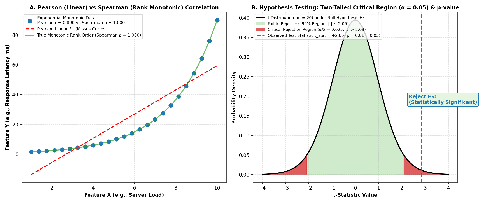
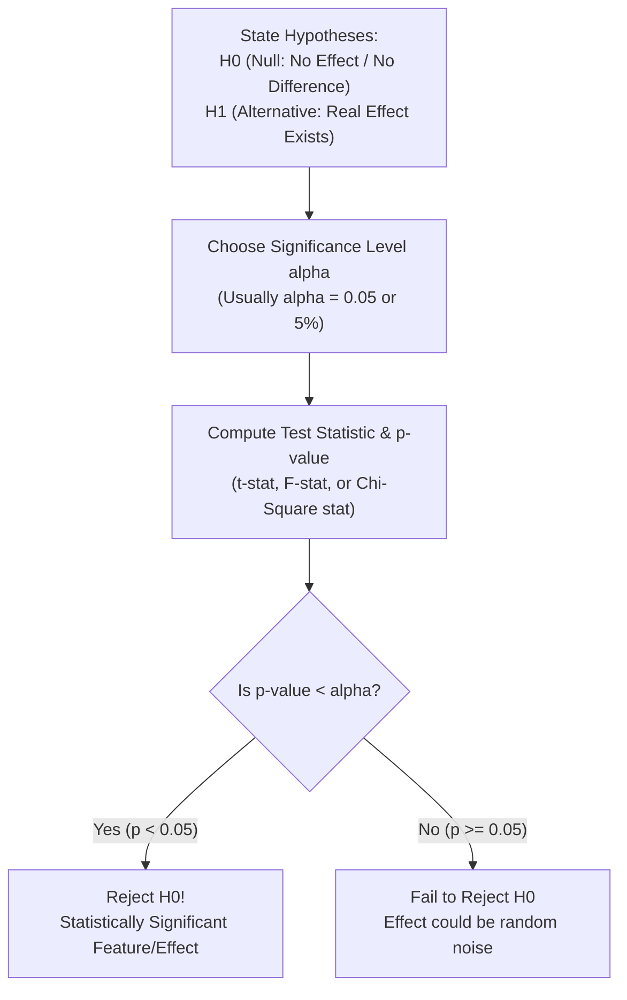

# Dependency Lesson 04.3: Correlation (Pearson vs Spearman), Spurious Correlations, and Statistical Hypothesis Testing (සහසම්බන්ධතාව සහ කල්පිත පරීක්ෂාව)

> [!TIP]
> **🔗 Related Core Module Lessons (මෙම පාඩම භාවිතා වන ප්‍රධාන පාඩම්):**
> මෙම පාඩමෙන් ඔබ ඉගෙන ගන්නා **Covariance (සහවිචලතාව)**, **Pearson Correlation ($r$)**, **Spearman Rank Correlation ($\rho$)**, **Null vs Alternative Hypothesis ($H_0, H_1$)**, **$p$-value**, සහ **$t$-test / ANOVA $F$-test / $\chi^2$ Test** යන සංඛ්‍යාන පරීක්ෂණ පහත CI7524 Data Mining පාඩම්වලදී (විශේෂයෙන් **Filter-Based Feature Selection** වලදී) සෘජුවම භාවිතා වේ:
> - [Lesson 3.2 - Mathematical Preliminaries & Distance Metrics](../../Module_03_Data_Mining_Lifecycle_and_Preprocessing/Lesson_3.2_Mathematical_Preliminaries_Distance_Metrics_and_Curse_of_Dimensionality.md)
> - [Lesson 3.3 - Data Quality, Cleaning & Missing Data Imputation](../../Module_03_Data_Mining_Lifecycle_and_Preprocessing/Lesson_3.3_Data_Quality_Cleaning_Integration_and_Missing_Data_Imputation.md)
> - [Lesson 3.4 - Feature Engineering, Scaling & Selection](../../Module_03_Data_Mining_Lifecycle_and_Preprocessing/Lesson_3.4_Feature_Engineering_Scaling_Encoding_and_Selection.md)
> - [Lesson 4.1 - Clustering Algorithms (K-Means, Hierarchical, DBSCAN)](../../Module_04_Data_Mining_Algorithms_and_Model_Selection/Lesson_4.1_Clustering_Algorithms_KMeans_Hierarchical_and_DBSCAN.md)
> - [Lesson 4.2 - Component Analysis & Dimensionality Reduction (PCA & SVD)](../../Module_04_Data_Mining_Algorithms_and_Model_Selection/Lesson_4.2_Component_Analysis_and_Dimensionality_Reduction_PCA_SVD_tSNE.md)
>
> **📚 Sibling Lessons in Dep_04 Series:**
> - **Previous:** [01_Descriptive_Statistics_Central_Tendency_and_Dispersion.md](./01_Descriptive_Statistics_Central_Tendency_and_Dispersion.md)
> - **Previous:** [02_Probability_Normal_Distribution_and_Z_Scores.md](./02_Probability_Normal_Distribution_and_Z_Scores.md)
> - **Current:** `03_Correlation_Covariance_and_Hypothesis_Testing.md`

---

## 1. Zero-to-Hero Intuition: Covariance (සහවිචලතාව) සිට Correlation (සහසම්බන්ධතාව) දක්වා

පළමු පාඩම් දෙකේදී අපි තනි විචල්‍යයක් (**Univariate Analysis** — උදා: `Age` පමණක්) විශ්ලේෂණය කරන ආකාරය ඉගෙන ගත්තා. නමුත් Data Mining වලදී අපට වැදගත්ම ප්‍රශ්නය වන්නේ **විචල්‍යයන් දෙකක් ($X$ සහ $Y$) එකිනෙකා සමඟ සම්බන්ධ වී ඇත්තේ කෙසේද? (Bivariate Relationship)** යන්නයි!

### 1.1 Sample Covariance (නියැදි සහවිචලතාව — $\text{Cov}(X, Y)$)
විචල්‍ය දෙකක් එකම දිශාවට වෙනස් වෙනවාද නැත්නම් ප්‍රතිවිරුද්ධ දිශාවට වෙනස් වෙනවාද යන්න මනින මූලික මිනුම **Covariance (සහවිචලතාව)** යි:

$$\text{Cov}(X, Y) = s_{XY} = \frac{1}{n - 1} \sum_{i=1}^{n} (x_i - \bar{x})(y_i - \bar{y})$$

- **ගැටලුව (Why Covariance Alone is Not Enough):** Covariance අගයට නිශ්චිත සීමාවක් නැත ($-\infty$ සිට $+\infty$ දක්වා ඕනෑම අගයක් ගත හැක) සහ එය මනින ඒකක මත රඳා පවතී! උදාහරණයකට උස මීටර් ($\text{m}$) වෙනුවට සෙන්ටිමීටර් ($\text{cm}$) වලින් මැන්නොත්, සම්බන්ධතාවයේ කිසිම වෙනසක් නොවුණත් $\text{Cov}(X, Y)$ අගය $100$ ගුණයකින් වැඩි වේ!

### 1.2 Pearson Correlation Coefficient (පියර්සන් සහසම්බන්ධතා සංගුණකය — $r$)
ඒකකවල බලපෑම ඉවත් කිරීම සඳහා Karl Pearson විසින් $\text{Cov}(X, Y)$ අගය $X$ සහ $Y$ හි සම්මත අපගමනයන්ගේ ගුණිතයෙන් ($s_X s_Y$) බෙදීමෙන් **Pearson Linear Correlation Coefficient ($r$)** හඳුන්වා දෙන ලදී:

$$r = \frac{\text{Cov}(X, Y)}{s_X \cdot s_Y} = \frac{\sum_{i=1}^{n} (x_i - \bar{x})(y_i - \bar{y})}{\sqrt{\sum_{i=1}^{n} (x_i - \bar{x})^2} \sqrt{\sum_{i=1}^{n} (y_i - \bar{y})^2}}$$

- **පරාසය:** $r$ සෑමවිටම **$-1.0 \le r \le +1.0$** අතර පවතී (ඒකක රහිතයි / Scale-invariant!).
  - **$r = +1.0$:** පූර්ණ ධන රේඛීය සම්බන්ධතාව (Perfect Positive Linear Relationship).
  - **$r = -1.0$:** පූර්ණ ඍණ රේඛීය සම්බන්ධතාව (Perfect Negative Linear Relationship).
  - **$r = 0.0$:** **රේඛීය** සම්බන්ධතාවක් නොමැත (No Linear Correlation).

> [!TIP]
> **Linear Algebra Bridge (`Dep_03` Connection!):**
> ඉහත $r$ සූත්‍රය දෙස හොඳින් බලන්න! Mean-centered දෛශික දෙකක් වන $\mathbf{x}_c = \mathbf{x} - \bar{x}$ සහ $\mathbf{y}_c = \mathbf{y} - \bar{y}$ ගත් විට, **Pearson Correlation ($r$) යනු හරියටම එම Mean-centered දෛශික දෙක අතර Cosine Similarity ($\cos\theta$) එකම වේ!**
> $$r = \frac{\mathbf{x}_c \cdot \mathbf{y}_c}{\|\mathbf{x}_c\|_2 \|\mathbf{y}_c\|_2} = \cos(\theta)$$

### 1.3 Worked Hand Calculation of Pearson $r$
`Dep_03` හි අප භාවිතා කළ ශිෂ්‍යයන් $n=4$ දෙනාගේ `Study Hours` ($X = [2, 4, 6, 8]$, $\bar{x}=5$) සහ `Exam Marks` ($Y = [50, 60, 80, 90]$, $\bar{y}=70$) සඳහා:
1. $x_i - \bar{x} = [-3, -1, +1, +3] \implies \sum (x_i - \bar{x})^2 = 9 + 1 + 1 + 9 = 20$
2. $y_i - \bar{y} = [-20, -10, +10, +20] \implies \sum (y_i - \bar{y})^2 = 400 + 100 + 100 + 400 = 1000$
3. Cross-product sum: $\sum (x_i - \bar{x})(y_i - \bar{y}) = (-3)(-20) + (-1)(-10) + (1)(10) + (3)(20) = 140$
4. Pearson $r$ ආදේශ කිරීම:
   $$r = \frac{140}{\sqrt{20} \times \sqrt{1000}} = \frac{140}{\sqrt{20000}} = \frac{140}{141.4214} \approx +0.9900$$
   ($r = +0.99$ යනු අතිශයින්ම ප්‍රබල ධන රේඛීය සම්බන්ධතාවයකි!).

---

## 2. Spearman Rank Correlation ($\rho$) & Why Correlation $\neq$ Causation



### 2.1 Spearman Rank Correlation (ස්පියර්මන් තරාතිරම් සහසම්බන්ධතාව — $\rho$ හෝ $r_s$)
Pearson $r$ මගින් මනින්නේ **සෘජු රේඛීය (Straight-line Linear)** සම්බන්ධතා පමණි. නමුත් ඉහත රූපයේ **Panel A** හි දැක්වෙන පරිදි Server Load ($X$) වැඩි වන විට Response Latency ($Y = e^{0.45X}$) ඝාතීය වක්‍රයක් (Exponential Curve) ලෙස වැඩි වේ නම්, Pearson රේඛාවට එය හරියටම හසු නොවේ ($r = 0.875 < 1.0$).

මෙවැනි **Monotonic Non-Linear (ඒකාකාරීව වැඩි වන හෝ අඩු වන වක්‍රාකාර)** සම්බන්ධතා සහ Outliers සහිත දත්ත සඳහා අපි **Spearman Rank Correlation ($\rho$)** භාවිතා කරමු:
- අමු අගයන් ($x_i, y_i$) වෙනුවට ඒවායේ කුඩාම සිට විශාලතම දක්වා **තරාතිරම් අංක (Ranks: $1, 2, \dots, n$)** ආදේශ කර ඒවා අතර Pearson සහසම්බන්ධතාව සොයනු ලැබේ. බැඳුණු තරාතිරම් (Tied ranks) නොමැති විට:
  $$\rho = 1 - \frac{6 \sum_{i=1}^{n} d_i^2}{n(n^2 - 1)} \qquad (\text{where } d_i = \text{Rank}(x_i) - \text{Rank}(y_i))$$

### 2.2 Why "Correlation Does NOT Imply Causation" & Spurious Correlations in Big Data
සංඛ්‍යානයේ සහ Data Mining වල රන් නීතිය වන්නේ: **සහසම්බන්ධතාවය යනු හේතු-ඵල සම්බන්ධතාවය නොවේ (Correlation $\neq$ Causation)!**
1. **Confounding Variable (සැඟවුණු තුන්වන විචල්‍යයක් — $Z$):**
   - උදාහරණය: නගරයක අයිස්ක්‍රීම් අලෙවිය ($X$) සහ දියේ ගිලී මියයාම් ($Y$) අතර ඉහළ ධන සහසම්බන්ධතාවයක් ($r \approx +0.85$) පවතී. අයිස්ක්‍රීම් කෑමෙන් මිනිසුන් දියේ ගිලෙනවාද? නැත! සැඟවුණු හේතුව (**Confounder $Z$**) වන්නේ **ගිම්හාන උෂ්ණත්වය (Hot Summer Weather)** යි — රස්නය වැඩි නිසා මිනිසුන් වැඩිපුර අයිස්ක්‍රීම් කන අතරම වැඩිපුර මුහුදේ පිහිනීමටද යති!
2. **Spurious Correlations in Big Data (ව්‍යාජ සහසම්බන්ධතා):**
   - ඔබ සතුව විචල්‍යයන් $d = 10,000$ ක් ඇති Big Data වගුවක් තිබේ නම්, යුගල $\binom{10000}{2} \approx 50,000,000$ (මිලියන 50ක්) පවතී! සම්පූර්ණයෙන්ම අහඹු ඝෝෂාවක් (Random Noise) තුළ වුවද, අහම්බෙන් $r > 0.90$ පෙන්වන ව්‍යාජ යුගල දහස් ගණනක් හමුවීම ගණිතමය වශයෙන් අනිවාර්ය වේ!

---

## 3. Statistical Hypothesis Testing (සංඛ්‍යානමය කල්පිත පරීක්ෂාව)

අපි නියැදියකින් දකින වෙනසක් හෝ සහසම්බන්ධතාවයක් ඇත්තටම සංගහනයේ පවතින සැබෑ බලපෑමක්ද, නැත්නම් අහඹු නියැදි වාසනාවක් (Random Sampling Chance) නිසා පෙනෙන දෙයක්ද යන්න තීරණය කරන විද්‍යාත්මක ක්‍රමවේදය **Hypothesis Testing (කල්පිත පරීක්ෂාව)** යි.



### 3.1 Null Hypothesis ($H_0$) vs Alternative Hypothesis ($H_1$)
අධිකරණ නඩු විභාගයකදී වරදකරු බව ඔප්පු වන තුරු විත්තිකරු නිවැරදිකරු ("Innocence until proven guilty") ලෙස සලකන්නා සේ:
- **Null Hypothesis (ශූන්‍ය කල්පිතය — $H_0$):** "කිසිදු වෙනසක්, බලපෑමක් හෝ සම්බන්ධතාවක් නොමැත" ($\mu_1 = \mu_2$, හෝ $r = 0$, හෝ විචල්‍ය දෙක ස්වායත්ත වේ).
- **Alternative Hypothesis (විකල්ප කල්පිතය — $H_1$ හෝ $H_a$):** අපි ඔප්පු කිරීමට උත්සාහ කරන ප්‍රකාශය — "සැබෑ වෙනසක් හෝ සම්බන්ධතාවක් පවතී" ($\mu_1 \neq \mu_2$, හෝ $r \neq 0$).

### 3.2 What Exactly is the $p$-value?
- **$p$-value:** **ශූන්‍ය කල්පිතය ($H_0$) සත්‍ය යැයි උපකල්පනය කළ විට**, අපට ලැබුණු නියැදි ප්‍රතිඵලය හෝ ඊටත් වඩා ආන්තික (Extreme) ප්‍රතිඵලයක් හුදෙක් අහම්බෙන් ලැබීමේ සම්භාවිතාවයි!
- **Decision Rule (තීරණ නීතිය — $\alpha = 0.05$):**
  - **$p < \alpha$ ($p < 0.05$) නම්:** $H_0$ සත්‍ය නම් මෙවැනි දෙයක් අහම්බෙන් වීමට ඇති ඉඩ $5\%$ ටත් වඩා අඩුය. එබැවින් අපි **$H_0$ ප්‍රතික්ෂේප කරමු (Reject $H_0$ — Statistically Significant!)**.
  - **$p \ge \alpha$ ($p \ge 0.05$) නම්:** $H_0$ ප්‍රතික්ෂේප කිරීමට ප්‍රමාණවත් සාක්ෂි නොමැත (**Fail to Reject $H_0$**).

### 3.3 Type I ($\alpha$) vs Type II ($\beta$) Errors
| Decision \ Truth | $H_0$ is Actually True (No Effect) | $H_0$ is Actually False (Real Effect) |
| :--- | :--- | :--- |
| **Reject $H_0$ (Claim Effect)** | ❌ **Type I Error (False Positive)**<br/>Probability $= \alpha$ (Significance Level) | ✅ **Correct Decision (True Positive)**<br/>Probability $= 1 - \beta$ (Statistical Power) |
| **Fail to Reject $H_0$** | ✅ **Correct Decision (True Negative)**<br/>Probability $= 1 - \alpha$ | ❌ **Type II Error (False Negative)**<br/>Probability $= \beta$ |

---

## 4. The 3 Essential Statistical Tests for Data Mining & Feature Selection (Lesson 3.4)

Feature Selection (Lesson 3.4) වලදී කුමන Feature එක Target Variable එකට බලපාන්නේදැයි තේරීමට භාවිතා කරන ප්‍රධාන පරීක්ෂණ 3:

### 4.1 Student's $t$-Test (Comparing Means of 2 Groups)
කාණ්ඩ දෙකක (උදා: `Churned` vs `Non-Churned` පාරිභෝගිකයන්ගේ) සන්තතික විචල්‍යයක මධ්‍යන්‍යයන් ($\bar{x}_1$ සහ $\bar{x}_2$) අතර සැලකිය යුතු වෙනසක් තිබේදැයි පරීක්ෂා කරයි:

$$t = \frac{\bar{x}_1 - \bar{x}_2}{\sqrt{\frac{s_1^2}{n_1} + \frac{s_2^2}{n_2}}}$$

### 4.2 ANOVA $F$-Test (Analysis of Variance — Comparing Means of $\ge 3$ Groups)
කාණ්ඩ $k \ge 3$ ක මධ්‍යන්‍යයන් සංසන්දනය කිරීමට (`sklearn.feature_selection.f_classif`) භාවිතා කරයි. එය කාණ්ඩ අතර විචලතාවය (**Between-Group Variance**) කාණ්ඩ තුළ විචලතාවයෙන් (**Within-Group Variance**) බෙදීමෙන් ගණනය කරයි:

$$F = \frac{\text{MS}_{\text{between}}}{\text{MS}_{\text{within}}} = \frac{\text{Variance Between Group Means}}{\text{Variance Within Groups (Noise)}}$$

$F$ අගය ඉතා විශාල නම් ($p < 0.05$), එම Feature එක මගින් Target Classes හොඳින් වෙන් කර හඳුනාගත හැක!

### 4.3 Chi-Square ($\chi^2$) Test of Independence (Categorical vs Categorical)
Categorical Features දෙකක් (උදා: `Gender` සහ `Purchased_Product` — `sklearn.feature_selection.chi2`) එකිනෙකින් ස්වායත්තදැයි පරීක්ෂා කරයි. Contingency Table එකක නිරීක්ෂිත සංඛ්‍යාත (**Observed Counts — $O_{ij}$**) සහ $H_0$ යටතේ අපේක්ෂිත සංඛ්‍යාත (**Expected Counts — $E_{ij} = \frac{\text{RowTotal}_i \times \text{ColTotal}_j}{N}$**) අතර වෙනස මනිනු ලැබේ:

$$\chi^2 = \sum_{i} \sum_{j} \frac{(O_{ij} - E_{ij})^2}{E_{ij}}$$

---

## 5. Python (`NumPy`) Implementation: Correlation & $\chi^2$ / $t$-Test

```python
import numpy as np

# 1. Pearson vs Spearman Correlation on Monotonic Non-Linear Data
x = np.array([1, 2, 3, 4, 5], dtype=float)
y = np.array([2, 4, 8, 16, 64], dtype=float)  # Exponential growth

pearson_r = np.corrcoef(x, y)[0, 1]
# Spearman rank correlation: compute Pearson r on the ranks of x and y
ranks_x = np.argsort(np.argsort(x)) + 1
ranks_y = np.argsort(np.argsort(y)) + 1
spearman_rho = np.corrcoef(ranks_x, ranks_y)[0, 1]

print(f"Pearson Linear r  : {pearson_r:.4f}")
print(f"Spearman Rank rho : {spearman_rho:.4f} (Captures exact monotonic order!)\n")

# 2. Independent Two-Sample Welch t-Statistic Calculation
group_A = np.array([78, 82, 85, 80, 84, 79, 81], dtype=float)  # New Algorithm
group_B = np.array([70, 72, 68, 74, 71, 69, 73], dtype=float)  # Old Baseline

se_diff = np.sqrt(np.var(group_A, ddof=1)/len(group_A) + np.var(group_B, ddof=1)/len(group_B))
t_stat = (np.mean(group_A) - np.mean(group_B)) / se_diff
print(f"Two-Sample t-statistic: t = {t_stat:.4f} (|t| > 2.18 -> Reject H0 at alpha=0.05!)\n")

# 3. Chi-Square Test of Independence on a 2x2 Contingency Table
# Rows: [Clicked Ad, No Click], Cols: [Bought, Did Not Buy]
O = np.array([[40.0, 60.0],
              [10.0, 90.0]])
row_totals = O.sum(axis=1, keepdims=True)
col_totals = O.sum(axis=0, keepdims=True)
N = O.sum()
E = (row_totals @ col_totals) / N
chi2_stat = np.sum(((O - E) ** 2) / E)

print("Expected Frequencies E_ij:\n", E)
print(f"Chi-Square Statistic: chi2 = {chi2_stat:.4f} (Critical value df=1 at alpha=0.05 is 3.841 -> Reject H0!)")
```

**Output:**
```text
Pearson Linear r  : 0.8696
Spearman Rank rho : 1.0000 (Captures exact monotonic order!)

Two-Sample t-statistic: t = 8.4017 (|t| > 2.18 -> Reject H0 at alpha=0.05!)

Expected Frequencies E_ij:
 [[25. 75.]
 [25. 75.]]
Chi-Square Statistic: chi2 = 24.0000 (Critical value df=1 at alpha=0.05 is 3.841 -> Reject H0!)
```

---

## 🛠️ Practical Task / Hands-On Exercise (ප්‍රායෝගික අභ්‍යාසය)

### Scenario / Goal
ඔබ Feature Selection Pipeline එකක Categorical Feature එකක් වන `Has_Fiber_Internet` (Yes/No) සහ Target Variable එක වන `Customer_Churn` (Yes/No) අතර සංඛ්‍යානමය බැඳීමක් තිබේදැයි **Chi-Square ($\chi^2$) Test of Independence** මගින් පරීක්ෂා කරයි. පාරිභෝගිකයන් $N = 100$ දෙනෙකුගේ නිරීක්ෂිත වගුව (Observed Table $O$) පහත දැක්වේ:

| | Churn = Yes | Churn = No | Row Total |
| :--- | :---: | :---: | :---: |
| **Fiber = Yes** | $30$ | $20$ | $50$ |
| **Fiber = No** | $10$ | $40$ | $50$ |
| **Column Total** | $40$ | $60$ | **$100$** |

### Step-by-Step Tasks
1. **Task 1 (Hand Calculation):** $E_{ij} = \frac{\text{RowTotal}_i \times \text{ColTotal}_j}{100}$ සූත්‍රයෙන් කොටු 4 සඳහා අපේක්ෂිත අගයන් ($E_{11}, E_{12}, E_{21}, E_{22}$) ගණනය කරන්න.
2. **Task 2 (Hand Calculation):** $\chi^2 = \sum \frac{(O_{ij} - E_{ij})^2}{E_{ij}}$ සූත්‍රයෙන් $\chi^2$ අගය සොයන්න.
3. **Task 3 (Decision):** Degrees of Freedom $\text{df} = (r-1)(c-1) = 1$ සඳහා $\alpha = 0.05$ හි Critical Value එක $3.841$ වේ. $\chi^2 > 3.841$ ද? මෙම Feature එක Classification Model එකට තෝරාගත යුතුද?

### Starter Code
```python
import numpy as np

O = np.array([[30.0, 20.0],
              [10.0, 40.0]])

# TODO: Compute Expected matrix E, chi2_stat, and compare with critical value 3.841
```

### Expected Output / Reference Solution
```python
import numpy as np

O = np.array([[30.0, 20.0],
              [10.0, 40.0]])

N = O.sum()
E = (O.sum(axis=1, keepdims=True) @ O.sum(axis=0, keepdims=True)) / N
chi2_stat = np.sum((O - E)**2 / E)

print("Expected Table E:\n", E)
print(f"Chi-Square Statistic = {chi2_stat:.4f}")
print("Decision:", "Reject H0 (Keep Feature!)" if chi2_stat > 3.841 else "Fail to Reject H0 (Drop Feature)")
```

**Expected Output:**
```text
Expected Table E:
 [[20. 30.]
 [20. 30.]]
Chi-Square Statistic = 16.6667
Decision: Reject H0 (Keep Feature!)
```

---

## 📝 Summary & Exam Revision Cheat Sheet

| Statistical Tool / Test | Formula | Variable Types | Data Mining / Feature Selection Role |
| :--- | :--- | :--- | :--- |
| **Sample Covariance** | $\frac{1}{n-1}\sum(x_i-\bar{x})(y_i-\bar{y})$ | Continuous vs Continuous | Builds Covariance Matrix $\Sigma$ for PCA |
| **Pearson Correlation ($r$)** | $\frac{\text{Cov}(X,Y)}{s_X s_Y} \in [-1, +1]$ | Continuous vs Continuous (Linear) | Detecting redundant collinear features & linear target correlation |
| **Spearman Rank ($\rho$)** | Pearson $r$ on Ranked data | Continuous / Ordinal (Monotonic) | Non-linear monotonic correlation & outlier-resistant correlation |
| **Two-Sample $t$-Test** | $t = \frac{\bar{x}_1 - \bar{x}_2}{\text{SE}}$ | Continuous Feature vs Binary Target | Testing if feature mean differs across 2 classes |
| **ANOVA $F$-Test** | $F = \frac{\text{MS}_{\text{between}}}{\text{MS}_{\text{within}}}$ | Continuous Feature vs Multi-class Target | `f_classif` filter feature selection in Scikit-Learn |
| **Chi-Square ($\chi^2$) Test** | $\sum \frac{(O_{ij} - E_{ij})^2}{E_{ij}}$ | Categorical Feature vs Categorical Target | `chi2` filter feature selection for categorical/text features |

---

> [!TIP]
> **🔙 Return to Core Module Lessons (ආපසු ප්‍රධාන පාඩම් වෙත):**
> - [Lesson 3.2 - Mathematical Preliminaries & Distance Metrics](../../Module_03_Data_Mining_Lifecycle_and_Preprocessing/Lesson_3.2_Mathematical_Preliminaries_Distance_Metrics_and_Curse_of_Dimensionality.md)
> - [Lesson 3.3 - Data Quality, Cleaning & Missing Data Imputation](../../Module_03_Data_Mining_Lifecycle_and_Preprocessing/Lesson_3.3_Data_Quality_Cleaning_Integration_and_Missing_Data_Imputation.md)
> - [Lesson 3.4 - Feature Engineering, Scaling & Selection](../../Module_03_Data_Mining_Lifecycle_and_Preprocessing/Lesson_3.4_Feature_Engineering_Scaling_Encoding_and_Selection.md)
> - [Lesson 4.1 - Clustering Algorithms (K-Means, Hierarchical, DBSCAN)](../../Module_04_Data_Mining_Algorithms_and_Model_Selection/Lesson_4.1_Clustering_Algorithms_KMeans_Hierarchical_and_DBSCAN.md)
> - [Lesson 4.2 - Component Analysis & Dimensionality Reduction (PCA & SVD)](../../Module_04_Data_Mining_Algorithms_and_Model_Selection/Lesson_4.2_Component_Analysis_and_Dimensionality_Reduction_PCA_SVD_tSNE.md)
