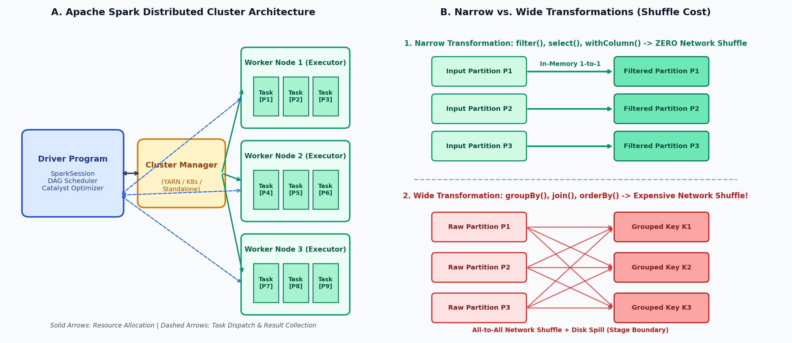
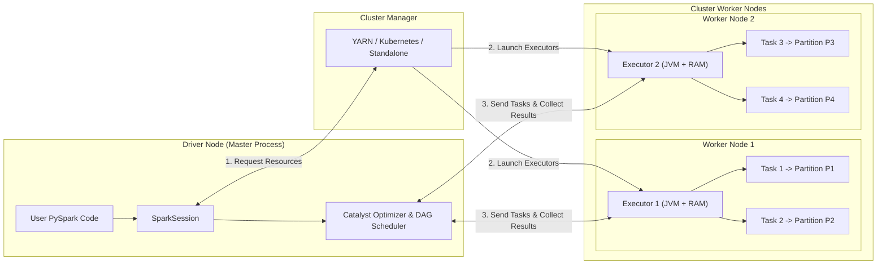
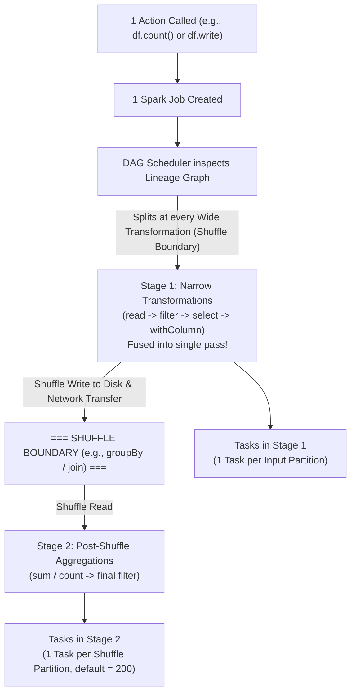

# Dependency 05 — Lesson 01: Distributed Computing Architecture & Apache Spark Execution Engine (මුල සිට සරලව)

> [!TIP]
> **🔗 Related Core Course Lessons (CI7524 Big Data & Data Mining):**
> මෙම Dependency පාඩම් මාලාව හැදෑරීමෙන් පසු, පහත දැක්වෙන ප්‍රධාන පාඩම් (Core Module Lessons) වල ඇති Distributed Architecture සහ Big Data Processing කොටස් ඉතා පහසුවෙන් තේරුම් ගත හැක:
> - [Lesson 2.1 - Distributed Computing: HDFS, MapReduce & Apache Spark](../../Module_02_Big_Data_Architectures_and_Processing/Lesson_2.1_Distributed_Computing_HDFS_MapReduce_and_Apache_Spark.md)
> - [Lesson 3.4 - Feature Engineering, Scaling, Encoding & Selection](../../Module_03_Data_Mining_Lifecycle_and_Preprocessing/Lesson_3.4_Feature_Engineering_Scaling_Encoding_and_Selection.md)
> - [Lesson 5.4 - CI7524 Coursework Portfolio Blueprint](../../Module_05_Governance_Ethics_Sustainability_and_Coursework/Lesson_5.4_CI7524_Coursework_Portfolio_Blueprint_and_End_to_End_Case_Study.md)
>
> **📚 Dep_05 Series Navigation:**
> - **Lesson 01 (මෙම පාඩම):** Distributed Computing Architecture & Spark Execution Engine
> - [Lesson 02: PySpark DataFrames, SQL & Data Cleaning](02_PySpark_DataFrames_SQL_and_Data_Cleaning.md)
> - [Lesson 03: Spark MLlib Scalable Machine Learning Pipelines](03_Spark_MLlib_Scalable_Machine_Learning_Pipelines.md)

---

## 1. හැඳින්වීම: ඇයි සාමාන්‍ය Python සහ Pandas ලොකු Data වලදී වැඩ කරන්නේ නැත්තේ? (Why Single-Node Python Fails at Scale)

අපි සාමාන්‍යයෙන් Laptop එකක හෝ Desktop පරිගණකයක Data Science වැඩ කරද්දී `pandas.read_csv()` හෝ `scikit-learn` පාවිච්චි කරනවා. හැබැයි ඔබේ Dataset එක **100 MB** හෝ **1 GB** වෙනුවට **500 GB** හෝ **10 TB (Terabytes)** වුණොත් මොකද වෙන්නේ?

සාමාන්‍ය Python (`Pandas` / `NumPy`) වැඩ කරන්නේ **Single-Node In-Memory Architecture** එකක් මතයි. ඒ කියන්නේ:
1. **RAM Bottleneck (මතක සීමාව):** ඔබේ පරිගණකයේ තියෙන්නේ **16 GB RAM** එකක් නම්, `Pandas` මගින් **50 GB** CSV file එකක් load කරන්න හැදුවොත්, Pandas ඒ සම්පූර්ණ දත්ත ප්‍රමාණයම තනි පරිගණකයේ RAM එකට දාගන්න උත්සාහ කරනවා. එතකොට Python එකෙන් **`MemoryError (Out-Of-Memory / OOM Crash)`** එකක් ඇවිත් Program එක නතර වෙනවා. (සාමාන්‍යයෙන් `Pandas` DataFrame එකක් RAM එකේදී මුල් CSV file එකට වඩා 3x – 5x ගුණයක ඉඩක් ගන්නවා!).
2. **CPU Bottleneck (සැකසුම් වේග සීමාව):** Standard Python (`CPython`) සහ `Pandas` බොහෝ විට ක්‍රියාත්මක වන්නේ **Single CPU Core (Single Thread)** එකක් මතයි. ඔබේ පරිගණකයේ Cores 8ක් තිබුණත්, බිලියන ගණනක Rows (`Rows`) පිරිසිදු කරන්න තනි Core එකකට පැය ගණනක් ගත වෙනවා.
3. **Disk I/O Bottleneck:** තනි Hard Disk (SSD/HDD) එකකින් තත්පරයකට කියවිය හැකි උපරිම වේගය (Read Bandwidth) සීමිතයි (උදා: `500 MB/s` සිට `3 GB/s` දක්වා). `10 TB` දත්ත තනි Disk එකකින් කියවන්න විතරක් පැය ගණනක් යනවා.

### Vertical Scaling (Scale-Up) vs. Horizontal Scaling (Scale-Out)

මෙම ගැටලුව විසඳන්න ක්‍රම දෙකක් තියෙනවා:

| නිර්ණායකය (Criterion) | Vertical Scaling (Scale-Up) | Horizontal Scaling (Scale-Out) |
| :--- | :--- | :--- |
| **මූලික අදහස** | තනි පරිගණකයකට තව RAM, CPU Cores සහ ලොකු Disk එකතු කිරීම. | සාමාන්‍ය පරිගණක (Commodity Machines / Nodes) දහස් ගණනක් Network එකකින් එකට සම්බන්ධ කර **Cluster** එකක් ලෙස වැඩ ගැනීම. |
| **වියදම (Cost Efficiency)** | ඉතාම මිල අධිකයි (Exponential Cost Curve). 1 TB RAM තියෙන Server එකක් ඉතා මිල අධිකයි. | ලාභදායී වේ (Linear Cost). සාමාන්‍ය Cloud VMs (උදා: 32GB RAM Nodes 32ක්) එකතු කිරීම පහසුයි. |
| **උපරිම සීමාව (Hardware Limit)** | භෞතික සීමාවක් ඇත (තනි Motherboard එකකට දැමිය හැකි උපරිම RAM/CPU ප්‍රමාණයක් ඇත). | සීමාවක් නැත — Petabytes ගණනක දත්ත සඳහා Nodes සිය ගණනක් එකතු කළ හැක. |
| **Fault Tolerance (දෝෂ දරාගැනීමේ හැකියාව)** | **Single Point of Failure:** එම තනි Server එක බිඳ වැටුණොත් සම්පූර්ණ පද්ධතියම නතර වේ. | **High Fault Tolerance:** එක් Node එකක් බිඳ වැටුණත් අනෙක් Nodes මගින් එම වැඩ කොටස ස්වයංක්‍රීයව නැවත සකසයි. |

**Apache Spark** නිර්මාණය කර ඇත්තේ **Horizontal Scaling (Distributed Computing)** මූලධර්මය මතයි. එහිදී විශාල Dataset එකක් කුඩා කොටස් (**Partitions**) වලට කඩා, Cluster එකක ඇති පරිගණක (**Worker Nodes**) රාශියක RAM එක තුළ එකවර (**In-Memory Parallel Processing**) සකසනු ලබනවා.

---

## 2. Apache Spark Cluster Architecture (විසිරුණු පද්ධති ආකෘතිය)

Apache Spark වැඩ කරන ආකාරය හරියටම තේරුම් ගන්න නම්, එහි ප්‍රධාන කොටස් 6ක් ගැන අපි දැනගන්න ඕනේ. අපි මේක **කර්මාන්තශාලාවක (Factory)** උදාහරණයකින් තේරුම් ගනිමු:

1. **Driver Program (ප්‍රධාන කළමනාකරු / Architect):**
   - ඔබ ලියන Python (`PySpark`) කේතය (`main()` script හෝ Jupyter Notebook එක) ක්‍රියාත්මක වන ප්‍රධාන ක්‍රියාවලියයි.
   - Driver Program එක ඇතුළේ තමයි **`SparkSession`** object එක නිර්මාණය වෙන්නේ.
   - Driver එක කවදාවත් තනියම විශාල දත්ත සකසන්නේ නැහැ! එයා කරන්නේ ඔබේ කේතය කියවා, එය කුඩා වැඩ කොටස් (**Tasks**) වලට කඩා, සේවකයන්ට (**Executors**) බෙදා දීම සහ අවසාන ප්‍රතිඵලය එකතු කර ගැනීමයි.
2. **`SparkSession` (Spark වෙත පිවිසෙන ප්‍රධාන දොරටුව):**
   - Spark 2.0 සිට හඳුන්වා දුන් Unified Entry Point එකයි (මීට පෙර තිබූ `SparkContext`, `SQLContext`, සහ `HiveContext` යන සියල්ලම දැන් `SparkSession` තුළ අන්තර්ගත වේ).
3. **Cluster Manager (සම්පත් බෙදාහරින්නා / Resource Allocator):**
   - Cluster එකේ කොපමණ පරිගණක (**Nodes**), CPU Cores සහ RAM තිබේද යන්න කළමනාකරණය කරන මෘදුකාංගයයි.
   - ප්‍රධාන Cluster Managers වර්ග 4කි:
     - **`local[*]` (Local Mode):** ඉගෙනීමට සහ අත්හදා බැලීමට ඔබේ තනි Laptop එකේ ඇති සියලුම CPU Cores (`*`) භාවිතා කරමින් Cluster එකක් අනුකරණය කරයි.
     - **Standalone Mode:** Spark සමඟම එන සරල Built-in Cluster Manager එක.
     - **Apache YARN (Yet Another Resource Negotiator):** Hadoop පද්ධතිවල බහුලවම භාවිතා වන Cluster Manager එක.
     - **Kubernetes (K8s):** නවීන Cloud-native Containers මත Spark ධාවනය කරන ප්‍රමුඛතම ක්‍රමය.
4. **Worker Nodes (සේවක පරිගණක):**
   - Cluster එකේ ඇති සැබෑ දත්ත සැකසීම සිදු කරන භෞතික හෝ Virtual Servers (VMs).
5. **Executors (ක්‍රියාත්මක කරන්නන්):**
   - එක් එක් Worker Node එක ඇතුළේ ආරම්භ කරන **JVM (Java Virtual Machine) Processes** වේ.
   - සෑම Executor එකකටම වෙන් කරන ලද නිශ්චිත **RAM** ප්‍රමාණයක් (උදා: `16 GB`) සහ **CPU Cores (Slots)** ගණනක් (උදා: `4 Cores`) ඇත.
   - Tasks ක්‍රියාත්මක කිරීම සහ අතරමැදි දත්ත RAM එකේ තබා ගැනීම (**Caching / Persistence**) සිදු කරන්නේ Executors මගිනි.
6. **Data Partitions & Tasks (දත්ත කොටස් සහ කාර්යයන්):**
   - **Partition:** ඔබේ විශාල Dataset එකේ කුඩා තාර්කික කොටසක් (Chunk of rows). උදාහරණයක් ලෙස `100 GB` ගොනුවක් `128 MB` බැගින් වූ **Partitions 800කට** කැඩී විවිධ Worker Nodes වල පවතී.
   - **Task:** **එක් Partition එකක් මත එක් CPU Core එකකින් සිදු කරන කුඩාම වැඩ ඒකකයයි (Smallest unit of execution).**
   - **Golden Rule:** `1 Partition = 1 Task = 1 CPU Core Thread`. ඔබට Partitions 200ක් තිබේ නම්, Spark මගින් Tasks 200ක් සාදා Executors වෙත යවයි.



ඉහත රූපයේ **Panel A** මගින් Driver Program එක, Cluster Manager එක සහ Worker Nodes 3ක් අතර සම්බන්ධතාවය පැහැදිලිව පෙන්වා ඇත:



---

## 3. RDDs සිට DataFrames දක්වා විකාශනය (Evolution from RDDs to DataFrames)

Spark ඉතිහාසයේ දත්ත නිරූපණය කරන ප්‍රධාන API පරම්පරා දෙකක් තිබෙනවා:

1. **RDD — Resilient Distributed Dataset (Spark 1.0):**
   - Spark වල මූලිකම Low-level දත්ත ව්‍යුහයයි.
   - **Resilient (ඔරොත්තු දෙන):** කිසියම් Node එකක් බිඳ වැටුණහොත්, එම දත්ත සෑදුණු පියවර සටහන (**Lineage Graph**) භාවිතා කර නැතිවූ Partition එක පමණක් නැවත ගණනය කළ හැක.
   - **Distributed (විසිරුණු):** දත්ත Cluster එක පුරා Partitions ලෙස බෙදී ඇත.
   - **අවාසිය:** RDD එකක් ඇතුළේ තියෙන Python objects වල ව්‍යුහය (Schema / Columns) Spark දන්නේ නැහැ (Opaque Objects). ඒ නිසා Spark එකට ස්වයංක්‍රීයව Query Optimization කරන්න බැහැ.
2. **Spark DataFrame & Spark SQL (Spark 2.0+ / Spark 3.x — වර්තමාන ප්‍රමිතිය):**
   - `Pandas` DataFrame එකක් හෝ SQL Table එකක් වගේ **Named Columns සහ Data Types (Schema)** සහිත Distributed දත්ත ව්‍යුහයකි.
   - Schema එක දන්නා නිසා, Spark හි **Catalyst Optimizer** සහ **Project Tungsten** මගින් ඔබේ Python කේතය ඉතා වේගවත් JVM Bytecode බවට පත් කරයි (RDD වලට වඩා 10x – 100x වේගවත්!).

---

## 4. Transformations vs. Actions සහ Lazy Evaluation (කම්මැලි ඇගයීම)

Spark වල තියෙන වැදගත්ම සංකල්පය තමයි **Lazy Evaluation**. ඔබ `Pandas` වලදී `df = pd.read_csv("data.csv")` කියලා ගැහුවම, ඒ මොහොතේම CPU එක වැඩ කරලා දත්ත ටික RAM එකට ගන්නවා (**Eager Evaluation**).

නමුත් **Apache Spark** වලදී මෙහෙයුම් (Operations) වර්ග දෙකකට බෙදෙනවා:

### A. Transformations (පරිවර්තන — Lazy Operations)
පවතින DataFrame එකකින් අලුත් DataFrame එකක් සාදන නියෝග **Transformations** ලෙස හැඳින්වේ. (Spark DataFrames යනු **Immutable** — එනම් වෙනස් කළ නොහැකි ව්‍යුහයන්ය; සෑම Transformation එකකින්ම අලුත් DataFrame reference එකක් ලබා දෙයි).
- **උදාහරණ:** `df.select()`, `df.filter()`, `df.withColumn()`, `df.groupBy()`, `df.join()`, `df.orderBy()`.
- **Lazy Evaluation (කම්මැලි ඇගයීම) යනු කුමක්ද?**
  ඔබ Transformation එකක් ලියූ විට, **Spark ඒ මොහොතේ කිසිම දත්තයක් සකසන්නේ නැහැ!** ඒ වෙනුවට Spark කරන්නේ *"මුලින්ම file එක කියවන්න ඕනේ, ඊළඟට `age > 25` filter කරන්න ඕනේ, ඊළඟට column දෙකක් select කරන්න ඕනේ"* කියලා තාර්කික සැලැස්මක් (**Execution Plan / Lineage DAG**) තමන්ගේ පොතේ ලියා ගැනීම පමණයි!

### B. Actions (ක්‍රියා — Eager Triggers)
සැබෑවටම දත්ත ගණනය කර ප්‍රතිඵලයක් Driver Program එකට ගෙන්වා ගැනීමට හෝ Disk එකකට ලිවීමට දෙන නියෝග **Actions** ලෙස හැඳින්වේ.
- **උදාහරණ:**
  - `df.count()` (මුළු පේළි ගණන ගණනය කිරීම)
  - `df.show(n)` (මුල් පේළි $n$ තිරයේ පෙන්වීම)
  - `df.collect()` (සියලුම Worker Nodes වල ඇති දත්ත Driver එකේ RAM එකට Python list එකක් ලෙස ගෙන්වා ගැනීම — **⚠️ අවවාදයයි: විශාල DataFrame මත කිසිවිටෙක `.collect()` භාවිතා නොකරන්න, Driver එක OOM Crash වේ!**)
  - `df.take(5)` / `df.first()` (පේළි කිහිපයක් පමණක් ආරක්ෂිතව ගෙන්වා ගැනීම)
  - `df.write.parquet("output_path")` (සැකසූ දත්ත Disk/HDFS වෙත ලිවීම)

> [!IMPORTANT]
> **ඇයි Lazy Evaluation මගින් Spark වේගවත් වෙන්නේ?**
> ඔබ පියවර 10කින් යුත් Transformations ලියා අවසානයේ `df.show()` (Action) කැඳවන තුරු Spark බලා සිටියි. එවිට Spark හි **Catalyst Optimizer** එකට ඔබේ මුළු පියවර 10ම එකවර පරීක්ෂා කර, අනවශ්‍ය Columns ඉවත් කර (**Column Pruning**), `filter()` කොන්දේසි මුලටම ගෙනැවිත් (**Predicate Pushdown**), පියවර කිහිපයක් තනි පියවරකට හැකිළීමට (**Pipelining / Whole-Stage Codegen**) අවස්ථාව ලැබේ!

---

## 5. Narrow Transformations vs. Wide Transformations (Shuffle Cost)

සියලුම Transformations එක හා සමානව වේගවත් නැත! Network එක හරහා දත්ත හුවමාරු වීම (**Data Shuffle**) මත පදනම්ව Transformations ප්‍රධාන වර්ග දෙකකට බෙදේ (ඉහත **රූපයේ Panel B** බලන්න):

### 1. Narrow Transformations (පටු පරිවර්තන — Zero Network Shuffle)
- **අර්ථ දැක්වීම:** Output DataFrame එකේ එක් Partition එකක් සෑදීමට අවශ්‍ය දත්ත තිබෙන්නේ Input DataFrame එකේ **තනි Partition එකක් (1-to-1 relationship)** තුළ පමණි.
- **උදාහරණ:** `filter()`, `where()`, `select()`, `withColumn()`, `drop()`, `map()`, `union()`.
- **වේගය:** **ඉතාම වේගවත් (Blazing Fast)!** Worker Node 1 හි ඇති Partition P1 filter කිරීමට Worker Node 2 ගෙන් කිසිම දත්තයක් අවශ්‍ය නැත. සියලුම පියවර තනි CPU Core එකේ RAM එක තුළම (**In-Memory Pipelining**) Network ගමනාගමනයකින් තොරව සිදු වේ.

### 2. Wide Transformations (පුළුල් පරිවර්තන — Expensive Network Shuffle!)
- **අර්ථ දැක්වීම:** Output Partition එකක් සෑදීමට Input Partitions කිහිපයක (හෝ සියල්ලෙහිම) විසිරී ඇති දත්ත එකතු කිරීමට සිදු වේ (**All-to-All / Many-to-Many dependency**).
- **උදාහරණ:** `groupBy()`, `join()`, `distinct()`, `dropDuplicates()`, `orderBy()`, `sort()`, `repartition()`.
- **ඇයි මෙය මිල අධික වන්නේ? (The Shuffle Bottleneck):**
  හිතන්න ඔබ `df.groupBy("city").agg(F.sum("sales"))` කියලා ලිව්වා කියලා. `"Colombo"` නගරයට අදාළ විකුණුම් වාර්තා Worker Node 1, Worker Node 2, සහ Worker Node 3 යන තුනේම Partitions වල විසිරී තියෙනවා.
  එකතුව ගණනය කරන්න නම්, Spark විසින් `"Colombo"` වලට අදාළ සියලුම පේළි **Network එක හරහා (Shuffle)** එකම Executor එකක එකම Partition එකකට ගෙන ආ යුතුයි!
  **Shuffle එකකදී සිදුවන අධික පිරිවැය (Costs):**
  1. **Serialization:** දත්ත Bytes බවට පත් කිරීම.
  2. **Disk I/O (Shuffle Write):** Network ගැටලුවකදී දත්ත නැති නොවීමට Shuffle files තාවකාලිකව Local Disk එකට ලිවීම.
  3. **Network I/O (Data Transfer):** Nodes අතර Network cables හරහා දත්ත යැවීම.
  4. **Deserialization:** ලැබුණු Bytes නැවත Objects බවට පත් කිරීම.

---

## 6. DAG Scheduler: Jobs, Stages සහ Tasks බෙදෙන ආකාරය

ඔබ Action එකක් කැඳවූ සැණින් Spark හි **DAG (Directed Acyclic Graph) Scheduler** එක ඔබේ වැඩසටහන ක්‍රියාත්මක කරන ධූරාවලිය (Execution Hierarchy) මෙසේ ගොඩනගයි:



- **Job:** සෑම **Action** එකකටම (`show`, `count`, `write`) එක **Spark Job** එකක් සෑදේ.
- **Stage:** Job එකක් ඇතුළේ **Wide Transformation (Shuffle)** එකක් හමුවන සෑම තැනකින්ම DAG Scheduler එක මගින් Job එක වෙනම **Stages** වලට කඩයි.
  - *උදාහරණය:* ඔබේ කේතයේ `read -> filter -> withColumn -> groupBy -> filter -> count` තිබේ නම්, මෙහි Shuffle (`groupBy`) ඇත්තේ 1ක් පමණි. එබැවින් මෙම Job එකට **Stages 2ක්** ඇත (Stage 1: `read -> filter -> withColumn`, Stage 2: `groupBy -> filter`).
- **Task:** සෑම Stage එකක්ම එහි ඇති Partitions ගණනට සමාන **Tasks** ගණනකට කැඩී Executors වල CPU Cores මත සමාන්තරව ධාවනය වේ.

---

## 7. Caching, Persistence & Partitioning Strategies (වේගය වැඩි කරන උපක්‍රම)

### A. `.cache()` සහ `.persist()` භාවිතා කළ යුත්තේ කවදාද?
සාමාන්‍යයෙන් Spark DataFrame එකක් මත ඔබ Actions දෙකක් කැඳවුවහොත් (උදා: පළමුව `df_clean.count()` සහ දෙවනුව `df_clean.write.parquet()`), Spark විසින් දෙවන Action එකේදීත් මුල සිටම (CSV එක කියවීමේ සිට සියලුම Transformations) **නැවත වතාවක් ගණනය කරයි (Re-computation)**!

ඔබ එකම පිරිසිදු කළ DataFrame එකක් (`df_clean`) Machine Learning පුහුණු කිරීමට හෝ Actions කිහිපයකට නැවත නැවත භාවිතා කරන්නේ නම්, එය RAM එකේ රඳවා තබා ගැනීමට **`.cache()`** භාවිතා කළ යුතුය:

```python
from pyspark import StorageLevel

# DataFrame එක පිරිසිදු කිරීම (Lazy)
df_clean = df_raw.filter(df_raw["amount"] > 0).dropna()

# RAM එකේ/Disk එකේ තබා ගැනීමට ලකුණු කිරීම (Lazy until first Action!)
df_clean.cache()  # හෝ df_clean.persist(StorageLevel.MEMORY_AND_DISK)

# 1 වන Action එක: මුල සිට ගණනය කර RAM එකේ Cache කරයි
print("Total rows:", df_clean.count())

# 2 වන Action එක: Disk එකෙන් නැවත කියවන්නේ නැතිව කෙලින්ම RAM Cache එකෙන් ක්ෂණිකව ගනී!
df_clean.groupBy("category").count().show()

# වැඩ අවසන් වූ පසු RAM එක නිදහස් කිරීම (Best Practice)
df_clean.unpersist()
```

### B. `repartition(n)` vs. `coalesce(n)`
- **`df.repartition(n)`:** සම්පූර්ණ Network Shuffle එකක් සිදු කරමින් දත්ත සමානව Partitions `n` ගණනකට බෙදයි (Partitions ගණන වැඩි කිරීමට හෝ Data Skew නැති කිරීමට භාවිතා කරයි — **Wide Transformation**).
- **`df.coalesce(n)`:** Network Shuffle එකකින් තොරව එකම Worker Node එකේ ඇති Partitions එකතු කරමින් Partitions ගණන **අඩු කිරීමට** පමණක් භාවිතා කරයි (උදා: Parquet ලිවීමට පෙර කුඩා files රාශියක් වෙනුවට files 4කට හැකිළීමට — **Narrow Transformation**).

---

## 🛠️ Practical Task / Hands-On Exercise (ප්‍රායෝගික අභ්‍යාසය)

### Scenario / Goal
ඔබ E-Commerce සමාගමක Data Engineer කෙනෙකි. ඔබට ගනුදෙනු (Transactions) අඩංගු PySpark DataFrame එකක් ලැබී ඇත. ඔබේ ඉලක්කය වන්නේ **Narrow vs. Wide Transformations** හඳුනා ගැනීම, `.explain()` මගින් Spark Execution Plan එක පරීක්ෂා කිරීම සහ `.cache()` මගින් නැවත නැවත ගණනය වීම වැළැක්වීමයි.

### Step-by-Step Tasks
1. Local Mode (`local[*]`) භාවිතා කරමින් `SparkSession` එකක් ආරම්භ කරන්න.
2. ලබා දී ඇති Sample Data වලින් Partitions 4ක් සහිත DataFrame එකක් සාදා `df.rdd.getNumPartitions()` මගින් එය තහවුරු කරන්න.
3. Narrow Transformations දෙකක් (`filter` සහ `withColumn`) සහ Wide Transformation එකක් (`groupBy`) යොදා, `df_summary.explain(True)` මගින් Shuffle (`Exchange`) පියවර නිරීක්ෂණය කරන්න.
4. `df_filtered` DataFrame එක `.cache()` කර Actions දෙකක් ක්‍රියාත්මක කර අවසානයේ `.unpersist()` කරන්න.

### Starter Code & Reference Solution

```python
from pyspark.sql import SparkSession
from pyspark.sql import functions as F

# Task 1: Create SparkSession using all local CPU cores
spark = (
    SparkSession.builder
    .appName("CI7524_Dep05_Lesson01_Architecture")
    .master("local[*]")
    .config("spark.sql.shuffle.partitions", "4")  # Default 200 වෙනුවට 4ක් යෙදීම
    .getOrCreate()
)

# Task 2: Create sample distributed data with 4 Partitions
sample_data = [
    ("TX01", "Colombo", "Electronics", 45000.0, 2),
    ("TX02", "Kandy", "Clothing", 3500.0, 1),
    ("TX03", "Colombo", "Electronics", 120000.0, 1),
    ("TX04", "Galle", "Books", 1500.0, 3),
    ("TX05", "Kandy", "Electronics", 68000.0, 1),
    ("TX06", "Colombo", "Clothing", 8200.0, 4),
    ("TX07", "Galle", "Electronics", 54000.0, 2),
    ("TX08", "Colombo", "Books", -500.0, 1),  # Corrupted negative price
]
columns = ["tx_id", "city", "category", "unit_price", "quantity"]

df_raw = spark.createDataFrame(sample_data, columns).repartition(4)
print(f"Initial Number of Partitions: {df_raw.rdd.getNumPartitions()}")

# Task 3: Apply Narrow Transformations (Zero Shuffle)
df_filtered = (
    df_raw
    .filter(F.col("unit_price") > 0)  # Narrow Transformation 1
    .withColumn("total_revenue", F.col("unit_price") * F.col("quantity"))  # Narrow Transformation 2
)

# Task 4: Cache intermediate cleaned DataFrame before multiple downstream actions
df_filtered.cache()
print(f"Valid Transactions Count (Action 1): {df_filtered.count()}")

# Apply Wide Transformation (Requires Shuffle / Exchange across network)
df_summary = (
    df_filtered
    .groupBy("city")
    .agg(
        F.count("tx_id").alias("num_orders"),
        F.sum("total_revenue").alias("city_revenue")
    )
    .orderBy(F.col("city_revenue").desc())
)

print("\n--- Physical Execution Plan (Notice 'Exchange' for Shuffle) ---")
df_summary.explain()

print("\n--- Final Aggregated Output (Action 2) ---")
df_summary.show()

# Clean up cache memory
df_filtered.unpersist()
spark.stop()
```

**Expected Output:**
```text
Initial Number of Partitions: 4
Valid Transactions Count (Action 1): 7

--- Physical Execution Plan (Notice 'Exchange' for Shuffle) ---
== Physical Plan ==
AdaptiveSparkPlan isFinalPlan=false
+- Sort [city_revenue#... DESC NULLS LAST], true, 0
   +- Exchange rangepartitioning(city_revenue#... DESC NULLS LAST, 4)
      +- HashAggregate(keys=[city#...], functions=[count(tx_id#...), sum(total_revenue#...)])
         +- Exchange hashpartitioning(city#..., 4)
            +- HashAggregate(keys=[city#...], functions=[partial_count(tx_id#...), partial_sum(total_revenue#...)])
               +- InMemoryTableScan [tx_id#..., city#..., total_revenue#...]

--- Final Aggregated Output (Action 2) ---
+-------+----------+------------+
|   city|num_orders|city_revenue|
+-------+----------+------------+
|Colombo|         3|    242800.0|
|  Galle|         2|    112500.0|
|  Kandy|         2|     71500.0|
+-------+----------+------------+
```

---

## 📝 Summary & Exam Revision Cheat Sheet

| Concept / Component | Technical Role in Apache Spark | Key Exam / Interview Takeaway |
| :--- | :--- | :--- |
| **Driver Program** | Runs `SparkSession`, builds Logical/Physical Plans, schedules Tasks. | Avoid `df.collect()` on big data — it pulls all data into Driver RAM and causes OOM crashes! |
| **Executor** | Distributed JVM process on a Worker Node with dedicated RAM & CPU cores. | Executes Tasks on Partitions and stores `.cache()` data in memory. |
| **Partition & Task** | Partition = logical chunk of rows; Task = 1 CPU core processing 1 Partition. | **Concurrency Rule:** `1 Partition = 1 Task = 1 Core Thread`. |
| **Lazy Evaluation** | Transformations only build a DAG lineage; execution waits for an **Action**. | Enables Catalyst Optimizer to perform **Predicate Pushdown** and **Column Pruning**. |
| **Narrow Transformation** | `select`, `filter`, `withColumn`, `map` (1-to-1 partition mapping). | **Zero Network Shuffle**; runs entirely in-memory within a single Stage. |
| **Wide Transformation** | `groupBy`, `join`, `orderBy`, `distinct`, `repartition` (All-to-All). | Triggers an expensive **Network Shuffle + Disk Spill** and creates a new **Stage Boundary**. |
| **`.cache()` vs `.persist()`** | Saves intermediate DataFrame in Executor memory (`MEMORY_AND_DISK`). | Essential before iterative ML training or when calling multiple Actions on the same DataFrame. |

---

> [!TIP]
> **🔗 Next Step in Series:** දැන් ඔබ Spark Architecture එක සහ Execution Engine එක ක්‍රියා කරන ආකාරය දන්නවා! ඊළඟට ප්‍රායෝගිකව PySpark DataFrames, Schemas, Data Cleaning, Window Functions සහ Catalyst SQL Optimization ලියන ආකාරය ඉගෙන ගැනීමට [Lesson 02: PySpark DataFrames, SQL & Data Cleaning](02_PySpark_DataFrames_SQL_and_Data_Cleaning.md) වෙත පිවිසෙන්න.
>
> **🔙 Back to Main Course Modules:**
> - [Lesson 2.1 - Distributed Computing: HDFS, MapReduce & Apache Spark](../../Module_02_Big_Data_Architectures_and_Processing/Lesson_2.1_Distributed_Computing_HDFS_MapReduce_and_Apache_Spark.md)
> - [Lesson 3.4 - Feature Engineering, Scaling, Encoding & Selection](../../Module_03_Data_Mining_Lifecycle_and_Preprocessing/Lesson_3.4_Feature_Engineering_Scaling_Encoding_and_Selection.md)
> - [Lesson 5.4 - CI7524 Coursework Portfolio Blueprint](../../Module_05_Governance_Ethics_Sustainability_and_Coursework/Lesson_5.4_CI7524_Coursework_Portfolio_Blueprint_and_End_to_End_Case_Study.md)
