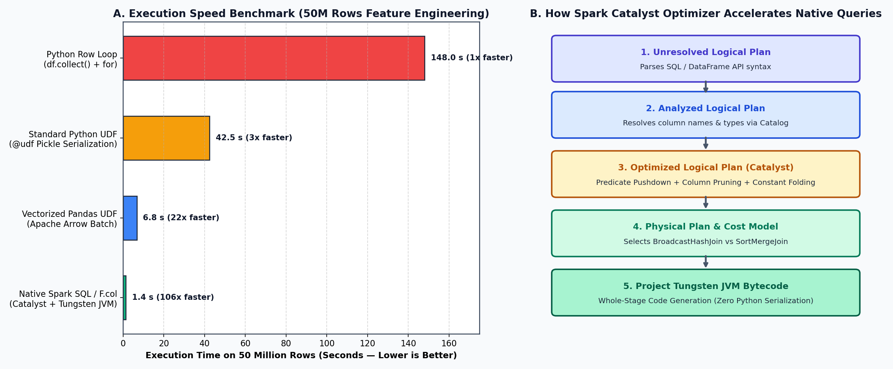
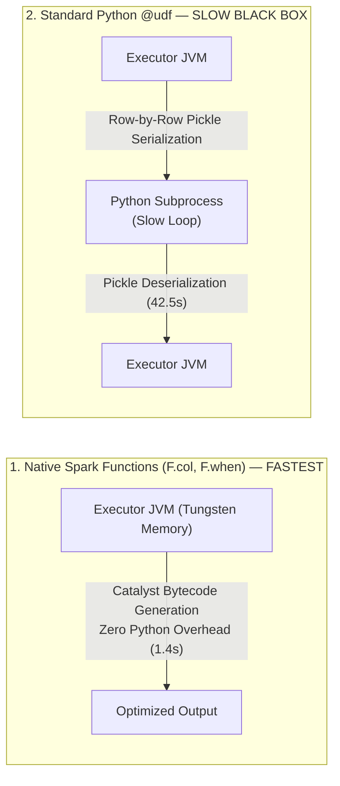

# Dependency 05 — Lesson 02: PySpark DataFrames, Spark SQL & Distributed Data Cleaning (ප්‍රායෝගික අත්වැල)

> [!TIP]
> **🔗 Related Core Course Lessons (CI7524 Big Data & Data Mining):**
> මෙම පාඩමෙන් උගන්වන PySpark DataFrame API, Data Cleaning, Aggregations සහ Catalyst Optimization ක්‍රමවේදයන් පහත ප්‍රධාන පාඩම් (Core Module Lessons) සඳහා සෘජුවම භාවිතා වේ:
> - [Lesson 2.1 - Distributed Computing: HDFS, MapReduce & Apache Spark](../../Module_02_Big_Data_Architectures_and_Processing/Lesson_2.1_Distributed_Computing_HDFS_MapReduce_and_Apache_Spark.md)
> - [Lesson 3.4 - Feature Engineering, Scaling, Encoding & Selection](../../Module_03_Data_Mining_Lifecycle_and_Preprocessing/Lesson_3.4_Feature_Engineering_Scaling_Encoding_and_Selection.md)
> - [Lesson 5.4 - CI7524 Coursework Portfolio Blueprint](../../Module_05_Governance_Ethics_Sustainability_and_Coursework/Lesson_5.4_CI7524_Coursework_Portfolio_Blueprint_and_End_to_End_Case_Study.md)
>
> **📚 Dep_05 Series Navigation:**
> - [Lesson 01: Distributed Computing Architecture & Spark Execution Engine](01_Distributed_Computing_Architecture_and_Spark_Execution.md)
> - **Lesson 02 (මෙම පාඩම):** PySpark DataFrames, SQL & Data Cleaning
> - [Lesson 03: Spark MLlib Scalable Machine Learning Pipelines](03_Spark_MLlib_Scalable_Machine_Learning_Pipelines.md)

---

## 1. හැඳින්වීම: PySpark DataFrame API එක Pandas වලින් වෙනස් වන්නේ කෙසේද?

ඔබ මීට පෙර `Pandas` පාවිච්චි කරලා තියෙනවා නම්, `PySpark` DataFrame එකත් බැලූ බැල්මට Rows සහ Columns තියෙන Table එකක් වගේමයි. නමුත් යටින් ක්‍රියාත්මක වන තාක්ෂණයේ විශාල වෙනස්කම් 3ක් තියෙනවා:

1. **Immutability (වෙනස් කළ නොහැකි බව):** `Pandas` වලදී `df["age"] = df["age"] + 1` කියලා ලියලා තියෙන DataFrame එකම වෙනස් කරන්න (`in-place mutation`) පුළුවන්. නමුත් PySpark DataFrames **Immutable** වේ. ඔබ Column එකක් අලුතින් හදන හෝ වෙනස් කරන සෑම විටම `df = df.withColumn(...)` මගින් අලුත් DataFrame reference එකක් ලබා ගත යුතුය.
2. **No Default Row Index:** `Pandas` වල සෑම පේළියකටම `0, 1, 2, ...` ලෙස Global Row Index එකක් තිබුණත්, PySpark වල දත්ත Worker Nodes ගණනාවක Partitions වල විසිරී ඇති නිසා `df.iloc[5]` වැනි Row Index පදනම් කරගත් තේරීම් නැත.
3. **Expressions over Loops:** `Pandas` හෝ සාමාන්‍ය Python වලදී අපි සමහර විට `for` loops හෝ `.apply()` භාවිතා කළත්, PySpark වලදී අපි සෑම විටම **`pyspark.sql.functions` (`F`)** හරහා Declarative Column Expressions ලියන්නෙමු.

---

## 2. Explicit Schema Definition (`StructType` vs. `inferSchema=True`)

ඔබ විශාල CSV හෝ JSON ගොනුවක් PySpark වෙත කියවන විට (`spark.read.csv()`), විකල්ප දෙකක් තිබේ:

- **ක්‍රමය 1 (`inferSchema=True` — පහසු නමුත් මන්දගාමී):**
  Spark විසින් මුළු `100 GB` CSV ගොනුවම **දෙවතාවක් (Two Passes)** කියවයි! පළමු වටයේදී සෑම තීරුවකම Data Type එක (`Integer`, `Double`, `String`) අනුමාන කිරීමට මුළු ගොනුවම Scan කරන අතර, දෙවන වටයේදී දත්ත කියවයි. විශාල දත්ත සඳහා මෙය විශාල කාල නාස්තියකි. තවද `"00124"` වැනි Zip codes වැරදියට `Integer` (`124`) ලෙස හඳුනාගත හැක.
- **ක්‍රමය 2 (Explicit `StructType` Schema — Production Best Practice):**
  අපි කලින්ම තීරු වල නම් සහ Data Types නිශ්චිතවම ලබා දෙන නිසා, Spark එකට **Extra Scan Job එකක් අවශ්‍ය නොවේ (Zero Schema Inference Overhead)**, සහ වැරදි Data Types ඇතුළු වීම 100%ක් වැළකේ!

```python
from pyspark.sql import SparkSession
from pyspark.sql.types import (
    StructType, StructField,
    StringType, IntegerType, DoubleType, TimestampType
)

spark = SparkSession.builder.appName("CI7524_Schema_Demo").master("local[*]").getOrCreate()

# Production-Grade Explicit Schema Definition
customer_schema = StructType([
    StructField("customer_id", StringType(), nullable=False),
    StructField("age", IntegerType(), nullable=True),
    StructField("monthly_spend", DoubleType(), nullable=True),
    StructField("signup_date", TimestampType(), nullable=True),
    StructField("subscription_tier", StringType(), nullable=True)
])

# CSV කියවන ආකාරය:
# df = spark.read.csv("customers.csv", header=True, schema=customer_schema)
```

### CSV vs. Apache Parquet (ඇයි Big Data වලදී Parquet භාවිතා කරන්නේ?)
- **CSV (Row-Based Text Format):** Schema එකක් ගබඩා නොවේ, සම්පීඩනය (Compression) දුර්වලයි, ඔබට Columns 100කින් Columns 2ක් පමණක් අවශ්‍ය වුවත් සම්පූර්ණ පේළියම Disk එකෙන් කියවිය යුතුය.
- **Apache Parquet (Columnar Binary Format):**
  1. **Self-Describing Schema:** තීරු වල Data Types ගොනුව ඇතුළේම ගබඩා වේ (`StructType` නැවත ලිවීමට අවශ්‍ය නැත).
  2. **Column Pruning:** ඔබට Columns 100කින් 3ක් පමණක් `select()` කළ විට, Disk එකෙන් කියවන්නේ ඒ Columns 3 පමණි!
  3. **Predicate Pushdown (Min/Max Row-Group Stats):** Parquet ගොනුවේ සෑම කොටසකම `min` සහ `max` අගයන් සටහන් කර ඇති නිසා, `filter(F.col("age") > 60)` යෙදූ විට අදාළ නැති දත්ත කොටස් Disk එකෙන් කියවන්නේවත් නැතිව මඟ හරියි!

```python
# Parquet ලිවීම සහ කියවීම (Best Practice in Spark)
# df.write.mode("overwrite").partitionBy("subscription_tier").parquet("data/customers.parquet")
# df_parquet = spark.read.parquet("data/customers.parquet")
```

---

## 3. Core DataFrame Operations (`pyspark.sql.functions as F`)

PySpark වලදී Data Manipulation කිරීමට අපි සැමවිටම `from pyspark.sql import functions as F` ආනයනය කරමු.

### A. Selecting, Creating & Renaming Columns (`select`, `withColumn`, `alias`)
```python
from pyspark.sql import functions as F

data = [
    ("C001", 28, 4500.0, "Gold", "2025-01-15"),
    ("C002", None, 1200.0, "Silver", "2025-02-10"),
    ("C003", 45, None, "Gold", "2025-03-05"),
    ("C004", 19, 800.0, "Bronze", "2025-03-20"),
    ("C005", 34, 9800.0, "Platinum", "2025-04-01"),
]
df = spark.createDataFrame(data, ["customer_id", "age", "monthly_spend", "tier", "signup_str"])

# 1. String දිනය DateType බවට පත් කිරීම සහ අලුත් Columns සෑදීම
df_transformed = (
    df
    .withColumn("signup_date", F.to_date(F.col("signup_str"), "yyyy-MM-dd"))
    .withColumn("annual_spend", F.col("monthly_spend") * 12.0)
    .withColumn(
        "customer_segment",
        F.when(F.col("monthly_spend") >= 5000, "High Value")
         .when(F.col("monthly_spend") >= 1000, "Medium Value")
         .otherwise("Low Value / Unknown")
    )
    .drop("signup_str")
)
```

### B. Filtering Rows (`filter` / `where`)
PySpark හි `.filter()` සහ `.where()` යන දෙකම 100%ක් සමාන වේ (Aliases). කොන්දේසි කිහිපයක් එකතු කරන විට **`&` (AND)**, **`|` (OR)**, සහ **`~` (NOT)** භාවිතා කරන අතර, **සෑම කොන්දේසියක්ම වරහන් `(...)` තුළ තැබීම අනිවාර්ය වේ!**

```python
# Multiple conditions with parentheses
df_high_gold = df_transformed.filter(
    (F.col("tier").isin("Gold", "Platinum")) &
    (F.col("age") >= 25) &
    (F.col("monthly_spend").isNotNull())
)
```

---

## 4. Distributed Data Cleaning (අඩුපාඩු සහිත දත්ත පිරිසිදු කිරීම)

සැබෑ ලෝකයේ Datasets වල **Missing Values (`null` / `NaN`)**, **Duplicates (අනුපිටපත්)**, සහ **Inconsistent Strings** බහුලව හමුවේ.

```python
# 1. Missing Values පරීක්ෂා කිරීම (Null count per column in a single pass!)
null_counts = df.select([
    F.count(F.when(F.col(c).isNull(), c)).alias(c) for c in df.columns
])
null_counts.show()

# 2. Missing Values ඉවත් කිරීම (df.na.drop)
# subset මගින් නිශ්චිත columns වල පමණක් null තිබේ නම් පේළිය ඉවත් කරයි
df_dropped = df.na.drop(subset=["customer_id", "monthly_spend"])

# 3. Missing Values පිරවීම (df.na.fill — Dictionary එකක් මගින් එකවර columns කිහිපයක් පිරවීම)
mean_age = df.select(F.mean("age")).first()[0]
df_filled = df.na.fill({
    "age": int(round(mean_age)),
    "monthly_spend": 0.0,
    "tier": "Standard"
})

# 4. Duplicates ඉවත් කිරීම
df_dedup = df_filled.dropDuplicates(subset=["customer_id"])

# 5. Text Cleaning (Trim whitespace, Lowercase, Regex Extraction)
df_clean_text = df_dedup.withColumn(
    "tier_clean", F.initcap(F.trim(F.col("tier")))
)
```

---

## 5. Aggregations, Joins & Window Functions (උසස් විශ්ලේෂණ මෙහෙයුම්)

### A. `groupBy()` සහ Multi-Metric `.agg()`
```python
tier_summary = (
    df_filled
    .groupBy("tier")
    .agg(
        F.count("customer_id").alias("customer_count"),
        F.round(F.avg("monthly_spend"), 2).alias("mean_spend"),
        F.round(F.stddev("monthly_spend"), 2).alias("std_spend"),
        F.max("monthly_spend").alias("max_spend")
    )
    .orderBy(F.col("mean_spend").desc())
)
```

### B. Distributed Joins & Broadcast Join Optimization (`F.broadcast`)
දත්ත වගු දෙකක් `join()` කරන විට, වගු දෙකම ඉතා විශාල නම් Spark විසින් වගු දෙකම Network එක හරහා Shuffle කරයි (**Sort-Merge Join**). නමුත් එක් වගුවක් විශාල වන අතර (උදා: `100 GB` Transactions), අනෙක් වගුව කුඩා Lookup Table එකක් නම් (උදා: `5 MB` Country/Branch table), අපට **`F.broadcast(small_df)`** භාවිතා කළ හැක!
එවිට Spark විසින් කුඩා වගුව සෑම Worker Node එකකම RAM එකට යවන අතර, විශාල වගුව Shuffle කිරීම සම්පූර්ණයෙන්ම නතර වේ (**Zero Shuffle Broadcast Hash Join**)!

```python
# Broadcast Join Example
# df_joined = df_large_transactions.join(F.broadcast(df_small_branches), on="branch_id", how="left")
```

### C. Window Functions (`Window.partitionBy`)
`groupBy()` කළ විට පේළි ගණන හැකිළෙන (Collapse) නමුත්, **Window Functions** මගින් මුල් පේළි එලෙසම තබා ගනිමින් එක් එක් කාණ්ඩය තුළ **Ranking (`row_number`, `dense_rank`)**, **Running Totals**, හෝ **Moving Averages** ගණනය කළ හැක:

```python
from pyspark.sql.window import Window

# සෑම Tier එකක් ඇතුළේම වැඩිම වියදම් කරන පාරිභෝගිකයන් පෙළගැස්වීම
tier_window = Window.partitionBy("tier").orderBy(F.col("monthly_spend").desc())

df_ranked = df_filled.withColumn("rank_in_tier", F.dense_rank().over(tier_window))
```

### D. Spark SQL (`createOrReplaceTempView`)
ඔබට SQL භාෂාව වඩාත් හුරුපුරුදු නම්, ඕනෑම DataFrame එකක් Temporary View එකක් ලෙස ලියාපදිංචි කර සම්මත SQL Queries ලිවිය හැක. **වැදගත්ම කරුණ:** PySpark DataFrame API එක සහ Spark SQL යන දෙකම Catalyst Optimizer මගින් **100%ක් එකම Physical Execution Plan එකට** compile කරයි (වේගයේ කිසිම වෙනසක් නැත!):

```python
df_filled.createOrReplaceTempView("customers_view")

sql_result = spark.sql("""
    SELECT tier,
           COUNT(*) AS total_users,
           ROUND(AVG(monthly_spend), 2) AS avg_spend
    FROM customers_view
    WHERE age >= 20
    GROUP BY tier
    ORDER BY avg_spend DESC
""")
```

---

## 6. Catalyst Optimizer vs. Python UDFs (ඇයි Python UDFs මන්දගාමී වන්නේ?)

බොහෝ ආධුනිකයන් කරන ලොකුම වරදක් තමයි සාමාන්‍ය Python function එකක් ලියලා ඒක `@udf` (User-Defined Function) එකක් විදිහට Spark DataFrame මත ධාවනය කිරීම.



ඉහත රූපයේ **Panel A** සහ **Panel B** හොඳින් නිරීක්ෂණය කරන්න:
- **Native Spark SQL / `F.col` Expressions (`1.4 seconds` on 50M rows — 106x faster!):**
  ඔබ `F.col("price") * F.col("qty")` හෝ `F.when(...)` භාවිතා කරන විට, සම්පූර්ණ ගණනය කිරීමම සිදු වන්නේ **JVM (Java Virtual Machine) එක ඇතුළේ Project Tungsten C++-style memory** මතයි. Python වෙත කිසිම දත්තයක් හුවමාරු වන්නේ නැත!
- **Standard Python `@udf` (`42.5 seconds` — 30x slower!):**
  Spark ක්‍රියාත්මක වන්නේ JVM එකක් තුළයි. ඔබ සාමාන්‍ය Python `@udf` එකක් කැඳවූ විට:
  1. JVM Executor එක විසින් සෑම පේළියක්ම (`Row-by-Row`) Pickle format එකට **Serialize** කළ යුතුය.
  2. එය Pipe එකක් හරහා වෙනම **Python Worker Subprocess** එකකට යැවිය යුතුය.
  3. Python තුළ එම function එක එකින් එක ක්‍රියාත්මක කර, ප්‍රතිඵලය නැවත JVM වෙත Serialize කර එවිය යුතුය.
  4. තවද, Catalyst Optimizer එකට Python UDF එක ඇතුළේ වෙන්නේ මොකක්ද කියලා පේන්නේ නැත (**Black Box**).
- **Vectorized `@pandas_udf` (`6.8 seconds` — Apache Arrow Batching):**
  Native Spark functions වලින් කළ නොහැකි සංකීර්ණ ගණිතමය වැඩක් (උදා: `scipy` හෝ custom statistical transformation) කිරීමටම සිදු වුවහොත්, සාමාන්‍ය `@udf` වෙනුවට **`@pandas_udf`** භාවිතා කරන්න. එය **Apache Arrow** හරහා Zero-Copy memory batches (`pd.Series` -> `pd.Series`) ලෙස දත්ත යවන නිසා සාමාන්‍ය UDF වලට වඩා 6x–10x වේගවත් වේ.



---

## 🛠️ Practical Task / Hands-On Exercise (ප්‍රායෝගික අභ්‍යාසය)

### Scenario / Goal
ඔබට සිල්ලර වෙළඳසැල් ජාලයක (Retail Store Chain) අපිරිසිදු විකුණුම් දත්ත (Dirty Sales Logs) ලැබී ඇත. එහි Missing values (`None`), Duplicate records, සහ අක්‍රමවත් අකුරු (`"  colombo "`, `"COLOMBO"`) අඩංගු වේ. ඔබේ කාර්යය වන්නේ Explicit `StructType` Schema එකක් භාවිතා කර DataFrame එක සාදා, Native PySpark Functions (`F`) සහ Window Functions මගින් එය පිරිසිදු කර විශ්ලේෂණය කිරීමයි.

### Step-by-Step Tasks
1. `StructType` සහ `StructField` භාවිතා කර Explicit Schema එකක් නිර්මාණය කරන්න.
2. `store_city` තීරුවේ හිස්තැන් ඉවත් කර (`F.trim`) මුල් අකුර පමණක් Capital (`F.initcap`) කරන්න; `order_id` මත ඇති Duplicates ඉවත් කරන්න.
3. `discount_pct` හි ඇති `null` අගයන් `0.0` ලෙසත්, `sales_amount` හි ඇති `null` අගයන් සාමාන්‍ය අගයෙන් (Mean) පුරවන්න.
4. Native Spark Expressions භාවිතා කර `net_sales = sales_amount * (1 - discount_pct / 100.0)` ගණනය කර, `Window.partitionBy("store_city")` මගින් සෑම නගරයකම ඉහළම ගනුදෙනුව Rank කරන්න.

### Starter Code & Reference Solution

```python
from pyspark.sql import SparkSession, functions as F
from pyspark.sql.types import StructType, StructField, StringType, DoubleType
from pyspark.sql.window import Window

spark = SparkSession.builder.appName("CI7524_Dep05_Lesson02_Cleaning").master("local[*]").getOrCreate()

# Task 1: Define Explicit Schema
schema = StructType([
    StructField("order_id", StringType(), False),
    StructField("store_city", StringType(), True),
    StructField("sales_amount", DoubleType(), True),
    StructField("discount_pct", DoubleType(), True)
])

raw_rows = [
    ("ORD101", "  colombo ", 15000.0, 10.0),
    ("ORD102", "KANDY", 8000.0, None),
    ("ORD101", "  colombo ", 15000.0, 10.0),  # Duplicate order_id
    ("ORD103", "colombo", 24000.0, 5.0),
    ("ORD104", " kandy ", None, 0.0),         # Missing sales_amount
    ("ORD105", "Galle", 12000.0, 15.0),
    ("ORD106", "GALLE ", 18000.0, None)
]

df = spark.createDataFrame(raw_rows, schema=schema)

# Task 2: Deduplicate and standardize city string formatting
df_dedup = (
    df
    .dropDuplicates(["order_id"])
    .withColumn("store_city", F.initcap(F.trim(F.col("store_city"))))
)

# Task 3: Impute missing values (0.0 for discount_pct, mean for sales_amount)
mean_sales = df_dedup.select(F.mean("sales_amount")).first()[0]
df_clean = df_dedup.na.fill({
    "discount_pct": 0.0,
    "sales_amount": round(mean_sales, 2)
})

# Task 4: Native net_sales calculation + Window Ranking per City
city_win = Window.partitionBy("store_city").orderBy(F.col("net_sales").desc())

df_final = (
    df_clean
    .withColumn("net_sales", F.round(F.col("sales_amount") * (1.0 - F.col("discount_pct") / 100.0), 2))
    .withColumn("city_rank", F.row_number().over(city_win))
    .orderBy("store_city", "city_rank")
)

df_final.show()
spark.stop()
```

**Expected Output:**
```text
+--------+----------+------------+------------+---------+---------+
|order_id|store_city|sales_amount|discount_pct|net_sales|city_rank|
+--------+----------+------------+------------+---------+---------+
|  ORD103|   Colombo|     24000.0|         5.0|  22800.0|        1|
|  ORD101|   Colombo|     15000.0|        10.0|  13500.0|        2|
|  ORD106|     Galle|     18000.0|         0.0|  18000.0|        1|
|  ORD105|     Galle|     12000.0|        15.0|  10200.0|        2|
|  ORD104|     Kandy|     15400.0|         0.0|  15400.0|        1|
|  ORD102|     Kandy|      8000.0|         0.0|   8000.0|        2|
+--------+----------+------------+------------+---------+---------+
```

---

## 📝 Summary & Exam Revision Cheat Sheet

| Operation / Concept | Best Practice PySpark Syntax | Why It Matters at Big Data Scale |
| :--- | :--- | :--- |
| **Schema Definition** | `StructType([StructField("col", DoubleType(), True)])` | Avoids the extra full-dataset scan required by `inferSchema=True` and prevents type errors. |
| **Storage Format** | `df.write.parquet()` / `spark.read.parquet()` | Columnar binary format enabling **Column Pruning** and **Predicate Pushdown** (10x faster than CSV). |
| **Conditional Logic** | `F.when(cond1, val1).when(cond2, val2).otherwise(val3)` | Runs natively inside JVM via Catalyst Optimizer without Python serialization overhead. |
| **Missing Data** | `df.na.fill({"colA": 0, "colB": "Unknown"})` | Handles `null` and `NaN` across distributed partitions in a single narrow transformation pass. |
| **Small-to-Large Join** | `df_big.join(F.broadcast(df_small), "id")` | Eliminates network shuffle of the huge table by broadcasting the small table to all Executors. |
| **UDFs vs Native SQL** | Prefer `pyspark.sql.functions (F)` over `@udf` | Python `@udf` forces slow row-by-row Pickle serialization between JVM and Python subprocesses. |

---

> [!TIP]
> **🔗 Next Step in Series:** දැන් ඔබට PySpark මගින් ඕනෑම විශාල Dataset එකක් පිරිසිදු කර Feature Engineering කරගන්න පුළුවන්! ඊළඟට එම පිරිසිදු කළ දත්ත භාවිතා කර Distributed Machine Learning සහ Clustering Models (`Spark MLlib`) ගොඩනගන ආකාරය ඉගෙන ගැනීමට [Lesson 03: Spark MLlib Scalable Machine Learning Pipelines](03_Spark_MLlib_Scalable_Machine_Learning_Pipelines.md) වෙත යන්න.
>
> **🔙 Back to Main Course Modules:**
> - [Lesson 2.1 - Distributed Computing: HDFS, MapReduce & Apache Spark](../../Module_02_Big_Data_Architectures_and_Processing/Lesson_2.1_Distributed_Computing_HDFS_MapReduce_and_Apache_Spark.md)
> - [Lesson 3.4 - Feature Engineering, Scaling, Encoding & Selection](../../Module_03_Data_Mining_Lifecycle_and_Preprocessing/Lesson_3.4_Feature_Engineering_Scaling_Encoding_and_Selection.md)
> - [Lesson 5.4 - CI7524 Coursework Portfolio Blueprint](../../Module_05_Governance_Ethics_Sustainability_and_Coursework/Lesson_5.4_CI7524_Coursework_Portfolio_Blueprint_and_End_to_End_Case_Study.md)
