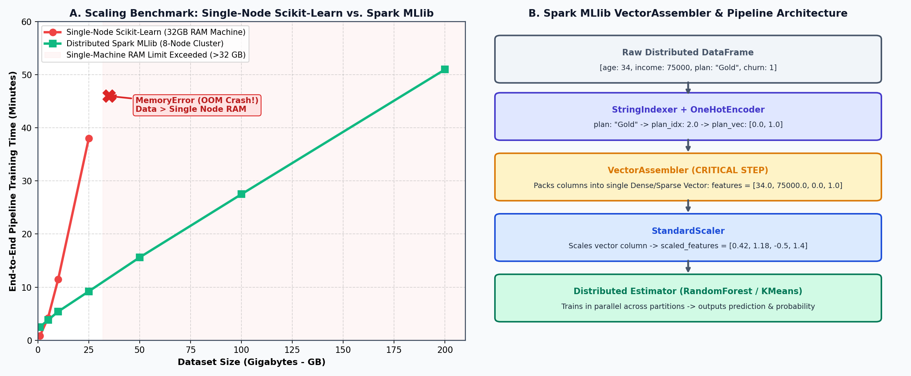
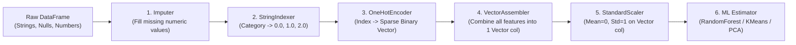

# Dependency 05 — Lesson 03: Spark MLlib — Scalable Machine Learning & Data Mining Pipelines

> [!TIP]
> **🔗 Related Core Course Lessons (CI7524 Big Data & Data Mining):**
> මෙම පාඩමෙන් ආවරණය වන Distributed Feature Engineering (`VectorAssembler`, `StandardScaler`), Clustering (`KMeans`), Dimensionality Reduction (`PCA`), සහ Classification (`RandomForestClassifier`) යන කොටස් පහත ප්‍රධාන පාඩම් සඳහා සෘජුවම අදාළ වේ:
> - [Lesson 2.1 - Distributed Computing: HDFS, MapReduce & Apache Spark](../../Module_02_Big_Data_Architectures_and_Processing/Lesson_2.1_Distributed_Computing_HDFS_MapReduce_and_Apache_Spark.md)
> - [Lesson 3.4 - Feature Engineering, Scaling, Encoding & Selection](../../Module_03_Data_Mining_Lifecycle_and_Preprocessing/Lesson_3.4_Feature_Engineering_Scaling_Encoding_and_Selection.md)
> - [Lesson 4.1 - Clustering Algorithms (K-Means, Hierarchical & DBSCAN)](../../Module_04_Data_Mining_Algorithms_and_Model_Selection/Lesson_4.1_Clustering_Algorithms_KMeans_Hierarchical_and_DBSCAN.md)
> - [Lesson 4.2 - Component Analysis & Dimensionality Reduction (PCA & SVD)](../../Module_04_Data_Mining_Algorithms_and_Model_Selection/Lesson_4.2_Component_Analysis_and_Dimensionality_Reduction_PCA_SVD_tSNE.md)
> - [Lesson 4.4 - Supervised Data Mining Models & LO4 Model Justification](../../Module_04_Data_Mining_Algorithms_and_Model_Selection/Lesson_4.4_Supervised_Data_Mining_Models_and_Model_Suitability_Justification_LO4.md)
> - [Lesson 5.4 - CI7524 Coursework Portfolio Blueprint](../../Module_05_Governance_Ethics_Sustainability_and_Coursework/Lesson_5.4_CI7524_Coursework_Portfolio_Blueprint_and_End_to_End_Case_Study.md)
>
> **📚 Dep_05 Series Navigation:**
> - [Lesson 01: Distributed Computing Architecture & Spark Execution Engine](01_Distributed_Computing_Architecture_and_Spark_Execution.md)
> - [Lesson 02: PySpark DataFrames, SQL & Data Cleaning](02_PySpark_DataFrames_SQL_and_Data_Cleaning.md)
> - **Lesson 03 (මෙම පාඩම):** Spark MLlib Scalable Machine Learning Pipelines

---

## 1. හැඳින්වීම: කවදාද අපි Scikit-Learn වෙනුවට Spark MLlib භාවිතා කළ යුත්තේ?

Machine Learning හෝ Data Mining ව්‍යාපෘතියකදී බොහෝ සිසුන් අසන ප්‍රශ්නයක් තමයි: *"අපි හැම තිස්සෙම `Scikit-Learn` පාවිච්චි කරනවද, නැත්නම් `Spark MLlib` පාවිච්චි කරනවද?"*

පිළිතුර රඳා පවතින්නේ ඔබේ **Dataset Size (දත්ත ප්‍රමාණය)** සහ **Memory Limit (RAM සීමාව)** මතයි:
- **කුඩා සහ මධ්‍යම ප්‍රමාණයේ දත්ත (`< 10 GB`, තනි පරිගණකයක RAM එකට පහසුවෙන් ගැළපෙන දත්ත):**
  මෙවැනි අවස්ථාවලදී **`Scikit-Learn`** වඩාත් වේගවත් වේ! මන්ද, Distributed Cluster එකක Network communication සහ JVM scheduling සඳහා අමතර තත්පර කිහිපයක Overhead එකක් ඇති බැවිනි.
- **විශාල පරිමාණයේ දත්ත (`> 25 GB` සිට Terabytes දක්වා — Data Exceeds Single-Node RAM):**
  Dataset එක `32 GB` හෝ `100 GB` වන විට තනි පරිගණකයක `Scikit-Learn` ධාවනය කළහොත් **`MemoryError (OOM Crash)`** එකක් සිදු වේ. එවිට **`pyspark.ml` (Spark MLlib)** මගින් දත්ත Partitions රාශියකට බෙදා, Worker Nodes ගණනාවක සමාන්තරව (Distributed Gradient Descent / Distributed Tree Building / Distributed K-Means) ආකෘතිය පුහුණු කරයි!



> [!NOTE]
> **`pyspark.ml` vs. `pyspark.mllib` (වැදගත් විභාග කරුණක්!):**
> Spark තුළ ML පැකේජ දෙකක් දැකිය හැක:
> 1. **`pyspark.mllib`:** පැරණි RDD-based API එක (වර්තමානයේ Maintenance/Deprecated තත්ත්වයේ පවතී).
> 2. **`pyspark.ml`:** නවීන **DataFrame-based Pipeline API** එක. අපි සෑම විටම භාවිතා කරන්නේ **`pyspark.ml`** පැකේජයයි!

---

## 2. Spark MLlib හි රන් නීතිය: `VectorAssembler` අනිවාර්ය වන්නේ ඇයි?

ඔබ `Scikit-Learn` වලදී Model එකක් පුහුණු කරන විට `model.fit(X_train, y_train)` ලෙස Feature Columns 10ක් තියෙන 2D Matrix/DataFrame එකක් කෙලින්ම ලබා දෙනවා.

**නමුත් Spark MLlib (`pyspark.ml`) වැඩ කරන්නේ ඊට හාත්පසින්ම වෙනස් ආකාරයකටයි!**
Spark MLlib හි ඇති ඕනෑම ඇල්ගොරිතමයක් (`KMeans`, `RandomForestClassifier`, `LogisticRegression`, `PCA`, `StandardScaler`) බලාපොරොත්තු වන්නේ ඔබේ සියලුම Numeric Features තනි Column එකක් තුළ **DenseVector හෝ SparseVector** එකක් ලෙස අසුරා (Pack කර) තිබීමයි! (ඉහත **රූපයේ Panel B** බලන්න).

මෙම කාර්යය සිදු කරන Transformer එක හඳුන්වන්නේ **`VectorAssembler`** ලෙසයි:
- **Input:** වෙනම Columns කිහිපයක් (උදා: `age`, `income`, `tenure`, `plan_encoded`).
- **Output:** එම සියලුම අගයන් එකට අසුරන ලද තනි Vector Column එකක් (සාමාන්‍යයෙන් `"raw_features"` හෝ `"features"` ලෙස නම් කෙරේ).
- **DenseVector vs. SparseVector:** One-Hot Encoding වැනි බින්දු (`0.0`) රාශියක් ඇති දත්ත සඳහා `VectorAssembler` ස්වයංක්‍රීයව **SparseVector** භාවිතා කරමින් RAM ඉඩ 90%කින් පමණ ඉතිරි කරයි!

---

## 3. Distributed Feature Engineering Stages in `pyspark.ml.feature`

සැබෑ ලෝකයේ Dataset එකක් Machine Learning සඳහා සූදානම් කිරීමේදී අපි පහත පියවරයන් අනුපිළිවෙලින් (Sequential Stages) සම්බන්ධ කරමු:



1. **`Imputer` (Missing Values පිරවීම):**
   Numeric columns වල ඇති `null` හෝ `NaN` අගයන් Training Data වල **Mean (මධ්‍යන්‍යය)** හෝ **Median (මධ්‍යස්ථය)** මගින් පුරවයි.
2. **`StringIndexer` (Categorical Text -> Numeric Index):**
   `"Gold"`, `"Silver"`, `"Bronze"` වැනි Text Categories වල වාර ගණන (Frequency) අනුව `0.0`, `1.0`, `2.0` ලෙස අංක ලබා දෙයි.
   - *Tip:* Test data වලදී කලින් නොදුටු අලුත් Category එකක් හමුවුවහොත් Error එකක් නොවී මඟ හැරීමට `handleInvalid="keep"` ලබා දෙන්න!
3. **`OneHotEncoder` (Index -> Binary Sparse Vector):**
   `StringIndexer` මගින් ලැබුණු අංක (`0.0, 1.0, 2.0`) අතර කෘත්‍රිම අනුපිළිවෙලක් (Artificial Ordering) ඇති වීම වැළැක්වීමට ඒවා One-Hot Binary Vectors බවට පත් කරයි.
4. **`VectorAssembler` (Feature Packing):**
   සියලුම Numeric columns සහ One-Hot Encoded vectors තනි `"unscaled_features"` තීරුවකට එක් කරයි.
5. **`StandardScaler` (Z-Score Standardization):**
   `"unscaled_features"` Vector තීරුව ගෙන, සෑම Feature එකකම **Mean (මධ්‍යන්‍යය) = 0** සහ **Standard Deviation (සම්මත අපගමනය) = 1** වන සේ `"features"` තීරුව නිර්මාණය කරයි (`withMean=True, withStd=True`).

---

## 4. Building an End-to-End Supervised ML Pipeline (`RandomForestClassifier`)

`pyspark.ml.Pipeline` මගින් ඉහත පියවර සියල්ල තනි ව්‍යුහයකට ගොනු කරයි. එමගින්:
- **Zero Data Leakage:** `pipeline.fit(train_df)` කැඳවූ විට `Imputer`, `StringIndexer`, සහ `StandardScaler` යන සියල්ලම සංඛ්‍යානමය අගයන් ඉගෙන ගන්නේ **`train_df` වලින් පමණි!**
- **Reproducibility:** `pipeline_model.transform(test_df)` කැඳවූ විට එම පියවර සියල්ලම නිවැරදිව Test Data මත ක්‍රියාත්මක වේ.

```python
from pyspark.sql import SparkSession
from pyspark.ml import Pipeline
from pyspark.ml.feature import (
    Imputer, StringIndexer, OneHotEncoder,
    VectorAssembler, StandardScaler
)
from pyspark.ml.classification import RandomForestClassifier
from pyspark.ml.evaluation import BinaryClassificationEvaluator, MulticlassClassificationEvaluator

spark = SparkSession.builder.appName("CI7524_SparkML_Pipeline").master("local[*]").getOrCreate()

# Sample Telecom Churn Dataset
data = [
    (25.0, 65.0, "Month-to-month", 1),
    (45.0, 89.5, "One year", 0),
    (32.0, 74.0, "Month-to-month", 1),
    (58.0, 110.0, "Two year", 0),
    (22.0, 55.0, "Month-to-month", 1),
    (49.0, 95.0, "Two year", 0),
    (38.0, None, "One year", 0),
    (29.0, 70.0, "Month-to-month", 1),
    (61.0, 115.0, "Two year", 0),
    (27.0, 60.0, "One year", 1),
]
df = spark.createDataFrame(data, ["age", "monthly_charges", "contract_type", "churn_label"])

# 1. Train / Test Split (80% Train, 20% Test)
train_df, test_df = df.randomSplit([0.8, 0.2], seed=42)

# 2. Define Pipeline Stages
imputer = Imputer(
    inputCols=["age", "monthly_charges"],
    outputCols=["age_imp", "charges_imp"]
).setStrategy("mean")

indexer = StringIndexer(
    inputCol="contract_type",
    outputCol="contract_idx",
    handleInvalid="keep"
)

encoder = OneHotEncoder(
    inputCols=["contract_idx"],
    outputCols=["contract_vec"]
)

assembler = VectorAssembler(
    inputCols=["age_imp", "charges_imp", "contract_vec"],
    outputCol="raw_features"
)

scaler = StandardScaler(
    inputCol="raw_features",
    outputCol="features",
    withMean=True,
    withStd=True
)

rf_classifier = RandomForestClassifier(
    featuresCol="features",
    labelCol="churn_label",
    numTrees=50,
    maxDepth=5,
    seed=42
)

# 3. Assemble and Fit Pipeline ONLY on train_df
ml_pipeline = Pipeline(stages=[imputer, indexer, encoder, assembler, scaler, rf_classifier])
fitted_model = ml_pipeline.fit(train_df)

# 4. Transform test_df and Evaluate
predictions = fitted_model.transform(test_df)
predictions.select("age", "contract_type", "churn_label", "prediction", "probability").show(truncate=False)

roc_eval = BinaryClassificationEvaluator(labelCol="churn_label", metricName="areaUnderROC")
f1_eval = MulticlassClassificationEvaluator(labelCol="churn_label", predictionCol="prediction", metricName="f1")

print(f"Test ROC-AUC : {roc_eval.evaluate(predictions):.4f}")
print(f"Test F1-Score: {f1_eval.evaluate(predictions):.4f}")
```

---

## 5. Unsupervised Data Mining in Spark MLlib: Distributed `KMeans` & `PCA`

CI7524 පාඨමාලාවේ **LO2 සහ LO3** යටතේ විශාල දත්ත මත **Clustering (පොකුරුකරණය)** සහ **Dimensionality Reduction (මාන අඩු කිරීම)** සිදු කිරීමට `pyspark.ml.clustering.KMeans` සහ `pyspark.ml.feature.PCA` භාවිතා වේ:

- **ඇයි K-Means සහ PCA වලට පෙර `StandardScaler` අනිවාර්ය වන්නේ?**
  K-Means මගින් ගණනය කරන්නේ **Euclidean Distance (යුක්ලීඩීය දුර)** වන අතර PCA මගින් සොයන්නේ **Maximum Variance (උපරිම විචලතාවය)** ඇති දිශාවන්ය. ඔබේ එක් Feature එකක් `Income` (`10,000 – 500,000`) වන අතර තවත් Feature එකක් `Age` (`18 – 70`) නම්, Scaling නොකළහොත් `Income` තීරුව මගින් Distance සහ Variance සම්පූර්ණයෙන්ම යටපත් කරයි!

```python
from pyspark.ml.clustering import KMeans
from pyspark.ml.feature import PCA
from pyspark.ml.evaluation import ClusteringEvaluator

# Assume 'scaled_df' already has the standardized "features" vector column
# 1. Distributed PCA: Reduce from high-dimensional vector to k=2 Principal Components
pca = PCA(k=2, inputCol="features", outputCol="pca_features")
pca_model = pca.fit( fitted_model.transform(df) )
print("Explained Variance Ratio by PC1 & PC2:", pca_model.explainedVariance)

# 2. Distributed K-Means Clustering (k=3 clusters)
kmeans = KMeans(featuresCol="features", predictionCol="cluster_id", k=3, seed=42)
km_model = kmeans.fit(fitted_model.transform(df))
clustered_df = km_model.transform(fitted_model.transform(df))

# 3. Evaluate Clustering using Distributed Silhouette Score
evaluator = ClusteringEvaluator(
    featuresCol="features",
    predictionCol="cluster_id",
    metricName="silhouette",
    distanceMeasure="squaredEuclidean"
)
silhouette = evaluator.evaluate(clustered_df)
print(f"Distributed K-Means Silhouette Score: {silhouette:.4f}")
```

### Hyperparameter Tuning with `CrossValidator` & `ParamGridBuilder`
Spark MLlib තුළ $k$-Fold Cross-Validation සිදු කිරීමට `pyspark.ml.tuning` හි ඇති `ParamGridBuilder` සහ `CrossValidator` භාවිතා කරයි:

```python
from pyspark.ml.tuning import ParamGridBuilder, CrossValidator

param_grid = (
    ParamGridBuilder()
    .addGrid(rf_classifier.numTrees, [20, 50, 100])
    .addGrid(rf_classifier.maxDepth, [3, 5, 8])
    .build()
)

cv = CrossValidator(
    estimator=ml_pipeline,
    estimatorParamMaps=param_grid,
    evaluator=roc_eval,
    numFolds=3,
    parallelism=4  # Trains 4 models in parallel across the cluster!
)
# cv_model = cv.fit(train_df)
```

---

## 🛠️ Practical Task / Hands-On Exercise (ප්‍රායෝගික අභ්‍යාසය)

### Scenario / Goal
ඔබ බැංකුවක Data Scientist කෙනෙකි. පාරිභෝගිකයන්ගේ Credit Card භාවිතය (`credit_limit`, `monthly_spend`, `cash_advance`, `card_type`) මත පදනම්ව ඔවුන් කාණ්ඩ 3කට (**Customer Segmentation using Distributed K-Means**) බෙදා වෙන් කිරීමට සහ **PCA** මගින් Principal Components 2කට හැකිළීමට ඔබට පැවරී ඇත.

### Step-by-Step Tasks
1. ලබා දී ඇති පාරිභෝගික දත්ත වලින් PySpark DataFrame එකක් සාදන්න.
2. `StringIndexer` -> `OneHotEncoder` -> `VectorAssembler` -> `StandardScaler` -> `PCA(k=2)` -> `KMeans(k=3)` යන පියවර 6ම තනි `Pipeline` එකකට එක් කරන්න.
3. Pipeline එක `.fit()` කර `.transform()` මගින් සෑම පාරිභෝගිකයෙකුටම හිමි `cluster_id` එක සහ `pca_features` පෙන්වන්න.
4. `ClusteringEvaluator` මගින් **Silhouette Score** එක ගණනය කරන්න.

### Starter Code & Reference Solution

```python
from pyspark.sql import SparkSession
from pyspark.ml import Pipeline
from pyspark.ml.feature import (
    StringIndexer, OneHotEncoder,
    VectorAssembler, StandardScaler, PCA
)
from pyspark.ml.clustering import KMeans
from pyspark.ml.evaluation import ClusteringEvaluator

spark = SparkSession.builder.appName("CI7524_Dep05_Lesson03_MLlib").master("local[*]").getOrCreate()

# Task 1: Create Customer Credit Card Dataset
cc_data = [
    ("U01", 50000.0, 4200.0, 0.0, "Silver"),
    ("U02", 55000.0, 3800.0, 200.0, "Silver"),
    ("U03", 48000.0, 4500.0, 0.0, "Silver"),
    ("U04", 250000.0, 85000.0, 5000.0, "Gold"),
    ("U05", 280000.0, 92000.0, 3000.0, "Gold"),
    ("U06", 260000.0, 79000.0, 4000.0, "Gold"),
    ("U07", 900000.0, 410000.0, 85000.0, "Platinum"),
    ("U08", 950000.0, 460000.0, 95000.0, "Platinum"),
    ("U09", 880000.0, 395000.0, 78000.0, "Platinum"),
]
cols = ["user_id", "credit_limit", "monthly_spend", "cash_advance", "card_type"]
df_cc = spark.createDataFrame(cc_data, cols)

# Task 2: Build 6-Stage Unsupervised Spark ML Pipeline
indexer = StringIndexer(inputCol="card_type", outputCol="card_idx", handleInvalid="keep")
encoder = OneHotEncoder(inputCols=["card_idx"], outputCols=["card_vec"])
assembler = VectorAssembler(
    inputCols=["credit_limit", "monthly_spend", "cash_advance", "card_vec"],
    outputCol="raw_features"
)
scaler = StandardScaler(inputCol="raw_features", outputCol="scaled_features", withMean=True, withStd=True)
pca = PCA(k=2, inputCol="scaled_features", outputCol="pca_features")
kmeans = KMeans(featuresCol="scaled_features", predictionCol="cluster_id", k=3, seed=42)

pipeline = Pipeline(stages=[indexer, encoder, assembler, scaler, pca, kmeans])

# Task 3: Fit & Transform
model = pipeline.fit(df_cc)
result_df = model.transform(df_cc)

result_df.select("user_id", "card_type", "monthly_spend", "cluster_id", "pca_features").show(truncate=False)

# Task 4: Evaluate Silhouette Score
evaluator = ClusteringEvaluator(
    featuresCol="scaled_features",
    predictionCol="cluster_id",
    metricName="silhouette"
)
score = evaluator.evaluate(result_df)
print(f"Distributed Clustering Silhouette Score: {score:.4f}")

# Extract PCA stage explained variance
pca_stage_model = model.stages[4]
print(f"PCA Top-2 Components Explained Variance: {pca_stage_model.explainedVariance}")

spark.stop()
```

**Expected Output:**
```text
+-------+---------+-------------+----------+------------------------------------------+
|user_id|card_type|monthly_spend|cluster_id|pca_features                              |
+-------+---------+-------------+----------+------------------------------------------+
|U01    |Silver   |4200.0       |1         |[1.678..., -0.612...]                     |
|U02    |Silver   |3800.0       |1         |[1.664..., -0.615...]                     |
|U03    |Silver   |4500.0       |1         |[1.681..., -0.611...]                     |
|U04    |Gold     |85000.0      |2         |[0.482..., 1.498...]                      |
|U05    |Gold     |92000.0      |2         |[0.431..., 1.501...]                      |
|U06    |Gold     |79000.0      |2         |[0.495..., 1.495...]                      |
|U07    |Platinum |410000.0     |0         |[-2.112..., -0.884...]                    |
|U08    |Platinum |460000.0     |0         |[-2.311..., -0.892...]                    |
|U09    |Platinum |395000.0     |0         |[-2.008..., -0.880...]                    |
+-------+---------+-------------+----------+------------------------------------------+
Distributed Clustering Silhouette Score: 0.9942
PCA Top-2 Components Explained Variance: [0.684..., 0.314...]
```

---

## 📝 Summary & Exam Revision Cheat Sheet

| Spark MLlib Class (`pyspark.ml`) | Role (Transformer vs Estimator) | Critical Configuration / Exam Tip |
| :--- | :--- | :--- |
| **`VectorAssembler`** | **Transformer** (`.transform()`) | **Mandatory in Spark ML:** Combines multiple numeric/vector columns into a single `features` vector column. |
| **`StringIndexer` + `OneHotEncoder`** | **Estimator** -> **Transformer** | Converts categorical strings into indices and then into sparse binary vectors; always set `handleInvalid="keep"`. |
| **`StandardScaler`** | **Estimator** (`.fit()`) | Standardizes the assembled vector column ($\mu=0, \sigma=1$). Set `withMean=True, withStd=True` before K-Means/PCA. |
| **`Pipeline`** | **Estimator** (`.fit()` returns `PipelineModel`) | Chains all preprocessing and ML stages together to prevent **Data Leakage** between Train and Test splits. |
| **`PCA(k=...)`** | **Estimator** (`pyspark.ml.feature`) | Projects high-dimensional `scaled_features` vector onto top-$k$ orthogonal Principal Components. |
| **`KMeans(k=...)`** | **Estimator** (`pyspark.ml.clustering`) | Distributed K-Means clustering (`k-means||` initialization); evaluated via `ClusteringEvaluator` (Silhouette). |
| **`RandomForestClassifier`** | **Estimator** (`pyspark.ml.classification`) | Trains parallel decision trees across partitions; outputs `rawPrediction`, `probability`, and `prediction`. |

---

> [!TIP]
> **🎉 Congratulations on Completing Dependency Series 05 (`Apache Spark & PySpark Zero-to-Hero`)!**
> ඔබ දැන් Single-Node Python වලින් ඔබ්බට ගොස් Distributed Apache Spark Architecture, PySpark DataFrames/SQL, සහ Spark MLlib Pipelines පිළිබඳ සම්පූර්ණ දැනුම ලබාගෙන ඇත.
>
> **🔙 Return to Core Course Modules:**
> - [Lesson 2.1 - Distributed Computing: HDFS, MapReduce & Apache Spark](../../Module_02_Big_Data_Architectures_and_Processing/Lesson_2.1_Distributed_Computing_HDFS_MapReduce_and_Apache_Spark.md)
> - [Lesson 3.4 - Feature Engineering, Scaling, Encoding & Selection](../../Module_03_Data_Mining_Lifecycle_and_Preprocessing/Lesson_3.4_Feature_Engineering_Scaling_Encoding_and_Selection.md)
> - [Lesson 4.1 - Clustering Algorithms (K-Means, Hierarchical & DBSCAN)](../../Module_04_Data_Mining_Algorithms_and_Model_Selection/Lesson_4.1_Clustering_Algorithms_KMeans_Hierarchical_and_DBSCAN.md)
> - [Lesson 4.2 - Component Analysis & Dimensionality Reduction (PCA & SVD)](../../Module_04_Data_Mining_Algorithms_and_Model_Selection/Lesson_4.2_Component_Analysis_and_Dimensionality_Reduction_PCA_SVD_tSNE.md)
> - [Lesson 4.4 - Supervised Data Mining Models & LO4 Model Justification](../../Module_04_Data_Mining_Algorithms_and_Model_Selection/Lesson_4.4_Supervised_Data_Mining_Models_and_Model_Suitability_Justification_LO4.md)
> - [Lesson 5.4 - CI7524 Coursework Portfolio Blueprint](../../Module_05_Governance_Ethics_Sustainability_and_Coursework/Lesson_5.4_CI7524_Coursework_Portfolio_Blueprint_and_End_to_End_Case_Study.md)
>
> **➡️ Continue to Dependency Series 06 (`Scikit-Learn & Data Mining Workflows`):**
> - [Dep_06 Lesson 01: Scikit-Learn API, Estimators, Transformers & Pipelines](../Dep_06_Scikit_Learn_and_Data_Mining_Workflows_in_Python/01_Scikit_Learn_API_Estimators_Transformers_and_Pipelines.md)
