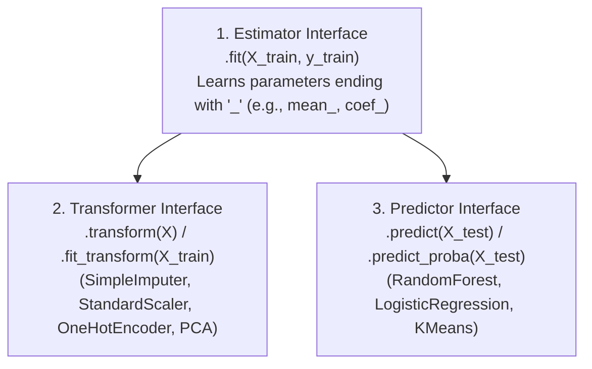
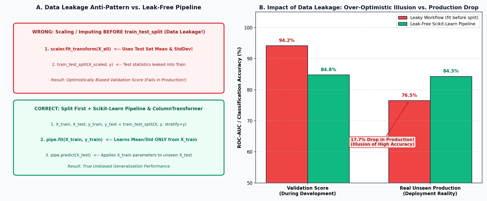
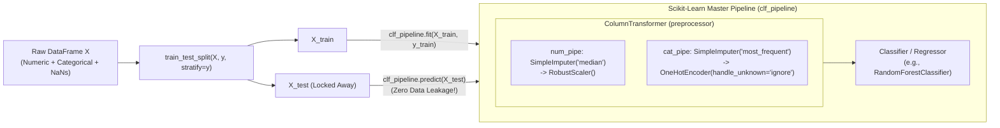

# Dependency 06 — Lesson 01: Scikit-Learn API, Estimators, Transformers & Leak-Free Pipelines (මුල සිට සරලව)

> [!TIP]
> **🔗 Related Core Course Lessons (CI7524 Big Data & Data Mining):**
> මෙම පාඩමෙන් උගන්වන Scikit-Learn API Design, **Data Leakage Prevention (දත්ත කාන්දු වීම වැළැක්වීම)**, `ColumnTransformer`, සහ `Pipeline` ගොඩනැගීම පහත ප්‍රධාන පාඩම් (Core Module Lessons) සඳහා අත්‍යවශ්‍ය පදනම සපයයි:
> - [Lesson 3.4 - Feature Engineering, Scaling, Encoding & Selection](../../Module_03_Data_Mining_Lifecycle_and_Preprocessing/Lesson_3.4_Feature_Engineering_Scaling_Encoding_and_Selection.md)
> - [Lesson 4.1 - Clustering Algorithms (K-Means, Hierarchical & DBSCAN)](../../Module_04_Data_Mining_Algorithms_and_Model_Selection/Lesson_4.1_Clustering_Algorithms_KMeans_Hierarchical_and_DBSCAN.md)
> - [Lesson 4.2 - Component Analysis & Dimensionality Reduction (PCA & SVD)](../../Module_04_Data_Mining_Algorithms_and_Model_Selection/Lesson_4.2_Component_Analysis_and_Dimensionality_Reduction_PCA_SVD_tSNE.md)
> - [Lesson 4.4 - Supervised Data Mining Models & LO4 Model Justification](../../Module_04_Data_Mining_Algorithms_and_Model_Selection/Lesson_4.4_Supervised_Data_Mining_Models_and_Model_Suitability_Justification_LO4.md)
> - [Lesson 5.4 - CI7524 Coursework Portfolio Blueprint](../../Module_05_Governance_Ethics_Sustainability_and_Coursework/Lesson_5.4_CI7524_Coursework_Portfolio_Blueprint_and_End_to_End_Case_Study.md)
>
> **📚 Dep_06 Series Navigation:**
> - **Lesson 01 (මෙම පාඩම):** Scikit-Learn API, Estimators, Transformers & Pipelines
> - [Lesson 02: Unsupervised Learning in Practice — Clustering & PCA](02_Unsupervised_Learning_in_Practice_Clustering_and_PCA.md)
> - [Lesson 03: Supervised Modelling, Cross-Validation & Evaluation Metrics](03_Supervised_Modelling_Cross_Validation_and_Evaluation_Metrics.md)

---

## 1. හැඳින්වීම: ඇයි Scikit-Learn API එක ලෝකයේ ජනප්‍රියම Data Mining Library එක වුණේ?

Python වලින් Data Mining සහ Machine Learning කරන ඕනෑම කෙනෙක් මුලින්ම ඉගෙන ගන්න Library එක තමයි **`scikit-learn` (`sklearn`)**. එහි ඇති විශේෂත්වය තමයි ඔබ `StandardScaler` එකක් පාවිච්චි කළත්, `PCA` එකක් පාවිච්චි කළත්, `RandomForestClassifier` එකක් පාවිච්චි කළත්, ඒ හැම එකක්ම වැඩ කරන්නේ **එකම පොදු නීති පද්ධතියකට (Unified Object-Oriented API Design)** අනුව වීමයි!

Scikit-Learn හි සියලුම Objects ප්‍රධාන භූමිකා (Interfaces) 3කට බෙදෙනවා:

### 1. Estimators (ඇස්තමේන්තුකාරක — `.fit()` මගින් දත්ත වලින් ඉගෙන ගන්නා ඕනෑම Object එකක්)
දත්ත පරීක්ෂා කර එහි ඇති සංඛ්‍යානමය පරාමිතීන් (**Learned Parameters**) ඉගෙන ගන්නා ඕනෑම class එකක් **Estimator** එකක් ලෙස හැඳින්වේ.
- **ක්‍රියා කරන ආකාරය:** `estimator.fit(X_train)` හෝ `estimator.fit(X_train, y_train)` කැඳවීම.
- **Scikit-Learn Naming Convention (Trailing Underscore `_`):**
  Estimator එකක් `.fit()` කළ පසු, දත්ත වලින් ඉගෙන ගත් සියලුම අගයන් (Learned Attributes) ගබඩා වන්නේ **අගට යටි ඉරක් (`_`)** සහිත විචල්‍යයන් ලෙසයි!
  - *උදාහරණ:*
    - `scaler.fit(X_train)` කළ පසු -> `scaler.mean_` සහ `scaler.scale_` (Standard Deviation).
    - `kmeans.fit(X_train)` කළ පසු -> `kmeans.cluster_centers_` සහ `kmeans.labels_`.
    - `pca.fit(X_train)` කළ පසු -> `pca.components_` සහ `pca.explained_variance_ratio_`.

### 2. Transformers (පරිවර්තක — `.transform()` මගින් දත්ත වෙනස් කරන Objects)
දත්ත පිරිසිදු කරන, පරිමාණ කරන (Scale), Encode කරන, හෝ මාන අඩු කරන (PCA) Estimators හැඳින්වෙන්නේ **Transformers** ලෙසයි.
- **`.fit(X_train)`:** Training දත්ත වලින් පමණක් පරාමිතීන් (උදා: Mean, Median, Min, Max, Categories) ඉගෙන ගනී.
- **`.transform(X)`:** ඉගෙන ගත් පරාමිතීන් භාවිතා කර `X_train` හෝ `X_test` අලුත් ස්වරූපයකට පරිවර්තනය කරයි.
- **`.fit_transform(X_train)`:** Training data මත `.fit()` සහ `.transform()` යන පියවර දෙකම එකවර වේගවත්ව සිදු කරයි (**⚠️ අවවාදයයි: `.fit_transform()` භාවිතා කළ යුත්තේ `X_train` මත පමණි! කිසිවිටෙක `X_test` මත `.fit_transform()` කැඳවන්න එපා!**).

### 3. Predictors (අනාවැකිකාරක — `.predict()` මගින් අනාවැකි කියන Models)
Classification, Regression, හෝ Clustering සිදු කරන Machine Learning ආකෘති **Predictors** වේ.
- **`.predict(X_test)`:** අලුත් දත්ත සඳහා අවසාන Class Label එක (`0` හෝ `1`) හෝ අගය ලබා දෙයි.
- **`.predict_proba(X_test)`:** Classification වලදී එක් එක් පන්තියට අයත් වීමේ **Probability (සම්භාවිතාවය)** ලබා දෙයි (ROC-AUC ගණනය කිරීමට අත්‍යවශ්‍ය වේ!).
- **`.score(X_test, y_test)`:** ආකෘතියේ Accuracy (Classification) හෝ $R^2$ (Regression) ලකුණු ගණනය කරයි.



---

## 2. Feature Matrix `X` සහ Target Vector `y` හි හැඩය (Shapes & Data Types)

Scikit-Learn වෙත දත්ත ලබා දීමේදී හැඩයන් (Dimensions/Shapes) පිළිබඳව ඉතා සැලකිලිමත් විය යුතුය:
- **Feature Matrix `X` (2D Array or DataFrame — Shape: `(n_samples, n_features)`):**
  `X` සෑම විටම **ද්වි-මාන (2D)** විය යුතුය! ඔබට ඇත්තේ එකම එක Feature Column එකක් පමණක් වුවද, `df["age"]` (1D Series) ලෙස ලබා දුන්නොත් Scikit-Learn වෙතින් `ValueError: Expected 2D array, got 1D array instead` දෝෂය ලැබේ. එබැවින් සෑම විටම ද්විත්ව වරහන් **`df[["age", "income"]]`** (2D DataFrame) භාවිතා කරන්න.
- **Target Vector `y` (1D Array or Series — Shape: `(n_samples,)`):**
  Supervised Learning වලදී අනාවැකි කිව යුතු Target තීරුව `df["churn"]` ලෙස **ඒක-මාන (1D Series/Array)** ලෙස ලබා දෙයි.

---

## 3. Data Leakage (දත්ත කාන්දු වීම) සහ එය වළක්වන ආකාරය (CRITICAL FOR CI7524 LO3/LO4)

Data Mining Coursework සහ ප්‍රායෝගික ව්‍යාපෘති වලදී සිසුන් අතින් සිදුවන **භයානකම තාක්ෂණික වරද** තමයි **Preprocessing Data Leakage (පූර්ව-සැකසුම් දත්ත කාන්දු වීම)**.

### Data Leakage සිදුවන්නේ කෙසේද? (The Anti-Pattern)
හිතන්න ඔබ ළඟ පාරිභෝගිකයන් 1,000කගේ දත්ත (`X`) තියෙනවා. ඔබ `train_test_split` කරන්න **කලින්**, මුළු Dataset එකටම මෙහෙම කළොත් මොකද වෙන්නේ?
```python
# ❌ WRONG (DATA LEAKAGE!): Fitting scaler/imputer on the ENTIRE dataset before splitting!
X_scaled = scaler.fit_transform(X)
X_train, X_test, y_train, y_test = train_test_split(X_scaled, y, test_size=0.2)
```
මෙහිදී `scaler.fit_transform(X)` මගින් **Mean ($\mu$)** සහ **Standard Deviation ($\sigma$)** ගණනය කරන්නේ **Test Set එකේ තියෙන පේළි 200ත් ඇතුළත් කරගෙනයි!**
එතකොට අනාගතයේදී එන්න තියෙන නොදුටු දත්ත (Unseen Test Data) වල සංඛ්‍යානමය තොරතුරු Training Data ඇතුළට කාන්දු වෙලා (**Information Leakage from Test to Train**).



ඉහත රූපයේ **Panel A** සහ **Panel B** පෙන්වන පරිදි:
- **Leaky Workflow එකේදී:** Development අවස්ථාවේදී Validation Accuracy එක `94.2%` ක් වගේ ඉතා ඉහළ අගයක් පෙන්වමින් ඔබව රවටයි (**Over-optimistic Evaluation Bias**). නමුත් සැබෑ ලෝකයේ (Production) අලුත් දත්ත හමුවූ විට Accuracy එක `76.5%` දක්වා කඩා වැටේ!
- **Leak-Free Workflow එකේදී:**
  1. පළමුව `train_test_split(X, y)` මගින් දත්ත වෙන් කරන්න.
  2. `scaler.fit(X_train)` මගින් **`X_train` වලින් පමණක්** Mean ($\mu_{\text{train}}$) සහ Std ($\sigma_{\text{train}}$) ඉගෙන ගන්න:
     $$z_{\text{train}} = \frac{x_{\text{train}} - \mu_{\text{train}}}{\sigma_{\text{train}}}$$
  3. `scaler.transform(X_test)` මගින් Test Set එක පරිමාණ කිරීමේදීත් **`X_train` වලින් ඉගෙන ගත් $\mu_{\text{train}}$ සහ $\sigma_{\text{train}}$ ම පමණක්** භාවිතා කරන්න:
     $$z_{\text{test}} = \frac{x_{\text{test}} - \mu_{\text{train}}}{\sigma_{\text{train}}}$$

---

## 4. Core Preprocessing Transformers in `sklearn`

සැබෑ ලෝකයේ Tabular Dataset එකක විවිධ වර්ගයේ තීරු (Numeric, Categorical, Skewed, Missing) පවතී. ඒ සඳහා Scikit-Learn හි ඇති ප්‍රධාන Transformers 4 මෙසේය:

| Transformer Class | භාවිතා කරන අවස්ථාව (When to Use) | ගණිතමය ක්‍රියාවලිය / Key Parameters |
| :--- | :--- | :--- |
| **`SimpleImputer`** | Missing Values (`NaN`) පිරවීමට. | Numeric සඳහා `strategy="median"` (Outliers වලට ඔරොත්තු දෙයි) හෝ `"mean"`; Categorical සඳහා `strategy="most_frequent"`. |
| **`StandardScaler`** | සාමාන්‍ය ව්‍යාප්තියකට ආසන්න Numeric Features සඳහා (PCA, K-Means, SVM, Logistic Regression). | **Z-Score Standardization:** $\mu = 0, \sigma = 1$ බවට පත් කරයි. |
| **`RobustScaler`** | දැඩි **Outliers (අසාමාන්‍ය අගයන්)** සහිත Numeric Features සඳහා (උදා: Income, House Price). | **Median (මධ්‍යස්ථය)** සහ **IQR (Interquartile Range)** භාවිතා කරන නිසා Outliers වලින් බලපෑමක් නැත: $x' = \frac{x - \text{Median}}{\text{IQR}}$. |
| **`MinMaxScaler`** | සියලුම අගයන් $[0, 1]$ පරාසය තුළට ගෙන ඒමට අවශ්‍ය විට (Neural Networks / Image pixels). | $x' = \frac{x - x_{\min}}{x_{\max} - x_{\min}}$ (Outliers වලට ඉතා සංවේදී වේ). |
| **`OneHotEncoder`** | Nominal Categorical Columns (අනුපිළිවෙලක් නැති කාණ්ඩ — උදා: `City`, `Gender`). | සෑම කාණ්ඩයකටම Binary (`0/1`) තීරුවක් සාදයි. **`handle_unknown="ignore"`** ලබා දීමෙන් Test Set හි අලුත් කාණ්ඩයක් ආවත් Error නොවේ! |
| **`OrdinalEncoder`** | Ordinal Categorical Columns (නිශ්චිත අනුපිළිවෙලක් ඇති කාණ්ඩ — උදා: `Low < Medium < High`). | ලබා දුන් අනුපිළිවෙල අනුව `0, 1, 2` ලෙස අංක ලබා දෙයි. |

---

## 5. Production-Grade Architecture: `ColumnTransformer` + `Pipeline`

සැබෑ Dataset එකක Numeric Columns වලට `SimpleImputer(strategy="median")` + `StandardScaler()` යෙදිය යුතු අතර, Categorical Columns වලට `SimpleImputer(strategy="most_frequent")` + `OneHotEncoder(handle_unknown="ignore")` යෙදිය යුතුය.

මේවා අතින් වෙන වෙනම කරන්න ගියොත් කේතය ඉතා අවුල් සහගත වන අතර Cross-Validation වලදී Data Leakage සිදු වේ. මෙයට Scikit-Learn ලබා දෙන අලංකාර විසඳුම තමයි **`ColumnTransformer`** සහ **`Pipeline`** එකතුව!



### Complete Production Code Walkthrough:
```python
import pandas as pd
import numpy as np
from sklearn.model_selection import train_test_split
from sklearn.pipeline import Pipeline
from sklearn.compose import ColumnTransformer
from sklearn.impute import SimpleImputer
from sklearn.preprocessing import StandardScaler, OneHotEncoder
from sklearn.ensemble import RandomForestClassifier
from sklearn.metrics import accuracy_score, roc_auc_score

# 1. Sample Mixed-Type Dataset with Missing Values
df = pd.DataFrame({
    "age": [25, 42, np.nan, 35, 51, 28, 60, 31, np.nan, 47],
    "monthly_bill": [70.5, 110.0, 65.0, 95.0, 120.0, 55.0, 130.0, np.nan, 68.0, 105.0],
    "contract": ["Monthly", "Annual", "Monthly", "Two-Year", "Annual", "Monthly", "Two-Year", "Monthly", "Monthly", "Annual"],
    "payment_method": ["Card", "Bank", np.nan, "Card", "Bank", "E-Wallet", "Bank", "E-Wallet", "Card", "Bank"],
    "churn": [1, 0, 1, 0, 0, 1, 0, 1, 1, 0]
})

X = df.drop(columns=["churn"])
y = df["churn"]

# 2. STEP 1: Split BEFORE any preprocessing (Stratified by target y)
X_train, X_test, y_train, y_test = train_test_split(
    X, y, test_size=0.3, stratify=y, random_state=42
)

# 3. Define column groups
numeric_cols = ["age", "monthly_bill"]
categorical_cols = ["contract", "payment_method"]

# 4. Build sub-pipelines for Numeric and Categorical features
numeric_transformer = Pipeline(steps=[
    ("imputer", SimpleImputer(strategy="median")),
    ("scaler", StandardScaler())
])

categorical_transformer = Pipeline(steps=[
    ("imputer", SimpleImputer(strategy="most_frequent")),
    ("onehot", OneHotEncoder(handle_unknown="ignore", sparse_output=False))
])

# 5. Combine using ColumnTransformer
preprocessor = ColumnTransformer(
    transformers=[
        ("num", numeric_transformer, numeric_cols),
        ("cat", categorical_transformer, categorical_cols)
    ],
    remainder="drop"  # Or "passthrough" to keep unlisted columns
)

# 6. Create Final End-to-End Pipeline
full_pipeline = Pipeline(steps=[
    ("preprocessor", preprocessor),
    ("classifier", RandomForestClassifier(n_estimators=100, random_state=42))
])

# 7. Fit ONLY on X_train, then predict on X_test (100% Leak-Free!)
full_pipeline.fit(X_train, y_train)
y_pred = full_pipeline.predict(X_test)
y_prob = full_pipeline.predict_proba(X_test)[:, 1]

# Inspect transformed feature names
feature_names = full_pipeline.named_steps["preprocessor"].get_feature_names_out()
print("Engineered Feature Names:", feature_names)
print("Test Accuracy:", accuracy_score(y_test, y_pred))
```

---

## 🛠️ Practical Task / Hands-On Exercise (ප්‍රායෝගික අභ්‍යාසය)

### Scenario / Goal
ඔබ සෞඛ්‍ය දත්ත (Healthcare Patient Readmission Dataset) විශ්ලේෂණය කරන Data Miner කෙනෙකි. Dataset එකෙහි Numerical (`bmi`, `glucose_level`), Ordinal (`risk_tier`: `"Low" < "Medium" < "High"`), සහ Nominal (`department`: `"Cardiology"`, `"Neurology"`, `"General"`) තීරු මෙන්ම Missing Values (`NaN`) ද පවතී. **Data Leakage** කිසිවක් සිදු නොවන ලෙස `ColumnTransformer` සහ `Pipeline` එකක් නිර්මාණය කිරීම ඔබේ අභියෝගයයි.

### Step-by-Step Tasks
1. `X` සහ `y` වෙන් කර `train_test_split(..., test_size=0.25, stratify=y, random_state=42)` මගින් දත්ත බෙදන්න.
2. Numerical තීරු සඳහා `SimpleImputer(strategy="median")` + `RobustScaler()` අඩංගු Pipeline එකක් සාදන්න.
3. Ordinal තීරුව (`risk_tier`) සඳහා `OrdinalEncoder(categories=[["Low", "Medium", "High"]])` සහ Nominal තීරුව (`department`) සඳහා `OneHotEncoder(handle_unknown="ignore", sparse_output=False)` යොදමින් `ColumnTransformer` එකක් ගොඩනගන්න.
4. `LogisticRegression()` සමඟ සම්පූර්ණ Pipeline එක `.fit(X_train, y_train)` කර, `get_feature_names_out()` සහ Test Predictions පෙන්වන්න.

### Starter Code & Reference Solution

```python
import numpy as np
import pandas as pd
from sklearn.model_selection import train_test_split
from sklearn.pipeline import Pipeline
from sklearn.compose import ColumnTransformer
from sklearn.impute import SimpleImputer
from sklearn.preprocessing import RobustScaler, OrdinalEncoder, OneHotEncoder
from sklearn.linear_model import LogisticRegression

# Sample Healthcare Readmission Dataset
data = pd.DataFrame({
    "bmi": [22.5, 31.2, np.nan, 28.4, 35.0, 24.1, 33.8, 21.9, 29.5, 36.2, 23.0, 32.1],
    "glucose_level": [92.0, 165.0, 148.0, np.nan, 190.0, 88.0, 172.0, 95.0, 140.0, 210.0, 90.0, 160.0],
    "risk_tier": ["Low", "High", "Medium", "Medium", "High", "Low", "High", "Low", "Medium", "High", "Low", "High"],
    "department": ["General", "Cardiology", "Neurology", "Cardiology", "Cardiology", "General",
                   "Neurology", "General", "Cardiology", "Cardiology", "General", "Neurology"],
    "readmitted": [0, 1, 1, 0, 1, 0, 1, 0, 1, 1, 0, 1]
})

X = data.drop(columns=["readmitted"])
y = data["readmitted"]

# Task 1: Split data first
X_train, X_test, y_train, y_test = train_test_split(
    X, y, test_size=0.25, stratify=y, random_state=42
)

# Task 2 & 3: Build specialized pipelines and ColumnTransformer
num_pipe = Pipeline([
    ("imputer", SimpleImputer(strategy="median")),
    ("robust_scaler", RobustScaler())
])

ord_pipe = Pipeline([
    ("imputer", SimpleImputer(strategy="most_frequent")),
    ("ordinal", OrdinalEncoder(categories=[["Low", "Medium", "High"]]))
])

nom_pipe = Pipeline([
    ("imputer", SimpleImputer(strategy="most_frequent")),
    ("ohe", OneHotEncoder(handle_unknown="ignore", sparse_output=False))
])

preprocessor = ColumnTransformer(transformers=[
    ("num", num_pipe, ["bmi", "glucose_level"]),
    ("ord", ord_pipe, ["risk_tier"]),
    ("nom", nom_pipe, ["department"])
])

# Task 4: Complete End-to-End Pipeline with LogisticRegression
clf_pipe = Pipeline([
    ("prep", preprocessor),
    ("logreg", LogisticRegression(random_state=42))
])

clf_pipe.fit(X_train, y_train)
preds = clf_pipe.predict(X_test)

print("Transformed Feature Names:\n", clf_pipe.named_steps["prep"].get_feature_names_out())
print("Test Set Predictions:", preds)
print("Actual Test Labels  :", y_test.values)
```

**Expected Output:**
```text
Transformed Feature Names:
 ['num__bmi' 'num__glucose_level' 'ord__risk_tier'
 'nom__department_Cardiology' 'nom__department_General'
 'nom__department_Neurology']
Test Set Predictions: [1 0 1]
Actual Test Labels  : [1 0 1]
```

---

## 📝 Summary & Exam Revision Cheat Sheet

| Scikit-Learn Concept | Key Method / Parameter | Why It Is Critical for CI7524 Exams & Coursework |
| :--- | :--- | :--- |
| **Estimator (`.fit()`)** | `fit(X_train, y_train)` | Learns parameters (e.g., `mean_`, `scale_`, `coef_`) **strictly from `X_train`**. |
| **Transformer (`.transform()`)** | `fit_transform(X_train)` + `transform(X_test)` | Never call `.fit()` or `.fit_transform()` on `X_test` — doing so causes **Data Leakage**! |
| **Data Leakage Prevention** | Split first + wrap all steps in `Pipeline` | Ensures during $k$-Fold CV that each validation fold is scaled/imputed using only training-fold statistics. |
| **`RobustScaler` vs `StandardScaler`** | Uses Median & IQR vs Mean & StdDev | Use `RobustScaler` when financial/sensor features contain extreme **Outliers**. |
| **`OneHotEncoder` vs `OrdinalEncoder`** | `handle_unknown="ignore"` | Use `OneHotEncoder` for unordered nominal categories and `OrdinalEncoder` for ordered tiers. |
| **`ColumnTransformer`** | Applies distinct pipelines to column subsets | Cleanly processes mixed numerical and categorical tabular datasets in a single reproducible step. |

---

> [!TIP]
> **🔗 Next Step in Series:** දැන් ඔබ Scikit-Learn හි Leak-Free Preprocessing Pipelines ගොඩනගන ආකාරය ඉගෙන ගත්තා! ඊළඟට Unsupervised Learning (`KMeans`, `AgglomerativeClustering`, `DBSCAN`, සහ `PCA` Dimensionality Reduction) ප්‍රායෝගිකව ක්‍රියාත්මක කරන ආකාරය ඉගෙන ගැනීමට [Lesson 02: Unsupervised Learning in Practice — Clustering & PCA](02_Unsupervised_Learning_in_Practice_Clustering_and_PCA.md) වෙත පිවිසෙන්න.
>
> **🔙 Back to Main Course Modules:**
> - [Lesson 3.4 - Feature Engineering, Scaling, Encoding & Selection](../../Module_03_Data_Mining_Lifecycle_and_Preprocessing/Lesson_3.4_Feature_Engineering_Scaling_Encoding_and_Selection.md)
> - [Lesson 4.4 - Supervised Data Mining Models & LO4 Model Justification](../../Module_04_Data_Mining_Algorithms_and_Model_Selection/Lesson_4.4_Supervised_Data_Mining_Models_and_Model_Suitability_Justification_LO4.md)
> - [Lesson 5.4 - CI7524 Coursework Portfolio Blueprint](../../Module_05_Governance_Ethics_Sustainability_and_Coursework/Lesson_5.4_CI7524_Coursework_Portfolio_Blueprint_and_End_to_End_Case_Study.md)
