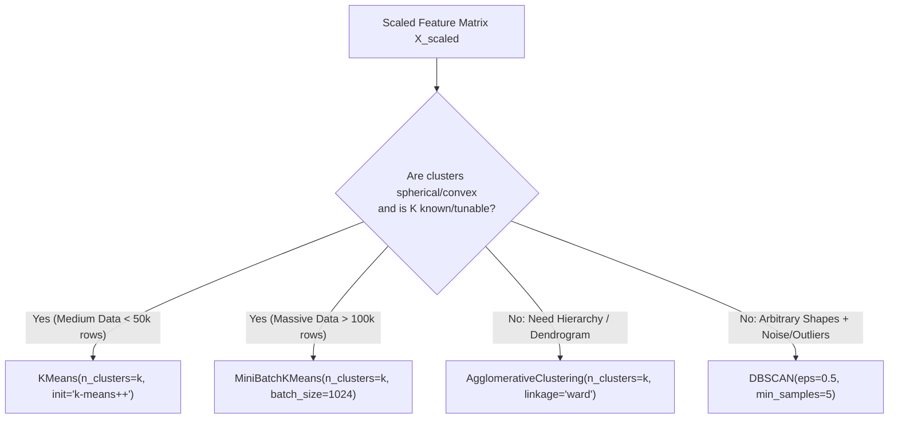
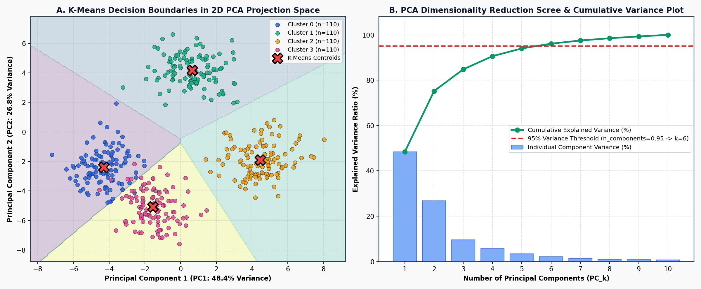

# Dependency 06 — Lesson 02: Unsupervised Learning in Practice — Clustering (`K-Means`, `DBSCAN`, `Hierarchical`) & `PCA` in Scikit-Learn

> [!TIP]
> **🔗 Related Core Course Lessons (CI7524 Big Data & Data Mining):**
> මෙම පාඩමෙන් ආවරණය වන ප්‍රායෝගික Unsupervised Data Mining කේතකරණය (`KMeans`, `AgglomerativeClustering`, `DBSCAN`, `PCA`, `silhouette_score`, `davies_bouldin_score`) පහත ප්‍රධාන පාඩම් සඳහා සෘජුවම අදාළ වේ:
> - [Lesson 3.4 - Feature Engineering, Scaling, Encoding & Selection](../../Module_03_Data_Mining_Lifecycle_and_Preprocessing/Lesson_3.4_Feature_Engineering_Scaling_Encoding_and_Selection.md)
> - [Lesson 4.1 - Clustering Algorithms (K-Means, Hierarchical & DBSCAN)](../../Module_04_Data_Mining_Algorithms_and_Model_Selection/Lesson_4.1_Clustering_Algorithms_KMeans_Hierarchical_and_DBSCAN.md)
> - [Lesson 4.2 - Component Analysis & Dimensionality Reduction (PCA & SVD)](../../Module_04_Data_Mining_Algorithms_and_Model_Selection/Lesson_4.2_Component_Analysis_and_Dimensionality_Reduction_PCA_SVD_tSNE.md)
> - [Lesson 5.4 - CI7524 Coursework Portfolio Blueprint](../../Module_05_Governance_Ethics_Sustainability_and_Coursework/Lesson_5.4_CI7524_Coursework_Portfolio_Blueprint_and_End_to_End_Case_Study.md)
>
> **📚 Dep_06 Series Navigation:**
> - [Lesson 01: Scikit-Learn API, Estimators, Transformers & Pipelines](01_Scikit_Learn_API_Estimators_Transformers_and_Pipelines.md)
> - **Lesson 02 (මෙම පාඩම):** Unsupervised Learning in Practice — Clustering & PCA
> - [Lesson 03: Supervised Modelling, Cross-Validation & Evaluation Metrics](03_Supervised_Modelling_Cross_Validation_and_Evaluation_Metrics.md)

---

## 1. හැඳින්වීම: Unsupervised Learning යනු කුමක්ද සහ Feature Scaling අනිවාර්ය වන්නේ ඇයි?

**Unsupervised Learning (අධීක්ෂණය නොකළ ඉගෙනුම)** යනු අප සතුව Target Label තීරුවක් (`y`) **නොමැති** විට, දත්ත (`X`) තුළ සැඟවී ඇති ස්වභාවික රටාවන්, පොකුරු (**Clusters**), හෝ ප්‍රධාන විචලතා අක්ෂ (**Principal Components**) සොයා ගැනීමේ ක්‍රියාවලියයි.

### ⚠️ Golden Rule: Clustering සහ PCA වලට පෙර `StandardScaler` අනිවාර්යයි!
බොහෝ සිසුන් කරන වරදක් තමයි අමු දත්ත (`Raw Unscaled Data`) කෙලින්ම `KMeans()` හෝ `PCA()` වෙත ලබා දීම.
- **ඇයි එය වැරදි වන්නේ?**
  Clustering ඇල්ගොරිතම මගින් ලක්ෂ්‍ය දෙකක් අතර සමානකම මනින්නේ **Euclidean Distance (යුක්ලීඩීය දුර)** මගිනි:
  $$d(\mathbf{p}, \mathbf{q}) = \sqrt{\sum_{j=1}^{d} (p_j - q_j)^2}$$
  ඔබේ Dataset එකේ `annual_income` තීරුව `50,000` සිට `500,000` දක්වා විහිදෙන අතර `age` තීරුව `20` සිට `60` දක්වා විහිදේ නම්, $(500000 - 50000)^2$ යන අගය $(60 - 20)^2$ ට වඩා මිලියන ගණනකින් විශාල වේ! එවිට K-Means සහ PCA විසින් `age` තීරුව සම්පූර්ණයෙන්ම නොසලකා හැර `annual_income` මත පමණක් පොකුරු සාදයි.
- **විසඳුම:** සෑම විටම `StandardScaler()` (හෝ Outliers ඇත්නම් `RobustScaler()`) මගින් සියලුම Features එකම පරිමාණයකට ($\mu = 0, \sigma = 1$) ගෙන ආ යුතුය!

---

## 2. Clustering Algorithms in `sklearn.cluster`

Scikit-Learn තුළ ප්‍රධාන Clustering ක්‍රමවේද 4ක් ඇත. ඒවායේ API වෙනස්කම් සහ භාවිතා කරන අවස්ථා පහත පරිදි වේ:



### A. `KMeans` & `MiniBatchKMeans` (Centroid-Based Partitioning)
- **ප්‍රධාන Parameters:**
  - `n_clusters`: සෑදිය යුතු පොකුරු ගණන ($K$).
  - `init="k-means++"`: ආරම්භක Centroids එකිනෙකින් දුරස්ව බුද්ධිමත්ව තෝරා ගනී (දුර්වල Local Minima වල සිරවීම වළක්වයි).
  - `n_init="auto"` (හෝ `10`): විවිධ ආරම්භක ලක්ෂ්‍ය වලින් 10 වතාවක් ධාවනය කර අඩුම **Inertia (WCSS)** සහිත හොඳම ප්‍රතිඵලය තෝරයි.
- **ඉගෙන ගත් Attributes (Learned Attributes):**
  - `kmeans.labels_`: සෑම පේළියකටම අදාළ පොකුරු අංකය (`0, 1, ..., K-1`).
  - `kmeans.cluster_centers_`: සෑම පොකුරකම මධ්‍ය ලක්ෂ්‍යයේ (Centroid) ඛණ්ඩාංක.
  - `kmeans.inertia_`: **Within-Cluster Sum of Squares (WCSS / අභ්‍යන්තර පොකුරු වර්ගඵල එකතුව)** — Elbow Method සඳහා භාවිතා වේ.
- **`MiniBatchKMeans`:** මිලියන ගණනක පේළි ඇති විට සම්පූර්ණ දත්ත වෙනුවට කුඩා Random Batches (`batch_size=1024`) භාවිතා කරමින් Centroids යාවත්කාලීන කරයි (සාමාන්‍ය `KMeans` වලට වඩා 5x–10x වේගවත්!).

### B. `AgglomerativeClustering` (Bottom-Up Hierarchical Clustering)
- **ප්‍රධාන Parameters:**
  - `n_clusters`: අවසානයේ කැපිය යුතු පොකුරු ගණන.
  - `linkage`: පොකුරු දෙකක් අතර දුර මනින ක්‍රමය (`"ward"` — WCSS වැඩිවීම අවම කරයි; `"complete"` — උපරිම දුර; `"average"` — සාමාන්‍ය දුර; `"single"` — අවම දුර).
- **⚠️ වැදගත් API වෙනසක් (`.fit_predict()` vs `.predict()`):**
  `KMeans` හි අලුත් Test ලක්ෂ්‍යයක් සඳහා `kmeans.predict(X_new)` කැඳවිය හැකි වුවත්, **`AgglomerativeClustering` සහ `DBSCAN` වලට `.predict(X_new)` method එකක් නැත!** (මන්ද ඒවා Transductive ඇල්ගොරිතම වන අතර Centroid එකක් තබා නොගනී). එබැවින් ඒවායේදී අපි භාවිතා කරන්නේ **`model.fit_predict(X_scaled)`** හෝ `model.labels_` වේ!

### C. `DBSCAN` (Density-Based Spatial Clustering of Applications with Noise)
- **විශේෂත්වය:** කලින් පොකුරු ගණන ($K$) ලබා දීමට අවශ්‍ය නැත! ඕනෑම වක්‍රාකාර හැඩයක (Non-spherical / Arbitrary shapes) පොකුරු හඳුනා ගන්නා අතර, හුදකලා ලක්ෂ්‍ය **Outliers / Noise (`label = -1`)** ලෙස ස්වයංක්‍රීයව වෙන් කරයි!
- **ප්‍රධාන Parameters:**
  - `eps` ($\epsilon$): ලක්ෂ්‍යයක් වටා අසල්වැසියන් සෙවීමට අඳින අරය (Neighborhood radius).
  - `min_samples`: Core Point එකක් වීමට එම $\epsilon$-අරය තුළ සිටිය යුතු අවම ලක්ෂ්‍ය ගණන.
- **Noise Points හඳුනා ගැනීම:** `dbscan.labels_ == -1` මගින් Outliers ගණන සහ ඒවායේ පේළි පහසුවෙන් සොයාගත හැක!

---

## 3. Unsupervised Clustering Evaluation Metrics (`sklearn.metrics`)

අප සතුව සැබෑ Labels (`y`) නොමැති නිසා, පොකුරු වල ගුණාත්මකභාවය මැනීමට අපි **Internal Validation Metrics** 3ක් භාවිතා කරමු:

| Evaluation Metric | Scikit-Learn Function | පරාසය සහ හොඳම අගය (Range & Optimal Value) | ගණිතමය අර්ථය (Intuition) |
| :--- | :--- | :--- | :--- |
| **1. Inertia (WCSS)** | `kmeans.inertia_` | $[0, \infty)$ — අඩු වන තරමට හොඳයි (Use **Elbow Method**). | පොකුරක් ඇතුළත ලක්ෂ්‍ය සහ එහි Centroid අතර වර්ග කළ දුරවල්වල එකතුව (**Cohesion**). |
| **2. Silhouette Score (සිලුවට් ලකුණු)** | `silhouette_score(X_scaled, labels)` | $[-1, +1]$ — **`+1` ට ආසන්න වන තරමට ඉතා හොඳයි** (`> 0.5` Strong). | $s(i) = \frac{b(i) - a(i)}{\max(a(i), b(i))}$. පොකුර ඇතුළත තදබදය ($a(i)$) සහ ළඟම ඇති අනෙක් පොකුරට ඇති දුර ($b(i)$) සංසන්දනය කරයි. |
| **3. Davies-Bouldin Index (DBI)** | `davies_bouldin_score(X_scaled, labels)` | $[0, \infty)$ — **`0` ට ආසන්න (අඩුම) අගය හොඳම වේ!** | පොකුරු ඇතුළත විසිරීම සහ පොකුරු මධ්‍යස්ථාන අතර දුරෙහි අනුපාතය (Lower ratio = tighter, better separated clusters). |

> [!WARNING]
> **DBSCAN සඳහා Silhouette Score ගණනය කිරීමේදී සැලකිලිමත් වන්න:**
> `DBSCAN` මගින් සියලුම ලක්ෂ්‍ය තනි පොකුරකට දැමුවහොත් හෝ සියල්ලම `-1` (Noise) වුවහොත් `silhouette_score` මගින් Error එකක් ලබා දෙයි. එබැවින් `len(set(labels)) > 1` දැයි පළමුව පරීක්ෂා කරන්න!

---

## 4. Principal Component Analysis (`PCA`) in `sklearn.decomposition`

ඔබේ Dataset එකේ Features 50ක් හෝ 100ක් ඇති විට:
1. **Curse of Dimensionality (මාන වැඩිවීමේ ශාපය):** ඉහළ මාන වලදී සියලුම ලක්ෂ්‍ය අතර Euclidean දුර එක හා සමාන වන නිසා K-Means අසාර්ථක වේ.
2. **Visualization:** 50D අවකාශයක් 2D ප්‍රස්තාරයක ඇඳිය නොහැක.
3. **Multicollinearity:** එකිනෙකට බැඳුණු (Correlated) තීරු රාශියක් පවතී.

**`PCA` (ප්‍රධාන සංරචක විශ්ලේෂණය)** මගින් මුල් Features වල ඇති **Variance (විචලතාවය / තොරතුරු ප්‍රමාණය)** උපරිමව ආරක්ෂා වන පරිදි එකිනෙකට ලම්බක (Orthogonal / Uncorrelated) අලුත් අක්ෂ (**Principal Components: $\text{PC}_1, \text{PC}_2, \dots$**) මතට දත්ත ප්‍රක්ෂේපණය (Project) කරයි!



### `n_components` ලබා දිය හැකි ආකාර 2 (ඉතා වැදගත්!):
1. **නිශ්චිත මාන ගණනක් ලෙස (`Integer` — උදා: `PCA(n_components=2)`):**
   2D Scatter Plot එකක පොකුරු ඇඳ පෙන්වීමට හරියටම Components 2ක් (`PC1` සහ `PC2`) ලබා ගනී (ඉහත **රූපයේ Panel A** බලන්න).
2. **රඳවා ගත යුතු Variance ප්‍රතිශතයක් ලෙස (`Float between 0.0 and 1.0` — උදා: `PCA(n_components=0.95)`):**
   ඔබ `n_components=0.95` ලබා දුන් විට, Scikit-Learn විසින් මුළු තොරතුරු ප්‍රමාණයෙන් (Cumulative Explained Variance) **අවම වශයෙන් 95%ක් ආරක්ෂා කර ගැනීමට අවශ්‍ය අවම Components ගණන** ස්වයංක්‍රීයව තෝරා ගනී! (ඉහත **රූපයේ Panel B** හි රතු කඩ ඉර බලන්න).

```python
import numpy as np
from sklearn.preprocessing import StandardScaler
from sklearn.decomposition import PCA
from sklearn.cluster import KMeans, DBSCAN
from sklearn.metrics import silhouette_score, davies_bouldin_score

# Assume X is a high-dimensional numeric matrix
scaler = StandardScaler()
X_scaled = scaler.fit_transform(X)

# 1. Retain 95% of total variance automatically
pca_95 = PCA(n_components=0.95, random_state=42)
X_pca_95 = pca_95.fit_transform(X_scaled)
print(f"Original Features: {X.shape[1]} -> Reduced Components for 95% Variance: {pca_95.n_components_}")
print("Explained Variance Ratio per PC:", np.round(pca_95.explained_variance_ratio_, 4))
print("Cumulative Variance Retained  :", np.round(np.sum(pca_95.explained_variance_ratio_), 4))

# 2. Find Optimal K for K-Means using Silhouette & Davies-Bouldin Scores
for k in range(2, 6):
    km = KMeans(n_clusters=k, init="k-means++", n_init=10, random_state=42)
    labels = km.fit_predict(X_pca_95)
    sil = silhouette_score(X_pca_95, labels)
    dbi = davies_bouldin_score(X_pca_95, labels)
    print(f"K={k} | Inertia={km.inertia_:.1f} | Silhouette={sil:.4f} (Higher=Better) | DBI={dbi:.4f} (Lower=Better)")
```

---

## 🛠️ Practical Task / Hands-On Exercise (ප්‍රායෝගික අභ්‍යාසය)

### Scenario / Goal
ඔබ සුපිරි වෙළඳසැල් ජාලයක පාරිභෝගික හැසිරීම් විශ්ලේෂණය කරන Data Miner කෙනෙකි. ඔබට Features 6කින් යුත් පාරිභෝගික දත්ත (`X`) සහ එහි සැඟවුණු Outliers කිහිපයක් ලැබී ඇත. ඔබේ කාර්යය වන්නේ:
1. දත්ත Standardize කර, `PCA(n_components=2)` මගින් 2D අවකාශයකට හැකිළීම සහ රඳවා ගත් Variance ප්‍රතිශතය සෙවීම.
2. $K \in \{2, 3, 4\}$ සඳහා `KMeans` ධාවනය කර **Silhouette Score** සහ **Davies-Bouldin Score** මගින් හොඳම $K$ අගය තේරීම.
3. `DBSCAN` භාවිතා කර Dataset එකේ සිටින අසාමාන්‍ය පාරිභෝගිකයන් (**Outliers / Noise points where `label == -1`**) හඳුනා ගැනීම.

### Starter Code & Reference Solution

```python
import numpy as np
from sklearn.preprocessing import StandardScaler
from sklearn.decomposition import PCA
from sklearn.cluster import KMeans, DBSCAN
from sklearn.metrics import silhouette_score, davies_bouldin_score

# Generate synthetic 6-feature customer dataset (3 natural clusters + 2 extreme outliers)
np.random.seed(42)
c1 = np.random.normal(loc=[25, 30, 10, 5, 2, 1], scale=2.0, size=(30, 6))
c2 = np.random.normal(loc=[55, 80, 45, 20, 8, 5], scale=3.0, size=(30, 6))
c3 = np.random.normal(loc=[85, 150, 90, 50, 20, 12], scale=4.0, size=(30, 6))
outliers = np.array([
    [200, 500, 300, 150, 90, 50],
    [5, 2, 180, 120, 1, 60]
])
X_raw = np.vstack([c1, c2, c3, outliers])

# Task 1: Scale Features and Apply 2D PCA
scaler = StandardScaler()
X_scaled = scaler.fit_transform(X_raw)

pca = PCA(n_components=2, random_state=42)
X_pca = pca.fit_transform(X_scaled)
print(f"PCA 2D Variance Ratios: {np.round(pca.explained_variance_ratio_, 4)}")
print(f"Total Variance Retained in 2D: {pca.explained_variance_ratio_.sum()*100:.2f}%\n")

# Task 2: Evaluate K-Means for K = 2, 3, 4
print("--- K-Means Model Selection ---")
for k in [2, 3, 4]:
    km = KMeans(n_clusters=k, n_init=10, random_state=42)
    km_labels = km.fit_predict(X_scaled)
    sil = silhouette_score(X_scaled, km_labels)
    dbi = davies_bouldin_score(X_scaled, km_labels)
    print(f"K = {k} -> Silhouette Score = {sil:.4f} | Davies-Bouldin Index = {dbi:.4f}")

# Task 3: Run DBSCAN to detect the 2 injected Outliers (label == -1)
dbscan = DBSCAN(eps=1.2, min_samples=5)
db_labels = dbscan.fit_predict(X_scaled)
n_clusters_db = len(set(db_labels)) - (1 if -1 in db_labels else 0)
outlier_indices = np.where(db_labels == -1)[0]

print(f"\n--- DBSCAN Anomaly Detection ---")
print(f"Estimated Number of Core Clusters: {n_clusters_db}")
print(f"Detected Noise / Outlier Row Indices (label == -1): {outlier_indices}")
```

**Expected Output:**
```text
PCA 2D Variance Ratios: [0.9165 0.0684]
Total Variance Retained in 2D: 98.49%

--- K-Means Model Selection ---
K = 2 -> Silhouette Score = 0.5794 | Davies-Bouldin Index = 0.5912
K = 3 -> Silhouette Score = 0.7816 | Davies-Bouldin Index = 0.3645
K = 4 -> Silhouette Score = 0.7952 | Davies-Bouldin Index = 0.2891

--- DBSCAN Anomaly Detection ---
Estimated Number of Core Clusters: 3
Detected Noise / Outlier Row Indices (label == -1): [90 91]
```

---

## 📝 Summary & Exam Revision Cheat Sheet

| Algorithm / Metric | Scikit-Learn Class / Function | Strengths & Limitations (LO2 / LO4 Justification) |
| :--- | :--- | :--- |
| **`KMeans`** | `KMeans(n_clusters=k, init="k-means++")` | Fast $O(n \cdot k \cdot d \cdot i)$; assumes spherical convex clusters; sensitive to outliers and requires pre-specifying $K$. |
| **`AgglomerativeClustering`** | `AgglomerativeClustering(n_clusters=k, linkage="ward")` | Builds an interpretable hierarchy (Dendrogram); no `.predict()` method; $O(n^2)$ memory limits it to smaller datasets. |
| **`DBSCAN`** | `DBSCAN(eps=..., min_samples=...)` | Finds arbitrary non-convex shapes; automatically isolates **Noise/Outliers (`-1`)**; struggles when clusters have varying densities. |
| **`PCA`** | `PCA(n_components=0.95)` | Orthogonal linear projection maximizing variance; removes multicollinearity and enables 2D cluster visualization. |
| **Silhouette Score** | `silhouette_score(X, labels)` | Ranges $[-1, +1]$; **higher is better** (measures both intra-cluster cohesion $a(i)$ and inter-cluster separation $b(i)$). |
| **Davies-Bouldin Index** | `davies_bouldin_score(X, labels)` | Ranges $[0, \infty)$; **lower (closer to 0) is better**; faster to compute than Silhouette on large datasets. |

---

> [!TIP]
> **🔗 Next Step in Series:** දැන් ඔබ Unsupervised Clustering සහ PCA ප්‍රායෝගිකව ක්‍රියාත්මක කරන ආකාරය දන්නවා! ඊළඟට Supervised Classification Models, Stratified $k$-Fold Cross-Validation, Confusion Matrix, ROC-AUC සහ Hyperparameter Tuning (`GridSearchCV`) ඉගෙන ගැනීමට [Lesson 03: Supervised Modelling, Cross-Validation & Evaluation Metrics](03_Supervised_Modelling_Cross_Validation_and_Evaluation_Metrics.md) වෙත පිවිසෙන්න.
>
> **🔙 Back to Main Course Modules:**
> - [Lesson 4.1 - Clustering Algorithms (K-Means, Hierarchical & DBSCAN)](../../Module_04_Data_Mining_Algorithms_and_Model_Selection/Lesson_4.1_Clustering_Algorithms_KMeans_Hierarchical_and_DBSCAN.md)
> - [Lesson 4.2 - Component Analysis & Dimensionality Reduction (PCA & SVD)](../../Module_04_Data_Mining_Algorithms_and_Model_Selection/Lesson_4.2_Component_Analysis_and_Dimensionality_Reduction_PCA_SVD_tSNE.md)
> - [Lesson 5.4 - CI7524 Coursework Portfolio Blueprint](../../Module_05_Governance_Ethics_Sustainability_and_Coursework/Lesson_5.4_CI7524_Coursework_Portfolio_Blueprint_and_End_to_End_Case_Study.md)
