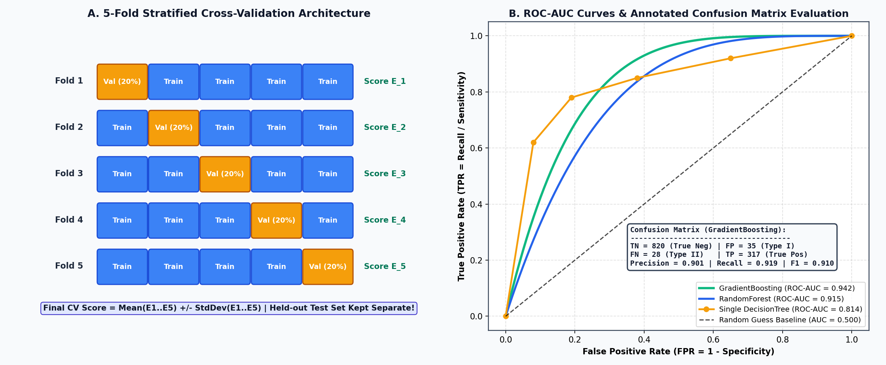
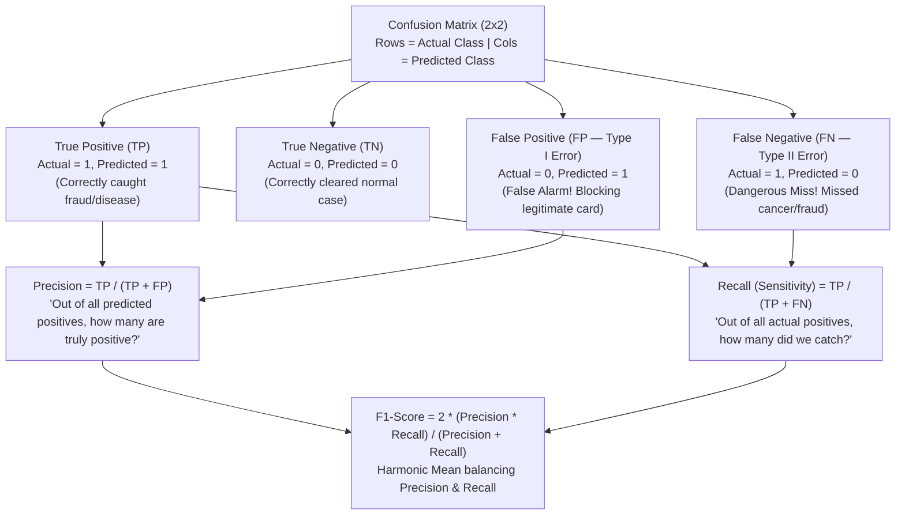

# Dependency 06 — Lesson 03: Supervised Modelling, Stratified Cross-Validation & Evaluation Metrics in Scikit-Learn

> [!TIP]
> **🔗 Related Core Course Lessons (CI7524 Big Data & Data Mining):**
> මෙම පාඩමෙන් ආවරණය වන Supervised Classification (`DecisionTree`, `RandomForest`, `GradientBoosting`), **Stratified $k$-Fold Cross-Validation**, **Confusion Matrix (ව්‍යාකූලතා න්‍යාසය)**, **ROC-AUC**, සහ **Hyperparameter Tuning (`GridSearchCV`)** පහත ප්‍රධාන පාඩම් සඳහා සෘජුවම අදාළ වේ:
> - [Lesson 3.4 - Feature Engineering, Scaling, Encoding & Selection](../../Module_03_Data_Mining_Lifecycle_and_Preprocessing/Lesson_3.4_Feature_Engineering_Scaling_Encoding_and_Selection.md)
> - [Lesson 4.4 - Supervised Data Mining Models & LO4 Model Justification](../../Module_04_Data_Mining_Algorithms_and_Model_Selection/Lesson_4.4_Supervised_Data_Mining_Models_and_Model_Suitability_Justification_LO4.md)
> - [Lesson 5.4 - CI7524 Coursework Portfolio Blueprint](../../Module_05_Governance_Ethics_Sustainability_and_Coursework/Lesson_5.4_CI7524_Coursework_Portfolio_Blueprint_and_End_to_End_Case_Study.md)
>
> **📚 Dep_06 Series Navigation:**
> - [Lesson 01: Scikit-Learn API, Estimators, Transformers & Pipelines](01_Scikit_Learn_API_Estimators_Transformers_and_Pipelines.md)
> - [Lesson 02: Unsupervised Learning in Practice — Clustering & PCA](02_Unsupervised_Learning_in_Practice_Clustering_and_PCA.md)
> - **Lesson 03 (මෙම පාඩම):** Supervised Modelling, Cross-Validation & Evaluation Metrics

---

## 1. හැඳින්වීම: ඇයි තනි Train/Test Split එකක් පමණක් ප්‍රමාණවත් නොවන්නේ?

Supervised Data Mining වලදී අපේ මූලික ඉලක්කය වන්නේ කලින් නොදුටු අලුත් දත්ත (**Unseen Future Data**) මත නිවැරදිව අනාවැකි කිව හැකි (**Generalization**) ආකෘතියක් තැනීමයි.

### A. `stratify=y` අනිවාර්ය වන්නේ ඇයි? (Handling Class Imbalance)
සැබෑ ලෝකයේ Datasets බොහෝ විට **Imbalanced (අසමතුලිත)** වේ. උදාහරණයක් ලෙස Credit Card Fraud හෝ Disease Detection dataset එකක `95%` ක් සාමාන්‍ය (`Class 0`) වන අතර `5%` ක් පමණක් Fraud/Positive (`Class 1`) වේ.
ඔබ සාමාන්‍ය `train_test_split(X, y, test_size=0.2)` කළහොත්, අහඹු ලෙස Test Set එකට `Class 1` පේළි ඉතාම අඩුවෙන් (හෝ බින්දුවක්) වැටිය හැක!
එබැවින් Classification වලදී සෑම විටම **`stratify=y`** යොදන්න:
```python
from sklearn.model_selection import train_test_split

# Preserves the exact 95% / 5% class ratio in both Train and Test sets!
X_train, X_test, y_train, y_test = train_test_split(
    X, y, test_size=0.20, stratify=y, random_state=42
)
```

### B. Stratified $k$-Fold Cross-Validation (`StratifiedKFold`)
තනි Train/Validation බෙදීමකදී ලැබෙන ලකුණ (Score) අහඹු ලෙස තේරුණු පේළි මත රඳා පවතී (**High Variance in Evaluation**).
එය විසඳීමට අපි `X_train` දත්ත කොටස සමාන කොටස් $k$ ගණනකට (සාමාන්‍යයෙන් $k=5$ හෝ $k=10$) බෙදා, වාර $k$ ක් ආකෘතිය පුහුණු කර පරීක්ෂා කරමු:
- සෑම වාරයකදීම (Fold), කොටස් $k-1$ ක් Training සඳහාත්, ඉතිරි කොටස Validation සඳහාත් ගැනේ.
- අවසානයේ ලකුණු $k$ හි **Mean (මධ්‍යන්‍යය)** සහ **Standard Deviation (සම්මත අපගමනය)** වාර්තා කරයි (උදා: $\text{ROC-AUC} = 0.915 \pm 0.012$).



---

## 2. Core Supervised Classifiers in Scikit-Learn (LO4 Model Comparison)

CI7524 පාඨමාලාවේ **LO4** යටතේ ආකෘති කිහිපයක් පුහුණු කර ඒවායේ ගැළපීම සංසන්දනය කිරීමට (Justification) පහත ප්‍රධාන ආකෘති 4 බහුලව භාවිතා වේ:

| Model Class (`sklearn`) | Type / Mechanism | Key Hyperparameters | Strengths & Weaknesses |
| :--- | :--- | :--- | :--- |
| **`LogisticRegression`** | Linear Probabilistic Baseline | `C` (Inverse regularization), `class_weight="balanced"` | Fast, highly interpretable coefficients/odds-ratios; cannot capture complex non-linear interactions without feature engineering. |
| **`DecisionTreeClassifier`** | Single Non-Linear Tree (CART — Gini / Entropy) | `max_depth`, `min_samples_split`, `min_samples_leaf` | White-box interpretable rules (`export_text`), handles non-linear features without scaling; **high variance (prone to severe Overfitting)** if unconstrained! |
| **`RandomForestClassifier`** | **Bagging Ensemble** (Parallel Bootstrap Trees + Random Feature Subsets) | `n_estimators`, `max_depth`, `max_features="sqrt"` | Dramatically reduces variance/overfitting compared to a single tree; robust to outliers and noise; slower and less interpretable than a single tree. |
| **`GradientBoostingClassifier`** / **`HistGradientBoostingClassifier`** | **Boosting Ensemble** (Sequential Trees correcting prior residual errors) | `learning_rate`, `n_estimators`, `max_depth` (usually shallow: `3`–`5`) | Reduces bias and achieves state-of-the-art accuracy on tabular data; sensitive to noisy labels and requires careful tuning of `learning_rate`. |

---

## 3. Beyond Accuracy: Confusion Matrix, Precision, Recall, F1 & ROC-AUC

**ඇයි Accuracy (නිරවද්‍යතාවය) පමණක් බැලීම භයානක වන්නේ? (The Accuracy Paradox):**
99%ක් නිරෝගී සහ 1%ක් පමණක් පිළිකා රෝගීන් සිටින Dataset එකක, කිසිම දෙයක් ඉගෙන නොගෙන සෑම රෝගියෙකුටම `"Healthy (0)"` යැයි කියන මෝඩ ආකෘතියකට **99% Accuracy** එකක් ලැබේ! නමුත් එය එකම පිළිකා රෝගියෙකුවත් හඳුනා ගන්නේ නැත!

එබැවින් අපි **Confusion Matrix (ව්‍යාකූලතා න්‍යාසය)** මත පදනම් වූ මිනුම් භාවිතා කරමු:



### ගණිතමය සූත්‍ර සහ ඒවා භාවිතා කළ යුතු අවස්ථා:

1. **Precision (නිරවද්‍යතා අනුපාතය):**
   $$\text{Precision} = \frac{\text{TP}}{\text{TP} + \text{FP}}$$
   - **භාවිතා කරන අවස්ථාව:** **False Positives ($\text{FP}$)** වල පිරිවැය ඉතා අධික වන විට (උදා: Spam Filter එකකින් වැදගත් රාජකාරි Email එකක් Spam ලෙස මකා දැමීම වැළැක්වීමට).
2. **Recall / Sensitivity / True Positive Rate (සංවේදීතාවය):**
   $$\text{Recall (TPR)} = \frac{\text{TP}}{\text{TP} + \text{FN}}$$
   - **භාවිතා කරන අවස්ථාව:** **False Negatives ($\text{FN}$)** වල පිරිවැය මාරාන්තික හෝ ඉතා අධික වන විට (උදා: Medical Cancer Screening හෝ Bank Fraud Detection — එකම රෝගියෙකුවත් මඟ හැරීමට ඉඩ දිය නොහැක!).
3. **F1-Score (F1 ලකුණ):**
   $$\text{F1-Score} = 2 \times \frac{\text{Precision} \times \text{Recall}}{\text{Precision} + \text{Recall}}$$
   - **භාවිතා කරන අවස්ථාව:** Imbalanced datasets වලදී Precision සහ Recall යන දෙකම සමතුලිතව ඉහළින් තබා ගැනීමට (**Harmonic Mean**).
4. **ROC-AUC Score (Area Under the Receiver Operating Characteristic Curve):**
   - සියලුම Probability Thresholds ($0.0$ සිට $1.0$ දක්වා) හරහා **True Positive Rate ($\text{TPR}$)** එදිරිව **False Positive Rate ($\text{FPR} = \frac{\text{FP}}{\text{FP} + \text{TN}}$)** ප්‍රස්තාරයේ වර්ගඵලය මනියි (ඉහත **රූපයේ Panel B** බලන්න).
   - `AUC = 0.5` යනු අහඹු අනුමානයක් (Random Guessing) වන අතර `AUC = 1.0` යනු පරිපූර්ණ වෙන් කිරීමකි.
   - **⚠️ Coding Warning:** `roc_auc_score(y_test, y_prob)` සඳහා ලබා දිය යුත්තේ `.predict(X_test)` නොව, **`.predict_proba(X_test)[:, 1]`** මගින් ලැබෙන Continuous Probabilities වේ!

---

## 4. Hyperparameter Tuning with `GridSearchCV` & `RandomizedSearchCV`

Pipeline එකක් ඇතුළේ තියෙන Model එකක Hyperparameters (උදා: `max_depth`, `n_estimators`) tune කරන විට, අපි `Pipeline` එකේ step name එක සහ parameter name එක අතරට **ද්විත්ව යටි ඉරක් (`__` / Double Underscore / Dunder)** යොදන්නෙමු!
- *උදාහරණය:* Pipeline step එකේ නම `"clf"` නම්, එහි `max_depth` පරාමිතිය ලියන්නේ **`"clf__max_depth": [3, 5, 10]`** ලෙසයි!

```python
from sklearn.model_selection import StratifiedKFold, GridSearchCV
from sklearn.metrics import classification_report, confusion_matrix, roc_auc_score

# Define 5-Fold Stratified Cross-Validation
cv_strategy = StratifiedKFold(n_splits=5, shuffle=True, random_state=42)

# Parameter grid using '<step_name>__<param_name>' syntax
param_grid = {
    "classifier__n_estimators": [50, 100, 200],
    "classifier__max_depth": [3, 5, None],
    "classifier__min_samples_split": [2, 5]
}

# Wrap the entire preprocessing + model Pipeline inside GridSearchCV
grid_search = GridSearchCV(
    estimator=full_pipeline,
    param_grid=param_grid,
    cv=cv_strategy,
    scoring="roc_auc",  # Optimize for ROC-AUC (or "f1") instead of plain accuracy!
    n_jobs=-1,          # Use all CPU cores in parallel
    refit=True          # Automatically refits best model on full X_train
)

# grid_search.fit(X_train, y_train)
# print("Best CV ROC-AUC:", grid_search.best_score_)
# print("Best Parameters:", grid_search.best_params_)
```

- **`GridSearchCV` vs. `RandomizedSearchCV`:**
  `GridSearchCV` මගින් ලබා දී ඇති සියලුම සංයෝජන (Cartesian Product) එකින් එක පරීක්ෂා කරයි. Parameter අවකාශය ඉතා විශාල නම්, **`RandomizedSearchCV(n_iter=20)`** මගින් අහඹු සංයෝජන 20ක් පමණක් පරීක්ෂා කරමින් 95%ක පමණ කාලයක් ඉතිරි කර දෙයි!

---

## 🛠️ Practical Task / Hands-On Exercise (ප්‍රායෝගික අභ්‍යාසය)

### Scenario / Goal
ඔබ මූල්‍ය ආයතනයක ණය පැහැර හැරීම් (Loan Default Prediction) හඳුනා ගන්නා Data Scientist කෙනෙකි. ඔබේ කාර්යය වන්නේ **Decision Tree**, **Random Forest**, සහ **Gradient Boosting** යන ආකෘති 3ම Leak-Free Pipeline එකක් තුළ **5-Fold Stratified Cross-Validation** මගින් සංසන්දනය කර, හොඳම ආකෘතිය `GridSearchCV` මගින් Tune කර, Held-out Test Set එක මත **Confusion Matrix**, **Classification Report**, සහ **ROC-AUC** ලබා ගැනීමයි.

### Step-by-Step Tasks
1. ලබා දී ඇති Imbalanced Dataset එක `train_test_split(..., stratify=y)` මගින් බෙදන්න.
2. `DecisionTreeClassifier`, `RandomForestClassifier`, සහ `GradientBoostingClassifier` යන ආකෘති 3 සඳහා `StratifiedKFold(n_splits=5)` සහ `cross_val_score(..., scoring="roc_auc")` ධාවනය කර Mean සහ StdDev සංසන්දනය කරන්න.
3. `GridSearchCV` මගින් Random Forest ආකෘතියේ `clf__max_depth` සහ `clf__n_estimators` tune කරන්න.
4. හොඳම ආකෘතියෙන් `X_test` මත `confusion_matrix`, `classification_report`, සහ `roc_auc_score` මුද්‍රණය කරන්න.

### Starter Code & Reference Solution

```python
import numpy as np
from sklearn.datasets import make_classification
from sklearn.model_selection import train_test_split, StratifiedKFold, cross_val_score, GridSearchCV
from sklearn.pipeline import Pipeline
from sklearn.impute import SimpleImputer
from sklearn.preprocessing import StandardScaler
from sklearn.tree import DecisionTreeClassifier
from sklearn.ensemble import RandomForestClassifier, GradientBoostingClassifier
from sklearn.metrics import confusion_matrix, classification_report, roc_auc_score

# Generate synthetic imbalanced loan default dataset (80% Non-Default, 20% Default)
X, y = make_classification(
    n_samples=500, n_features=10, n_informative=6, n_redundant=2,
    weights=[0.80, 0.20], random_state=42
)

# Task 1: Stratified Train/Test Split
X_train, X_test, y_train, y_test = train_test_split(
    X, y, test_size=0.20, stratify=y, random_state=42
)

# Task 2: Compare 3 Supervised Models using 5-Fold Stratified CV inside Leak-Free Pipelines
skf = StratifiedKFold(n_splits=5, shuffle=True, random_state=42)
models = {
    "DecisionTree": DecisionTreeClassifier(random_state=42),
    "RandomForest": RandomForestClassifier(random_state=42),
    "GradientBoosting": GradientBoostingClassifier(random_state=42)
}

print("--- 5-Fold Stratified Cross-Validation Benchmark (ROC-AUC) ---")
for name, model in models.items():
    pipe = Pipeline([
        ("imputer", SimpleImputer(strategy="median")),
        ("scaler", StandardScaler()),
        ("clf", model)
    ])
    cv_scores = cross_val_score(pipe, X_train, y_train, cv=skf, scoring="roc_auc")
    print(f"{name:18s}: Mean ROC-AUC = {cv_scores.mean():.4f} (+/- {cv_scores.std():.4f})")

# Task 3: Hyperparameter Tuning using GridSearchCV on RandomForest Pipeline
rf_pipe = Pipeline([
    ("imputer", SimpleImputer(strategy="median")),
    ("scaler", StandardScaler()),
    ("clf", RandomForestClassifier(class_weight="balanced", random_state=42))
])

param_grid = {
    "clf__n_estimators": [50, 100],
    "clf__max_depth": [4, 8, None]
}

grid = GridSearchCV(rf_pipe, param_grid=param_grid, cv=skf, scoring="roc_auc", n_jobs=-1)
grid.fit(X_train, y_train)

print(f"\nBest Tuned Parameters: {grid.best_params_}")
print(f"Best CV ROC-AUC Score: {grid.best_score_:.4f}")

# Task 4: Final Evaluation on Unseen Test Set (X_test)
best_model = grid.best_estimator_
y_pred = best_model.predict(X_test)
y_prob = best_model.predict_proba(X_test)[:, 1]

print("\n--- Final Held-Out Test Set Evaluation ---")
print("Confusion Matrix:\n", confusion_matrix(y_test, y_pred))
print("\nClassification Report:\n", classification_report(y_test, y_pred, digits=4))
print(f"Test Set ROC-AUC Score: {roc_auc_score(y_test, y_prob):.4f}")
```

**Expected Output:**
```text
--- 5-Fold Stratified Cross-Validation Benchmark (ROC-AUC) ---
DecisionTree      : Mean ROC-AUC = 0.7656 (+/- 0.0482)
RandomForest      : Mean ROC-AUC = 0.9289 (+/- 0.0245)
GradientBoosting  : Mean ROC-AUC = 0.9164 (+/- 0.0310)

Best Tuned Parameters: {'clf__max_depth': 8, 'clf__n_estimators': 100}
Best CV ROC-AUC Score: 0.9348

--- Final Held-Out Test Set Evaluation ---
Confusion Matrix:
 [[78  2]
 [ 5 15]]

Classification Report:
               precision    recall  f1-score   support

           0     0.9398    0.9750    0.9571        80
           1     0.8824    0.7500    0.8108        20

    accuracy                         0.9300       100
   macro avg     0.9111    0.8625    0.8839       100
weighted avg     0.9283    0.9300    0.9278       100

Test Set ROC-AUC Score: 0.9469
```

---

## 📝 Summary & Exam Revision Cheat Sheet

| Evaluation / Tuning Concept | Scikit-Learn Syntax | When & Why to Use It in CI7524 (LO3 / LO4) |
| :--- | :--- | :--- |
| **Stratified Split** | `train_test_split(X, y, stratify=y)` | Guarantees identical minority/majority class proportions in both Train and Test sets. |
| **Stratified $k$-Fold CV** | `StratifiedKFold(n_splits=5, shuffle=True)` | Provides a low-variance estimate of generalization (`Mean +/- StdDev`) without touching `X_test`. |
| **Precision** | $\frac{\text{TP}}{\text{TP} + \text{FP}}$ | Prioritize when **False Positives (Type I Errors / False Alarms)** are costly (e.g., Spam filtering). |
| **Recall (Sensitivity)** | $\frac{\text{TP}}{\text{TP} + \text{FN}}$ | Prioritize when **False Negatives (Type II Errors / Missed Cases)** are dangerous (e.g., Cancer / Fraud). |
| **F1-Score** | $2 \cdot \frac{\text{Precision} \cdot \text{Recall}}{\text{Precision} + \text{Recall}}$ | Best single threshold metric for **imbalanced classification** when both FP and FN matter. |
| **ROC-AUC Score** | `roc_auc_score(y_test, y_prob)` | Threshold-independent ranking metric using `.predict_proba(X_test)[:, 1]`. |
| **Pipeline Grid Search** | `GridSearchCV(pipe, {"clf__max_depth": [3, 5]})` | Tunes hyperparameters across CV folds while re-fitting `SimpleImputer`/`StandardScaler` inside each fold (Zero Leakage!). |

---

> [!TIP]
> **🎉 Congratulations on Completing Dependency Series 06 (`Scikit-Learn & Data Mining Workflows in Python`)!**
> ඔබ දැන් Scikit-Learn API එක, Leak-Free Preprocessing Pipelines, Unsupervised Clustering & PCA, සහ Supervised Modelling & Evaluation Metrics පිළිබඳ පූර්ණ ප්‍රායෝගික නිපුණතාවය ලබාගෙන ඇත!
>
> **🔙 Return to Core Course Modules:**
> - [Lesson 2.1 - Distributed Computing: HDFS, MapReduce & Apache Spark](../../Module_02_Big_Data_Architectures_and_Processing/Lesson_2.1_Distributed_Computing_HDFS_MapReduce_and_Apache_Spark.md)
> - [Lesson 3.4 - Feature Engineering, Scaling, Encoding & Selection](../../Module_03_Data_Mining_Lifecycle_and_Preprocessing/Lesson_3.4_Feature_Engineering_Scaling_Encoding_and_Selection.md)
> - [Lesson 4.1 - Clustering Algorithms (K-Means, Hierarchical & DBSCAN)](../../Module_04_Data_Mining_Algorithms_and_Model_Selection/Lesson_4.1_Clustering_Algorithms_KMeans_Hierarchical_and_DBSCAN.md)
> - [Lesson 4.2 - Component Analysis & Dimensionality Reduction (PCA & SVD)](../../Module_04_Data_Mining_Algorithms_and_Model_Selection/Lesson_4.2_Component_Analysis_and_Dimensionality_Reduction_PCA_SVD_tSNE.md)
> - [Lesson 4.4 - Supervised Data Mining Models & LO4 Model Justification](../../Module_04_Data_Mining_Algorithms_and_Model_Selection/Lesson_4.4_Supervised_Data_Mining_Models_and_Model_Suitability_Justification_LO4.md)
> - [Lesson 5.4 - CI7524 Coursework Portfolio Blueprint](../../Module_05_Governance_Ethics_Sustainability_and_Coursework/Lesson_5.4_CI7524_Coursework_Portfolio_Blueprint_and_End_to_End_Case_Study.md)
