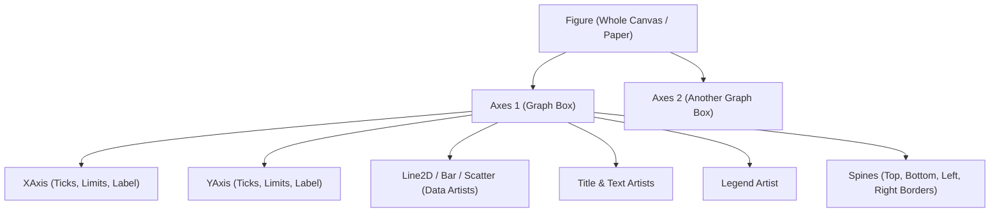
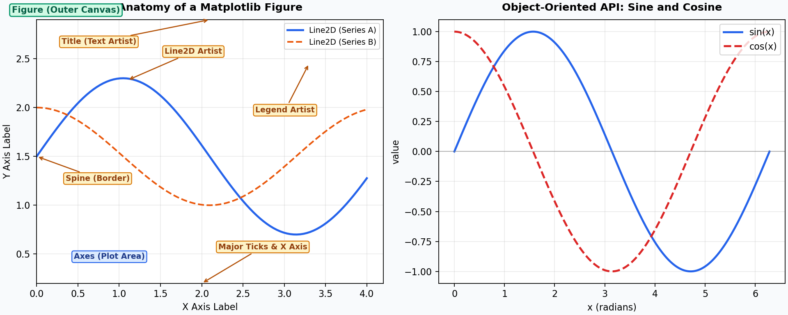
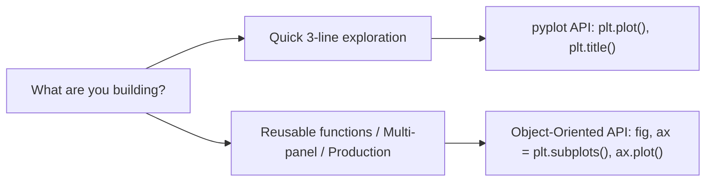

[🏠 Course Home](README.md) | [Next: Lesson 02 — Core Plot Types ➡️](02_Core_Plot_Types.md)

---

# 📘 Lesson 01: Setup, Architecture and the Two APIs (මූලික සැකසුම, ව්‍යුහය සහ API දෙක)

> [!TIP]
> **මේ පාඩමෙන් ඔයා ඉගෙන ගන්නේ මොනවද?**
> Matplotlib ඉගෙන ගන්න ගොඩක් අයට මුලදී පැටලෙන ලොකුම තැන තමයි `plt.plot()` සහ `ax.plot()` අතර වෙනස මොකක්ද කියන එක. මේ පාඩමෙන් Matplotlib වල **Object Hierarchy** (ව්‍යුහය), **Backends**, **pyplot API vs Object-Oriented API**, **Figure setup**, **memory management**, සහ **Plot lifecycle** සරලවම, 100% පැහැදිලිව ඉගෙන ගමු!

---

## 1. Installation සහ Backends (ස්ථාපනය සහ Rendering ක්‍රම)

Matplotlib පාවිච්චි කරන්න කලින් ඔයාගේ Python environment එකේ install කරගෙන තියෙන්න ඕනෙ:

```bash
pip install matplotlib numpy
```

Install වෙලා තියෙන version එක බලාගන්න මේ විදියට check කරන්න පුළුවන්:

```python
import matplotlib as mpl
import matplotlib.pyplot as plt
import numpy as np

print(mpl.__version__)
```

### Backend කියන්නේ මොකක්ද?
ඔයා code එකක් ලියලා chart එකක් අඳිනකොට, ඒ chart එක **කොතැනද පෙන්නන්නේ හෝ save කරන්නේ** කියන එක තීරණය කරන engine එකට තමයි **Backend** කියන්නේ.

* **Interactive Backends (`%matplotlib widget`, `TkAgg`, `QtAgg`):** Desktop window එකක හෝ Jupyter Notebook එකක zoom කරන්න, pan කරන්න පුළුවන් interactive chart එකක් පෙන්නනවා.
* **Inline Backend (`%matplotlib inline`):** Jupyter Notebook එකේ cell එකට යටින් static image එකක් විදියට chart එක පෙන්නනවා.
* **Non-Interactive Backend (`matplotlib.use('Agg')`):** Screen එකක් නැති server එකක හෝ Python script එකකින් PNG/PDF file විතරක් save කරන්න ඕනෙ වෙලාවට මේක පාවිච්චි කරනවා. (`Agg` = Anti-Grain Geometry).

> [!IMPORTANT]
> `matplotlib.use('Agg')` කියන line එක අනිවාර්යයෙන්ම `import matplotlib.pyplot as plt` කරන්න **කලින්** ලියන්න ඕනෙ! නැත්නම් ඒක වැඩ කරන්නේ නෑ.

---

## 2. Anatomy of a Figure (Matplotlib Chart එකක අභ්‍යන්තර ව්‍යුහය)

Matplotlib තේරුම් ගන්න තියෙන හොඳම විදිය තමයි **Drawing Paper (චිත්‍ර කඩදාසියක්)** උදාහරණයට ගන්න එක:

* **`Figure` (`fig`):** මේක තමයි මුළු චිත්‍ර කඩදාසිය (outer canvas / frame). එක `Figure` එකක් ඇතුළේ chart එකක් හෝ කීපයක් තියෙන්න පුළුවන්.
* **`Axes` (`ax`):** මේක තමයි කඩදාසිය ඇතුළේ අඳින **තනි Graph Box එක** (plot area). අපි data plot කරන්නේ, title දාන්නේ, legend දාන්නේ ඔක්කොම `Axes` එකට. *(වැදගත්: `Axes` කියන්නේ X/Y අක්ෂ දෙක නෙවෙයි, මුළු තනි graph එකටමයි!)*
* **`Axis` (`ax.xaxis`, `ax.yaxis`):** මේවා තමයි ඇත්තටම X අක්ෂය සහ Y අක්ෂය. Ticks (කෙටි ඉරි), tick labels (අංක), සහ limits පාලනය කරන්නේ මේවායින්.
* **`Artist`:** ඔයා chart එකේ ඇහැට දකින **හැම දෙයක්ම** — `Figure`, `Axes`, `Line2D` (රේඛා), `Text` (අකුරු), `Legend`, `Spines` (බෝඩර්) — මේ හැමදේම `Artist` කියන මූලික class එකෙන් හැදිලා තියෙන්නේ.



පහළ තියෙන රූපය බලන්න — වම් පැත්තේ තියෙන්නේ `Figure` එකක Anatomy එක, දකුණු පැත්තේ තියෙන්නේ Object-Oriented API එකෙන් ඇඳපු පිරිසිදු `sin(x)` සහ `cos(x)` chart එක:



---

## 3. The Two APIs: `pyplot` (Stateful) vs Object-Oriented (OO) API

Matplotlib වල chart අඳින්න ක්‍රම දෙකක් තියෙනවා. මේ දෙකේ වෙනස දැනගත්තම Matplotlib code කියවන්න හරිම ලේසියි.



### A. `pyplot` (Stateful) API
මේකේදී `plt.plot()`, `plt.title()`, `plt.xlabel()` වගේ functions කෙලින්ම call කරනවා. Matplotlib යටින් "දැනට active වෙලා තියෙන `Figure` සහ `Axes` එක මොකක්ද?" කියලා මතක තියාගෙන ඒකට අඳිනවා.
* **හොඳම අවස්ථාව:** ඉක්මනට data ටිකක් බලාගන්න (fast exploration).
* **ප්‍රශ්නය:** Subplots ගොඩක් තියෙනකොට හෝ function එකක් ඇතුළේ reusable code ලියනකොට කොයි graph එකටද අඳින්නේ කියලා පැටලෙනවා.

### B. Object-Oriented (OO) API — ⭐ නිර්දේශිත ක්‍රමය (Recommended)
මේකේදී අපි කෙලින්ම `fig, ax = plt.subplots()` කියලා `Figure` එකයි `Axes` එකයි variables දෙකකට ගන්නවා. ඊට පස්සේ `ax.plot()`, `ax.set_title()`, `ax.set_xlabel()` කියලා කෙලින්ම ඒ `ax` එකටම කියනවා මොනවද කරන්න ඕනෙ කියලා.
* **හොඳම අවස්ථාව:** ඕනෑම serious project එකකට, multi-panel dashboards වලට, reusable functions වලට.

| Feature | `pyplot` (Stateful) API | Object-Oriented (OO) API |
| --- | --- | --- |
| Create chart | `plt.figure()` | `fig, ax = plt.subplots()` |
| Plot line | `plt.plot(x, y)` | `ax.plot(x, y)` |
| Set title | `plt.title('My Title')` | `ax.set_title('My Title')` |
| Set X / Y label | `plt.xlabel('x')`, `plt.ylabel('y')` | `ax.set_xlabel('x')`, `ax.set_ylabel('y')` |
| Show legend | `plt.legend()` | `ax.legend()` |

---

## 4. Figure Setup, Showing, Closing & Plot Lifecycle

### Figure Setup (ප්‍රමාණය, Resolution සහ Background)
```python
fig, ax = plt.subplots(figsize=(6, 4), dpi=120, facecolor='#f8fafc')
```
* `figsize=(6, 4)`: අඟල් (inches) වලින් පළල 6ක් සහ උස 4ක්.
* `dpi=120`: Dots Per Inch (resolution එක). Screen එකට `100–120`, print/report වලට `300` හොඳයි.
* `facecolor=`: මුළු `Figure` එකේ background පාට.

### Showing and Closing (පෙන්වීම සහ Memory නිදහස් කිරීම)
* `plt.show()`: ඔක්කොම figures screen එකේ පෙන්වනවා.
* `plt.close(fig)`: ඒ අදාළ `fig` එක memory (RAM) එකෙන් අයින් කරනවා.
* `plt.close('all')`: Open වෙලා තියෙන හැම figure එකක්ම RAM එකෙන් අයින් කරනවා.

### Plot Lifecycle (Chart එකක් හැදෙන පිළිවෙළ)
1. **Create:** `fig, ax = plt.subplots()` මගින් canvas සහ plot box එක හදනවා.
2. **Draw:** `ax.plot(...)`, `ax.set_title(...)` මගින් Artists එකතු කරනවා.
3. **Adjust / Render:** `fig.canvas.draw()` මගින් layout/canvas එක render කරනවා (ගොඩක් වෙලාවට `show()` හෝ `savefig()` මේක ඉබේම කරනවා).
4. **Save / Show / Close:** `fig.savefig('chart.png', dpi=150)` මගින් save කරලා `plt.show()` හෝ `plt.close(fig)` කරනවා.

### Documentation Habits (හොඳ පුරුදු)
* අලුත් chart එකක් අඳින්න කලින් [matplotlib.org/stable/gallery](https://matplotlib.org/stable/gallery/index.html) බලන්න — ඔයාට ඕනෙ chart එකට සමාන code එකක් එතනින් ගන්න පුළුවන්.
* Python ඇතුළෙම ඕනෙ method එකක විස්තර බලන්න `help(ax.plot)` පාවිච්චි කරන්න.

---

## 5. Complete Code Example (පූර්ණ උදාහරණය සහ Line-by-Line පැහැදිලි කිරීම)

```python
import matplotlib.pyplot as plt
import numpy as np

x = np.linspace(0, 2 * np.pi, 200)

# object-oriented style (recommended)
fig, ax = plt.subplots(figsize=(6, 4), dpi=120)
ax.plot(x, np.sin(x), label='sin')
ax.plot(x, np.cos(x), label='cos')
ax.set_xlabel('x (radians)')
ax.set_ylabel('value')
ax.set_title('Sine and cosine')
ax.legend()
plt.show()
```

### Line-by-Line පැහැදිලි කිරීම:
1. `x = np.linspace(0, 2 * np.pi, 200)` — `0` සිට `2π` (≈ 6.28) දක්වා සමාන පරතරයෙන් අගයන් 200ක් හදනවා.
2. `fig, ax = plt.subplots(figsize=(6, 4), dpi=120)` — අඟල් 6×4, 120 DPI ප්‍රමාණයේ `Figure` එකක් සහ ඒක ඇතුළේ තනි `Axes` (`ax`) එකක් හදනවා.
3. `ax.plot(x, np.sin(x), label='sin')` — `sin(x)` රේඛාව ඇඳලා legend එකට `'sin'` කියන නම දෙනවා.
4. `ax.plot(x, np.cos(x), label='cos')` — ඒ `ax` එකේම `cos(x)` රේඛාව ඇඳලා `'cos'` කියන නම දෙනවා.
5. `ax.set_xlabel(...)` / `ax.set_ylabel(...)` / `ax.set_title(...)` — X අක්ෂය, Y අක්ෂය සහ මාතෘකාව දානවා.
6. `ax.legend()` — අපි කලින් දුන්න `label='sin'` සහ `label='cos'` ටික පෙන්නන legend box එක අඳිනවා.
7. `plt.show()` — හදපු chart එක display කරනවා.

**Expected Visual Output:**
`0` සිට `2π` දක්වා නිල් පාටින් `sin(x)` තරංගයත්, තැඹිලි පාටින් `cos(x)` තරංගයත් එකම graph box එක ඇතුළේ පිරිසිදුව ඇඳිලා, ඉහළ කෙළවරේ legend එක සහ පැහැදිලි X/Y labels සහ title එක පෙන්නනවා.

---

## 🧠 මතක තබා ගැනීමට පහසු ක්‍රම (Memory Hacks)

* **Figure vs Axes:** `Figure` = චිත්‍ර අඳින කඩදාසිය, `Axes` = ඒ කඩදාසියේ අඳින තනි කොටුව (graph box).
* **OO API Naming Rule:** `pyplot` එකේ `plt.title()`, `plt.xlabel()` කියලා තියෙන ඒවා, OO API එකේදී ගොඩක් වෙලාවට `set_` කියන කෑල්ල ඉස්සරහින් එනවා (`ax.set_title()`, `ax.set_xlabel()`).
* **Always Start With:** ඕනෙම chart එකක් පටන් ගන්න default template එක විදියට `fig, ax = plt.subplots()` මතක තියාගන්න!

---

## ⚠️ සාමාන්‍යයෙන් වෙන වැරදි (Common Pitfalls)

> [!WARNING]
> **1. Loop එකක් ඇතුළේ `plt.close(fig)` අමතක වීම:**
> ඔයා `for` loop එකකින් charts 100ක් හදලා `fig.savefig(...)` කරලා `plt.close(fig)` කළේ නැත්නම්, ඒ charts 100ම RAM එකේ රැඳිලා memory leak එකක් වෙනවා (Matplotlib warning එකකුත් දෙනවා: *"More than 20 figures have been opened"*). Save කළ ගමන්ම `plt.close(fig)` කරන්න!

> [!WARNING]
> **2. `pyplot` සහ OO API එකම chart එකේ කලවම් කිරීම:**
> `ax.plot(...)` ගහලා ඊළඟ line එකේ `plt.title(...)` ගහන්න එපා. සම්පූර්ණයෙන්ම `ax.set_title(...)` වගේ OO style එකම දිගටම පාවිච්චි කරන්න.

> [!WARNING]
> **3. `matplotlib.use('Agg')` වැරදි තැනක දැමීම:**
> `import matplotlib.pyplot as plt` එකට **පස්සේ** `matplotlib.use('Agg')` දැම්මොත් backend එක මාරු වෙන්නේ නෑ. හැමවිටම `pyplot` import කරන්න කලින් දාන්න.

---

## 🏋️ Practical Exercises (ප්‍රායෝගික අභ්‍යාස)

### Warm-up Exercise:
`figsize=(7, 3)`, `dpi=100` තියෙන `Figure` එකක් හදලා `x = np.linspace(-5, 5, 100)` සඳහා $y = x^2$ රේඛාව Object-Oriented API එකෙන් ඇඳලා `'parabola.png'` විදියට save කරලා memory එකෙන් close කරන්න.

<details>
<summary>✅ පිළිතුර බලන්න (Click to see Solution)</summary>

```python
import matplotlib.pyplot as plt
import numpy as np

x = np.linspace(-5, 5, 100)
fig, ax = plt.subplots(figsize=(7, 3), dpi=100)
ax.plot(x, x**2, label='y = x^2')
ax.set_title('Simple Parabola')
ax.set_xlabel('x')
ax.set_ylabel('y')
ax.legend()
fig.savefig('parabola.png', dpi=100)
plt.close(fig)
```
</details>

### Exercise 1:
එකම chart එක (`sin(x)` සහ `cos(x)`) `pyplot` functions වලිනුත්, `fig, ax` (OO API) වලිනුත් දෙවිදියටම අඳින්න. Function එකක් ඇතුළේ reuse කරන්න ලේසි කොයි ක්‍රමයද කියලා පැහැදිලි කරන්න.

<details>
<summary>✅ පිළිතුර බලන්න (Click to see Solution)</summary>

```python
import matplotlib.pyplot as plt
import numpy as np

x = np.linspace(0, 2 * np.pi, 200)

# 1) pyplot (stateful) style
plt.figure(figsize=(6, 4))
plt.plot(x, np.sin(x), label='sin')
plt.plot(x, np.cos(x), label='cos')
plt.title('pyplot API')
plt.xlabel('x')
plt.ylabel('value')
plt.legend()
plt.show()

# 2) Object-Oriented style (reusable in a function)
def plot_trig(ax, x_vals):
    ax.plot(x_vals, np.sin(x_vals), label='sin')
    ax.plot(x_vals, np.cos(x_vals), label='cos')
    ax.set_title('OO API')
    ax.set_xlabel('x')
    ax.set_ylabel('value')
    ax.legend()
    return ax

fig, ax = plt.subplots(figsize=(6, 4))
plot_trig(ax, x)
plt.show()
```
**පැහැදිලි කිරීම:** OO API (`fig, ax`) තමයි function එකක් ඇතුළේ reuse කරන්න ගොඩක් ලේසි. මොකද `ax` එක argument එකක් විදියට pass කළාම, ඒ function එක තනි chart එකකට වගේම multi-panel subplot එකක ඕනෑම කොටුවකටත් කිසිම වෙනසක් නැතුව පාවිච්චි කරන්න පුළුවන්!
</details>

### Exercise 2:
`fig`, `ax`, `ax.xaxis` සහ `ax.lines[0]` වල `type()` print කරලා Matplotlib වල Object Hierarchy එක තහවුරු කරගන්න.

<details>
<summary>✅ පිළිතුර බලන්න (Click to see Solution)</summary>

```python
import matplotlib.pyplot as plt
import numpy as np

x = np.linspace(0, 10, 50)
fig, ax = plt.subplots()
ax.plot(x, np.sin(x))

print("fig      :", type(fig))
print("ax       :", type(ax))
print("ax.xaxis :", type(ax.xaxis))
print("line[0]  :", type(ax.lines[0]))

plt.close(fig)
```
**Output එක:**
- `fig` -> `<class 'matplotlib.figure.Figure'>`
- `ax` -> `<class 'matplotlib.axes._axes.Axes'>`
- `ax.xaxis` -> `<class 'matplotlib.axis.XAxis'>`
- `ax.lines[0]` -> `<class 'matplotlib.lines.Line2D'>`
</details>

### Exercise 3:
Loop එකකින් figures 20ක් හදලා, `plt.close(fig)` පාවිච්චි කරනකොට සහ නොකරනකොට RAM (memory) භාවිතය `tracemalloc` හරහා සංසන්දනය කරන්න.

<details>
<summary>✅ පිළිතුර බලන්න (Click to see Solution)</summary>

```python
import tracemalloc
import matplotlib
matplotlib.use('Agg')
import matplotlib.pyplot as plt
import numpy as np

x = np.linspace(0, 10, 500)

# Without plt.close
tracemalloc.start()
for i in range(20):
    fig, ax = plt.subplots()
    ax.plot(x, np.sin(x + i))
current_no_close, peak_no_close = tracemalloc.get_traced_memory()
tracemalloc.stop()
plt.close('all')

# With plt.close
tracemalloc.start()
for i in range(20):
    fig, ax = plt.subplots()
    ax.plot(x, np.sin(x + i))
    plt.close(fig)
current_close, peak_close = tracemalloc.get_traced_memory()
tracemalloc.stop()

print(f"Without close -> Current: {current_no_close/1024:.1f} KB, Peak: {peak_no_close/1024:.1f} KB")
print(f"With close    -> Current: {current_close/1024:.1f} KB, Peak: {peak_close/1024:.1f} KB")
```
`plt.close(fig)` දැම්මම current සහ peak memory දෙකම සැලකිය යුතු විදියට අඩු වෙනවා!
</details>

---

## 📋 Cheat Sheet Summary

| Concept | Key API | Short Purpose |
| --- | --- | --- |
| Non-GUI Backend | `matplotlib.use('Agg')` | Headless server / script file saving |
| Jupyter Backends | `%matplotlib inline`, `%matplotlib widget` | Static or interactive notebook plots |
| OO Creation | `fig, ax = plt.subplots(figsize=(w, h), dpi=120)` | Create Figure and Axes explicitly |
| Background color | `facecolor='white'` | Set outer figure background |
| Render & Save | `fig.canvas.draw()`, `fig.savefig('out.png')` | Render canvas and export image |
| Free Memory | `plt.close(fig)`, `plt.close('all')` | Prevent RAM leaks in loops |
| Quick Help | `help(ax.plot)` | Inspect method arguments in Python |

---

[🏠 Course Home](README.md) | [Next: Lesson 02 — Core Plot Types ➡️](02_Core_Plot_Types.md)
