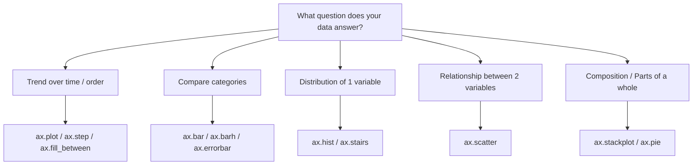
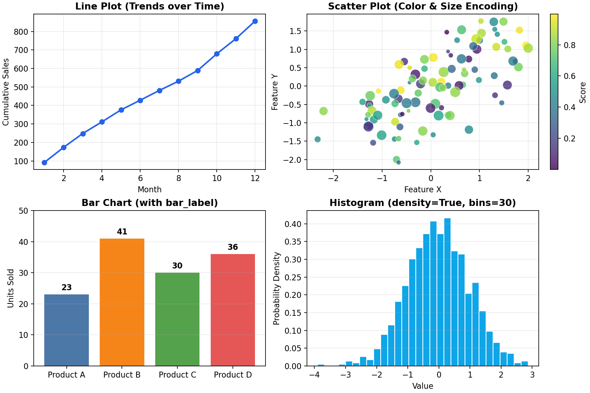

[⬅️ Previous: Lesson 01](01_Setup_Architecture_and_Two_APIs.md) | [🏠 Course Home](README.md) | [Next: Lesson 03 — Styling, Text & Legends ➡️](03_Styling_Text_Annotations_and_Legends.md)

---

# 📊 Lesson 02: Core Plot Types (මූලික ප්‍රස්තාර වර්ග)

> [!TIP]
> **මේ පාඩමෙන් ඔයා ඉගෙන ගන්නේ මොනවද?**
> ඔයා ළඟ තියෙන data එකට හරියනම chart එක තෝරගන්නේ කොහොමද? Trend එකක්ද, Comparison එකක්ද, Distribution එකක්ද, Relationship එකක්ද, නැත්නම් Composition එකක්ද? මේ පාඩමෙන් Matplotlib වල ප්‍රධාන plot types **13ම** (`plot`, `scatter`, `bar`/`barh`, grouped/stacked bars, `hist`, `step`/`stairs`, `fill_between`, `stackplot`, `pie`, `errorbar`, reference lines, `stem`, `eventplot`) උදාහරණ එක්කම ඉගෙන ගමු!

---

## 1. හරි Chart එක තෝරා ගන්නේ කොහොමද? (Chart Selection Guide)

Chart එකක් අඳින්න කලින් ඔයාගෙන්ම අහන්න ඕනෙ ප්‍රශ්නය තමයි: **"මට මේ data එකෙන් පෙන්නන්න ඕනෙ මොකක්ද?"**



පහළ තියෙන 2×2 showcase එකෙන් අපි වැඩිපුරම පාවිච්චි කරන ප්‍රධාන chart 4 (Line, Scatter, Bar, Histogram) එකපාර බලාගන්න පුළුවන්:



---

## 2. ප්‍රධාන Plot Types 13ම සරලව

### 1) Line Plot — `ax.plot(x, y)`
* **හොඳම අවස්ථාව:** කාලයත් එක්ක හෝ පිළිවෙළකට තියෙන axis එකක් දිගේ වෙනස්වීම් (**trends**) පෙන්නන්න (උදා: මාසික ආදායම, උෂ්ණත්වය).
* **Key options:** `linestyle` (`'-'`, `'--'`, `':'`), `linewidth` (`lw`), `marker` (`'o'`, `'s'`), `color`, `label`.

### 2) Scatter Plot — `ax.scatter(x, y)`
* **හොඳම අවස්ථාව:** විචල්‍ය දෙකක් අතර සම්බන්ධය (**relationship / correlation**) බලන්න (උදා: උස සහ බර, වියදම සහ ලාභය).
* **Key options:** `s` (තිතේ ප්‍රමාණය — 3වෙනි variable එකක් පෙන්නන්න පුළුවන්), `c` (පාට — 4වෙනි variable එකක් පෙන්නන්න පුළුවන්), `alpha` (විනිවිද පෙනෙන ගතිය), `cmap` (colormap, උදා: `'viridis'`), `marker`.

### 3) Vertical & Horizontal Bar Charts — `ax.bar()`, `ax.barh()`
* **හොඳම අවස්ථාව:** Categories අතර අගයන් සංසන්දනය (**comparison**) කරන්න. Category නම් දිගයි නම් `ax.barh()` (horizontal bar) පාවිච්චි කරන එක ගොඩක් පැහැදිලියි!
* **Key options:** `width`, `bottom` (stack කරන්න), `yerr` (error bars), `align`, `hatch` (රටා දාන්න).

### 4) Grouped & Stacked Bars + `ax.bar_label()`
* **හොඳම අවස්ථාව:** Sub-categories සංසන්දනය කරන්න (උදා: Product A, B, C වල Q1–Q4 විකුණුම්).
* **Grouped bars:** `x = np.arange(n)` අරගෙන `x - width`, `x`, `x + width` විදියට bars එහා මෙහා shift කරලා අඳිනවා.
* **Stacked bars:** දෙවෙනි `ax.bar()` එකට `bottom=values1` දීලා පළවෙනි bar එක උඩින් තියනවා.
* **Value labels:** `bars = ax.bar(...)` අරගෙන `ax.bar_label(bars)` ගැහුවම bar එක උඩින් අගය ඉබේම ලියවෙනවා!

### 5) Histogram — `ax.hist(data, bins=)`
* **හොඳම අවස්ථාව:** තනි සංඛ්‍යාත්මක variable එකක ව්‍යාප්තිය (**distribution**) බලන්න (උදා: පන්තියේ ළමයින්ගේ ලකුණු බෙදී ගිය විදිය).
* **Key options:** `bins` (කොටු ගණන), `density=True` (count වෙනුවට probability density පෙන්නන්න), `cumulative=True`, `histtype` (`'bar'`, `'step'`), `range`, `edgecolor='white'`.

### 6) Step & Stairs — `ax.step()`, `ax.stairs()`
* **හොඳම අවස්ථාව:** ක්ෂණිකව වෙනස් වෙන piecewise-constant signals (උදා: digital signal, tax brackets, pre-computed histograms).
* **Key options:** `where='pre'` / `'mid'` / `'post'`.

### 7) Fill Between — `ax.fill_between()`, `ax.fill_betweenx()`
* **හොඳම අවස්ථාව:** රේඛා දෙකක් අතර ප්‍රදේශය පාට කරන්න — **confidence bands**, `±1 std` (standard deviation) range එක, හෝ ලාභ/අලාභ ප්‍රදේශ පෙන්නන්න.
* **Key options:** `alpha` (විනිවිද පෙනෙන ගතිය), `where=` (කොන්දේසියක් අනුව පාට කරන්න), `interpolate=True`.

### 8) Stackplot — `ax.stackplot(x, y1, y2, ...)`
* **හොඳම අවස්ථාව:** කාලයත් එක්ක මුළු එකතුව හැදිලා තියෙන කොටස් (**composition over time**) පෙන්නන්න (උදා: වෙබ් අඩවියක Mobile / Desktop / Tablet traffic).
* **Key options:** `labels`, `colors`.

### 9) Pie & Donut Charts — `ax.pie()`
* **හොඳම අවස්ථාව:** කොටස් කීපයකින් (3–5ක් වගේ) හැදුණු මුළු එකක ප්‍රතිශත පෙන්නන්න. *(මිනිස් ඇහැට කෝණ සංසන්දනය කරන්න අමාරු නිසා පරිස්සමින්, අවශ්‍යම තැනක විතරක් පාවිච්චි කරන්න!)*
* **Key options:** `autopct='%1.1f%%'` (ප්‍රතිශත ලියන්න), `explode` (කෑල්ලක් එළියට අදින්න), `wedgeprops=dict(width=0.4)` (Donut chart එකක් හදන්න!).

### 10) Error Bars — `ax.errorbar()`
* **හොඳම අවස්ථාව:** මිනුමක අවිනිශ්චිතතාවය (**uncertainty / error range**) පෙන්නන්න.
* **Key options:** `yerr`, `xerr`, `capsize` (ඉර කෙළවර පොඩි තිරස් ඉර), `fmt` (උදා: `'o-'`).

### 11) Reference Lines & Spans — `axhline`, `axvline`, `axhspan`, `axvspan`
* **හොඳම අවස්ථාව:** Target line එකක්, threshold එකක් (`axhline(y)` / `axvline(x)`), හෝ විශේෂ කාල පරාසයක් (`axvspan(x1, x2)` / `axhspan(y1, y2)`) highlight කරන්න.
* **Key options:** `linestyle`, `alpha`, `color`.

### 12) Stem Plot — `ax.stem()`
* **හොඳම අවස්ථාව:** Discrete signals (ඩිජිටල් සංඥා, ලොලිපොප් වගේ baseline එකේ ඉඳන් උඩට තියෙන අගයන්).
* **Key options:** `linefmt`, `markerfmt`.

### 13) Event Plot — `ax.eventplot()`
* **හොඳම අවස්ථාව:** Spike trains, server outages, හෝ සිදුවීම් සිද්ධ වුණු වෙලාවල් (event timelines) කෙටි සිරස් ඉරි විදියට පෙන්නන්න.
* **Key options:** `lineoffsets`.

---

## 3. Complete Code Example (පූර්ණ උදාහරණය සහ Line-by-Line පැහැදිලි කිරීම)

```python
import matplotlib.pyplot as plt
import numpy as np

rng = np.random.default_rng(0)
fig, axs = plt.subplots(2, 2, figsize=(9, 6), constrained_layout=True)

# 1. Line plot
x = np.arange(1, 13)
axs[0, 0].plot(x, rng.integers(50, 100, 12).cumsum(), marker='o')
axs[0, 0].set_title('Line')

# 2. Scatter plot
axs[0, 1].scatter(rng.normal(size=100), rng.normal(size=100),
                  c=rng.random(100), s=40, cmap='viridis', alpha=.8)
axs[0, 1].set_title('Scatter')

# 3. Bar chart with bar_label
cats = ['A', 'B', 'C']
bars = axs[1, 0].bar(cats, [23, 41, 30], color='#4C78A8')
axs[1, 0].bar_label(bars)
axs[1, 0].set_title('Bar')

# 4. Histogram
axs[1, 1].hist(rng.normal(size=1000), bins=30, density=True, edgecolor='white')
axs[1, 1].set_title('Histogram')

plt.show()
```

### Line-by-Line පැහැදිලි කිරීම:
1. `rng = np.random.default_rng(0)` — එකම random අංක ටික හැමදාම ලැබෙන්න (reproducibility) seed `0` දාලා modern NumPy random generator එකක් හදනවා.
2. `fig, axs = plt.subplots(2, 2, figsize=(9, 6), constrained_layout=True)` — පේළි 2යි තීරු 2යි තියෙන subplot grid එකක් හදනවා. `constrained_layout=True` නිසා titles සහ labels එකිනෙක ගැටෙන්නේ නෑ.
3. `axs[0, 0].plot(..., marker='o')` — ඉහළ-වම් කොටුවේ cumulative sum line plot එක තිත් (`'o'`) එක්ක අඳිනවා.
4. `axs[0, 1].scatter(..., c=..., s=40, cmap='viridis', alpha=.8)` — ඉහළ-දකුණු කොටුවේ random අගයන් 100ක scatter plot එකක්, `'viridis'` colormap එකෙන් පාට කරලා, 80% opacity (`alpha=.8`) දාලා අඳිනවා.
5. `bars = axs[1, 0].bar(...)` සහ `axs[1, 0].bar_label(bars)` — පහළ-වම් කොටුවේ bar chart එක ඇඳලා, හැම bar එකක් උඩම එහි අගය (`23`, `41`, `30`) print කරනවා.
6. `axs[1, 1].hist(..., bins=30, density=True, edgecolor='white')` — පහළ-දකුණු කොටුවේ normal distribution histogram එක bins 30කින් සහ සුදු පාට bar බෝඩර් එක්ක අඳිනවා.

**Expected Visual Output:**
පිරිසිදු 2×2 grid එකක — ඉහළ වමේ ඉහළ යන line chart එකක්, ඉහළ දකුණේ වර්ණවත් scatter plot එකක්, පහළ වමේ අගයන් ලියපු bar chart එකක්, සහ පහළ දකුණේ සීනුවක හැඩේ (bell-curve) histogram එකක් දිස්වෙනවා.

---

## 🧠 මතක තබා ගැනීමට පහසු ක්‍රම (Memory Hacks)

* **Bar vs Histogram:** Bar chart එකේ කණු අතර **හිඩැස් (gaps)** තියෙනවා (වෙනස් categories නිසා). Histogram එකේ කණු **එකට ගෑවිලා** තියෙනවා (අඛණ්ඩ සංඛ්‍යා පරාසයක් නිසා).
* **`scatter` වල `s` සහ `c`:** `s` = **S**ize (ප්‍රමාණය), `c` = **C**olor (පාට).
* **`axhline` vs `axvspan`:** `h` = **H**orizontal (තිරස්), `v` = **V**ertical (සිරස්); `line` = තනි ඉරක්, `span` = පාට කරපු තීරුවක්!

---

## ⚠️ සාමාන්‍යයෙන් වෙන වැරදි (Common Pitfalls)

> [!WARNING]
> **1. Unsorted data වලට `ax.plot()` ගැසීම:**
> `x` අගයන් පිළිවෙළකට sort වෙලා නැත්නම් `ax.plot(x, y)` ගැහුවම මකුළු දැලක් වගේ ඉරි හැමතැනම යනවා! Ordered නැති data වලට `ax.scatter()` පාවිච්චි කරන්න, නැත්නම් `x` අනුව sort කරන්න.

> [!WARNING]
> **2. Histogram වල `bins` ගණන ගැන නොසිතීම:**
> `bins` ගොඩක් අඩු කළොත් (උදා: `bins=5`) data වල හැඩේ වැහෙනවා. `bins` ගොඩක් වැඩි කළොත් (උදා: `bins=100`) noise එක විතරක් පේනවා. හැමවිටම `bins` අගයන් 2-3ක් try කරලා බලන්න.

> [!WARNING]
> **3. Categories ගොඩක් තියෙනකොට Pie Chart පාවිච්චි කිරීම:**
> Categories 6කට වඩා තියෙනකොට Pie chart එක කියවන්න හරිම අමාරුයි. ඒ වෙනුවට sorted `ax.barh()` පාවිච්චි කරන්න.

---

## 🏋️ Practical Exercises (ප්‍රායෝගික අභ්‍යාස)

### Warm-up Exercise:
`ax.pie()` පාවිච්චි කරලා budget කොටස් 4ක් (`Rent: 40`, `Food: 30`, `Transport: 15`, `Savings: 15`) Donut chart එකක් විදියට `autopct='%1.0f%%'` එක්ක අඳින්න.

<details>
<summary>✅ පිළිතුර බලන්න (Click to see Solution)</summary>

```python
import matplotlib.pyplot as plt

labels = ['Rent', 'Food', 'Transport', 'Savings']
sizes = [40, 30, 15, 15]

fig, ax = plt.subplots(figsize=(5, 5))
ax.pie(sizes, labels=labels, autopct='%1.0f%%', startangle=90,
       wedgeprops=dict(width=0.4, edgecolor='white'))
ax.set_title('Monthly Budget (Donut Chart)')
plt.show()
```
</details>

### Exercise 1:
Products තුනක (`P1`, `P2`, `P3`) කාර්තු 4ක (`Q1`–`Q4`) විකුණුම් පෙන්නන **grouped bar chart** එකක් value labels (`ax.bar_label`) එක්ක අඳින්න.

<details>
<summary>✅ පිළිතුර බලන්න (Click to see Solution)</summary>

```python
import matplotlib.pyplot as plt
import numpy as np

quarters = ['Q1', 'Q2', 'Q3', 'Q4']
sales = {
    'Product A': [20, 34, 30, 35],
    'Product B': [25, 32, 34, 20],
    'Product C': [18, 28, 25, 30],
}

x = np.arange(len(quarters))
width = 0.25

fig, ax = plt.subplots(figsize=(8, 4.5))
for i, (name, vals) in enumerate(sales.items()):
    bars = ax.bar(x + (i - 1) * width, vals, width, label=name)
    ax.bar_label(bars, padding=2, fontsize=8)

ax.set_xticks(x)
ax.set_xticklabels(quarters)
ax.set_ylabel('Sales (Units)')
ax.set_title('Quarterly Sales by Product')
ax.set_ylim(0, 42)
ax.legend()
plt.show()
```
</details>

### Exercise 2:
Noisy signal එකක් ඇඳලා ඒ වටේට `fill_between` පාවිච්චි කරලා ±1 standard deviation shaded band එකක් අඳින්න.

<details>
<summary>✅ පිළිතුර බලන්න (Click to see Solution)</summary>

```python
import matplotlib.pyplot as plt
import numpy as np

rng = np.random.default_rng(42)
x = np.linspace(0, 10, 100)
mean_y = np.sin(x)
std_y = 0.25 + 0.1 * np.abs(np.cos(x))
noisy_y = mean_y + rng.normal(0, std_y)

fig, ax = plt.subplots(figsize=(8, 4))
ax.plot(x, mean_y, color='#2563eb', lw=2, label='Mean signal')
ax.scatter(x, noisy_y, color='gray', s=12, alpha=0.5, label='Noisy samples')
ax.fill_between(x, mean_y - std_y, mean_y + std_y,
                color='#2563eb', alpha=0.2, label='±1 std band')
ax.set_title('Noisy Signal with ±1 Standard Deviation Band')
ax.set_xlabel('Time')
ax.set_ylabel('Amplitude')
ax.legend()
plt.show()
```
</details>

### Exercise 3:
Marker size එකෙන් **population** එකත්, color එකෙන් **continent** එකත් encode වෙන scatter plot එකක් හදන්න.

<details>
<summary>✅ පිළිතුර බලන්න (Click to see Solution)</summary>

```python
import matplotlib.pyplot as plt
import numpy as np

gdp = np.array([15, 45, 8, 60, 22, 5, 38, 12])
life_exp = np.array([72, 81, 66, 83, 75, 61, 80, 70])
pop_millions = np.array([22, 125, 1400, 330, 210, 200, 83, 55])
continents = ['Asia', 'Asia', 'Asia', 'Americas', 'Americas', 'Africa', 'Europe', 'Africa']
colors = {'Asia': '#ef4444', 'Americas': '#3b82f6', 'Africa': '#10b981', 'Europe': '#f59e0b'}

fig, ax = plt.subplots(figsize=(7.5, 4.5))
for cont in colors:
    mask = [c == cont for c in continents]
    ax.scatter(gdp[mask], life_exp[mask],
               s=pop_millions[mask] * 0.6 + 40,
               color=colors[cont], alpha=0.75, edgecolors='black', label=cont)

ax.set_xlabel('GDP per Capita ($k)')
ax.set_ylabel('Life Expectancy (years)')
ax.set_title('GDP vs Life Expectancy (Size = Population, Color = Continent)')
ax.legend(title='Continent')
ax.grid(True, alpha=0.25)
plt.show()
```
</details>

### Exercise 4:
එකම dataset එකට 10-bin histogram එකක් සහ 50-bin histogram එකක් පැත්තෙන් පැත්ත ඇඳලා වෙනස් වෙන දේ විස්තර කරන්න.

<details>
<summary>✅ පිළිතුර බලන්න (Click to see Solution)</summary>

```python
import matplotlib.pyplot as plt
import numpy as np

rng = np.random.default_rng(7)
data = np.concatenate([rng.normal(-2, 0.8, 500), rng.normal(2, 1.0, 500)])

fig, (ax1, ax2) = plt.subplots(1, 2, figsize=(9, 3.8), constrained_layout=True)
ax1.hist(data, bins=10, edgecolor='white', color='#3b82f6')
ax1.set_title('10 Bins (Smooth, Less Detail)')

ax2.hist(data, bins=50, edgecolor='white', color='#10b981')
ax2.set_title('50 Bins (More Detail, More Noise)')
plt.show()
```
**වෙනස:** `bins=10` වලදී සමස්ත bimodal (කඳු දෙකක් තියෙන) හැඩය සුමටව පේනවා, හැබැයි සියුම් විස්තර වැහෙනවා. `bins=50` වලදී සියුම් වෙනස්කම් පැහැදිලිව පෙනුණත්, random sampling noise එක නිසා බාර් උස පහළ යෑම් (jaggedness) වැඩි වෙනවා.
</details>

---

## 📋 Cheat Sheet Summary

| Plot Type | Method | Best For | Key Options |
| --- | --- | --- | --- |
| Line | `ax.plot(x, y)` | Trends over ordered axis | `linestyle`, `linewidth`, `marker`, `color`, `label` |
| Scatter | `ax.scatter(x, y)` | 2-variable relationship | `s`, `c`, `alpha`, `cmap`, `marker` |
| Bar | `ax.bar`, `ax.barh` | Compare categories | `width`, `bottom`, `yerr`, `hatch`, `ax.bar_label` |
| Histogram | `ax.hist(data, bins=)` | Distribution of 1 variable | `density`, `cumulative`, `histtype`, `range` |
| Step / Stairs | `ax.step`, `ax.stairs` | Piecewise-constant signals | `where='pre'/'mid'/'post'` |
| Fill Between | `ax.fill_between` | Confidence bands / areas | `alpha`, `where=`, `interpolate` |
| Stackplot | `ax.stackplot` | Composition over time | `labels`, `colors` |
| Pie / Donut | `ax.pie` | Few parts of a whole | `autopct`, `explode`, `wedgeprops` |
| Error Bars | `ax.errorbar` | Uncertainty | `yerr`, `xerr`, `capsize`, `fmt` |
| Reference Marks | `axhline`, `axvline`, `axhspan`, `axvspan` | Thresholds & windows | `linestyle`, `alpha` |
| Stem / Event | `ax.stem`, `ax.eventplot` | Discrete signals / timelines | `linefmt`, `markerfmt`, `lineoffsets` |

---

[⬅️ Previous: Lesson 01](01_Setup_Architecture_and_Two_APIs.md) | [🏠 Course Home](README.md) | [Next: Lesson 03 — Styling, Text & Legends ➡️](03_Styling_Text_Annotations_and_Legends.md)
