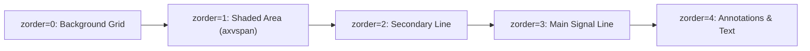
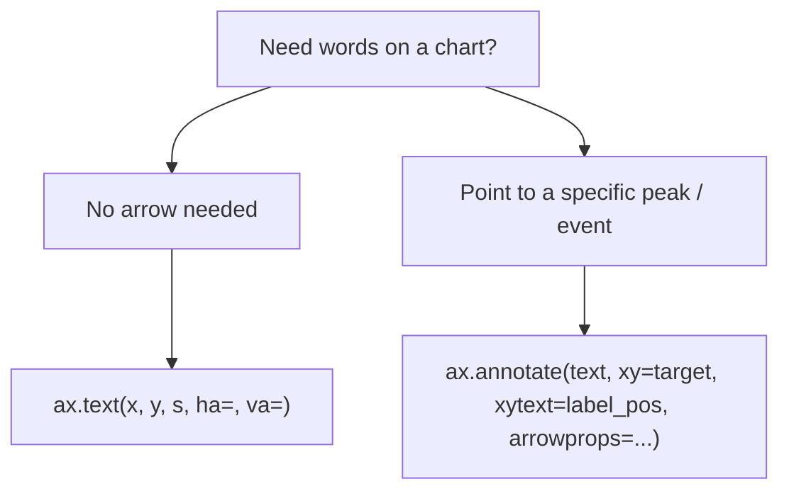
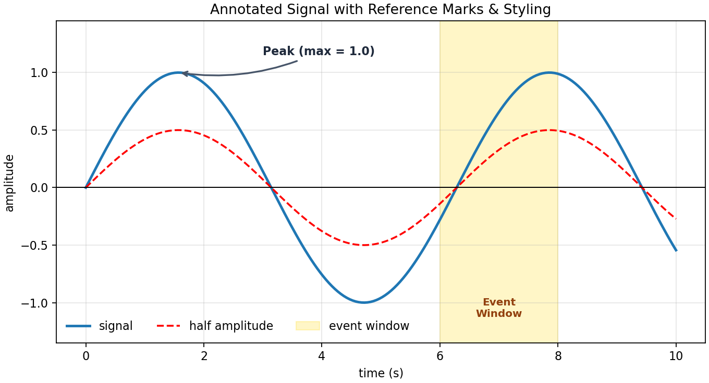

[⬅️ Previous: Lesson 02](02_Core_Plot_Types.md) | [🏠 Course Home](README.md) | [Next: Lesson 04 — Axes Control, Ticks & Dates ➡️](04_Axes_Control_Ticks_Scales_and_Dates.md)

---

# 🎨 Lesson 03: Styling, Text, Annotations and Legends (හැඩගැන්වීම, අකුරු, විස්තර සහ Legends)

> [!TIP]
> **මේ පාඩමෙන් ඔයා ඉගෙන ගන්නේ මොනවද?**
> හොඳ chart එකක් කියන්නේ පාට ගොඩක් ගාලා සරසපු එකක් නෙවෙයි — **පැහැදිලි labels, හොඳින් කියවන්න පුළුවන් colors, වැදගත් තැන් පෙන්නන annotations, සහ පිරිසිදු legend එකක්** තියෙන chart එකක්. මේ පාඩමෙන් colors, line styles, markers, z-order, text/annotations, custom proxy legends, colorblind accessibility, hatches, සහ grids ගැන සම්පූර්ණයෙන්ම ඉගෙන ගමු!

---

## 1. Colours, Colour Cycles & Accessibility (වර්ණ භාවිතය)

Matplotlib වල පාටක් දෙන්න ක්‍රම 5ක් තියෙනවා:
1. **Named colours:** `'red'`, `'tab:blue'`, `'tab:orange'`, `'navy'`
2. **Hex codes:** `'#1f77b4'`, `'#4C78A8'` (Brand colours වලට හොඳම ක්‍රමය)
3. **RGB / RGBA tuples:** `(0.1, 0.2, 0.5)` හෝ `(0.1, 0.2, 0.5, 0.8)` (`0` සිට `1` අතර)
4. **Grayscale strings:** `'0.0'` (කළු) සිට `'1.0'` (සුදු), උදා: `'0.5'` (අළු)
5. **Cycle colours:** `'C0'`, `'C1'`, ..., `'C9'` (දැනට active theme එකේ default පාට පිළිවෙළ)

### Colour Cycles (ස්වයංක්‍රීය වර්ණ පිළිවෙළ)
එකම chart එකේ lines කීපයක් අඳිනකොට පාට මාරු වෙන පිළිවෙළ අපිටම සකසන්න පුළුවන්:
```python
from cycler import cycler
ax.set_prop_cycle(cycler(color=['#1b9e77', '#d95f02', '#7570b3']))
# හෝ global වෙනස් කරන්න: plt.rcParams['axes.prop_cycle']
```

### Colour Accessibility & Hatches (සැමට පැහැදිලි නිර්මාණ)
* **Colourblind-safe palettes:** රතු-කොළ (`red`/`green`) එකට පාවිච්චි කරන එකෙන් වළකින්න (ලෝකයේ පිරිමි 12 දෙනෙකුගෙන් 1 අයෙකුට රතු-කොළ වෙන් කරලා අඳුනගන්න අමාරුයි!). ඒ වෙනුවට `plt.style.use('tableau-colorblind10')` හෝ Blue-Orange පාට යුගලය පාවිච්චි කරන්න.
* **Hatches and patterns:** කළු-සුදු (grayscale) print කරනකොට bars/areas වෙන් කරලා අඳුනගන්න `hatch='//'`, `'xx'`, `'..'` වගේ patterns දාන්න පුළුවන්.

---

## 2. Lines, Markers, Format Strings & Layering (`alpha`, `zorder`)

### Lines & Markers
* **Line styling:** `linestyle='--'` (`'-'`, `':'`, `'-.'`), `lw=2` (`linewidth`), `dashes=(5, 2)` (custom dash length), `drawstyle='steps-post'`.
* **Markers:** `marker='o'` (`'s'`, `'^'`, `'D'`, `'*'`), `markersize=7`, `markerfacecolor='white'`, `markeredgecolor='navy'`, `markevery=5` (හැම 5වෙනි point එකේම විතරක් marker එක දාන්න!).
* **Format Strings (කෙටි ක්‍රමය):** `ax.plot(x, y, 'ro--')` කියන්නේ **r**ed color + **o** marker + **--** dashed line කියන තුනම එකට!

### Transparency (`alpha`) & Layer Order (`zorder`)
Chart එකක elements එක උඩ එක වැටෙනකොට:
* `alpha=0.2` (`0` = සම්පූර්ණයෙන් නොපෙනේ, `1` = සම්පූර්ණයෙන් පෙනේ).
* `zorder=`: වැඩි අංකය තියෙන element එක උඩින්ම පේනවා! (උදා: grid එක `zorder=0`, shaded region එක `zorder=1`, main line එක `zorder=3`).



---

## 3. Titles, Labels, Text & Annotations

### Titles & Axis Labels
* `ax.set_title('Main Chart', loc='left', pad=10)` — `loc='left'` දුන්නම title එක වම් පැත්තට align වෙනවා (modern style!).
* `ax.set_xlabel('Time (s)', labelpad=8)`, `ax.set_ylabel('Amplitude')`.
* `fig.suptitle('Overall Dashboard Title')` — මුළු `Figure` එකටම උඩින් දාන ප්‍රධාන මාතෘකාව.
* කෙටි ක්‍රමය: `ax.set(title='...', xlabel='...', ylabel='...', ylim=(-1.3, 1.4))`.

### `ax.text()` vs `ax.annotate()`
* **`ax.text(x, y, 'Label', ha='center', va='bottom', fontsize=10)`:** ඕනෑම `(x, y)` තැනක අකුරු ලියන්න. `transform=ax.transAxes` දුන්නොත් data coordinates වෙනුවට `0.0` සිට `1.0` දක්වා relative positions වලින් ලියන්න පුළුවන්!
* **`ax.annotate('peak', xy=(x_point, y_point), xytext=(x_text, y_text), arrowprops=dict(arrowstyle='->'))`:** වැදගත් data point එකකට **ඊතලයක් (arrow)** එක්ක විස්තරයක් පෙන්නන්න.



පහළ රූපයෙන් මේ සියලු styling, annotations, reference marks (`axhline`, `axvspan`), grid සහ legend එකට එකතු වුණාම කොච්චර පැහැදිලිද කියලා බලන්න:



---

## 4. Legends & Custom Proxy Artists

### Standard Legend
```python
ax.legend(loc='lower left', ncol=3, title='Series', frameon=False)
```
* Chart එකෙන් **පිටත** legend එක තියන්න ඕනෙ නම් `bbox_to_anchor=(1.02, 1)` සහ `loc='upper left'` පාවිච්චි කරනවා.
* `handles, labels = ax.get_legend_handles_labels()` මගින් legend එකේ අයිතම අතින් modify කරන්නත් පුළුවන්.

### Custom Legend Entries (Proxy Artists)
සමහර වෙලාවට chart එකේ ඇඳපු දෙයකට (උදා: scatter marker size, හෝ custom colored patch) ඉබේම legend entry එකක් එන්නේ නෑ. එතකොට අපි `Line2D` හෝ `Patch` පාවිච්චි කරලා **Proxy Artists** හදලා `ax.legend(handles=...)` එකට දෙනවා:

```python
from matplotlib.lines import Line2D
from matplotlib.patches import Patch

custom_handles = [
    Line2D([0], [0], color='tab:blue', lw=2, label='Observed'),
    Patch(facecolor='gold', alpha=0.3, label='Event Window'),
]
ax.legend(handles=custom_handles)
```

---

## 5. Complete Code Example (පූර්ණ උදාහරණය සහ Line-by-Line පැහැදිලි කිරීම)

```python
import matplotlib.pyplot as plt
import numpy as np

x = np.linspace(0, 10, 100)
fig, ax = plt.subplots(figsize=(7, 4))

ax.plot(x, np.sin(x), color='tab:blue', lw=2, label='signal')
ax.plot(x, np.sin(x) * .5, 'r--', lw=1.5, label='half amplitude')

ax.annotate('peak', xy=(np.pi / 2, 1), xytext=(3, 1.15),
            arrowprops=dict(arrowstyle='->', color='gray'))
ax.axhline(0, color='black', lw=.8)
ax.axvspan(6, 8, color='gold', alpha=.2, label='event window')

ax.set(title='Annotated signal', xlabel='time (s)', ylabel='amplitude',
       ylim=(-1.3, 1.4))
ax.grid(alpha=.3)
ax.legend(loc='lower left', ncol=3, frameon=False)
plt.show()
```

### Line-by-Line පැහැදිලි කිරීම:
1. `ax.plot(x, np.sin(x), color='tab:blue', lw=2, label='signal')` — නිල් පාට, ඝනකම `2` රේඛාවක් අඳිනවා.
2. `ax.plot(x, np.sin(x) * .5, 'r--', lw=1.5, label='half amplitude')` — `'r--'` format string එකෙන් රතු පාට කඩඉරි (dashed) රේඛාවක් අඳිනවා.
3. `ax.annotate('peak', xy=(np.pi / 2, 1), xytext=(3, 1.15), arrowprops=...)` — `x = π/2, y = 1` උපරිම ලක්ෂ්‍යයට `(3, 1.15)` තැනේ ඉඳන් අළු පාට ඊතලයක් අඳිනවා.
4. `ax.axhline(0, color='black', lw=.8)` — `y = 0` හරහා සිහින් කළු reference ඉරක් අඳිනවා.
5. `ax.axvspan(6, 8, color='gold', alpha=.2, label='event window')` — `x = 6` සිට `8` දක්වා රන්වන් පාට සැහැල්ලු තීරුවක් highlight කරලා legend එකටත් එකතු කරනවා.
6. `ax.set(...)` — title, xlabel, ylabel සහ `ylim` ඔක්කොම එකම line එකකින් set කරනවා.
7. `ax.grid(alpha=.3)` — ඇහැට කරදරයක් නොවෙන විදියට සැහැල්ලු grid එකක් දානවා.
8. `ax.legend(loc='lower left', ncol=3, frameon=False)` — පහළ වම් කෙළවරේ තීරු 3කට, වටේ කොටුව නැතුව (`frameon=False`) පිරිසිදු legend එකක් දානවා.

**Expected Visual Output:**
`0` සිට `10` දක්වා නිල් පාට sine රේඛාව සහ රතු කඩඉරි half-amplitude රේඛාව, උඩින් `peak` ඊතලය, මැද `y=0` ඉර, `6–8` අතර රන්වන් event window තීරුව, සහ පහළ තනි පේළියට තියෙන frameless legend එක.

---

## 🧠 මතක තබා ගැනීමට පහසු ක්‍රම (Memory Hacks)

* **`xy` vs `xytext` in `annotate`:** `xy` = ඊතලේ **තුඩ** වදින තැන (target point). `xytext` = **අකුරු** තියෙන තැන.
* **`ha` & `va`:** `ha` = **H**orizontal **A**lignment (`'left'`, `'center'`, `'right'`), `va` = **V**ertical **A**lignment (`'top'`, `'center'`, `'bottom'`).
* **Less is More:** Grid එකට හැමවිටම `alpha=0.2`–`0.3` දාන්න — grid එක data එකට වඩා කැපිලා පේන්න හොඳ නෑ!

---

## ⚠️ සාමාන්‍යයෙන් වෙන වැරදි (Common Pitfalls)

> [!WARNING]
> **1. `label=` නොදී `ax.legend()` call කිරීම:**
> Plot කරනකොට `label='...'` දීලා නැත්නම් `ax.legend()` ගැහුවම *"No artists with labels found to put in legend"* කියලා warning එකක් එනවා, legend එක හිස් වෙනවා.

> [!WARNING]
> **2. Legend එකෙන් වැදගත් data වැසී යාම:**
> Default `loc='best'` සමහර වෙලාවට line එක උඩටම වැටෙන්න පුළුවන්. ඒ වෙලාවට `ylim` ටිකක් වැඩි කරලා ඉඩ හදන්න, නැත්නම් `bbox_to_anchor=(1.02, 1)` වලින් legend එක පිටතින් තියන්න.

> [!WARNING]
> **3. රතු සහ කොළ (Red/Green) එකට භාවිතය:**
> Colourblind පාඨකයින්ට මේ පාට දෙකම එක වගේ පේනවා. හැමවිටම colourblind-safe palettes + line styles (`'-'` vs `'--'`) හෝ hatches පාවිච්චි කරන්න.

---

## 🏋️ Practical Exercises (ප්‍රායෝගික අභ්‍යාස)

### Warm-up Exercise:
`x = np.linspace(0, 5, 50)` සඳහා $y = e^{-x}$ රේඛාව ඇඳලා, `x=0, y=1` ලක්ෂ්‍යයට `'Start (0, 1)'` කියලා arrow annotation එකක් සහ `ax.text()` මගින් chart එකේ ඉහළ-දකුණු කෙළවරේ (`transform=ax.transAxes`) `'Exponential Decay'` කියලා ලියන්න.

<details>
<summary>✅ පිළිතුර බලන්න (Click to see Solution)</summary>

```python
import matplotlib.pyplot as plt
import numpy as np

x = np.linspace(0, 5, 50)
y = np.exp(-x)

fig, ax = plt.subplots(figsize=(6.5, 4))
ax.plot(x, y, color='tab:purple', lw=2, marker='o', markevery=5)
ax.annotate('Start (0, 1)', xy=(0, 1), xytext=(1.2, 0.85),
            arrowprops=dict(arrowstyle='->', color='black'))
ax.text(0.95, 0.92, 'Exponential Decay', transform=ax.transAxes,
        ha='right', va='top', fontsize=10, style='italic', color='gray')
ax.grid(alpha=0.3)
plt.show()
```
</details>

### Exercise 1:
Published chart එකක් recreate කරන ආකාරයට: වසර 5ක (`2021`–`2025`) Company Revenue vs Target chart එකක්, left-aligned bold title, muted grid, target dashed line, සහ 2024 peak එකට annotation arrow එකක් එක්ක publication-style එකට අඳින්න.

<details>
<summary>✅ පිළිතුර බලන්න (Click to see Solution)</summary>

```python
import matplotlib.pyplot as plt

years = [2021, 2022, 2023, 2024, 2025]
revenue = [120, 145, 160, 215, 198]
target = 180

fig, ax = plt.subplots(figsize=(7.5, 4.2))
ax.plot(years, revenue, color='#1d4ed8', lw=2.5, marker='o', markersize=7,
        markerfacecolor='white', markeredgewidth=2, label='Actual Revenue')
ax.axhline(target, color='#64748b', linestyle='--', lw=1.5, label='Target ($180M)')

ax.annotate('Record Launch\n($215M)', xy=(2024, 215), xytext=(2022.4, 210),
            fontweight='bold', color='#1e3a8a',
            arrowprops=dict(arrowstyle='->', color='#1d4ed8', lw=1.5))

ax.set_title('Annual Revenue Exceeded Target in 2024–2025', loc='left',
             fontsize=12, fontweight='bold', pad=12)
ax.set_ylabel('Revenue ($ Millions)')
ax.set_xticks(years)
ax.set_ylim(100, 240)
ax.grid(axis='y', alpha=0.25)
ax.legend(frameon=False, loc='lower right')
plt.show()
```
</details>

### Exercise 2:
Proxy artists (`Line2D`) පාවිච්චි කරලා scatter plot එකක marker sizes (`Small`, `Medium`, `Large`) පැහැදිලි කරන custom legend එකක් හදන්න.

<details>
<summary>✅ පිළිතුර බලන්න (Click to see Solution)</summary>

```python
import matplotlib.pyplot as plt
from matplotlib.lines import Line2D
import numpy as np

rng = np.random.default_rng(3)
x = rng.uniform(0, 10, 30)
y = rng.uniform(0, 10, 30)
sizes = rng.choice([40, 140, 300], size=30)

fig, ax = plt.subplots(figsize=(7, 4.5))
ax.scatter(x, y, s=sizes, color='#0ea5e9', alpha=0.75, edgecolors='white')

size_handles = [
    Line2D([0], [0], marker='o', color='w', label='Small (40)',
           markerfacecolor='#0ea5e9', markersize=6),
    Line2D([0], [0], marker='o', color='w', label='Medium (140)',
           markerfacecolor='#0ea5e9', markersize=11),
    Line2D([0], [0], marker='o', color='w', label='Large (300)',
           markerfacecolor='#0ea5e9', markersize=16),
]
ax.legend(handles=size_handles, title='Population Size', labelspacing=1.2, frameon=True)
ax.set_title('Custom Size Legend Using Proxy Artists')
ax.grid(alpha=0.25)
plt.show()
```
</details>

### Exercise 3:
රතු-කොළ (`red`/`green`) bar chart එකක් `tableau-colorblind10` style එක සහ `hatch` patterns පාවිච්චි කරලා colorblind-safe සහ grayscale-friendly විදියට නැවත අඳින්න.

<details>
<summary>✅ පිළිතුර බලන්න (Click to see Solution)</summary>

```python
import matplotlib.pyplot as plt
import numpy as np

cats = ['Q1', 'Q2', 'Q3', 'Q4']
a = [30, 42, 38, 50]
b = [25, 35, 44, 41]
x = np.arange(len(cats))
w = 0.35

with plt.style.context('tableau-colorblind10'):
    fig, ax = plt.subplots(figsize=(7, 4))
    ax.bar(x - w/2, a, w, label='Model A', hatch='//', edgecolor='white')
    ax.bar(x + w/2, b, w, label='Model B', hatch='..', edgecolor='white')
    ax.set_xticks(x)
    ax.set_xticklabels(cats)
    ax.set_ylabel('Accuracy (%)')
    ax.set_title('Colourblind-Safe & Grayscale-Friendly Chart')
    ax.legend()
    plt.show()
```
`tableau-colorblind10` palette එක නිසා colourblind අයටත්, `hatch` patterns නිසා black-and-white print කරත් bars දෙක පැහැදිලිව වෙන් කරලා අඳුනගන්න පුළුවන්!
</details>

---

## 📋 Cheat Sheet Summary

| Topic | Key API | Use Case |
| --- | --- | --- |
| Colours | `color='#1f77b4'`, `'tab:orange'`, `'C0'` | Brand & consistent colours |
| Colour Cycle | `ax.set_prop_cycle(...)` | Custom series palette |
| Lines & Markers | `linestyle='--'`, `lw=`, `marker='o'`, `markevery=` | Distinguish data series |
| Format String | `ax.plot(x, y, 'ro--')` | Compact quick styling |
| Layering | `alpha=0.3`, `zorder=3` | Control overlap visibility |
| Text & Annotations | `ax.text(...)`, `ax.annotate(s, xy, xytext, arrowprops=)` | Call out peaks & events |
| Legends | `ax.legend(loc=, ncol=, frameon=, bbox_to_anchor=)` | Clean series key |
| Proxy Artists | `Line2D`, `Patch` | Custom legend entries |
| Accessibility | `plt.style.use('tableau-colorblind10')`, `hatch='//'` | Inclusive & B&W printing |

---

[⬅️ Previous: Lesson 02](02_Core_Plot_Types.md) | [🏠 Course Home](README.md) | [Next: Lesson 04 — Axes Control, Ticks & Dates ➡️](04_Axes_Control_Ticks_Scales_and_Dates.md)
