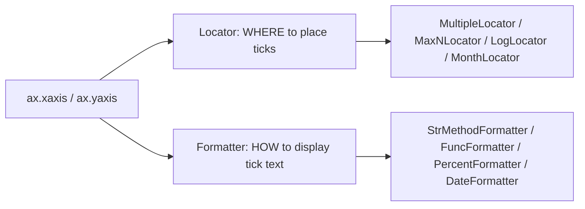
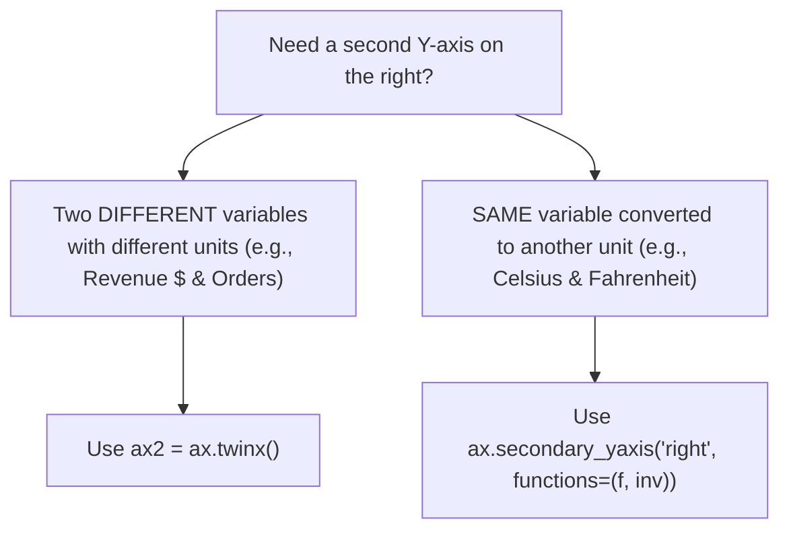
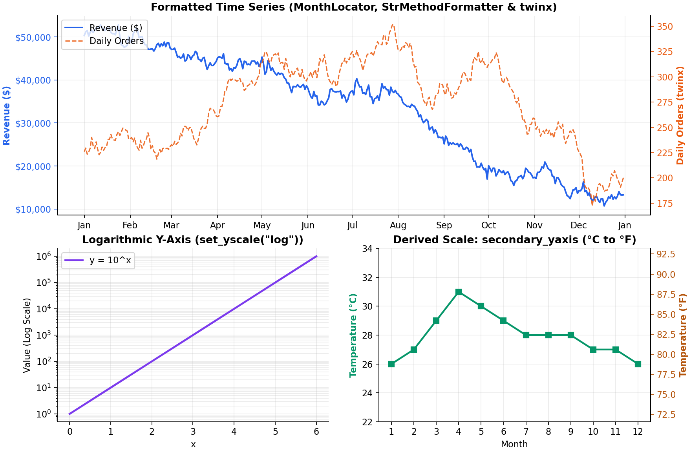

[⬅️ Previous: Lesson 03](03_Styling_Text_Annotations_and_Legends.md) | [🏠 Course Home](README.md) | [Next: Lesson 05 — Subplots and Layouts ➡️](05_Subplots_and_Layouts.md)

---

# 🎛️ Lesson 04: Axes Control — Limits, Ticks, Scales, Formatters and Dates (අක්ෂ පාලනය)

> [!TIP]
> **මේ පාඩමෙන් ඔයා ඉගෙන ගන්නේ මොනවද?**
> Default Matplotlib chart එකක් සහ **publication-quality** chart එකක් අතර ලොකුම වෙනස තියෙන්නේ **Axes Control** වලයි! මේ පාඩමෙන් `xlim`/`ylim`, aspect ratio, **Locators** (ticks තියෙන තැන්), **Formatters** (`$50,000`, `45%` වගේ අකුරු හැඩගැන්වීම), **Log/Symlog scales**, **Dates** (`matplotlib.dates`), **Spines** (බෝඩර් ඉවත් කිරීම), **`twinx()`** සහ **`secondary_yaxis()`** ගැන 100% පැහැදිලිව ඉගෙන ගමු!

---

## 1. Limits, Margins, Aspect Ratio & Inverted Axes

* **Limits (සීමාවන්):** `ax.set_xlim(0, 10)`, `ax.set_ylim(-1, 1)` — chart එකේ නිශ්චිත කොටසකට zoom කරන්න.
* **Margins & Autoscale:** `ax.margins(x=0.05, y=0.1)` (වටේ ඉඩ ප්‍රමාණය), `ax.autoscale(tight=True)`.
* **Invert Axes (අක්ෂය උඩු යටිකුරු කිරීම):** `ax.invert_yaxis()` හෝ `ax.invert_xaxis()` — උදාහරණයක් විදියට මුහුදු ගැඹුර (depth) හෝ 1st, 2nd, 3rd rankings උඩ ඉඳන් පහළට පෙන්නන්න ගොඩක් ප්‍රයෝජනවත්!
* **Aspect Ratio:** `ax.set_aspect('equal')` — වෘත්තයක් අඳිනකොට ඒක බිත්තරයක් වගේ ඇදෙන්නේ නැතුව හරියටම වෘත්තයක් විදියට පෙන්නන්න (maps, geometry වලට අත්‍යවශ්‍යයි). `ax.set_box_aspect(1)` මගින් graph කොටුව සමචතුරස්‍රයක් කරන්න පුළුවන්.

---

## 2. Ticks: Locators (කොහෙද?) vs Formatters (මොනවද?)

Matplotlib වල Ticks පාලනය කරන මූලික රහස මේකයි — හැම `Axis` එකකම දෙන්නෙක් වැඩ කරනවා:
1. **Locator (ස්ථාන තීරකය):** Ticks **කොයි අගයන් වලද** තියෙන්න ඕනෙ කියලා තීරණය කරනවා.
2. **Formatter (පෙනුම තීරකය):** ඒ tick එක ළඟ **මොන අකුරු/ආකෘතියෙන්ද** ලියන්න ඕනෙ කියලා තීරණය කරනවා.



### Manual Ticks & Styling
* `ax.set_xticks([0, 5, 10])` සහ `ax.set_xticklabels(['Low', 'Mid', 'High'])`
* `ax.tick_params(axis='x', direction='in', length=6, labelrotation=45)` — ticks ඇතුළට හරවන්න, දිග වෙනස් කරන්න, labels අංශක 45ක් හරවන්න.

### Common Locators (`import matplotlib.ticker as mticker`)
* `mticker.MultipleLocator(10)` — හැම `10`න් `10`ටම tick එකක් (`0, 10, 20, ...`).
* `mticker.MaxNLocator(5)` — උපරිම ticks 5ක් neat විදියට දාන්න.
* `mticker.LogLocator(base=10)` — log axis වලට.
* `mticker.AutoMinorLocator()` — major ticks අතරට සියුම් minor ticks දාන්න.
* `mticker.FixedLocator([1, 2, 5])` — අපි දෙන නිශ්චිත අගයන් වල විතරක්.

### Common Formatters (`import matplotlib.ticker as mticker`)
* `mticker.StrMethodFormatter('${x:,.0f}')` — `50000` කියන එක `$50,000` විදියට ලියනවා!
* `mticker.FuncFormatter(lambda x, pos: f'{x/1e6:.1f}M')` — ඕනෑම custom Python function එකකින් format කරන්න (උදා: `1200000` -> `1.2M`).
* `mticker.PercentFormatter(xmax=1.0)` — `0.25` කියන එක `25%` විදියට ලියනවා.
* `mticker.ScalarFormatter()` — සාමාන්‍ය සංඛ්‍යා සඳහා.

### Large Numbers & Offsets
ලොකු සංඛ්‍යා (`1e6`, `1e9`) එනකොට scientific notation පාලනය කරන්න:
* `ax.ticklabel_format(style='plain', axis='y')` (scientific notation නවත්වන්න)
* `ax.yaxis.get_offset_text()` (උඩින් එන `1e6` කියන offset text එක style කරන්න).

---

## 3. Non-Linear Scales (`log`, `symlog`, `logit`, `FuncScale`)

ඔයාගේ data එක `1` සිට `1,000,000` දක්වා විශාල පරාසයක විහිදෙනවා නම් (orders of magnitude කීපයක්), සාමාන්‍ය linear scale එකක පොඩි අගයන් ඔක්කොම 0 ළඟ ඇලිලා පේන්නේ නැතුව යනවා. එතකොට:
* `ax.set_yscale('log')` (හෝ `set_xscale('log')`): ධන අගයන් සඳහා (10, 100, 1000 සමාන පරතරයෙන් පේනවා).
* `ax.set_yscale('symlog')`: 0 සහ සෘණ අගයනුත් තියෙන data වලට (symmetric log).
* `ax.set_yscale('logit')`: `0` සහ `1` අතර probability values වලට.
* `FuncScale`: අපිම හදන custom mathematical scale එකක්.

### Major & Minor Grids
Log plots වල අගයන් හරියට කියවන්න `ax.minorticks_on()` සහ `ax.grid(True, which='both', alpha=0.25)` පාවිච්චි කරනවා.

---

## 4. Dates & Time Series (`import matplotlib.dates as mdates`)

කාලයත් එක්ක යන data (Time Series) අඳිනකොට date labels එක උඩ එක වැටෙන එක ලොකු ප්‍රශ්නයක්. `matplotlib.dates` වලින් මේක හරිම ලේසියෙන් විසඳන්න පුළුවන්:
* `mdates.MonthLocator()`: හැම මාසෙකම 1වෙනිදාට tick එකක්.
* `mdates.DateFormatter('%b')`: මාසයේ කෙටි නම (`Jan`, `Feb`, `Mar`). `'%Y-%m'` දුන්නොත් `2026-01`.
* `mdates.AutoDateLocator()` + `mdates.ConciseDateFormatter(locator)`: Matplotlib වල තියෙන **smartest date formatter එක** — අවුරුද්ද වෙනස් වෙන තැන විතරක් year එක පෙන්නලා අනිත් තැන් කෙටියෙන් ලස්සනට පෙන්නනවා!

---

## 5. Spines, Twin Axes (`twinx`) & Secondary Axes (`secondary_yaxis`)

### Spines (බෝඩර් ඉවත් කිරීම සහ ස්ථානගත කිරීම)
Modern charts වල උඩ සහ දකුණු බෝඩර් (spines) අයින් කළාම chart එක ගොඩක් පිරිසිදු වෙනවා:
```python
for s in ('top', 'right'):
    ax.spines[s].set_visible(False)
```
මැදින් කැපෙන X/Y අක්ෂ (crossed axes) හදන්න `ax.spines['left'].set_position('zero')` පාවිච්චි කරනවා.

### `twinx()` vs `secondary_yaxis()` — මේ දෙකේ වෙනස මොකක්ද?


* **`ax.twinx()` / `ax.twiny()`:** එකම X axis එක share කරන, හැබැයි සම්පූර්ණයෙන්ම වෙනස් Y scales දෙකක් (උදා: වම් පැත්තේ Revenue `$`, දකුණු පැත්තේ Daily Orders).
* **`ax.secondary_yaxis('right', functions=(c_to_f, f_to_c))`:** එකම data එක වෙනස් ඒකකයකින් පෙන්නන්න (උදා: °C සහ °F, km සහ miles). Forward function (`f`) සහ inverse function (`inv`) දෙකම දෙන්න ඕනෙ!
* **Broken Axes:** Outlier අගයන් ගොඩක් ඈතින් තියෙනකොට subplots දෙකක් එක උඩ එක තියලා මැදින් කඩලා පෙන්නන ක්‍රමය (stacked axes with different `ylim` + hidden middle spines).

පහළ රූපයෙන් Time Series (`MonthLocator`, `DateFormatter`, `$` formatter, `twinx`), Log Scale, සහ `secondary_yaxis` (°C / °F) තුනම එකපාර බලාගන්න පුළුවන්:



---

## 6. Complete Code Example (පූර්ණ උදාහරණය සහ Line-by-Line පැහැදිලි කිරීම)

*(සටහන: `pandas` install කරලා තියෙනවා නම් `pd.date_range('2026-01-01', periods=365)` පාවිච්චි කරන්නත්, නැත්නම් Python built-in `datetime` පාවිච්චි කරන්නත් පුළුවන්!)*

```python
import datetime
import matplotlib.pyplot as plt
import matplotlib.dates as mdates
import matplotlib.ticker as mticker
import numpy as np

# With pandas: dates = pd.date_range('2026-01-01', periods=365)
start = datetime.date(2026, 1, 1)
dates = [start + datetime.timedelta(days=i) for i in range(365)]
vals = np.random.default_rng(1).normal(0, 1, 365).cumsum() * 1000 + 50000

fig, ax = plt.subplots(figsize=(8, 3.5))
ax.plot(dates, vals)
ax.xaxis.set_major_locator(mdates.MonthLocator())
ax.xaxis.set_major_formatter(mdates.DateFormatter('%b'))
ax.yaxis.set_major_formatter(mticker.StrMethodFormatter('${x:,.0f}'))

for s in ('top', 'right'):
    ax.spines[s].set_visible(False)

ax2 = ax.twinx()
ax2.set_ylabel('secondary axis')
ax.set_yscale('linear')
plt.show()
```

### Line-by-Line පැහැදිලි කිරීම:
1. `dates = [...]` — 2026 ජනවාරි 1 සිට දවස් 365ක දින ලැයිස්තුවක් හදනවා.
2. `vals = ...` — `$50,000` අවට විචලනය වෙන random walk time series එකක් හදනවා.
3. `ax.xaxis.set_major_locator(mdates.MonthLocator())` — X අක්ෂයේ හැම මාසෙකම ආරම්භයේ tick එකක් තියනවා.
4. `ax.xaxis.set_major_formatter(mdates.DateFormatter('%b'))` — ඒ ticks වල නම් `'Jan'`, `'Feb'`, ... විදියට කෙටියෙන් පෙන්නනවා.
5. `ax.yaxis.set_major_formatter(mticker.StrMethodFormatter('${x:,.0f}'))` — Y අක්ෂයේ අගයන් `$50,000` විදියට ඩොලර් සලකුණ සහ කොමා එක්ක format කරනවා.
6. `for s in ('top', 'right'): ax.spines[s].set_visible(False)` — උඩ සහ දකුණු බෝඩර් ඉවත් කරලා පිරිසිදු පෙනුමක් දෙනවා.
7. `ax2 = ax.twinx()` — දකුණු පැත්තේ වෙනම Y axis එකක් හදනවා.
8. `ax.set_yscale('linear')` — පළවෙනි Y axis එක linear scale එකේ තියෙන බව තහවුරු කරනවා (මෙතන `'log'` දුන්නොත් log scale වෙනවා).

**Expected Visual Output:**
`Jan` සිට `Dec` දක්වා මාස නම් යටින් පෙළගැසුණු, වම් පැත්තේ `$40,000`, `$50,000` ලෙස ඩොලර් ආකෘතියෙන් ලියැවුණු, උඩ බෝඩරය නැති පිරිසිදු time-series chart එකක් සහ දකුණු පැත්තේ secondary Y-axis එකක්.

---

## 🧠 මතක තබා ගැනීමට පහසු ක්‍රම (Memory Hacks)

* **Locator vs Formatter:** **L**ocator = **L**ocation (තැන), **F**ormatter = **F**ormat (අකුරු හැඩය).
* **`twinx()` vs `secondary_yaxis()`:** Data දෙකක් (උදා: Revenue & Orders) -> **`twinx()`**. එකම data එක ඒකක දෙකකින් (උදා: °C & °F) -> **`secondary_yaxis()`**.
* **Date Magic:** Date format code අමතක නම් `%Y` = 2026, `%b` = Jan, `%d` = 01 කියලා මතක තියාගන්න.

---

## ⚠️ සාමාන්‍යයෙන් වෙන වැරදි (Common Pitfalls)

> [!WARNING]
> **1. `set_xticks` නැතුව `set_xticklabels` විතරක් පාවිච්චි කිරීම:**
> `ax.set_xticklabels(...)` විතරක් ගැහුවොත් Matplotlib warning එකක් දෙනවා (`FixedFormatter should only be used together with FixedLocator`). හැමවිටම `set_xticks()` කලින් දාන්න, නැත්නම් `FuncFormatter` / `StrMethodFormatter` පාවිච්චි කරන්න!

> [!WARNING]
> **2. `0` හෝ සෘණ අගයන් තියෙන data වලට `set_yscale('log')` දැමීම:**
> $\log(0)$ සහ $\log(-5)$ අර්ථ දක්වලා නැති නිසා ඒ points chart එකෙන් අතුරුදහන් වෙනවා. 0 හෝ සෘණ අගයන් තියෙනවා නම් `set_yscale('symlog')` පාවිච්චි කරන්න.

> [!WARNING]
> **3. `twinx()` වල legend එකේ එක line එකක් විතරක් පෙනීම:**
> `ax.legend()` ගැහුවොත් `ax` එකේ lines විතරයි පේන්නේ (`ax2` එකේ ඒවා නෑ!). දෙකම එක legend එකක පෙන්නන්න `lines = l1 + l2` එකතු කරලා `ax.legend(lines, [l.get_label() for l in lines])` පාවිච්චි කරන්න.

---

## 🏋️ Practical Exercises (ප්‍රායෝගික අභ්‍යාස)

### Warm-up Exercise:
වෘත්තයක් (`theta = np.linspace(0, 2*np.pi, 100)`, `x = np.cos(theta)`, `y = np.sin(theta)`) ඇඳලා `ax.set_aspect('equal')` දාන්න, උඩ සහ දකුණු spines අයින් කරලා, `left` සහ `bottom` spines මැද (`'zero'`) ට ගෙනත් crossed axes හදන්න.

<details>
<summary>✅ පිළිතුර බලන්න (Click to see Solution)</summary>

```python
import matplotlib.pyplot as plt
import numpy as np

theta = np.linspace(0, 2 * np.pi, 100)
fig, ax = plt.subplots(figsize=(5, 5))
ax.plot(np.cos(theta), np.sin(theta), color='#2563eb', lw=2)
ax.set_aspect('equal')

for s in ('top', 'right'):
    ax.spines[s].set_visible(False)
for s in ('left', 'bottom'):
    ax.spines[s].set_position('zero')

ax.set_title('Unit Circle with Crossed Spines', pad=15)
plt.show()
```
</details>

### Exercise 1:
Orders of magnitude 6ක් (`1` සිට `1,000,000`) පුරා විහිදෙන අගයන් log axis එකක ඇඳලා sensible minor ticks සහ both grids පෙන්නන්න.

<details>
<summary>✅ පිළිතුර බලන්න (Click to see Solution)</summary>

```python
import matplotlib.pyplot as plt
import matplotlib.ticker as mticker
import numpy as np

x = np.linspace(0, 6, 120)
y = 10 ** x  # 10^0 = 1 to 10^6 = 1,000,000

fig, ax = plt.subplots(figsize=(7, 4))
ax.plot(x, y, color='#7c3aed', lw=2.2)
ax.set_yscale('log')
ax.yaxis.set_major_locator(mticker.LogLocator(base=10.0, numticks=8))
ax.yaxis.set_minor_locator(mticker.LogLocator(base=10.0, subs=np.arange(2, 10) * 0.1, numticks=100))
ax.grid(True, which='major', alpha=0.4)
ax.grid(True, which='minor', linestyle=':', alpha=0.25)
ax.set_title('Six Orders of Magnitude on a Log Scale')
ax.set_xlabel('x')
ax.set_ylabel('y (log scale)')
plt.show()
```
</details>

### Exercise 2:
`FuncFormatter` පාවිච්චි කරලා revenue axis එක `$1.2M` වගේ ආකෘතියට format කරන්න.

<details>
<summary>✅ පිළිතුර බලන්න (Click to see Solution)</summary>

```python
import matplotlib.pyplot as plt
import matplotlib.ticker as mticker

quarters = ['Q1', 'Q2', 'Q3', 'Q4']
revenue = [850_000, 1_200_000, 1_450_000, 1_900_000]

fig, ax = plt.subplots(figsize=(7, 4))
ax.bar(quarters, revenue, color='#0ea5e9')
ax.yaxis.set_major_formatter(mticker.FuncFormatter(lambda x, pos: f'${x / 1e6:.1f}M'))
ax.set_title('Quarterly Revenue')
ax.set_ylabel('Revenue')
ax.grid(axis='y', alpha=0.25)
plt.show()
```
</details>

### Exercise 3:
Celsius (°C) වලින් උෂ්ණත්වය plot කරලා, දකුණු පැත්තෙන් `secondary_yaxis` මගින් Fahrenheit (°F) අක්ෂය පෙන්නන්න.

<details>
<summary>✅ පිළිතුර බලන්න (Click to see Solution)</summary>

```python
import matplotlib.pyplot as plt
import numpy as np

months = np.arange(1, 13)
temp_c = [26, 27, 29, 31, 30, 29, 28, 28, 28, 27, 27, 26]

fig, ax = plt.subplots(figsize=(7.5, 4))
ax.plot(months, temp_c, marker='o', color='#059669', lw=2)
ax.set_xlabel('Month')
ax.set_ylabel('Temperature (°C)')
ax.set_xticks(months)
ax.set_ylim(22, 34)

sec = ax.secondary_yaxis('right', functions=(lambda c: c * 9/5 + 32, lambda f: (f - 32) * 5/9))
sec.set_ylabel('Temperature (°F)')
ax.set_title('Monthly Temperature (°C with Secondary °F Axis)')
ax.grid(alpha=0.25)
plt.show()
```
</details>

### Exercise 4:
අවුරුද්දක දෛනික (daily) data අඳින්න — හැබැයි මාස නම් (`Jan`, `Feb`, ...) ticks දෙකක් **මැදට (centred between ticks)** වැටෙන විදියට හදන්න! *(Hint: Major ticks මාසයේ 1වෙනිදාට දාලා labels හිස් කරලා, minor ticks මාසයේ 15වෙනිදාට දාලා ඒවාට `%b` formatter දෙන්න!)*

<details>
<summary>✅ පිළිතුර බලන්න (Click to see Solution)</summary>

```python
import datetime
import matplotlib.pyplot as plt
import matplotlib.dates as mdates
import matplotlib.ticker as mticker
import numpy as np

start = datetime.date(2026, 1, 1)
dates = [start + datetime.timedelta(days=i) for i in range(365)]
vals = np.random.default_rng(10).normal(0, 1, 365).cumsum()

fig, ax = plt.subplots(figsize=(9, 3.8))
ax.plot(dates, vals, color='#2563eb')

# Major ticks at 1st of each month (tick marks only, no labels)
ax.xaxis.set_major_locator(mdates.MonthLocator())
ax.xaxis.set_major_formatter(mticker.NullFormatter())

# Minor ticks at 15th of each month (month names, no tick marks)
ax.xaxis.set_minor_locator(mdates.MonthLocator(bymonthday=15))
ax.xaxis.set_minor_formatter(mdates.DateFormatter('%b'))
ax.tick_params(axis='x', which='minor', length=0)

ax.set_title('Daily Data with Centred Month Labels')
ax.grid(axis='x', which='major', alpha=0.3)
plt.show()
```
</details>

---

## 📋 Cheat Sheet Summary

| Topic | Key API | Use Case |
| --- | --- | --- |
| Limits & Aspect | `set_xlim`, `set_ylim`, `invert_yaxis`, `set_aspect('equal')` | Zoom, flip, keep geometry true |
| Ticks & Styling | `set_xticks`, `tick_params(direction=, labelrotation=)` | Clean readable axes |
| Locators | `MultipleLocator`, `MaxNLocator`, `LogLocator`, `AutoMinorLocator` | Automatic tick placement |
| Formatters | `StrMethodFormatter`, `FuncFormatter`, `PercentFormatter` | `$`, `%`, `M` formatting |
| Scales | `set_yscale('log'/'symlog'/'logit')`, `FuncScale` | Wide-ranging / non-linear data |
| Dates | `MonthLocator`, `DateFormatter`, `ConciseDateFormatter` | Time-series X axes |
| Spines | `ax.spines['top'].set_visible(False)`, `set_position('zero')` | Minimal & crossed axes |
| Twin vs Secondary | `ax.twinx()`, `ax.secondary_yaxis('right', functions=(f, inv))` | Different units vs derived unit |

---

[⬅️ Previous: Lesson 03](03_Styling_Text_Annotations_and_Legends.md) | [🏠 Course Home](README.md) | [Next: Lesson 05 — Subplots and Layouts ➡️](05_Subplots_and_Layouts.md)
