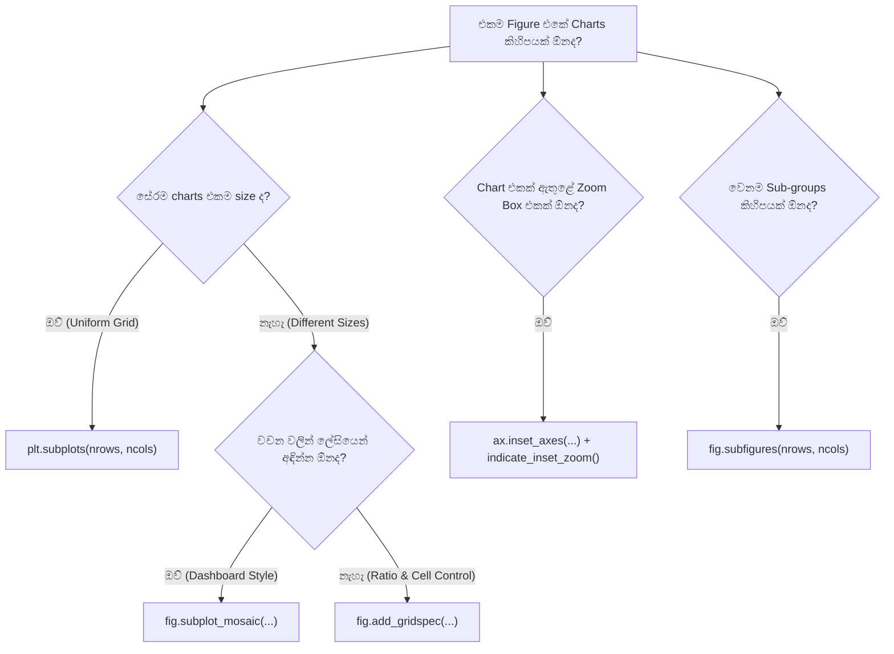
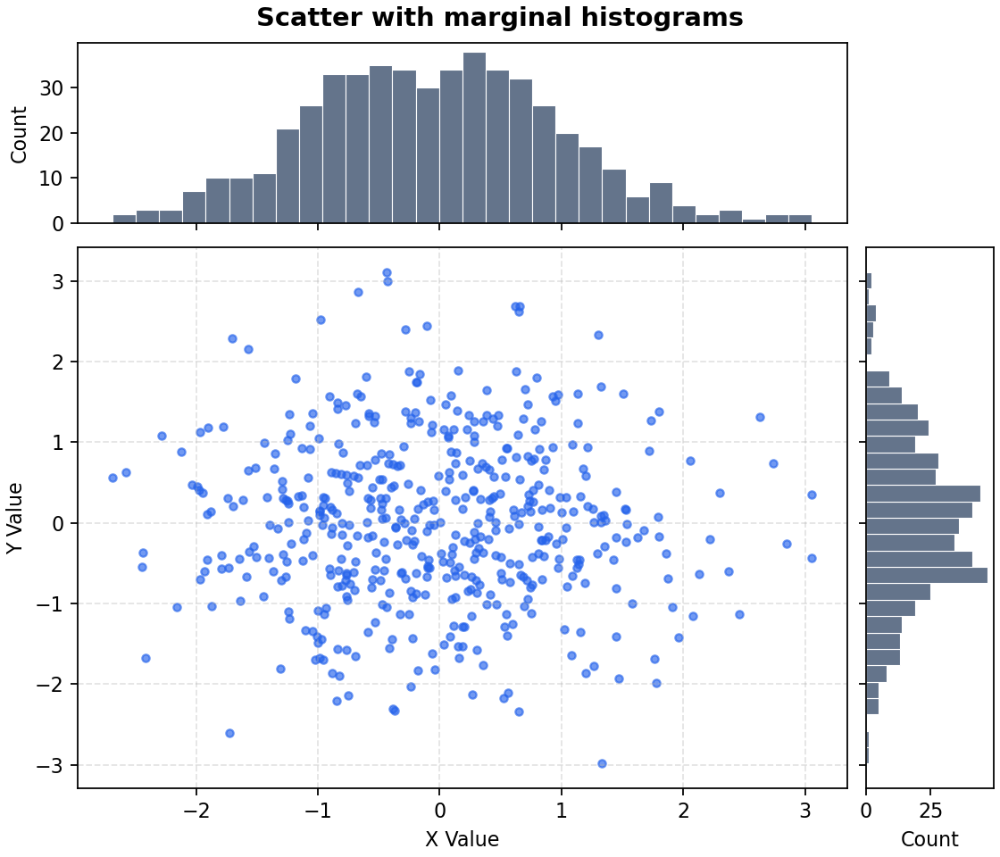
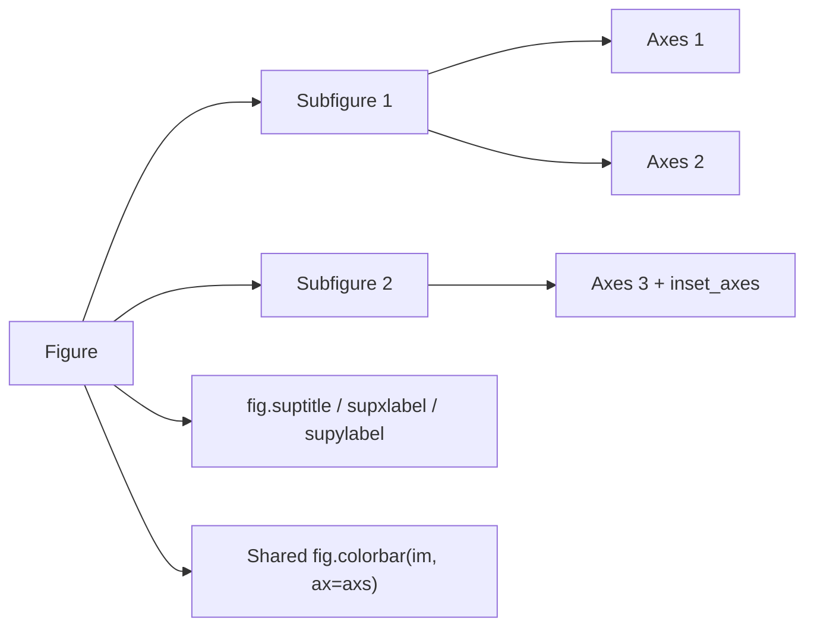

[⬅️ කලින් පාඩම: Axes Control, Ticks, Scales & Dates](04_Axes_Control_Ticks_Scales_and_Dates.md) | [🏠 මුල් පිටුව (Course Home)](README.md) | [ඊළඟ පාඩම: Statistical & Distribution Plots ➡️](06_Statistical_and_Distribution_Plots.md)

---

# පාඩම 05: Subplots සහ Layouts (Subplots and Layouts)

## 🎯 මේ පාඩමෙන් ඔයා මොනවද ඉගෙන ගන්නේ?
තනි ප්‍රස්තාරයක් (single chart) අඳිනවට වඩා, එකම `Figure` එක ඇතුළේ **ප්‍රස්තාර කිහිපයක් ලස්සනට පිළිවෙලට arrange කරන්නේ කොහොමද** කියලා අද අපි ඉගෙන ගන්නවා. 

හිතන්න ඔයා **Photo Collage** එකක් හදනවා කියලා — සමහර වෙලාවට සමාන කොටු 4ක් (2x2 grid), සමහර වෙලාවට ලොකු photo එකක් උඩින් සහ පොඩි photo 3ක් යටින් (Dashboard එකක් වගේ), නැත්නම් ලොකු photo එකක් ඇතුළේ පොඩි zoom කරපු කොටුවක් (Inset zoom). Matplotlib වල මේ හැම layout එකක්ම හදන්න සුපිරි tools තියෙනවා!

---

## 🧭 Layout එකක් තෝරගන්නේ කොහොමද? (Decision Flowchart)



---

## 1. Grid of Subplots (`plt.subplots`) — සමාන කොටු ජාලයක්

එකම ප්‍රමාණයේ ප්‍රස්තාර කිහිපයක් (මේවට **Small Multiples** කියනවා) පේළි (`nrows`) සහ තීරු (`ncols`) විදියට හදන්න `plt.subplots()` පාවිච්චි කරනවා.

```python
import matplotlib.pyplot as plt
import numpy as np

fig, axs = plt.subplots(
    nrows=2, ncols=3,
    sharex='col',      # එකම column එකේ X-axis share කරනවා
    sharey='row',      # එකම row එකේ Y-axis share කරනවා
    squeeze=False,     # 1x1 වුණත් axs හැමවෙලේම 2D array එකක් විදියට තියාගන්නවා
    figsize=(10, 6),
    constrained_layout=True
)
```

- **`sharex` / `sharey`**: `'all'` (හැමෝම), `'row'` (පේළියට), `'col'` (තීරුවට), හෝ `False`. මේකෙන් panels අතර scale එක සමාන වෙන නිසා සංසන්දනය කරන්න හරිම ලේසියි!
- **`squeeze=False`**: ඔයා `plt.subplots(1, 3)` ගැහුවොත් සාමාන්‍යයෙන් `axs` 1D array එකක් වෙනවා; `plt.subplots(1, 1)` ගැහුවොත් තනි `Axes` එකක් වෙනවා. `squeeze=False` දැම්මොත් හැමවෙලේම `axs[row, col]` විදියට index කරන්න පුළුවන් (loops ලියද්දි bugs එන්නේ නෑ!).

### 🔄 Looping over Axes (`axs.flat`)
Panel 6ක් හෝ 9ක් තියෙද්දි එකින් එක ලියන්නේ නැතුව, `axs.flat` පාවිච්චි කරලා loop එකකින් ඔක්කොම අඳින්න පුළුවන්:

```python
cols = ['Sales', 'Profit', 'Users', 'Orders', 'Returns', 'Visits']
for ax, col in zip(axs.flat, cols):
    ax.plot(np.random.randn(20).cumsum())
    ax.set_title(col)
```

---

## 2. Layout Engines සහ Manual Spacing — Overlaps නැති කරගන්න

ප්‍රස්තාර කිහිපයක් ළඟ ළඟ තියෙද්දි titles සහ axis labels එක උඩ එක වැටෙනවා (overlap වෙනවා). ඒක හදන්න ක්‍රම 3ක් තියෙනවා:

| ක්‍රමය | API | කොහොමද වැඩ කරන්නේ? |
| :--- | :--- | :--- |
| **Constrained Layout** (හොඳම ක්‍රමය!) | `plt.subplots(..., constrained_layout=True)` හෝ `layout='constrained'` | Colorbars, suptitles, legends ඔක්කොම බලලා auto space හදනවා. |
| **Tight Layout** (පරණ ක්‍රමය) | `fig.tight_layout()` | අන්තිමට call කරන්න ඕනේ. Colorbar එක්ක සමහර වෙලාවට අවුල් යනවා. |
| **Manual Spacing** | `fig.subplots_adjust(left=0.1, right=0.95, hspace=0.4, wspace=0.3)` | අතින්ම margins සහ gaps (`hspace` = height gap, `wspace` = width gap) දෙනවා. |

---

## 3. Mosaic Layouts (`subplot_mosaic`) — වචන වලින් Dashboard අඳින්න!

`subplot_mosaic` කියන්නේ Matplotlib වල තියෙන **ලේසිම සහ ලස්සනම** layout tool එක. ඔයාට අවශ්‍ය layout එක චිත්‍රයක් වගේ list එකකින් (නැත්නම් string එකකින්) නම් දීලා අඳින්න පුළුවන්!

- එකම නම කොටු දෙකක ලිව්වොත් ඒ කොටු දෙක එකතු වෙලා ලොකු panel එකක් වෙනවා.
- තිතක් (`'.'`) දැම්මොත් ඒ කොටුව **හිස්ව** තියනවා!
- Return වෙන්නේ `axd` කියලා **Python dictionary** එකක් (`axd['main']`, `axd['top']` වගේ නමින්ම access කරන්න පුළුවන්!).

### 🧪 ප්‍රධාන උදාහරණය: Scatter Plot with Marginal Histograms

```python
import matplotlib.pyplot as plt
import numpy as np

rng = np.random.default_rng(2)
x, y = rng.normal(size=500), rng.normal(size=500)

fig, axd = plt.subplot_mosaic(
    [['top', 'top', '.'],
     ['main', 'main', 'right']],
    width_ratios=[3, 3, 1], height_ratios=[1, 3],
    constrained_layout=True, figsize=(7, 6), sharex=False)

axd['main'].scatter(x, y, s=10, alpha=.6)
axd['top'].hist(x, bins=30, color='gray')
axd['right'].hist(y, bins=30, orientation='horizontal', color='gray')
axd['top'].set_xticklabels([])
axd['right'].set_yticklabels([])
fig.suptitle('Scatter with marginal histograms')
plt.show()
```

### 🔍 පේළියෙන් පේළිය පැහැදිලි කිරීම (Line-by-Line)
1. `rng = np.random.default_rng(2)`: එකම random numbers ටික හැමපාරම එන්න seed එක `2` දීලා generator එක හදනවා.
2. `x, y = rng.normal(size=500), rng.normal(size=500)`: Normal distribution එකෙන් points 500 බැගින් හදනවා.
3. `[['top', 'top', '.'], ['main', 'main', 'right']]`:
   - පළවෙනි පේළියේ වම් කොටු දෙක `'top'`, දකුණු කොටුව `'.'` (හිස්).
   - දෙවෙනි පේළියේ වම් කොටු දෙක `'main'`, දකුණු කොටුව `'right'`.
4. `width_ratios=[3, 3, 1], height_ratios=[1, 3]`: `'main'` එක ලොකුවටත්, `'top'` සහ `'right'` histograms සිහින්වත් තියන්න අනුපාත දෙනවා.
5. `axd['main'].scatter(...)`: මැද ලොකු කොටුවේ scatter plot එක අඳිනවා.
6. `axd['top'].hist(...)` සහ `axd['right'].hist(..., orientation='horizontal')`: උඩින් X වල histogram එකත්, දකුණෙන් Y වල තිරස් histogram එකත් අඳිනවා.
7. `set_xticklabels([])` / `set_yticklabels([])`: අනවශ්‍ය tick numbers අයින් කරලා chart එක clean කරනවා.
8. `fig.suptitle(...)`: මුළු Figure එකටම පොදු මාතෘකාවක් දානවා.

### 🖼️ බලාපොරොත්තු වන ප්‍රතිඵලය (Expected Output)


---

## 4. `GridSpec` සහ `GridSpecFromSubplotSpec` — සංකීර්ණ ජාල (Fine-Grained Grids)

`subplot_mosaic` වල යටින් වැඩ කරන engine එක තමයි `GridSpec`. ඔයාට slice notation (`gs[0, :2]`) පාවිච්චි කරලා හෝ Grid එකක් ඇතුළේ තවත් Grid එකක් (`GridSpecFromSubplotSpec`) හදන්න ඕන වුණාම මේක පාවිච්චි කරනවා.

```python
import matplotlib.gridspec as gridspec

fig = plt.figure(figsize=(9, 5), constrained_layout=True)
gs = fig.add_gridspec(2, 3, width_ratios=[2, 1, 1], height_ratios=[1, 2])

ax_main = fig.add_subplot(gs[:, 0])    # වම්පස පේළි 2ම අල්ලගන්නවා
ax_top  = fig.add_subplot(gs[0, 1:])   # උඩ දකුණු කොටු 2
# යට දකුණු කොටුව ඇතුළේ තවත් 1x2 sub-grid එකක්:
sub_gs = gridspec.GridSpecFromSubplotSpec(1, 2, subplot_spec=gs[1, 1:])
ax_b1 = fig.add_subplot(sub_gs[0, 0])
ax_b2 = fig.add_subplot(sub_gs[0, 1])
```

---

## 5. `add_axes`, `inset_axes`, සහ `indicate_inset_zoom` — Zoom Panels!

සමහර වෙලාවට ඔයාට chart එකේ ඕනම තැනක අලුත් `Axes` එකක් තියන්න හෝ chart එකේ පොඩි කොටසක් **Magnifying Glass (අත්කාචයක්)** එකකින් බලනවා වගේ zoom කරලා පෙන්නන්න ඕනේ.

- **`fig.add_axes([left, bottom, width, height])`**: Figure එකේ 0 සිට 1 දක්වා fraction වලින් ඕනම තැනක Axes එකක් හදනවා (උදා: `[0.15, 0.55, 0.3, 0.3]`).
- **`ax.inset_axes([x0, y0, width, height])`**: දැනට තියෙන `ax` එක ඇතුළේම පොඩි Zoom panel එකක් හදනවා.
- **`ax.indicate_inset_zoom(axins, edgecolor="black")`**: Main chart එකේ zoom කරපු තැන වටේට කොටුවක් ඇඳලා, ඒක inset box එකට ඉරි දෙකකින් සම්බන්ධ කරනවා!

```python
fig, ax = plt.subplots(figsize=(7, 4))
t = np.linspace(0, 10, 500)
y = np.sin(t) + 0.3 * np.exp(-((t - 5.0) / 0.15)**2)
ax.plot(t, y)

# Zoom panel එකක් හදමු (right-top corner)
axins = ax.inset_axes([0.58, 0.52, 0.38, 0.4])
axins.plot(t, y, color='crimson')
axins.set_xlim(4.4, 5.6)
axins.set_ylim(-1.1, -0.4)
ax.indicate_inset_zoom(axins, edgecolor='black')
```

---

## 6. Sub-figures, Figure-Level Text, Shared Colorbars & `axes_grid1`

ලොකු research papers හෝ reports හදද්දි මේ advanced features හරිම වටිනවා:

1. **Sub-figures (`fig.subfigures(nrows, ncols)`)**:
   එක `Figure` එකක් ඇතුළේ වෙනම පසුබිම් පාටවල්, වෙනම `suptitle` තියෙන **nested figure groups** හදන්න පුළුවන්.
   ```python
   fig = plt.figure(constrained_layout=True, figsize=(10, 4))
   subfigs = fig.subfigures(1, 2, wspace=0.07)
   subfigs[0].set_facecolor('#f1f5f9')
   subfigs[0].suptitle('Group A: Sensor Data')
   axs_left = subfigs[0].subplots(2, 1)
   ```

2. **Figure-Level Text (`fig.suptitle`, `fig.supxlabel`, `fig.supylabel`)**:
   හැම subplot එකේම "Time (s)" කියලා ආයේ ආයේ ලියන්නේ නැතුව, මුළු Figure එකටම පොදු X label, Y label සහ Title එකක් දානවා:
   ```python
   fig.suptitle('Quarterly Performance 2026')
   fig.supxlabel('Month')
   fig.supylabel('Revenue (LKR Millions)')
   ```

3. **Shared Colorbar (`fig.colorbar(im, ax=axs)`)**:
   Heatmaps 4ක් තියෙද්දි (ඔක්කොගෙම `vmin`, `vmax` සමාන නම්) හැම එකටම colorbar දාන්නේ නැතුව `ax=axs` (මුළු array එකම) දීලා **එක පොදු colorbar එකක්** දාන්න පුළුවන්.

4. **Axes Grid Helpers (`mpl_toolkits.axes_grid1`)**:
   - `make_axes_locatable(ax)`: Image එකක හරියටම ඒ උසටම colorbar එකක් හෝ side-panel එකක් align කරලා අලවන්න පාවිච්චි කරනවා.
   - `ImageGrid`: Image galleries වල එකම aspect ratio සහ එකම colorbar එකක් තියාගන්න හදපු specialized grid එකක්.



---

## 🧠 මතක තබා ගැනීමට පහසු ක්‍රම (Memory Hacks)
- **Mosaic = Lego / Tetris Map**: 2D list එකක් ඇතුළේ අකුරු ලියලා layout අඳිනවා. `'.'` කියන්නේ හිස් කොටුවක්!
- **`sup` = Super (Figure-level)**: `ax.set_xlabel` තනි chart එකට, `fig.supxlabel` මුළු Figure එකටම!
- **`constrained_layout=True` හැමවෙලේම දාන්න**: `tight_layout()` වලට වඩා නවීනයි, colorbars සහ suptitles එක්ක හොඳටම වැඩ කරනවා.

---

## ⚠️ සාමාන්‍යයෙන් වෙන වැරදි (Common Pitfalls)

> [!WARNING]
> **1. `plt.subplots(1, 3)` වල `axs[0, 1]` ගහලා `IndexError` එනවා!**
> Row 1ක් හෝ Column 1ක් විතරක් තියෙද්දි `axs` 1D array එකක් වෙනවා (`axs[1]` විතරයි පුළුවන්). ඒක වළක්වන්න `squeeze=False` දාන්න, නැත්නම් `axs.flat` පාවිච්චි කරන්න.

> [!WARNING]
> **2. `constrained_layout=True` සහ `tight_layout()` දෙකම එකට දාන්න එපා!**
> දෙකම එකට දැම්මොත් layout engine එක අවුල් වෙලා warnings එනවා. එකක් විතරක් (`constrained_layout=True`) තෝරගන්න.

> [!WARNING]
> **3. Shared Colorbar දාද්දි `vmin` / `vmax` සමාන නොකිරීම!**
> Panel 4කට එක colorbar එකක් දැම්මට, ඒ panels 4 වෙනස් scales වලින් ඇඳලා තිබුණොත් colorbar එක බොරු තොරතුරු පෙන්නනවා. හැම panel එකටම එකම `vmin` සහ `vmax` දෙන්න!

---

## 🏋️ ප්‍රායෝගික අභ්‍යාස (Practical Exercises)

### Warm-up Exercise:
`plt.subplots(2, 2, constrained_layout=True)` පාවිච්චි කරලා $y = x$, $y = x^2$, $y = x^3$, සහ $y = \sqrt{x}$ ($x \in [0, 5]$) එකම Figure එකේ අඳින්න. `fig.suptitle`, `fig.supxlabel`, `fig.supylabel` එකතු කරන්න.

<details>
<summary>✅ පිළිතුර බලන්න (Click to see Solution)</summary>

```python
import matplotlib.pyplot as plt
import numpy as np

x = np.linspace(0, 5, 100)
funcs = [('y = x', x), ('y = x^2', x**2), ('y = x^3', x**3), ('y = sqrt(x)', np.sqrt(x))]

fig, axs = plt.subplots(2, 2, figsize=(8, 6), constrained_layout=True)
for ax, (title, y) in zip(axs.flat, funcs):
    ax.plot(x, y, linewidth=2)
    ax.set_title(title)
    ax.grid(True, alpha=0.3)

fig.suptitle('Basic Mathematical Functions', fontsize=14)
fig.supxlabel('X Value')
fig.supylabel('Y Value')
plt.show()
```
</details>

### Exercise 1:
Draw a 3x3 grid of small multiples for nine categories with shared axes and one common legend.

<details>
<summary>✅ පිළිතුර බලන්න (Click to see Solution)</summary>

```python
import matplotlib.pyplot as plt
import numpy as np

rng = np.random.default_rng(10)
x = np.arange(1, 13)
categories = [f'Category {i}' for i in range(1, 10)]

fig, axs = plt.subplots(3, 3, figsize=(10, 8), sharex=True, sharey=True, constrained_layout=True)

for ax, cat in zip(axs.flat, categories):
    actual = np.cumsum(rng.normal(2, 3, size=12)) + 20
    target = np.linspace(20, 42, 12)
    ax.plot(x, actual, marker='o', markersize=3, label='Actual')
    ax.plot(x, target, linestyle='--', label='Target')
    ax.set_title(cat, fontsize=10)
    ax.grid(True, alpha=0.25)

# පළවෙනි axes එකෙන් handles සහ labels අරගෙන Figure එකටම පොදු legend එකක් දානවා
handles, labels = axs[0, 0].get_legend_handles_labels()
fig.legend(handles, labels, loc='upper right', ncol=2)
fig.suptitle('3x3 Small Multiples: Actual vs Target', fontsize=13)
fig.supxlabel('Month')
fig.supylabel('Units Sold')
plt.show()
```
</details>

### Exercise 2:
Build a dashboard layout with `subplot_mosaic`: one wide time series on top and three small charts below.

<details>
<summary>✅ පිළිතුර බලන්න (Click to see Solution)</summary>

```python
import matplotlib.pyplot as plt
import numpy as np

rng = np.random.default_rng(7)
days = np.arange(1, 61)
revenue = 100 + np.cumsum(rng.normal(0.8, 3, 60))

fig, axd = plt.subplot_mosaic(
    [['ts', 'ts', 'ts'],
     ['bar', 'hist', 'scatter']],
    height_ratios=[1.5, 1],
    figsize=(11, 6),
    constrained_layout=True
)

axd['ts'].plot(days, revenue, color='#2563eb', linewidth=2)
axd['ts'].set_title('Daily Revenue (60 Days)')
axd['ts'].set_ylabel('Revenue ($k)')
axd['ts'].grid(True, alpha=0.3)

axd['bar'].bar(['Q1', 'Q2', 'Q3', 'Q4'], [45, 52, 61, 70], color='#10b981')
axd['bar'].set_title('Quarterly Summary')

axd['hist'].hist(rng.normal(50, 10, 300), bins=20, color='#f59e0b', edgecolor='white')
axd['hist'].set_title('Order Size Distribution')

axd['scatter'].scatter(rng.normal(size=100), rng.normal(size=100), alpha=0.6, color='#8b5cf6')
axd['scatter'].set_title('Customer Segments')

fig.suptitle('Executive Sales Dashboard', fontsize=14, fontweight='bold')
plt.show()
```
</details>

### Exercise 3:
Add a zoomed inset to a time series showing a short spike.

<details>
<summary>✅ පිළිතුර බලන්න (Click to see Solution)</summary>

```python
import matplotlib.pyplot as plt
import numpy as np

t = np.linspace(0, 24, 1000)
# සාමාන්‍ය signal එක + t=14.2 ළඟ පොඩි sharp spike එකක්
signal = 10 + 1.5 * np.sin(t) + 12 * np.exp(-((t - 14.2) / 0.08)**2)

fig, ax = plt.subplots(figsize=(9, 4.5), constrained_layout=True)
ax.plot(t, signal, color='#0f172a', linewidth=1.2)
ax.set_title('24-Hour Server CPU Load with Anomaly Spike')
ax.set_xlabel('Hour of Day')
ax.set_ylabel('CPU Load (%)')
ax.grid(True, alpha=0.3)

# Zoomed inset panel එක
axins = ax.inset_axes([0.12, 0.45, 0.35, 0.45])
axins.plot(t, signal, color='#dc2626', linewidth=1.5)
axins.set_xlim(13.8, 14.6)
axins.set_ylim(9, 25)
axins.set_title('Zoom: 13.8h - 14.6h', fontsize=9)
axins.grid(True, alpha=0.3)

ax.indicate_inset_zoom(axins, edgecolor='#dc2626', linewidth=1.2)
plt.show()
```
</details>

---

## 📋 Cheat Sheet (සාරාංශ වගුව)

| අවශ්‍යතාවය (Task) | Key API |
| :--- | :--- |
| සමාන grid එකක් හදන්න | `fig, axs = plt.subplots(r, c, sharex='col', sharey='row', squeeze=False)` |
| Overlaps auto හදන්න | `constrained_layout=True` හෝ `layout='constrained'` |
| අතින් spacing හදන්න | `fig.subplots_adjust(left, right, hspace, wspace)` |
| වචන වලින් dashboard හදන්න | `fig, axd = plt.subplot_mosaic([['A','A'],['B','C']])` |
| විවිධ size cells (ratios) | `fig.add_gridspec(r, c, width_ratios=, height_ratios=)` / `GridSpecFromSubplotSpec` |
| ඕනම තැනක Axes එකක් | `fig.add_axes([l, b, w, h])` / `fig.add_subplot(...)` |
| Zoom inset panel එකක් | `ax.inset_axes([x, y, w, h])` + `ax.indicate_inset_zoom(axins)` |
| Nested figure groups | `fig.subfigures(nrows, ncols)` |
| Figure-level labels | `fig.suptitle()`, `fig.supxlabel()`, `fig.supylabel()` |
| Shared colorbar | `fig.colorbar(im, ax=axs)` |
| Image gallery / aligned bar | `mpl_toolkits.axes_grid1.make_axes_locatable`, `ImageGrid` |
| හැම Axes එකක්ම loop කරන්න | `for ax, col in zip(axs.flat, cols):` |

---

[⬅️ කලින් පාඩම: Axes Control, Ticks, Scales & Dates](04_Axes_Control_Ticks_Scales_and_Dates.md) | [🏠 මුල් පිටුව (Course Home)](README.md) | [ඊළඟ පාඩම: Statistical & Distribution Plots ➡️](06_Statistical_and_Distribution_Plots.md)
