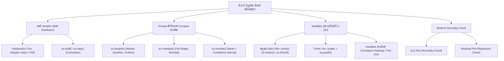
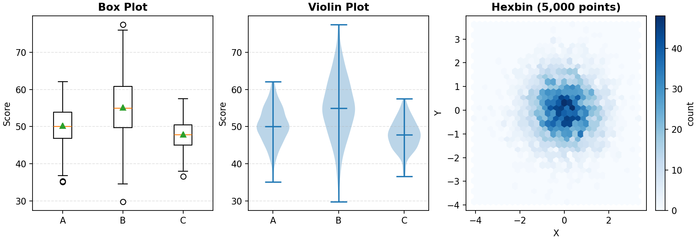

[⬅️ කලින් පාඩම: Subplots & Layouts](05_Subplots_and_Layouts.md) | [🏠 මුල් පිටුව (Course Home)](README.md) | [ඊළඟ පාඩම: 2D Data, Images, Heatmaps & Colormaps ➡️](07_2D_Data_Images_Heatmaps_Contours_Colormaps.md)

---

# පාඩම 06: Statistical සහ Distribution Plots (Statistical and Distribution Plots)

## 🎯 මේ පාඩමෙන් ඔයා මොනවද ඉගෙන ගන්නේ?
දත්ත සමූහයක (dataset එකක) **සාමාන්‍යය (mean)** විතරක් බැලුවොත් අපි රැවටෙන්න පුළුවන්! උදාහරණයක් විදියට, පන්ති දෙකකම ලකුණු වල average එක 60ක් වෙන්න පුළුවන් — හැබැයි එක පන්තියක හැමෝටම 58–62 අතර, අනිත් පන්තියේ භාගෙකට 20යි, භාගෙකට 100යි!

දත්ත පැතිරිලා තියෙන විදිය (**distribution**), විශේෂ අගයන් (**outliers**), අවිනිශ්චිතතාවය (**error bars**), සහ දත්ත අතර සම්බන්ධතා (**correlation & regression**) පැහැදිලිව බලාගන්න පුළුවන් Statistical Plots සේරම අද අපි ඉගෙන ගන්නවා.

---

## 🧭 මොන Statistical Plot එකද තෝරගන්නේ?



---

## 1. Box Plot, Violin Plot, සහ Hexbin — ප්‍රධාන තුන්දෙනා!

### 📦 Box Plot (`ax.boxplot`)
දත්ත සමූහයක **සාරාංශය (5-number summary)** එක පාරින් පෙන්නනවා:
- මැද ඉර = **Median** (50% මැද අගය)
- පෙට්ටිය (Box) = **Q1 (25%) සිට Q3 (75%)** දක්වා (මැද 50% දත්ත)
- උඩ/යට කෙඳි (Whiskers) = සාමාන්‍ය දත්ත සීමාව
- තනි තිත් = **Outliers** (අසාමාන්‍ය ලොකු/පොඩි අගයන්)
- `showmeans=True` දැම්මොත් **Mean** එකත් පෙන්නනවා; `notch=True` දැම්මොත් median එකේ confidence interval එක පෙන්නනවා.

### 🎻 Violin Plot (`ax.violinplot`)
Box plot එකේ පොඩි අඩුවක් තියෙනවා: දත්ත කඳු දෙකක් විදියට (**bimodal**) බෙදිලා තිබුණත් Box plot එකට ඒක පේන්නේ නැහැ! Violin plot එකෙන් **මුළු distribution එකේම හැඩය** වයලීනයක් වගේ දෙපැත්තටම පෙන්නනවා. `showmedians=True` දාලා මැද අගයත් ලකුණු කරන්න පුළුවන්.

### 🐝 2D Histogram & Hexbin (`ax.hist2d`, `ax.hexbin`)
Points 5,000ක් හෝ 1,000,000ක් `scatter()` ගැහුවොත් ඔක්කොම තිත් එක උඩ එක වැටිලා තනි නිල් පාට බෝලයක් වගේ පේනවා (**overplotting**). ඒකට විසඳුම තමයි මී වදයක් වගේ කොටු (hexagons) වලට කඩලා, එක් එක් කොටුවේ points කීයක් තියෙනවද කියලා පාටින් පෙන්නන **`ax.hexbin()`** (නැත්නම් හතරැස් කොටු වලට **`ax.hist2d()`**).

### 🧪 ප්‍රධාන උදාහරණය: Box vs Violin vs Hexbin

```python
import matplotlib.pyplot as plt
import numpy as np

rng = np.random.default_rng(4)
groups = [rng.normal(m, s, 200) for m, s in [(50, 5), (55, 8), (48, 4)]]

fig, axs = plt.subplots(1, 3, figsize=(11, 3.5), constrained_layout=True)

axs[0].boxplot(groups, tick_labels=['A', 'B', 'C'], showmeans=True)
axs[0].set_title('Box')

axs[1].violinplot(groups, showmedians=True)
axs[1].set_xticks([1, 2, 3], ['A', 'B', 'C'])
axs[1].set_title('Violin')

x, y = rng.normal(size=5000), rng.normal(size=5000)
hb = axs[2].hexbin(x, y, gridsize=30, cmap='Blues')
fig.colorbar(hb, ax=axs[2], label='count')
axs[2].set_title('Hexbin')
plt.show()
```

### 🔍 පේළියෙන් පේළිය පැහැදිලි කිරීම (Line-by-Line)
1. `groups = [rng.normal(m, s, 200) ...]`: Mean සහ Standard Deviation වෙනස් groups 3ක් (A, B, C) හදනවා.
2. `axs[0].boxplot(groups, tick_labels=['A', 'B', 'C'], showmeans=True)`: Box plot එක අඳිනවා. `showmeans=True` නිසා කොළ පාට ත්‍රිකෝණයකින් mean එකත් පේනවා.
3. `axs[1].violinplot(groups, showmedians=True)`: Violin plot එක අඳිනවා. `violinplot` එකේ `tick_labels` parameter එක නැති නිසා ඊළඟ පේළියේ `set_xticks([1, 2, 3], ['A', 'B', 'C'])` දානවා.
4. `hb = axs[2].hexbin(x, y, gridsize=30, cmap='Blues')`: Points 5,000ක් hexagon කොටු 30ක grid එකකට දාලා density එක නිල් පාටින් පෙන්නනවා.
5. `fig.colorbar(hb, ax=axs[2], label='count')`: තද පාට කියන්නේ points කීයක්ද කියලා බලන්න colorbar එකක් එකතු කරනවා.

### 🖼️ බලාපොරොත්තු වන ප්‍රතිඵලය (Expected Output)


---

## 2. Histogram Variants, ECDF, සහ Kernel Density (KDE)

- **Step & Density Histogram**: Groups කිහිපයක histograms එක උඩ එක අඳිද්දි පාට පිරුණු bars දැම්මොත් යට එක වැහෙනවා. ඒ වෙනුවට `histtype='step'` (outline එක විතරයි) සහ `density=True` (මුළු area එක 1 කරනවා) පාවිච්චි කරන්න.
- **Cumulative & Survival Curves (`cumulative=True`, `ax.ecdf`, `ax.step`)**:
  "ලකුණු 70ට අඩු ළමයි ප්‍රතිශතය කීයද?" වගේ ප්‍රශ්න වලට **ECDF (Empirical Cumulative Distribution Function)** සුපිරි! නවීන Matplotlib වල `ax.ecdf(data)` කෙලින්ම තියෙනවා. Time-to-event (reliability / survival) curves වලට `ax.step()` පාවිච්චි කරනවා.
- **Kernel Density (KDE)**: Histogram එකේ කොටු ගතිය නැති කරලා සුමට curve එකක් අඳින්න SciPy (`scipy.stats.gaussian_kde`) හෝ pandas වලින් density එක හදලා `ax.plot()` + `ax.fill_between()` කරනවා.

```python
fig, (ax1, ax2) = plt.subplots(1, 2, figsize=(9, 3.5), constrained_layout=True)

# 1. Overlaid step histograms (density=True)
ax1.hist(groups[0], bins=20, density=True, histtype='step', linewidth=2, label='Group A')
ax1.hist(groups[1], bins=20, density=True, histtype='step', linewidth=2, label='Group B')
ax1.legend(); ax1.set_title('Overlaid Density Step Histograms')

# 2. ECDF (Empirical Cumulative Distribution)
ax2.ecdf(groups[0], label='Group A')
ax2.ecdf(groups[1], label='Group B')
ax2.legend(); ax2.set_title('ECDF (Cumulative Share)')
```

---

## 3. Error Bars (`ax.errorbar`) — අවිනිශ්චිතතාවය පෙන්නමු

විද්‍යාත්මක පරීක්ෂණ වලදී Mean එක විතරක් නෙවෙයි, ඒකේ **Standard Error** හෝ **95% Confidence Interval** එකත් පෙන්නන්න ඕනේ.

```python
x = np.arange(3)
means = [g.mean() for g in groups]
sems = [g.std(ddof=1) / np.sqrt(len(g)) for g in groups]
ci95 = [1.96 * s for s in sems]

fig, ax = plt.subplots(figsize=(5, 3.5))
ax.errorbar(x, means, yerr=ci95, fmt='o', capsize=5, color='#2563eb', ecolor='#ef4444')
ax.set_xticks(x, ['Group A', 'Group B', 'Group C'])
ax.set_ylabel('Mean ± 95% CI')
```
- `fmt='o'`: දත්ත ලක්ෂ්‍යය තිතක් විදියට පෙන්නනවා (ඉරක් ඕනේ නම් `fmt='-o'`).
- `capsize=5`: Error bar එකේ උඩ සහ යට පොඩි තිරස් ඉරි කෑලි (caps) දානවා.

---

## 4. Regression, Residuals, සහ Q-Q Plots (Model Checks)

Machine Learning හෝ Statistics වලදී model එක හරියට වැඩද කියලා බලන්න මේ plots 3 හරිම වැදගත්:

1. **Scatter with Regression Line (`np.polyfit`)**:
   ```python
   m, b = np.polyfit(x_data, y_data, deg=1)   # 1st degree = සරල රේඛාවක් (y = mx + b)
   ax.scatter(x_data, y_data, alpha=0.6)
   ax.plot(x_data, m * x_data + b, color='red', label=f'y = {m:.2f}x + {b:.2f}')
   ```

2. **Residual Plot**:
   ඇත්ත අගයයි, predict කරපු අගයයි අතර වෙනස (`residual = y_actual - y_pred`) Y-axis එකටත්, `y_pred` X-axis එකටත් දාලා අඳිනවා. `ax.axhline(0, linestyle='--')` වටේට තිත් අහඹු විදියට (random) පැතිරිලා නම් model එක හොඳයි!

3. **Q-Q Plot (Quantile-Quantile Plot)**:
   ඔයාගේ data ටික **Normal Distribution (Bell Curve)** එකකට සමානද කියලා බලන්න පාවිච්චි කරනවා. Sort කරපු data ටික theoretical normal quantiles එක්ක plot කරාම, තිත් සේරම **කෙළින් ඉරක් (45° diagonal line)** දිගේ තියෙනවා නම් data Normal!

---

## 5. Correlation Matrix, Pair Grids, සහ Seaborn Shortcuts

- **Correlation Matrix**: `np.corrcoef(data, rowvar=False)` වලින් correlation table එක හදලා `ax.imshow(corr, cmap='coolwarm', vmin=-1, vmax=1)` ඇඳලා, හැම කොටුවක් ඇතුළෙම `ax.text(j, i, f'{corr[i, j]:.2f}')` දාලා අගය ලියනවා.
- **Pair Grids**: Columns $k$ ගණනක් තියෙද්දි $k \times k$ subplots grid එකක් හදලා, diagonal එකේ histograms සහ අනිත් කොටු වල scatter plots අඳිනවා.
- **Statistical Shortcuts (`seaborn`)**: Seaborn කියන්නේ **Matplotlib උඩින්ම හදපු** statistical library එකක්! `sns.boxplot`, `sns.violinplot`, `sns.kdeplot`, `sns.pairplot`, `sns.regplot` වගේ ඒවායින් පේළි 1කින් මේ සංකීර්ණ charts අඳින්න පුළුවන් — ඊටපස්සේ Matplotlib `ax` methods වලින්ම customize කරන්න පුළුවන්!

---

## 🧠 මතක තබා ගැනීමට පහසු ක්‍රම (Memory Hacks)
- **Box = Skeleton (ඇටසැකිල්ල)**, **Violin = Full Body (සම්පූර්ණ හැඩය)**: දත්ත වල කඳු දෙකක් (bimodal) තියෙනවද බලන්න නම් හැමවෙලේම Violin!
- **Scatter > 5,000 points? → Switch to Hexbin!** (මී වදේ වගේ density පෙන්නනවා).
- **Q-Q Plot = Straight Line = Normal!** ඉරෙන් පිට පැනලා නම් skewed හෝ heavy-tailed data.

---

## ⚠️ සාමාන්‍යයෙන් වෙන වැරදි (Common Pitfalls)

> [!WARNING]
> **1. `boxplot(..., labels=...)` vs `tick_labels=...`!**
> නවීන Matplotlib (3.9+) වල `labels` parameter එක `tick_labels` කියලා rename කරලා තියෙනවා. පරණ code copy කරද්දි `MatplotlibDeprecationWarning` ආවොත් `tick_labels=` පාවිච්චි කරන්න!

> [!WARNING]
> **2. `violinplot` එකට `tick_labels=` දාන්න බැහැ!**
> `boxplot` එකේ වගේ `violinplot` එකේ `tick_labels` නැහැ. ඒ නිසා අනිවාර්යයෙන්ම `ax.set_xticks([1, 2, 3], ['A', 'B', 'C'])` වෙනම call කරන්න.

> [!WARNING]
> **3. Sample sizes වෙනස් Groups වල Histograms `density=False` තියලා Compare කිරීම!**
> Group A එකේ 100ක් සහ Group B එකේ 10,000ක් ඉන්නකොට raw counts plot කරොත් Group A එක බිමටම ඇලිලා පේන්නේ නැතුව යනවා. හැමවෙලේම `density=True` දාන්න!

---

## 🏋️ ප්‍රායෝගික අභ්‍යාස (Practical Exercises)

### Warm-up Exercise:
Random normal data 1,000ක් හදලා එකම Figure එකේ වම්පස `ax.hist(..., density=True)` සහ දකුණුපස `ax.ecdf(...)` අඳින්න.

<details>
<summary>✅ පිළිතුර බලන්න (Click to see Solution)</summary>

```python
import matplotlib.pyplot as plt
import numpy as np

rng = np.random.default_rng(1)
data = rng.normal(loc=100, scale=15, size=1000)

fig, (ax1, ax2) = plt.subplots(1, 2, figsize=(9, 3.8), constrained_layout=True)
ax1.hist(data, bins=30, density=True, color='#3b82f6', alpha=0.7, edgecolor='white')
ax1.set_title('Density Histogram')
ax1.set_xlabel('Value')

ax2.ecdf(data, color='#10b981', linewidth=2)
ax2.set_title('Empirical CDF (ECDF)')
ax2.set_xlabel('Value')
ax2.set_ylabel('Cumulative Probability')
ax2.grid(True, alpha=0.3)
plt.show()
```
</details>

### Exercise 1:
Compare three groups using box and violin plots side by side and explain what each reveals.

<details>
<summary>✅ පිළිතුර බලන්න (Click to see Solution)</summary>

```python
import matplotlib.pyplot as plt
import numpy as np

rng = np.random.default_rng(42)
g1 = rng.normal(50, 6, 300)
# Bimodal group (කඳු දෙකක් තියෙන data!)
g2 = np.concatenate([rng.normal(42, 3, 150), rng.normal(58, 3, 150)])
g3 = rng.exponential(scale=12, size=300) + 38  # Skewed data
groups = [g1, g2, g3]
names = ['Normal', 'Bimodal', 'Skewed']

fig, (ax1, ax2) = plt.subplots(1, 2, figsize=(10, 4.2), constrained_layout=True)

ax1.boxplot(groups, tick_labels=names, showmeans=True)
ax1.set_title('Box Plot (Summary & Outliers)')
ax1.grid(True, axis='y', alpha=0.3)

ax2.violinplot(groups, showmedians=True)
ax2.set_xticks([1, 2, 3], names)
ax2.set_title('Violin Plot (Full Distribution Shape)')
ax2.grid(True, axis='y', alpha=0.3)

plt.show()
# පැහැදිලි කිරීම:
# Box plot එකේ Normal සහ Bimodal දෙකම එක වගේ පෙනුනත්,
# Violin plot එකේ Bimodal group එකේ කඳු දෙකක් (hourglass shape) තියෙන බව පැහැදිලිවම පේනවා!
# Box plot එකෙන් Skewed group එකේ outliers පැහැදිලිව තිත් විදියට පෙන්නනවා.
```
</details>

### Exercise 2:
Draw a hexbin of 1 million points and add a colourbar labelled with counts.

<details>
<summary>✅ පිළිතුර බලන්න (Click to see Solution)</summary>

```python
import matplotlib.pyplot as plt
import numpy as np

rng = np.random.default_rng(99)
x = rng.normal(size=1_000_000)
y = 0.6 * x + rng.normal(scale=0.8, size=1_000_000)

fig, ax = plt.subplots(figsize=(6.5, 5.5), constrained_layout=True)
hb = ax.hexbin(x, y, gridsize=50, cmap='inferno', mincnt=1)
fig.colorbar(hb, ax=ax, label='Point Count')
ax.set_title('Hexbin of 1,000,000 Points')
ax.set_xlabel('X')
ax.set_ylabel('Y')
plt.show()
```
</details>

### Exercise 3:
Plot means with 95% confidence intervals using `errorbar`.

<details>
<summary>✅ පිළිතුර බලන්න (Click to see Solution)</summary>

```python
import matplotlib.pyplot as plt
import numpy as np

rng = np.random.default_rng(12)
samples = [rng.normal(m, s, 80) for m, s in [(72, 10), (78, 12), (69, 8), (84, 14)]]
labels = ['Method A', 'Method B', 'Method C', 'Method D']

means = [s.mean() for s in samples]
ci95 = [1.96 * s.std(ddof=1) / np.sqrt(len(s)) for s in samples]

fig, ax = plt.subplots(figsize=(6.5, 4), constrained_layout=True)
ax.errorbar(range(len(labels)), means, yerr=ci95, fmt='o', capsize=6,
            linewidth=2, markersize=7, color='#2563eb', ecolor='#dc2626')
ax.set_xticks(range(len(labels)), labels)
ax.set_ylabel('Score (Mean ± 95% CI)')
ax.set_title('Experiment Results with 95% Confidence Intervals')
ax.grid(True, axis='y', linestyle='--', alpha=0.35)
plt.show()
```
</details>

### Exercise 4:
Build a Q-Q plot for a sample and judge normality.

<details>
<summary>✅ පිළිතුර බලන්න (Click to see Solution)</summary>

```python
import matplotlib.pyplot as plt
import numpy as np

rng = np.random.default_rng(5)
sample = np.sort(rng.normal(loc=50, scale=10, size=200))

# Theoretical normal quantiles (SciPy නැතුවත් numpy වලින් හදන්න පුළුවන්,
# නැත්නම් scipy.stats.norm.ppf පාවිච්චි කරන්න පුළුවන්)
try:
    from scipy.stats import norm
    probs = (np.arange(1, len(sample) + 1) - 0.5) / len(sample)
    theo_q = norm.ppf(probs)
except ImportError:
    theo_q = np.sort(rng.normal(size=len(sample)))

fig, ax = plt.subplots(figsize=(5.5, 5), constrained_layout=True)
ax.scatter(theo_q, sample, s=18, alpha=0.75, label='Sample Quantiles')

# Reference straight line (mean + std * z)
line_x = np.array([theo_q.min(), theo_q.max()])
ax.plot(line_x, sample.mean() + sample.std() * line_x, color='crimson',
        linestyle='--', linewidth=1.8, label='Normal Reference Line')

ax.set_title('Q-Q Plot (Normality Check)')
ax.set_xlabel('Theoretical Normal Quantiles')
ax.set_ylabel('Sample Quantiles')
ax.legend()
ax.grid(True, alpha=0.3)
plt.show()
# නිගමනය: තිත් සේරම රතු කෙළින් ඉර ළඟින්ම යන නිසා මේ sample එක Normal distribution එකකට ගැලපෙනවා!
```
</details>

---

## 📋 Cheat Sheet (සාරාංශ වගුව)

| Plot එක | Method / API | පෙන්නන්නේ මොකක්ද? |
| :--- | :--- | :--- |
| Box plot | `ax.boxplot(data, tick_labels=, showmeans=, notch=)` | Median, quartiles, outliers |
| Violin plot | `ax.violinplot(data, showmedians=True)` | සම්පූර්ණ distribution හැඩය (bimodal) |
| Histogram variants | `ax.hist(histtype='step', density=True, cumulative=True)` | Overlaid / cumulative distributions |
| ECDF & Survival | `ax.ecdf(data)`, `ax.step(x, y)` | Cumulative share, time-to-event |
| 2D Histogram / Hexbin | `ax.hist2d()`, `ax.hexbin(x, y, gridsize=30)` | ලොකු scatter data වල density |
| KDE (Smooth density) | SciPy/pandas KDE + `ax.plot` / `ax.fill_between` | Smooth distribution curve |
| Error bars | `ax.errorbar(x, y, yerr=, fmt='o', capsize=3)` | Mean + uncertainty / CI |
| Regression line | `np.polyfit(x, y, 1)` + `ax.plot()` | Linear trend line |
| Residual plot | `ax.scatter(y_pred, y - y_pred)` + `ax.axhline(0)` | Regression model check |
| Q-Q plot | Sorted sample vs theoretical quantiles | Normality check |
| Correlation matrix | `ax.imshow(corr)` + `ax.text()` | Feature relationships |
| Seaborn shortcuts | `sns.boxplot`, `sns.violinplot`, `sns.pairplot` | Fast statistical visuals on Matplotlib |

---

[⬅️ කලින් පාඩම: Subplots & Layouts](05_Subplots_and_Layouts.md) | [🏠 මුල් පිටුව (Course Home)](README.md) | [ඊළඟ පාඩම: 2D Data, Images, Heatmaps & Colormaps ➡️](07_2D_Data_Images_Heatmaps_Contours_Colormaps.md)
