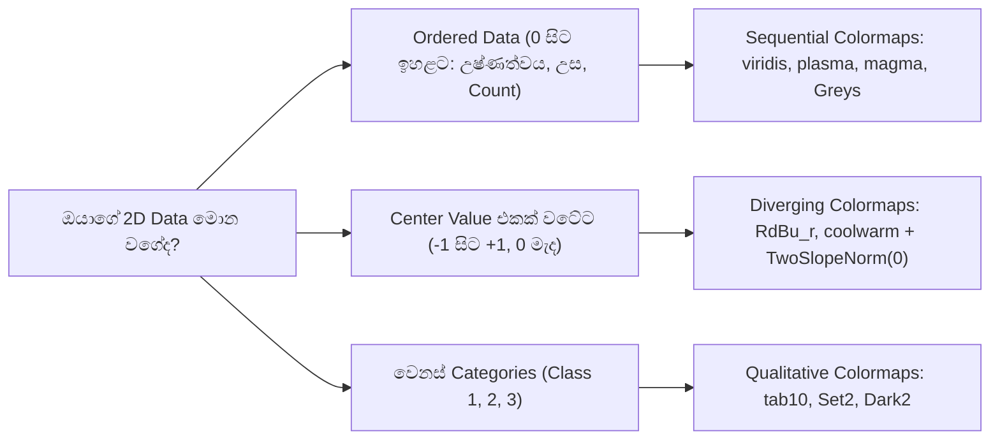
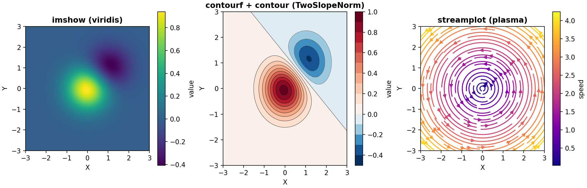

[⬅️ කලින් පාඩම: Statistical & Distribution Plots](06_Statistical_and_Distribution_Plots.md) | [🏠 මුල් පිටුව (Course Home)](README.md) | [ඊළඟ පාඩම: 3D, Polar & Specialised Plots ➡️](08_3D_Polar_and_Specialised_Plots.md)

---

# පාඩම 07: 2D Data — Images, Heatmaps, Contours, Colormaps සහ Vector Fields

## 🎯 මේ පාඩමෙන් ඔයා මොනවද ඉගෙන ගන්නේ?
මෙච්චර වෙලා අපි ඇන්දේ 1D data (X සහ Y). හැබැයි ඇත්ත ලෝකේ ගොඩක් දත්ත **2D Matrices** (පේළි සහ තීරු වලින් හැදුණු කොටු ජාල):
- ඡායාරූප (Images — pixels ගොඩක්)
- Correlation / Confusion Matrices (Heatmaps)
- කන්දක උස පෙන්නන සිතියම් (Contours)
- සුළඟ හෝ වතුර ගලන දිශාව (Vector Fields)

මේ හැම 2D data එකක්ම පාට (Colormaps) සහ ඊතල (Vectors) වලින් හරියටම, ඇහැට රැවටෙන්නේ නැතුව visualize කරන විදිය අද ඉගෙන ගමු!

---

## 🧭 Colormap එකක් තෝරගන්නේ කොහොමද?

පාට තෝරද්දි හිතුමතේ පාට දාන්න එපා! දත්ත වර්ගය අනුව හරි **Colormap** වර්ගය තෝරගන්න ඕනේ:



> [!TIP]
> **`viridis`, `plasma`, `magma` ඇයි හොඳ?** මේවා **Perceptually Uniform** (ඇහැට පේන දීප්තිය සමානව වැඩි වෙනවා) සහ Colorblind-friendly! පරණ `jet` colormap එක කවදාවත් පාවිච්චි කරන්න එපා — ඒකෙන් නැති patterns මවලා පෙන්නනවා.

---

## 1. Images (`imshow`), Heatmaps, සහ `pcolormesh`

### 🖼️ `ax.imshow()` — 2D Arrays සහ Photos පෙන්නන්න
2D NumPy array එකක් pixels විදියට අඳිනවා. වැදගත් parameters ටික මේවා:
- `cmap='viridis'`: පාට මාලාව.
- `vmin`, `vmax`: අවම සහ උපරිම අගයන් lock කරන්න.
- `origin='lower'`: සාමාන්‍යයෙන් photos වල `(0, 0)` තියෙන්නේ උඩ වම් කෙළවරේ (`origin='upper'`). ගණිත ප්‍රස්තාර වලදී `(0, 0)` යට වම් කෙළවරට ගන්න `origin='lower'` දාන්න!
- `extent=(xmin, xmax, ymin, ymax)`: Pixel index වෙනුවට ඇත්ත X, Y අගයන් දාන්න.
- `interpolation='nearest'` / `'bilinear'`: Pixels අතර සුමට කරනවද නැද්ද තීරණය කරනවා.

### 🔥 Annotated Heatmaps (`imshow` + `ax.text`)
Confusion Matrix හෝ Correlation Matrix එකක හැම කොටුවක් ඇතුළෙම අගය ලියන්න `imshow` ඇඳලා nested `for` loop එකකින් `ax.text(j, i, f'{val:.2f}', ha='center', va='center')` දානවා.

### 📐 `ax.pcolormesh(X, Y, Z, shading='auto')`
`imshow` වැඩ කරන්නේ සමාන ප්‍රමාණයේ හතරැස් කොටු (regular grid) වලට විතරයි. හැබැයි grid එකේ කොටු අසමාන (irregular / non-uniform) නම් **`pcolormesh`** පාවිච්චි කරන්න!

---

## 2. Contours (`contour`, `contourf`, `clabel`)

සිතියමක එකම උස තියෙන තැන් යා කරන ඉරි වලට **Contour Lines** කියනවා:
- `ax.contourf(X, Y, Z, levels=15)`: පාට පුරවපු (filled) contours.
- `ax.contour(X, Y, Z, levels=15, colors='k', linewidths=0.3)`: කළු ඉරි විතරක් (filled එක උඩින් දැම්මාම හරිම පැහැදිලියි!).
- `ax.clabel(cs, inline=True, fontsize=8)`: Contour ඉරි උඩම උස අගයන් print කරනවා.

---

## 3. Normalisation (`Normalize`, `LogNorm`, `TwoSlopeNorm`, `BoundaryNorm`, `PowerNorm`)

සමහර වෙලාවට data වල values 1 සිට 10,000 දක්වා පැතිරිලා තියෙනවා, නැත්නම් `-0.4` සිට `+1.0` දක්වා තිබුණත් **බිංදුව (0) හරියටම සුදු පාට** වෙන්න ඕනේ! ඒකට `matplotlib.colors` වල Normalisation classes පාවිච්චි කරනවා:

| Class | කවදාද පාවිච්චි කරන්නේ? |
| :--- | :--- |
| `Normalize(vmin, vmax)` | සාමාන්‍ය linear scaling |
| `LogNorm(vmin, vmax)` | 1 සිට 1,000,000 වගේ ගොඩක් skewed positive data වලට |
| `TwoSlopeNorm(vcenter=0, vmin=, vmax=)` | ධන සහ සෘණ අගයන් අසමාන වුණත් **0 හරියටම මැද පාට** කරන්න |
| `BoundaryNorm(boundaries, ncolors)` | නිශ්චිත කාණ්ඩ (discrete bins) වලට පාට බෙදන්න |
| `PowerNorm(gamma=0.5)` | Gamma correction (පොඩි අගයන් highlight කරන්න) |

---

## 4. Vector Fields (`quiver`, `streamplot`, `barbs`)

සුළඟ හමන දිශාව, චුම්භක ක්ෂේත්‍ර, වතුර ගලන විදිය පෙන්නන්න:
- **`ax.quiver(X, Y, U, V)`**: හැම ලක්ෂ්‍යයකම ඊතල (arrows) අඳිනවා (`U` = X-දිශාව, `V` = Y-දිශාව).
- **`ax.streamplot(X, Y, U, V, color=, cmap=, density=)`**: ගලා යන රේඛා (streamlines) අඳිනවා — fluid flow වලට ලස්සනයි!
- **`ax.barbs(X, Y, U, V)`**: කාලගුණ සිතියම් වල සුළගේ වේගය පෙන්නන wind barbs අඳිනවා.

### 🧪 ප්‍රධාන උදාහරණය: `imshow` + `contourf (TwoSlopeNorm)` + `streamplot`

```python
import matplotlib.pyplot as plt
from matplotlib.colors import TwoSlopeNorm
import numpy as np

x = np.linspace(-3, 3, 200)
X, Y = np.meshgrid(x, x)
Z = np.exp(-(X**2 + Y**2)) - 0.5 * np.exp(-((X - 1)**2 + (Y - 1)**2))

fig, axs = plt.subplots(1, 3, figsize=(12, 3.8), constrained_layout=True)

im = axs[0].imshow(Z, extent=(-3, 3, -3, 3), origin='lower', cmap='viridis')
fig.colorbar(im, ax=axs[0], label='value')

cs = axs[1].contourf(X, Y, Z, levels=15, cmap='RdBu_r',
                     norm=TwoSlopeNorm(0, Z.min(), Z.max()))
axs[1].contour(X, Y, Z, levels=15, colors='k', linewidths=.3)
fig.colorbar(cs, ax=axs[1])

axs[2].streamplot(X, Y, -Y, X, color=np.hypot(X, Y), cmap='plasma', density=1.2)
axs[2].set_aspect('equal')
plt.show()
```

### 🔍 පේළියෙන් පේළිය පැහැදිලි කිරීම (Line-by-Line)
1. `X, Y = np.meshgrid(x, x)`: 1D array එකකින් 200×200 2D coordinate grid එකක් හදනවා.
2. `Z = ...`: `(0, 0)` ළඟ ධන කන්දකුත්, `(1, 1)` ළඟ සෘණ වළකුත් තියෙන 2D surface එකක් හදනවා.
3. `axs[0].imshow(..., origin='lower', cmap='viridis')`: `Z` අගයන් පාටින් පෙන්නනවා. `extent=(-3, 3, -3, 3)` නිසා axis වල 0..200 වෙනුවට -3..+3 පේනවා.
4. `norm=TwoSlopeNorm(0, Z.min(), Z.max())`: `Z.min()` ආසන්නව `-0.4` සහ `Z.max()` ආසන්නව `+0.9` වුණත්, **`0` හරියටම සුදු පාට** වෙන්න center කරනවා!
5. `axs[1].contour(..., colors='k', linewidths=.3)`: Filled contours උඩින් සිහින් කළු ඉරි ඇඳලා මට්ටම් වෙන් කරනවා.
6. `axs[2].streamplot(X, Y, -Y, X, color=np.hypot(X, Y), ...)`: වටේට කැරකෙන vortex flow එකක් `(-Y, X)` අඳිනවා. `np.hypot(X, Y)` (වේගය) අනුව `plasma` පාට මාරු වෙනවා.

### 🖼️ බලාපොරොත්තු වන ප්‍රතිඵලය (Expected Output)


---

## 5. Custom Colormaps, Colorbars, Triangulated Data, Image I/O & Specialised Views

1. **Colorbars**: `fig.colorbar(im, ax=ax, label='Temp (°C)', shrink=0.8, orientation='horizontal')` — හැම පාට-පදනම් ප්‍රස්තාරයකටම colorbar එකක් අනිවාර්යයි!
2. **Custom Colormaps**:
   - `matplotlib.colormaps['viridis']`: දැනට තියෙන colormap එකක් ගන්න.
   - `ListedColormap(['#ffffff', '#93c5fd', '#1d4ed8'])`: නිශ්චිත පාට ලැයිස්තුවකින්.
   - `LinearSegmentedColormap.from_list('brand', ['white', '#0ea5e9', '#0369a1'])`: සුමට gradient colormap එකක් හදන්න.
3. **Triangulated Data (Scattered 2D Points)**:
   Sensors අහඹු තැන්වල තියෙනකොට regular `meshgrid` එකක් නැහැ! එතකොට `ax.tricontourf(x, y, z)`, `ax.tripcolor(x, y, z)`, හෝ `matplotlib.tri.Triangulation` පාවිච්චි කරනවා.
4. **Image I/O**:
   - `img = plt.imread('photo.png')`: Photo එකක් NumPy array එකක් විදියට කියවනවා.
   - `plt.imsave('out.png', arr, cmap='viridis')`: Array එකක් කෙලින්ම image file එකක් විදියට save කරනවා.
5. **Spectrograms & Matrices**:
   - `ax.specgram(signal, Fs=sample_rate)`: Audio signals වල frequency කාලයත් එක්ක වෙනස් වෙන හැටි.
   - `ax.matshow(matrix)`: Matrix එකක් ඉක්මනින් බලන්න (`imshow` වගේමයි, ticks උඩින් දානවා).
   - `ax.spy(sparse_matrix)`: ලොකු sparse matrix එකක 0 නොවන තැන් විතරක් තිත් විදියට පෙන්නනවා.

---

## 🧠 මතක තබා ගැනීමට පහසු ක්‍රම (Memory Hacks)
- **`imshow` = Image (Origin උඩ)** → ගණිත data නම් **`origin='lower'`** මතක තියාගන්න!
- **Diverging (`RdBu_r`) = 0 මැද තියන්න `TwoSlopeNorm(0, ...)`**.
- **`contour` = ඉරි (lines)**, **`contourf` = Filled (පාට පුරවපු)** (`f` for filled!).

---

## ⚠️ සාමාන්‍යයෙන් වෙන වැරදි (Common Pitfalls)

> [!WARNING]
> **1. `imshow` එකේ `origin='lower'` අමතක වීම!**
> `meshgrid` වලින් හදපු ගණිත function එකක් `imshow` ගැහුවාම `origin='lower'` දැම්මේ නැත්නම් ප්‍රස්තාරය **උඩු යටිකුරු (upside-down)** වෙලා පේන්නේ!

> [!WARNING]
> **2. `TwoSlopeNorm` නැතුව Diverging Colormap දැමීම!**
> Data `-1` සිට `+10` දක්වා තියෙද්දි `RdBu_r` නිකන්ම දැම්මොත්, සුදු පාට වැටෙන්නේ `+4.5` ට (0 ට නෙවෙයි!). ඒකෙන් බලන කෙනා සම්පූර්ණයෙන්ම නොමඟ යනවා.

> [!WARNING]
> **3. `plt.imread` වල PNG vs JPG වටිනාකම් වෙනස!**
> PNG files සාමාන්‍යයෙන් `0.0 - 1.0` float විදියටත්, JPG files `0 - 255` uint8 විදියටත් load වෙන්න පුළුවන්. Channel slice කරද්දි `img.dtype` check කරගන්න.

---

## 🏋️ ප්‍රායෝගික අභ්‍යාස (Practical Exercises)

### Warm-up Exercise:
10×10 random matrix එකක් `ax.matshow()` වලින් අඳින්න, `cmap='magma'` දාලා colorbar එකක් එකතු කරන්න.

<details>
<summary>✅ පිළිතුර බලන්න (Click to see Solution)</summary>

```python
import matplotlib.pyplot as plt
import numpy as np

rng = np.random.default_rng(3)
M = rng.uniform(0, 100, size=(10, 10))

fig, ax = plt.subplots(figsize=(5.5, 4.8), constrained_layout=True)
im = ax.matshow(M, cmap='magma')
fig.colorbar(im, ax=ax, label='Intensity')
ax.set_title('10x10 Random Matrix (matshow)', pad=15)
plt.show()
```
</details>

### Exercise 1:
Draw an annotated correlation heatmap with a diverging colormap centred at zero.

<details>
<summary>✅ පිළිතුර බලන්න (Click to see Solution)</summary>

```python
import matplotlib.pyplot as plt
import numpy as np

rng = np.random.default_rng(7)
# Features 5ක් හදමු
a = rng.normal(size=200)
b = 0.8 * a + rng.normal(scale=0.5, size=200)
c = -0.7 * a + rng.normal(scale=0.6, size=200)
d = rng.normal(size=200)
e = 0.5 * b - 0.4 * d + rng.normal(scale=0.5, size=200)

data = np.column_stack([a, b, c, d, e])
corr = np.corrcoef(data, rowvar=False)
names = ['Math', 'Physics', 'Errors', 'Art', 'CS']

fig, ax = plt.subplots(figsize=(6, 5), constrained_layout=True)
im = ax.imshow(corr, cmap='RdBu_r', vmin=-1, vmax=1)
fig.colorbar(im, ax=ax, label='Pearson r')

ax.set_xticks(range(len(names)), names, rotation=30, ha='right')
ax.set_yticks(range(len(names)), names)

for i in range(len(names)):
    for j in range(len(names)):
        val = corr[i, j]
        txt_color = 'white' if abs(val) > 0.55 else 'black'
        ax.text(j, i, f'{val:.2f}', ha='center', va='center', color=txt_color, fontweight='bold')

ax.set_title('Annotated Correlation Heatmap')
plt.show()
```
</details>

### Exercise 2:
Plot a function of two variables as filled contours with labelled contour lines.

<details>
<summary>✅ පිළිතුර බලන්න (Click to see Solution)</summary>

```python
import matplotlib.pyplot as plt
import numpy as np

x = np.linspace(-3, 3, 150)
X, Y = np.meshgrid(x, x)
Z = np.sin(X) * np.cos(Y)

fig, ax = plt.subplots(figsize=(6.5, 5.2), constrained_layout=True)
cf = ax.contourf(X, Y, Z, levels=12, cmap='coolwarm')
cs = ax.contour(X, Y, Z, levels=12, colors='black', linewidths=0.6)
ax.clabel(cs, inline=True, fontsize=8, fmt='%.2f')
fig.colorbar(cf, ax=ax, label='f(x, y)')

ax.set_title('Filled Contours with Labels: sin(x) cos(y)')
ax.set_xlabel('X')
ax.set_ylabel('Y')
plt.show()
```
</details>

### Exercise 3:
Display an image, then show its three colour channels as separate panels.

<details>
<summary>✅ පිළිතුර බලන්න (Click to see Solution)</summary>

```python
import matplotlib.pyplot as plt
import numpy as np

# Synthetic RGB image එකක් හදමු (ඔයාගේ photo එකක් නම් plt.imread('photo.png') පාවිච්චි කරන්න)
x = np.linspace(0, 1, 120)
X, Y = np.meshgrid(x, x)
R = X
G = Y
B = np.clip(1 - 0.5 * (X + Y), 0, 1)
img = np.stack([R, G, B], axis=-1)

fig, axs = plt.subplots(1, 4, figsize=(13, 3.3), constrained_layout=True)
axs[0].imshow(img)
axs[0].set_title('Original RGB')

for idx, (ch_name, cmap) in enumerate([('Red Channel', 'Reds'), ('Green Channel', 'Greens'), ('Blue Channel', 'Blues')]):
    im = axs[idx + 1].imshow(img[:, :, idx], cmap=cmap, vmin=0, vmax=1)
    axs[idx + 1].set_title(ch_name)
    fig.colorbar(im, ax=axs[idx + 1], shrink=0.75)

for ax in axs:
    ax.axis('off')
plt.show()
```
</details>

### Exercise 4:
Create a custom colormap that goes from white to your brand colour.

<details>
<summary>✅ පිළිතුර බලන්න (Click to see Solution)</summary>

```python
import matplotlib.pyplot as plt
from matplotlib.colors import LinearSegmentedColormap
import numpy as np

# සුදු පාට සිට Brand Teal (#0d9488) සහ Dark Teal (#115e59) දක්වා
brand_cmap = LinearSegmentedColormap.from_list(
    'brand_teal', ['#ffffff', '#5eead4', '#0d9488', '#115e59']
)

x = np.linspace(-2, 2, 100)
X, Y = np.meshgrid(x, x)
Z = np.exp(-(X**2 + Y**2))

fig, ax = plt.subplots(figsize=(6, 4.8), constrained_layout=True)
im = ax.imshow(Z, extent=(-2, 2, -2, 2), origin='lower', cmap=brand_cmap)
fig.colorbar(im, ax=ax, label='Brand Intensity')
ax.set_title('Custom Brand Colormap (White → Teal)')
plt.show()
```
</details>

---

## 📋 Cheat Sheet (සාරාංශ වගුව)

| Topic | Key API | Use Case |
| :--- | :--- | :--- |
| Images | `ax.imshow(a, cmap=, vmin=, vmax=, origin=, extent=, interpolation=)` | Photos, regular matrices |
| Heatmaps | `ax.imshow()` + `ax.text()` | Correlation / confusion matrices |
| Irregular grids | `ax.pcolormesh(X, Y, Z, shading='auto')` | Non-uniform gridded data |
| Contours | `ax.contourf()`, `ax.contour()`, `ax.clabel()` | Elevation, 2D surfaces |
| Colormaps | `viridis`, `plasma`, `RdBu_r`, `matplotlib.colormaps['name']` | Sequential / diverging / qualitative |
| Normalisation | `Normalize`, `LogNorm`, `TwoSlopeNorm`, `BoundaryNorm`, `PowerNorm` | Skewed data, centred zero |
| Colorbars | `fig.colorbar(im, ax=ax, label=, shrink=, orientation=)` | Colour scale legend |
| Custom colormaps | `ListedColormap`, `LinearSegmentedColormap.from_list` | Branded colour scales |
| Vector fields | `ax.quiver()`, `ax.streamplot()`, `ax.barbs()` | Wind, fluid flow, fields |
| Triangulated data | `ax.tricontourf()`, `ax.tripcolor()`, `Triangulation` | Scattered sensor networks |
| Image I/O | `plt.imread()`, `plt.imsave()` | Read / save image files |
| Specialised matrices | `ax.specgram()`, `ax.matshow()`, `ax.spy()` | Audio, matrices, sparse patterns |

---

[⬅️ කලින් පාඩම: Statistical & Distribution Plots](06_Statistical_and_Distribution_Plots.md) | [🏠 මුල් පිටුව (Course Home)](README.md) | [ඊළඟ පාඩම: 3D, Polar & Specialised Plots ➡️](08_3D_Polar_and_Specialised_Plots.md)
