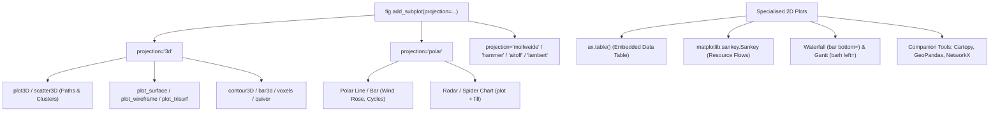
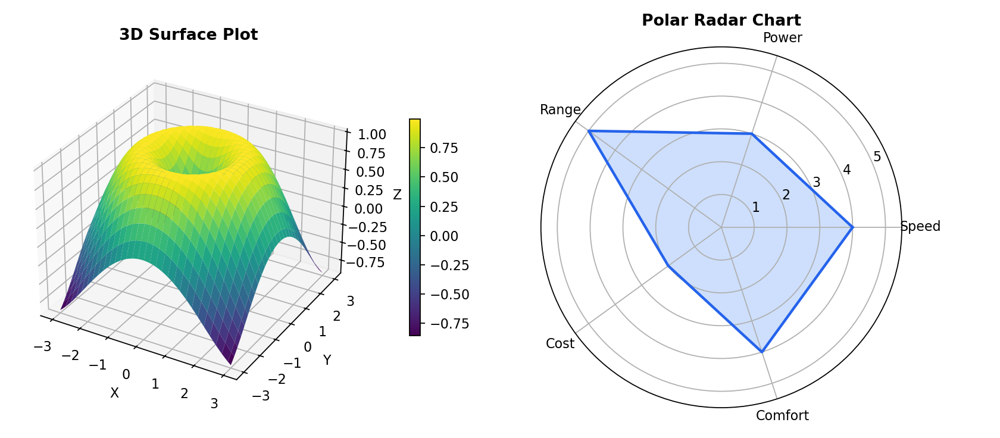

[⬅️ කලින් පාඩම: 2D Data, Images, Heatmaps & Colormaps](07_2D_Data_Images_Heatmaps_Contours_Colormaps.md) | [🏠 මුල් පිටුව (Course Home)](README.md) | [ඊළඟ පාඩම: Styles, rcParams, Fonts & LaTeX ➡️](09_Styles_rcParams_Fonts_and_LaTeX.md)

---

# පාඩම 08: 3D, Polar සහ Specialised Plots (3D, Polar and Specialised Plots)

## 🎯 මේ පාඩමෙන් ඔයා මොනවද ඉගෙන ගන්නේ?
හැම ප්‍රස්තාරයක්ම සාමාන්‍ය හතරැස් 2D කොටුවක (Cartesian X-Y plane) අඳින්න ඕනේ නෑ!
- කන්දක් හෝ Cost Landscape එකක් වගේ **3D Surface** එකක්,
- Game character එකක skills හෝ Phone දෙකක specs compare කරන **Polar Radar Chart** එකක්,
- ලෝක සිතියම් projections, Sankey flow diagrams, Tables, Waterfall සහ Gantt charts!

මේ සේරම Matplotlib වල **`projection=`** parameter එක සහ specialized tools පාවිච්චි කරලා හදන විදිය අද අපි ඉගෙන ගමු!

---

## 🧭 Projections සහ Specialised Plots සිතියම



---

## 1. 3D Plots (`projection='3d'`)

3D axes එකක් හදන්න අමුතු library එකක් install කරන්න ඕනේ නෑ — `fig.add_subplot(projection='3d')` (නැත්නම් `plt.subplots(subplot_kw={'projection': '3d'})`) දුන්නාම ඇති!

### 🏔️ ප්‍රධාන 3D Plot වර්ග
- **3D Lines & Scatter**: `ax.plot3D(x, y, z)` (අභ්‍යවකාශයේ ගමන් මඟක් වගේ) සහ `ax.scatter3D(x, y, z, c=cluster)` (3D clusters).
- **Surfaces**:
  - `ax.plot_surface(X, Y, Z, cmap='viridis', edgecolor='none')` — පාට පුරවපු 3D මතුපිට.
  - `ax.plot_wireframe(X, Y, Z)` — දැලක් (net එකක්) වගේ.
  - `ax.plot_trisurf(x, y, z)` — Grid එකක් නැති විසිරුණු 3D ලක්ෂ්‍ය වලට.
- **3D Contours & Bars**:
  - `ax.contour3D(X, Y, Z)` සහ බිමට හෙවනැල්ල වගේ projection දාන්න `ax.contourf(X, Y, Z, zdir='z', offset=-1)`.
  - `ax.bar3d(x, y, z, dx, dy, dz)` — 3D කණු.
- **Voxels & 3D Quiver**:
  - `ax.voxels(filled_3d_bool_array)` — Minecraft කොටු වගේ 3D volume data!
  - `ax.quiver(X, Y, Z, U, V, W)` — 3D ඊතල.

### 🎥 Camera Angle & Limits (3D පැහැදිලිව පේන්න!)
- `ax.view_init(elev=30, azim=-60)`: කැමරාවේ උස කෝණය (`elev` = elevation) සහ වටේට කැරකෙන කෝණය (`azim` = azimuth) වෙනස් කරනවා.
- `ax.set_zlim(-1.5, 1.5)`: Z-axis සීමාව.
- `ax.set_box_aspect((1, 1, 0.5))`: 3D පෙට්ටියේ දිග-පළල-උස අනුපාතය.

---

## 2. Polar Plots සහ Radar Charts (`projection='polar'`)

වෘත්තාකාර දත්ත (දිශාවන්, ඔරලෝසු පැය 24, සුළං දිශාව, කුසලතා පැතිකඩ) වලට Polar axes පාවිච්චි කරනවා.
- `theta` = කෝණය (**radians** වලින්: $0$ සිට $2\pi$).
- `r` = මැද සිට දුර (radius).
- `ax.set_theta_zero_location('N')`: 0° උතුරට (උඩට) ගන්න (මාලිමාවක් වගේ!).
- `ax.set_theta_direction(-1)`: ඔරලෝසු කටු කැරකෙන අතට (clockwise) හරවන්න.
- `ax.set_rticks([1, 2, 3, 4, 5])`: රවුම් ticks සකසන්න.

### 🧪 ප්‍රධාන උදාහරණය: 3D Surface + Polar Radar Chart

```python
import matplotlib.pyplot as plt
import numpy as np

x = np.linspace(-3, 3, 60)
X, Y = np.meshgrid(x, x)
Z = np.sin(np.hypot(X, Y))

fig = plt.figure(figsize=(10, 4.5))
ax1 = fig.add_subplot(1, 2, 1, projection='3d')
ax1.plot_surface(X, Y, Z, cmap='viridis', edgecolor='none')
ax1.view_init(elev=30, azim=-60)

ax2 = fig.add_subplot(1, 2, 2, projection='polar')
labels = ['Speed', 'Power', 'Range', 'Cost', 'Comfort']
vals = [4, 3, 5, 2, 4]
ang = np.linspace(0, 2 * np.pi, len(vals), endpoint=False)
ang = np.r_[ang, ang[0]]; vals = vals + vals[:1]
ax2.plot(ang, vals); ax2.fill(ang, vals, alpha=.25)
ax2.set_xticks(ang[:-1], labels)
plt.show()
```

### 🔍 පේළියෙන් පේළිය පැහැදිලි කිරීම (Line-by-Line)
1. `Z = np.sin(np.hypot(X, Y))`: වතුරට ගලක් දැම්මාම රැළි යනවා වගේ ($\sin(\sqrt{X^2+Y^2})$) 3D තරංගයක් හදනවා.
2. `ax1 = fig.add_subplot(1, 2, 1, projection='3d')`: වම් පැත්තේ 3D panel එක හදනවා.
3. `ax1.plot_surface(..., edgecolor='none')`: කළු දැල් ඉරි අයින් කරලා සුමට 3D surface එක අඳිනවා.
4. `ax2 = fig.add_subplot(1, 2, 2, projection='polar')`: දකුණු පැත්තේ Polar panel එක හදනවා.
5. `ang = np.linspace(0, 2 * np.pi, len(vals), endpoint=False)`: කෝණ 5ක් සමානව බෙදනවා (0° සිට 360° අතර).
6. `ang = np.r_[ang, ang[0]]; vals = vals + vals[:1]`: **හරිම වැදගත් trick එක!** Radar polygon එක අන්තිම ලක්ෂ්‍යයේ ඉඳලා ආයේ පළවෙනි ලක්ෂ්‍යයට **වහන්න (close කරන්න)** පළවෙනි අගය අගටත් එකතු කරනවා.
7. `ax2.plot(...)` + `ax2.fill(..., alpha=.25)`: මායිම ඇඳලා ඇතුළට විනිවිද පේන පාටක් පුරවනවා.
8. `ax2.set_xticks(ang[:-1], labels)`: අගට එකතු කරපු duplicate කෝණය ඇරෙන්න අනිත් 5ට නම් දානවා.

### 🖼️ බලාපොරොත්තු වන ප්‍රතිඵලය (Expected Output)


---

## 3. Geographic Projections, Maps, Networks, Tables, Sankey, Waterfall & Gantt

Matplotlib වලින් තවත් විශේෂ diagrams ගොඩක් අඳින්න පුළුවන්:

1. **Built-in Geographic Projections**:
   `fig.add_subplot(projection='mollweide')` (තවත් ඒවා: `'hammer'`, `'aitoff'`, `'lambert'`). ලෝක සිතියමක් හෝ අහසේ තරු සිතියමක් (star map) අඳින්න මේවා built-in එනවා!
   *(සම්පූර්ණ රටවල්/මායිම් එක්ක maps අඳින්න නම් **Cartopy** හෝ **GeoPandas** `.plot()` පාවිච්චි කරනවා — ඒවත් වැඩ කරන්නේ Matplotlib උඩින්මයි!)*

2. **Network & Tree Diagrams**:
   `matplotlib.patches` වලින් අතින්ම circles/arrows අඳින්න පුළුවන්, නැත්නම් **NetworkX** (`nx.draw(G, ax=ax)`) පාවිච්චි කරලා graphs අඳින්න පුළුවන්.

3. **Table in a Figure (`ax.table`)**:
   Chart එකක් යටින් හෝ පැත්තෙන් data table එකක් embed කරන්න:
   ```python
   ax.table(cellText=[['A', '92'], ['B', '85']], colLabels=['Group', 'Score'], loc='bottom')
   ```

4. **Sankey Diagrams (`matplotlib.sankey.Sankey`)**:
   ශක්තිය (energy) හෝ මුදල් (budget) ගලා යන ආකාරය (inflows → outflows) ඊතල වල ඝනකමින් පෙන්නන්න:
   ```python
   from matplotlib.sankey import Sankey
   Sankey(flows=[100, -60, -30, -10], labels=['Income', 'Rent', 'Food', 'Savings'],
          orientations=[0, 1, 0, -1]).finish()
   ```

5. **Waterfall & Gantt Charts** (සාමාන්‍ය Bar charts වල smart use එකක්!):
   - **Waterfall Chart** (මුදල් අඩු/වැඩි වීම): `ax.bar(x, changes, bottom=running_totals)`
   - **Gantt Chart** (Project schedule): `ax.barh(tasks, durations, left=start_days)`

---

## 🧠 මතක තබා ගැනීමට පහසු ක්‍රම (Memory Hacks)
- **Radar Chart වහන්න මතක තියාගන්න**: `ang` සහ `vals` දෙකේම **පළවෙනි element එක අගටත් copy කරන්න** (`vals + vals[:1]`). නැත්නම් කොටුවේ එක පැත්තක් ඇරිලා තියෙයි!
- **Polar Angles = Radians** (`np.deg2rad()` පාවිච්චි කරන්න degrees තියෙනවා නම්).
- **Waterfall = Vertical `bar(bottom=)`**, **Gantt = Horizontal `barh(left=)`**.

---

## ⚠️ සාමාන්‍යයෙන් වෙන වැරදි (Common Pitfalls)

> [!WARNING]
> **1. 3D Charts අනවශ්‍ය තැන්වල දැමීම!**
> 2D `contourf` හෝ heatmap එකකින් පැහැදිලිව පෙන්නන්න පුළුවන් data එකක් 3D වලින් ඇන්දොත්, පිටිපස්සේ තියෙන කඳු ඉස්සරහා ඒවායින් වැහිලා (occlusion) කියවන්න අමාරු වෙනවා. ඇත්තටම අවශ්‍ය වෙලාවට විතරක් 3D පාවිච්චි කරන්න!

> [!WARNING]
> **2. Polar plot එකට Degrees කෙලින්ම දීම!**
> `ax.plot([0, 90, 180], [1, 2, 3])` ගැහුවොත් 90 සහ 180 ගන්නේ **radians** විදියට (90 rad ≈ රවුම් 14ක්!). හැමවෙලේම `np.deg2rad([0, 90, 180])` දාන්න.

> [!WARNING]
> **3. Sankey Diagram එකේ `flows` එකතුව 0 නොවීම!**
> `Sankey` එකේ ඇතුළට එන (+) අගයන්ගේ සහ පිටවෙන (-) අගයන්ගේ එකතුව **0** වෙන්න ඕනේ (නැත්නම් balance warning/error එනවා).

---

## 🏋️ ප්‍රායෝගික අභ්‍යාස (Practical Exercises)

### Warm-up Exercise:
Project එකක Tasks 4ක් (Design, Backend, Frontend, Testing) සඳහා `ax.barh(..., left=...)` පාවිච්චි කරලා සරල **Gantt Chart** එකක් අඳින්න.

<details>
<summary>✅ පිළිතුර බලන්න (Click to see Solution)</summary>

```python
import matplotlib.pyplot as plt

tasks = ['Design', 'Backend', 'Frontend', 'Testing']
starts = [0, 3, 5, 11]
durations = [4, 8, 7, 4]
colors = ['#3b82f6', '#10b981', '#f59e0b', '#ef4444']

fig, ax = plt.subplots(figsize=(7.5, 3.8), constrained_layout=True)
ax.barh(tasks, durations, left=starts, color=colors, height=0.55)
ax.invert_yaxis()  # Design උඩින්ම පේන්න
ax.set_xlabel('Project Day')
ax.set_title('Simple Project Gantt Chart')
ax.grid(True, axis='x', linestyle='--', alpha=0.4)
plt.show()
```
</details>

### Exercise 1:
Plot a 3D surface of a two-variable function and animate the camera angle in a loop.

<details>
<summary>✅ පිළිතුර බලන්න (Click to see Solution)</summary>

```python
import matplotlib.pyplot as plt
import numpy as np

x = np.linspace(-3, 3, 50)
X, Y = np.meshgrid(x, x)
Z = np.cos(X) * np.sin(Y)

fig = plt.figure(figsize=(6.5, 5))
ax = fig.add_subplot(111, projection='3d')
ax.plot_surface(X, Y, Z, cmap='plasma', edgecolor='none')
ax.set_title('3D Surface: cos(x) * sin(y)')

# Interactive window එකක කැමරාව වටේට කරකවන්න:
for azim in range(0, 360, 5):
    ax.view_init(elev=30, azim=azim)
    plt.pause(0.05)  # තත්පර 0.05ක් නවතිලා frame එක update කරනවා

plt.show()
```
</details>

### Exercise 2:
Draw a radar chart comparing three products across six metrics.

<details>
<summary>✅ පිළිතුර බලන්න (Click to see Solution)</summary>

```python
import matplotlib.pyplot as plt
import numpy as np

metrics = ['Battery', 'Camera', 'Screen', 'Speed', 'Price', 'Design']
products = {
    'Phone A': [4.5, 4.0, 4.8, 4.7, 3.0, 4.5],
    'Phone B': [3.8, 4.9, 4.5, 4.2, 3.5, 4.8],
    'Phone C': [5.0, 3.2, 3.8, 3.5, 4.9, 3.6],
}

ang = np.linspace(0, 2 * np.pi, len(metrics), endpoint=False)
ang_closed = np.r_[ang, ang[0]]

fig, ax = plt.subplots(figsize=(6.5, 6), subplot_kw={'projection': 'polar'})
for name, vals in products.items():
    vals_closed = vals + vals[:1]
    ax.plot(ang_closed, vals_closed, linewidth=2, label=name)
    ax.fill(ang_closed, vals_closed, alpha=0.15)

ax.set_theta_zero_location('N')
ax.set_theta_direction(-1)
ax.set_xticks(ang, metrics)
ax.set_ylim(0, 5.5)
ax.set_title('Smartphone Comparison (6 Metrics)', pad=20)
ax.legend(loc='upper right', bbox_to_anchor=(1.25, 1.1))
plt.show()
```
</details>

### Exercise 3:
Plot a wind-rose style bar chart on polar axes.

<details>
<summary>✅ පිළිතුර බලන්න (Click to see Solution)</summary>

```python
import matplotlib.pyplot as plt
import numpy as np

directions = ['N', 'NE', 'E', 'SE', 'S', 'SW', 'W', 'NW']
theta = np.linspace(0, 2 * np.pi, len(directions), endpoint=False)
wind_freq = [18, 12, 8, 6, 10, 24, 20, 15]
width = (2 * np.pi / len(directions)) * 0.85

fig, ax = plt.subplots(figsize=(6, 6), subplot_kw={'projection': 'polar'})
bars = ax.bar(theta, wind_freq, width=width, bottom=0, alpha=0.8,
              color=plt.cm.viridis(np.array(wind_freq) / max(wind_freq)),
              edgecolor='black', linewidth=0.6)

ax.set_theta_zero_location('N')
ax.set_theta_direction(-1)
ax.set_xticks(theta, directions)
ax.set_title('Wind-Rose Chart (Wind Frequency %)', pad=18)
plt.show()
```
</details>

### Exercise 4:
Draw a 3D scatter of a clustered dataset coloured by cluster.

<details>
<summary>✅ පිළිතුර බලන්න (Click to see Solution)</summary>

```python
import matplotlib.pyplot as plt
import numpy as np

rng = np.random.default_rng(21)
centers = [(0, 0, 0), (4, 4, 2), (-3, 4, -2)]
colors = ['#2563eb', '#10b981', '#ef4444']

fig = plt.figure(figsize=(7, 5.5))
ax = fig.add_subplot(111, projection='3d')

for i, (cx, cy, cz) in enumerate(centers):
    pts = rng.normal(loc=[cx, cy, cz], scale=0.9, size=(80, 3))
    ax.scatter3D(pts[:, 0], pts[:, 1], pts[:, 2], s=28, alpha=0.8,
                 color=colors[i], label=f'Cluster {i + 1}')

ax.set_xlabel('Feature X')
ax.set_ylabel('Feature Y')
ax.set_zlabel('Feature Z')
ax.set_title('3D Clustered Scatter Plot')
ax.view_init(elev=25, azim=40)
ax.legend()
plt.show()
```
</details>

---

## 📋 Cheat Sheet (සාරාංශ වගුව)

| Topic | Key API | Use Case |
| :--- | :--- | :--- |
| 3D axes | `fig.add_subplot(projection='3d')` | 3D surfaces, trajectories |
| 3D lines & scatter | `ax.plot3D()`, `ax.scatter3D()` | Paths, 3D clusters |
| 3D surfaces | `ax.plot_surface()`, `plot_wireframe()`, `plot_trisurf()` | 2-variable landscapes |
| 3D contours & bars | `ax.contour3D()`, `ax.bar3d()`, `contourf(zdir=)` | 3D projections & columns |
| 3D camera & limits | `ax.view_init(elev, azim)`, `set_zlim()`, `set_box_aspect()` | Readable 3D angle |
| 3D volumes & arrows | `ax.voxels()`, `ax.quiver()` | Voxel blocks, 3D vector fields |
| Polar plots | `projection='polar'`, `set_theta_zero_location()`, `set_rticks()` | Wind rose, cyclic data |
| Radar charts | Polar `ax.plot()` + `ax.fill()` (closed loop) | Multi-metric comparison |
| Geo projections | `projection='mollweide'/'hammer'/'aitoff'/'lambert'` | World / sky views |
| Full Maps & Graphs | Cartopy, GeoPandas `.plot()`, NetworkX `nx.draw()` | Cartography & networks |
| Embedded Table | `ax.table(cellText=, colLabels=)` | Data summary beside chart |
| Sankey | `matplotlib.sankey.Sankey` | Energy / budget flows |
| Waterfall & Gantt | `ax.bar(bottom=)` / `ax.barh(left=)` | Finance changes & schedules |

---

[⬅️ කලින් පාඩම: 2D Data, Images, Heatmaps & Colormaps](07_2D_Data_Images_Heatmaps_Contours_Colormaps.md) | [🏠 මුල් පිටුව (Course Home)](README.md) | [ඊළඟ පාඩම: Styles, rcParams, Fonts & LaTeX ➡️](09_Styles_rcParams_Fonts_and_LaTeX.md)
