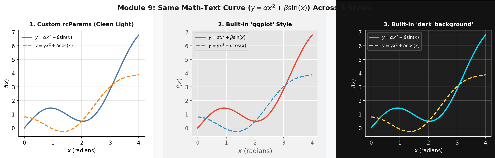
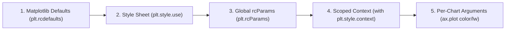
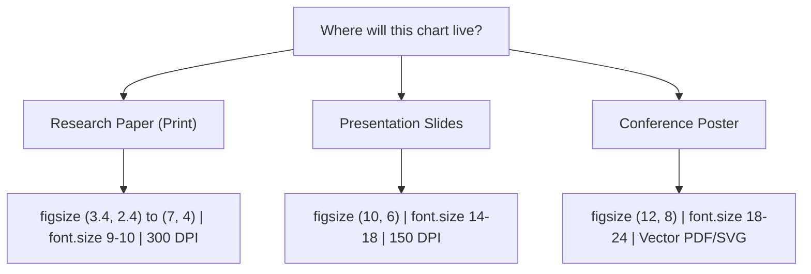

[⬅️ පෙර පාඩම: 08 — 3D, Polar & Specialised Plots](08_3D_Polar_and_Specialised_Plots.md) | [🏠 මුල් පිටුව (Course Index)](README.md) | [ඊළඟ පාඩම: 10 — Animation & Interactivity ➡️](10_Animation_and_Interactivity.md)

---

# 🎨 පාඩම 09: Styles, `rcParams`, Fonts සහ LaTeX (Styles, rcParams, Fonts & LaTeX)

> [!TIP]
> **මේ පාඩමෙන් ඔයා ඉගෙන ගන්න දේවල්:**
> හැම chart එකකටම එකින් එක colors, font size, grid settings ලියන එක වෙනුවට, එක පාරක් project එකටම හරියන look එකක් හදාගන්නේ කොහොමද කියලා අපි මේ පාඩමෙන් ඉගෙන ගන්නවා. Built-in styles, `rcParams`, `.mplstyle` files, fonts, math equations (`mathtext` & `LaTeX`), සහ clean design principles 100% සරලව බලමු!

---

## 1. ඇයි Styles සහ Configuration ඕනේ? (Phone Theme Analogy 📱)

හිතන්න ඔයාගේ phone එකේ **Dark Mode** හරි **Custom Theme** එකක් හරි දානවා කියලා. ඔයා WhatsApp, YouTube, Settings වගේ හැම app එකකටම වෙන වෙනම ගිහින් background එක කළු කරලා, font එක මාරු කරන්නේ නෑනේ! Phone එකේ main **Theme** එක මාරු කළාම, හැම app එකටම ඒ look එක auto apply වෙනවා.

Matplotlib වලත් හරියටම එහෙමයි:
- Chart 20ක් හදන research report එකක හරි dashboard එකක හරි, හැම chart එකේම `fontsize=12`, `linewidth=2`, `grid(alpha=0.3)` කියලා copy-paste කරන එක හරිම අවුල්.
- ඒ වෙනුවට අපි **Built-in Styles**, **`rcParams`**, හෝ **`.mplstyle` file** එකක් පාවිච්චි කරලා එක තැනකින් මුළු project එකේම look එක control කරනවා.



---

## 2. Configuration Priority Flow (කොහොමද Settings Override වෙන්නේ?)

Matplotlib chart එකක් අඳිනකොට settings apply වෙන පිළිවෙළ මේ diagram එකෙන් පැහැදිලිව බලාගන්න පුළුවන්:



> **සරල නීතිය:** දකුණු පැත්තේ තියෙන දේවල් (වඩාත් specific දේවල්) වම් පැත්තේ තියෙන general defaults override කරනවා!

---

## 3. Built-in Styles සහ Temporary Styles (`plt.style`)

Matplotlib එක්ක දැනටමත් ලස්සනට හදපු ready-made themes ගොඩක් එනවා.

### 🔹 තියෙන Styles මොනවද කියලා බලන විදිය:
```python
import matplotlib.pyplot as plt

print(plt.style.available)
# Output example: ['Solarize_Light2', 'bmh', 'dark_background', 'fivethirtyeight', 'ggplot', 'seaborn-v0_8', ...]
```

### 🔹 ජනප්‍රිය Built-in Styles:
- `'ggplot'` — R language එකේ ජනප්‍රිය `ggplot2` look එක (අළු background + සුදු grid lines).
- `'seaborn-v0_8'` — Data science වලට හරිම clean modern look එකක්.
- `'bmh'` — Bayesian Methods for Hackers style එක (scientific charts වලට හොඳයි).
- `'fivethirtyeight'` — News / journalism style bold charts.
- `'dark_background'` — Dark slides සහ dashboards වලට සුපිරි.

### 🔹 Global Style vs Temporary Style (`with plt.style.context`)
- **`plt.style.use('ggplot')`**: මේක දැම්මට පස්සේ හදන **හැම chart එකටම** මේ style එක apply වෙනවා.
- **`with plt.style.context('dark_background'):`**: මේක හරියට තාවකාලික ඇඳුමක් වගේ! `with` block එක ඇතුළේ හදන **ඒ එක chart එකට විතරක්** style එක apply වෙලා, block එකෙන් එළියට ආවම ආපහු පරණ style එකටම auto හැරෙනවා.

```python
import matplotlib.pyplot as plt
import numpy as np

x = np.linspace(0, 10, 100)

# මේ chart එක විතරක් dark_background වලින් අඳිනවා
with plt.style.context('dark_background'):
    fig, ax = plt.subplots(figsize=(6, 3.5))
    ax.plot(x, np.sin(x), color='#00E5FF', lw=2)
    ax.set_title("Dark Theme (Temporary Context)")
    plt.show()

# මේකෙන් පස්සේ අඳින chart වලට කලින් තිබුණු normal light theme එකමයි එන්නේ!
```

---

## 4. `rcParams`, `mpl.rc()` සහ `.mplstyle` Style Sheets

`rcParams` කියන්නේ **Runtime Configuration Parameters** කියන එකයි. මේක නිකන් Python dictionary එකක් (`dict`) වගේ! Matplotlib වල තියෙන හැම default setting එකක්ම මේක ඇතුළේ තියෙනවා.

### 🔹 `rcParams` වෙනස් කරන ක්‍රම 3:
1. **තනි setting එකක් වෙනස් කරන්න:**
   ```python
   plt.rcParams['font.size'] = 12
   ```
2. **Group එකක් විදියට `mpl.rc()` පාවිච්චි කරන්න:**
   ```python
   import matplotlib as mpl
   mpl.rc('lines', linewidth=2.5, linestyle='--')
   ```
3. **Dictionary එකකින් ගොඩක් settings එක පාර update කරන්න (`plt.rcParams.update()`):**
   - ඔක්කොම reset කරලා මුල්ම defaults වලට යන්න ඕනේ නම් **`plt.rcdefaults()`** call කරන්න!

### 🔹 Reusable `.mplstyle` Files (Team Branding)
ඔයාගේ company එකට හරි university thesis එකට හරි එකම colors, fonts තියාගන්න ඕනේ නම්, `team.mplstyle` කියලා text file එකක් හදලා, එක පේළියකට එක `key: value` ගානේ දාන්න:

```text
# team.mplstyle
figure.figsize: 7, 4
figure.dpi: 120
font.size: 11
axes.spines.top: False
axes.spines.right: False
axes.grid: True
grid.alpha: 0.3
axes.prop_cycle: cycler('color', ['4C78A8', 'F58518', '54A24B', 'E45756'])
savefig.bbox: tight
```
ඊට පස්සේ ඕනෑම Python script එකකින් එක line එකෙන් load කරන්න පුළුවන්:
```python
plt.style.use('team.mplstyle')
# Styles කිහිපයක් එකට combine කරන්නත් පුළුවන් (පස්සේ තියෙන එක override කරනවා):
plt.style.use(['seaborn-v0_8-whitegrid', 'team.mplstyle'])
```

---

## 5. Complete Code Example: Custom `rcParams`, Colour Cycle & MathText

අපේ course එකේ main example එක line-by-line බලමු:

```python
import matplotlib.pyplot as plt
from cycler import cycler

# 1. Global rcParams dictionary එකෙන් project theme එක set කරනවා
plt.rcParams.update({
    'figure.figsize': (7, 4),
    'figure.dpi': 120,
    'font.size': 11,
    'axes.spines.top': False,
    'axes.spines.right': False,
    'axes.grid': True,
    'grid.alpha': 0.3,
    'axes.prop_cycle': cycler(color=['#4C78A8', '#F58518', '#54A24B', '#E45756']),
    'savefig.bbox': 'tight',
})

# 2. Chart එක අඳිනවා (දැන් අමතර styling parameters ලියන්න ඕනේ නෑ!)
fig, ax = plt.subplots()
ax.plot([1, 2, 3], [2, 4, 3], label=r'$y = \alpha x^2$')
ax.plot([1, 2, 3], [1, 3, 2.5], label=r'$y = \beta x + c$')
ax.set_xlabel(r'Input ($x$)')
ax.set_ylabel(r'Output ($y$)')
ax.set_title('Custom rcParams + Colour Cycle + Mathtext')
ax.legend()
plt.show()
```

### 🔍 Line-by-Line පැහැදිලි කිරීම:
- `from cycler import cycler`: Series කිහිපයක් අඳිනකොට පිළිවෙළින් එන color palette එක (`axes.prop_cycle`) හදන්න `cycler` පාවිච්චි කරනවා.
- `'figure.figsize': (7, 4)` & `'figure.dpi': 120`: හැම figure එකේම default size එක සහ clarity එක set කරනවා.
- `'axes.spines.top': False`, `'axes.spines.right': False`: Chart එකේ උඩ සහ දකුණු පැත්තේ අනවශ්‍ය කළු ඉරි (box borders) අයින් කරලා clean look එකක් ගන්නවා.
- `'axes.grid': True`, `'grid.alpha': 0.3`: ඇහැට අමාරු නැති ලා grid lines දානවා.
- `'savefig.bbox': 'tight'`: Save කරනකොට axis labels කැපිලා යන එක නවත්තනවා.
- `label=r'$y = \alpha x^2$'`: `r'...'` (raw string) සහ `$...$` ඇතුළේ දාපු නිසා Matplotlib මේක ලස්සන mathematical equation එකක් ($y = \alpha x^2$) විදියට render කරනවා!

### 🖥️ Expected Output:
- අඟල් 7×4 ප්‍රමාණයේ, උඩ/දකුණු borders නැති, ලා grid lines තියෙන clean chart එකක් එනවා.
- පළවෙනි line එක නිල් (`#4C78A8`), දෙවෙනි line එක තැඹිලි (`#F58518`) පාටින් auto ඇඳෙනවා.
- Legend එකේ $y = \alpha x^2$ සහ $y = \beta x + c$ හරියටම math symbols එක්ක පේනවා.

---

## 6. Fonts, Unicode (සිංහල/Other Languages), `mathtext` සහ Full LaTeX

### 🅰️ Fonts පාලනය කරන විදිය:
1. **Global Font Family:**
   ```python
   plt.rcParams['font.family'] = 'sans-serif'
   plt.rcParams['font.sans-serif'] = ['DejaVu Sans', 'Arial', 'Helvetica']
   ```
2. **එක text එකකට විතරක් (`fontdict=` හෝ `FontProperties`):**
   ```python
   from matplotlib.font_manager import FontProperties

   custom_font = FontProperties(family='serif', weight='bold', size=14)
   ax.set_title('Research Findings', fontproperties=custom_font)

   # හෝ fontdict පාවිච්චි කරලා:
   ax.set_xlabel('Time (s)', fontdict={'family': 'monospace', 'color': 'navy', 'size': 12})
   ```

### 🌐 Unicode සහ Non-Latin Languages (සිංහල / Japanese / Arabic):
Matplotlib වල default font එකේ (`DejaVu Sans`) සිංහල හෝ සමහර non-Latin අකුරු (glyphs) නැති වෙන්න පුළුවන්. එතකොට අකුරු වෙනුවට **කොටු (□□□)** පේනවා!
- **විසඳුම:** ඒ භාෂාවේ glyphs තියෙන system font එකක් (`Noto Sans Sinhala`, `Iskoola Pota`, `Noto Sans CJK`) තෝරලා දෙන්න:
  ```python
  plt.rcParams['font.sans-serif'] = ['Noto Sans Sinhala', 'DejaVu Sans']
  ```

### ➗ MathText vs Full LaTeX:
| Feature | `mathtext` (Built-in) | Full `LaTeX` (`text.usetex = True`) |
| --- | --- | --- |
| **LaTeX install කරන්න ඕනෙද?** | ❌ නෑ! Python එක්කම වැඩ කරනවා | ✅ ඔව් (`TeX Live` / `MiKTeX` + `dvipng` ඕනේ) |
| **වේගය (Speed)** | ⚡ ඉතා වේගවත් | 🐢 ටිකක් හෙමින් |
| **භාවිතය** | `r'$\alpha^2 + \beta_i = \frac{1}{2}$'` | `plt.rcParams['text.usetex'] = True` |
| **Font style මාරු කරන්න** | `plt.rcParams['mathtext.fontset'] = 'stix'` (`'cm'`, `'dejavusans'`) | Journal එකේ LaTeX preamble එකටම match වෙනවා |
| **කවදද පාවිච්චි කරන්නේ?** | 95% වෙලාවට මේක හොඳටම ඇති! | IEEE / Nature වගේ strict LaTeX journals වලට |

---

## 7. Dark & Light Themes, Sizing for Context සහ Clean Design Principles

### 🌗 Dark vs Light Theme Key Parameters:
Dark theme එකක් තනියම හදනවා නම් ප්‍රධාන වශයෙන් මේ 3 හදාගන්න:
- `figure.facecolor` — මුළු figure එකේම background color එක (e.g., `'#121212'`).
- `axes.facecolor` — Plot එක ඇතුළේ background color එක (e.g., `'#1E1E1E'`).
- `text.color`, `axes.labelcolor`, `xtick.color`, `ytick.color` — අකුරු සහ ticks පැහැදිලිව පේන්න සුදු/ලා අළු පාට (`'#F0F0F0'`).

### 📐 Sizing for Context (කොතනද පාවිච්චි කරන්නේ කියන එක අනුව):


### ✨ Tufte-Style Design Principles (හොඳ Chart එකක රහස් 4):
Data visualization expert Edward Tufte කියන **"Maximize Data-Ink Ratio"** කියන එක සරලව මෙහෙමයි:
1. **Remove clutter (අනවශ්‍ය කුණු අයින් කරන්න):** Top සහ right spines අයින් කරන්න, බර grid lines වෙනුවට `alpha=0.25` ලා grid දාන්න.
2. **Label directly (කෙලින්ම label කරන්න):** පුළුවන් තැන්වල legend box එකක් වෙනුවට line එකේ කෙළවරේම නම ලියන්න (`ax.text(...)`).
3. **Limit colours (පාට සීමා කරන්න):** පාට 10ක් දාන්න එපා! වැදගත් data series 1–2ක් විතරක් highlight color එකකින් දාලා, අනිත් ඒවා අළු (grey) පාටින් තියන්න.
4. **Start bars at zero (Bar charts 0න් පටන් ගන්න):** Bar chart එකක y-axis එක 0න් පටන් ගත්තේ නැත්නම්, පොඩි වෙනසක් ලොකු වෙනසක් වගේ පෙනිලා බලන අයව රැවටෙනවා!

---

## 🧠 මතක තබා ගැනීමට පහසු ක්‍රම (Memory Hacks)

- **`r'$...$'` (Raw String Rule):** Math equations ලියනකොට හැමතිස්සෙම string එකට ඉස්සරහින් **`r`** අකුර දාන්න! නැත්නම් `\beta` එකේ `\b` backspace එකක් විදියටත්, `\theta` එකේ `\t` tab එකක් විදියටත් Python තේරුම් ගන්නවා.
- **`rcdefaults()` = Factory Reset:** `rcParams` ඔක්කොම අවුල් වුණොත්, phone එක factory reset කරනවා වගේ `plt.rcdefaults()` ගහන්න!
- **`with plt.style.context(...)` = Try-on Room:** කඩේක ඇඳුමක් try කරලා බලනවා වගේ, එක chart එකකට විතරක් style එක දාලා බලන්න.

---

## ⚠️ සාමාන්‍යයෙන් වෙන වැරදි (Common Pitfalls)

> [!WARNING]
> **1. Raw string (`r`) අමතක වීම:**
> `ax.set_title('$\tau = \beta$')` ලිව්වොත් `\t` (tab) සහ `\b` (backspace) නිසා equation එක කැඩෙනවා. හැමවිටම `r'$\tau = \beta$'` ලියන්න!

> [!WARNING]
> **2. `plt.style.use()` පස්සේ `rcParams` overwrite වීම:**
> ඔයා මුලින් `plt.rcParams['font.size'] = 14` දාලා, ඊට පස්සේ `plt.style.use('ggplot')` දැම්මොත්, `ggplot` එකෙන් ඔයාගේ `font.size` එක ආපහු reset කරනවා! හැමවිටම **මුලින් `plt.style.use(...)`**, ඊට පස්සේ custom `plt.rcParams.update(...)` ලියන්න.

> [!WARNING]
> **3. `text.usetex = True` දාලා LaTeX නැතිව Crash වීම:**
> Machine එකේ `TeX Live` / `MiKTeX` install කරලා නැත්නම් `text.usetex = True` දැම්මම `FileNotFoundError: latex` එනවා. සාමාන්‍ය equations වලට built-in `mathtext` (`r'$...$'`) පාවිච්චි කරන්න.

---

## 🏋️ ප්‍රායෝගික අභ්‍යාස (Practical Exercises)

### Warm-up Exercise: Global `rcParams` Reset & Update
`plt.rcParams.update()` පාවිච්චි කරලා top/right spines අයින් කරලා, font size 13 කරලා සරල line plot එකක් අඳින්න. ඊට පස්සේ `plt.rcdefaults()` call කරලා defaults reset කරන්න.

<details>
<summary>✅ පිළිතුර බලන්න (Click to see Solution)</summary>

```python
import matplotlib.pyplot as plt
import numpy as np

plt.rcParams.update({
    'font.size': 13,
    'axes.spines.top': False,
    'axes.spines.right': False,
    'axes.grid': True,
    'grid.alpha': 0.3,
})

x = np.linspace(0, 5, 50)
fig, ax = plt.subplots()
ax.plot(x, x**2, lw=2.5, color='#2563EB')
ax.set_title('Warm-up Custom rcParams')
plt.show()

# Reset back to factory defaults
plt.rcdefaults()
```
</details>

### Exercise 1: Create & Apply a `.mplstyle` File
ඔයාගේ ආයතනයට හෝ project එකට ගැලපෙන colors සහ fonts දාලා `myorg.mplstyle` file එකක් හදලා, ඒක charts 3කට (Line, Bar, Scatter) apply කරන්න.

<details>
<summary>✅ පිළිතුර බලන්න (Click to see Solution)</summary>

```python
import matplotlib.pyplot as plt
import numpy as np

# 1. Create the .mplstyle file programmatically
style_content = """
figure.figsize: 6, 3.8
font.family: sans-serif
font.size: 11
axes.spines.top: False
axes.spines.right: False
axes.grid: True
grid.alpha: 0.25
axes.prop_cycle: cycler('color', ['1D4ED8', 'EA580C', '16A34A', '9333EA'])
lines.linewidth: 2.2
"""

with open("myorg.mplstyle", "w") as f:
    f.write(style_content.strip())

# 2. Apply to 3 different charts
with plt.style.context("myorg.mplstyle"):
    fig, axes = plt.subplots(1, 3, figsize=(13, 3.8))
    x = np.linspace(0, 6, 40)

    # Chart 1: Line
    axes[0].plot(x, np.sin(x), label="Series A")
    axes[0].plot(x, np.cos(x), label="Series B")
    axes[0].set_title("Line Chart")
    axes[0].legend(frameon=False)

    # Chart 2: Bar
    axes[1].bar(["Q1", "Q2", "Q3", "Q4"], [45, 62, 58, 80])
    axes[1].set_title("Bar Chart (Starts at 0)")

    # Chart 3: Scatter
    rng = np.random.default_rng(42)
    axes[2].scatter(rng.normal(size=40), rng.normal(size=40), s=50, alpha=0.8)
    axes[2].set_title("Scatter Chart")

    fig.tight_layout()
    plt.show()
```
</details>

### Exercise 2: Render an Equation in an Axis Label Using `mathtext`
Normal distribution (Gaussian) curve එකක් ඇඳලා, y-axis label එකේ හෝ title එකේ සම්පූර්ණ equation එක (`$f(x) = \frac{1}{\sigma\sqrt{2\pi}} e^{-\frac{1}{2}(\frac{x-\mu}{\sigma})^2}$`) `mathtext` වලින් render කරන්න.

<details>
<summary>✅ පිළිතුර බලන්න (Click to see Solution)</summary>

```python
import matplotlib.pyplot as plt
import numpy as np

plt.rcParams['mathtext.fontset'] = 'stix'  # Publication-style math font

x = np.linspace(-4, 4, 300)
mu, sigma = 0, 1
y = (1 / (sigma * np.sqrt(2 * np.pi))) * np.exp(-0.5 * ((x - mu) / sigma) ** 2)

fig, ax = plt.subplots(figsize=(7, 4))
ax.plot(x, y, color='#2563EB', lw=2.5)
ax.fill_between(x, y, alpha=0.15, color='#2563EB')

ax.set_xlabel(r'$x$ (Standard Deviations from $\mu$)', fontsize=12)
ax.set_ylabel(r'$f(x) = \frac{1}{\sigma\sqrt{2\pi}} e^{-\frac{1}{2}\left(\frac{x-\mu}{\sigma}\right)^2}$', fontsize=12)
ax.set_title(r'Normal Distribution ($\mu = 0,\ \sigma = 1$)', fontsize=13)
ax.grid(True, alpha=0.3)
plt.show()
```
</details>

### Exercise 3: Light and Dark Versions Using Style Contexts
එකම chart එක `with plt.style.context(...)` පාවිච්චි කරලා Light theme එකකින් සහ Dark theme එකකින් වෙන වෙනම හදන්න.

<details>
<summary>✅ පිළිතුර බලන්න (Click to see Solution)</summary>

```python
import matplotlib.pyplot as plt
import numpy as np

x = np.linspace(0, 2 * np.pi, 200)
y = np.sin(x) * np.exp(-0.2 * x)

def make_chart(style_name, line_color, title_text):
    with plt.style.context(style_name):
        fig, ax = plt.subplots(figsize=(6, 3.5))
        ax.plot(x, y, color=line_color, lw=2.5, label=r'$e^{-0.2x}\sin(x)$')
        ax.set_title(title_text)
        ax.set_xlabel('Time (s)')
        ax.set_ylabel('Amplitude')
        ax.legend()
        ax.grid(True, alpha=0.3)
        plt.show()

make_chart('seaborn-v0_8-whitegrid', '#1D4ED8', 'Light Version (Report)')
make_chart('dark_background', '#00E5FF', 'Dark Version (Presentation Slide)')
```
</details>

---

## 📋 Cheat Sheet Summary Table

| කාර්යය (Task) | Key API / Code | විස්තරය (Description) |
| --- | --- | --- |
| Built-in styles බලන්න | `plt.style.available` | තියෙන preset styles list එක |
| Global style දාන්න | `plt.style.use('ggplot')` | මුළු script එකටම style apply කරනවා |
| Temporary style දාන්න | `with plt.style.context('dark_background'):` | ඒ `with` block එකට විතරක් style දානවා |
| Global `rcParams` set | `plt.rcParams['font.size'] = 12` / `plt.rcParams.update({...})` | Default settings වෙනස් කරනවා |
| Group `rc` set | `mpl.rc('lines', linewidth=2)` | Group එකක defaults වෙනස් කරනවා |
| Factory Reset | `plt.rcdefaults()` | Matplotlib original defaults වලට යනවා |
| Custom Style Sheet | `plt.style.use('team.mplstyle')` | `.mplstyle` file එක load කරනවා |
| Colour Cycle | `axes.prop_cycle` + `cycler(color=[...])` | Default color palette එක set කරනවා |
| Fonts | `font.family`, `FontProperties`, `fontdict=` | Brand fonts / Unicode glyphs තෝරනවා |
| Math Equations | `r'$\alpha^2 + \beta_i$'` + `mathtext.fontset` | LaTeX නැතිව math render කරනවා |
| Full LaTeX | `plt.rcParams['text.usetex'] = True` | System LaTeX engine එකෙන් render කරනවා |

---

[⬅️ පෙර පාඩම: 08 — 3D, Polar & Specialised Plots](08_3D_Polar_and_Specialised_Plots.md) | [🏠 මුල් පිටුව (Course Index)](README.md) | [ඊළඟ පාඩම: 10 — Animation & Interactivity ➡️](10_Animation_and_Interactivity.md)
