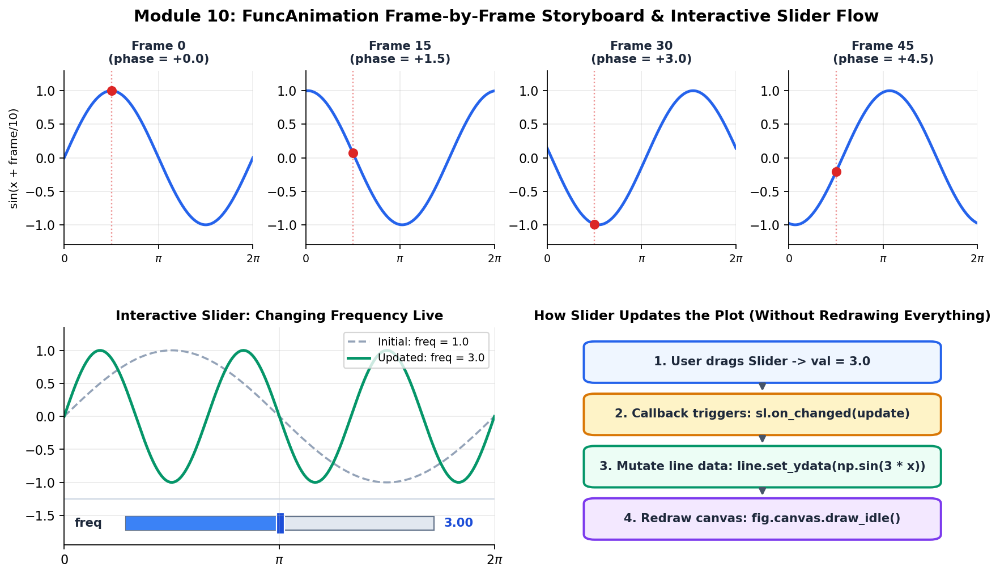
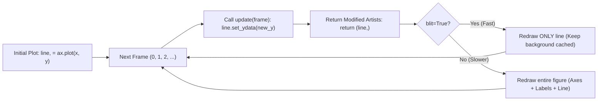
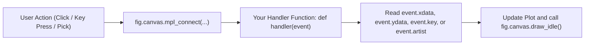

[⬅️ පෙර පාඩම: 09 — Styles, rcParams, Fonts & LaTeX](09_Styles_rcParams_Fonts_and_LaTeX.md) | [🏠 මුල් පිටුව (Course Index)](README.md) | [ඊළඟ පාඩම: 11 — Saving, Export & Publication Quality ➡️](11_Saving_Export_and_Publication_Quality.md)

---

# 🎬 පාඩම 10: Animation සහ Interactivity (Animation & Interactivity)

> [!TIP]
> **මේ පාඩමෙන් ඔයා ඉගෙන ගන්න දේවල්:**
> Static (නිශ්චල) charts වලට පණ දෙන්නේ කොහොමද කියලා අපි මේ පාඩමෙන් ඉගෙන ගන්නවා! `FuncAnimation` සහ `ArtistAnimation` වලින් GIF/MP4 animations හදන විදිය, `Slider`/`Button` වගේ interactive widgets, mouse clicks අල්ලගන්න `event handling`, live streaming plots, සහ Matplotlib interactivity වල සීමාවන් සරලව බලමු.

---

## 1. Animation කොහොමද වැඩ කරන්නේ? (Flipbook Analogy 📖)

ඔයා පොඩි කාලේ පොතක කොළ අග කෙළවරේ පොඩි මිනිහෙක් ඇඳලා, පිටු ටික වේගයෙන් පෙරළලා (**Flipbook**) ඒ මිනිහා දුවනවා වගේ හදලා තියෙනවද?

Matplotlib Animation එකක් කියන්නෙත් හරියටම ඒකමයි!
- **`FuncAnimation`**: එක chart එකක් තියාගෙන, හැම තත්පරයෙන් කොටසකටම පාරක් (e.g., 40 milliseconds) `update(frame)` කියන function එක call කරලා data ටික චුට්ටක් වෙනස් කරනවා.
- **`ArtistAnimation`**: දැනටමත් හදපු පින්තූර/frames list එකක් (`artists`) පිළිවෙළින් flipbook එකක් වගේ පෙන්නනවා.



---

## 2. `FuncAnimation` Loop සහ `blit=True` රහස

`FuncAnimation` ඇතුළේ වෙන cycle එක මේ diagram එකෙන් බලන්න:



- **`blit=True` කියන්නේ මොකක්ද?** හැම frame එකේම මුළු background එකයි, axes ටිකයි, ticks ටිකයි ආපහු අඳින්නේ නැතිව, වෙනස් වුණු `line` එක **විතරක්** redraw කරන optimization technique එකක්! මේකෙන් animation එක ගොඩක් smooth සහ වේගවත් වෙනවා. හැබැයි `blit=True` දැම්මොත් `update(frame)` function එකෙන් වෙනස් කරපු artists ටික tuple එකක් විදියට **`return (line,)`** කරන්නම ඕනේ!

---

## 3. `FuncAnimation` සහ `ArtistAnimation` + Save කිරීම (GIF / MP4)

### 🔹 `FuncAnimation` සම්පූර්ණ Code එක (Moving Sine Wave):
```python
import numpy as np
import matplotlib.pyplot as plt
from matplotlib.animation import FuncAnimation

fig, ax = plt.subplots(figsize=(7, 3.5))
x = np.linspace(0, 2 * np.pi, 200)
line, = ax.plot(x, np.sin(x), color='#2563EB', lw=2.5)
ax.set_ylim(-1.2, 1.2)
ax.set_title("Animated Sine Wave")

def update(frame):
    # X data එක එහෙමම තියලා Y data විතරක් update කරනවා
    line.set_ydata(np.sin(x + frame / 10))
    return (line,)   # blit=True නිසා tuple එකක් return කරන්නම ඕනේ!

anim = FuncAnimation(fig, update, frames=100, interval=40, blit=True)

# GIF එකක් විදියට save කරන්න (pillow library එකෙන් — extra software ඕනේ නෑ!)
anim.save('wave.gif', writer='pillow', fps=25)

# MP4 video එකක් විදියට save කරන්න (system එකේ ffmpeg තියෙනවා නම්)
# anim.save('wave.mp4', writer='ffmpeg', fps=25)
plt.show()
```

### 🔍 Line-by-Line පැහැදිලි කිරීම:
- `line, = ax.plot(...)`: `ax.plot()` return කරන්නේ list එකක් (`[Line2D]`). කොමාව (`,`) දාලා unpack කළාම `line` variable එකට කෙලින්ම ඒ `Line2D` object එක එනවා.
- `frames=100`: `update(frame)` function එකට `0` ඉඳන් `99` වෙනකම් numbers pass වෙනවා.
- `interval=40`: හැම frame එකක් අතරම 40 milliseconds (එනම් තත්පරයට frames 25ක්) පරතරයක් තියනවා.
- `anim.save('wave.gif', writer='pillow', fps=25)`: Animation එක share කරන්න පුළුවන් GIF එකක් විදියට save කරනවා.

### 🖥️ Expected Output:
- වම් පැත්තට smooth විදියට ගලාගෙන යන නිල් පාට sine wave එකක් පේනවා.
- Working directory එකේ `wave.gif` file එක හැදෙනවා.

### 🔹 `ArtistAnimation` (Pre-built Image Sequences වලට):
හැම frame එකක්ම කලින්ම generate කරලා තියෙනවා නම් (උදා: MRI scans, satellite images list එකක්):
```python
from matplotlib.animation import ArtistAnimation

fig, ax = plt.subplots()
artists = []
for i in range(20):
    img = ax.imshow(np.random.rand(10, 10), animated=True, cmap='viridis')
    artists.append([img])

anim = ArtistAnimation(fig, artists, interval=150, blit=True)
anim.save('noise.gif', writer='pillow', fps=7)
```

### 🔹 Jupyter Notebook Display:
Jupyter Notebook වල animation එකක් inline බලන්න ක්‍රම 2ක් තියෙනවා:
```python
from IPython.display import HTML
HTML(anim.to_jshtml())   # Play/Pause/Speed buttons එක්ක HTML5 player එකක් එනවා!
```
නැත්නම් notebook එකේ උඩින්ම **`%matplotlib widget`** (install `ipympl`) දැම්මම interactive controls auto වැඩ කරනවා.

---

## 4. Interactive Widgets (`Slider`, `Button`, `CheckButtons`, `RadioButtons`, `RectangleSelector`)

හිතන්න TV එකේ volume slider එක එහා මෙහා කරනකොට සද්දේ live වෙනස් වෙනවා වගේ, chart එකක frequency එක හෝ threshold එක live වෙනස් කරලා බලන්න ඕනේ කියලා!

### 🔹 Interactive `Slider` සම්පූර්ණ Code එක:
```python
import numpy as np
import matplotlib.pyplot as plt
from matplotlib.widgets import Slider

x = np.linspace(0, 2 * np.pi, 200)

fig2, ax2 = plt.subplots(figsize=(7, 4.5))
plt.subplots_adjust(bottom=0.22)          # Slider එක දාන්න යටින් ඉඩක් තියනවා

l, = ax2.plot(x, np.sin(x), color='#059669', lw=2.2)
ax2.set_ylim(-1.2, 1.2)
ax2.set_title("Drag the Slider to Change Frequency")

# Slider එක තියෙන පොඩි Axes box එක [left, bottom, width, height]
ax_slider = plt.axes([0.2, 0.05, 0.6, 0.03])
sl = Slider(ax_slider, 'freq', valmin=1, valmax=5, valinit=1)

# Slider එක move කරන හැම වෙලේම run වෙන callback function එක
def on_change(val):
    l.set_ydata(np.sin(val * x))
    fig2.canvas.draw_idle()               # Efficient redraw!

sl.on_changed(on_change)
plt.show()
```

### 🔹 තවත් ප්‍රයෝජනවත් Widgets (`matplotlib.widgets`):
- **`Button`**: Reset button එකක් හෝ "Next Step" button එකක් දාන්න (`btn.on_clicked(callback)`).
- **`CheckButtons`**: Lines කිහිපයක් show/hide (on/off) කරන්න.
- **`RadioButtons`**: Colors හෝ chart options අතරින් එකක් තෝරන්න.
- **`RectangleSelector`**: Mouse එකෙන් drag කරලා data region එකක් select කරගන්න.

---

## 5. Event Handling, Picking සහ Cursor Tools

Mouse clicks, key presses, සහ data points select කරන විදිය බලමු:



### 🔹 Mouse Clicks, Keyboard & Picking (`mpl_connect`):
```python
fig, ax = plt.subplots()
pts = ax.scatter([1, 2, 3, 4], [10, 25, 15, 30], s=100, picker=True)  # picker=True!

def on_click(event):
    if event.inaxes:
        print(f"Clicked at x={event.xdata:.2f}, y={event.ydata:.2f}")

def on_key(event):
    print(f"Key pressed: {event.key}")

def on_pick(event):
    ind = event.ind  # Select වුණු point එකේ index එක
    print(f"Picked point index: {ind}")

fig.canvas.mpl_connect('button_press_event', on_click)
fig.canvas.mpl_connect('key_press_event', on_key)
fig.canvas.mpl_connect('pick_event', on_pick)
plt.show()
```
- ඕනෑම artist එකක් click කරලා select කරන්න පුළුවන් වෙන්න **`artist.set_picker(True)`** (හෝ plot කරනකොටම `picker=True`) දාන්න.

### 🔹 Cursor Tools & Interactive Backends:
- **Interactive Backends:** Desktop script එකක `plt.show()` දැම්මම Zoom, Pan, Save toolbar එක එනවා. Jupyter වල නම් `%matplotlib widget` (`ipympl`), `%matplotlib qt`, හෝ `%matplotlib tk` පාවිච්චි කරන්න.
- **Cursor Tools:**
  - `matplotlib.widgets.Cursor(ax, useblit=True, color='red', linewidth=1)` — Mouse එකත් එක්ක යන crosshair ඉරි 2ක් දානවා.
  - `MultiCursor` — Subplots කිහිපයක එකම x-position එකේ crosshair එක sync කරනවා.
  - **`mplcursors`** (3rd-party package: `pip install mplcursors`): `mplcursors.cursor(hover=True)` එක line එකෙන් hover tooltips දාන්න පුළුවන්!

---

## 6. Live Updating Plots (Streaming Data)

Sensor data හරි stock prices හරි real-time එනකොට, මුළු chart එකම clear කරලා අඳින්නේ නැතිව fast update කරන pattern එක:

```python
import time
import numpy as np
import matplotlib.pyplot as plt

plt.ion()  # Interactive mode ON
fig, ax = plt.subplots()
xs, ys = [], []
line, = ax.plot([], [], lw=2)

for i in range(50):
    xs.append(i)
    ys.append(np.sin(i / 5) + np.random.normal(0, 0.05))
    line.set_data(xs, ys)        # Data update කරනවා
    ax.relim()                   # Axis limits අලුත් data වලට අනුව ගණන් හදනවා
    ax.autoscale_view()          # View එක auto-scale කරනවා
    fig.canvas.draw_idle()       # Redraw schedule කරනවා
    fig.canvas.flush_events()    # GUI events process කරනවා
    time.sleep(0.05)

plt.ioff()
plt.show()
```

---

## 7. Limits of Matplotlib Interactivity (කවදද වෙන Tools පාවිච්චි කරන්නේ?)

Matplotlib හදලා තියෙන්නේ ප්‍රධාන වශයෙන් **publication-quality static figures** සහ **local desktop/notebook exploration** වලට.
- ඔයාට browser එකේ run වෙන, link එකක් යවලා අනිත් අයට share කරන්න පුළුවන් **web dashboards** ඕනේ නම්:
  - **Plotly** — Built-in rich hover tooltips, zoom, HTML export.
  - **Bokeh** — Streaming web dashboards.
  - **Streamlit** — Python script එකක් විනාඩි 5න් web app එකක් කරන්න (`st.pyplot(fig)` වලින් Matplotlib charts embed කරන්නත් පුළුවන්!).

---

## 🧠 මතක තබා ගැනීමට පහසු ක්‍රම (Memory Hacks)

- **`anim = FuncAnimation(...)` — "Save it or Lose it!"**: `anim` variable එකකට assign කළේ නැත්නම්, Python garbage collector එකෙන් animation object එක delete කරලා animation එක freeze වෙනවා!
- **`line, = ax.plot(...)` — "Don't forget the comma!"**: කොමාව නැත්නම් `line` කියන්නේ list එකක්, එතකොට `line.set_ydata()` දැම්මම `AttributeError` එනවා.
- **Widget reference එකත් save කරන්න:** `sl = Slider(...)` variable එකකට assign කරලා තියාගන්න, නැත්නම් slider එක drag කළාට වැඩ කරන්නේ නැතිව යනවා!

---

## ⚠️ සාමාන්‍යයෙන් වෙන වැරදි (Common Pitfalls)

> [!WARNING]
> **1. `blit=True` දාලා `return (line,)` අමතක වීම:**
> `update(frame)` function එකෙන් වෙනස් කරපු artists ටික iterable එකක් (tuple/list) විදියට return කළේ නැත්නම් `RuntimeError: The animation function must return a sequence of Artist objects` එනවා.

> [!WARNING]
> **2. `plt.show()` දාලා Static Inline Backend එකේ Widgets වැඩ නොකිරීම:**
> Jupyter Notebook එකේ default `%matplotlib inline` mode එකේ `Slider` සහ `mpl_connect` වැඩ කරන්නේ නෑ (ඒවා නිකන් PNG images විතරයි). Interactive widgets වලට **`%matplotlib widget`** (හෝ desktop Python script එකක්) පාවිච්චි කරන්න.

> [!WARNING]
> **3. `ax.clear()` හැම frame එකේම call කිරීම:**
> `update(frame)` ඇතුළේ හැම පාරම `ax.clear()` ගහලා මුල ඉඳන් plot කළොත් animation එක ගොඩක් slow වෙනවා. ඒ වෙනුවට `line.set_ydata(...)` හෝ `scat.set_offsets(...)` වලින් data විතරක් update කරන්න!

---

## 🏋️ ප්‍රායෝගික අභ්‍යාස (Practical Exercises)

### Warm-up Exercise: Growing Line Animation
`x = np.linspace(0, 10, 100)` සහ `y = np.cos(x)` වෙන්න, frame 0 සිට 100 දක්වා line එක ටික ටික ඇඳීගෙන යන `FuncAnimation` එකක් හදන්න.

<details>
<summary>✅ පිළිතුර බලන්න (Click to see Solution)</summary>

```python
import numpy as np
import matplotlib.pyplot as plt
from matplotlib.animation import FuncAnimation

x = np.linspace(0, 10, 100)
y = np.cos(x)

fig, ax = plt.subplots()
ax.set_xlim(0, 10)
ax.set_ylim(-1.2, 1.2)
line, = ax.plot([], [], lw=2.5, color='#DC2626')

def update(frame):
    line.set_data(x[:frame], y[:frame])
    return (line,)

anim = FuncAnimation(fig, update, frames=len(x), interval=30, blit=True)
plt.show()
```
</details>

### Exercise 1: Animate a Bouncing Ball (or Orbiting Planet) and Save as GIF
බිම වැදිලා උඩ පනින බෝලයක් (හෝ සූර්යයා වටේ කැරකෙන ග්‍රහලෝකයක්) `FuncAnimation` වලින් animate කරලා `orbit.gif` විදියට save කරන්න.

<details>
<summary>✅ පිළිතුර බලන්න (Click to see Solution)</summary>

```python
import numpy as np
import matplotlib.pyplot as plt
from matplotlib.animation import FuncAnimation

fig, ax = plt.subplots(figsize=(5, 5))
ax.set_xlim(-1.5, 1.5)
ax.set_ylim(-1.5, 1.5)
ax.set_aspect('equal')
ax.set_title("Orbiting Planet Animation")

# Sun at center + dashed orbit path
theta = np.linspace(0, 2 * np.pi, 200)
ax.plot(np.cos(theta), np.sin(theta), ls='--', color='gray', alpha=0.5)
ax.scatter([0], [0], color='gold', s=300, edgecolors='orange', zorder=4, label='Sun')

planet, = ax.plot([1], [0], 'o', color='#2563EB', markersize=12, label='Planet')
ax.legend(loc='upper right')

def update(frame):
    angle = 2 * np.pi * frame / 60
    planet.set_data([np.cos(angle)], [np.sin(angle)])
    return (planet,)

anim = FuncAnimation(fig, update, frames=60, interval=40, blit=True)
anim.save('orbit.gif', writer='pillow', fps=25)
print("Saved orbit.gif!")
```
</details>

### Exercise 2: Dual Sliders (Frequency & Amplitude)
Wave එකක **frequency** එකයි **amplitude** එකයි දෙකම interactively වෙනස් කරන්න පුළුවන් `Slider` දෙකක් හදන්න.

<details>
<summary>✅ පිළිතුර බලන්න (Click to see Solution)</summary>

```python
import numpy as np
import matplotlib.pyplot as plt
from matplotlib.widgets import Slider

x = np.linspace(0, 2 * np.pi, 300)

fig, ax = plt.subplots(figsize=(7, 5))
plt.subplots_adjust(bottom=0.28)

line, = ax.plot(x, np.sin(x), lw=2.2, color='#7C3AED')
ax.set_ylim(-3.2, 3.2)
ax.set_title("Interactive Frequency & Amplitude Control")
ax.grid(True, alpha=0.3)

ax_freq = plt.axes([0.2, 0.13, 0.65, 0.03])
ax_amp  = plt.axes([0.2, 0.06, 0.65, 0.03])

s_freq = Slider(ax_freq, 'Freq', 0.5, 5.0, valinit=1.0)
s_amp  = Slider(ax_amp,  'Amp',  0.2, 3.0, valinit=1.0)

def update(_):
    line.set_ydata(s_amp.val * np.sin(s_freq.val * x))
    fig.canvas.draw_idle()

s_freq.on_changed(update)
s_amp.on_changed(update)
plt.show()
```
</details>

### Exercise 3: Click Handler for Nearest Data Point
Scatter plot එකේ ඕනෑම තැනක click කළාම, ඒ click කරපු තැනට **ළඟම තියෙන data point එකේ coordinates** print කරලා highlight කරන click handler එකක් හදන්න.

<details>
<summary>✅ පිළිතුර බලන්න (Click to see Solution)</summary>

```python
import numpy as np
import matplotlib.pyplot as plt

rng = np.random.default_rng(7)
pts_x = rng.uniform(0, 10, 25)
pts_y = rng.uniform(0, 10, 25)

fig, ax = plt.subplots()
ax.scatter(pts_x, pts_y, s=60, color='#2563EB')
highlight, = ax.plot([], [], 'o', color='#DC2626', markersize=12, fillstyle='none', mew=2.5)
ax.set_title("Click anywhere to find the nearest point")

def on_click(event):
    if event.inaxes != ax:
        return
    # Euclidean distance to every point
    dists = np.hypot(pts_x - event.xdata, pts_y - event.ydata)
    idx = np.argmin(dists)
    nx, ny = pts_x[idx], pts_y[idx]
    print(f"Nearest point #{idx}: ({nx:.2f}, {ny:.2f})")
    highlight.set_data([nx], [ny])
    fig.canvas.draw_idle()

fig.canvas.mpl_connect('button_press_event', on_click)
plt.show()
```
</details>

---

## 📋 Cheat Sheet Summary Table

| කාර්යය (Task) | Key API / Code | විස්තරය (Description) |
| --- | --- | --- |
| Function Animation | `FuncAnimation(fig, update, frames=, interval=, blit=True)` | Frame එකෙන් frame එක function එකකින් redraw කරනවා |
| Pre-built Animation | `ArtistAnimation(fig, artists)` | කලින් හදපු artists list එකක් play කරනවා |
| Save GIF / MP4 | `anim.save('a.gif', writer='pillow', fps=20)` / `writer='ffmpeg'` | Animation එක file එකකට save කරනවා |
| Jupyter Animation | `HTML(anim.to_jshtml())` / `%matplotlib widget` | Notebook එක ඇතුළේ play කරනවා |
| Mouse / Key Events | `fig.canvas.mpl_connect('button_press_event', handler)` | Click, key press, pick events අල්ලගන්නවා |
| Picking Artists | `artist.set_picker(True)` + `'pick_event'` | Plot එකේ specific point/line select කරනවා |
| Interactive Widgets | `Slider`, `Button`, `CheckButtons`, `RadioButtons`, `RectangleSelector` | Parameter tuning UI controls |
| Crosshair Cursor | `Cursor`, `MultiCursor`, `mplcursors` | Values කියවන්න crosshair/hover tooltips |
| Live Streaming Plot | `line.set_data()`, `ax.relim()`, `draw_idle()`, `flush_events()` | Full redraw නැතිව live data update කරනවා |
| Web Dashboards | Plotly / Bokeh / Streamlit | Shareable browser apps වලට companion tools |

---

[⬅️ පෙර පාඩම: 09 — Styles, rcParams, Fonts & LaTeX](09_Styles_rcParams_Fonts_and_LaTeX.md) | [🏠 මුල් පිටුව (Course Index)](README.md) | [ඊළඟ පාඩම: 11 — Saving, Export & Publication Quality ➡️](11_Saving_Export_and_Publication_Quality.md)
