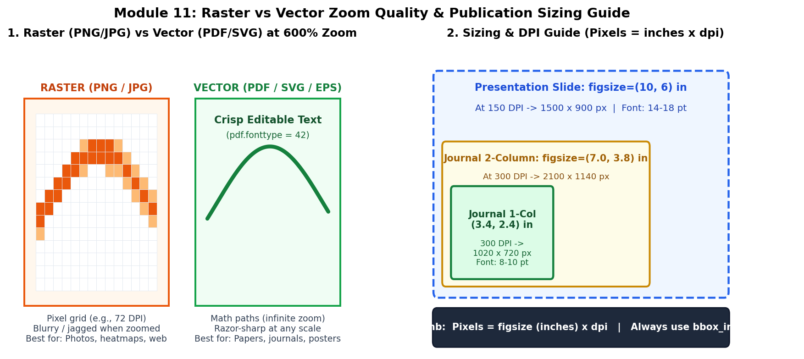
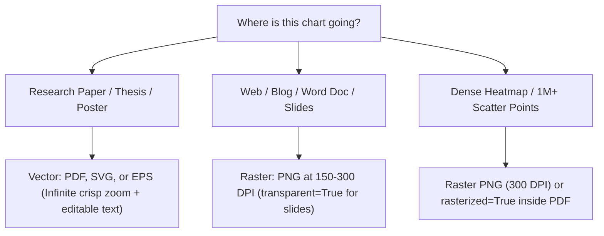
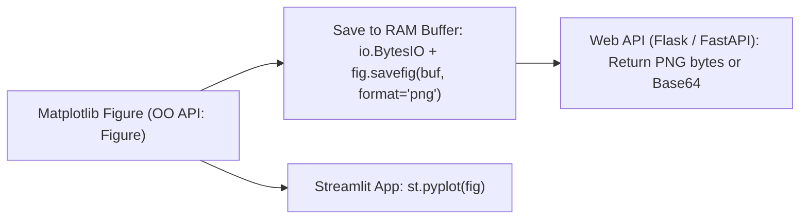

[⬅️ පෙර පාඩම: 10 — Animation & Interactivity](10_Animation_and_Interactivity.md) | [🏠 මුල් පිටුව (Course Index)](README.md) | [ඊළඟ පාඩම: 12 — Integration & Performance ➡️](12_Integration_and_Performance.md)

---

# 🖨️ පාඩම 11: Saving, Export සහ Publication Quality (Saving, Export & Publication Quality)

> [!TIP]
> **මේ පාඩමෙන් ඔයා ඉගෙන ගන්න දේවල්:**
> ඔයා හදපු ලස්සන chart එක screen එකේ හොඳට පෙනුණට, thesis එකට හරි research journal එකකට හරි දැම්මම බොඳ වෙනවද? නැත්නම් labels කැපිලා යනවද? මේ පාඩමෙන් අපි `savefig`, **Raster vs Vector**, **DPI & Journal Sizing**, editable PDF fonts (`pdf.fonttype = 42`), multi-page PDFs (`PdfPages`), batch generation, accessibility, සහ web apps වලට figures embed කරන හැටි 100% ප්‍රායෝගිකව ඉගෙන ගන්නවා!

---

## 1. Raster vs Vector (Photo Zoom vs Logo Zoom Analogy 🔍)

හිතන්න ඔයා phone එකෙන් ගත්ත **photo එකක්** (JPG/PNG) 600%ක් zoom කරනවා කියලා. එතකොට මොකද වෙන්නේ? පින්තූරේ පොඩි කොටු කොටු (**pixels**) වෙලා බොඳ වෙනවා! ඒකට තමයි **Raster** කියන්නේ.

දැන් හිතන්න graphic designer කෙනෙක් හදපු **SVG/PDF logo එකක්** 1000%ක් zoom කරනවා කියලා. කොච්චර zoom කළත් ඉරි ටික පිහියෙන් කැපුවා වගේ razor-sharp! ඇයි? ඒක save වෙලා තියෙන්නේ pixels විදියට නෙවෙයි, ගණිතමය සමීකරණ (**mathematical paths**) විදියට. ඒකට තමයි **Vector** කියන්නේ!



### 🔹 කවදද මොන Format එක තෝරන්නේ?



> **වැදගත් Note එකක්:** Points ලක්ෂ 5ක් තියෙන scatter plot එකක් Vector PDF එකක් විදියට save කළොත් PDF file එක 50MB වගේ ලොකු වෙලා open කරන්නත් අමාරු වෙනවා! ඒ වගේ dense data වලට PNG (300 DPI) හෝ `rasterized=True` පාවිච්චි කරන්න.

---

## 2. `fig.savefig()` — සම්පූර්ණ Options සහ Resolution Formula

```python
fig.savefig(
    'figure1.png',
    dpi=300,                 # Print/Publication sharpness
    bbox_inches='tight',     # Labels/titles කැපිලා යන එක නවත්තනවා!
    transparent=False,       # Slides උඩ දාන්න ඕනේ නම් True දාන්න
    facecolor='white',       # Background color එක fix කරනවා
    metadata={'Title': 'Signal Analysis', 'Author': 'Your Name'}  # Provenance metadata
)
```
- **`format=`**: File extension එකෙන් (`.png`, `.pdf`, `.svg`, `.eps`, `.jpg`) format එක auto අඳුරගන්නවා. Bytes buffer එකකට write කරනකොට `format='png'` කියලා explicit දෙන්න පුළුවන්.

### 📐 Resolution Formula (`Pixels = inches × dpi`):
- ඔයාගේ `figsize=(3.4, 2.4)` (inches) සහ `dpi=300` නම්:
  - Width = $3.4 \times 300 = 1020\text{ pixels}$
  - Height = $2.4 \times 300 = 720\text{ pixels}$
- **Journal Single-Column Sizing:** IEEE, Nature, Science වගේ journals වල single column එකක් සාමාන්‍යයෙන් අඟල් **3.3 – 3.5** පළලයි. ඒ නිසා ලොකු `(10, 6)` chart එකක් හදලා Word/LaTeX වලින් පොඩි කරනවට වඩා, මුල ඉඳන්ම **`figsize=(3.4, 2.4)`** වලින් හදලා font size එක 8–10 pt තිබ්බම paper එකේ අකුරු එක්ක හරියටම match වෙනවා!

---

## 3. Fonts in PDF/PS (`pdf.fonttype = 42`) & Multi-page PDFs (`PdfPages`)

### 🅰️ Editable Text in Adobe Illustrator / Inkscape:
Matplotlib default විදියට PDF/PS වල අකුරු save කරන්නේ **Type 3** fonts (shapes වගේ) විදියට. එතකොට journal editor කෙනෙක්ට හරි ඔයාට හරි Illustrator එකෙන් text එක edit කරන්න බෑ!
- **විසඳුම:** Script එකේ උඩින්ම මේ lines 2 දාන්න:
  ```python
  plt.rcParams['pdf.fonttype'] = 42   # TrueType editable fonts for PDF
  plt.rcParams['ps.fonttype']  = 42   # TrueType editable fonts for PS/EPS
  ```

### 📚 Complete Code Example: Journal Figure + Multi-page PDF (`PdfPages`)

```python
import matplotlib.pyplot as plt
from matplotlib.backends.backend_pdf import PdfPages

# 1. PDF එකේ අකුරු editable TrueType විදියට embed කරන්න
plt.rcParams['pdf.fonttype'] = 42

# 2. Journal single-column figure එකක් (3.4 x 2.4 inches)
fig, ax = plt.subplots(figsize=(3.4, 2.4))
ax.plot([1, 2, 3], [3, 1, 2], color='#1D4ED8', lw=2)
ax.set(xlabel='time (s)', ylabel='signal')

# Vector (PDF) සහ High-Res Raster (PNG) දෙකෙන්ම save කරනවා
fig.savefig('figure1.pdf', bbox_inches='tight')
fig.savefig('figure1.png', dpi=300, bbox_inches='tight')
plt.close(fig)

# 3. Multi-page PDF report එකක් (එක පිටුවකට එක region chart එක ගානේ)
with PdfPages('report.pdf') as pdf:
    for region in ['North', 'South', 'East']:
        f, a = plt.subplots(figsize=(6, 4))
        a.plot([1, 2, 3, 4], [10, 15, 13, 18], marker='o')
        a.set_title(f'Regional Report: {region}')
        a.set_xlabel('Quarter')
        a.set_ylabel('Revenue')
        pdf.savefig(f, bbox_inches='tight')
        plt.close(f)  # RAM leak වෙන්න නොදී figure එක close කරනවා!
```

### 🔍 Line-by-Line පැහැදිලි කිරීම:
- `plt.rcParams['pdf.fonttype'] = 42`: PDF export එකේදී TrueType fonts embed කරලා text selectable සහ editable කරනවා.
- `figsize=(3.4, 2.4)`: Exact journal single-column physical dimensions.
- `with PdfPages('report.pdf') as pdf:`: Context manager එකෙන් PDF file එක open කරලා, loop එක ඉවර වුණාම auto close කරනවා.
- `pdf.savefig(f, bbox_inches='tight')`: ඒ figure එක PDF එකේ අලුත් page එකක් විදියට එකතු කරනවා.
- `plt.close(f)`: ඉතාම වැදගත්! Loop එකක figures 50ක් හදද්දී `plt.close(f)` දැම්මේ නැත්නම්, හැම figure එකක්ම memory (RAM) එකේ රැඳිලා crash වෙන්න පුළුවන්.

### 🖥️ Expected Output:
- `figure1.pdf` (vector, editable text) සහ `figure1.png` (300 DPI crisp raster) හැදෙනවා.
- `report.pdf` කියලා පිටු 3ක (North, South, East) PDF report එකක් හැදෙනවා.

---

## 4. Batch Generation, Reproducibility, Accessibility & Embedding in Apps

### ⚙️ Batch Figure Generation (Automated Reporting):
Group 100කට charts 100ක් save කරනකොට:
1. Loop එකක් ඇතුළේ `fig, ax = plt.subplots()` හදන්න.
2. `fig.savefig(f'output/{group}.png', dpi=200, bbox_inches='tight')` කරන්න.
3. අනිවාර්යයෙන්ම **`plt.close(fig)`** දාන්න!

### 🔬 Reproducible Figures (Auditable Research):
- කවදාවත් GUI එකෙන් අතින් drag කරලා chart හදන්න එපා — හැම figure එකක්ම **Python script** එකකින් generate කරලා Git වගේ version control එකක තියාගන්න.
- Random data පාවිච්චි කරනවා නම් හැමවිටම seed එකක් දාන්න: `rng = np.random.default_rng(42)`.

### ♿ Accessibility (හැමෝටම කියවන්න පුළුවන් Charts):
- **Colourblind-friendly palettes:** Red-Green (`'jet'`, `'RdYlGn'`) වෙනුවට **`'viridis'`**, **`'cividis'`**, හෝ **Okabe-Ito** palette පාවිච්චි කරන්න.
- **High contrast & Direct labels:** අකුරු සහ background අතර හොඳ contrast තියන්න; lines වලට colors විතරක් නෙවෙයි, dashed/dotted styles (`ls='--'`) සහ markers (`marker='o'`) එකතු කරන්න.
- **Alt text:** Web/documents වල image එක දානකොට, chart එකේ main message එක කියන Alt text එකක් ලියන්න.

### 🌐 Embedding Figures in Web & GUI Apps (`io.BytesIO`, `FigureCanvasAgg`, Streamlit):



```python
import io
from matplotlib.figure import Figure
from matplotlib.backends.backend_agg import FigureCanvasAgg

# Thread-safe OO way (pyplot state නැතිව web servers වලට සුපිරි!)
fig = Figure(figsize=(5, 3), dpi=150)
canvas = FigureCanvasAgg(fig)
ax = fig.add_subplot(111)
ax.plot([1, 2, 3], [2, 5, 3])
ax.set_title("Served from Memory (No Disk File)")

buf = io.BytesIO()
fig.savefig(buf, format='png', bbox_inches='tight')
buf.seek(0)
png_bytes = buf.getvalue()  # Flask/FastAPI response එකකට කෙලින්ම යවන්න පුළුවන්!
```
Streamlit app එකක නම් තවත් ලේසියි: `st.pyplot(fig)`.

---

## 🧠 මතක තබා ගැනීමට පහසු ක්‍රම (Memory Hacks)

- **"Save FIRST, Show SECOND!"**: හැමවිටම `fig.savefig(...)` මුලින්, `plt.show()` පස්සේ!
- **"42 is the Answer (to PDF fonts)!"**: `plt.rcParams['pdf.fonttype'] = 42` දැම්මම PDF text editable වෙනවා.
- **"Loop -> Save -> Close!"**: Batch loop එකක `savefig` කළ ගමන් `plt.close(fig)` ගහන්න.

---

## ⚠️ සාමාන්‍යයෙන් වෙන වැරදි (Common Pitfalls)

> [!WARNING]
> **1. `plt.show()` කළාට පස්සේ `plt.savefig()` කිරීම (Blank White Image!):**
> `plt.show()` run වුණාම Matplotlib current figure එක clear කරනවා. ඊට පස්සේ `plt.savefig('out.png')` දැම්මොත් සම්පූර්ණයෙන්ම **සුදු හිස් image එකක්** save වෙන්නේ! හැමවිටම `fig.savefig(...)` මුලින් call කරන්න.

> [!WARNING]
> **2. `bbox_inches='tight'` අමතක වීම:**
> සමහර වෙලාවට `plt.show()` එකේ හොඳට පේන `xlabel` හෝ `suptitle` එක save කළාම බාගෙට කැපිලා යනවා. `bbox_inches='tight'` (හෝ `rcParams['savefig.bbox'] = 'tight'`) දාන එක පුරුද්දක් කරගන්න.

> [!WARNING]
> **3. Loop එකක `plt.close(fig)` අමතක වීම:**
> Figures 20කට වඩා open වුණාම Matplotlib warning එකක් දෙනවා (`More than 20 figures have been opened`), 500ක් විතර හැදුවොත් RAM full වෙලා script එක crash වෙනවා!

---

## 🏋️ ප්‍රායෝගික අභ්‍යාස (Practical Exercises)

### Warm-up Exercise: Transparent Slide Chart with Metadata
Dark slide එකක් උඩ දාන්න පුළුවන් විදියට `transparent=True` සහ `metadata={'Title': 'Sales Trend', 'Author': 'Student'}` දාලා 200 DPI PNG එකක් save කරන්න.

<details>
<summary>✅ පිළිතුර බලන්න (Click to see Solution)</summary>

```python
import matplotlib.pyplot as plt

fig, ax = plt.subplots(figsize=(6, 3.5))
ax.plot([2021, 2022, 2023, 2024], [120, 150, 175, 210], marker='o', lw=2.5, color='#38BDF8')
ax.set_title("Annual Sales Trend")
ax.set_xlabel("Year")
ax.set_ylabel("Sales ($k)")

fig.savefig(
    'slide_chart.png',
    dpi=200,
    bbox_inches='tight',
    transparent=True,
    metadata={'Title': 'Sales Trend', 'Author': 'Student'}
)
plt.close(fig)
print("Saved transparent PNG successfully!")
```
</details>

### Exercise 1: PNG (300 DPI) vs SVG Comparison
එකම chart එක 300 DPI PNG එකක් සහ SVG එකක් විදියට save කරලා, `os.path.getsize()` වලින් file sizes දෙක compare කරලා, browser එකේ open කරලා zoom quality බලන්න.

<details>
<summary>✅ පිළිතුර බලන්න (Click to see Solution)</summary>

```python
import os
import numpy as np
import matplotlib.pyplot as plt

x = np.linspace(0, 10, 300)
fig, ax = plt.subplots(figsize=(6, 3.5))
ax.plot(x, np.sin(x), lw=2, label='sin(x)')
ax.plot(x, np.cos(x), lw=2, ls='--', label='cos(x)')
ax.set_title("Raster vs Vector Export Test")
ax.legend()
ax.grid(True, alpha=0.3)

fig.savefig('compare.png', dpi=300, bbox_inches='tight')
fig.savefig('compare.svg', bbox_inches='tight')
plt.close(fig)

print(f"PNG (300 DPI) size: {os.path.getsize('compare.png'):,} bytes")
print(f"SVG (Vector)  size: {os.path.getsize('compare.svg'):,} bytes")
```
</details>

### Exercise 2: Journal Single-Column Chart
`figsize=(3.4, 2.4)` ප්‍රමාණයට journal single-column chart එකක් හදලා, අකුරු පැහැදිලිව කියවන්න පුළුවන් විදියට font sizes (`8-10 pt`) adjust කරලා, editable fonts (`pdf.fonttype = 42`) එක්ක PDF එකක් විදියට save කරන්න.

<details>
<summary>✅ පිළිතුර බලන්න (Click to see Solution)</summary>

```python
import numpy as np
import matplotlib.pyplot as plt

with plt.rc_context({
    'pdf.fonttype': 42,
    'font.size': 9,
    'axes.titlesize': 10,
    'axes.labelsize': 9,
    'xtick.labelsize': 8,
    'ytick.labelsize': 8,
    'legend.fontsize': 8,
    'axes.spines.top': False,
    'axes.spines.right': False,
}):
    x = np.linspace(0, 5, 100)
    fig, ax = plt.subplots(figsize=(3.4, 2.4))
    ax.plot(x, np.exp(-0.5 * x), color='#1D4ED8', lw=1.8, label='Model A')
    ax.plot(x, np.exp(-0.8 * x), color='#EA580C', lw=1.8, ls='--', label='Model B')
    ax.set_xlabel('Time (ms)')
    ax.set_ylabel('Decay')
    ax.set_title('Single-Column Journal Figure')
    ax.legend(frameon=False)
    ax.grid(True, alpha=0.25)

    fig.savefig('journal_fig1.pdf', bbox_inches='tight')
    plt.close(fig)
print("Saved journal_fig1.pdf!")
```
</details>

### Exercise 3: Multi-Page PDF by Product Category
Product categories 4කට (`Electronics`, `Clothing`, `Home`, `Sports`) එක පිටුවකට එක bar chart එක ගානේ තියෙන `category_report.pdf` multi-page PDF එකක් `PdfPages` පාවිච්චි කරලා හදන්න.

<details>
<summary>✅ පිළිතුර බලන්න (Click to see Solution)</summary>

```python
import matplotlib.pyplot as plt
from matplotlib.backends.backend_pdf import PdfPages

data = {
    'Electronics': [120, 145, 160, 210],
    'Clothing':    [80,  95,  110, 140],
    'Home':        [60,  70,  65,  90],
    'Sports':      [50,  85,  95,  75],
}
quarters = ['Q1', 'Q2', 'Q3', 'Q4']

plt.rcParams['pdf.fonttype'] = 42

with PdfPages('category_report.pdf') as pdf:
    for category, sales in data.items():
        fig, ax = plt.subplots(figsize=(6, 3.8))
        ax.bar(quarters, sales, color='#2563EB', width=0.55)
        ax.set_title(f'Quarterly Sales — {category}', fontweight='bold')
        ax.set_ylabel('Units Sold')
        ax.set_ylim(0, max(sales) * 1.15)
        ax.spines['top'].set_visible(False)
        ax.spines['right'].set_visible(False)
        ax.grid(axis='y', alpha=0.3)

        pdf.savefig(fig, bbox_inches='tight')
        plt.close(fig)

print("Generated 4-page category_report.pdf!")
```
</details>

---

## 📋 Cheat Sheet Summary Table

| කාර්යය (Task) | Key API / Code | විස්තරය (Description) |
| --- | --- | --- |
| Save Figure | `fig.savefig('f.png', dpi=300, bbox_inches='tight')` | High-res, labels කැපෙන්නේ නැතිව save කරනවා |
| Raster Formats | `.png`, `.jpg` (`dpi=150`–`300`) | Web, slides, dense images වලට |
| Vector Formats | `.pdf`, `.svg`, `.eps` | Papers, journals, infinite zoom වලට |
| Resolution Math | `Pixels = figsize (in) × dpi` | Image dimensions ගණනය කරන සූත්‍රය |
| Journal Sizing | `figsize=(3.4, 2.4)` + `font.size=8–10` | Single-column paper layout එකට |
| Editable PDF Fonts | `plt.rcParams['pdf.fonttype'] = 42` | Illustrator/Inkscape වලින් text edit කරන්න |
| Multi-page PDF | `with PdfPages('report.pdf') as pdf:` | Charts ගොඩක් එක PDF එකකට දානවා |
| Transparent Slide | `transparent=True` | Slide background එකට blend වෙන්න |
| Metadata | `metadata={'Title': ..., 'Author': ...}` | File properties embed කරනවා |
| Batch Export | Loop + `savefig` + `plt.close(fig)` | RAM leak නැතිව charts ගොඩක් හදනවා |
| Web/App Embed | `FigureCanvasAgg`, `io.BytesIO()`, `st.pyplot(fig)` | Disk file නැතිව memory එකෙන් serve කරනවා |

---

[⬅️ පෙර පාඩම: 10 — Animation & Interactivity](10_Animation_and_Interactivity.md) | [🏠 මුල් පිටුව (Course Index)](README.md) | [ඊළඟ පාඩම: 12 — Integration & Performance ➡️](12_Integration_and_Performance.md)
