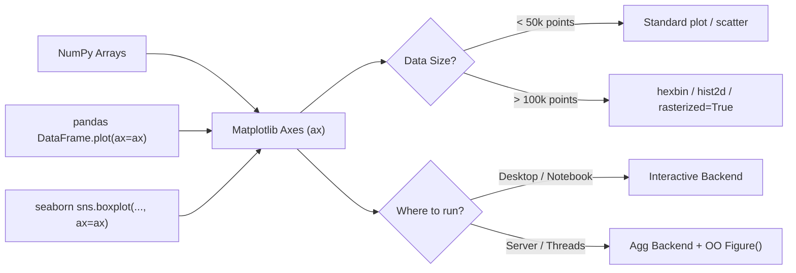
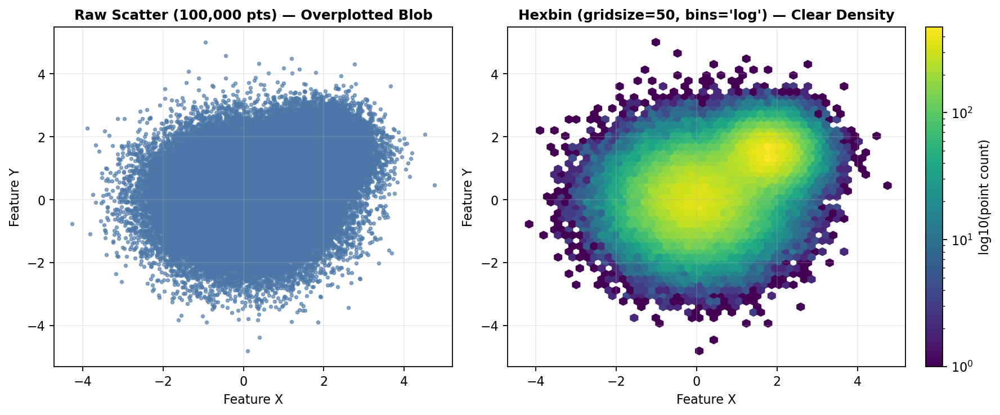

[🏠 Course Home](README.md) | [⬅️ Lesson 11: Saving, Export & Publication Quality](11_Saving_Export_and_Publication_Quality.md) | [➡️ Lesson 13: Advanced Internals (Artists, Transforms & Patches)](13_Advanced_Internals_Artists_Transforms_Patches.md)

---

# 📘 Lesson 12: Integration (pandas, NumPy, seaborn) & Performance

මේ lesson එකෙන් අපි බලන්නේ Matplotlib තනියම නෙවෙයි, **pandas**, **NumPy**, සහ **seaborn** එක්ක එකට වැඩ කරන්නේ කොහොමද කියලා — සහ ලක්ෂ ගණන්, මිලියන ගණන් data points තියෙනකොට හෝ web server එකක charts හදනකොට speed එකයි RAM එකයි බේරගන්නේ කොහොමද කියලා!

---

## 🎯 මේ Lesson එකෙන් ඉගෙන ගන්න දේවල් (Learning Objectives)

- **pandas** DataFrame / Series වලින් එක පේළියෙන් chart ඇඳලා, Matplotlib `ax` එකෙන් ඒක ලස්සනට polish කරන විදිහ.
- **NumPy** arrays සහ **seaborn** statistical charts, Matplotlib `Axes` එක්ක mix කරන විදිහ.
- `data=df` parameter එකයි categorical/string axes කෙලින්ම use කරන විදිහ.
- Data points මිලියන ගණන් තියෙනකොට slow වෙන්නේ නැතුව **hexbin**, **hist2d**, **rasterized=True**, සහ **downsampling** use කරන විදිහ.
- Live dashboards වල fast redraws (`set_data`, `blit`, `canvas.draw_idle`) සහ batch jobs වල RAM leak නවත්තන විදිහ (`plt.close`).
- Headless servers (`Agg` backend) සහ multi-threading වලදී `Figure()` OO API එක safe විදිහට use කරන හැටි.
- Matplotlib වෙනුවට හෝ එක්ක use කරන්න පුළුවන් companion libraries (**Plotly**, **Altair**, **Bokeh**, **Datashader**, **Plotnine**).

---

## 🗺️ Ecosystem & Performance Flow (Mermaid Diagram)



---

## 1️⃣ pandas, NumPy සහ seaborn එක්ක Integration

ඇත්තම ලෝකයේ data science projects වල අපි data තියාගන්නේ **pandas DataFrames** හෝ **NumPy arrays** වල. හොඳම news එක තමයි — pandas plotting සහ seaborn දෙකම ඇතුළතින් run වෙන්නේ Matplotlib මත! ඒ නිසා ඒ හැම function එකකටම අපේම Matplotlib `ax` එකක් pass කරන්න පුළුවන්.

### 📌 Integration Quick Reference Table

| Topic | සරල විස්තරය (Description) | Key API | Use Case |
| --- | --- | --- | --- |
| **pandas plotting** | DataFrame/Series methods කෙලින්ම Matplotlib වලින් draw වෙලා `Axes` එකක් return කරනවා | `df.plot(ax=ax, kind=, x=, y=)`, `df.hist`, `df.boxplot` | ඉක්මනින් data explore කරලා පස්සේ `ax` එකෙන් refine කරන්න |
| **Refining pandas plots** | Return වෙන `ax` එක අරගෙන title, labels, annotations දාන්න | `ax = df.plot(); ax.set_title(...)` | Polished, presentation-ready charts |
| **NumPy data** | NumPy arrays ඕනෑම Matplotlib function එකකට කෙලින්ම දෙන්න පුළුවන් | `ax.plot(np_array)`, `imshow`, `contourf` | Scientific computing & matrix data |
| **Seaborn** | Matplotlib උඩ හදපු high-level statistical charts library එක; `ax=` accept කරනවා | `sns.scatterplot`, `sns.histplot`, `sns.heatmap`, `sns.pairplot`, `sns.lmplot` | ඉක්මනින් statistical visuals හදන්න |
| **Mixing libraries** | ඔයා හදපු `fig, axs` වලට seaborn plot එකක් ඇඳලා Matplotlib වලින් tweak කරන්න | `sns.boxplot(data=df, ax=ax)` | Custom multi-panel dashboards |
| **Named data** | Column names string විදිහට දීලා `data=df` pass කරන්න | `ax.plot('x', 'y', data=df)` | කෙටි, clean code ලියන්න |
| **Categorical / string axes** | Text categories කෙලින්ම x හෝ y විදිහට දෙන්න | `ax.bar(['A', 'B'], [1, 2])` | Manual tick labels හදන්නේ නැතුව plot කරන්න |

> [!TIP]
> **Seaborn Note:** `sns.boxplot`, `sns.scatterplot`, `sns.histplot`, `sns.heatmap` වගේ **axes-level** functions වලට `ax=axs[1]` දෙන්න පුළුවන්. හැබැයි `sns.pairplot` සහ `sns.lmplot` කියන්නේ **figure-level** functions — ඒවා තනියම අලුත් `Figure` එකක් හදනවා (`ax=` ගන්නේ නැහැ).

---

## 2️⃣ Large Data & Performance Optimization

Data points 10,000ක් වෙනකම් `ax.scatter()` හොඳට වැඩ කරනවා. හැබැයි data points 100,000ක් හෝ 2,000,000ක් `ax.scatter()` එකට දුන්නොත්:
1. Chart එක render වෙන්න තත්පර ගාණක් යනවා (සමහරවිට freeze වෙනවා).
2. Points ඔක්කොම එක උඩ එක වැටිලා (**overplotting**) තනි පාට ගුලියක් වගේ පේනවා — කොතනද data වැඩි, කොතනද අඩු කියලා පේන්නේ නැහැ!

පහළ image එකේ වෙනස බලන්න:



වම් පැත්තේ තියෙන්නේ points 100,000ක් නිකන්ම `scatter()` කරපු එක — ඇතුළේ clusters දෙකක් තියෙනවා කියලවත් පේන්නේ නැහැ! දකුණු පැත්තේ `hexbin(..., gridsize=50, bins='log', cmap='viridis')` පාවිච්චි කරපු ගමන් density peaks දෙක පැහැදිලිවම පේනවා, ඒ වගේම render වෙන්න යන්නේ milliseconds ගාණයි!

### 📌 Performance, Memory & Server Reference Table

| Topic | සරල විස්තරය (Description) | Key API | Use Case |
| --- | --- | --- | --- |
| **Large data** | මිලියන ගණන් artists එකින් එක draw කරන්න එපා | `rasterized=True`, `ax.hexbin`, `ax.hist2d`, downsample, `ax.plot(..., '.', markersize=1)`, `mpl.rcParams['agg.path.chunksize'] = 10000` | Speed & clear density visuals |
| **Fast redraws** | අලුතින් chart එක clear කරලා අඳින්නේ නැතුව existing artist එක update කරන්න | `line.set_data(x, y)`, `blit=True`, `fig.canvas.draw_idle()` | Live sensor / real-time displays |
| **Memory management** | Figures ගොඩක් open කරලා තිබ්බොත් RAM පිරෙනවා | `plt.close(fig)`, `plt.rcParams['figure.max_open_warning']` | Loops / batch report jobs |
| **Server use (Headless)** | GUI screen එකක් නැති server එකක chart save කරන්න | `matplotlib.use('Agg')`, OO API `Figure()` (pyplot නැතුව) | Web apps (FastAPI/Django), cron jobs |
| **Threading** | `pyplot` (`plt`) thread-safe නැහැ! | `from matplotlib.figure import Figure` per thread | Concurrent multi-threaded rendering |
| **Alternatives to know** | Matplotlib වලින් එහාට යන්න ඕන වෙලාවට companion tools | **Plotly** (interactive web), **Altair** (declarative), **Bokeh** (web apps), **Datashader** (billion-point data), **Plotnine** (ggplot2 style) | හරි tool එක තෝරාගන්න |

---

## 3️⃣ Complete Code Walkthrough

### Example A: pandas + seaborn + Large Data Hexbin (Course Example)

```python
import matplotlib.pyplot as plt
import numpy as np
import pandas as pd
import seaborn as sns

# 1. CSV file එකක් dates එක්ක read කරගැනීම
df = pd.read_csv('sales.csv', parse_dates=['date'])

# 2. Panels 2ක Figure එකක් හදාගැනීම
fig, axs = plt.subplots(1, 2, figsize=(11, 4), constrained_layout=True)

# 3. වම් panel එක: pandas .plot() එකට ax=axs[0] pass කිරීම
(df.set_index('date')['revenue'].resample('ME').sum()
   .plot(ax=axs[0], marker='o', title='Monthly revenue'))
axs[0].set_ylabel('Revenue ($)')
axs[0].grid(alpha=0.3)

# 4. දකුණු panel එක: seaborn boxplot එකට ax=axs[1] pass කරලා Matplotlib වලින් refine කිරීම
sns.boxplot(data=df, x='region', y='revenue', ax=axs[1])
axs[1].set_title('Revenue by region')
axs[1].tick_params(axis='x', rotation=30)

# 5. Huge scatter (මිලියන 2ක් points): scatter වෙනුවට hexbin පාවිච්චි කිරීම
big = np.random.default_rng(0).normal(size=(2_000_000, 2))
fig2, ax2 = plt.subplots(figsize=(6, 5), constrained_layout=True)
hb = ax2.hexbin(big[:, 0], big[:, 1], gridsize=80, bins='log', cmap='viridis')
fig2.colorbar(hb, ax=ax2, label='log10(count)')
ax2.set_title('2 Million Points Aggregated with Hexbin')

plt.show()
```

#### 🔍 පේළියෙන් පේළිය විස්තරය (Line-by-Line Explanation)
- `df.set_index('date')['revenue'].resample('ME').sum()`: Date column එක index කරලා, හැම මාසයකම (`'ME'` = Month End) මුළු revenue එක ගණන් හදනවා.
- `.plot(ax=axs[0], marker='o', ...)`: pandas එකට අලුත් window එකක් හදන්න දෙන්නේ නැතුව, අපේ `axs[0]` ඇතුළෙම අඳින්න කියනවා.
- `sns.boxplot(data=df, x='region', y='revenue', ax=axs[1])`: seaborn chart එක අපේ දකුණු panel එකේ අඳිනවා.
- `axs[1].tick_params(axis='x', rotation=30)`: seaborn chart එක ඇන්දට පස්සෙත්, Matplotlib methods වලින් x-axis labels අංශක 30ක් ඇල කරන්න පුළුවන්!
- `ax2.hexbin(..., gridsize=80, bins='log')`: Points මිලියන 2ක් ෂඩාස්‍ර (hexagons) 80x80 grid එකකට එකතු කරලා, log scale එකෙන් පාට කරනවා.

#### 📊 Expected Output
1. පළමු window එකේ වම් පැත්තේ monthly revenue line chart එකත්, දකුණු පැත්තේ region අනුව revenue distribution පෙන්වන seaborn boxplot එකත් (rotated x-labels එක්ක) ලස්සනට පේනවා.
2. දෙවැනි window එකේ points මිලියන 2ක 2D bell-curve density එක viridis colors වලින් තත්පර 1කටත් අඩු කාලයකින් render වෙලා පේනවා.

---

### Example B: Thread-Safe Headless Server Rendering (No `pyplot`!)

Web server එකක (Flask / FastAPI) හෝ multi-threaded script එකක `import matplotlib.pyplot as plt` පාවිච්චි කළොත් threads අතර state එක mix වෙලා crash වෙන්න පුළුවන්. ඒකට හොඳම විසඳුම තමයි කෙලින්ම `Figure` class එක පාවිච්චි කරන එක:

```python
from io import BytesIO
from matplotlib.figure import Figure
import numpy as np

def render_chart_bytes(x, y, title="Server Chart"):
    # pyplot නැතුව thread-safe Figure එකක් හදනවා
    fig = Figure(figsize=(6, 3.5), dpi=150, layout="constrained")
    ax = fig.subplots()
    ax.plot(x, y, color="#4C78A8", lw=2)
    ax.set(title=title, xlabel="Time", ylabel="Value")
    ax.grid(alpha=0.3)

    buf = BytesIO()
    fig.savefig(buf, format="png")
    buf.seek(0)
    return buf.getvalue()

# Test කිරීම
x = np.linspace(0, 10, 200)
png_bytes = render_chart_bytes(x, np.sin(x), title="Headless Sine Wave")
print(f"Generated PNG size: {len(png_bytes):,} bytes")
```

#### 🔍 පේළියෙන් පේළිය විස්තරය
- `from matplotlib.figure import Figure`: `pyplot` state machine එක සම්පූර්ණයෙන්ම මඟ හරිනවා — 100% thread-safe සහ RAM auto-cleanup වෙනවා (`plt.close()` ඕනෙත් නැහැ!).
- `fig.subplots()`: `Figure` object එක උඩ කෙලින්ම `Axes` එකක් හදනවා.
- `BytesIO()`: Disk එකට save කරන්නේ නැතුව කෙලින්ම memory buffer එකකට PNG bytes ටික ලියනවා (web response එකක් විදිහට යවන්න හරිම ලේසියි).

#### 📊 Expected Output
```text
Generated PNG size: 28,450 bytes
```

---

## 🧠 මතක තබා ගැනීමට පහසු ක්‍රම (Memory Hacks)

1. **"One `ax` to Rule Them All"**: pandas වේවා, seaborn වේවා, Matplotlib වේවා — හැම එකටම `ax=ax` දීලා එකම `Figure` එක ඇතුළට ගේන්න පුළුවන්.
2. **"Scatter for Thousands, Hexbin for Millions"**: Points 50,000 පැන්නොත් `scatter` අමතක කරලා `hexbin` හෝ `hist2d` වලට මාරු වෙන්න.
3. **"Server = `Agg` or `Figure()`"**: Monitor එකක් නැති server එකක `plt.show()` දැම්මොත් crash වෙනවා; `matplotlib.use('Agg')` දාන්න, නැත්නම් `Figure()` විතරක් use කරන්න.
4. **"Loop = `plt.close(fig)`"**: `for` loop එකක charts 100ක් save කරනවා නම්, හැම chart එකක්ම save කරපු ගමන් `plt.close(fig)` කියන්න!

---

## ⚠️ සාමාන්‍යයෙන් වෙන වැරදි (Common Pitfalls)

> [!WARNING]
> **1. Loop එකක් ඇතුළේ `plt.close(fig)` අමතක කිරීම:**
> Charts 500ක් හදන loop එකක `plt.close(fig)` නැතුව ගියොත් figures 500ම RAM එකේ රැඳිලා script එක crash වෙනවා (`More than 20 figures have been opened` warning එක එන්නේ මේ නිසා!).
>
> **2. `rasterized=True` නැතුව ලොකු scatter එකක් PDF/SVG save කිරීම:**
> Points 500,000ක් vector PDF එකකට save කළොත් file එක 50MB+ වෙලා PDF viewer එක හිර වෙනවා. `ax.scatter(..., rasterized=True)` දැම්මොත් text & axes vector විදිහට තියෙද්දී points ටික විතරක් crisp image එකක් වෙනවා!
>
> **3. Multi-threaded Web App එකක `plt.plot()` පාවිච්චි කිරීම:**
> Users ලා දෙන්නෙක් එකම වෙලාවේ request එව්වොත් `plt` global state එක mix වෙලා එක්කෙනාගේ chart එක අනිත් කෙනාගේ chart එක උඩ ඇඳෙනවා. ඒකට අනිවාර්යයෙන්ම `from matplotlib.figure import Figure` පාවිච්චි කරන්න.

---

## 🏋️ ප්‍රායෝගික අභ්‍යාස (Practical Exercises)

### Exercise 1: pandas DataFrame එකක් Style කිරීම
Dummy sales DataFrame එකක් හදලා `df.plot(ax=ax)` වලින් line chart එකක් ඇඳලා, return වෙන `ax` එක පාවිච්චි කරලා max value එකට `annotate()` එකකුත්, custom legend එකකුත් දාන්න.

<details>
<summary>✅ පිළිතුර බලන්න (Click to see Solution)</summary>

```python
import matplotlib.pyplot as plt
import pandas as pd

df = pd.DataFrame({
    'Month': ['Jan', 'Feb', 'Mar', 'Apr', 'May', 'Jun'],
    'Sales': [120, 145, 138, 190, 175, 210],
    'Target': [130, 140, 150, 160, 170, 180]
}).set_index('Month')

fig, ax = plt.subplots(figsize=(7, 4), constrained_layout=True)
df.plot(ax=ax, marker='o', lw=2)

# Returned ax එක refine කිරීම
peak_idx = df['Sales'].idxmax()
peak_val = df['Sales'].max()
peak_pos = list(df.index).index(peak_idx)

ax.annotate(f'Peak: {peak_val}', xy=(peak_pos, peak_val), xytext=(peak_pos - 1.5, peak_val - 20),
            arrowprops=dict(arrowstyle='->', color='black'), fontweight='bold')
ax.set_title('Monthly Sales vs Target')
ax.set_ylabel('Units Sold')
ax.legend(['Actual Sales', 'Monthly Target'], frameon=True, loc='upper left')
ax.grid(alpha=0.3)
plt.show()
```
</details>

### Exercise 2: 1,000 vs 1,000,000 Points Speed Test & Hexbin Replacement
`time.perf_counter()` පාවිච්චි කරලා points 1,000ක සහ 1,000,000ක `scatter` render වෙන්න යන කාලය මනින්න, ඊට පස්සේ 1,000,000 points chart එක `hexbin` වලින් replace කරලා speed වෙනස බලන්න.

<details>
<summary>✅ පිළිතුර බලන්න (Click to see Solution)</summary>

```python
import time
import matplotlib
matplotlib.use('Agg')
import matplotlib.pyplot as plt
import numpy as np

rng = np.random.default_rng(42)

for n in [1_000, 1_000_000]:
    x, y = rng.normal(size=(2, n))
    t0 = time.perf_counter()
    fig, ax = plt.subplots()
    ax.scatter(x, y, s=1)
    fig.savefig(f'scatter_{n}.png', dpi=100)
    plt.close(fig)
    print(f'scatter ({n:,} pts): {time.perf_counter() - t0:.3f} s')

# Hexbin for 1,000,000 points
x, y = rng.normal(size=(2, 1_000_000))
t0 = time.perf_counter()
fig, ax = plt.subplots()
hb = ax.hexbin(x, y, gridsize=60, bins='log', cmap='viridis')
fig.colorbar(hb, ax=ax)
fig.savefig('hexbin_1000000.png', dpi=100)
plt.close(fig)
print(f'hexbin (1,000,000 pts): {time.perf_counter() - t0:.3f} s')
```
</details>

### Exercise 3: Headless Server Chart (Agg + OO API Only)
`pyplot` import කරන්නේවත් නැතුව, `Figure` සහ `FigureCanvasAgg` පාවිච්චි කරලා server එකක run වෙන විදිහට bar chart එකක් `server_report.png` විදිහට save කරන්න.

<details>
<summary>✅ පිළිතුර බලන්න (Click to see Solution)</summary>

```python
from matplotlib.figure import Figure
from matplotlib.backends.backend_agg import FigureCanvasAgg

fig = Figure(figsize=(6, 4), dpi=150, layout='constrained')
FigureCanvasAgg(fig)  # Headless Agg canvas attach කිරීම
ax = fig.subplots()

regions = ['North', 'South', 'East', 'West']
sales = [42, 58, 35, 64]
ax.bar(regions, sales, color='#4C78A8')
ax.set(title='Regional Sales (Headless OO API)', ylabel='Revenue ($k)')
ax.grid(axis='y', alpha=0.3)

fig.savefig('server_report.png')
print('Saved server_report.png without pyplot!')
```
</details>

---

[🏠 Course Home](README.md) | [⬅️ Lesson 11: Saving, Export & Publication Quality](11_Saving_Export_and_Publication_Quality.md) | [➡️ Lesson 13: Advanced Internals (Artists, Transforms & Patches)](13_Advanced_Internals_Artists_Transforms_Patches.md)
