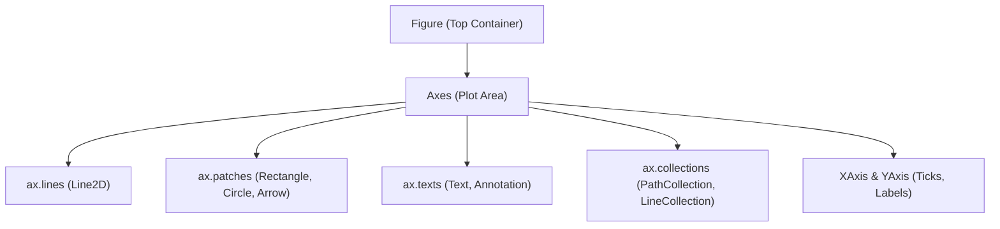
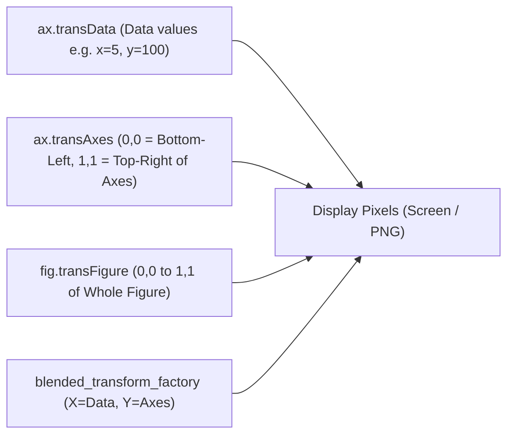
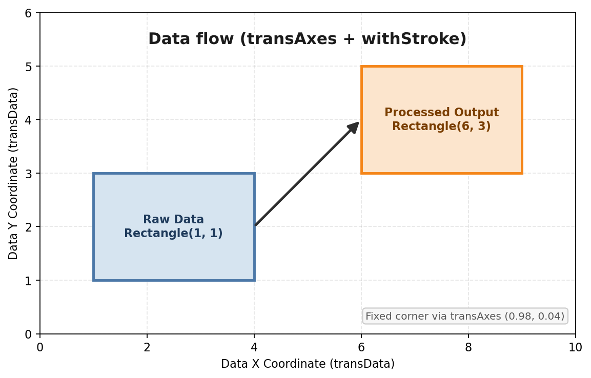

[🏠 Course Home](README.md) | [⬅️ Lesson 12: Integration & Performance](12_Integration_and_Performance.md) | [➡️ Lesson 14: Use Cases & Capstone Projects](14_Use_Cases_and_Capstone_Projects.md)

---

# 📘 Lesson 13: Advanced Internals — Artists, Transforms, Patches & Custom Components

මේ වෙනකම් අපි පාවිච්චි කළේ Matplotlib වල තියෙන ready-made charts (`plot`, `bar`, `scatter`, `hist`). හැබැයි සමහර වෙලාවට අපිට ඕන වෙනවා **සම්පූර්ණයෙන්ම අලුත් diagram එකක්**, **custom shape එකක්**, හෝ **chart එකේ corner එකට lock වෙලා තියෙන label එකක්** හදන්න. මේ lesson එකෙන් අපි Matplotlib එකේ ඇතුළත (internals) වැඩ කරන හැටි ඉගෙන ගෙන, අපේම custom components හදමු!

---

## 🎯 මේ Lesson එකෙන් ඉගෙන ගන්න දේවල් (Learning Objectives)

- Matplotlib **Artist Hierarchy** එක (`Figure` -> `Axes` -> `Lines`, `Patches`, `Texts`, `Collections`) තේරුම් ගන්න සහ inspect කරන්න.
- **Patches** (`Rectangle`, `Circle`, `Polygon`, `FancyArrowPatch`, `FancyBboxPatch`) සහ **Paths** වලින් custom diagrams අඳින්න.
- **Collections** (`LineCollection`, `PatchCollection`, `PolyCollection`, `PathCollection`) වලින් shapes දහස් ගණනක් වේගයෙන් render කරන්න.
- **Transforms** (`transData`, `transAxes`, `transFigure`, `blended_transform_factory`, `ScaledTranslation`) පාවිච්චි කරලා coordinate systems අතර මාරු වෙන්න.
- **Path Effects** (`withStroke`, `SimpleLineShadow`), **Custom Markers**, **Image Overlays** (`OffsetImage`, `AnnotationBbox`), සහ **Draw Order** (`zorder`) පාලනය කරන්න.
- Reusable custom plotting functions (`def plot_x(ax, data, **kw):`), custom projections/scales, units, backends, සහ `pytest-mpl` visual testing ගැන දැනගන්න.

---

## 🗺️ Artist Hierarchy & Coordinate Transforms (Mermaid Diagrams)

### 1. Everything is an Artist!



### 2. Coordinate Systems (Transforms)



---

## 1️⃣ Internals Complete Reference Table

| Topic | සරල විස්තරය (Description) | Key API | Use Case |
| --- | --- | --- | --- |
| **Artist hierarchy** | Chart එකේ ඇඳෙන හැමදේම `Artist` එකක්; containers ඇතුළේ child artists ඉන්නවා | `ax.get_children()`, `ax.lines`, `ax.patches`, `ax.texts` | Chart එක හැදුවට පස්සේ inspect හෝ modify කරන්න |
| **Patches** | 2D ජ්‍යාමිතික හැඩතල (rectangles, circles, polygons, arrows, wedges) | `Rectangle`, `Circle`, `Polygon`, `FancyArrowPatch`, `FancyBboxPatch` | Architecture diagrams, highlight boxes |
| **Collections** | එකම ජාතියේ artists ගොඩක් එකපාර වේගයෙන් අඳින්න | `LineCollection`, `PatchCollection`, `PolyCollection`, `PathCollection` (from `scatter`) | Multi-colored lines, thousands of shapes |
| **Paths** | ඕනෑම vector shape එකක් vertices + codes වලින් හදන්න | `matplotlib.path.Path`, `PathPatch` | Custom shapes & complex polygons |
| **Transforms** | Data coordinates, Axes fractions (0–1), Figure fractions අතර මාරු වෙන්න | `ax.transData`, `ax.transAxes`, `fig.transFigure`, `blended_transform_factory`, `ScaledTranslation` | Zoom කළත් හෙලවෙන්නේ නැති corner labels |
| **Custom markers** | ඔයාගෙම symbol එකක් marker එකක් විදිහට හදන්න | `marker=Path(...)`, `MarkerStyle` | Special domain icons on scatter/line plots |
| **Path effects** | Text හෝ lines වලට outline, shadow, glow දාන්න | `matplotlib.patheffects.withStroke`, `SimpleLineShadow` | Busy background එකක් උඩ text පැහැදිලිව පේන්න |
| **Image overlay** | PNG logos හෝ icons chart එක උඩ තියන්න | `OffsetImage`, `AnnotationBbox`, `ax.imshow(extent=)` | Company logo watermark, flags as markers |
| **Draw order** | මොන layer එක උඩින්ද, මොන එක යටින්ද පේන්නේ කියලා තීරණය කරන්න | `zorder`, `set_rasterized`, `set_animated` | Lines boxes උඩින් පේන්න / grid යටින් පේන්න |
| **Custom projections & scales** | අලුත් coordinate system එකක් හෝ axis scale එකක් register කරන්න | `matplotlib.projections.register_projection`, `ScaleBase` | Specialised scientific charts |
| **Custom plot functions** | නිතර අඳින chart patterns reusable functions වලට දාන්න | `def plot_x(ax, data, **kw):` | Clean, DRY codebase |
| **Units & converters** | Custom Python classes (e.g., Pint units, custom dates) කෙලින්ම plot කරන්න | `matplotlib.units.registry` | Physical quantities with units |
| **Backends** | Chart එක ඇත්තටම render කරන engine එක | `Agg` (PNG), `Cairo`, `PDF`, `SVG`, `Qt`, `Tk`, `WebAgg` | Output format & GUI interactivity |
| **Testing figures** | Code වෙනස් කළාම charts කැඩිලද කියලා automated test කරන්න | `matplotlib.testing.decorators.image_comparison`, `pytest-mpl` | Visual regression tests in CI/CD |

---

## 2️⃣ Visual Preview: Patches + Transforms + Path Effects

පහළ chart එක ඇඳලා තියෙන්නේ කිසිම `plot()` හෝ `bar()` එකක් නැතුව — තනිකරම `Rectangle`, `FancyArrowPatch`, `ax.transAxes`, සහ `patheffects.withStroke` පාවිච්චි කරලා!



---

## 3️⃣ Complete Code Walkthrough

### Example A: Data Flow Diagram with Patches, `transAxes` & `withStroke`

```python
import matplotlib.pyplot as plt
import matplotlib.patheffects as pe
from matplotlib.patches import Rectangle, FancyArrowPatch

fig, ax = plt.subplots(figsize=(6, 4), constrained_layout=True)
ax.set(xlim=(0, 10), ylim=(0, 6), aspect='equal')

# 1. Data coordinates වලින් Rectangle patches දෙකක් එකතු කිරීම
ax.add_patch(Rectangle((1, 1), 3, 2, fc='#D6E4F0', ec='#4C78A8', lw=2))
ax.add_patch(Rectangle((6, 3), 3, 2, fc='#FCE5CD', ec='#F58518', lw=2))

# 2. Boxes දෙක යා කරන FancyArrowPatch එකක් එකතු කිරීම
ax.add_patch(FancyArrowPatch((4, 2), (6, 4), arrowstyle='-|>', mutation_scale=18))

# 3. Axes-fraction coordinates (transAxes) වලින් title එක දාලා white outline එකක් දීම
ax.text(0.5, 0.95, 'Data flow', transform=ax.transAxes, ha='center', va='top',
        fontsize=14, fontweight='bold',
        path_effects=[pe.withStroke(linewidth=3, foreground='white')])

# 4. Inspecting Artists (හදපු artists මොනවද බලමු)
print("Total patches:", len(ax.patches))
print("Total texts:", len(ax.texts))

plt.show()
```

#### 🔍 පේළියෙන් පේළිය විස්තරය (Line-by-Line Explanation)
- `Rectangle((1, 1), 3, 2, fc=..., ec=...)`: `(x=1, y=1)` bottom-left corner එකේ ඉඳන් පළල `3`, උස `2` තියෙන කොටුවක් හදනවා. `fc` = facecolor (ඇතුළේ පාට), `ec` = edgecolor (border පාට).
- `ax.add_patch(...)`: Patch එකක් හැදුවට විතරක් පේන්නේ නැහැ — `ax.add_patch()` වලින් ඒක Axes එකට attach කරන්න ඕනේ!
- `FancyArrowPatch((4, 2), (6, 4), arrowstyle='-|>', mutation_scale=18)`: `(4, 2)` ඉඳන් `(6, 4)` වෙනකම් තියුණු ඊතලයක් අඳිනවා. `mutation_scale` එකෙන් ඊතලේ හිසේ size එක පාලනය වෙනවා.
- `transform=ax.transAxes`: `(0.5, 0.95)` කියන්නේ x-axis එකේ හරි මැද (50%) සහ y-axis එකේ උඩින්ම (95%). ඔයා `xlim` හෝ `ylim` මොනවට වෙනස් කළත් මේ text එක හෙලවෙන්නේ නැහැ!
- `path_effects=[pe.withStroke(linewidth=3, foreground='white')]`: Text එක වටේට 3pt සුදු පාට border එකක් දානවා — පිටිපස්සේ grid lines තිබ්බත් අකුරු crystal clear විදිහට පේනවා.

#### 📊 Expected Output
```text
Total patches: 3
Total texts: 1
```
*(පෙර image එකේ වගේ boxes 2ක්, ඊතලයක් සහ සුදු outline එකක් සහිත "Data flow" title එකක් පේනවා.)*

---

### Example B: Reusable Plotting Function (`def plot_series(ax, ...)`)

ඔයාගේ project එකේ හැම තැනම එකම style එකේ chart අඳිනවා නම්, code copy-paste කරන්නේ නැතුව `ax` එක parameter එකක් විදිහට ගන්න function එකක් ලියන්න!

```python
import matplotlib.pyplot as plt
import numpy as np

def plot_series(ax, x, y, **kw):
    """Reusable helper that draws a styled line on any given Axes."""
    ax.plot(x, y, **kw)
    ax.grid(alpha=0.3)
    ax.spines['top'].set_visible(False)
    ax.spines['right'].set_visible(False)
    return ax

x = np.linspace(0, 2 * np.pi, 100)
fig, axs = plt.subplots(1, 2, figsize=(9, 3.5), constrained_layout=True)

plot_series(axs[0], x, np.sin(x), color='#4C78A8', lw=2, label='sin(x)')
axs[0].set_title('Sine Wave')
axs[0].legend()

plot_series(axs[1], x, np.cos(x), color='#E45756', lw=2, linestyle='--', label='cos(x)')
axs[1].set_title('Cosine Wave')
axs[1].legend()

plt.show()
```

#### 🔍 ඇයි මේ pattern එක මෙච්චර වැදගත්?
- `**kw` (keyword arguments) දෙන නිසා `color`, `lw`, `linestyle`, `label` වගේ ඕනෑම extra option එකක් කෙලින්ම `ax.plot()` එකට යනවා.
- `ax` එක return කරන නිසා caller ට පුළුවන් තව customizations එකතු කරන්න.
- මේ pattern එක තමයි **seaborn** සහ **pandas** ඇතුළතත් පාවිච්චි කරන්නේ!

---

## 🧠 මතක තබා ගැනීමට පහසු ක්‍රම (Memory Hacks)

1. **`transData` vs `transAxes` vs `transFigure`**:
   - `transData`: Data points වල ගණන් වලින් place කරන්න (e.g., `x=2026, y=500`).
   - `transAxes`: Subplot එක ඇතුළේ percentage වලින් place කරන්න (`0.0` සිට `1.0`). Corner labels ("Panel A", "R² = 0.95") වලට සුපිරි!
   - `transFigure`: මුළු image එකේම percentage වලින් place කරන්න (watermark / footer source note වලට සුපිරි!).
2. **`zorder` = Layer Number**: Photoshop layers වගේ! `zorder=1` යටින්, `zorder=10` උඩින්. Grid lines `zorder=0` දාලා bars `zorder=3` දැම්මම grid එක bars වලට යටින් ලස්සනට පේනවා.
3. **Patch හදලා නිකන් ඉන්න එපා — `ax.add_patch(p)` කරන්න!**

---

## ⚠️ සාමාන්‍යයෙන් වෙන වැරදි (Common Pitfalls)

> [!WARNING]
> **1. Patch එකක් add කළාට axes limits auto-update නොවීම:**
> `ax.plot()` වගේ නෙවෙයි, `ax.add_patch()` කළාම සමහර වෙලාවට `xlim`/`ylim` `(0, 1)` වලම නවතිනවා, එතකොට ඔයා `(5, 5)` වල ඇඳපු කොටුව පේන්නේ නැහැ! ඒ නිසා අනිවාර්යයෙන්ම `ax.set(xlim=..., ylim=...)` හෝ `ax.autoscale_view()` දාන්න.
>
> **2. `aspect='equal'` අමතක වීම:**
> `Circle((0, 0), radius=2)` එකක් ඇන්දම x-axis සහ y-axis scales වෙනස් නම් ඒක බිත්තරයක් (ellipse) වගේ පේනවා! හරියටම රවුමක් පේන්න `ax.set_aspect('equal')` දාන්න.
>
> **3. එකම Patch object එක Axes දෙකකට add කිරීම:**
> එකම `rect = Rectangle(...)` object එක `axs[0].add_patch(rect)` සහ `axs[1].add_patch(rect)` දෙකටම දෙන්න බැහැ (`ValueError` එනවා). හැම Axes එකකටම අලුත් Patch instance එකක් හදන්න.

---

## 🏋️ ප්‍රායෝගික අභ්‍යාස (Practical Exercises)

### Exercise 1: Architecture Diagram using Patches Only
`FancyBboxPatch` (rounded boxes) 3ක් (`User` -> `API Server` -> `Database`) සහ `FancyArrowPatch` 2ක් පාවිච්චි කරලා සරල architecture diagram එකක් අඳින්න (`ax.axis('off')` දාලා clean කරන්න).

<details>
<summary>✅ පිළිතුර බලන්න (Click to see Solution)</summary>

```python
import matplotlib.pyplot as plt
from matplotlib.patches import FancyBboxPatch, FancyArrowPatch

fig, ax = plt.subplots(figsize=(8, 3), constrained_layout=True)
ax.set(xlim=(0, 12), ylim=(0, 4), aspect='equal')
ax.axis('off')

boxes = [
    (0.5, 1.2, 'User\n(Browser)', '#D6E4F0', '#4C78A8'),
    (4.5, 1.2, 'API Server\n(FastAPI)', '#FCE5CD', '#F58518'),
    (8.5, 1.2, 'Database\n(PostgreSQL)', '#D9EAD3', '#54A24B'),
]

for x, y, label, fc, ec in boxes:
    box = FancyBboxPatch((x, y), 2.8, 1.6, boxstyle='round,pad=0.15', fc=fc, ec=ec, lw=2)
    ax.add_patch(box)
    ax.text(x + 1.4, y + 0.8, label, ha='center', va='center', fontsize=10, fontweight='bold')

ax.add_patch(FancyArrowPatch((3.45, 2.0), (4.35, 2.0), arrowstyle='-|>', mutation_scale=18, lw=2))
ax.add_patch(FancyArrowPatch((7.45, 2.0), (8.35, 2.0), arrowstyle='-|>', mutation_scale=18, lw=2))

ax.set_title('Simple Web Architecture Diagram', fontsize=13, fontweight='bold')
plt.show()
```
</details>

### Exercise 2: Subplot Top-Right Labels with `transAxes`
2x2 subplot grid එකක් හදලා, හැම panel එකේම data range එක වෙනස් කරලා, `ax.transAxes` පාවිච්චි කරලා හැම subplot එකේම දකුණු පැත්තේ උඩ කෙළවරට (`0.95, 0.92`) `(A)`, `(B)`, `(C)`, `(D)` කියලා label දාන්න.

<details>
<summary>✅ පිළිතුර බලන්න (Click to see Solution)</summary>

```python
import matplotlib.pyplot as plt
import numpy as np

fig, axs = plt.subplots(2, 2, figsize=(8, 6), constrained_layout=True)
scales = [1, 100, 0.01, 5000]
labels = ['(A)', '(B)', '(C)', '(D)']
x = np.linspace(0, 10, 100)

for ax, scale, lbl in zip(axs.flat, scales, labels):
    ax.plot(x, np.sin(x) * scale, color='#4C78A8')
    # Data scale එක මොකක් වුණත් corner එකේ lock වෙලා තියෙනවා
    ax.text(0.95, 0.92, lbl, transform=ax.transAxes,
            ha='right', va='top', fontsize=12, fontweight='bold',
            bbox=dict(boxstyle='round,pad=0.2', fc='white', ec='#CCCCCC'))
    ax.grid(alpha=0.3)

plt.show()
```
</details>

### Exercise 3: Reusable `plot_with_band(ax, x, mean, std)` Function
Mean line එකයි `± std` shaded confidence band එකයි අඳින reusable `plot_with_band(ax, x, mean, std, **kw)` function එකක් ලියලා, ඒක 2x2 panels හතරකට පාවිච්චි කරන්න.

<details>
<summary>✅ පිළිතුර බලන්න (Click to see Solution)</summary>

```python
import matplotlib.pyplot as plt
import numpy as np

def plot_with_band(ax, x, mean, std, color='#4C78A8', label=None):
    ax.plot(x, mean, color=color, lw=2, label=label)
    ax.fill_between(x, mean - std, mean + std, color=color, alpha=0.2)
    ax.grid(alpha=0.3)
    return ax

rng = np.random.default_rng(7)
x = np.linspace(0, 10, 80)
fig, axs = plt.subplots(2, 2, figsize=(9, 6), constrained_layout=True)
colors = ['#4C78A8', '#F58518', '#54A24B', '#E45756']

for i, (ax, c) in enumerate(zip(axs.flat, colors), start=1):
    mean = np.sin(x + i) * i
    std = 0.25 * i + rng.uniform(0, 0.15, size=len(x))
    plot_with_band(ax, x, mean, std, color=c, label=f'Experiment {i}')
    ax.set_title(f'Sensor {i} (Mean ± 1 SD)')
    ax.legend(loc='upper right')

plt.show()
```
</details>

---

[🏠 Course Home](README.md) | [⬅️ Lesson 12: Integration & Performance](12_Integration_and_Performance.md) | [➡️ Lesson 14: Use Cases & Capstone Projects](14_Use_Cases_and_Capstone_Projects.md)
