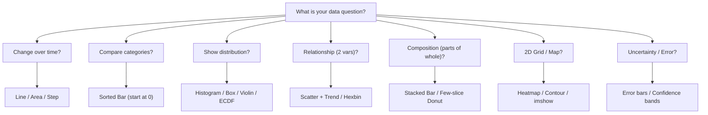
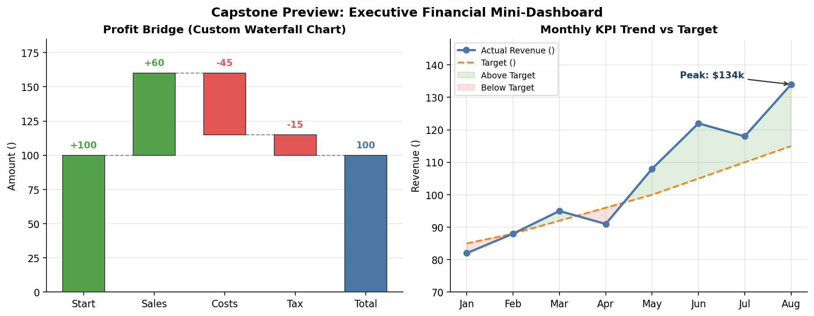

[🏠 Course Home](README.md) | [⬅️ Lesson 13: Advanced Internals (Artists, Transforms & Patches)](13_Advanced_Internals_Artists_Transforms_Patches.md) | [➡️ Lesson 15: Cheat Sheet, Pitfalls & Study Plan](15_Cheat_Sheet_Pitfalls_and_Study_Plan.md)

---

# 📘 Lesson 14: Use Cases & Capstone Projects

මේ වෙනකම් ඔයා Matplotlib වල මුළු toolkit එකම ඉගෙන ගත්තා! දැන් වැදගත්ම ප්‍රශ්නය තමයි: **"මගේ data එකට හරියන chart එක තෝරාගන්නේ කොහොමද?"** සහ **"ඇත්තම ලෝකයේ portfolio-ready projects හදන්නේ කොහොමද?"** කියන එක. මේ lesson එකේදී අපි Chart Selection Guide එකත්, Industry Use Cases ටිකත්, complete **Capstone Projects 6ක්** practical code එක්කම කරමු!

---

## 🎯 මේ Lesson එකෙන් ඉගෙන ගන්න දේවල් (Learning Objectives)

- ඕනෑම data ප්‍රශ්නයකට **හරියටම ගැළපෙන chart type එක** තෝරාගන්න (සහ නොකළ යුතු දේවල් මඟ හරින්න).
- Business, Data Science, Science/Engineering, Finance, Geospatial, සහ Education fields වල Matplotlib පාවිච්චි වෙන හැටි.
- Complete **Capstone Projects 6** සඳහා working Python blueprints:
  1. **Sales Dashboard Figure** (Mosaic Layout + Annotations)
  2. **Publication-Ready Figure Set** (Journal Sizing + LaTeX + Vector PDF)
  3. **Model Diagnostics Report** (Multi-Page PDF via `PdfPages`)
  4. **Animated Simulation** (`FuncAnimation` 2D Random Walk)
  5. **Custom Waterfall Chart** (Reusable Profit Bridge Function)
  6. **Automated Report Generator** (Headless `Agg` Batch Loop)

---

## 1️⃣ Choosing the Right Chart (හරි Chart එක තෝරාගන්නේ කොහොමද?)



### 📌 Chart Selection Cheat Table

| ඔයාගේ ප්‍රශ්නය (Question) | හොඳම Chart එක (Use) | මඟ හරින්න ඕනේ (Avoid) |
| --- | --- | --- |
| **කාලයත් එක්ක අගය වෙනස් වෙන්නේ කොහොමද?** (Over time) | Line, Area, Step | Pie charts, 3D bars |
| **Categories අතර සංසන්දනය කරන්නේ කොහොමද?** (Comparison) | Sorted horizontal/vertical bars (0 න් පටන් ගන්න) | Truncated bar axes (0 න් පටන් නොගන්නා bars) |
| **Data පැතිරිලා තියෙන්නේ කොහොමද?** (Distribution) | Histogram, Box, Violin, ECDF | Averages (mean) විතරක් පෙන්වීම |
| **Variables දෙකක් අතර සම්බන්ධය මොකක්ද?** (Relationship) | Scatter + trend line; ලොකු data වලට `hexbin` | බොරු correlation පෙන්වන dual y-axes |
| **මුළු එකෙන් කොටස් කීයද?** (Composition) | Stacked bars, පොඩි slices ගාණක pie/donut | Slices 10–15ක් තියෙන pie charts |
| **2D grid හෝ map එකක අගයන් තියෙන්නේ කොහෙද?** (Spatial/Grid) | Heatmap, Contour, Image (`viridis` / diverging) | Rainbow (`jet`) colormaps |
| **Estimate එක කොච්චර sure ද?** (Uncertainty) | Error bars, confidence bands (`fill_between`) | Uncertainty හංගලා තනි ඉරක් විතරක් පෙන්වීම |

---

## 2️⃣ Where Matplotlib is Used (කර්මාන්ත අනුව භාවිතය)

| Domain | සාමාන්‍ය වැඩ (Typical Work) | වැඩියෙන්ම ඕන වෙන Modules |
| --- | --- | --- |
| **Business Reporting** | KPI trends, regional comparisons, automated PDF reports | Modules 2, 3, 5, 11 |
| **Data Science** | EDA panels, model diagnostics, confusion matrices, learning curves | Modules 5, 6, 7 |
| **Science & Engineering** | Publication figures, signals, spectra, simulations | Modules 4, 7, 9, 11 |
| **Finance** | Candlestick-style charts (bars වලින්), drawdown & return charts | Modules 2, 4, 12 |
| **Geospatial** | GeoPandas හෝ Cartopy එක්ක maps ඇඳීම | Modules 8, 12 |
| **Education** | Animated explanations සහ interactive demos | Module 10 |

---

## 3️⃣ Visual Preview: Capstone Waterfall & KPI Dashboard

පහළ තියෙන්නේ Capstone 5 (Custom Waterfall "Profit Bridge") සහ Capstone 1 (KPI Trend Panel) එකට එකතු කරලා හදපු dashboard preview එකක්!



---

## 4️⃣ The 6 Capstone Projects (Full Practical Walkthroughs)

### 🏆 Capstone 1: Sales Dashboard Figure (Mosaic Layout + Annotations)
**Skills Tested:** `subplot_mosaic`, formatters (`FuncFormatter`), annotations, multi-panel PNG & PDF export.

```python
import matplotlib.pyplot as plt
from matplotlib.ticker import FuncFormatter
import numpy as np

months = ['Jan', 'Feb', 'Mar', 'Apr', 'May', 'Jun']
rev = np.array([82, 95, 91, 115, 128, 142]) * 1000
regions = ['North', 'South', 'East', 'West']
reg_sales = [210, 180, 145, 240]

fig, axd = plt.subplot_mosaic(
    [['trend', 'trend'],
     ['region', 'share']],
    figsize=(10, 6.5), constrained_layout=True
)

# Panel 1: Monthly Revenue Trend
ax = axd['trend']
ax.plot(months, rev, marker='o', lw=2.5, color='#4C78A8')
ax.yaxis.set_major_formatter(FuncFormatter(lambda v, _: f'${v/1000:.0f}k'))
ax.annotate('Record High!', xy=(5, rev[-1]), xytext=(3.6, rev[-1] - 12000),
            arrowprops=dict(arrowstyle='->', color='black'), fontweight='bold')
ax.set_title('Monthly Revenue Trend', fontweight='bold')
ax.grid(alpha=0.3)

# Panel 2: Regional Bar Comparison (Sorted)
order = np.argsort(reg_sales)
axd['region'].barh([regions[i] for i in order], [reg_sales[i] for i in order], color='#54A24B')
axd['region'].set_title('Sales by Region ($k)', fontweight='bold')
axd['region'].grid(axis='x', alpha=0.3)

# Panel 3: Category Share Donut
axd['share'].pie([45, 30, 25], labels=['Online', 'Retail', 'B2B'],
                 autopct='%1.0f%%', startangle=90, wedgeprops=dict(width=0.45))
axd['share'].set_title('Channel Share', fontweight='bold')

fig.suptitle('Q1–Q2 Executive Sales Dashboard', fontsize=14, fontweight='bold')
fig.savefig('sales_dashboard.png', dpi=200, bbox_inches='tight')
fig.savefig('sales_dashboard.pdf', bbox_inches='tight')
plt.close(fig)
```

---

### 🏆 Capstone 2: Publication-Ready Figure Set (Journal Sizing + LaTeX + Vector Export)
**Skills Tested:** `rcParams` / `.mplstyle`, exact journal width (e.g., 3.5 inches single-column), mathtext/LaTeX, vector PDF/SVG.

```python
import matplotlib.pyplot as plt
import numpy as np

# Journal single-column style rules (3.5 in width, 8-9pt fonts)
journal_rc = {
    'font.family': 'serif',
    'font.size': 9,
    'axes.labelsize': 9,
    'axes.titlesize': 10,
    'xtick.labelsize': 8,
    'ytick.labelsize': 8,
    'legend.fontsize': 8,
    'lines.linewidth': 1.4,
}

with plt.rc_context(journal_rc):
    x = np.linspace(0, 4 * np.pi, 300)
    y = np.exp(-0.2 * x) * np.cos(x)

    fig, ax = plt.subplots(figsize=(3.5, 2.4), constrained_layout=True)
    ax.plot(x, y, color='#1F77B4', label=r'$y(t) = e^{-0.2t}\cos(t)$')
    ax.axhline(0, color='gray', lw=0.7, ls='--')
    ax.set(xlabel=r'Time $t$ (s)', ylabel=r'Amplitude $y(t)$', title='Damped Oscillation')
    ax.legend(frameon=False)
    ax.spines[['top', 'right']].set_visible(False)

    fig.savefig('fig1_damped_oscillation.pdf', bbox_inches='tight')
    plt.close(fig)
```

---

### 🏆 Capstone 3: Model Diagnostics Report (Multi-Page PDF via `PdfPages`)
**Skills Tested:** Residuals plot, Confusion Matrix heatmap, Learning Curves, `matplotlib.backends.backend_pdf.PdfPages`.

```python
import matplotlib.pyplot as plt
from matplotlib.backends.backend_pdf import PdfPages
import numpy as np

rng = np.random.default_rng(42)

with PdfPages('model_diagnostics_report.pdf') as pdf:
    # Page 1: Residuals vs Predicted
    y_pred = np.linspace(10, 100, 120)
    residuals = rng.normal(0, 5, size=120)
    fig, ax = plt.subplots(figsize=(7, 4), constrained_layout=True)
    ax.scatter(y_pred, residuals, alpha=0.7, color='#4C78A8')
    ax.axhline(0, color='#E45756', ls='--', lw=1.5)
    ax.set(title='Page 1: Residuals vs Predicted', xlabel='Predicted', ylabel='Residual')
    ax.grid(alpha=0.3)
    pdf.savefig(fig)
    plt.close(fig)

    # Page 2: Confusion Matrix Heatmap
    cm = np.array([[85, 7], [11, 97]])
    fig, ax = plt.subplots(figsize=(5, 4.5), constrained_layout=True)
    im = ax.imshow(cm, cmap='Blues')
    fig.colorbar(im, ax=ax)
    for i in range(2):
        for j in range(2):
            ax.text(j, i, str(cm[i, j]), ha='center', va='center', fontsize=14, fontweight='bold')
    ax.set_xticks([0, 1], ['Pred 0', 'Pred 1'])
    ax.set_yticks([0, 1], ['True 0', 'True 1'])
    ax.set_title('Page 2: Confusion Matrix')
    pdf.savefig(fig)
    plt.close(fig)
```

---

### 🏆 Capstone 4: Animated Simulation (`FuncAnimation` 2D Random Walk)
**Skills Tested:** `FuncAnimation`, reusing artist via `set_data()`, saving GIF/MP4.

```python
import matplotlib.pyplot as plt
from matplotlib.animation import FuncAnimation
import numpy as np

rng = np.random.default_rng(1)
steps = rng.normal(0, 0.5, size=(120, 2))
path = np.cumsum(steps, axis=0)

fig, ax = plt.subplots(figsize=(5, 5))
ax.set(xlim=(path[:, 0].min() - 1, path[:, 0].max() + 1),
       ylim=(path[:, 1].min() - 1, path[:, 1].max() + 1),
       title='2D Random Walk Simulation')
ax.grid(alpha=0.3)

line, = ax.plot([], [], lw=1.8, color='#4C78A8')
head, = ax.plot([], [], 'o', color='#E45756', markersize=7)

def update(frame):
    line.set_data(path[:frame + 1, 0], path[:frame + 1, 1])
    head.set_data([path[frame, 0]], [path[frame, 1]])
    return line, head

anim = FuncAnimation(fig, update, frames=len(path), interval=40, blit=True)
# Save කිරීමට (pillow හෝ ffmpeg install වී තිබිය යුතුය):
# anim.save('random_walk.gif', writer='pillow', fps=25)
plt.close(fig)
```

---

### 🏆 Capstone 5: Custom Waterfall Chart (Course Example — Profit Bridge)
**Skills Tested:** Reusable custom chart function taking `ax`, `bottom=` stacking, conditional colors.

```python
import matplotlib.pyplot as plt
import numpy as np

# Waterfall chart (custom chart type from bars)
def waterfall(ax, labels, deltas):
    cum = np.cumsum([0] + list(deltas))
    for i, d in enumerate(deltas):
        ax.bar(i, d, bottom=cum[i], color='#54A24B' if d >= 0 else '#E45756')
    ax.bar(len(deltas), cum[-1], color='#4C78A8')
    ax.set_xticks(range(len(deltas) + 1), list(labels) + ['Total'])
    return ax

fig, ax = plt.subplots(figsize=(7, 3.5), constrained_layout=True)
waterfall(ax, ['Start', 'Sales', 'Costs', 'Tax'], [100, 60, -45, -15])
ax.set_title('Profit bridge')
ax.set_ylabel('Amount ($k)')
ax.grid(axis='y', alpha=0.3)
plt.show()
```

#### 🔍 පේළියෙන් පේළිය විස්තරය
- `cum = np.cumsum([0] + list(deltas))`: හැම bar එකක්ම පටන් ගන්න ඕනේ කලින් bar එක ඉවර වුණු උසෙන්! `cumsum` එකෙන් `[0, 100, 160, 115, 100]` කියන running totals හදාගන්නවා.
- `ax.bar(i, d, bottom=cum[i], ...)`: ධන අගයන් (`d >= 0`) කොළ පාටින් (`#54A24B`) උඩටත්, ඍණ අගයන් (`d < 0`) රතු පාටින් (`#E45756`) පහළටත් අඳිනවා.
- `ax.bar(len(deltas), cum[-1], color='#4C78A8')`: අන්තිමට Total bar එක 0 ඉඳන් නිල් පාටින් අඳිනවා.

---

### 🏆 Capstone 6: Automated Report Generator (Headless `Agg` Batch Loop)
**Skills Tested:** `matplotlib.use('Agg')`, loops, `plt.close(fig)` memory safety, batch PNG export.

```python
import os
import matplotlib
matplotlib.use('Agg')  # Headless server backend
import matplotlib.pyplot as plt
import numpy as np

os.makedirs('reports', exist_ok=True)
regions = {'North': [40, 45, 52, 60], 'South': [30, 28, 35, 42],
           'East': [55, 50, 58, 63], 'West': [25, 32, 41, 48]}
quarters = ['Q1', 'Q2', 'Q3', 'Q4']

for region, values in regions.items():
    fig, ax = plt.subplots(figsize=(6, 3.5), constrained_layout=True)
    ax.bar(quarters, values, color='#4C78A8')
    ax.set(title=f'{region} Region — Quarterly Sales', ylabel='Revenue ($k)', ylim=(0, 75))
    ax.grid(axis='y', alpha=0.3)
    out_path = os.path.join('reports', f'{region.lower()}_report.png')
    fig.savefig(out_path, dpi=150)
    plt.close(fig)  # RAM leak වළක්වනවා!
    print(f'Saved: {out_path}')
```

---

## 🌍 Practice Sources (පුහුණු වෙන්න හොඳම තැන්)

1. **Official Matplotlib Gallery** (`matplotlib.org/stable/gallery/`): ඔයා ආසම examples 5ක් තෝරාගෙන බලාගෙන නැතුව recreate කරන්න.
2. **Public Datasets**: **Our World in Data** (OWID) සහ **Kaggle** datasets අරගෙන ඔයාගෙම story එකක් chart කරන්න.
3. **News Charts**: *The Economist*, *Financial Times*, හෝ *New York Times* වල ඔයා දකින ලස්සන charts Matplotlib වලින් ඒ විදිහටම හදන්න try කරන්න!

---

## 🧠 මතක තබා ගැනීමට පහසු ක්‍රම (Memory Hacks)

1. **"Question First, Chart Second"**: කෙලින්ම code ලියන්න යන්න එපා — ඉස්සෙල්ලාම "මම මේකෙන් කියන්න හදන ප්‍රශ්නය මොකක්ද?" කියලා අහන්න (Time? Comparison? Distribution? Relationship?).
2. **"No Dual Y-Axes, Use Two Panels"**: Scales දෙකක් තියෙන lines දෙකක් එක chart එකේ දාලා මිනිස්සු රවට්ටනවට වඩා `plt.subplots(2, 1, sharex=True)` දාන එක 100 ගුණයක් honest සහ පැහැදිලියි!
3. **"Waterfall = `cumsum` + `bottom=`"**: මේ පොඩි trick එක මතක තිබ්බොත් ඕනෑම financial bridge chart එකක් විනාඩියෙන් හදන්න පුළුවන්.

---

## ⚠️ සාමාන්‍යයෙන් වෙන වැරදි (Common Pitfalls)

> [!WARNING]
> **1. Truncated Bar Chart Axis (0 න් පටන් නොගැනීම):**
> 98 සහ 100 කියන bars දෙක `ylim=(95, 102)` දාලා ඇන්දොත් 100 bar එක 98 ට වඩා දෙගුණයක් ලොකුයි වගේ බොරුවට පේනවා! Bar charts හැමතිස්සෙම **0 න් පටන් ගන්න**.
>
> **2. Slices ගොඩක් තියෙන Pie Chart:**
> Pie chart එකක slices 4–5ට වඩා ගියොත් මිනිස් ඇහැට angles සංසන්දනය කරන්න බැහැ. ඒ වෙලාවට **sorted horizontal bar chart (`barh`)** එකක් පාවිච්චි කරන්න.

---

## 🏋️ ප්‍රායෝගික අභ්‍යාස (Practical Exercises)

### Exercise 1: Waterfall Chart එක Upgrade කරන්න
Capstone 5 හි `waterfall()` function එකට හැම bar එක උඩින්ම අගය (`+60`, `-45`, `100`) print වෙන text labels සහ dashed connector lines එකතු කරන්න.

<details>
<summary>✅ පිළිතුර බලන්න (Click to see Solution)</summary>

```python
import matplotlib.pyplot as plt
import numpy as np

def waterfall_pro(ax, labels, deltas):
    cum = np.cumsum([0] + list(deltas))
    for i, d in enumerate(deltas):
        c = '#54A24B' if d >= 0 else '#E45756'
        ax.bar(i, d, bottom=cum[i], width=0.6, color=c)
        top = cum[i + 1] if d >= 0 else cum[i]
        ax.text(i, top + 3, f'{d:+d}', ha='center', va='bottom', fontweight='bold', color=c)
        ax.plot([i + 0.3, i + 0.7], [cum[i + 1], cum[i + 1]], color='gray', ls='--', lw=1)

    ax.bar(len(deltas), cum[-1], width=0.6, color='#4C78A8')
    ax.text(len(deltas), cum[-1] + 3, f'{cum[-1]}', ha='center', va='bottom', fontweight='bold', color='#4C78A8')
    ax.set_xticks(range(len(deltas) + 1), list(labels) + ['Total'])
    ax.set_ylim(0, max(cum) * 1.15)
    return ax

fig, ax = plt.subplots(figsize=(7, 3.8), constrained_layout=True)
waterfall_pro(ax, ['Start', 'Sales', 'Costs', 'Tax'], [100, 60, -45, -15])
ax.set_title('Upgraded Profit Bridge')
plt.show()
```
</details>

### Exercise 2: හරි Chart එක තෝරන්න (Scenario Quiz)
පහළ scenarios 3ට හරියන chart type එකයි, avoid කරන්න ඕන දේයි කියන්න:
1. රටවල් 12ක GDP සංසන්දනය කිරීම.
2. Points 500,000ක් තියෙන House Price vs Area dataset එකක සම්බන්ධය බැලීම.
3. සමාගමක මාස 24ක ආදායම වෙනස් වෙන හැටි පෙන්වීම.

<details>
<summary>✅ පිළිතුර බලන්න (Click to see Solution)</summary>

1. **රටවල් 12ක GDP:** **Sorted horizontal bar chart (`barh`)** starting at 0. *(Avoid: 12-slice pie chart හෝ truncated axis).*
2. **500,000 points Price vs Area:** **`hexbin`** හෝ **`hist2d`** with `bins='log'`. *(Avoid: raw `scatter` overplotting).*
3. **මාස 24ක ආදායම:** **Line chart** (`ax.plot`). *(Avoid: 3D bars හෝ pie chart).*
</details>

---

[🏠 Course Home](README.md) | [⬅️ Lesson 13: Advanced Internals (Artists, Transforms & Patches)](13_Advanced_Internals_Artists_Transforms_Patches.md) | [➡️ Lesson 15: Cheat Sheet, Pitfalls & Study Plan](15_Cheat_Sheet_Pitfalls_and_Study_Plan.md)
