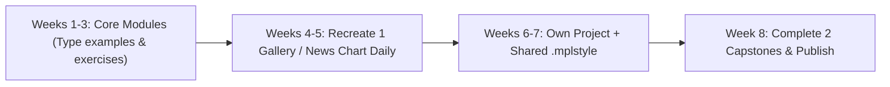

[🏠 Course Home](README.md) | [⬅️ Lesson 14: Use Cases & Capstone Projects](14_Use_Cases_and_Capstone_Projects.md)

---

# 📘 Lesson 15: Cheat Sheet, Common Pitfalls, 8-Week Study Plan & Resources

මේක ඔයාගේ **Matplotlib Quick Reference Desk Guide** එක! හැම code එකක්ම කටපාඩම් කරන්න ඕනේ නැහැ — project එකක් කරනකොට ඉක්මනින් බලාගන්න ඕන API commands, අනිවාර්යයෙන්ම මඟ හරින්න ඕන **Common Pitfalls 11**, **8-Week Practice Plan** එක, **Mastery Checklist** එක, සහ ඉදිරියට ඉගෙන ගන්න හොඳම **Resources** ඔක්කොම මේ එක පිටුවේ තියෙනවා!

---

## 1️⃣ Quick Reference Cheat Sheet (By Task)

| මට කරන්න ඕනේ... (I want to...) | පාවිච්චි කරන්න ඕනේ (Use) |
| --- | --- |
| **Figure එකක් පටන් ගන්න** | `fig, ax = plt.subplots(figsize=(7, 4), dpi=120)` |
| **Data plot කරන්න** | `ax.plot`, `ax.scatter`, `ax.bar`, `ax.hist`, `ax.imshow`, `ax.contourf`, `ax.boxplot` |
| **Labels & Text දාන්න** | `ax.set(title=, xlabel=, ylabel=)`, `ax.annotate()`, `ax.text()`, `ax.legend()` |
| **Axes & Ticks control කරන්න** | `ax.set_xlim()`, `ax.set_xscale('log')`, `ax.set_xticks()`, `ax.tick_params()`, Formatters & Locators |
| **Panels කිහිපයක් හදන්න** | `plt.subplots()`, `plt.subplot_mosaic()`, `GridSpec`, `constrained_layout=True` |
| **Data පාට කරන්න (Colormaps)** | `cmap='viridis'`, `norm=`, `fig.colorbar(mappable, ax=ax)` |
| **Global style එකක් දාන්න** | `plt.style.use()`, `plt.rcParams`, `.mplstyle` files |
| **Animate කරන්න** | `FuncAnimation(fig, update, frames=...)` සහ `anim.save('out.gif')` |
| **Export / Save කරන්න** | `fig.savefig('chart.pdf', bbox_inches='tight')` / `dpi=300` (PNG) |
| **pandas වලින් plot කරන්න** | `ax = df.plot(ax=ax)` ඊට පස්සේ `ax` එකෙන් refine කරන්න |

---

## 2️⃣ The 11 Most Common Pitfalls (සාමාන්‍යයෙන් වෙන වැරදි 11)

> [!WARNING]
> මේ වැරදි 11 මඟ හැරියොත්, ඔයාගේ Matplotlib charts 99% ක්ම professional, bug-free, සහ misleading නොවන විදිහට හැදෙනවා!

| # | වෙන වැරැද්ද (Pitfall) | හරි විසඳුම (Fix) |
| --- | --- | --- |
| **1** | එකම figure එකේ `plt.` calls සහ `ax.` methods mix කිරීම (වෙනස් axes එකකට changes යනවා!) | හැමතිස්සෙම **Object-Oriented API** (`fig, ax = plt.subplots()`, `ax.set_title(...)`) විතරක් පාවිච්චි කරන්න. |
| **2** | Loops ඇතුළේ `plt.close(fig)` අමතක කිරීම (RAM leak වෙලා crash වෙනවා) | හැම `fig.savefig()` එකකටම පස්සේ `plt.close(fig)` දාන්න. |
| **3** | Tick labels / titles එක උඩ එක වැටීම (Overlapping labels) | `constrained_layout=True` දාන්න; දිග labels rotate කරන්න (`rotation=30`) හෝ කෙටි කරන්න. |
| **4** | `jet` හෝ rainbow colormaps පාවිච්චි කිරීම (data වැරදියට පේනවා, colorblind-unfriendly) | Sequential data වලට `viridis`/`cividis` සහ 0 වටේ data වලට diverging (`coolwarm`/`RdBu_r`) ගන්න. |
| **5** | Bar chart axes 0 න් පටන් නොගැනීම (Truncated axes — වෙනස බොරුවට ලොකු කර පෙන්වනවා) | Bar charts හැමතිස්සෙම `0` න් පටන් ගන්න. |
| **6** | Points මිලියන ගණන් කෙලින්ම `scatter()` කිරීම (slow + solid blob) | `ax.hexbin()` හෝ `ax.hist2d()` වලින් aggregate කරන්න. |
| **7** | Layout හදන්න කලින් save කිරීම (labels කැපිලා යනවා) | `fig.savefig('f.png', bbox_inches='tight')` පාවිච්චි කරන්න. |
| **8** | Default font sizes/figure sizes උඩම යැපීම (slides වල පොඩි වැඩියි, papers වල ලොකු වැඩියි) | Destination එකට (slide / paper / web) ගැළපෙන්න `figsize` සහ font size තෝරන්න. |
| **9** | Color එකෙන් විතරක් groups වෙන් කිරීම (colorblind අයට / black-and-white print වල පේන්නේ නැහැ) | Color එක්කම markers (`o`, `s`, `^`), linestyles (`--`, `:`), direct labels හෝ hatching දාන්න. |
| **10** | Upgrade කළාට පස්සේ deprecated arguments පාවිච්චි කිරීම (උදා: `boxplot` වල `labels` -> `tick_labels`, පරණ seaborn style names) | Matplotlib version එකට අදාළ release notes / deprecation warnings බලන්න. |
| **11** | බොරු සම්බන්ධයක් පෙන්වන Dual Y-Axes (`twinx()`) දැමීම | Dual y-axes වෙනුවට `plt.subplots(2, 1, sharex=True)` වලින් separate panels දෙකක් අඳින්න. |

### 🔍 Bad vs Good Code Example (Pitfalls #1, #2, #3, #7)

```python
import matplotlib.pyplot as plt
import numpy as np

x = np.linspace(0, 10, 50)

# ❌ BAD: Mixing plt + ax, no layout, forgetting plt.close in loop
# for i in range(50):
#     fig, ax = plt.subplots()
#     ax.plot(x, np.sin(x + i))
#     plt.title(f'Wave {i}')
#     fig.savefig(f'bad_{i}.png')

# ✅ GOOD: Pure OO API, constrained_layout, bbox_inches='tight', plt.close(fig)
for i in range(3):
    fig, ax = plt.subplots(figsize=(6, 3.5), constrained_layout=True)
    ax.plot(x, np.sin(x + i), color='#4C78A8', lw=2)
    ax.set(title=f'Wave {i}', xlabel='Time (s)', ylabel='Signal')
    ax.grid(alpha=0.3)
    fig.savefig(f'good_{i}.png', dpi=150, bbox_inches='tight')
    plt.close(fig)
```

---

## 3️⃣ 8-Week Practice Plan (සති 8ක පුහුණු සැලැස්ම)



| සති (Weeks) | දිනපතා පුරුද්ද (Daily Habit: විනාඩි 45–60) |
| --- | --- |
| **Weeks 1 to 3** | හැම module එකක්ම කියවන්න, හැම code example එකක්ම අතින් type කරලා run කරන්න, exercises ඔක්කොම ඉවර කරන්න. |
| **Weeks 4 to 5** | දවසකට එක ගාණේ Matplotlib Official Gallery chart එකක් හෝ news site chart එකක් recreate කරන්න. |
| **Weeks 6 to 7** | ඔයාගෙම real project data අරගෙන, එකම `.mplstyle` file එකක් පාවිච්චි කරලා consistent figure set එකක් හදන්න. |
| **Week 8** | Lesson 14 එකේ Capstone Projects වලින් 2ක් සම්පූර්ණ කරලා GitHub / portfolio එකේ publish කරන්න! |

---

## 4️⃣ Mastery Checklist (ඔයාගේ ප්‍රගතිය මනින්න!)

මේ course එක ඉවර කරලා ඔයාට මේ හැම එකක්ම තනියම කරන්න පුළුවන්ද කියලා tick කරලා බලන්න:

- [ ] මට `Figure`, `Axes`, `Axis`, සහ `Artist` අතර වෙනස පැහැදිලි කරන්න සහ ඒවා අතර navigate කරන්න පුළුවන්.
- [ ] දෙන ඕනෑම data ප්‍රශ්නයකට හරියන chart type එක තෝරාගන්න පුළුවන්.
- [ ] Axes, ticks, dates, සහ units මට ඕන විදිහට format කරන්න පුළුවන්.
- [ ] Shared axes සහ තනි legend/colorbar එකක් එක්ක multi-panel layouts හදන්න පුළුවන්.
- [ ] Data වලට honest විදිහට colormaps සහ normalisations තෝරාගන්න පුළුවන්.
- [ ] මුළු project එකටම reusable `.mplstyle` theme එකක් apply කරන්න පුළුවන්.
- [ ] Print (journal/PDF) සහ Web (PNG/SVG) වලට හරි size, DPI, සහ format එකෙන් export කරන්න පුළුවන්.
- [ ] Simulation එකක් animate කරන්න සහ simple interactivity එකතු කරන්න පුළුවන්.
- [ ] `ax` parameter එකක් ගන්න reusable custom plotting functions ලියන්න පුළුවන්.

---

## 5️⃣ Best Resources & Next Steps (ඉදිරියට යන්න හොඳම මූලාශ්‍ර)

### 📚 Recommended Books & Docs
- **Official Matplotlib Documentation** (`matplotlib.org`): Tutorials, User Guide, Gallery, සහ official PDF Cheatsheets.
- ***Scientific Visualization: Python + Matplotlib*** — Nicolas Rougier (නොමිලේ online කියවන්න පුළුවන් සුපිරි පොතක්!).
- ***Fundamentals of Data Visualization*** — Claus Wilke (නොමිලේ online — හොඳ charts සහ නරක charts වෙනස ඉගෙන ගන්න).
- ***The Visual Display of Quantitative Information*** — Edward Tufte (Data visualization වල classic පොත).

### 🚀 Next Steps After Matplotlib
1. **seaborn**: Statistical visualizations ඉක්මනින් අඳින්න.
2. **Plotly** හෝ **Altair**: Web browser එකේ hover/zoom කරන්න පුළුවන් interactive charts හදන්න.
3. **pandas** සහ **NumPy**: Data cleaning, transformation, සහ fast array math mastery කරන්න.

---

## 🧠 මතක තබා ගැනීමට පහසු ක්‍රම (Memory Hacks)

1. **"OO, Layout, Tight, Close"**: මේ වචන 4 මතක තියාගන්න!
   - **OO**: `fig, ax = plt.subplots()`
   - **Layout**: `constrained_layout=True`
   - **Tight**: `bbox_inches='tight'`
   - **Close**: `plt.close(fig)`
2. **Type, Don't Just Read**: Code බලනවට වඩා අතින් type කරලා parameters වෙනස් කරලා බැලුවම තමයි Matplotlib හරියටම ඇඟට වදින්නේ!

---

## 🏋️ Final Quick Self-Check Quiz

පහළ වැරදි code snippet එකේ තියෙන pitfalls 4 හොයලා හරියට rewrite කරන්න:

```python
for i in range(100):
    fig, ax = plt.subplots()
    plt.bar(['A', 'B'], [98, 100])
    plt.ylim(95, 102)
    plt.imshow([[1, 2], [3, 4]], cmap='jet')
    fig.savefig(f'chart_{i}.png')
```

<details>
<summary>✅ පිළිතුර බලන්න (Click to see Solution)</summary>

හොයාගත්ත Pitfalls 4:
1. `plt.` සහ `ax.` mix කිරීම (OO API පාවිච්චි කළ යුතුයි).
2. Bar chart එක 95 න් පටන් ගැනීම (truncated axis — 0 න් පටන් ගන්න ඕනේ).
3. `cmap='jet'` පාවිච්චි කිරීම (`viridis` පාවිච්චි කළ යුතුයි).
4. Loop එකේ `plt.close(fig)` සහ `bbox_inches='tight'` නොමැති වීම.

**Fixed Version (Separate Panels):**
```python
import matplotlib.pyplot as plt

for i in range(3):
    fig, axs = plt.subplots(1, 2, figsize=(8, 3.5), constrained_layout=True)
    axs[0].bar(['A', 'B'], [98, 100], color='#4C78A8')
    axs[0].set(ylim=(0, 110), title='Honest Bar Chart (Starts at 0)')

    im = axs[1].imshow([[1, 2], [3, 4]], cmap='viridis')
    fig.colorbar(im, ax=axs[1])
    axs[1].set_title('Perceptually Uniform Heatmap')

    fig.savefig(f'chart_{i}.png', dpi=150, bbox_inches='tight')
    plt.close(fig)
```
</details>

---

[🏠 Course Home](README.md) | [⬅️ Lesson 14: Use Cases & Capstone Projects](14_Use_Cases_and_Capstone_Projects.md)
