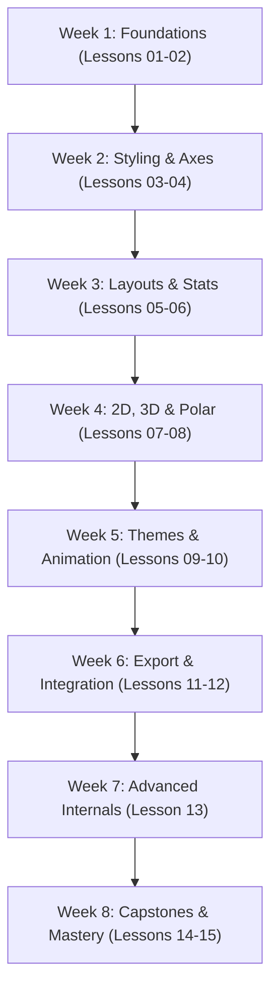

# 📊 Master Matplotlib: Complete Self-Study Course (සිංහල පාඩම් මාලාව)

**සාදරයෙන් පිළිගන්නවා!** මේක ඔයාගේ පළමු `plt.plot()` එකේ ඉඳන් publication-quality scientific figures, animations, custom components, සහ automated server dashboards දක්වා සම්පූර්ණ **Matplotlib toolkit** එකම **සරල, එදිනෙදා කතා කරන සිංහලෙන්** ඉගෙන ගන්න හදපු සති 8ක self-study පාඩම් මාලාවයි!

---

## 🎯 කවුරු සඳහාද? (Who is this for?)
- මූලික Python (සහ පොඩි NumPy / pandas) දැනුම තියෙන students ලා, data analysts ලා, data scientists ලා, සහ engineers ලා සඳහා.

## 🚀 මේ Course එක ඉවර වුණාම ඔයාට කරන්න පුළුවන් දේවල්
- ඕනෑම data ප්‍රශ්නයකට **හරි chart type එක** තෝරාගන්න.
- Chart එකේ හැම visual element එකක්ම (ticks, dates, legends, fonts, LaTeX, colors) 100% control කරන්න.
- Multi-panel dashboards, statistical plots, 2D heatmaps/contours, 3D/polar plots, සහ animations හදන්න.
- Journal, web, සහ automated server reports වලට ගැළපෙන professional figures export කරන්න.

---

## 🗺️ Learning Path (ඉගෙන ගන්න පිළිවෙළ)



---

## 📚 සියලුම පාඩම් (All 15 Lessons Index)

| Lesson | මාතෘකාව (Topic) | සතිය (Week) |
| --- | --- | --- |
| **01** | [Setup, Architecture & Two APIs (`pyplot` vs OO)](01_Setup_Architecture_and_Two_APIs.md) | Week 1 |
| **02** | [Core Plot Types (Line, Scatter, Bar, Stack, Pie)](02_Core_Plot_Types.md) | Week 1 |
| **03** | [Styling, Text, Annotations & Legends](03_Styling_Text_Annotations_and_Legends.md) | Week 2 |
| **04** | [Axes Control, Ticks, Scales & Dates](04_Axes_Control_Ticks_Scales_and_Dates.md) | Week 2 |
| **05** | [Subplots & Multi-Panel Layouts (`GridSpec`, `mosaic`)](05_Subplots_and_Layouts.md) | Week 3 |
| **06** | [Statistical & Distribution Plots (Hist, Box, Violin, ECDF)](06_Statistical_and_Distribution_Plots.md) | Week 3 |
| **07** | [2D Data: Images, Heatmaps, Contours & Colormaps](07_2D_Data_Images_Heatmaps_Contours_Colormaps.md) | Week 4 |
| **08** | [3D, Polar & Specialised Plots](08_3D_Polar_and_Specialised_Plots.md) | Week 4 |
| **09** | [Styles, `rcParams`, Fonts & LaTeX Math](09_Styles_rcParams_Fonts_and_LaTeX.md) | Week 5 |
| **10** | [Animation & Interactivity (`FuncAnimation`, Events, Widgets)](10_Animation_and_Interactivity.md) | Week 5 |
| **11** | [Saving, Export & Publication Quality (DPI, Vector PDF/SVG)](11_Saving_Export_and_Publication_Quality.md) | Week 6 |
| **12** | [Integration (pandas, NumPy, seaborn) & Performance](12_Integration_and_Performance.md) | Week 6 |
| **13** | [Advanced Internals: Artists, Transforms, Patches & Custom Components](13_Advanced_Internals_Artists_Transforms_Patches.md) | Week 7 |
| **14** | [Use Cases & Capstone Projects (6 Full Projects)](14_Use_Cases_and_Capstone_Projects.md) | Week 8 |
| **15** | [Cheat Sheet, 11 Common Pitfalls, 8-Week Plan & Checklist](15_Cheat_Sheet_Pitfalls_and_Study_Plan.md) | Reference |

---

## 📅 8-Week Study Roadmap (සති 8ක සැලැස්ම)

| සතිය (Week) | Modules | ඉලක්කය (Milestone) |
| --- | --- | --- |
| **Week 1** | 1 to 2 | `Figure` සහ `Axes` තේරුම් ගැනීම; core chart types ඇඳීම |
| **Week 2** | 3 to 4 | Charts style කිරීම; axes, ticks, dates, සහ scales පාලනය කිරීම |
| **Week 3** | 5 to 6 | Multi-panel layouts හා statistical distribution plots හැදීම |
| **Week 4** | 7 to 8 | Heatmaps, contours, 3D, සහ polar charts ඇඳීම |
| **Week 5** | 9 to 10 | Themes, custom fonts, LaTeX math; animations සහ interactivity |
| **Week 6** | 11 to 12 | Publication export සහ pandas / seaborn / high-performance integration |
| **Week 7** | 13 | Artists, transforms, patches, සහ reusable custom components |
| **Week 8** | 14 to 15 | Capstone projects 2ක් සම්පූර්ණ කිරීම සහ mastery checklist verify කිරීම |

---

## ⚡ Quick Setup Check (පටන් ගන්න කලින් test කරන්න)

ඔයාගේ Python environment එකේ Matplotlib හරියට install වෙලාද කියලා මේ code එක run කරලා බලන්න:

```python
import matplotlib as mpl
import matplotlib.pyplot as plt
import numpy as np

print("Matplotlib version:", mpl.__version__)
```

> [!TIP]
> **හොඳම study ක්‍රමය:** හැම lesson එකකම තියෙන code examples නිකන් කියවන්නේ නැතුව **අතින් type කරලා run කරන්න**, ඊට පස්සේ අග තියෙන **Practical Exercises** ටික තනියම try කරලා collapsible solution එක එක්ක compare කරන්න!

👉 **පටන් ගමු:** [➡️ Lesson 01: Setup, Architecture & Two APIs](01_Setup_Architecture_and_Two_APIs.md)
