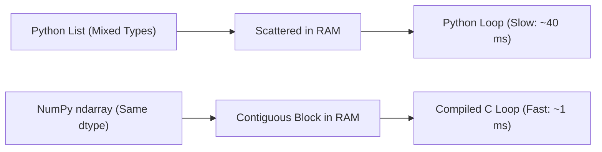
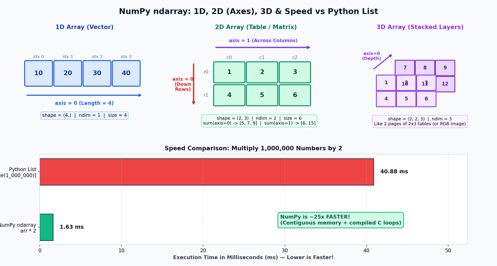
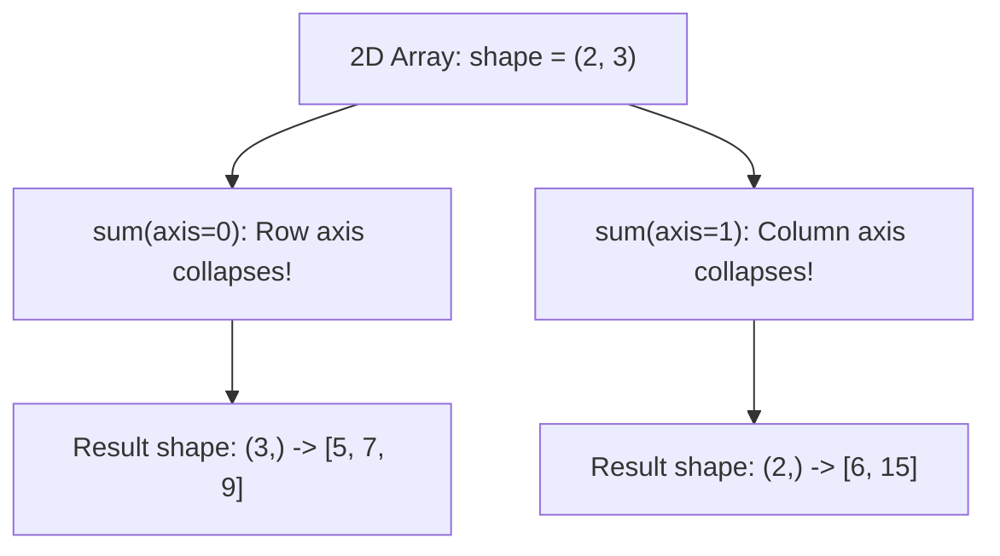

[🏠 Course Home](README.md) | **Module 01: Setup & ndarray Basics** | [Next: Module 02 ➡️](02_Creating_Arrays.md)

---

# 📘 Module 01: Setup, `ndarray` Basics සහ NumPy 2.x Notes

> **මේ පාඩමෙන් ඔයා ඉගෙන ගන්නේ මොනවද?**
> Python වල තියෙන සාමාන්‍ය `list` එකකට වඩා NumPy `ndarray` එක කොච්චර වේගවත්ද, ඒක ඇත්තටම මොකක්ද, `axis` කියන්නේ මොකක්ද, සහ NumPy 2.x අලුත් version එකේදී අපි දැනගන්න ඕන වෙනස්කම් මොනවද කියලා සරලව මුල ඉඳන් ඉගෙන ගමු!

---

## 1. ඇයි අපිට NumPy ඕනේ? (Why NumPy?)

හිතන්න ඔයාගේ ඉස්කෝලේ ළමයි 1,000,000 කගේ ගණිත ලකුණු තියෙනවා කියලා. හැම ළමයෙක්ගේම ලකුණු 2න් වැඩි කරන්න ඕනේ.

- **Python `list` එකක්** කියන්නේ එක එක ජාතියේ බඩු (පෑනක්, පොතක්, මකනයක්, කෑම පෙට්ටියක්) දාපු **බෑග් එකක්** වගේ. ඒ නිසා Python එකට හැම item එකක් ළඟටම ගිහින් "මේක number එකක්ද? string එකක්ද?" කියලා බල බල එකින් එක loop කරන්න වෙනවා. ඒක හරිම slow!
- **NumPy `ndarray` එකක්** කියන්නේ එකම ජාතියේ බිත්තර ටිකක් පිළිවෙළට අහුරපු **බිත්තර තැටියක් (Egg Tray)** වගේ! හැම කොටුවකම තියෙන්නේ එකම data type එකේ (Homogeneous) number එකක්. Memory එකේ එක ළඟ (Contiguous memory) තියෙන නිසා computer එකේ C language වලින් ලියපු වේගවත් loops (compiled loops) පාවිච්චි කරලා එකපාරටම ගණන් හදන්න පුළුවන්.

ඒ නිසා NumPy වල vector math කියන වැඩ Python loops වලට වඩා **10x සිට 100x දක්වා වේගවත්**! Data Science, Machine Learning (pandas, SciPy, scikit-learn, Matplotlib, PyTorch, TensorFlow) හැම දේකම අඩිතාලම තමයි මේ NumPy.



---

## 2. NumPy Install කරගන්න විදිය (Installation)

ඔයාගේ computer එකේ project එකකට NumPy දාගන්නකොට, වෙනම **Virtual Environment (`venv`)** එකක් හදාගෙන install කරන එක හොඳම පුරුද්ද (reproducible setup).

```bash
# 1. Virtual environment එකක් හදාගන්න (Optional නමුත් හොඳම ක්‍රමය)
python -m venv myenv

# 2. Virtual environment එක activate කරගන්න
# Windows වලදී:
# myenv\Scripts\activate
# Linux / Mac වලදී:
source myenv/bin/activate

# 3. NumPy install කරන්න (pip හෝ conda පාවිච්චි කරන්න පුළුවන්)
pip install numpy
# හෝ Conda පාවිච්චි කරනවා නම්:
# conda install numpy
```

Install වුණාද කියලා බලන්න Python වලින් මෙහෙම run කරලා බලමු:

```python
import numpy as np  # NumPy හැමෝම කෙටියෙන් 'np' කියලා import කරනවා

print("NumPy version:", np.__version__)
```

**Expected Output:**
```text
NumPy version: 2.3.5
```
*(ඔයාගේ machine එකේ install වෙලා තියෙන version අංකය මෙතන පෙන්නයි — උදා: `2.1.0`, `2.3.5`)*

---

## 3. මොකක්ද මේ `ndarray`? (The N-Dimensional Array)

NumPy වල ප්‍රධානම දේ තමයි **`ndarray`** (N-dimensional array). මේකට fixed `dtype` (දත්ත වර්ගය) එකක් සහ `shape` (හැඩය) එකක් තියෙනවා.

- **1D Array (Vector):** එක පේළියක තියෙන ලකුණු ටිකක් වගේ — උදා: `[10, 20, 30, 40]`
- **2D Array (Matrix / Table):** පේළි (rows) සහ තීරු (columns) තියෙන ඉස්කෝලේ ලකුණු වගුවක් හෝ බිත්තර තැටියක් වගේ.
- **3D Array (Tensor):** 2D වගු කීපයක් එක උඩ එක තියලා හදපු පොතක පිටු ටිකක් වගේ (හෝ Color Photo එකක Red, Green, Blue layers 3 වගේ).



### `ndarray` එකක ප්‍රධාන ගුණාංග (Key Attributes)

```python
import numpy as np

# 2D array එකක් හදමු (Rows 2ක් සහ Columns 3ක්)
a = np.array([[1, 2, 3],
              [4, 5, 6]])

print("Array:\n", a)
print("shape   :", a.shape)     # (rows, cols) -> (2, 3)
print("ndim    :", a.ndim)      # dimensions ගාණ -> 2
print("size    :", a.size)      # මුළු elements ගාණ -> 6
print("dtype   :", a.dtype)     # data type එක -> int64
print("itemsize:", a.itemsize)  # එක number එකකට යන bytes ගාණ -> 8
print("nbytes  :", a.nbytes)    # මුළු array එකටම යන bytes (size * itemsize) -> 48
```

**Line-by-Line පැහැදිලි කිරීම:**
1. `np.array([[1, 2, 3], [4, 5, 6]])`: Python nested list එකක් 2D NumPy array එකක් බවට පත් කරනවා.
2. `a.shape`: `(2, 3)` — ඒ කියන්නේ පේළි 2යි, තීරු 3යි.
3. `a.ndim`: `2` — මේක 2D (ද්විමාන) array එකක්.
4. `a.size`: `6` — මුළු ඉලක්කම් 6ක් තියෙනවා ($2 \times 3 = 6$).
5. `a.dtype`: `int64` — හැම ඉලක්කමක්ම 64-bit integer එකක්.
6. `a.itemsize`: `8` — 64 bits කියන්නේ bytes 8යි ($64 / 8 = 8$).
7. `a.nbytes`: `48` — මුළු memory එක bytes 48යි ($6 \times 8 = 48$).

**Expected Output:**
```text
Array:
 [[1 2 3]
  [4 5 6]]
shape   : (2, 3)
ndim    : 2
size    : 6
dtype   : int64
itemsize: 8
nbytes  : 48
```

---

## 4. Python Lists vs NumPy Arrays

Python `list` එකක් `2` න් වැඩි කළොත් වෙන දේයි, NumPy `ndarray` එකක් `2` න් වැඩි කළොත් වෙන දේයි සම්පූර්ණයෙන්ම වෙනස්!

```python
import numpy as np

lst = [1, 2, 3]
arr = np.array([1, 2, 3])

# Python list: එකම list එක දෙපාරක් repeat කරනවා!
print("List * 2 :", lst * 2)

# NumPy array: හැම ඉලක්කමක්ම වෙන වෙනම 2න් වැඩි කරනවා (Element-wise)!
print("Array * 2:", arr * 2)

# List දෙකක් එකතු කළොත් concatenate (එකට අලවනවා), Array දෙකක් නම් element-wise එකතු වෙනවා
print("List + List  :", lst + lst)
print("Array + Array:", arr + arr)
```

**Expected Output:**
```text
List * 2 : [1, 2, 3, 1, 2, 3]
Array * 2: [2 4 6]
List + List  : [1, 2, 3, 1, 2, 3]
Array + Array: [2 4 6]
```

### වේගය මැනලා බලමු (`%timeit` / `time`)

Jupyter Notebook එකක නම් `%timeit` magic command එකෙන් ලේසියෙන්ම speed එක මනින්න පුළුවන්:

```python
import numpy as np
import time

x = np.arange(1_000_000)

# Jupyter Notebook වලදී මෙහෙම check කරන්න පුළුවන්:
# %timeit x * 2                             -> සාමාන්‍යයෙන් ~1 ms
# %timeit [i * 2 for i in range(1_000_000)] -> ~40 ms - 50 ms හෝ ඊට වැඩියි

# සාමාන්‍ය Python script එකක time module එකෙන් බලමු:
t0 = time.perf_counter()
py_result = [i * 2 for i in range(1_000_000)]
py_time = (time.perf_counter() - t0) * 1000

t0 = time.perf_counter()
np_result = x * 2
np_time = (time.perf_counter() - t0) * 1000

print(f"Python list time: {py_time:.2f} ms")
print(f"NumPy array time: {np_time:.2f} ms")
print(f"NumPy is ~{py_time / np_time:.1f}x faster!")
```

**Expected Output (ඔයාගේ CPU එක අනුව අගයන් පොඩ්ඩක් වෙනස් වෙයි):**
```text
Python list time: 40.88 ms
NumPy array time: 1.63 ms
NumPy is ~25.1x faster!
```

---

## 5. `axis` කියන්නේ මොකක්ද? (Understanding Axes)

බොහෝ දෙනෙක් පටලවා ගන්න තැනක් තමයි `axis=0` සහ `axis=1`. අපි මේක ඉස්කෝලේ ලකුණු වගුවකින් තේරුම් ගමු!

හිතන්න මේ array එකේ **Rows** කියන්නේ ළමයි 2ක් (කමල්, නිමල්), **Columns** කියන්නේ විෂයන් 3ක් (Maths, Science, English):

```python
import numpy as np

a = np.array([[1, 2, 3],   # Row 0 (කමල්)
              [4, 5, 6]])  # Row 1 (නිමල්)

# axis=0: පහළට (down the rows) ගිහින් එකතු කරනවා -> එක එක Column එකේ එකතුව!
print("sum(axis=0):", a.sum(axis=0))  # [1+4, 2+5, 3+6] = [5 7 9]

# axis=1: හරහට (across the columns) ගිහින් එකතු කරනවා -> එක එක Row එකේ එකතුව!
print("sum(axis=1):", a.sum(axis=1))  # [1+2+3, 4+5+6]  = [6 15]

# axis නොදී දැම්මොත් මුළු array එකේම එකතුව
print("sum()      :", a.sum())        # 21
```

**Expected Output:**
```text
sum(axis=0): [5 7 9]
sum(axis=1): [ 6 15]
sum()      : 21
```



> **💡 ලොකුම රහස:** ඔයා `axis=k` කියලා දුන්නම, **ඒ `k` වෙනි axis එක හැකිළිලා (collapse වෙලා) නැති වෙලා යනවා!**
> - `shape = (2, 3)` වල `axis=0` collapse කළොත් `2` අයින් වෙලා `(3,)` ඉතුරු වෙනවා.
> - `shape = (2, 3)` වල `axis=1` collapse කළොත් `3` අයින් වෙලා `(2,)` ඉතුරු වෙනවා.

---

## 6. NumPy 2.x අලුත් වෙනස්කම් (NumPy 2.x Notes)

ඔයා පරණ tutorials හෝ පරණ code copy කරලා run කරනකොට NumPy 2.x වලදී error එන්න පුළුවන්. මොකද NumPy 2.0 ඉඳන් පරණ aliases කීපයක්ම අයින් කළා (removed) සහ නම් වෙනස් කළා!

| පරණ NumPy 1.x නම (Removed / Old) | අලුත් NumPy 2.x නිවැරදි නම (Use This!) | විස්තරය |
| --- | --- | --- |
| `np.float_` | `np.float64` | 64-bit float alias එක අයින් කළා |
| `np.NaN` / `np.NAN` | `np.nan` | කුඩා අකුරෙන් `np.nan` විතරයි දැන් තියෙන්නේ |
| `np.Inf` / `np.PINF` | `np.inf` | Infinity සඳහා `np.inf` පාවිච්චි කරන්න |
| `np.trapz(y, x)` | `np.trapezoid(y, x)` | Trapezoidal integration function එකේ නම මාරු වුණා |
| `np.string_` | `np.bytes_` | Byte string alias එක |
| `np.unicode_` | `np.str_` | Unicode string alias එක |
| `np.row_stack` | `np.vstack` | Vertical stacking සඳහා `np.vstack` |
| **NEP 50 (Scalar Promotion)** | Array dtype එකට මුල් තැන | උදා: `np.uint8(250) + 10` වගේ scalar එකතු කිරීම් වලදී අලුත් promotion rules ක්‍රියාත්මක වෙනවා |

```python
import numpy as np

# නිවැරදි NumPy 2.x code:
val = np.float64(3.14)
missing = np.nan
area = np.trapezoid([1, 2, 3])  # පරණ np.trapz වෙනුවට

print("Version:", np.__version__)
print("val:", val, "| missing:", missing, "| area:", area)
```

**Expected Output:**
```text
Version: 2.3.5
val: 3.14 | missing: nan | area: 4.0
```

---

## 7. Output ලස්සනට Print කරන විදිය (`np.set_printoptions`)

සමහර වෙලාවට NumPy array print කරද්දී `1.23456789e-05` වගේ scientific notation හෝ දශම ස්ථාන ගොඩක් එනවා. ඒක කියවන්න ලේසි වෙන්න `np.set_printoptions()` පාවිච්චි කරන්න පුළුවන්.

```python
import numpy as np

raw = np.array([1.23456789, 0.00001234, 98.7654321])
print("Default  :", raw)

# දශම ස්ථාන 3ට සීමා කරලා, scientific notation (e-05) නවත්තන්න:
np.set_printoptions(precision=3, suppress=True, threshold=1000)
print("Formatted:", raw)

# අවශ්‍ය නම් ආපහු default විදියට reset කරන්න:
np.set_printoptions(precision=8, suppress=False)
```

**Expected Output:**
```text
Default  : [1.23456789e+00 1.23400000e-05 9.87654321e+01]
Formatted: [ 1.235  0.    98.765]
```
- `precision=3`: දශම ස්ථාන 3ක් පෙන්වන්න.
- `suppress=True`: කුඩා සංඛ්‍යා `1.23e-05` විදියට නොපෙන්වා සාමාන්‍ය දශම විදියට පෙන්වන්න.
- `threshold=1000`: elements 1000ට වඩා වැඩි නම් මැද `...` දාලා කෙටි කරන්න (`np.inf` දුන්නොත් මුළු array එකම print වෙනවා).

---

## 🧠 මතක තබා ගැනීමට පහසු ක්‍රම (Memory Hacks)

1. **`axis=0` vs `axis=1`:**
   - **0** කියන්නේ ඉහළ ඉඳන් පහළට ඇඳපු **ඉරක්** වගේ හිතන්න ➡️ **Down the Rows** (පහළට).
   - **1** කියන්නේ වමේ ඉඳන් දකුණට යන **පේළියක්** ➡️ **Across the Columns** (හරහට).
2. **`size` vs `shape` vs `ndim`:**
   - `ndim` = dimensions කීයද? (1D, 2D, 3D)
   - `shape` = දිග පළල කීයද? `(rows, cols)`
   - `size` = ඇතුළේ තියෙන මුළු බිත්තර (elements) ගාණ කීයද?
3. **List vs Array:** List එකක් `* 2` කළොත් **Copy-Paste** වෙනවා; Array එකක් `* 2` කළොත් **ගණිතමය වැඩි කිරීමක්** වෙනවා.

---

## ⚠️ සාමාන්‍යයෙන් වෙන වැරදි (Common Pitfalls)

> [!WARNING]
> **1. `np.array(1, 2, 3)` කියලා ලියන්න එපා!**
> `np.array()` ඇතුළට හැමතිස්සෙම **එක list එකක් හෝ tuple එකක්** දෙන්න ඕනේ: `np.array([1, 2, 3])`. නැත්නම් `TypeError` එකක් එනවා.

> [!WARNING]
> **2. `axis=0` කියලා හිතලා Row sum එක ගැනීම!**
> ගොඩක් අය හිතනවා "axis=0 කියන්නේ Rows නිසා `sum(axis=0)` දුන්නම Row එකක එකතුව එයි" කියලා. **වැරදියි!** `axis=0` කියන්නේ rows දිගේ පහළට යන නිසා ලැබෙන්නේ **එක එක Column එකේ එකතුව**. Row එකක එකතුව ඕනේ නම් `axis=1` දෙන්න!

> [!WARNING]
> **3. NumPy 2.x වල පරණ `np.NaN` හෝ `np.float_` පාවිච්චි කිරීම!**
> NumPy 2.x වල මේවා `AttributeError` දෙනවා. හැමවෙලේම `np.nan`, `np.inf`, `np.float64`, `np.trapezoid` පාවිච්චි කරන්න.

---

## 🏋️ ප්‍රායෝගික අභ්‍යාස (Practical Exercises)

### Warm-up Exercise (Grade 10 Level)
ක්‍රිකට් කණ්ඩායමක ක්‍රීඩකයෝ 3 දෙනෙක් තරඟ 2කදී ගහපු ලකුණු `[[45, 60], [12, 88], [30, 25]]` විදියට 2D NumPy array එකකට දාන්න. ඒකේ `shape`, `ndim`, `size`, සහ `nbytes` print කරන්න.

<details>
<summary>✅ පිළිතුර බලන්න (Click to see Solution)</summary>

```python
import numpy as np

scores = np.array([[45, 60],
                   [12, 88],
                   [30, 25]])

print("Shape :", scores.shape)   # (3, 2)
print("ndim  :", scores.ndim)    # 2
print("size  :", scores.size)    # 6
print("nbytes:", scores.nbytes)  # 48 (6 elements * 8 bytes each)
```
</details>

---

### Course Exercise 1
1 million (1,000,000) සංඛ්‍යා වල වර්ගය ($x^2$) හොයන්න Python **list comprehension** එකක් සහ **NumPy** පාවිච්චි කරලා දෙකේම වේගය (time) සංසන්දනය කරන්න.

<details>
<summary>✅ පිළිතුර බලන්න (Click to see Solution)</summary>

```python
import numpy as np
import time

N = 1_000_000

# 1. Python list comprehension
t0 = time.perf_counter()
py_sq = [i ** 2 for i in range(N)]
py_ms = (time.perf_counter() - t0) * 1000

# 2. NumPy vectorised operation
arr = np.arange(N)
t0 = time.perf_counter()
np_sq = arr ** 2
np_ms = (time.perf_counter() - t0) * 1000

print(f"Python list comprehension: {py_ms:.2f} ms")
print(f"NumPy array (arr ** 2)   : {np_ms:.2f} ms")
print(f"Speedup                  : {py_ms / np_ms:.1f}x faster!")
```
</details>

---

### Course Exercise 2
`3x4` array එකක් හදලා `axis=0` සහ `axis=1` දිගේ sum එක ගණනය කරන්න. එක් එක් අවස්ථාවේදී collapse (හැකිළිලා නැති වෙලා) වෙන්නේ මොන axis එකද කියලා පැහැදිලි කරන්න.

<details>
<summary>✅ පිළිතුර බලන්න (Click to see Solution)</summary>

```python
import numpy as np

a = np.arange(1, 13).reshape(3, 4)
print("Array (3x4):\n", a)

sum_axis0 = a.sum(axis=0)
sum_axis1 = a.sum(axis=1)

print("sum(axis=0):", sum_axis0, "| shape:", sum_axis0.shape)
print("sum(axis=1):", sum_axis1, "| shape:", sum_axis1.shape)
```

**පැහැදිලි කිරීම:**
- මුල් array එකේ `shape = (3, 4)` (Rows 3යි, Columns 4යි).
- `a.sum(axis=0)` දුන්නම **axis 0 (Rows 3)** collapse වෙනවා. පහළට එකතු වෙලා Columns 4ට අදාළ අගයන් `[15, 18, 21, 24]` — `shape = (4,)` ලැබෙනවා.
- `a.sum(axis=1)` දුන්නම **axis 1 (Columns 4)** collapse වෙනවා. හරහට එකතු වෙලා Rows 3ට අදාළ අගයන් `[10, 26, 42]` — `shape = (3,)` ලැබෙනවා.
</details>

---

### Course Exercise 3
පහත දීලා තියෙන පරණ NumPy 1.x code එකේ NumPy 2.x වලින් අයින් කරපු හෝ වෙනස් කරපු නම් හොයලා නිවැරදි කරන්න:
```python
# Old NumPy 1.x code:
# x = np.array([1, 2, np.NaN, np.Inf], dtype=np.float_)
# area = np.trapz([0, 2, 4])
```

<details>
<summary>✅ පිළිතුර බලන්න (Click to see Solution)</summary>

```python
import numpy as np

# Updated NumPy 2.x code:
# np.NaN -> np.nan, np.Inf -> np.inf, np.float_ -> np.float64
x = np.array([1, 2, np.nan, np.inf], dtype=np.float64)

# np.trapz -> np.trapezoid
area = np.trapezoid([0, 2, 4])

print("x   :", x)
print("area:", area)  # 4.0
```
</details>

---

## 📋 Cheat Sheet Summary Table

| Concept / API | උදාහරණය (Example) | කරන දේ (What it does) |
| --- | --- | --- |
| Import NumPy | `import numpy as np` | NumPy `np` ලෙස import කිරීම |
| Check Version | `np.__version__` | Install කර ඇති version එක බැලීම |
| Create Array | `np.array([[1, 2], [3, 4]])` | List එකකින් `ndarray` එකක් සෑදීම |
| Dimensions | `a.ndim`, `a.shape`, `a.size` | මාන ගණන, හැඩය, මුළු elements ගණන |
| Memory Info | `a.dtype`, `a.itemsize`, `a.nbytes` | Data type, element size, මුළු bytes |
| Axis Reduction | `a.sum(axis=0)` / `a.sum(axis=1)` | Columns දිගේ පහළට / Rows දිගේ හරහට එකතු කිරීම |
| Print Format | `np.set_printoptions(precision=3, suppress=True)` | දශම ස්ථාන සහ scientific notation පාලනය |
| NumPy 2.x | `np.nan`, `np.inf`, `np.float64`, `np.trapezoid` | NumPy 2.x හි නිවැරදි නම් |

---

[🏠 Course Home](README.md) | **Module 01: Setup & ndarray Basics** | [Next: Module 02 ➡️](02_Creating_Arrays.md)
