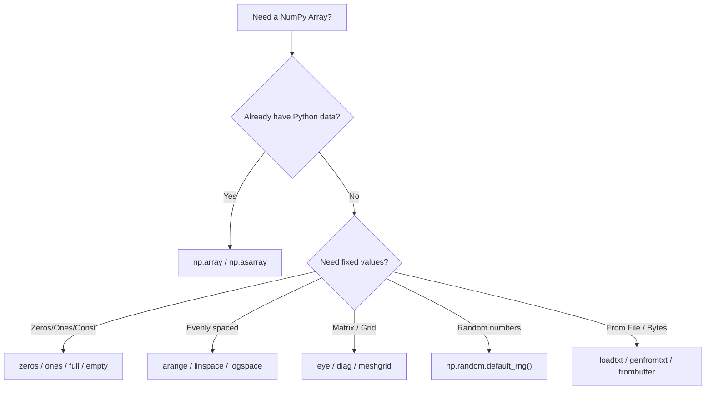
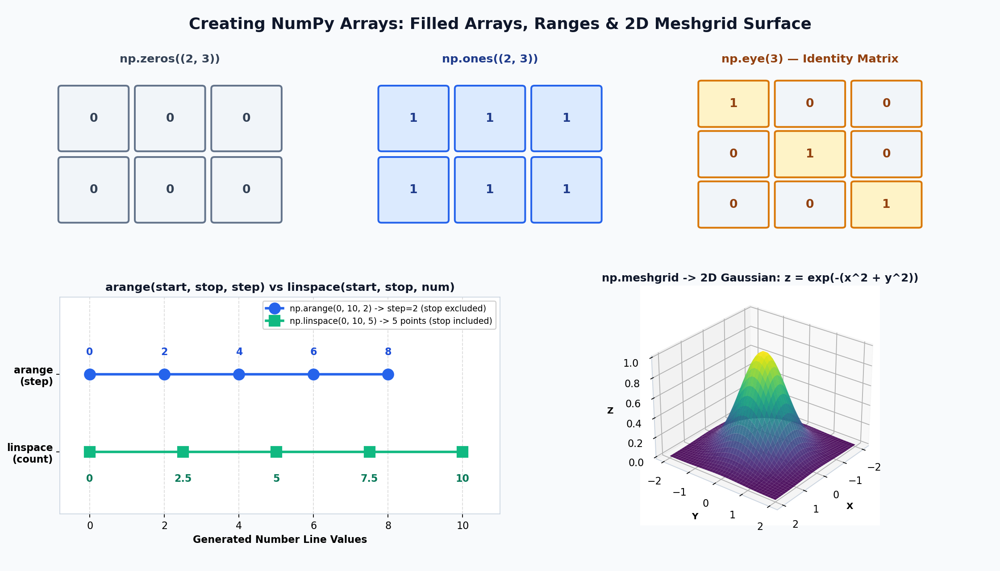

[🏠 Course Home](README.md) | [⬅️ Prev: Module 01](01_Setup_and_ndarray_Basics.md) | **Module 02: Creating Arrays** | [Next: Module 03 ➡️](03_Indexing_Slicing_Views_vs_Copies.md)

---

# 📘 Module 02: Creating Arrays (Arrays හදන හැම විදියම)

> **මේ පාඩමෙන් ඔයා ඉගෙන ගන්නේ මොනවද?**
> හැමතිස්සෙම අතින් ඉලක්කම් type කරලා `np.array([...])` හදන්න බෑ! බිංදු පුරවපු arrays, එකම ඉලක්කම පුරවපු arrays, සමාන පරතර තියෙන සංඛ්‍යා පේළි (`arange`, `linspace`), identity matrices, 2D grids (`meshgrid`), random arrays, සහ files වලින් arrays හදන හැම විදියම සරලව ඉගෙන ගමු.

---

## 1. Array එකක් හදන්න ක්‍රම තෝරා ගන්නේ කොහොමද?





---

## 2. Python Data වලින් Array හදන විදිය (`array`, `asarray`, `asanyarray`)

ඔයා ළඟ දැනටමත් Python list එකක් හෝ tuple එකක් තියෙනවා නම්:

```python
import numpy as np

a = np.array([1, 2, 3])               # හැමවෙලේම අලුත් copy එකක් හදනවා (default)
b = np.asarray(a)                     # දැනටමත් ndarray එකක් නම් copy නොකර ඒකම දෙනවා!
c = np.asanyarray(a)                  # ndarray subclasses (උදා: masked array) ආරක්ෂා කරනවා
d = np.array(a, copy=True)            # අනිවාර්යයෙන්ම වෙනම safe copy එකක් හදන්න
e = a.copy()                          # safe copy හදන්න තියෙන ලේසිම විදිය

print("a is b:", a is b)              # True (memory ඉතුරුයි!)
print("a is e:", a is e)              # False (වෙනම copy එකක්!)
```

**Expected Output:**
```text
a is b: True
a is e: False
```

---

## 3. පුරවපු Arrays (Filled Arrays: `zeros`, `ones`, `full`, `empty`, `*_like`)

හිතන්න ඔයාට අලුත් පන්තියක ළමයි 5 දෙනෙක්ගේ ලකුණු දාන්න හිස් වගුවක් ඕනේ. මුලින්ම ඔක්කොටම `0` හෝ `1` දාලා තියාගන්න එක ලේසියි.

```python
import numpy as np

z = np.zeros((2, 3))                  # 2x3 array එකක්, හැම තැනම 0.0 (float64)
o = np.ones((2, 3), dtype=int)        # 2x3 array එකක්, හැම තැනම 1 (int)
f = np.full((2, 2), 7)                # 2x2 array එකක්, හැම තැනම 7
emp = np.empty((2, 2))                # Initialize නොකරපු garbage values! (හරිම වේගවත්)

# තවත් array එකක shape එකටම සමානව හදන්න *_like පාවිච්චි කරන්න:
z_like = np.zeros_like(f)             # f වගේම 2x2 zeros array එකක්
o_like = np.ones_like(f)              # f වගේම 2x2 ones array එකක්
f_like = np.full_like(f, 99)          # f වගේම 2x2 array එකක්, හැම තැනම 99

print("zeros:\n", z)
print("full:\n", f)
print("full_like:\n", f_like)
```

**Expected Output:**
```text
zeros:
 [[0. 0. 0.]
  [0. 0. 0.]]
full:
 [[7 7]
  [7 7]]
full_like:
 [[99 99]
  [99 99]]
```

> **💡 `np.empty()` ගැන දැනගන්න:** `empty` කියන්නේ "හිස්" හෝ "බිංදු" නෙවෙයි! Computer RAM එකේ ඒ වෙලාවේ තිබ්බ පරණ ඉතුරු අගයන් (uninitialised garbage) එහෙම්මම පෙන්වනවා. ඒක පාවිච්චි කරන්නේ පස්සේ හැම කොටුවක්ම overwrite කරන buffer එකක් හදන්න විතරයි.

---

## 4. සංඛ්‍යා පරාස (Ranges: `arange`, `linspace`, `logspace`, `geomspace`)

මේ දෙක තමයි graphs අඳිද්දී වැඩියෙන්ම ඕන වෙන්නේ:
- **`np.arange(start, stop, step)`:** "පියවර (step) කීයෙන් කීයටද යන්නේ?" කියලා දෙනවා. **`stop` අගය ඇතුළත් වෙන්නේ නෑ!**
- **`np.linspace(start, stop, num)`:** "මේ දෙක අතර මුළු ලක්ෂ්‍ය (points) කීයක් ඕනෙද?" කියලා දෙනවා. **`stop` අගය ඇතුළත් වෙනවා!**

```python
import numpy as np

print("arange   :", np.arange(0, 10, 2))        # [0 2 4 6 8] (10 නෑ!)
print("linspace :", np.linspace(0, 1, 5))       # [0.   0.25 0.5  0.75 1.  ] (1 තියෙනවා!)
print("logspace :", np.logspace(0, 3, 4))       # 10^0, 10^1, 10^2, 10^3 -> [1. 10. 100. 1000.]
print("geomspace:", np.geomspace(1, 16, 5))     # ගුණෝත්තර ශ්‍රේණිය -> [1. 2. 4. 8. 16.]
```

**Expected Output:**
```text
arange   : [0 2 4 6 8]
linspace : [0.   0.25 0.5  0.75 1.  ]
logspace : [   1.   10.  100. 1000.]
geomspace: [ 1.  2.  4.  8. 16.]
```

---

## 5. Identity සහ Diagonal Matrices (`eye`, `identity`, `diag`, `tri`, `tril`, `triu`)

Linear algebra (න්‍යාස ගණිතය) වලදී විකර්ණයේ (diagonal එකේ) `1` තියෙන matrices හදන්න මේවා උදව් වෙනවා:

```python
import numpy as np

print("eye(3):\n", np.eye(3))                # 3x3 identity matrix (k=1 දුන්නොත් diagonal එක shift කරන්න පුළුවන්)
print("identity(2):\n", np.identity(2))      # හැමවෙලේම square identity matrix
print("diag:\n", np.diag([10, 20, 30]))      # දීපු numbers ටික diagonal එකට දාලා matrix එකක් හදනවා

m = np.arange(1, 10).reshape(3, 3)
print("tril (පහළ ත්‍රිකෝණය):\n", np.tril(m))   # Lower triangle
print("triu (ඉහළ ත්‍රිකෝණය):\n", np.triu(m))    # Upper triangle
print("tri(3):\n", np.tri(3))                # 1s වලින් හදපු lower triangle
```

**Expected Output:**
```text
eye(3):
 [[1. 0. 0.]
  [0. 1. 0.]
  [0. 0. 1.]]
identity(2):
 [[1. 0.]
  [0. 1.]]
diag:
 [[10  0  0]
  [ 0 20  0]
  [ 0  0 30]]
tril (පහළ ත්‍රිකෝණය):
 [[1 0 0]
  [4 5 0]
  [7 8 9]]
triu (ඉහළ ත්‍රිකෝණය):
 [[1 2 3]
  [0 5 6]
  [0 0 9]]
tri(3):
 [[1. 0. 0.]
  [1. 1. 0.]
  [1. 1. 1.]]
```

---

## 6. Coordinate Grids (`meshgrid`, `mgrid`, `ogrid`, `indices`)

ඔයාට 3D කන්දක් වගේ $z = f(x, y)$ ප්‍රස්තාරයක් අඳින්න ඕනේ නම්, හැම $(x, y)$ ලක්ෂ්‍යයක්ම හදාගන්න ඕනේ. ඒකට තමයි **`np.meshgrid`** පාවිච්චි කරන්නේ! (උඩ තියෙන රූපයේ දකුණු පැත්තේ පහළ 3D කන්ද හැදුවෙත් මේ code එකෙන්මයි!)

```python
import numpy as np

# 1. meshgrid: 2D Gaussian surface එකක් හදමු
x, y = np.meshgrid(np.linspace(-2, 2, 5), np.linspace(-2, 2, 5))
z = np.exp(-(x**2 + y**2))   # හැම (x, y) ලක්ෂ්‍යයකම උස (z)

print("x grid:\n", x)
print("z shape:", z.shape, "| Peak at center:", z[2, 2])

# 2. mgrid & ogrid (slice syntax එකෙන් grid හදන්න)
gx, gy = np.mgrid[0:3, 0:3]     # සම්පූර්ණ 3x3 dense grid
ox, oy = np.ogrid[0:3, 0:3]     # Memory ඉතුරු කරන open grid (broadcasting වලට නියමයි!)
idx = np.indices((2, 3))        # Row සහ Column index arrays දෙනවා

print("ogrid shapes:", ox.shape, oy.shape)
print("indices shape:", idx.shape)
```

**Expected Output:**
```text
x grid:
 [[-2. -1.  0.  1.  2.]
  [-2. -1.  0.  1.  2.]
  [-2. -1.  0.  1.  2.]
  [-2. -1.  0.  1.  2.]
  [-2. -1.  0.  1.  2.]]
z shape: (5, 5) | Peak at center: 1.0
ogrid shapes: (3, 1) (1, 3)
indices shape: (2, 2, 3)
```

---

## 7. Functions, Buffers, Files සහ Random වලින් Arrays හදන විදිය

### A. From Functions (`fromfunction`, `fromiter`, `vectorize`)

```python
import numpy as np

# Index (i, j) අනුව අගයන් හදන්න (උදා: i + j)
ff = np.fromfunction(lambda i, j: i + j, (3, 3), dtype=int)
print("fromfunction (i + j):\n", ff)

# Python generator / iterator එකකින් 1D array හදන්න
fi = np.fromiter((x * x for x in range(5)), dtype=int)
print("fromiter:", fi)

# සාමාන්‍ය Python function එකක් element-wise වැඩ කරන්න හදාගන්න (සටහන: මේක loop wrapper එකක්, speed වැඩි නොවේ)
def grade(score):
    return "Pass" if score >= 50 else "Fail"

v_grade = np.vectorize(grade)
print("vectorize:", v_grade(np.array([35, 72, 50, 18])))
```

**Expected Output:**
```text
fromfunction (i + j):
 [[0 1 2]
  [1 2 3]
  [2 3 4]]
fromiter: [ 0  1  4  9 16]
vectorize: ['Fail' 'Pass' 'Pass' 'Fail']
```

### B. From Buffers and Files (`frombuffer`, `fromfile`, `loadtxt`, `genfromtxt`)

```python
import numpy as np
from io import StringIO

# Raw bytes (buffer) එකකින් array එකක් කියවන්න
raw_bytes = b"\x01\x02\x03\x04"
buf_arr = np.frombuffer(raw_bytes, dtype=np.uint8)
print("frombuffer:", buf_arr)

# CSV / Text data කියවන්න (loadtxt = පිරිසිදු data වලට, genfromtxt = missing values තියෙන data වලට)
csv_clean = StringIO("10,20,30\n40,50,60")
print("loadtxt:\n", np.loadtxt(csv_clean, delimiter=","))

csv_missing = StringIO("10,,30\n40,50,60")
print("genfromtxt (handles missing):\n", np.genfromtxt(csv_missing, delimiter=","))
# Binary files කියවන්න: np.fromfile("data.bin", dtype=np.float32)
```

**Expected Output:**
```text
frombuffer: [1 2 3 4]
loadtxt:
 [[10. 20. 30.]
  [40. 50. 60.]]
genfromtxt (handles missing):
 [[10. nan 30.]
  [40. 50. 60.]]
```

### C. Random Arrays (`np.random.default_rng`)

NumPy වල දැන් නිර්දේශ කරන අලුත්ම ක්‍රමය තමයි **`np.random.default_rng()`**! (පරණ `np.random.rand` වෙනුවට).

```python
import numpy as np

rng = np.random.default_rng(seed=42)  # seed=42 දුන්නම හැමවෙලේම එකම random numbers එනවා!

print("Uniform [0, 1):\n", rng.random((2, 3)).round(2))
print("Random ints 1..10:", rng.integers(1, 11, size=5))
```

**Expected Output:**
```text
Uniform [0, 1):
 [[0.77 0.44 0.86]
  [0.7  0.09 0.98]]
Random ints 1..10: [6 2 1 1 8]
```

---

## 8. Repeating සහ Tiling (`repeat`, `tile`, `kron`)

බිමට ටයිල් (tiles) අල්ලනවා වගේ පොඩි pattern එකක් ලොකු කරගන්න මේ functions 3 මාරම ප්‍රයෝජනවත්!

- **`repeat`:** එක එක **element** එක වෙන වෙනම repeat කරනවා (`[1, 2]` ➡️ `[1, 1, 2, 2]`).
- **`tile`:** **මුළු array එකම** එක දිගට copy-paste කරනවා (`[1, 2]` ➡️ `[1, 2, 1, 2]`).
- **`kron` (Kronecker product):** Block patterns හදන්න (උදා: checkerboard එකක් block වලින් ලොකු කරන්න).

```python
import numpy as np

a = np.array([1, 2])
print("repeat(a, 2):", np.repeat(a, 2))      # [1 1 2 2]
print("tile(a, 2)  :", np.tile(a, 2))        # [1 2 1 2]

# 2x2 pattern එකක් 2x2 වාරයක් tile කරන්න:
block = np.array([[0, 1], [1, 0]])
print("tile 2D (4x4 checkerboard):\n", np.tile(block, (2, 2)))

# kron: හැම element එකක්ම 2x2 ones block එකකින් ලොකු කරන්න:
print("kron:\n", np.kron(block, np.ones((2, 2), dtype=int)))
```

**Expected Output:**
```text
repeat(a, 2): [1 1 2 2]
tile(a, 2)  : [1 2 1 2]
tile 2D (4x4 checkerboard):
 [[0 1 0 1]
  [1 0 1 0]
  [0 1 0 1]
  [1 0 1 0]]
kron:
 [[0 0 1 1]
  [0 0 1 1]
  [1 1 0 0]
  [1 1 0 0]]
```

---

## 🧠 මතක තබා ගැනීමට පහසු ක්‍රම (Memory Hacks)

1. **`arange` vs `linspace`:**
   - `a`**`range`** ➡️ Python `range()` වගේමයි — **step** එක දෙනවා, **අන්තිම number එක නෑ!**
   - `lin`**`space`** ➡️ **සමාන space** තියෙන points ගාණ දෙනවා, **අන්තිම number එක තියෙනවා!**
2. **`repeat` vs `tile`:**
   - **Repeat** = ගිරවෙක් වගේ එකම වචනේ කියවනවා (`1, 1, 2, 2`).
   - **Tile** = බිමට ටයිල් අල්ලනවා වගේ මුළු කෑල්ලම තියනවා (`1, 2, 1, 2`).
3. **Shape tuple:** `np.zeros((2, 3))` වල වරහන් දෙකක් තියෙන්නේ පළවෙනි argument එක `shape` tuple එක `(2, 3)` නිසා!

---

## ⚠️ සාමාන්‍යයෙන් වෙන වැරදි (Common Pitfalls)

> [!WARNING]
> **1. `np.zeros(2, 3)` කියලා ලිවීම!**
> `np.zeros(2, 3)` දුන්නොත් error එනවා (මොකද 2 වෙනි argument එක `dtype`!). හැමවෙලේම shape එක tuple එකක් ඇතුළේ දෙන්න: **`np.zeros((2, 3))`**.

> [!WARNING]
> **2. Float step වලට `np.arange(0, 1, 0.1)` පාවිච්චි කිරීම!**
> Floating-point rounding errors නිසා `arange` එකේදී අන්තිම අගය සමහර වෙලාවට ඇවිත් නොයෙන්න පුළුවන්. දශම පරාස වලට හැමතිස්සෙම **`np.linspace(0, 1, 11)`** පාවිච්චි කරන්න!

> [!WARNING]
> **3. `np.empty()` බිංදු දෙනවා කියලා හිතීම!**
> `np.empty()` වල බිංදු නෑ — ඒකේ තියෙන්නේ අහඹු පරණ RAM values. බිංදු ඕනේ නම් අනිවාර්යයෙන්ම `np.zeros()` පාවිච්චි කරන්න.

---

## 🏋️ ප්‍රායෝගික අභ්‍යාස (Practical Exercises)

### Warm-up Exercise (Grade 10 Level)
`0` සිට `20` දක්වා ඉරට්ටේ සංඛ්‍යා (even numbers) තියෙන array එකක් `np.arange` වලින් හදන්න (`20` ඇතුළත් වෙන්න ඕනේ!). ඊට පස්සේ ඒකේ shape එකටම සමානව `5` පුරවපු array එකක් `np.full_like` වලින් හදන්න.

<details>
<summary>✅ පිළිතුර බලන්න (Click to see Solution)</summary>

```python
import numpy as np

evens = np.arange(0, 21, 2)       # stop=21 නිසා 20 ඇතුළත් වෙනවා!
fives = np.full_like(evens, 5)

print("Evens:", evens)
print("Fives:", fives)
```
</details>

---

### Course Exercise 1
**Slicing විතරක්** පාවිච්චි කරලා `0` සහ `1` තියෙන `8x8` **Checkerboard (චෙස් පුවරුවක්)** හදන්න.

<details>
<summary>✅ පිළිතුර බලන්න (Click to see Solution)</summary>

```python
import numpy as np

board = np.zeros((8, 8), dtype=int)
board[0::2, 1::2] = 1   # ඉරට්ටේ rows වල ඔත්තේ columns වලට 1
board[1::2, 0::2] = 1   # ඔත්තේ rows වල ඉරට්ටේ columns වලට 1

print(board)
```
</details>

---

### Course Exercise 2
`0` සිට $2\pi$ (`2 * np.pi`) දක්වා සමාන පරතර තියෙන $x$ අගයන් 100ක් හදලා $\sin(x)$ ගණනය කරන්න.

<details>
<summary>✅ පිළිතුර බලන්න (Click to see Solution)</summary>

```python
import numpy as np

x = np.linspace(0, 2 * np.pi, 100)
y = np.sin(x)

print("x shape:", x.shape)
print("First 5 x:", np.round(x[:5], 3))
print("First 5 sin(x):", np.round(y[:5], 3))
print("sin(0):", round(y[0], 5), "| sin(2*pi):", round(y[-1], 5))
```
</details>

---

### Course Exercise 3
`np.arange` සහ broadcasting පාවිච්චි කරලා `1` සිට `10` දක්වා **ගුණකිරීමේ චක්‍රය (10x10 Multiplication Table)** හදන්න.

<details>
<summary>✅ පිළිතුර බලන්න (Click to see Solution)</summary>

```python
import numpy as np

row = np.arange(1, 11)               # shape: (10,)
col = np.arange(1, 11).reshape(10, 1)  # shape: (10, 1)

table = col * row                    # Broadcasting මගින් 10x10 වගුව හැදෙනවා!
print(table)
```
</details>

---

## 📋 Cheat Sheet Summary Table

| Category | Key APIs | ප්‍රධාන ප්‍රයෝජනය (Use Case) |
| --- | --- | --- |
| From Python | `np.array`, `np.asarray`, `np.asanyarray` | List/Tuple arrays බවට හැරවීම |
| Filled | `zeros`, `ones`, `full`, `empty`, `*_like` | මුල් අගයන් සහිත buffers/masks සෑදීම |
| Ranges | `arange`, `linspace`, `logspace`, `geomspace` | ප්‍රස්තාර හා පරාස සෑදීම |
| Diagonals | `eye`, `identity`, `diag`, `tri`, `tril`, `triu` | Linear algebra matrices |
| Grids | `meshgrid`, `mgrid`, `ogrid`, `indices` | 2D/3D $f(x, y)$ coordinate grids |
| Functions | `fromfunction`, `fromiter`, `vectorize` | Custom logic වලින් arrays සෑදීම |
| Files/Bytes | `frombuffer`, `fromfile`, `loadtxt`, `genfromtxt` | Binary හා CSV files කියවීම |
| Random | `np.random.default_rng().random(...)` | අහඹු සංඛ්‍යා (Simulations) |
| Patterns | `repeat`, `tile`, `kron` | රටා (Patterns) හා blocks සෑදීම |

---

[🏠 Course Home](README.md) | [⬅️ Prev: Module 01](01_Setup_and_ndarray_Basics.md) | **Module 02: Creating Arrays** | [Next: Module 03 ➡️](03_Indexing_Slicing_Views_vs_Copies.md)
