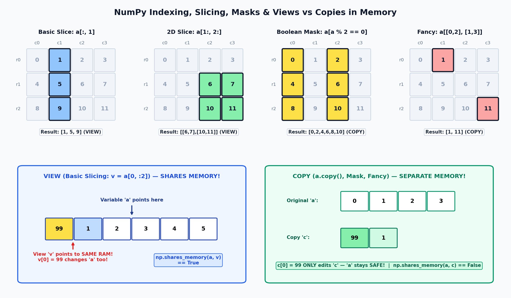
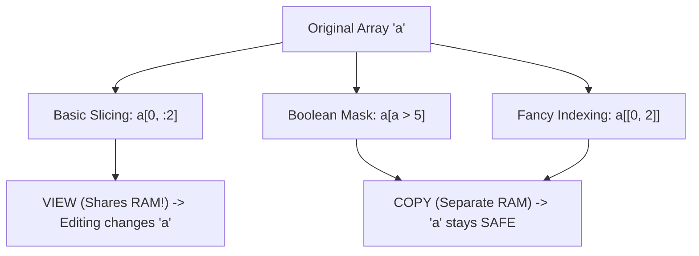

[🏠 Course Home](README.md) | [⬅️ Prev: Module 02](02_Creating_Arrays.md) | **Module 03: Indexing, Slicing, Views vs Copies** | [Next: Module 04 ➡️](04_Data_Types_and_Array_Attributes.md)

---

# 📘 Module 03: Indexing, Slicing, Views vs Copies

> **මේ පාඩමෙන් ඔයා ඉගෙන ගන්නේ මොනවද?**
> NumPy වල වැදගත්ම skill එක වගේම, වැඩියෙන්ම bugs හැදෙන තැන තමයි මේක! Array එකක් ඇතුළෙන් අපිට ඕන කෑල්ල විතරක් කපලා ගන්න විදිය (`indexing`, `slicing`, `boolean masks`, `fancy indexing`) සහ එහෙම ගත්ත කෑල්ල **View** එකක්ද (මුල් array එකත් වෙනස් වෙනවද) නැත්නම් **Copy** එකක්ද (ආරක්ෂිතද) කියලා හරියටම හඳුනා ගන්න ඉගෙන ගමු!

---

## 1. Basic Indexing & Multi-Dimensional Slicing

හිතන්න `a` කියන්නේ තට්ටු 3ක් (rows 3) සහ කාමර 4ක් (columns 4) තියෙන **අල්මාරියක් (Cupboard)** කියලා.
NumPy වලදී අපි `[row, col]` විදියට කොමා (comma) දාලා කෙලින්ම කාමරේට යන්න පුළුවන්!

```python
import numpy as np

a = np.arange(12).reshape(3, 4)
print("Original array 'a':\n", a)

# 1. Single element (Row 1, Col 2)
print("a[1, 2]     :", a[1, 2])         # 6

# 2. Negative index (අන්තිම row එකේ අන්තිම element එක)
print("a[-1, -1]   :", a[-1, -1])       # 11

# 3. Full column (හැම row එකකම 1 වෙනි column එක)
print("a[:, 1]     :", a[:, 1])         # [1 5 9]

# 4. 2D sub-grid slice (Row 1 සිට අගට, Columns 2න් 2ට)
print("a[1:, ::2]  :\n", a[1:, ::2])    # [[4 6], [8 10]]

# 5. Reversing (අග සිට මුලට)
print("a[0, ::-1]  :", a[0, ::-1])      # [3 2 1 0]

# 6. Ellipsis (...) - 3D/4D arrays වල මැද axes ඔක්කොම කෙටියෙන් ගන්න
cube = np.arange(24).reshape(2, 3, 4)
print("cube[..., 0] shape:", cube[..., 0].shape)  # cube[:, :, 0] ට සමානයි -> (2, 3)
```

**Expected Output:**
```text
Original array 'a':
 [[ 0  1  2  3]
  [ 4  5  6  7]
  [ 8  9 10 11]]
a[1, 2]     : 6
a[-1, -1]   : 11
a[:, 1]     : [1 5 9]
a[1:, ::2]  :
 [[ 4  6]
  [ 8 10]]
a[0, ::-1]  : [3 2 1 0]
cube[..., 0] shape: (2, 3)
```



---

## 2. අලුත් Dimension එකක් එකතු කිරීම (`np.newaxis` / `None`)

1D array එකක් `(3,)` තියෙනකොට ඒක **Column Vector `(3, 1)`** හෝ **Row Vector `(1, 3)`** කරගන්න `np.newaxis` (හෝ `None`) පාවිච්චි කරනවා. Broadcasting වලට මේක නිතරම ඕන වෙනවා.

```python
import numpy as np

v = np.array([10, 20, 30])          # shape: (3,)
col_vec = v[:, np.newaxis]          # shape: (3, 1)
row_vec = v[None, :]                # shape: (1, 3) (None කියන්නෙත් np.newaxis ම තමයි!)

print("col_vec shape:", col_vec.shape)
print("row_vec shape:", row_vec.shape)
```

**Expected Output:**
```text
col_vec shape: (3, 1)
row_vec shape: (1, 3)
```

---

## 3. Boolean Masks (කොන්දේසි දාලා තේරීම)

පන්තියේ ලකුණු 50ට වැඩි ළමයි විතරක් තෝරනවා වගේ, loop එකක් නැතුව කොන්දේසියකින් elements තෝරන්න **Boolean Mask** පාවිච්චි කරනවා!

```python
import numpy as np

a = np.arange(12).reshape(3, 4)

# ඉරට්ටේ සංඛ්‍යා විතරක් තෝරන්න
even_mask = (a % 2 == 0)
print("Even numbers:", a[even_mask])

# කොන්දේසි දෙකක් එකට දානකොට: '&' (AND), '|' (OR), '~' (NOT) + වරහන් අනිවාර්යයි!
mid = a[(a > 2) & (a < 8)]
print("2 < a < 8   :", mid)
```

**Expected Output:**
```text
Even numbers: [ 0  2  4  6  8 10]
2 < a < 8   : [3 4 5 6 7]
```

---

## 4. Fancy Indexing (Integer Arrays වලින් අහඹු තැන් තේරීම)

ඔයාට පිළිවෙළට නැති කොටු කීපයක් — උදාහරණයක් විදියට `(0, 1)` සහ `(2, 3)` විතරක් තෝරන්න ඕනේ නම් **Fancy Indexing** පාවිච්චි කරන්න.

```python
import numpy as np

x = np.array([10, 20, 30, 40, 50])
print("Pick indices 0, 2, 4:", x[[0, 2, 4]])  # [10 30 50]

a = np.arange(12).reshape(3, 4)
# (row=0, col=1) -> 1 සහ (row=2, col=3) -> 11
print("Pick (0,1) & (2,3)  :", a[[0, 2], [1, 3]])  # [ 1 11]
```

**Expected Output:**
```text
Pick indices 0, 2, 4: [10 30 50]
Pick (0,1) & (2,3)  : [ 1 11]
```

---

## 5. Assignment (අගයන් වෙනස් කිරීම) & Conditional Selection (`where`, `select`, `choose`, `piecewise`)

Slicing, Boolean mask හෝ Fancy indexing පාවිච්චි කරලා කෙලින්ම අගයන් replace කරන්න පුළුවන්:

```python
import numpy as np

arr = np.array([-5, 3, -2, 8, 0])
arr[arr < 0] = 0                    # සෘණ සංඛ්‍යා ඔක්කොම 0 කරන්න (loop නැතුව!)
print("Clipped negatives:", arr)

# np.where(condition, if_true, if_false) -> Vectorised if/else!
a = np.arange(12).reshape(3, 4)
binary = np.where(a > 6, 1, 0)
print("np.where (a > 6):\n", binary)

# np.select -> කොන්දේසි කීපයක් (if / elif / else) තියෙනකොට:
scores = np.array([30, 55, 82])
conditions = [scores >= 75, scores >= 50]
choices = ["A", "C"]
grades = np.select(conditions, choices, default="F")
print("np.select grades:", grades)

# np.choose -> index array එකකින් තෝරන්න
picked = np.choose([0, 1, 0], [[10, 20, 30], [100, 200, 300]])
print("np.choose       :", picked)

# np.piecewise -> කොටස් අනුව වෙනස් math formulas දාන්න
vals = np.array([-2.0, 0.0, 3.0])
pw = np.piecewise(vals, [vals < 0, vals >= 0], [lambda x: -x, lambda x: x**2])
print("np.piecewise    :", pw)
```

**Expected Output:**
```text
Clipped negatives: [0 3 0 8 0]
np.where (a > 6):
 [[0 0 0 0]
  [0 0 0 1]
  [1 1 1 1]]
np.select grades: ['F' 'C' 'A']
np.choose       : [ 10 200  30]
np.piecewise    : [2. 0. 9.]
```

---

## 6. Index Helpers, Diagonals & Iteration

අගයන් තියෙන **තැන් (positions)** හොයන්න මේ helper functions පාවිච්චි කරනවා:

```python
import numpy as np

a = np.array([[0, 5, 0],
              [7, 0, 9]])

print("nonzero (row, col tuples):", np.nonzero(a))
print("argwhere (row, col pairs):\n", np.argwhere(a > 5))
print("flatnonzero (1D indices) :", np.flatnonzero(a))

# np.ix_ : දීපු rows සහ columns වලින් sub-matrix එකක් (cross-product) ගන්න
m = np.arange(16).reshape(4, 4)
print("np.ix_ rows [0,2], cols [1,3]:\n", m[np.ix_([0, 2], [1, 3])])

# take, put, take_along_axis
x = np.array([10, 20, 30, 40])
print("np.take:", np.take(x, [3, 0]))
np.put(x, [0, 2], [99, 88])
print("after np.put:", x)

# take_along_axis: හැම row එකකම max element එක ගන්න
grid = np.array([[3, 9, 1], [8, 2, 5]])
idx = np.argmax(grid, axis=1, keepdims=True)
print("take_along_axis max:", np.take_along_axis(grid, idx, axis=1))

# Diagonals & Triangles indices
sq = np.arange(9).reshape(3, 3)
print("diag:", np.diag(sq))
print("diag_indices:", np.diag_indices(3))
print("tril_indices:", np.tril_indices(3))

# Iteration (කලාතුරකින් loop ඕනේ වුණොත් විතරක්)
small = np.array([[10, 20], [30, 40]])
for pos, val in np.ndenumerate(small):
    print(f"pos {pos} -> {val}")
# තවත්: np.nditer(small) සහ small.flat (1D iterator)
```

**Expected Output:**
```text
nonzero (row, col tuples): (array([0, 1, 1]), array([1, 0, 2]))
argwhere (row, col pairs):
 [[1 0]
  [1 2]]
flatnonzero (1D indices) : [1 3 5]
np.ix_ rows [0,2], cols [1,3]:
 [[ 1  3]
  [ 9 11]]
np.take: [40 10]
after np.put: [99 20 88 40]
take_along_axis max: [[9]
 [8]]
diag: [0 4 8]
diag_indices: (array([0, 1, 2]), array([0, 1, 2]))
tril_indices: (array([0, 1, 1, 2, 2, 2]), array([0, 0, 1, 0, 1, 2]))
pos (0, 0) -> 10
pos (0, 1) -> 20
pos (1, 0) -> 30
pos (1, 1) -> 40
```

---

## 7. 🔥 Views vs Copies — NumPy වල වැදගත්ම නීතිය!

මේක හරියට **පොතක් ජනේලයකින් බලනවා (View)** සහ **පොතේ Photocopy එකක් ගන්නවා (Copy)** වගේ!

- **VIEW (Basic Slicing):** ජනේලයෙන් බලාගෙන පෑනෙන් කුරුටු ගෑවොත් **මුල් පොතත් (Original Array) වෙනස් වෙනවා!** මොකද දෙන්නම පාවිච්චි කරන්නේ **එකම Memory එක**.
- **COPY (Boolean Mask, Fancy Indexing, `.copy()`):** Photocopy එකේ මොනවා ලිව්වත් **මුල් පොතට කිසිම හානියක් නෑ!**



```python
import numpy as np

a = np.arange(12).reshape(3, 4)

# 1. Basic Slice -> VIEW!
v = a[0, :2]
print("v shares memory with a?", np.shares_memory(a, v))  # True
print("v.base is a?           ", v.base is not None)      # True

v[0] = 99                       # v වෙනස් කළාම a එකත් වෙනස් වෙනවා!!
print("a[0, 0] after editing v:", a[0, 0])                # 99!

# 2. Boolean Mask / .copy() -> COPY!
c = a[a > 50].copy()            # ස්වාධීන copy එකක්
print("c shares memory with a?", np.shares_memory(a, c))  # False
print("c.base                 :", c.base)                 # None
```

**Expected Output:**
```text
v shares memory with a? True
v.base is a?            True
a[0, 0] after editing v: 99
c shares memory with a? False
c.base                 : None
```

---

## 🧠 මතක තබා ගැනීමට පහසු ක්‍රම (Memory Hacks)

1. **View ද Copy ද? (Golden Rule):**
   - **`:` (Colon / Slice)** විතරක් දැම්මොත් ➡️ **VIEW** (එකම Memory!).
   - **`[]` (List / Fancy)** හෝ **`>` (Boolean Mask)** දැම්මොත් ➡️ **COPY** (අලුත් Memory!).
   - සැකයක් තියෙන හැමවෙලේම **`.copy()`** දාන්න, නැත්නම් **`np.shares_memory(a, b)`** වලින් check කරන්න!
2. **`&` සහ `|`:** Python වල `and` / `or` NumPy arrays වල වැඩ කරන්නේ නෑ! NumPy වල හැමවෙලේම **`&`**, **`|`**, **`~`** සහ **වරහන් `()`** පාවිච්චි කරන්න.

---

## ⚠️ සාමාන්‍යයෙන් වෙන වැරදි (Common Pitfalls)

> [!WARNING]
> **1. Silent Edits (නොදැනීම Original Array එක වෙනස් වීම)!**
> `sub = a[:2, :2]` අරගෙන `sub[0, 0] = 999` දැම්මොත් `a` එකත් නොදැනීම වෙනස් වෙනවා. ඔයාට වෙනම edit කරන්න ඕනේ නම් `sub = a[:2, :2].copy()` කියලා ලියන්න.

> [!WARNING]
> **2. `a[a > 2 and a < 8]` කියලා ලිවීම!**
> මේකට `ValueError: The truth value of an array with more than one element is ambiguous` error එක එනවා. නිවැරදි විදිය: **`a[(a > 2) & (a < 8)]`**.

> [!WARNING]
> **3. `a[0][1]` වෙනුවට `a[0, 1]` පාවිච්චි කරන්න!**
> `a[0][1]` වලදී මුලින්ම temporary row එකක් හදලා ආයේ index කරනවා (slow). NumPy වල හැමවෙලේම **`a[0, 1]`** පාවිච්චි කරන්න.

---

## 🏋️ ප්‍රායෝගික අභ්‍යාස (Practical Exercises)

### Warm-up Exercise (Grade 10 Level)
`a = np.array([15, 62, 48, 91, 33, 77])` කියන ලකුණු list එකෙන් 50ට වැඩි ලකුණු විතරක් Boolean mask එකක් පාවිච්චි කරලා තෝරලා print කරන්න.

<details>
<summary>✅ පිළිතුර බලන්න (Click to see Solution)</summary>

```python
import numpy as np

a = np.array([15, 62, 48, 91, 33, 77])
passed = a[a > 50]
print("Passed marks:", passed)  # [62 91 77]
```
</details>

---

### Course Exercise 1
`5x5` array එකක් හදලා, ඒකේ **ඇතුළේ තියෙන `3x3` කොටස (inner block)** සහ **වටේ තියෙන border elements** වෙන් කරලා ගන්න.

<details>
<summary>✅ පිළිතුර බලන්න (Click to see Solution)</summary>

```python
import numpy as np

a = np.arange(1, 26).reshape(5, 5)
print("5x5 Array:\n", a)

# 1. ඇතුළේ 3x3 කොටස (Row 1..3, Col 1..3)
inner = a[1:-1, 1:-1]
print("\nInner 3x3:\n", inner)

# 2. Border elements (Boolean mask එකකින්)
mask = np.ones((5, 5), dtype=bool)
mask[1:-1, 1:-1] = False
border = a[mask]
print("\nBorder elements:", border)
```
</details>

---

### Course Exercise 2
Random numbers (ධන සහ සෘණ දෙකම තියෙන) array එකක් හදලා, loop එකක් නැතුව හැම සෘණ අගයක්ම `0` කරන්න.

<details>
<summary>✅ පිළිතුර බලන්න (Click to see Solution)</summary>

```python
import numpy as np

rng = np.random.default_rng(0)
arr = rng.integers(-10, 11, size=(3, 4))
print("Before:\n", arr)

arr[arr < 0] = 0
print("After:\n", arr)
```
</details>

---

### Course Exercise 3
**Slicing**, **Boolean masking**, සහ **Fancy indexing** වලින් කෝකද Copy හදන්නේ, කෝකද View හදන්නේ කියලා `np.shares_memory` වලින් ඔප්පු කරලා පෙන්වන්න.

<details>
<summary>✅ පිළිතුර බලන්න (Click to see Solution)</summary>

```python
import numpy as np

a = np.arange(12).reshape(3, 4)

s = a[:, 1:3]             # Basic slicing
b = a[a % 2 == 0]         # Boolean masking
f = a[[0, 2], [1, 3]]     # Fancy indexing

print("Slicing shares memory?        ", np.shares_memory(a, s))  # True  -> VIEW
print("Boolean masking shares memory?", np.shares_memory(a, b))  # False -> COPY
print("Fancy indexing shares memory? ", np.shares_memory(a, f))  # False -> COPY
```
</details>

---

### Course Exercise 4
2D array එකක හැම **row එකකම උපරිම අගය (maximum)** `argmax` සහ **Fancy indexing** පාවිච්චි කරලා තෝරන්න.

<details>
<summary>✅ පිළිතුර බලන්න (Click to see Solution)</summary>

```python
import numpy as np

a = np.array([[12, 45, 23, 10],
              [99, 14, 67, 88],
              [ 5, 31, 74, 29]])

row_idx = np.arange(a.shape[0])      # [0, 1, 2]
max_col_idx = np.argmax(a, axis=1)   # [1, 0, 2]

row_maxes = a[row_idx, max_col_idx]
print("Max column indices:", max_col_idx)
print("Max of each row   :", row_maxes)  # [45 99 74]
```
</details>

---

## 📋 Cheat Sheet Summary Table

| Feature | Syntax / API | View or Copy? |
| --- | --- | --- |
| Basic Indexing / Slicing | `a[1, 2]`, `a[:, 1]`, `a[1:, ::2]`, `a[..., 0]` | **VIEW** (Shares RAM) |
| Add Dimension | `a[:, np.newaxis]` / `a[None, :]` | **VIEW** |
| Boolean Masking | `a[(a > 2) & (a < 8)]` | **COPY** |
| Fancy Indexing | `a[[0, 2], [1, 3]]` | **COPY** |
| Explicit Copy | `a.copy()` | **COPY** |
| Check Memory | `np.shares_memory(a, b)`, `b.base` | Returns `True`/`False` |
| Conditional Select | `np.where(cond, x, y)`, `np.select`, `np.choose`, `np.piecewise` | New Array |
| Index Helpers | `np.nonzero`, `np.argwhere`, `np.flatnonzero`, `np.ix_`, `np.take`, `np.put`, `np.take_along_axis` | Locate / Pick elements |
| Diagonals & Loops | `np.diag`, `np.diag_indices`, `np.tril_indices`, `np.nditer`, `np.ndenumerate`, `flat` | Matrix parts / Iteration |

---

[🏠 Course Home](README.md) | [⬅️ Prev: Module 02](02_Creating_Arrays.md) | **Module 03: Indexing, Slicing, Views vs Copies** | [Next: Module 04 ➡️](04_Data_Types_and_Array_Attributes.md)
