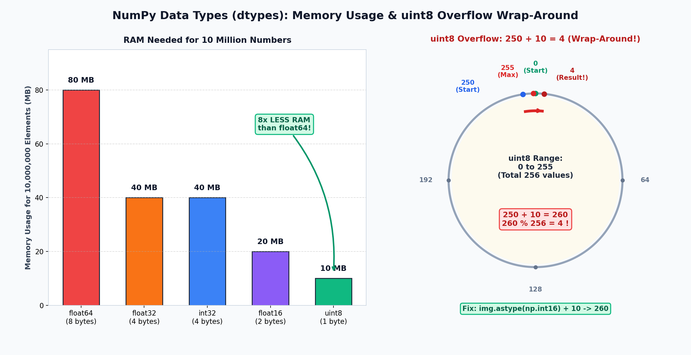
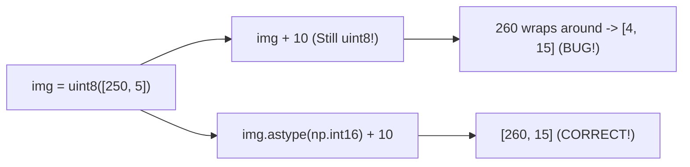

[🏠 Course Home](README.md) | [⬅️ Prev: Module 03](03_Indexing_Slicing_Views_vs_Copies.md) | **Module 04: Data Types & Array Attributes** | [Next: Module 05 ➡️](05_Math_Ufuncs_and_Aggregation.md)

---

# 📘 Module 04: Data Types (`dtype`) සහ Array Attributes

> **මේ පාඩමෙන් ඔයා ඉගෙන ගන්නේ මොනවද?**
> හරිම `dtype` (Data Type) එක තෝරගන්න එකෙන් ඔයාගේ program එකේ **නිවැරදිතාව (correctness)**, **RAM ප්‍රමාණය (memory)** සහ **වේගය (speed)** තීරණය වෙනවා! Integer overflow වෙන්නේ ඇයි, float සංඛ්‍යා සසඳද්දී `==` වරදින්නේ ඇයි, සහ `strides`, `flags`, C vs Fortran memory order කියන්නේ මොනවද කියලා සරලව ඉගෙන ගමු!

---

## 1. Numeric සහ වෙනත් `dtypes` (Data Types)

හිතන්න ඔයාට වතුර ගබඩා කරන්න ඕනේ. වතුර කෝප්පයක් දාන්න ලීටර් 1000 ටැංකියක් ගන්නේ නෑනේ! ඒ වගේම, `0` සිට `255` දක්වා තියෙන photo pixel එකක් දාන්න 8-byte `float64` ගත්තොත් RAM එක **8 ගුණයකින් නාස්ති වෙනවා**!

| Category | Key `dtypes` | Size (Bytes) | පරාසය / විස්තරය (Range / Use Case) |
| --- | --- | --- | --- |
| **Signed Integers** | `int8`, `int16`, `int32`, `int64` | 1, 2, 4, 8 | ධන සහ සෘණ පූර්ණ සංඛ්‍යා (`int8`: -128 සිට 127) |
| **Unsigned Integers** | `uint8`, `uint16`, `uint32`, `uint64` | 1, 2, 4, 8 | ධන සංඛ්‍යා විතරයි (`uint8`: 0 සිට 255 — Images වලට!) |
| **Floats** | `float16`, `float32`, `float64` | 2, 4, 8 | දශම සංඛ්‍යා (AI/Deep Learning වල `float32`/`float16` බහුලයි) |
| **Complex** | `complex64`, `complex128` | 8, 16 | සංකීර්ණ සංඛ්‍යා (උදා: `3 + 4j` — Signal processing / FFT) |
| **Other** | `bool_`, `str_`, `datetime64`, `timedelta64`, `object` | Varies | True/False, අකුරු, දින/වේලාවන්, මිශ්‍ර Python objects |



### `dtype` එක තෝරන සහ මාරු කරන විදිය (`dtype=`, `astype`)

```python
import numpy as np

# 1. හදනකොටම dtype දෙන්න
a = np.array([1, 2, 3], dtype=np.float32)
b = np.array([1, 2, 3], dtype=np.dtype('<i4'))  # '<i4' = little-endian 4-byte int (int32)

# 2. පස්සේ වෙන dtype එකකට හරවන්න (astype හැමවෙලේම අලුත් copy එකක් හදනවා)
c = a.astype(np.int16)

# 3. වෙනත් dtypes උදාහරණ
dates = np.array(['2026-11-22', '2026-11-25'], dtype='datetime64[D]')
diff = dates[1] - dates[0]                      # timedelta64[D] -> 3 days
flags = np.array([True, False], dtype=np.bool_)
names = np.array(['Kamal', 'Nimal'], dtype=np.str_)

print("a:", a.dtype, "| b:", b.dtype, "| c:", c.dtype)
print("Date difference:", diff)

# Memory ඉතුරු කරන හැටි (10 Million numbers!)
big = np.random.default_rng(0).random(10_000_000)
print("float64 MB:", big.nbytes / 1e6)                     # 80.0 MB
print("float32 MB:", big.astype(np.float32).nbytes / 1e6)  # 40.0 MB
```

**Expected Output:**
```text
a: float32 | b: int32 | c: int16
Date difference: 3 days
float64 MB: 80.0
float32 MB: 40.0
```

---

## 2. Type Limits (`iinfo`, `finfo`) සහ Integer Overflow!

**Integer Overflow** කියන්නේ බයිසිකලේ මීටරේ (odometer) `999` ට ගිහින් තව 1ක් ගියාම ආපහු `000` ට කැරකෙනවා (wrap-around) වගේ වැඩක්!

`uint8` එකේ තියන්න පුළුවන් උපරිම අගය `255`. ඔයා `250 + 10` කළොත් `260` වෙනුවට **`4`** එනවා ($260 - 256 = 4$)! Image processing වලදී photo එකක brightness වැඩි කරද්දී සුදු පාට තැන් එකපාරටම කළු වෙන්නේ මේ bug එක නිසයි!



```python
import numpy as np

# 1. uint8 overflow උදාහරණය
img = np.array([250, 5], dtype=np.uint8)
print("Overflow (uint8) :", img + 10)                  # [ 4 15] <- Wrap-around!
print("Fixed (int16)    :", img.astype(np.int16) + 10) # [260  15] <- නිවැරදියි!

# 2. Type limits check කරන්න (iinfo = integers, finfo = floats)
print("int32 max  :", np.iinfo(np.int32).max)          # 2147483647
print("uint8 range:", np.iinfo(np.uint8).min, "to", np.iinfo(np.uint8).max)
print("float32 eps:", np.finfo(np.float32).eps)        # ~1.19e-07 (කුඩාම වෙනස)
```

**Expected Output:**
```text
Overflow (uint8) : [ 4 15]
Fixed (int16)    : [260  15]
int32 max  : 2147483647
uint8 range: 0 to 255
float32 eps: 1.1920929e-07
```

---

## 3. Type Promotion (`result_type`, `promote_types`, `can_cast`)

වෙනස් `dtypes` දෙකක් එකතු කළාම උත්තරේ මොන `dtype` එකෙන්ද එන්නේ කියලා කලින්ම බලාගන්න මේවා පාවිච්චි කරනවා:

```python
import numpy as np

print("promote int16 + float32:", np.promote_types(np.int16, np.float32))
print("result_type            :", np.result_type(np.int8, np.float32))
print("can_cast int32->float64:", np.can_cast(np.int32, np.float64))  # True (safe)
print("can_cast float64->int32:", np.can_cast(np.float64, np.int32))  # False (දශම නැති වෙනවා!)
```

**Expected Output:**
```text
promote int16 + float32: float32
result_type            : float32
can_cast int32->float64: True
can_cast float64->int32: False
```

---

## 4. Floating-Point Care (`isclose`, `allclose`, `isnan`, `isinf`, `nan_to_num`)

Computer එකේ දශම සංඛ්‍යා binary වලින් ගබඩා කරන නිසා, `0.1 + 0.2` කියන්නේ හරියටම `0.3` නෙවෙයි — `0.30000000000000004`! ඒ නිසා float දෙකක් සමානද බලන්න **කවදාවත් `==` පාවිච්චි කරන්න එපා!** `np.isclose` හෝ `np.allclose` පාවිච්චි කරන්න.

```python
import numpy as np

print("0.1 + 0.2 == 0.3          :", 0.1 + 0.2 == 0.3)              # False!!
print("np.isclose(0.1+0.2, 0.3)  :", np.isclose(0.1 + 0.2, 0.3))  # True!

a = np.array([0.1 + 0.2, 0.2 + 0.4])
b = np.array([0.3, 0.6])
print("np.allclose(a, b)         :", np.allclose(a, b))           # True!

# NaN (Not a Number) සහ inf (Infinity) හසුරුවන විදිය:
dirty = np.array([1.0, np.nan, np.inf, -np.inf])
print("isnan     :", np.isnan(dirty))
print("isinf     :", np.isinf(dirty))
print("nan_to_num:", np.nan_to_num(dirty, nan=0.0, posinf=999.0, neginf=-999.0))
```

**Expected Output:**
```text
0.1 + 0.2 == 0.3          : False
np.isclose(0.1+0.2, 0.3)  : True
np.allclose(a, b)         : True
isnan     : [False  True False False]
isinf     : [False False  True  True]
nan_to_num: [   1.    0.  999. -999.]
```

---

## 5. Array Attributes, Byte Order (`C` vs `F`) සහ `.view(dtype)`

NumPy array එකක් ඇත්තටම RAM එකේ තියෙන්නේ කොහොමද කියලා බලන්න පුළුවන් attributes ටිකක් තියෙනවා:

- **`strides`:** ඊළඟ row එකට හෝ ඊළඟ column එකට පනින්න RAM එකේ bytes කීයක් ඉස්සරහට යන්න ඕනෙද කියලා පෙන්වනවා.
- **`order='C'` (Row-major - Default):** පේළියෙන් පේළිය RAM එකේ ලියනවා (වේගයෙන් rows කියවන්න හොඳයි).
- **`order='F'` (Fortran / Column-major):** තීරුවෙන් තීරුව RAM එකේ ලියනවා (columns කියවන්න හොඳයි).
- **`T`:** Transpose (Rows ටික Columns වෙනවා).
- **`real`, `imag`:** Complex numbers වල real සහ imaginary කොටස්.
- **`a.view(dtype)`:** RAM එකේ තියෙන bytes ටික වෙනස් නොකර, වෙන dtype එකක ඇස් කණ්ණාඩියකින් බලනවා (low-level reinterpretation).

```python
import numpy as np

m = np.array([[1, 2, 3],
              [4, 5, 6]], dtype=np.int32, order='C')

print("shape   :", m.shape)     # (2, 3)
print("ndim    :", m.ndim)      # 2
print("size    :", m.size)      # 6
print("itemsize:", m.itemsize)  # 4 bytes (int32)
print("nbytes  :", m.nbytes)    # 24 bytes
print("strides :", m.strides)   # (12, 4) -> ඊළඟ row එකට 12 bytes (3*4), ඊළඟ col එකට 4 bytes!
print("T:\n", m.T)              # Transpose -> shape (3, 2)
print("C_CONTIGUOUS?", m.flags['C_CONTIGUOUS'])

# Fortran order සහ ascontiguousarray:
f_arr = np.array([[1, 2], [3, 4]], order='F')
c_arr = np.ascontiguousarray(f_arr)
print("F_CONTIGUOUS?", f_arr.flags['F_CONTIGUOUS'], "| after ascontiguousarray C?", c_arr.flags['C_CONTIGUOUS'])

# Complex numbers: real & imag
z = np.array([3 + 4j, 1 - 2j])
print("real:", z.real, "| imag:", z.imag)

# Low-level byteswap & view(dtype):
x = np.array([1], dtype=np.int16)     # 2 bytes: [0x01, 0x00] (little-endian)
print("view as uint8:", x.view(np.uint8))       # [1 0]
print("byteswap     :", x.byteswap().view(np.uint8))  # [0 1]
```

**Expected Output:**
```text
shape   : (2, 3)
ndim    : 2
size    : 6
itemsize: 4
nbytes  : 24
strides : (12, 4)
T:
 [[1 4]
  [2 5]
  [3 6]]
C_CONTIGUOUS? True
F_CONTIGUOUS? True | after ascontiguousarray C? True
real: [3. 1.] | imag: [ 4. -2.]
view as uint8: [1 0]
byteswap     : [0 1]
```

---

## 🧠 මතක තබා ගැනීමට පහසු ක්‍රම (Memory Hacks)

1. **RAM ගණනය කිරීම:** `float64` = 8 bytes, `float32` = 4 bytes, `float16` = 2 bytes, `uint8` = 1 byte.
   - සරල සූත්‍රය: `bits / 8 = bytes` (උදා: `32 / 8 = 4 bytes`).
2. **Float සංසන්දනය:**
   - Integers වලට `==` OK.
   - Floats වලට හැමවෙලේම **`np.isclose()`** හෝ **`np.allclose()`**!
3. **`astype` vs `view`:**
   - **`astype`** = මුදල් රුපියල් වලින් ඩොලර් වලට **මාරු කරනවා** (අගය රැකගෙන convert කරනවා).
   - **`view`** = තියෙන bytes ටික එහෙම්මම වෙන විදියකට **කියවනවා** (convert වෙන්නේ නෑ!).

---

## ⚠️ සාමාන්‍යයෙන් වෙන වැරදි (Common Pitfalls)

> [!WARNING]
> **1. `uint8` image pixels වලට කෙලින්ම අගයන් එකතු/අඩු කිරීම!**
> `np.uint8(5) - 10` දුන්නොත් `-5` වෙනුවට `251` එනවා! Pixel ගණන් හදන්න කලින් `.astype(np.int16)` හෝ `.astype(np.float32)` කරන්න, පස්සේ `np.clip(..., 0, 255).astype(np.uint8)` කරන්න.

> [!WARNING]
> **2. `np.nan == np.nan` කියලා check කිරීම!**
> `np.nan == np.nan` හැමවෙලේම **`False`**! NaN තියෙනවද බලන්න අනිවාර්යයෙන්ම **`np.isnan(arr)`** පාවිච්චි කරන්න.

> [!WARNING]
> **3. `dtype=object` පාවිච්චි කළොත් NumPy වේගය නැති වෙනවා!**
> `object` dtype එකේදී NumPy එක Python list එකක් වගේ slow වෙනවා. හැමවෙලේම numeric dtypes (`int32`, `float32`, `float64`) තියාගන්න.

---

## 🏋️ ප්‍රායෝගික අභ්‍යාස (Practical Exercises)

### Warm-up Exercise (Grade 10 Level)
`a = np.array([100, 200, 300], dtype=np.int16)` හදලා, ඒකේ `itemsize`, `nbytes`, සහ `int16` වල ගබඩා කරන්න පුළුවන් අවම (`min`) සහ උපරිම (`max`) අගයන් `np.iinfo` වලින් print කරන්න.

<details>
<summary>✅ පිළිතුර බලන්න (Click to see Solution)</summary>

```python
import numpy as np

a = np.array([100, 200, 300], dtype=np.int16)
info = np.iinfo(np.int16)

print("itemsize:", a.itemsize, "bytes")
print("nbytes  :", a.nbytes, "bytes")
print("int16 min:", info.min, "| max:", info.max)  # -32768 to 32767
```
</details>

---

### Course Exercise 1
`uint8` overflow එකක් වෙන හැටි පෙන්වලා, ඊට පස්සේ ඒක wider dtype එකක් (`int16` හෝ `int32`) පාවිච්චි කරලා නිවැරදි කරන්න.

<details>
<summary>✅ පිළිතුර බලන්න (Click to see Solution)</summary>

```python
import numpy as np

pixels = np.array([240, 250, 255], dtype=np.uint8)

# Overflow (වැරදි උත්තරය)
wrong = pixels + 20
print("uint8 overflow:", wrong)  # [ 4 14 19]

# නිවැරදි කිරීම (wider dtype)
fixed = pixels.astype(np.int16) + 20
print("Fixed (int16) :", fixed)  # [260 270 275]

# Image pixel එකක් නම් 255 ට clip කරලා ආයේ uint8 කරන්න:
clipped = np.clip(fixed, 0, 255).astype(np.uint8)
print("Clipped uint8 :", clipped)  # [255 255 255]
```
</details>

---

### Course Exercise 2
සංඛ්‍යා මිලියන 10ක් (`10_000_000`) `float64`, `float32`, සහ `float16` විදියට ගබඩා කළාම යන **RAM ප්‍රමාණය (MB)** සංසන්දනය කරලා, `float64` එක්ක බලද්දී `float32` සහ `float16` වල වෙන **precision loss (නිරවද්‍යතා අඩුවීම)** මැනලා පෙන්වන්න.

<details>
<summary>✅ පිළිතුර බලන්න (Click to see Solution)</summary>

```python
import numpy as np

rng = np.random.default_rng(42)
f64 = rng.random(10_000_000)          # default float64
f32 = f64.astype(np.float32)
f16 = f64.astype(np.float16)

print(f"float64: {f64.nbytes / 1e6:.1f} MB")
print(f"float32: {f32.nbytes / 1e6:.1f} MB | Max error vs f64: {np.max(np.abs(f64 - f32)):.2e}")
print(f"float16: {f16.nbytes / 1e6:.1f} MB | Max error vs f64: {np.max(np.abs(f64 - f16)):.2e}")
```
*(ප්‍රතිඵලය: `float64` 80 MB, `float32` 40 MB ඉතා කුඩා error ~`3e-8`, `float16` 20 MB ලොකු error ~`2.4e-4`!)*
</details>

---

### Course Exercise 3
`==` දැම්මොත් `False` එන floating-point ගණිත සමානතාවයක් (identity) `np.allclose` පාවිච්චි කරලා `True` බව test කරන්න.

<details>
<summary>✅ පිළිතුර බලන්න (Click to see Solution)</summary>

```python
import numpy as np

angles = np.linspace(0, 2 * np.pi, 10)
lhs = np.sin(angles)**2 + np.cos(angles)**2   # ගණිතමය වශයෙන් 1.0 වෙන්න ඕනේ!
rhs = np.ones_like(angles)

print("Using ==       :", np.all(lhs == rhs))     # False (rounding errors නිසා!)
print("Using allclose :", np.allclose(lhs, rhs))  # True!
```
</details>

---

## 📋 Cheat Sheet Summary Table

| Topic | Key APIs | ප්‍රධාන ප්‍රයෝජනය (Use Case) |
| --- | --- | --- |
| Numeric dtypes | `int8..64`, `uint8`, `float16..64`, `complex128` | Memory සහ precision පාලනය |
| Other dtypes | `bool_`, `str_`, `datetime64`, `timedelta64`, `object` | දින, වේලා, text සහ boolean data |
| Casting | `dtype=`, `a.astype(...)`, `np.dtype('<i4')` | Type තේරීම හා පරිවර්තනය |
| Limits | `np.iinfo`, `np.finfo` | Min, max සහ epsilon බැලීම |
| Promotion | `np.result_type`, `np.promote_types`, `np.can_cast` | මිශ්‍ර ගණන් වල output dtype බැලීම |
| Float Safety | `np.isclose`, `np.allclose`, `np.isnan`, `np.isinf`, `np.nan_to_num` | Float සංසන්දනය හා NaN/inf පිරිසිදු කිරීම |
| Attributes | `shape`, `ndim`, `size`, `dtype`, `itemsize`, `nbytes`, `strides`, `flags`, `T`, `real`, `imag` | Memory layout සහ array විස්තර |
| Memory Order | `order='C'/'F'`, `np.ascontiguousarray`, `byteswap`, `a.view(dtype)` | Low-level optimization & interoperability |

---

[🏠 Course Home](README.md) | [⬅️ Prev: Module 03](03_Indexing_Slicing_Views_vs_Copies.md) | **Module 04: Data Types & Array Attributes** | [Next: Module 05 ➡️](05_Math_Ufuncs_and_Aggregation.md)
