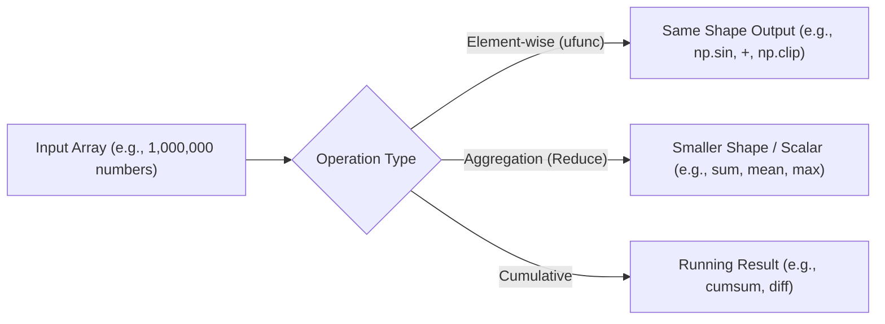
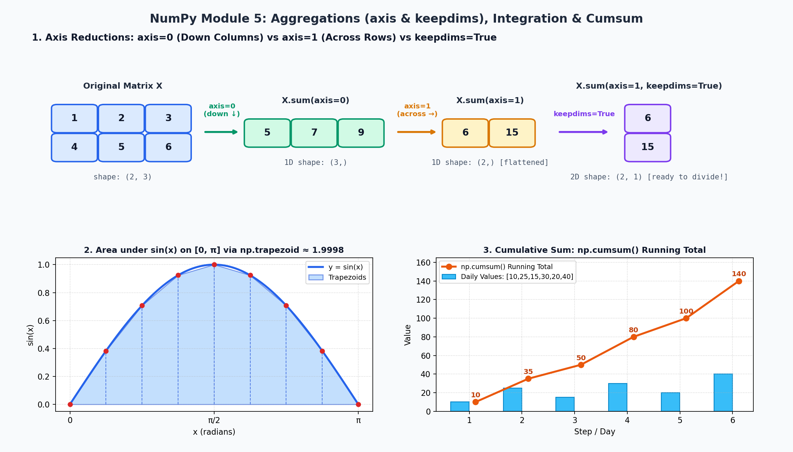

[⬅️ පෙර පාඩම: Data Types & Array Attributes](04_Data_Types_and_Array_Attributes.md) | [🏠 මුල් පිටුව (Course Index)](README.md) | [➡️ ඊළඟ පාඩම: Broadcasting](06_Broadcasting.md)

---

# 📘 පාඩම 05: Math, ufuncs සහ Aggregation (ගණිත ක්‍රියා, Universal Functions සහ එකතු කිරීම්)

NumPy වල තියෙන ලොකුම බලය තමයි **Python `for` loops නැතුව** අංක ලක්ෂ ගාණකට එකපාර ගණිත ක්‍රියා කරන්න පුළුවන් වීම! මේක පිටිපස්සේ ඉන්නේ **ufuncs (Universal Functions)** සහ **Aggregations (එකතු කරලා සාරාංශ ගන්න functions)**.

හිතන්න ඉස්කෝලේ පන්තියක ළමයි 50 දෙනෙක්ගේ ගණිතය ලකුණු වලට අමතර ලකුණු 5ක් දෙන්න ඕනේ කියලා. සාමාන්‍ය Python `list` එකක නම් එක ළමයා ගානේ ගිහින් `for` loop එකකින් `+ 5` කරන්න වෙනවා. හැබැයි NumPy වලදී `marks + 5` කියලා ගැහුවම, ඒක C language එකෙන් compile කරපු වේගවත් යන්ත්‍රයක් වගේ ළමයි 50 දෙනාගෙම ලකුණු **එකම තත්පරේකින්** update කරනවා!



---

## 1. Arithmetic Operations (මූලික ගණිත ක්‍රියා)

NumPy arrays දෙකක් අතර `+`, `-`, `*`, `/`, `//` (floor divide), `%` (modulo/ඉතිරිය), `**` (power/බලය) පාවිච්චි කරද්දී, ඒවා **element-wise** (එකම position එකේ තියෙන අංක දෙක අතර) සිදු වෙනවා. මේ හැම operator එකකටම NumPy function නමකුත් තියෙනවා (`np.add`, `np.subtract`, `np.multiply`, `np.divide`, `np.floor_divide`, `np.mod`, `np.power`).

**උදාහරණය: සෙල්සියස් (Celsius) උෂ්ණත්වය ෆැරන්හයිට් (Fahrenheit) වලට හරවමු**

```python
import numpy as np

a = np.array([10, 20, 30, 40])
b = np.array([3, 4, 5, 6])

print("Add (+):         ", a + b)               # np.add(a, b)
print("Subtract (-):    ", a - b)               # np.subtract(a, b)
print("Multiply (*):    ", a * b)               # np.multiply(a, b)
print("Divide (/):      ", np.round(a / b, 2))  # np.divide(a, b)
print("Floor divide (//):", a // b)             # np.floor_divide(a, b)
print("Modulo (%):      ", a % b)               # np.mod(a, b)
print("Power (**):      ", np.power([2, 3, 4], 2))

# Unit conversion: Celsius -> Fahrenheit
celsius = np.array([0, 25, 30, 37, 100])
fahrenheit = celsius * 9 / 5 + 32
print("Fahrenheit:      ", fahrenheit)
```

**Expected Output:**
```text
Add (+):          [13 24 35 46]
Subtract (-):     [ 7 16 25 34]
Multiply (*):     [ 30  80 150 240]
Divide (/):       [3.33 5.   6.   6.67]
Floor divide (//): [3 5 6 6]
Modulo (%):       [1 0 0 4]
Power (**):       [ 4  9 16]
Fahrenheit:       [ 32.   77.   86.   98.6 212. ]
```

*පේළියෙන් පේළිය:*
- `a + b` මගින් `10+3=13`, `20+4=24` ආදී ලෙස එකම index එකේ අංක එකතු කරනවා.
- `a // b` මගින් දශම කොටස හලලා පූර්ණ සංඛ්‍යාව (quotient) විතරක් දෙනවා (`10 // 3 = 3`).
- `a % b` මගින් බෙදුවම එන ඉතිරිය (remainder) දෙනවා (`10 % 3 = 1`).
- `celsius * 9 / 5 + 32` මගින් loop එකක් නැතුව හැම උෂ්ණත්වයක්ම එකපාර Fahrenheit වලට හරවනවා.

---

## 2. Math Functions (ගණිත ශ්‍රිත: Roots, Logs, Exponentials, Rounding)

දත්ත වෙනස් කරන්න (Data transformations) ඕනේ වෙන ප්‍රධාන math ufuncs ටික බලමු:
- **Roots & Powers:** `sqrt` (වර්ගමූලය), `cbrt` (ඝනමූලය), `square` (වර්ගය)
- **Exp & Logs:** `exp` ($e^x$), `log` (natural log $\ln$), `log10` (base-10 log), `log1p` ($\ln(1+x)$ — ඉතා කුඩා අංක වලදී accuracy වැඩියි!)
- **Sign & Absolute:** `abs` (සෘණ ලකුණ අයින් කරනවා), `sign` (ධන නම් `+1`, සෘණ නම් `-1`, බිංදුව නම් `0`)
- **Rounding:** `round` / `around` / `rint` (ආසන්නම අංකයට), `floor` (පහළට වටයනවා), `ceil` (ඉහළට වටයනවා), `trunc` (දශම කොටස කපලා දානවා)

```python
import numpy as np

nums = np.array([1, 4, 9, 16])
print("sqrt:  ", np.sqrt(nums))
print("cbrt:  ", np.cbrt([8, 27, 64]))
print("square:", np.square([2, 3, 4]))

vals = np.array([1, 10, 100])
print("log10: ", np.log10(vals))
print("exp:   ", np.round(np.exp([0, 1, 2]), 2))
print("log1p: ", np.round(np.log1p([0, 0.001, 1]), 4))

mixed = np.array([-3.7, -1.2, 0.0, 2.3, 4.8])
print("abs:   ", np.abs(mixed))
print("sign:  ", np.sign(mixed))
print("floor: ", np.floor(mixed))   # පහළට
print("ceil:  ", np.ceil(mixed))    # ඉහළට
print("trunc: ", np.trunc(mixed))   # දශම කපලා දානවා
print("round: ", np.round(mixed))   # ආසන්නම පූර්ණ අංකයට
```

**Expected Output:**
```text
sqrt:   [1. 2. 3. 4.]
cbrt:   [2. 3. 4.]
square: [ 4  9 16]
log10:  [0. 1. 2.]
exp:    [1.   2.72 7.39]
log1p:  [0.     0.001  0.6931]
abs:    [3.7 1.2 0.  2.3 4.8]
sign:   [-1. -1.  0.  1.  1.]
floor:  [-4. -2.  0.  2.  4.]
ceil:   [-3. -1.  0.  3.  5.]
trunc:  [-3. -1.  0.  2.  4.]
round:  [-4. -1.  0.  2.  5.]
```

> [!TIP]
> `-3.7` වගේ සෘණ අංකයකදී `floor(-3.7)` කියන්නේ `-4.0` (අංක රේඛාවේ වමට / පහළට), හැබැයි `trunc(-3.7)` කියන්නේ `-3.0` (දශම කොටස නිකම්ම කපලා දානවා)!

---

## 3. Trigonometry (ත්‍රිකෝණමිතිය — Angles & Waves)

NumPy වල `sin`, `cos`, `tan` වගේ functions හැමවෙලේම කෝණ බලාපොරොත්තු වෙන්නේ **Radians** වලින් (Degrees වලින් නෙවෙයි!).
- `deg2rad` (අංශක → radians), `rad2deg` (radians → අංශක)
- `sin`, `cos`, `tan`, සහ inverse functions: `arcsin`, `arccos`, `arctan`, `arctan2(y, x)`
- `hypot(a, b)`: පයිතගරස් ප්‍රමේයයෙන් කර්ණය ($\sqrt{a^2 + b^2}$) හොයනවා!
- Hyperbolic functions: `sinh`, `cosh`, `tanh` (Deep Learning වල `tanh` activation function එකට ගොඩක් පාවිච්චි වෙනවා).

```python
import numpy as np

angles_deg = np.array([0, 30, 45, 90])
angles_rad = np.deg2rad(angles_deg)

print("Radians: ", np.round(angles_rad, 3))
print("sin:     ", np.round(np.sin(angles_rad), 3))
print("cos:     ", np.round(np.cos(angles_rad), 3))
print("arcsin back to deg:", np.round(np.rad2deg(np.arcsin([0, 0.5, 1.0])), 1))

# ත්‍රිකෝණයක පාද 3 සහ 4 නම් කර්ණය (Hypotenuse)
print("hypot(3, 4):", np.hypot(3, 4))
print("arctan2(1, 1) in deg:", np.rad2deg(np.arctan2(1, 1)))
print("tanh([-1, 0, 1]):", np.round(np.tanh([-1, 0, 1]), 3))
```

**Expected Output:**
```text
Radians:  [0.    0.524 0.785 1.571]
sin:      [0.    0.5   0.707 1.   ]
cos:      [1.    0.866 0.707 0.   ]
arcsin back to deg: [ 0. 30. 90.]
hypot(3, 4): 5.0
arctan2(1, 1) in deg: 45.0
tanh([-1, 0, 1]): [-0.762  0.     0.762]
```

---

## 4. Comparison, Logic & Bitwise Operations (සැසඳීම්, තාර්කික සහ Bitwise ක්‍රියා)

Data filter කරන්න (masks හදන්න) `==`, `!=`, `<`, `>`, `<=`, `>=` වගේම `logical_and`, `logical_or`, `logical_not`, `logical_xor`, `isin`, `isfinite` පාවිච්චි කරනවා.

```python
import numpy as np

marks = np.array([45, 78, 92, 30, 65])

# සැසඳීම් සහ Logical operations
passed = marks >= 50
distinction = marks >= 75
print("Passed & <75:", np.logical_and(passed, np.logical_not(distinction)))
print("XOR example: ", np.logical_xor([True, True, False], [True, False, False]))

# isin: මේ ලකුණු අතර 30 හෝ 92 තියෙනවද?
print("isin [30, 92]:", np.isin(marks, [30, 92]))

# isfinite: NaN හෝ Infinity නැති සාමාන්‍ය අංකද?
weird = np.array([1.0, np.nan, np.inf, -5.0])
print("isfinite:     ", np.isfinite(weird))

# Bitwise operations (Binary bits මත ක්‍රියා — flags / permissions වලට)
a = np.array([5, 6], dtype=np.uint8)   # 5 = 0101, 6 = 0110
b = np.array([3, 3], dtype=np.uint8)   # 3 = 0011
print("bitwise_and:", np.bitwise_and(a, b))   # [1, 2]
print("left_shift: ", np.left_shift(a, 1))    # 2න් ගුණ වෙනවා -> [10, 12]
print("invert(0):  ", np.invert(np.uint8(0))) # 00000000 -> 11111111 (255)
bits = np.array([1, 0, 1, 0, 0, 0, 0, 0], dtype=np.uint8)
print("packbits:   ", np.packbits(bits))      # 10100000 in binary = 160
```

**Expected Output:**
```text
Passed & <75: [False False False False  True]
XOR example:  [False  True False]
isin [30, 92]: [False False  True  True False]
isfinite:      [ True False False  True]
bitwise_and: [1 2]
left_shift:  [10 12]
invert(0):   255
packbits:    [160]
```

> [!WARNING]
> **⚠️ සාමාන්‍යයෙන් වෙන වැරදි (Common Pitfall):** NumPy arrays දෙකක් සම්බන්ධ කරන්න Python වල `and`, `or`, `not` පාවිච්චි කරන්න එපා! `marks >= 50 and marks < 75` ගැහුවොත් `ValueError: The truth value of an array with more than one element is ambiguous` එනවා. හැමවෙලේම `np.logical_and(...)` හෝ `(marks >= 50) & (marks < 75)` (වරහන් එක්ක `&`, `|`, `~`) පාවිච්චි කරන්න!

---

## 5. Aggregations, `axis` සහ `keepdims=True` (සාරාංශ ගැනීම)

Aggregation එකක් කියන්නේ අංක ගොඩක් එකතු කරලා තනි අංකයකට හෝ පේළි/තීරු සාරාංශයකට අඩු (reduce) කරන එක:
- `sum` (එකතුව), `prod` (ගුණිතය), `mean` (සාමාන්‍යය), `min`, `max`
- `ptp` (Peak-to-Peak = `max - min`, පරාසය)
- `argmin`, `argmax` (කුඩාම / විශාලම අංකය තියෙන **index** එක)
- `any` (අඩුම තරමේ එක `True` එකක්වත් තියෙනවද?), `all` (ඔක්කොම `True` ද?), `count_nonzero` (බිංදු නොවන අංක ගණන)



### `axis=0` vs `axis=1` සහ `keepdims=True` තේරුම් ගමු!
හිතන්න 2D Table එකක් තියෙනවා — පේළි (rows) කියන්නේ ළමයි, තීරු (columns) කියන්නේ විෂයන් (ගණිතය, විද්‍යාව, ඉංග්‍රීසි).
- **`axis=0` (පහළට ↓):** හැම තීරුවක්ම (විෂයක්ම) පහළට එකතු වෙනවා → විෂයන් 3හේ එකතු/සාමාන්‍යය එනවා!
- **`axis=1` (හරහට →):** හැම පේළියක්ම (ළමයෙක්ගේම ලකුණු) හරහට එකතු වෙනවා → ළමයින්ගේ මුළු ලකුණු එනවා!
- **`keepdims=True`:** සාමාන්‍යයෙන් `x.sum(axis=1)` ගැහුවම `(2, 3)` matrix එක `(2,)` කියන 1D array එකකට තැලෙනවා. එතකොට `x / x.sum(axis=1)` කළොත් shape ගැලපෙන්නේ නැතුව error එනවා! හැබැයි `keepdims=True` දැම්මම shape එක `(2, 1)` විදියට තියාගන්නවා — එතකොට කෙලින්ම `x / x.sum(axis=1, keepdims=True)` බෙදලා හැම row එකක්ම 1ට normalize කරන්න පුළුවන්!

```python
import numpy as np

x = np.array([[1., 2., 3.],
              [4., 5., 6.]])

print("Total sum:    ", x.sum())                # 21.0
print("Mean axis=0:  ", x.mean(axis=0))         # [2.5, 3.5, 4.5] (තීරු පහළට)
print("Max axis=1:   ", x.max(axis=1))          # [3., 6.] (පේළි හරහට)
print("ptp (max-min):", np.ptp(x))              # 6.0 - 1.0 = 5.0
print("argmax flat:  ", x.argmax())             # 5 (index of 6.0)
print("any > 5:      ", np.any(x > 5))          # True
print("all > 0:      ", np.all(x > 0))          # True
print("count_nonzero:", np.count_nonzero(x > 3))# 3

# Row Normalisation (හැම row එකේම එකතුව 1 වෙන විදියට)
row_sums = x.sum(axis=1, keepdims=True)
print("row_sums shape:", row_sums.shape)        # (2, 1)
norm_x = x / row_sums
print("Normalised rows:\n", np.round(norm_x, 3))
print("Row sums after:", norm_x.sum(axis=1))    # [1., 1.]
```

**Expected Output:**
```text
Total sum:     21.0
Mean axis=0:   [2.5 3.5 4.5]
Max axis=1:    [3. 6.]
ptp (max-min): 5.0
argmax flat:   5
any > 5:       True
all > 0:       True
count_nonzero: 3
row_sums shape: (2, 1)
Normalised rows:
 [[0.167 0.333 0.5  ]
 [0.267 0.333 0.4  ]]
Row sums after: [1. 1.]
```

---

## 6. Cumulative Operations, NaN-Aware & Clipping

### A. Cumulative Operations (පියවරෙන් පියවර එකතු/වෙනස්කම්)
- `cumsum`: Running total (උදා: දවසින් දවස කැටේට දාන සල්ලි වල මුළු එකතුව).
- `cumprod`: Running product (දිගටම ගුණ කරගෙන යනවා).
- `diff`: පිටපිට තියෙන අංක දෙක අතර වෙනස (`a[i+1] - a[i]`).
- `ediff1d`: ඕනෑම array එකක් 1D කරලා differences හොයනවා.
- `gradient`: ශ්‍රිතයක numerical derivative (බෑවුම / වෙනස් වීමේ වේගය) හොයනවා.

### B. NaN-Aware Functions (හිස් දත්ත / `np.nan` මගහරින්න)
සැබෑ දත්ත වල සමහර අගයන් අඩුයි (`np.nan`). සාමාන්‍ය `np.mean([1., np.nan, 3.])` ගැහුවොත් උත්තරේ `nan` වෙනවා! ඒ නිසා `nansum`, `nanmean`, `nanmax`, `nanstd`, `nanargmax` පාවිච්චි කරලා `nan` අයින් කරලා ගණනය කරන්න පුළුවන්.

### C. Clipping & Rounding
- `np.clip(a, lo, hi)`: අංක `lo` ට වඩා අඩු නම් `lo` කරනවා, `hi` ට වඩා වැඩි නම් `hi` කරනවා (outliers පාලනය කරන්න සුපිරි!).
- `around` / `rint`: දශම ස්ථාන ගණනකට හෝ ආසන්නම පූර්ණ අංකයට වටයනවා.

```python
import numpy as np

x = np.array([[1., 2., 3.], [4., 5., 6.]])
print("cumsum axis=1:\n", np.cumsum(x, axis=1))
print("cumprod [1,2,3,4]:", np.cumprod([1, 2, 3, 4]))
print("diff [1,4,9,16]:  ", np.diff([1, 4, 9, 16]))     # [3, 5, 7]
print("ediff1d:          ", np.ediff1d([10, 15, 12]))   # [5, -3]
print("gradient:         ", np.gradient([1, 4, 9, 16])) # ~[3, 4, 6, 7]

# NaN-aware
d = np.array([1., np.nan, 3., 5.])
print("Normal mean:", np.mean(d))       # nan!
print("nanmean:    ", np.nanmean(d))    # 3.0
print("nansum:     ", np.nansum(d))     # 9.0
print("nanargmax:  ", np.nanargmax(d))  # 3

# Clipping
print("clip(x, 2, 5):\n", np.clip(x, 2, 5))
print("rint([1.4, 1.6, 2.5]):", np.rint([1.4, 1.6, 2.5]))
```

**Expected Output:**
```text
cumsum axis=1:
 [[ 1.  3.  6.]
 [ 4.  9. 15.]]
cumprod [1,2,3,4]: [ 1  2  6 24]
diff [1,4,9,16]:   [3 5 7]
ediff1d:           [ 5 -3]
gradient:          [3. 4. 6. 7.]
Normal mean: nan
nanmean:     3.0
nansum:      9.0
nanargmax:   3
clip(x, 2, 5):
 [[2. 2. 3.]
 [4. 5. 5.]]
rint([1.4, 1.6, 2.5]): [1. 2. 2.]
```

---

## 7. ufunc Methods, Integration & Vector Products

### A. ufunc Methods (`reduce`, `accumulate`, `outer`, `at`, `out=`, `where=`)
හැම binary ufunc එකකටම (උදා: `np.add`, `np.multiply`) විශේෂ methods ටිකක් තියෙනවා:
- `np.add.reduce(a)`: සියල්ල එකතු කරනවා (`sum` වගේමයි).
- `np.add.accumulate(a)`: running total (`cumsum` වගේමයි).
- `np.multiply.outer(a, b)`: හැම `a` එකක්ම හැම `b` එකකින්ම ගුණ කරලා චක්කර වගුවක් (table) හදනවා!
- `np.add.at(arr, indices, val)`: එකම index එක දෙපාරක් ආවත් නිවැරදිව එකතු කරනවා! (සාමාන්‍ය `arr[[0, 0, 2]] += 1` කළොත් index 0ට එකතු වෙන්නේ 1ක් විතරයි — `add.at` ඒ bug එක නැති කරනවා!).
- `out=` සහ `where=`: අලුත් memory ගන්නේ නැතුව existing array එකකට result එක ලියන්න (`out=`) සහ condition එකක් සත්‍ය තැන් වලට විතරක් operate කරන්න (`where=`).

### B. Numerical Integration (`np.trapezoid`) & Vector Products (`dot`, `outer`, `inner`, `cross`)
- `np.trapezoid(y, x)`: වක්‍රයක් යට තියෙන වර්ගඵලය (Area under curve) ත්‍රපීසියම් (trapezoids) ක්‍රමයෙන් ගණනය කරනවා. (NumPy 2.0 ට කලින් මේකට කිව්වේ `np.trapz`).
- `np.dot(u, v)` / `np.inner(u, v)`: Vectors දෙකේ dot/inner product එක.
- `np.outer(u, v)`: Outer product matrix එක.
- `np.cross(u, v)`: 3D vectors දෙකකට ලම්බක vector එක (Cross product).

```python
import numpy as np

# ufunc methods
print("add.reduce:    ", np.add.reduce([1, 2, 3, 4]))
print("add.accumulate:", np.add.accumulate([1, 2, 3, 4]))
print("multiply.outer:\n", np.multiply.outer([1, 2, 3], [10, 20]))

# np.add.at (duplicate indices සඳහා නිවැරදි ක්‍රමය!)
counts = np.zeros(3)
np.add.at(counts, [0, 0, 2], 1)
print("add.at counts: ", counts)   # [2., 0., 1.]

# out= සහ where= (බිංදුවෙන් බෙදීම වළක්වන්න!)
a = np.array([10., 20., 30.])
b = np.array([2., 0., 5.])
result = np.zeros_like(a)
np.divide(a, b, out=result, where=(b != 0))
print("Safe divide:   ", result)   # [5., 0., 6.]

# Integration: Area under y = x from 0 to 4 (ත්‍රිකෝණය: 0.5 * 4 * 4 = 8)
xs = np.linspace(0, 4, 100)
print("Area under y=x:", np.round(np.trapezoid(xs, xs), 4))

# Vector math
u = np.array([1, 2, 3])
v = np.array([4, 5, 6])
print("dot:   ", np.dot(u, v))     # 1*4 + 2*5 + 3*6 = 32
print("inner: ", np.inner(u, v))   # 32
print("cross: ", np.cross(u, v))   # [-3, 6, -3]
```

**Expected Output:**
```text
add.reduce:     10
add.accumulate: [ 1  3  6 10]
multiply.outer:
 [[10 20]
 [20 40]
 [30 60]]
add.at counts:  [2. 0. 1.]
Safe divide:    [5. 0. 6.]
Area under y=x: 8.0
dot:    32
inner:  32
cross:  [-3  6 -3]
```

---

## 🧠 මතක තබා ගැනීමට පහසු ක්‍රම (Memory Hacks)

1. **`axis=0` = පහළට (Columns ↓), `axis=1` = හරහට (Rows →):**
   `"0"` කියන අංකය දිගටි උස හැඩයක් (පහළට යනවා) වගේ හිතන්න. `axis=0` කරද්දී rows ටික collapse වෙලා column එකකට එක උත්තරේ එනවා.
2. **Row එකක් normalize කරනවද? `keepdims=True` අමතක කරන්න එපා!**
   `x / x.sum(axis=1, keepdims=True)` — මේක machine learning වල probability/softmax හදද්දී නිතරම ඕනේ වෙනවා.
3. **Data වල `NaN` තියෙනවද?** සාමාන්‍ය function නම ඉස්සරහට `nan` දාන්න: `sum` → `nansum`, `mean` → `nanmean`, `std` → `nanstd`.

> [!WARNING]
> **⚠️ සාමාන්‍යයෙන් වෙන වැරදි (Common Pitfalls):**
> 1. **Trigonometry වලට Degrees දීම:** `np.sin(90)` කියන්නේ `1.0` නෙවෙයි (`0.8939...`)! හැමවෙලේම `np.sin(np.deg2rad(90))` පාවිච්චි කරන්න.
> 2. **Duplicate index increment:** `counts[[0, 0, 2]] += 1` කළොත් `counts[0]` වෙන්නේ `1` මිසක් `2` නෙවෙයි! Duplicate indices එකතු කරන්න `np.add.at(counts, [0, 0, 2], 1)` පාවිච්චි කරන්න.
> 3. **Python `min`/`max`/`sum` vs NumPy:** `sum(big_array)` වෙනුවට `big_array.sum()` හෝ `np.sum(big_array)` පාවිච්චි කරන්න — NumPy version එක සිය ගුණයක් වේගවත්!

---

## 🏋️ ප්‍රායෝගික අභ්‍යාස (Practical Exercises)

### Warm-up අභ්‍යාසය: උෂ්ණත්ව වාර්තාව (NaN-Aware + Clipping)
`temps = np.array([28.5, 31.0, np.nan, 45.2, 29.8, 12.0])` යන array එකේ `nan` මගහැර සාමාන්‍යය (mean) සොයන්න, ඉන්පසු සියලු අගයන් `20.0` සහ `35.0` අතරට `clip` කරන්න.

<details>
<summary>✅ පිළිතුර බලන්න (Click to see Solution)</summary>

```python
import numpy as np

temps = np.array([28.5, 31.0, np.nan, 45.2, 29.8, 12.0])
avg_temp = np.nanmean(temps)
clipped = np.clip(temps, 20.0, 35.0)

print("Mean (ignoring NaN):", np.round(avg_temp, 2))  # 29.3
print("Clipped temps:      ", clipped)              # [28.5 31.   nan 35.  29.8 20. ]
```
</details>

---

### අභ්‍යාසය 1: Column Standardisation (Zero Mean & Unit Variance)
ඕනෑම 2D matrix එකක හැම column එකකම mean එක `0` සහ variance (හෝ std) එක `1` වෙන විදියට normalise කරන්න (Z-score normalisation).

<details>
<summary>✅ පිළිතුර බලන්න (Click to see Solution)</summary>

```python
import numpy as np

rng = np.random.default_rng(42)
M = rng.normal(loc=50, scale=15, size=(100, 4))

col_mean = M.mean(axis=0, keepdims=True)
col_std = M.std(axis=0, keepdims=True)
M_norm = (M - col_mean) / col_std

print("New column means (≈0):", np.round(M_norm.mean(axis=0), 6))
print("New column vars  (≈1):", np.round(M_norm.var(axis=0), 6))
```
</details>

---

### අභ්‍යාසය 2: Loop-Free Euclidean Distance
2D matrix එකක හැම row එකක්ම සහ දී ඇති තනි vector එකක් `v` අතර Euclidean distance ($\sqrt{\sum (x_i - v_i)^2}$) එක `for` loop එකක් නැතුව ගණනය කරන්න.

<details>
<summary>✅ පිළිතුර බලන්න (Click to see Solution)</summary>

```python
import numpy as np

points = np.array([[0., 0.], [3., 4.], [6., 8.], [1., 1.]])
target = np.array([0., 0.])

# ක්‍රමය 1: සූත්‍රයෙන්
dists = np.sqrt(np.sum((points - target) ** 2, axis=1))
print("Euclidean distances:", np.round(dists, 3))  # [0.    5.    10.   1.414]

# ක්‍රමය 2: np.linalg.norm
print("Using linalg.norm:  ", np.round(np.linalg.norm(points - target, axis=1), 3))
```
</details>

---

### අභ්‍යාසය 3: `np.add.at` vs `np.bincount`
Category IDs ඇතුළත් array එකක (`ids = np.array([0, 2, 1, 0, 0, 3, 2])`) හැම category එකම කී පාරක් එනවද කියලා `np.add.at` පාවිච්චි කරලා histogram එකක් හදන්න, ඒක `np.bincount` එක්ක සසඳන්න.

<details>
<summary>✅ පිළිතුර බලන්න (Click to see Solution)</summary>

```python
import numpy as np

ids = np.array([0, 2, 1, 0, 0, 3, 2])
hist_at = np.zeros(ids.max() + 1, dtype=int)
np.add.at(hist_at, ids, 1)

hist_bc = np.bincount(ids)

print("Using np.add.at: ", hist_at)               # [3 1 2 1]
print("Using bincount:  ", hist_bc)               # [3 1 2 1]
print("Exact match?:    ", np.array_equal(hist_at, hist_bc))  # True
```
</details>

---

### අභ්‍යාසය 4: `sin(x)` වක්‍රය යට වර්ගඵලය (`np.trapezoid`)
$[0, \pi]$ පරාසය තුළ `sin(x)` යට තියෙන වර්ගඵලය `np.trapezoid` පාවිච්චි කරලා ගණනය කරලා, එය `2.0` ට ආසන්නද කියලා පරීක්ෂා කරන්න.

<details>
<summary>✅ පිළිතුර බලන්න (Click to see Solution)</summary>

```python
import numpy as np

x = np.linspace(0, np.pi, 1000)
y = np.sin(x)
area = np.trapezoid(y, x)

print(f"Estimated area: {area:.6f}")
print("Close to 2.0?: ", np.isclose(area, 2.0, atol=1e-4))  # True
```
</details>

---

## 📋 Cheat Sheet — පාඩම 05 සාරාංශය

| Category | Key APIs | ප්‍රයෝජනය (Use Case) |
| --- | --- | --- |
| **Arithmetic** | `+ - * / // % **`, `add`, `power` | Unit conversion, element-wise math |
| **Math ufuncs** | `sqrt`, `cbrt`, `exp`, `log`, `log1p`, `abs`, `sign`, `floor`, `ceil`, `trunc` | Data transformations & rounding |
| **Trigonometry** | `sin`, `cos`, `tan`, `arctan2`, `hypot`, `deg2rad`, `rad2deg`, `tanh` | Signals, geometry, neural nets |
| **Logic & Bitwise** | `logical_and/or/not/xor`, `isin`, `isfinite`, `bitwise_and`, `left_shift`, `packbits` | Masks, filters, bit flags |
| **Aggregations** | `sum`, `prod`, `mean`, `min`, `max`, `ptp`, `argmin`, `argmax`, `any`, `all`, `count_nonzero` | Row/Column summaries |
| **Axis & Keepdims** | `x.sum(axis=1, keepdims=True)` | Preserving 2D shape for normalisation |
| **Cumulative** | `cumsum`, `cumprod`, `diff`, `gradient`, `ediff1d` | Running totals & numerical derivatives |
| **NaN-aware** | `nansum`, `nanmean`, `nanmax`, `nanstd`, `nanargmax` | Missing data (`np.nan`) handling |
| **Clip & ufunc methods** | `clip`, `around`, `rint`, `add.reduce`, `add.at`, `multiply.outer`, `out=`, `where=` | Outliers, safe division, custom reductions |
| **Integration & Vectors** | `np.trapezoid`, `np.dot`, `np.inner`, `np.outer`, `np.cross` | Area under curve & vector algebra |

---

[⬅️ පෙර පාඩම: Data Types & Array Attributes](04_Data_Types_and_Array_Attributes.md) | [🏠 මුල් පිටුව (Course Index)](README.md) | [➡️ ඊළඟ පාඩම: Broadcasting](06_Broadcasting.md)
