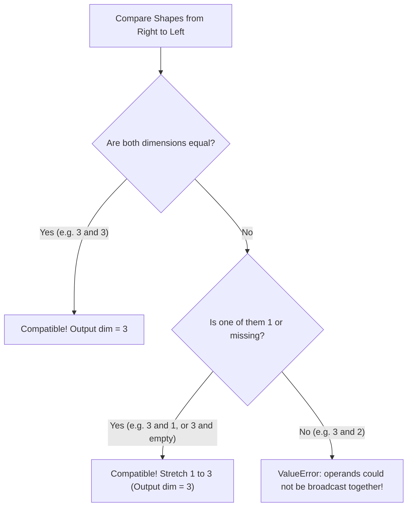
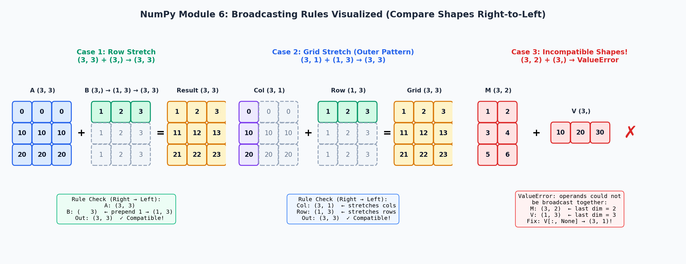

[⬅️ පෙර පාඩම: Math, ufuncs & Aggregation](05_Math_Ufuncs_and_Aggregation.md) | [🏠 මුල් පිටුව (Course Index)](README.md) | [➡️ ඊළඟ පාඩම: Shape Manipulation, Stacking & Splitting](07_Shape_Manipulation_Stacking_Splitting.md)

---

# 📘 පාඩම 06: Broadcasting (වෙනස් Shapes තියෙන Arrays එකතු කිරීමේ මැජික් එක)

NumPy වල `for` loops නැතුව code ලියන්න පුළුවන් වෙන්න ප්‍රධානම හේතුව තමයි **Broadcasting**!

Broadcasting කියන්නේ මොකක්ද?
හිතන්න ඔයා ගාව `(3, 3)` shape එකේ 2D matrix එකක් තියෙනවා, ඒකට `(3,)` shape එකේ 1D array එකක් එකතු කරන්න ඕනේ. සාමාන්‍යයෙන් ගණිතයේදී shape දෙක වෙනස් නම් එකතු කරන්න බෑ. හැබැයි NumPy **අලුතෙන් memory වල data copy නොකරම** පොඩි array එක හිතෙන් ඇදලා (virtually stretch කරලා) ලොකු array එකේ shape එකට ගැලපෙන්න හදලා එකතු කරනවා!

හරියට පන්තියේ ළමයි 5 දෙනාගෙම විෂයන් 3ක ලකුණු තියෙන වගුවකට, හැම ළමයාටම ගණිතයට `+5`, විද්‍යාවට `+2`, ඉංග්‍රීසි වලට `+3` දෙනවා වගේ — `[5, 2, 3]` කියන පොඩි ලැයිස්තුව ළමයි 5 දෙනාටම auto-repeat වෙනවා!

---

## 1. Broadcasting රන් නීතිය (The Golden Rule)

NumPy arrays දෙකක් broadcast කරන්න පුළුවන්ද කියලා බලන්නේ **දකුණු පැත්තේ ඉඳලා වමට (Right-to-Left / last axis backwards)** shapes සසඳලා!



**පියවර 3න් නීතිය මතක තියාගමු:**
1. Array දෙකේ dimension ගණන වෙනස් නම්, පොඩි array එකේ **වම් පැත්තට (leading side) `1`** දාලා සමාන කරගන්න. (උදා: `(3,)` → `(1, 3)`).
2. දැන් දකුණේ ඉඳන් වමට හැම axis එකක්ම බලන්න: දෙකම **සමාන** නම් හෝ **එකක් `1`** නම් → **OK (Compatible)!**
3. දෙකම `1` නෙවෙයි සහ සමානත් නැත්නම් (උදා: `2` සහ `3`) → **`ValueError`!** Output shape එක හැම axis එකකම **විශාලම අංකය** ගන්නවා.



---

## 2. ප්‍රධාන Broadcasting රටා 4 (The 4 Core Patterns)

### Pattern 1: Scalar with Array (තනි අංකයක් + Array)
තනි අංකයක් (scalar) ඕනෑම shape එකකට auto-stretch වෙනවා.

### Pattern 2: Matrix with Vector (Row / Column එකතු කිරීම)
`(5, 3)` matrix එකකින් `(3,)` column means අඩු කරන එක (centering data) කෙලින්ම වැඩ කරනවා. හැබැයි `(5,)` row sums වලින් බෙදන්න නම් `[:, None]` දාලා `(5, 1)` කරගන්න ඕනේ!

### Pattern 3: Row Vector + Column Vector (Outer / Grid Pattern)
`(n, 1)` සහ `(1, n)` (හෝ `(n,)`) එකතු/ගුණ කළාම `(n, n)` 2D වගුවක් හැදෙනවා! චක්කර වගුවක් (multiplication table) තනි පේළියෙන් හදන්න පුළුවන්!

```python
import numpy as np

# 1. Scalar with array
a = np.array([10, 20, 30])
print("Scalar + array:", a + 5)

# 2. Matrix with vector (Centering & Scaling columns)
rng = np.random.default_rng(1)
X = rng.normal(size=(5, 3))

centered = X - X.mean(axis=0)          # (5, 3) - (3,) -> OK!
scaled = centered / X.std(axis=0)      # (5, 3) / (3,) -> OK!

# Row normalisation: row_sums has shape (5,), so we add a new axis -> (5, 1)
row_sums = X.sum(axis=1)               # shape (5,)
normalised = X / row_sums[:, None]     # (5, 3) / (5, 1) -> OK!
print("Centered col means (≈0):", np.round(centered.mean(axis=0), 6))
print("Normalised shape:       ", normalised.shape)

# 3. Multiplication table: (5, 1) * (5,) -> (5, 5)
nums = np.arange(1, 6)
table = nums[:, None] * nums[None, :]
print("5x5 Multiplication Table:\n", table)
```

**Expected Output:**
```text
Scalar + array: [15 25 35]
Centered col means (≈0): [ 0. -0.  0.]
Normalised shape:        (5, 3)
5x5 Multiplication Table:
 [[ 1  2  3  4  5]
 [ 2  4  6  8 10]
 [ 3  6  9 12 15]
 [ 4  8 12 16 20]
 [ 5 10 15 20 25]]
```

---

## 3. Adding Axes (`np.newaxis`, `reshape`, `expand_dims`)

Shapes ගැලපෙන්නේ නැති වෙලාවට අලුත් `1` dimension එකක් දාගන්න ක්‍රම 3ක් තියෙනවා — මේ 3ම කරන්නේ එකම දේ:
- `v[:, None]` හෝ `v[:, np.newaxis]` (`np.newaxis` කියන්නේ ඇත්තටම `None` ම තමයි!)
- `v.reshape(-1, 1)`
- `np.expand_dims(v, axis=1)`

```python
import numpy as np

v = np.array([10, 20, 30])   # shape (3,)
print("Original:   ", v.shape)
print("newaxis:    ", v[:, np.newaxis].shape)      # (3, 1)
print("None:       ", v[None, :].shape)            # (1, 3)
print("expand_dims:", np.expand_dims(v, axis=1).shape) # (3, 1)
print("reshape:    ", v.reshape(3, 1).shape)       # (3, 1)
```

**Expected Output:**
```text
Original:    (3,)
newaxis:     (3, 1)
None:        (1, 3)
expand_dims: (3, 1)
reshape:     (3, 1)
```

---

## 4. Explicit Broadcasting (Debugging & Inspecting)

Broadcasting එකක් කරන්න කලින් output shape එක මොකක් වෙයිද කියලා බලන්න හෝ broadcast වුණු view එක ඇහැට දකින්න මේ functions 3 සුපිරි:
- `np.broadcast_shapes(s1, s2, ...)`: arrays හදන්නේ නැතුව shape එක විතරක් check කරනවා!
- `np.broadcast_to(a, new_shape)`: තනි array එකක් අලුත් shape එකකට (read-only view එකක් විදියට, memory copy නැතුව) stretch කරලා පෙන්නනවා.
- `np.broadcast_arrays(a, b)`: arrays දෙකම එකම common shape එකට stretch කරලා දෙනවා.

```python
import numpy as np

# Shape එක කලින්ම test කරමු
print("broadcast_shapes:", np.broadcast_shapes((3, 1, 4), (5, 1)))  # (3, 5, 4)

# broadcast_to (zero-copy view!)
row = np.array([1, 2, 3])
stretched = np.broadcast_to(row, (3, 3))
print("broadcast_to:\n", stretched)

# broadcast_arrays
a = np.array([[1], [2]])      # (2, 1)
b = np.array([10, 20, 30])    # (3,)
A_view, B_view = np.broadcast_arrays(a, b)
print("A_view shape:", A_view.shape, "| B_view shape:", B_view.shape)
```

**Expected Output:**
```text
broadcast_shapes: (3, 5, 4)
broadcast_to:
 [[1 2 3]
 [1 2 3]
 [1 2 3]]
A_view shape: (2, 3) | B_view shape: (2, 3)
```

---

## 5. Pairwise Distances (සියලු ලක්ෂ්‍ය අතර දුර) සහ Memory Awareness

Machine Learning (kNN, Clustering) වලදී ලක්ෂ්‍ය $N$ ක් දුන්නම, හැම ලක්ෂ්‍ය දෙකක් අතරම දුර (Pairwise Distance Matrix, shape `(N, N)`) හොයන්න ඕනේ වෙනවා.
3D broadcasting පාවිච්චි කරලා මේක පේළි 2න් කරන්න පුළුවන්:
- `X[:, None, :]` → shape `(N, 1, D)`
- `X[None, :, :]` → shape `(1, N, D)`
- දෙක අඩු කළාම `diff` → shape **`(N, N, D)`**!

```python
import numpy as np

rng = np.random.default_rng(1)
X = rng.normal(size=(5, 3))                # ලක්ෂ්‍ය 5ක්, 3D අවකාශයේ

diff = X[:, None, :] - X[None, :, :]       # (5, 1, 3) - (1, 5, 3) -> (5, 5, 3)
dist = np.sqrt((diff ** 2).sum(axis=-1))   # (5, 5) distance matrix

print("diff shape:", diff.shape)
print("dist shape:", dist.shape)
print("Distance matrix (rounded):\n", np.round(dist, 2))
```

**Expected Output:**
```text
diff shape: (5, 5, 3)
dist shape: (5, 5)
Distance matrix (rounded):
 [[0.   1.65 0.92 0.82 1.67]
 [1.65 0.   0.84 1.82 1.52]
 [0.92 0.84 0.   1.01 1.14]
 [0.82 1.82 1.01 0.   1.47]
 [1.67 1.52 1.14 1.47 0.  ]]
```

> [!WARNING]
> **⚠️ Memory Awareness (RAM පිරී යාම ගැන සැලකිලිමත් වන්න!):**
> Broadcasting වලදී inputs copy වෙන්නේ නැති වුණාට, `diff = X[:, None, :] - X[None, :, :]` කියන **intermediate output array එක** ඇත්තටම RAM එකේ හැදෙනවා!
> හිතන්න ලක්ෂ්‍ය `N = 20,000` ක් සහ features `D = 50` ක් තියෙනවා කියලා:
> `(20000, 20000, 50)` float64 array එකකට **160 GB RAM** ඕනේ! පරිගණකය crash වෙයි!
> **විසඳුම (Chunking):** එකපාර ඔක්කොම නොහදා, rows 200 ගානේ (chunks විදියට) loop එකකින් ගණනය කරන්න! (පහළ අභ්‍යාසය 3 බලන්න).

---

## 🧠 මතක තබා ගැනීමට පහසු ක්‍රම (Memory Hacks)

1. **"Right-Align & Pad Left with 1s":** Shapes දෙක කොළයක දකුණු පැත්තට align කරලා ලියන්න:
   ```text
   A: (3, 1, 4)
   B: (   5, 1)  --> වමට 1 දාන්න --> (1, 5, 1)
   Out: (3, 5, 4)
   ```
2. **Error එකක් ආවොත් මුලින්ම `.shape` print කරන්න!** `operands could not be broadcast together with shapes (5,3) (5,)` දැක්ක ගමන් තේරෙන්න ඕනේ `(5,)` එකට `[:, None]` දාලා `(5, 1)` කරන්න ඕනේ කියලා.
3. **1D `(n,)` හැමවෙලේම Row එකක් වගේ `(1, n)` හැසිරෙනවා.** Column එකක් විදියට හැසිරෙන්න නම් `[:, None]` දාන්නම ඕනේ!

> [!WARNING]
> **⚠️ සාමාන්‍යයෙන් වෙන වැරදි (Common Pitfalls):**
> 1. **`X / X.sum(axis=1)` වැරදියි!** `(5, 3)` සහ `(5,)` broadcast වෙන්නේ නෑ (දකුණේ 3 ≠ 5). නිවැරදි ක්‍රමය: `X / X.sum(axis=1)[:, None]` හෝ `X / X.sum(axis=1, keepdims=True)`.
> 2. **නොදැනුවත්වම 2D grid එකක් හැදීම:** `(5, 1) + (5,)` කළාම `(5,)` නෙවෙයි, **`(5, 5)`** හැදෙනවා! ඒ නිසා vectors එකතු කරද්දී දෙකම `(5,)` ද නැත්නම් එකක් `(5, 1)` ද කියලා check කරන්න.

---

## 🏋️ ප්‍රායෝගික අභ්‍යාස (Practical Exercises)

### Warm-up අභ්‍යාසය: ශ්‍රී ලංකා කඩේක බිල්පත් ගණනය
භාණ්ඩ 3ක මිල `prices = np.array([150, 250, 400])` (shape `(3,)`) සහ පාරිභෝගිකයන් 4 දෙනෙක් ගත්ත ප්‍රමාණ `qty` (shape `(4, 3)`) දී ඇත. Broadcasting පාවිච්චි කරලා හැම පාරිභෝගිකයාගෙම මුළු බිල (total bill) හොයන්න.

<details>
<summary>✅ පිළිතුර බලන්න (Click to see Solution)</summary>

```python
import numpy as np

prices = np.array([150, 250, 400])  # shape (3,)
qty = np.array([
    [2, 1, 0],
    [0, 3, 1],
    [1, 1, 1],
    [4, 0, 2],
])  # shape (4, 3)

item_costs = qty * prices           # (4, 3) * (3,) -> (4, 3)
total_bills = item_costs.sum(axis=1)
print("Total bills per customer (Rs.):", total_bills)  # [ 550 1150  800 1400]
```
</details>

---

### අභ්‍යාසය 1: Shape Prediction (කොම්පියුටරේ run නොකර හිතන්න!)
`(3, 1, 4)` සහ `(5, 1)` shapes තියෙන arrays දෙකක් එකතු කළාම එන result shape එක මොකක්ද? ඉන්පසු `np.broadcast_shapes` වලින් verify කරන්න.

<details>
<summary>✅ පිළිතුර බලන්න (Click to see Solution)</summary>

**ගණනය (දකුණේ සිට වමට):**
- A: `(3, 1, 4)`
- B: `(   5, 1)` → වමට `1` දැම්මම `(1, 5, 1)`
- Axis 2 (දකුණ): `4` සහ `1` → **`4`**
- Axis 1 (මැද): `1` සහ `5` → **`5`**
- Axis 0 (වම): `3` සහ `1` → **`3`**
- **Result Shape: `(3, 5, 4)`**

```python
import numpy as np
print(np.broadcast_shapes((3, 1, 4), (5, 1)))  # (3, 5, 4)
```
</details>

---

### අභ්‍යාසය 2: One-Line Column Mean Subtraction
`1000 x 20` matrix එකක හැම column එකකින්ම ඒ column එකේ mean එක තනි පේළියකින් (one line) අඩු කරන්න.

<details>
<summary>✅ පිළිතුර බලන්න (Click to see Solution)</summary>

```python
import numpy as np

rng = np.random.default_rng(0)
M = rng.normal(loc=10, scale=2, size=(1000, 20))

M_centered = M - M.mean(axis=0)  # (1000, 20) - (20,) -> (1000, 20)

print("Shape:", M_centered.shape)
print("Max abs col mean after centering:", np.abs(M_centered.mean(axis=0)).max())
```
</details>

---

### අභ්‍යාසය 3: Memory-Efficient Pairwise Distance Matrix (2000 Points, Chunked)
2D අවකාශයේ ලක්ෂ්‍ය 2000ක් සඳහා full `(2000, 2000)` pairwise distance matrix එක ගණනය කරන්න. පසුව RAM ඉතිරි කරන්න rows 200 ගානේ (chunks) ගණනය කරලා උත්තර දෙකම සමානද (`np.allclose`) බලන්න.

<details>
<summary>✅ පිළිතුර බලන්න (Click to see Solution)</summary>

```python
import numpy as np

rng = np.random.default_rng(42)
X = rng.normal(size=(2000, 2))

# 1. Full broadcasting (intermediate array: 2000 x 2000 x 2 = 64 MB)
diff_full = X[:, None, :] - X[None, :, :]
dist_full = np.sqrt((diff_full ** 2).sum(axis=-1))

# 2. Chunked broadcasting (200 rows at a time -> intermediate: 200 x 2000 x 2 = 6.4 MB!)
N = X.shape[0]
chunk_size = 200
dist_chunked = np.empty((N, N), dtype=np.float64)

for start in range(0, N, chunk_size):
    end = min(start + chunk_size, N)
    diff = X[start:end, None, :] - X[None, :, :]   # (200, 2000, 2)
    dist_chunked[start:end] = np.sqrt((diff ** 2).sum(axis=-1))

print("dist_chunked shape:", dist_chunked.shape)
print("Results match?:    ", np.allclose(dist_full, dist_chunked))  # True
```
</details>

---

## 📋 Cheat Sheet — පාඩම 06 සාරාංශය

| Topic | Key Pattern / API | ප්‍රයෝජනය (Use Case) |
| --- | --- | --- |
| **Scalar + Array** | `a + 5`, `a * 2` | Offsets & scaling |
| **Matrix + Row Vector** | `M - M.mean(axis=0)` | Column centering / scaling |
| **Matrix + Col Vector** | `M / M.sum(axis=1)[:, None]` | Row normalisation |
| **Outer Grid** | `a[:, None] + b[None, :]` | Multiplication / pairwise tables |
| **Add Axis** | `np.newaxis`, `None`, `expand_dims`, `reshape` | Aligning dimensions |
| **Inspect / Debug** | `broadcast_shapes`, `broadcast_to`, `broadcast_arrays` | Checking shapes without errors |
| **Pairwise 3D** | `X[:, None, :] - X[None, :, :]` | All-pairs distances (kNN, clustering) |
| **Big Data** | Chunk over rows (`range(0, N, chunk)`) | Avoiding RAM exhaustion |

---

[⬅️ පෙර පාඩම: Math, ufuncs & Aggregation](05_Math_Ufuncs_and_Aggregation.md) | [🏠 මුල් පිටුව (Course Index)](README.md) | [➡️ ඊළඟ පාඩම: Shape Manipulation, Stacking & Splitting](07_Shape_Manipulation_Stacking_Splitting.md)
