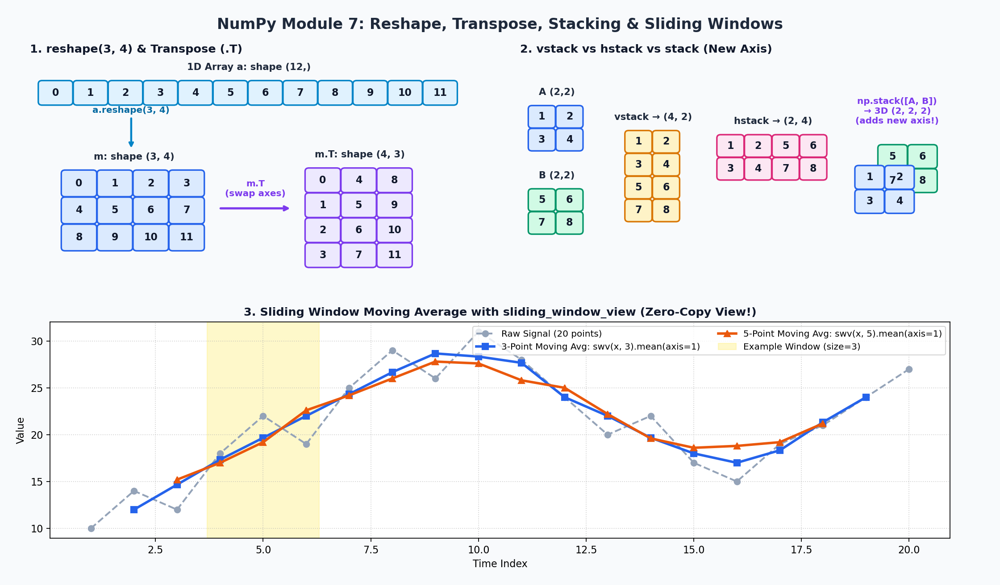
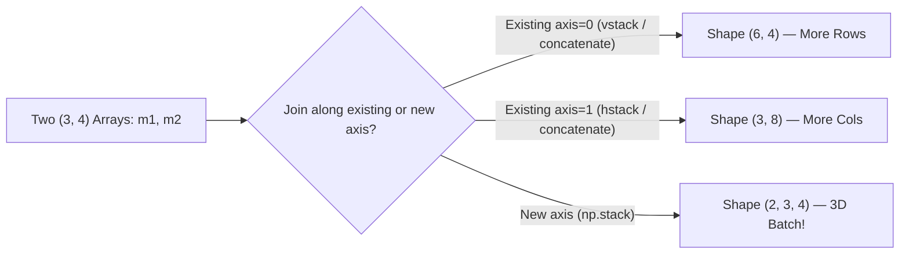

[⬅️ පෙර පාඩම: Broadcasting](06_Broadcasting.md) | [🏠 මුල් පිටුව (Course Index)](README.md) | [➡️ ඊළඟ පාඩම: Sorting, Searching & Set Operations](08_Sorting_Searching_and_Set_Operations.md)

---

# 📘 පාඩම 07: Shape Manipulation, Stacking & Splitting (හැඩය වෙනස් කිරීම, එකට ඇමිණීම සහ බෙදීම)

හිතන්න ඔයා ගාව බිත්තර 12ක් තියෙනවා. ඒවා දිග පේළියකට `(12,)` තියන්නත් පුළුවන්, පේළි 3කට 4 ගානේ `(3, 4)` tray එකක තියන්නත් පුළුවන්, නැත්නම් `(2, 2, 3)` පෙට්ටි දෙකක අහුරන්නත් පුළුවන්! **බිත්තර ටික වෙනස් වෙන්නේ නෑ — ඇහිරුම (shape) විතරයි වෙනස් වෙන්නේ.**

NumPy වලදී data වෙනස් නොකර shape එක හසුරුවන්න, arrays කීපයක් එකට එකතු කරන්න (stack/concatenate), සහ ලොකු array එකක් කෑලි වලට කඩන්න (split) තියෙන සුපිරි tools ටික මේ පාඩමෙන් ඉගෙන ගමු!



---

## 1. Reshaping & Flattening (`reshape`, `-1`, `ravel`, `flatten`, `resize`)

- **`reshape(r, c)`:** අංක ගණන සමාන නම් අලුත් shape එකකට හරවනවා (පුළුවන් හැමවෙලේම **view** එකක් දෙනවා — memory copy නෑ!).
- **`-1` trick:** එක dimension එකකට `-1` දුන්නොත්, ඉතිරි අංක ගණන අනුව NumPy ඒක auto-calculate කරනවා! (උදා: අංක 12ක් තියෙන array එකට `.reshape(3, -1)` දුන්නම auto `(3, 4)` වෙනවා).
- **`ravel()` vs `flatten()`:** දෙකම 1D කරනවා. හැබැයි `ravel()` පුළුවන් නම් **view** එකක් දෙනවා (වේගවත්!), `flatten()` හැමවෙලේම අලුත් **copy** එකක් හදනවා.
- **`np.resize(a, new_shape)`:** අලුත් shape එක ලොකු නම් මුල ඉඳන් data repeat කරලා පුරවනවා; `a.resize(...)` in-place වෙනස් කරලා අඩු තැන් වලට `0` දානවා.

```python
import numpy as np

a = np.arange(12)
m = a.reshape(3, 4)             # (3, 4) view
print("Reshaped (3, 4):\n", m)
print("Auto -1 -> (2, -1):", a.reshape(2, -1).shape)   # (2, 6)
print("Flatten via -1:   ", m.reshape(-1))             # 1D

# ravel (view) vs flatten (copy)
r = m.ravel()
f = m.flatten()
r[0] = 99
print("m[0, 0] after ravel edit:  ", m[0, 0])   # 99 (changed!)
f[1] = 888
print("m[0, 1] after flatten edit:", m[0, 1])   # 1 (unchanged!)

# np.resize repeats elements if larger
print("np.resize to (2, 3):", np.resize([1, 2, 3, 4], (2, 3)).tolist())
```

**Expected Output:**
```text
Reshaped (3, 4):
 [[ 0  1  2  3]
 [ 4  5  6  7]
 [ 8  9 10 11]]
Auto -1 -> (2, -1): (2, 6)
Flatten via -1:    [ 0  1  2  3  4  5  6  7  8  9 10 11]
m[0, 0] after ravel edit:   99
m[0, 1] after flatten edit: 1
np.resize to (2, 3): [[1, 2, 3], [4, 1, 2]]
```

---

## 2. Transposing, Axes Reordering & Adding/Removing Axes

### A. Axes Reordering (`T`, `transpose`, `swapaxes`, `moveaxis`, `rollaxis`)
Deep Learning / Image Processing වලදී ගොඩක් images තියෙන්නේ `(Height, Width, Channels)` (HWC — channel-last) විදියට. හැබැයි PyTorch වගේ libraries ඉල්ලන්නේ `(Channels, Height, Width)` (CHW — channel-first)! මේකට තමයි `transpose` සහ `moveaxis` ඕනේ වෙන්නේ.

### B. Adding & Removing Size-1 Axes (`expand_dims`, `squeeze`, `atleast_1d/2d/3d`)
- `np.expand_dims(a, axis=0)`: size 1 අලුත් axis එකක් එකතු කරනවා.
- `np.squeeze(a)`: size 1 තියෙන අනවශ්‍ය axes ඔක්කොම අයින් කරනවා (`(1, 3, 1)` → `(3,)`).
- `np.atleast_1d`, `np.atleast_2d`, `np.atleast_3d`: input එක අඩුම තරමේ 1D/2D/3D වෙන බව තහවුරු කරනවා.

```python
import numpy as np

m = np.arange(12).reshape(3, 4)
print("m.T shape:", m.T.shape)                          # (4, 3)

# 3D Image: (H=28, W=28, C=3) -> (C=3, H=28, W=28)
img = np.zeros((28, 28, 3))
print("transpose(2,0,1):", img.transpose(2, 0, 1).shape) # (3, 28, 28)
print("moveaxis(-1, 0): ", np.moveaxis(img, -1, 0).shape)# (3, 28, 28)
print("swapaxes(0, 2):  ", np.swapaxes(img, 0, 2).shape) # (3, 28, 28)

# expand_dims & squeeze
x = np.array([10, 20, 30])
x_3d = np.expand_dims(x, axis=(0, 2))
print("Expanded shape:", x_3d.shape)                    # (1, 3, 1)
print("Squeezed shape:", np.squeeze(x_3d).shape)        # (3,)
print("atleast_2d(5): ", np.atleast_2d(5).shape)        # (1, 1)
```

**Expected Output:**
```text
m.T shape: (4, 3)
transpose(2,0,1): (3, 28, 28)
moveaxis(-1, 0):  (3, 28, 28)
swapaxes(0, 2):   (3, 28, 28)
Expanded shape: (1, 3, 1)
Squeezed shape: (3,)
atleast_2d(5):  (1, 1)
```

---

## 3. Concatenation, Stacking & Splitting (එකට ඇමිණීම සහ බෙදීම)



- **Concatenation (පවතින axis එකක් දිගේ එකතු කරනවා):**
  - `np.concatenate([m1, m2], axis=0)` (පහළට), `axis=1` (දකුණට).
  - Shortcuts: `vstack` (vertical/පහළට), `hstack` (horizontal/හරහට), `dstack` (depth/3rd axis), `column_stack` (1D arrays columns විදියට අමුණනවා), `np.append` (අගට එකතු කරනවා — copy එකක් හදන නිසා loop ඇතුළේ පාවිච්චි කරන්න එපා!).
- **Stacking (අලුත් axis එකක් හදලා එකතු කරනවා):**
  - `np.stack([m1, m2], axis=0)` → `(3, 4)` දෙකක් `(2, 3, 4)` 3D batch එකක් වෙනවා!
  - `np.block([[A, B], [C, D]])` → පෙට්ටි වගේ block matrix එකක් හදනවා.
- **Splitting (කෑලි වලට කඩනවා):**
  - `np.split(a, 3)` (සමාන කෑලි 3කට — බෙදන්න බැරි නම් error!), `np.array_split(a, 3)` (සමානව බෙදන්න බැරි වුණත් error නැතුව බෙදනවා!).
  - `hsplit` (columns වලින්), `vsplit` (rows වලින්), `dsplit` (3rd axis වලින්).

```python
import numpy as np

m = np.arange(12).reshape(3, 4)
print("concatenate axis=0:", np.concatenate([m, m], axis=0).shape) # (6, 4)
print("vstack:            ", np.vstack([m, m]).shape)              # (6, 4)
print("hstack:            ", np.hstack([m, m]).shape)              # (3, 8)
print("dstack:            ", np.dstack([m, m]).shape)              # (3, 4, 2)
print("stack (new axis!): ", np.stack([m, m]).shape)               # (2, 3, 4)

# column_stack & block
c1, c2 = np.array([1, 2, 3]), np.array([4, 5, 6])
print("column_stack:\n", np.column_stack([c1, c2]))
print("block:\n", np.block([[np.ones((2, 2)), np.zeros((2, 2))]]))

# Splitting
a = np.arange(10)
print("split(12, 3):      ", [arr.tolist() for arr in np.split(np.arange(12), 3)])
print("array_split(10, 3):", [arr.tolist() for arr in np.array_split(a, 3)])
print("vsplit m at row 1: ", [arr.shape for arr in np.vsplit(m, [1])])
```

**Expected Output:**
```text
concatenate axis=0: (6, 4)
vstack:             (6, 4)
hstack:             (3, 8)
dstack:             (3, 4, 2)
stack (new axis!):  (2, 3, 4)
column_stack:
 [[1 4]
 [2 5]
 [3 6]]
block:
 [[1. 1. 0. 0.]
 [1. 1. 0. 0.]]
split(12, 3):       [[0, 1, 2, 3], [4, 5, 6, 7], [8, 9, 10, 11]]
array_split(10, 3): [[0, 1, 2, 3], [4, 5, 6], [7, 8, 9]]
vsplit m at row 1:  [(1, 4), (2, 4)]
```

---

## 4. Repeating, Flipping, Rotating, Padding & Editing

- **Repeating:** `np.repeat([1, 2], 3)` → `[1, 1, 1, 2, 2, 2]` (එක element එක 3 පාරක්). `np.tile([1, 2], 3)` → `[1, 2, 1, 2, 1, 2]` (මුළු array එකම 3 පාරක්!).
- **Flipping & Rotating:** `flip`, `fliplr` (වම-දකුණ මාරු), `flipud` (උඩ-යට මාරු), `rot90` (අංශක 90ක් කරකවනවා), `roll` (අංක ටික වටේට තල්ලු කරනවා).
- **Padding:** `np.pad(m, pad_width=1, mode='constant')` — photo එකකට frame එකක් දානවා වගේ වටේට border එකක් දානවා (`constant`=0, `edge`=අයිනේ අංකයම, `reflect`=කණ්ණාඩියෙන් වගේ).
- **Insert & Delete:** `np.insert(a, idx, val)` සහ `np.delete(a, idx)` (අලුත් copy එකක් return කරනවා).

```python
import numpy as np

print("repeat:", np.repeat([1, 2, 3], 2))      # [1 1 2 2 3 3]
print("tile:  ", np.tile([1, 2, 3], 2))        # [1 2 3 1 2 3]

grid = np.array([[1, 2], [3, 4]])
print("fliplr:\n", np.fliplr(grid))
print("rot90:\n", np.rot90(grid))
print("roll([1,2,3,4], 1):", np.roll([1, 2, 3, 4], 1))  # [4 1 2 3]

# Padding
padded = np.pad(grid, pad_width=1, mode='constant', constant_values=0)
print("Padded (constant=0):\n", padded)

# Insert & Delete
arr = np.array([10, 20, 30, 40])
print("insert 99 at idx 2:", np.insert(arr, 2, 99))
print("delete idx 1:      ", np.delete(arr, 1))
```

**Expected Output:**
```text
repeat: [1 1 2 2 3 3]
tile:   [1 2 3 1 2 3]
fliplr:
 [[2 1]
 [4 3]]
rot90:
 [[2 4]
 [1 3]]
roll([1,2,3,4], 1): [4 1 2 3]
Padded (constant=0):
 [[0 0 0 0]
 [0 1 2 0]
 [0 3 4 0]
 [0 0 0 0]]
insert 99 at idx 2: [10 20 99 30 40]
delete idx 1:       [10 30 40]
```

---

## 5. Memory Order (`C` vs `F`) සහ Sliding Windows (`sliding_window_view`)

### A. Memory Order (`C` vs `Fortran`)
Computer RAM එක 1D රේඛාවක්. 2D matrix එකක් RAM එකේ save කරන ක්‍රම 2ක් තියෙනවා:
- **C-order (`order='C'`, default):** Row-by-row (පළවෙනි පේළිය ඉවර වෙලා දෙවෙනි පේළිය).
- **Fortran-order (`order='F'`):** Column-by-column (පළවෙනි තීරුව ඉවර වෙලා දෙවෙනි තීරුව).
`m.T` කළාම array එක C-contiguous නොවෙන්න පුළුවන්; C libraries වලට දෙන්න කලින් `np.ascontiguousarray(m.T)` පාවිච්චි කරලා contiguous copy එකක් හදාගන්නවා.

### B. Sliding Windows (`sliding_window_view`)
Time-series data වල **Moving Average** (උදා: පහුගිය දවස් 3ක සාමාන්‍යය) හෝ images වල **patches** ගන්න `from numpy.lib.stride_tricks import sliding_window_view as swv` පාවිච්චි කරනවා! මේක **Zero-Copy View** එකක් නිසා අතිශයින් වේගවත්!

```python
import numpy as np
from numpy.lib.stride_tricks import sliding_window_view as swv

# Memory order check
m = np.arange(6).reshape(2, 3)
print("m C-contiguous?  ", m.flags['C_CONTIGUOUS'])
print("m.T C-contiguous?", m.T.flags['C_CONTIGUOUS'])
m_t_contig = np.ascontiguousarray(m.T)
print("Fixed contiguous?", m_t_contig.flags['C_CONTIGUOUS'])

# Sliding window moving average (window = 3)
data = np.arange(6, dtype=float)   # [0, 1, 2, 3, 4, 5]
windows = swv(data, 3)
print("Windows:\n", windows)
print("3-point Moving Average:", windows.mean(axis=1))
```

**Expected Output:**
```text
m C-contiguous?   True
m.T C-contiguous? False
Fixed contiguous? True
Windows:
 [[0. 1. 2.]
 [1. 2. 3.]
 [2. 3. 4.]
 [3. 4. 5.]]
3-point Moving Average: [1. 2. 3. 4.]
```

---

## 🧠 මතක තබා ගැනීමට පහසු ක්‍රම (Memory Hacks)

1. **`concatenate` = පවතින axis එක දිග් කරනවා; `stack` = අලුත් axis එකක් හදනවා!**
   `(3, 4)` දෙකක් `concatenate` කළොත් තාමත් 2D (`(6, 4)` හෝ `(3, 8)`). `stack` කළොත් 3D (`(2, 3, 4)`)!
2. **`repeat` = අකුරු repeat (`[1,1,2,2]`); `tile` = ගේ බිමට ටයිල් අල්ලනවා වගේ මුළු රටාවම repeat (`[1,2,1,2]`).**
3. **සමානව බෙදන්න බැරි array එකක් split කරනවද?** `np.split` වෙනුවට `np.array_split` පාවිච්චි කරන්න!

> [!WARNING]
> **⚠️ සාමාන්‍යයෙන් වෙන වැරදි (Common Pitfalls):**
> 1. **`for` loop එකක් ඇතුළේ `np.append` / `np.concatenate` පාවිච්චි කිරීම:** හැම වාරෙම මුළු array එකම අලුතෙන් RAM එකේ copy වෙන නිසා හරිම slow! ඒ වෙනුවට Python `list` එකකට `.append()` කරලා අන්තිමට එකපාර `np.concatenate(my_list)` කරන්න.
> 2. **`sliding_window_view` මත write කිරීම:** `swv` කියන්නේ overlapping view එකක් (එකම අංකය windows කීපයක පේනවා). ඒක edit කරන්න යන්න එපා — read-only විදියට තියාගෙන `.mean()`, `.sum()` වගේ දේවල් ගන්න!

---

## 🏋️ ප්‍රායෝගික අභ්‍යාස (Practical Exercises)

### Warm-up අභ්‍යාසය: Image Border Padding + Flip
`3 x 3` matrix එකකට වටේට `0` border එකක් (`pad_width=1`) දාලා, ඒක උඩ-යට මාරු (`flipud`) කරන්න.

<details>
<summary>✅ පිළිතුර බලන්න (Click to see Solution)</summary>

```python
import numpy as np

img = np.arange(1, 10).reshape(3, 3)
padded = np.pad(img, pad_width=1, mode='constant', constant_values=0)
flipped = np.flipud(padded)
print("Padded & Flipped:\n", flipped)
```
</details>

---

### අභ්‍යාසය 1: MNIST Image Batch Flattening & Restoring
`(100, 28, 28)` shape එකේ image batch එකක් `(100, 784)` විදියට flatten කරලා, ආපහු `(100, 28, 28)` වලට හරවන්න.

<details>
<summary>✅ පිළිතුර බලන්න (Click to see Solution)</summary>

```python
import numpy as np

images = np.random.default_rng(0).integers(0, 256, size=(100, 28, 28))

flat = images.reshape(100, -1)        # හෝ images.reshape(100, 784)
restored = flat.reshape(100, 28, 28)

print("Flat shape:    ", flat.shape)       # (100, 784)
print("Restored shape:", restored.shape)   # (100, 28, 28)
print("Exact match?:  ", np.array_equal(images, restored))  # True
```
</details>

---

### අභ්‍යාසය 2: Channel-Last `(H, W, 3)` → Channel-First `(3, H, W)`
`(64, 128, 3)` shape එකේ RGB image එකක channel axis එක ඉස්සරහට (`(3, 64, 128)`) ගේන්න.

<details>
<summary>✅ පිළිතුර බලන්න (Click to see Solution)</summary>

```python
import numpy as np

img_hwc = np.zeros((64, 128, 3))

# ක්‍රමය 1: moveaxis (වඩාත් පැහැදිලියි!)
img_chw_1 = np.moveaxis(img_hwc, -1, 0)

# ක්‍රමය 2: transpose
img_chw_2 = img_hwc.transpose(2, 0, 1)

print("moveaxis shape: ", img_chw_1.shape)  # (3, 64, 128)
print("transpose shape:", img_chw_2.shape)  # (3, 64, 128)
```
</details>

---

### අභ්‍යාසය 3: 5-Point Moving Average (`sliding_window_view`)
`sliding_window_view` පාවිච්චි කරලා අංක 20ක array එකක 5-point moving average එක ගණනය කරන්න.

<details>
<summary>✅ පිළිතුර බලන්න (Click to see Solution)</summary>

```python
import numpy as np
from numpy.lib.stride_tricks import sliding_window_view as swv

signal = np.arange(1, 21, dtype=float)
ma_5 = swv(signal, window_shape=5).mean(axis=1)

print("Input length: ", len(signal))  # 20
print("Output length:", len(ma_5))    # 20 - 5 + 1 = 16
print("5-pt Moving Avg:", ma_5)       # [ 3.  4.  5. ... 18.]
```
</details>

---

### අභ්‍යාසය 4: 5-Fold Cross-Validation Split
දත්ත 50ක් තියෙන dataset එකක් (`X` shape `(50, 4)`) සමාන folds 5කට බෙදලා (`np.array_split`), හැම fold එකක්ම validation set එක විදියටත්, ඉතිරි folds 4 train set එක විදියටත් හදන්න.

<details>
<summary>✅ පිළිතුර බලන්න (Click to see Solution)</summary>

```python
import numpy as np

X = np.arange(200).reshape(50, 4)
folds = np.array_split(X, 5, axis=0)   # list of 5 arrays, each (10, 4)

for i in range(5):
    val_set = folds[i]
    train_set = np.concatenate([folds[j] for j in range(5) if j != i], axis=0)
    print(f"Fold {i+1}: train={train_set.shape}, val={val_set.shape}")
```
</details>

---

## 📋 Cheat Sheet — පාඩම 07 සාරාංශය

| Category | Key APIs | ප්‍රයෝජනය (Use Case) |
| --- | --- | --- |
| **Reshape / Flatten** | `reshape`, `-1`, `ravel`, `flatten`, `resize` | Images to vectors & back |
| **Reorder Axes** | `T`, `transpose`, `swapaxes`, `moveaxis`, `rollaxis` | HWC ↔ CHW image conversion |
| **Add / Remove Axes** | `expand_dims`, `squeeze`, `atleast_1d/2d/3d` | Broadcasting prep |
| **Concatenate** | `concatenate`, `vstack`, `hstack`, `dstack`, `column_stack`, `append` | Joining along existing axis |
| **Stack** | `np.stack`, `np.block` | Creating batches (new axis) & block matrices |
| **Split** | `split`, `array_split`, `hsplit`, `vsplit`, `dsplit` | Train/Val/Test folds |
| **Repeat / Flip / Pad** | `repeat`, `tile`, `flip`, `fliplr`, `flipud`, `rot90`, `roll`, `pad` | Data augmentation & borders |
| **Edit & Memory** | `insert`, `delete`, `order='C'/'F'`, `ascontiguousarray` | Editing & C-interop speed |
| **Sliding Windows** | `np.lib.stride_tricks.sliding_window_view` | Zero-copy moving averages & patches |

---

[⬅️ පෙර පාඩම: Broadcasting](06_Broadcasting.md) | [🏠 මුල් පිටුව (Course Index)](README.md) | [➡️ ඊළඟ පාඩම: Sorting, Searching & Set Operations](08_Sorting_Searching_and_Set_Operations.md)
