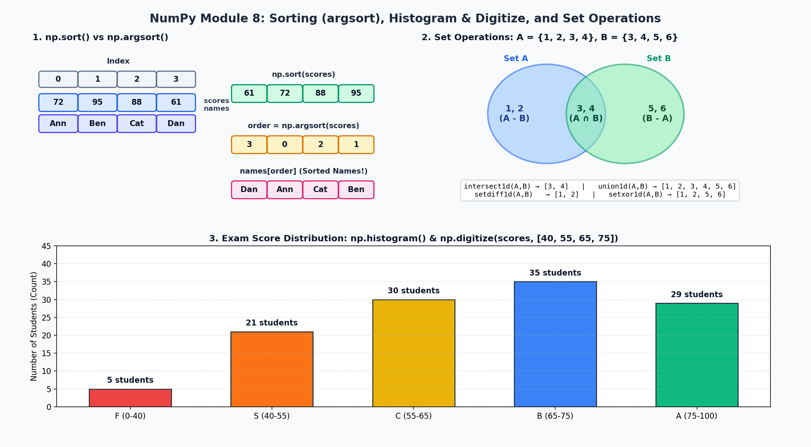
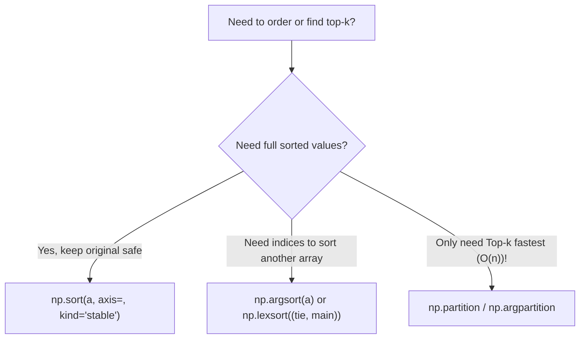

[⬅️ පෙර පාඩම: Shape Manipulation, Stacking & Splitting](07_Shape_Manipulation_Stacking_Splitting.md) | [🏠 මුල් පිටුව (Course Index)](README.md) | [➡️ ඊළඟ පාඩම: Random Numbers](09_Random_Numbers.md)

---

# 📘 පාඩම 08: Sorting, Searching & Set Operations (පිළිවෙළට සැකසීම, සෙවීම සහ කුලක ක්‍රියා)

හිතන්න පාසලේ වාර විභාගයේ ළමයි 1,000කගේ ලකුණු තියෙනවා. අපිට ඕනේ:
1. වැඩිම ලකුණු ගත්ත **පළවෙනි ළමයි 3 දෙනාගේ නම්** හොයන්න (`argsort` / `argpartition`),
2. ලකුණු අනුව **A, B, C, S, F** grades දෙන්න (`digitize` / `histogram`),
3. විද්‍යා සංගමයේ සහ ගණිත සංගමයේ **දෙකේම ඉන්න ළමයි** හොයන්න (`intersect1d`)!

මේ හැම දේම NumPy වලින් තත්පරයෙන් සියයෙන් පංගුවකින් කරන හැටි මේ පාඩමෙන් බලමු!



---

## 1. Sorting, `argsort`, `lexsort` සහ Partial Sorts (`partition`)



- **`np.sort(a)` vs `a.sort()`:** `np.sort(a)` අලුත් sorted **copy** එකක් දෙනවා; `a.sort()` original array එකම **in-place** sort කරනවා. `kind='stable'` දැම්මොත් සමාන අගයන් තියෙන අයගේ මුල් පිළිවෙළ වෙනස් වෙන්නේ නෑ!
- **`np.argsort(a)`:** Sort කළොත් අංක එන්න ඕනේ **indices (ස්ථාන)** ටික දෙනවා! ඒ indices පාවිච්චි කරලා තවත් array එකක් (උදා: ළමයින්ගේ නම්) sort කරන්න පුළුවන්!
- **`np.lexsort((secondary_key, primary_key))`:** ප්‍රධාන තීරුවෙන් sort කරලා, සමාන අය ආවොත් දෙවෙනි තීරුවෙන් tie-break කරනවා (**වැදගත්: අන්තිමට දෙන key එක තමයි Primary key එක!**).
- **`np.partition` / `np.argpartition`:** මිලියනයක් අතරින් වැඩිම 5 දෙනා විතරක් ඕනේ නම්, මුළු මිලියනයම sort කරන්න ඕනේ නෑ! `argpartition` ඒක ඉතා වේගයෙන් ($O(n)$) හොයලා දෙනවා.

```python
import numpy as np

scores = np.array([72, 95, 88, 61, 95, 70])
names  = np.array(['a', 'b', 'c', 'd', 'e', 'f'])

# වැඩිම සිට අඩුමට (-scores) stable sort කරලා Top 3 නම් ගමු
order = np.argsort(-scores, kind='stable')
print("Sorted order indices:", order)
print("Top 3 students:      ", names[order][:3])      # ['b' 'e' 'c']

# Top-3 unsorted indices via argpartition (ඉතා වේගවත්!)
k = 3
top_k_idx = np.argpartition(scores, -k)[-k:]
print("Top-3 (unsorted idx):", top_k_idx, "-> scores:", scores[top_k_idx])

# Multi-key sort with lexsort: මුලින් age (primary), සමාන නම් name (secondary)
ages = np.array([20, 18, 20, 18])
kids = np.array(['Kamal', 'Nimal', 'Amal', 'Sunil'])
idx = np.lexsort((kids, ages))   # අන්තිමට තියෙන ages තමයි primary!
print("Lexsorted:", list(zip(ages[idx], kids[idx])))
```

**Expected Output:**
```text
Sorted order indices: [1 4 2 0 5 3]
Top 3 students:       ['b' 'e' 'c']
Top-3 (unsorted idx): [2 1 4] -> scores: [88 95 95]
Lexsorted: [(np.int64(18), np.str_('Nimal')), (np.int64(18), np.str_('Sunil')), (np.int64(20), np.str_('Amal')), (np.int64(20), np.str_('Kamal'))]
```

---

## 2. Extremes (`argmin`, `argmax`, `unravel_index`) & Finding Conditions

- **`argmin` / `argmax`:** කුඩාම/විශාලම අංකයේ index එක දෙනවා. හැබැයි 2D matrix එකක `axis` නොදී ගැහුවොත් එන්නේ **flat (1D) index** එකක්! ඒක ආපහු `(row, col)` කරගන්න **`np.unravel_index(idx, shape)`** පාවිච්චි කරනවා!
- **`np.where(cond, x, y)`:** Condition එක `True` නම් `x`, `False` නම් `y` දෙනවා. (`np.where(cond)` විතරක් දුන්නොත් `True` තියෙන indices දෙනවා).
- **`np.nonzero(cond)`:** බිංදු නොවන / `True` ස්ථාන tuple එකක් විදියට දෙනවා.
- **`np.argwhere(cond)`:** `True` තියෙන `(row, col)` coordinates 2D array එකක් විදියට දෙනවා.
- **`np.extract(cond, arr)`:** Condition එක සත්‍ය elements ටික 1D array එකකට ගන්නවා.

```python
import numpy as np

grid = np.array([[10, 55, 30],
                 [85, 20, 40]])

flat_max = np.argmax(grid)
row, col = np.unravel_index(flat_max, grid.shape)
print(f"Max value {grid[row, col]} is at (row={row}, col={col})")

# Finding conditions
print("where (>=40 -> Pass):", np.where(grid >= 40, 'Pass', 'Fail').tolist())
print("argwhere (>35):\n", np.argwhere(grid > 35))
print("extract (>35): ", np.extract(grid > 35, grid))
print("count_nonzero (>35):", np.count_nonzero(grid > 35))
```

**Expected Output:**
```text
Max value 85 is at (row=1, col=0)
where (>=40 -> Pass): [['Fail', 'Pass', 'Fail'], ['Pass', 'Fail', 'Pass']]
argwhere (>35):
 [[0 1]
 [1 0]
 [1 2]]
extract (>35):  [55 85 40]
count_nonzero (>35): 3
```

---

## 3. Binary Search (`searchsorted`), Binning (`histogram`, `digitize`, `bincount`) & `unique`

- **`np.searchsorted(sorted_arr, v, side='left'/'right')`:** දැනටමත් **sort කරපු** array එකකට අලුත් අංකයක් `v` දාන්න ඕනේ හරිම index එක Binary Search වලින් ක්ෂණිකව හොයනවා!
- **`np.digitize(x, bins)`:** හැම අංකයක්ම අයිති වෙන bin අංකය (0, 1, 2...) දෙනවා (ලකුණු වලට A/B/C/F grades දෙන්න සුපිරි!).
- **`np.histogram(x, bins)` / `np.histogram2d(x, y, bins)`:** හැම පරාසයකටම (interval) කී දෙනෙක් වැටෙනවද කියලා ගණන් කරනවා.
- **`np.bincount(ints)`:** ධන පූර්ණ සංඛ්‍යා (0, 1, 2...) වල frequency counts ඉතා වේගයෙන් ගණනය කරනවා.
- **`np.unique(a, return_counts=True, return_inverse=True, axis=)`:** Repeat වෙච්ච ඒවා අයින් කරලා unique අගයන්, ඒවා ආපු වාර ගණන (`return_counts`), සහ මුල් array එක ආපහු හදන indices (`return_inverse`) දෙනවා.

```python
import numpy as np

scores = np.array([72, 95, 88, 61, 95, 70])

# 1. Binary search on sorted array
print("searchsorted(25):", np.searchsorted([10, 20, 30], 25))            # 2
print("searchsorted right:", np.searchsorted([10, 20, 20, 30], 20, side='right')) # 3

# 2. Unique values & counts
vals, counts = np.unique(scores, return_counts=True)
print("Unique values:", vals, "| Counts:", counts)

# 3. Digitize & Histogram
bin_idx = np.digitize(scores, [60, 80, 90])   # 0:<60, 1:60-79, 2:80-89, 3:>=90
print("Digitize bins:", bin_idx)

hist, edges = np.histogram(scores, bins=4)
print("Histogram counts:", hist, "| Edges:", np.round(edges, 1))

# 4. bincount (fast frequency count for non-negative integers)
votes = np.array([0, 2, 2, 1, 0, 2])
print("bincount:", np.bincount(votes))        # 0:2, 1:1, 2:3
```

**Expected Output:**
```text
searchsorted(25): 2
searchsorted right: 3
Unique values: [61 70 72 88 95] | Counts: [1 1 1 1 2]
Digitize bins: [1 3 2 1 3 1]
Histogram counts: [1 2 0 3] | Edges: [61.  69.5 78.  86.5 95. ]
bincount: [2 1 3]
```

---

## 4. Set Operations (කුලක ක්‍රියා — Comparing Arrays)

ඉස්කෝලේ ගණිතයෙදී ඉගෙන ගත්ත කුලක (Sets) ඒ විදියටම NumPy වල තියෙනවා!
- `np.intersect1d(A, B)`: $A \cap B$ (දෙකේම ඉන්න පොදු අය).
- `np.union1d(A, B)`: $A \cup B$ (දෙකේම ඉන්න ඔක්කොම, duplicates නැතුව).
- `np.setdiff1d(A, B)`: $A - B$ (`A` වල ඉන්න, හැබැයි `B` වල නැති අය).
- `np.setxor1d(A, B)`: එකක විතරක් ඉන්න අය (පොදු අය අයින් කරලා).
- `np.isin(A, B)`: `A` හි හැම අංකයක්ම `B` වල තියෙනවද කියන Boolean mask එක (`in1d` වෙනුවට දැන් නිර්දේශ කරන්නේ `isin`).

```python
import numpy as np

A = np.array([1, 2, 3, 4])
B = np.array([3, 4, 5, 6])

print("intersect1d (A ∩ B):", np.intersect1d(A, B))   # [3 4]
print("union1d     (A ∪ B):", np.union1d(A, B))       # [1 2 3 4 5 6]
print("setdiff1d   (A - B):", np.setdiff1d(A, B))     # [1 2]
print("setxor1d:           ", np.setxor1d(A, B))      # [1 2 5 6]
print("isin([1,5,9],[5,9,11]):", np.isin([1, 5, 9], [5, 9, 11]))
```

**Expected Output:**
```text
intersect1d (A ∩ B): [3 4]
union1d     (A ∪ B): [1 2 3 4 5 6]
setdiff1d   (A - B): [1 2]
setxor1d:            [1 2 5 6]
isin([1,5,9],[5,9,11]): [False  True  True]
```

---

## 5. Interpolation (`interp`, `polyfit`) & Run Detection (`diff`, `flatnonzero`)

- **`np.interp(x_new, xp, fp)`:** දන්නා ලක්ෂ්‍ය දෙකක් අතර මැද අගයක් linear විදියට අනුමාන කරනවා (උදා: පැය 1දී 10°C, පැය 3දී 20°C නම්, පැය 2දී කීයද? → 15°C!).
- **`np.polyfit(x, y, deg)`:** දත්ත වලට හොඳම රේඛාව (`deg=1`) හෝ වක්‍රය (`deg=2`) fit කරලා coefficients දෙනවා.
- **Run Detection (`np.diff` + `np.flatnonzero`):** දත්ත පෙළක අගය වෙනස් වෙන තැන් (change points / streaks) හොයනවා!

```python
import numpy as np

# 1. Linear Interpolation
hours = np.array([0, 2, 4])
temps = np.array([20.0, 28.0, 24.0])
print("Temp at hour 1 & 3:", np.interp([1, 3], hours, temps))  # [24., 26.]

# 2. Polynomial Fit (y = 2x + 3)
x = np.array([0, 1, 2, 3, 4])
y = np.array([3.1, 4.9, 7.1, 8.9, 11.0])
slope, intercept = np.polyfit(x, y, deg=1)
print(f"Best fit line: y = {slope:.2f}x + {intercept:.2f}")

# 3. Run / Change-point detection
states = np.array([0, 0, 1, 1, 1, 0, 2, 2])
change_points = np.flatnonzero(np.diff(states) != 0) + 1
print("Values change at indices:", change_points)   # [2, 5, 6]
```

**Expected Output:**
```text
Temp at hour 1 & 3: [24. 26.]
Best fit line: y = 1.98x + 3.04
Values change at indices: [2 5 6]
```

---

## 🧠 මතක තබා ගැනීමට පහසු ක්‍රම (Memory Hacks)

1. **`arg` මුලට ආවොත් එන්නේ "Index" (ස්ථානය):** `sort` → අගයන්, `argsort` → indices; `max` → අගය, `argmax` → index; `partition` → අගයන්, `argpartition` → indices!
2. **`lexsort` කියවන්නේ අන්තිමේ ඉඳන් මුලට:** `np.lexsort((tie_breaker, primary_key))` — අන්තිම argument එක තමයි ප්‍රධානම sort key එක!
3. **Top-K ඕනේ නම් `argpartition`!** මිලියන ගාණක array එකක `argsort` වලට වඩා `argpartition` 10x–50x වේගවත්!

> [!WARNING]
> **⚠️ සාමාන්‍යයෙන් වෙන වැරදි (Common Pitfalls):**
> 1. **Unsorted array එකකට `searchsorted` දීම:** `searchsorted` වැඩ කරන්නේ ascending order එකට sort කරපු array වලට විතරයි! නැත්නම් වැරදි උත්තරයක් කිසිම error එකක් නැතුව දෙයි!
> 2. **`a.sort()` හි return value එක `None`:** `b = a.sort()` ගැහුවොත් `b` වෙන්නේ `None`! අලුත් variable එකකට ගන්න ඕනේ නම් හැමවෙලේම `b = np.sort(a)` පාවිච්චි කරන්න.
> 3. **`argpartition` result එක sorted නෑ:** `np.argpartition(scores, -5)[-5:]` මගින් ලොකුම 5 දෙනා දෙනවා, හැබැයි ඒ 5 දෙනා ඇතුළේ පිළිවෙළට නැති වෙන්න පුළුවන් — ඒ 5 විතරක් පොඩියට `argsort` කරගන්න!

---

## 🏋️ ප්‍රායෝගික අභ්‍යාස (Practical Exercises)

### Warm-up අභ්‍යාසය: 2D Matrix Peak Finder
`4 x 5` random matrix එකක විශාලම අංකය තියෙන `(row, col)` ස්ථානය `argmax` සහ `unravel_index` වලින් හොයන්න.

<details>
<summary>✅ පිළිතුර බලන්න (Click to see Solution)</summary>

```python
import numpy as np

rng = np.random.default_rng(7)
M = rng.integers(1, 100, size=(4, 5))
r, c = np.unravel_index(np.argmax(M), M.shape)
print("Matrix:\n", M)
print(f"Peak value {M[r, c]} found at row={r}, col={c}")
```
</details>

---

### අභ්‍යාසය 1: Top-5 from 1 Million Elements Without Full Sort
අංක මිලියනයක (`1_000_000`) array එකකින් මුළු array එකම sort නොකර, විශාලම අගයන් 5 (`top 5`) descending order එකට return කරන්න.

<details>
<summary>✅ පිළිතුර බලන්න (Click to see Solution)</summary>

```python
import numpy as np

rng = np.random.default_rng(42)
big = rng.random(1_000_000)

# O(n) partial sort -> අන්තිම 5 ගන්නවා, ඉන්පසු ඒ 5 විතරක් sort කරනවා!
top5_unsorted = np.partition(big, -5)[-5:]
top5_sorted = np.sort(top5_unsorted)[::-1]

print("Top 5 largest values:", np.round(top5_sorted, 6))
```
</details>

---

### අභ්‍යාසය 2: Multi-Key Row Sort (`np.lexsort`)
2D matrix එකක rows ටික **දෙවෙනි column එකෙන් (`col 1`)** sort කරලා, සමාන අගයන් ආවොත් **පළවෙනි column එකෙන් (`col 0`)** tie-break කරන්න.

<details>
<summary>✅ පිළිතුර බලන්න (Click to see Solution)</summary>

```python
import numpy as np

M = np.array([
    [3, 20],
    [1, 10],
    [2, 20],
    [4, 10],
    [1, 20],
])

# lexsort: අන්තිම key එක (M[:, 1]) primary, පළවෙනි key එක (M[:, 0]) tie-breaker!
order = np.lexsort((M[:, 0], M[:, 1]))
M_sorted = M[order]

print("Sorted by col 1, then col 0:\n", M_sorted)
```
</details>

---

### අභ්‍යාසය 3: Letter Grades using `np.digitize`
ලකුණු array එකකට (`scores = np.array([35, 52, 61, 70, 88, 95, 40])`) `np.digitize` පාවිච්චි කරලා ශ්‍රී ලංකා O/L grades (`F`: <40, `S`: 40–54, `C`: 55–64, `B`: 65–74, `A`: ≥75) ලබා දෙන්න.

<details>
<summary>✅ පිළිතුර බලන්න (Click to see Solution)</summary>

```python
import numpy as np

scores = np.array([35, 52, 61, 70, 88, 95, 40])
bins = [40, 55, 65, 75]                  # boundaries
grade_labels = np.array(['F', 'S', 'C', 'B', 'A'])

bin_indices = np.digitize(scores, bins)  # 0..4
grades = grade_labels[bin_indices]

for s, g in zip(scores, grades):
    print(f"Score {s:3d} -> Grade {g}")
```
</details>

---

### අභ්‍යාසය 4: Missing IDs (`setdiff1d`)
Array `A` වල තියෙන, හැබැයි Array `B` වල නැති (missing) IDs ටික හොයන්න.

<details>
<summary>✅ පිළිතුර බලන්න (Click to see Solution)</summary>

```python
import numpy as np

A = np.array([101, 102, 103, 104, 105, 106])
B = np.array([102, 104, 106, 108, 110])

missing_from_B = np.setdiff1d(A, B)
print("IDs in A but missing from B:", missing_from_B)  # [101 103 105]
```
</details>

---

## 📋 Cheat Sheet — පාඩම 08 සාරාංශය

| Topic | Key APIs | ප්‍රයෝජනය (Use Case) |
| --- | --- | --- |
| **Sorting** | `np.sort`, `a.sort()`, `axis=`, `kind='stable'` | Ordering arrays |
| **Indirect / Multi Sort** | `np.argsort`, `np.lexsort` | Sort array B by array A; multi-key sort |
| **Top-K Fast** | `np.partition`, `np.argpartition` | Nearest neighbours / Top-k in $O(n)$ |
| **Extremes** | `argmin`, `argmax`, `np.unravel_index` | Finding 2D/ND peak positions |
| **Binary Search** | `np.searchsorted(a, v, side=)` | Fast lookups in sorted data |
| **Binning & Counts** | `histogram`, `histogram2d`, `digitize`, `bincount`, `count_nonzero` | Distributions & grade bins |
| **Unique** | `np.unique(a, return_counts=True, return_inverse=True, axis=)` | Category counts & deduplication |
| **Set Operations** | `intersect1d`, `union1d`, `setdiff1d`, `setxor1d`, `isin` | Comparing IDs & collections |
| **Conditions** | `np.where`, `np.nonzero`, `np.argwhere`, `np.extract` | Event / anomaly detection |
| **Interp & Runs** | `np.interp`, `np.polyfit`, `np.diff`, `np.flatnonzero` | Resampling, curve fitting & change points |

---

[⬅️ පෙර පාඩම: Shape Manipulation, Stacking & Splitting](07_Shape_Manipulation_Stacking_Splitting.md) | [🏠 මුල් පිටුව (Course Index)](README.md) | [➡️ ඊළඟ පාඩම: Random Numbers](09_Random_Numbers.md)
