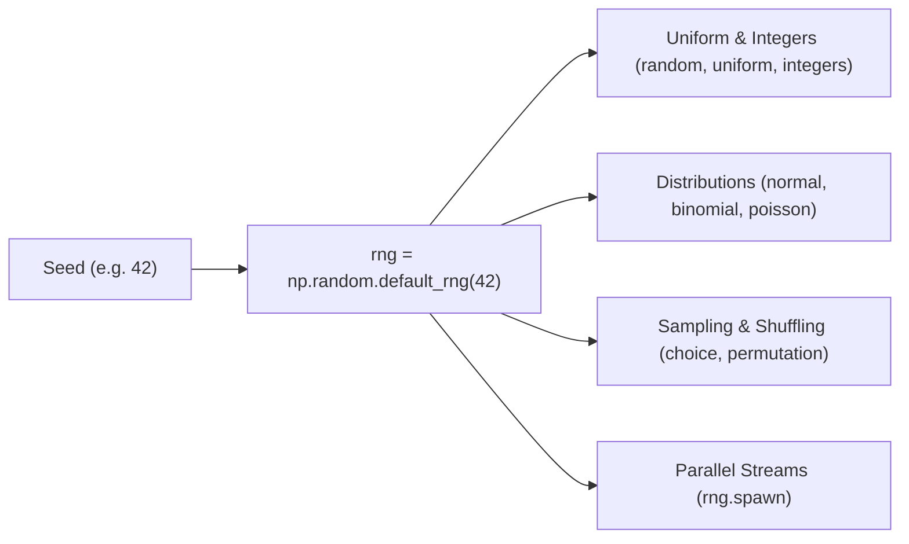
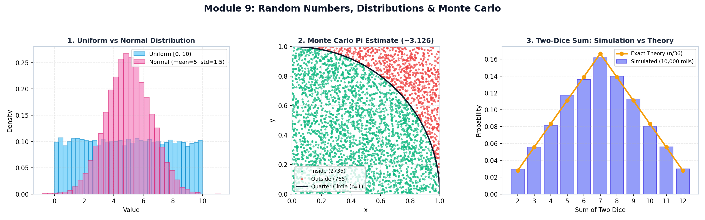

[⬅️ පෙර පාඩම: Sorting, Searching & Set Operations](08_Sorting_Searching_and_Set_Operations.md) | [🏠 මුල් පිටුව (Course Index)](README.md) | [➡️ ඊළඟ පාඩම: Linear Algebra](10_Linear_Algebra.md)

---

# 🎲 Module 9: Random Numbers (අහඹු සංඛ්‍යා සහ සමාකරණ)

Data Science, Machine Learning, Games, සහ Scientific Simulations වලදී අපිට නිතරම **Random Numbers (අහඹු සංඛ්‍යා)** හදන්න ඕන වෙනවා. උදාහරණයක් විදියට:
- දාදු කැටයක් (dice) දාන එක simulate කරන්න,
- Data set එකක් train සහ test විදියට අහඹු ලෙස බෙදන්න (shuffle කරන්න),
- Neural Network එකක initial weights හදන්න,
- Monte Carlo simulation එකකින් $\pi$ (Pi) අගය හොයන්න!

NumPy වල මේ හැමදේම ඉතා වේගයෙන් කරන්න පුළුවන් **Modern `Generator` API** එකක් තියෙනවා. අපි මේ පාඩමේදී ඒක මුල ඉඳන්ම සරලව ඉගෙන ගමු!

---

## 1. Modern `Generator` API vs Legacy API (`default_rng`)

NumPy වල random numbers හදන ක්‍රම දෙකක් තියෙනවා:
1. **Modern API (නව ක්‍රමය - Recommended ✅):** `rng = np.random.default_rng(seed)`
2. **Legacy API (පැරණි ක්‍රමය - පරණ code කියවන්න විතරක් දැනගන්න ⚠️):** `np.random.seed(42)`, `np.random.rand()`, `np.random.RandomState`

**ඇයි අපි Modern `default_rng` එක පාවිච්චි කරන්නේ?**
හිතන්නකෝ ඔයාට පන්තියේ ළමයි දෙන්නෙක් ඉන්නවා. පැරණි `np.random.seed()` ක්‍රමයේදී හැමෝම පාවිච්චි කරන්නේ එකම **global (පොදු)** දාදු කැටයක්. එක්කෙනෙක් ඒක වෙනස් කළොත් අනිත් එක්කෙනාගෙත් random numbers වෙනස් වෙනවා.
හැබැයි `rng = np.random.default_rng(42)` වලදී ඔයාට ඔයාගෙම වෙනම **independent (ස්වාධීන)** random generator object එකක් ලැබෙනවා. ඒ වගේම මේක පැරණි ක්‍රමයට වඩා ගොඩක් වේගවත් සහ ආරක්ෂිතයි!

**`seed` එකක් කියන්නේ මොකක්ද?**
`seed` (උදා: `42`) කියන්නේ random numbers පටන් ගන්න තැන තීරණය කරන "යතුරක්" (starting key) වගේ දෙයක්. එකම `seed` එක දුන්නොත්, හැම පාරම program එක run කරද්දී **එකම random numbers ටික** ලැබෙනවා (**Reproducibility - නැවත එම ප්‍රතිඵලයම ලබාගත හැකි බව**).



```python
import numpy as np

# Modern Generator එකක් හදමු (seed = 42 නිසා හැමදාම එකම උත්තර එනවා)
rng = np.random.default_rng(42)

print("Uniform [0, 1):\n", rng.random((2, 3)))
print("10 Dice Rolls:", rng.integers(1, 7, size=10))
```

**පේළියෙන් පේළිය පැහැදිලි කිරීම:**
- `rng = np.random.default_rng(42)` → `42` කියන seed එකෙන් අලුත් random generator එකක් හදනවා.
- `rng.random((2, 3))` → `0.0` ඉඳන් `1.0` (1.0 ඇතුළත් නැහැ) අතර දශම සංඛ්‍යා (floats) වලින් `2×3` array එකක් හදනවා.
- `rng.integers(1, 7, size=10)` → `1` ඉඳන් `6` දක්වා (7 ඇතුළත් නැහැ!) පූර්ණ සංඛ්‍යා 10ක් හදනවා — හරියට දාදු කැටයක් 10 පාරක් දැම්මා වගේ!

**බලාපොරොත්තු වන ප්‍රතිදානය (Expected Output):**
```text
Uniform [0, 1):
 [[0.77395605 0.43887844 0.85859792]
 [0.69736803 0.09417735 0.97562235]]
10 Dice Rolls: [6 5 2 1 4 6 5 5 5 5]
```

---

## 2. Uniform Numbers (ඒකාකාර අහඹු සංඛ්‍යා)

සෑම අගයකටම එන්න තියෙන **Probability (සම්භාවිතාව)** සමාන නම් ඒකට **Uniform Distribution (ඒකාකාර ව්‍යාප්තිය)** කියනවා. (හරියට සාධාරණ දාදු කැටයක් වගේ).

- `rng.random(size)`: `0.0` සහ `1.0` අතර float අගයන් (`[0, 1)`).
- `rng.uniform(low, high, size)`: `low` සහ `high` අතර float අගයන්.
- `rng.integers(low, high, size, endpoint=False)`: `low` සිට `high - 1` දක්වා integers. (`endpoint=True` දුන්නොත් `high` අගයත් ඇතුළත් වෙනවා).

```python
rng = np.random.default_rng(7)

floats_0_1 = rng.random(4)                       # [0.0, 1.0)
temps = rng.uniform(25.0, 35.0, size=5)          # 25.0 - 35.0 අතර උෂ්ණත්ව 5ක්
dice = rng.integers(1, 7, size=6)                # 1 සිට 6 දක්වා
dice_incl = rng.integers(1, 6, size=6, endpoint=True)  # 1 සිට 6 දක්වා (6 ඇතුළත්)

print("random:", np.round(floats_0_1, 3))
print("uniform:", np.round(temps, 2))
print("dice:", dice)
print("dice (endpoint=True):", dice_incl)
```

**Expected Output:**
```text
random: [0.625 0.897 0.776 0.225]
uniform: [28.0  33.74 25.05 33.21 32.97]
dice: [6 2 5 6 5 5]
dice (endpoint=True): [5 3 4 1 6 1]
```

---

## 3. Continuous Distributions (සන්තතික ව්‍යාප්ති — Normal & Friends)

ස්වභාවධර්මයේ ගොඩක් දේවල් (මිනිසුන්ගේ උස, විභාග ලකුණු, IQ අගයන්, sensor noise) **Normal Distribution (සාමාන්‍ය ව්‍යාප්තිය / Bell Curve)** එක අනුගමනය කරනවා. ඒ කියන්නේ ගොඩක් අගයන් මැද (**Mean - මධ්‍යන්‍යය**) ළඟ තියෙනවා, දෙපැත්තේ අන්තවල අගයන් අඩුයි.

| Function | පරාමිතීන් | සරල උදාහරණ / Use Case |
| --- | --- | --- |
| `rng.normal(loc, scale, size)` | `loc`=Mean, `scale`=Std Dev | උස, විභාග ලකුණු, sensor noise |
| `rng.lognormal(mean, sigma, size)` | log scale mean & std | ආදායම් ව්‍යාප්තිය, කොටස් වෙළඳපොළ මිල |
| `rng.exponential(scale, size)` | `scale`=සාමාන්‍ය කාලය | ඊළඟ බස් එක හෝ call එක එනකල් බලන් ඉන්න කාලය |
| `rng.gamma(shape, scale, size)` | `shape`, `scale` | රක්ෂණ වන්දි (insurance claims), වර්ෂාපතනය |
| `rng.beta(a, b, size)` | `a`, `b` (0–1 අතර) | A/B Testing, click-through rate (සම්භාවිතා) |
| `rng.chisquare(df, size)` | `df`=degrees of freedom | Hypothesis testing |
| `rng.standard_t(df, size)` | `df`=degrees of freedom | කුඩා sample වල t-tests |

```python
rng = np.random.default_rng(42)

# IQ scores: Mean (loc) = 100, Standard Deviation (scale) = 15
iq_scores = rng.normal(loc=100, scale=15, size=5)
# ඊළඟ customer එනකල් බලන් ඉන්න කාලය (සාමාන්‍යය විනාඩි 3යි)
wait_times = rng.exponential(scale=3.0, size=5)
# 0 සහ 1 අතර සම්භාවිතා (A/B test)
ctr = rng.beta(a=2, b=5, size=4)

print("IQ scores:", np.round(iq_scores, 1))
print("Wait times (min):", np.round(wait_times, 2))
print("Beta (CTR):", np.round(ctr, 3))
```

**Expected Output:**
```text
IQ scores: [104.6  84.4 111.3 114.1  70.7]
Wait times (min): [1.44 1.37 0.28 0.36 0.31]
Beta (CTR): [0.347 0.562 0.361 0.149]
```

---

## 4. Discrete Distributions (විවික්ත ව්‍යාප්ති — Counts & Trials)

ගණන් කරන්න පුළුවන් (0, 1, 2, 3...) සිදුවීම් වලට **Discrete Distributions** පාවිච්චි කරනවා:

- `rng.binomial(n, p, size)`: කාසියක් `n` පාරක් උඩ දාලා, head එන්න සම්භාවිතාව `p` නම් head කීයක් එනවද?
- `rng.poisson(lam, size)`: පැයකට සාමාන්‍යයෙන් `lam` (lambda) වතාවක් සිදුවෙන දෙයක් (උදා: කඩේට එන පාරිභෝගිකයෝ ගණන).
- `rng.geometric(p, size)`: පළවෙනි සාර්ථකත්වය ලැබෙනකල් කී පාරක් උත්සාහ කරන්න වෙනවද?
- `rng.multinomial(n, pvals, size)`: දාදු කැටයක් `n` පාරක් දැම්මම 1, 2, 3, 4, 5, 6 කී පාර ගානේ වැටුණද?
- `rng.hypergeometric(ngood, nbad, nsample, size)`: බෑග් එකකින් ආපහු නොදා (without replacement) බෝල ගනිද්දී රතු බෝල කීයක් එනවද?

```python
rng = np.random.default_rng(10)

# කාසියක් 10 පාරක් දාන පරීක්ෂණ 5ක් (head සම්භාවිතාව 0.5)
heads = rng.binomial(n=10, p=0.5, size=5)
# පැයකට සාමාන්‍යයෙන් 4 දෙනෙක් එන කඩේක පැය 5කදී ආපු ගණන
customers = rng.poisson(lam=4, size=5)
# දාදු කැටයක් 60 පාරක් දැම්මම 1-6 අගයන් වැටුණු වාර ගණන
dice_counts = rng.multinomial(n=60, pvals=[1/6]*6)

print("Binomial (heads out of 10):", heads)
print("Poisson (customers/hr):", customers)
print("Multinomial (60 dice rolls):", dice_counts)
```

**Expected Output:**
```text
Binomial (heads out of 10): [8 3 6 3 5]
Poisson (customers/hr): [4 3 1 4 4]
Multinomial (60 dice rolls): [10  7 12 10 10 11]
```

---

## 5. Sampling & Shuffling (`choice`, `shuffle`, `permutation`, `permuted`)

තියෙන data එකකින් අහඹු ලෙස අගයන් තෝරාගන්න (**Sampling**) හෝ අනුපිළිවෙළ මිශ්‍ර කරන්න (**Shuffling**) මේ functions ඕන වෙනවා.

1. **`rng.choice(a, size, replace=True, p=None)`**:
   - `replace=True` → ගත්ත අගය ආපහු දාලා ගන්නවා (එකම අගය ආපහු එන්න පුළුවන් — Bootstrap වලට මේක ඕන!).
   - `replace=False` → ගත්ත අගය ආපහු දාන්නේ නැහැ (ලොතරැයි දිනුම් අදිනවා වගේ).
   - `p=[...]` → හැම අගයකටම වෙන වෙනම සම්භාවිතා (weights) දෙන්න පුළුවන් (එකතුව `1.0` වෙන්න ඕන).
2. **`rng.shuffle(x)`**: Original array එක **in-place** (එතනම) මිශ්‍ර කරනවා. අලුත් copy එකක් හදන්නේ නැහැ!
3. **`rng.permutation(x)`**: Original array එක වෙනස් නොකර, මිශ්‍ර කරපු **අලුත් copy එකක්** return කරනවා. `rng.permutation(10)` කිව්වොත් `0..9` අහඹු පිළිවෙළට හදලා දෙනවා.
4. **`rng.permuted(x, axis=...)`**: 2D/3D array එකක හැම row එකක්ම හෝ column එකක්ම **ස්වාධීනව** shuffle කරනවා.

```python
rng = np.random.default_rng(42)

# Weighted sampling: A (50%), B (30%), C (20%)
grades = rng.choice(['A', 'B', 'C'], size=6, p=[0.5, 0.3, 0.2])
print("Weighted choice:", grades)

# Without replacement: ළමයි 5 දෙනෙක්ගෙන් 3 දෙනෙක් තේරීම
winners = rng.choice(['Nimal', 'Kamal', 'Saman', 'Amara', 'Mala'], size=3, replace=False)
print("Winners (no repeat):", winners)

# permutation vs shuffle
arr = np.array([10, 20, 30, 40, 50])
perm_arr = rng.permutation(arr)   # arr වෙනස් වෙන්නේ නැහැ!
print("Original arr:", arr)
print("Permutation:", perm_arr)

rng.shuffle(arr)                  # arr එතනම වෙනස් වෙනවා!
print("After shuffle:", arr)
```

**Expected Output:**
```text
Weighted choice: ['B' 'A' 'C' 'B' 'A' 'C']
Winners (no repeat): ['Mala' 'Saman' 'Nimal']
Original arr: [10 20 30 40 50]
Permutation: [40 10 30 50 20]
After shuffle: [50 20 10 30 40]
```

---

## 6. Multivariate Normal & Parallel Streams (`multivariate_normal`, `spawn`, `SeedSequence`)

- **`rng.multivariate_normal(mean, cov, size)`**: එකිනෙකට සම්බන්ධ (**Correlated**) විචල්‍යයන් දෙකක් හෝ වැඩි ගණනක් එකට හදන්න. උදා: උස වැඩි වෙනකොට බරත් වැඩි වෙන විදියට `(height, weight)` pairs හදන්න.
- **`rng.spawn(n)` / `np.random.SeedSequence`**: ඔයා parallel processing (බහු-ප්‍රොසෙසර්) වලින් simulations ගොඩක් එකපාර run කරනවා නම්, එකම generator එක බෙදාගන්න හොඳ නැහැ. `rng.spawn(4)` වලින් එකිනෙකට කිසිම සම්බන්ධයක් නැති (independent) අලුත් generators 4ක් ආරක්ෂිතව හදාගන්න පුළුවන්!

```python
rng = np.random.default_rng(42)

# උස (mean=170) සහ බර (mean=65) ධන සම්බන්ධතාවයකින් (cov=40) හදමු
mean = [170, 65]
cov = [[64, 40],
       [40, 49]]
people = rng.multivariate_normal(mean, cov, size=4)
print("Correlated (Height, Weight):\n", np.round(people, 1))

# Parallel-safe child generators 3ක් spawn කිරීම
child_rngs = rng.spawn(3)
print("Child 0:", child_rngs[0].integers(1, 100, size=3))
print("Child 1:", child_rngs[1].integers(1, 100, size=3))
```

**Expected Output:**
```text
Correlated (Height, Weight):
 [[168.4  60.1]
 [163.   61.8]
 [188.5  74.1]
 [170.5  62.6]]
Child 0: [30 78 44]
Child 1: [84 52 38]
```

---

## 7. Monte Carlo Simulations & Bootstrap (විශ්මයජනක ප්‍රායෝගික භාවිතයන්)

**Monte Carlo Method** කියන්නේ ගණිත සූත්‍රයකින් කෙලින්ම විසඳන්න අමාරු ප්‍රශ්නයක්, පරිගණකයෙන් අහඹු අත්හදා බැලීම් ලක්ෂ ගණනක් කරලා ආසන්න උත්තරය හොයන ක්‍රමයට!

### උදාහරණය 1: Monte Carlo ක්‍රමයෙන් $\pi$ (Pi) හොයමු!
හිතන්න $1 \times 1$ සමචතුරස්‍රයක් ඇතුළේ අරය $r = 1$ වෙන වෘත්ත කාලක් (quarter circle) ඇඳලා තියෙනවා.
- සමචතුරස්‍රයේ වර්ගඵලය = $1 \times 1 = 1$
- වෘත්ත කාලේ වර්ගඵලය = $\frac{\pi r^2}{4} = \frac{\pi}{4}$

අපි මේ සමචතුරස්‍රය ඇතුළට අහඹු විදියට තිත් (darts) 1,000,000ක් විසි කළොත්, වෘත්ත කාල ඇතුළට ($x^2 + y^2 \le 1$) වැටෙන තිත් අනුපාතය $\approx \frac{\pi}{4}$ වෙනවා. ඒ අනුපාතය `4` න් වැඩි කළාම $\pi$ ලැබෙනවා!

### උදාහරණය 2: Bootstrap 95% Confidence Interval
ඔයා ළඟ තියෙන්නේ එක data sample එකක් විතරයි (උදා: ළමයි 200කගේ ලකුණු). ඒකේ සාමාන්‍යය (Mean) කොච්චර විශ්වාසදායකද බලන්න, ඒ sample එකෙන්ම `replace=True` දාලා 5,000 පාරක් අලුත් samples අරන් ඒවායේ 2.5% සහ 97.5% percentiles බලනවා.



```python
rng = np.random.default_rng(42)

# 1. Monte Carlo estimate of Pi
n = 1_000_000
pts = rng.random((n, 2))                              # (x, y) තිත් මිලියනයක්
inside_circle = (pts ** 2).sum(axis=1) <= 1.0         # x^2 + y^2 <= 1 ද?
pi_est = 4 * np.mean(inside_circle)                   # අනුපාතය * 4
print(f"Estimated Pi: {pi_est:.5f} (Actual: {np.pi:.5f})")

# 2. Bootstrap 95% Confidence Interval for a Mean
data = rng.normal(50, 10, 200)
# 5000 පාරක් data එකෙන්ම ආපහු දාමින් (replace=True) samples 200 බැගින් ගැනීම
boot_means = rng.choice(data, size=(5000, data.size), replace=True).mean(axis=1)
ci_low, ci_high = np.percentile(boot_means, [2.5, 97.5])
print(f"Sample Mean: {data.mean():.2f}")
print(f"95% Bootstrap CI: [{ci_low:.2f}, {ci_high:.2f}]")
```

**Expected Output:**
```text
Estimated Pi: 3.14070 (Actual: 3.14159)
Sample Mean: 50.12
95% Bootstrap CI: [48.72, 51.51]
```

---

## 🧠 මතක තබා ගැනීමට පහසු ක්‍රම (Memory Hacks)

1. **`default_rng(42)` = ඔයාගෙම පෞද්ගලික දාදු කැටය:** කවදාවත් අලුත් code වල `np.random.seed()` ලියන්න එපා; හැමදාම `rng = np.random.default_rng(seed)` පාවිච්චි කරන්න.
2. **`integers(1, 7)` = Python `range(1, 7)` වගේමයි:** දෙවෙනි අංකය (`high`) ඇතුළත් වෙන්නේ **නැහැ**! දාදු කැටේට `1, 7` දෙන්න (නැත්නම් `endpoint=True` දාලා `1, 6` දෙන්න).
3. **`shuffle` vs `permutation`:**
   - `shuffle` → **S**huffle **S**crambles in-place (මුල් එක වෙනස් වෙනවා).
   - `permutation` → **P**ermutation **P**reserves original (අලුත් copy එකක් දෙනවා).

---

## ⚠️ සාමාන්‍යයෙන් වෙන වැරදි (Common Pitfalls)

> [!WARNING]
> **වැරැද්ද 1: `rng.integers(1, 6)` කියලා දාදු කැටයක් හිතාගෙන ලිවීම**
> `rng.integers(1, 6)` වලින් එන්නේ `1, 2, 3, 4, 5` විතරයි — කවදාවත් `6` එන්නේ නැහැ! හැමතිස්සෙම `rng.integers(1, 7)` හෝ `rng.integers(1, 6, endpoint=True)` පාවිච්චි කරන්න.

> [!WARNING]
> **වැරැද්ද 2: `rng.choice` වල `p` වල එකතුව `1.0` නොවීම**
> `rng.choice(['A', 'B'], p=[0.6, 0.5])` ලිව්වොත් `ValueError: probabilities do not sum to 1` එනවා. Weights තියෙනවා නම් මුලින්ම `p = weights / np.sum(weights)` කරලා normalize කරගන්න.

> [!WARNING]
> **වැරැද්ද 3: Legacy `np.random.rand(2, 3)` සහ Modern `rng.random((2, 3))` පටලවා ගැනීම**
> පැරණි `np.random.rand(2, 3)` එකට shape එක වෙන වෙනම arguments විදියට දුන්නට, අලුත් `rng.random((2, 3))` එකට shape එක **tuple එකක්** `(2, 3)` විදියට දෙන්න ඕන!

---

## 🏋️ ප්‍රායෝගික අභ්‍යාස (Practical Exercises)

### අභ්‍යාසය 0 (Warm-up): කාසියක් 1,000 පාරක් උඩ දැමීම
`rng = np.random.default_rng(123)` පාවිච්චි කරලා කාසියක් (`0` = Tail, `1` = Head) 1,000 පාරක් උඩ දාලා, Head වැටුණු ප්‍රතිශතය හොයන්න.

<details>
<summary>✅ පිළිතුර බලන්න (Click to see Solution)</summary>

```python
import numpy as np

rng = np.random.default_rng(123)
flips = rng.integers(0, 2, size=1000)
head_pct = np.mean(flips == 1) * 100
print(f"Heads: {flips.sum()} / 1000 ({head_pct:.2f}%)")
```
</details>

---

### අභ්‍යාසය 1: දාදු කැට දෙකක් 10,000 පාරක් දැමීම (Two-Dice Simulation)
දාදු කැට දෙකක් 10,000 පාරක් දාන එක simulate කරලා, එකතුව (2 සිට 12 දක්වා) එන සම්භාවිතාව ගණිතමය න්‍යාය (Theory: `1/36, 2/36, ..., 6/36, ..., 1/36`) එක්ක සංසන්දනය කරන්න.

<details>
<summary>✅ පිළිතුර බලන්න (Click to see Solution)</summary>

```python
import numpy as np

rng = np.random.default_rng(42)
n = 10_000
d1 = rng.integers(1, 7, size=n)
d2 = rng.integers(1, 7, size=n)
sums = d1 + d2

vals, counts = np.unique(sums, return_counts=True)
sim_probs = counts / n
theory_probs = np.array([1, 2, 3, 4, 5, 6, 5, 4, 3, 2, 1]) / 36

print("Sum | Simulated | Theory  | Diff")
print("-" * 34)
for v, s, t in zip(vals, sim_probs, theory_probs):
    print(f"{v:3d} |   {s:.4f}  | {t:.4f}  | {abs(s - t):.4f}")
```
</details>

---

### අභ්‍යාසය 2: උපන්දින විරුද්ධාභාසය (Birthday Paradox)
23 දෙනෙක් ඉන්න කණ්ඩායමක අඩුම ගානේ දෙන්නෙක්ගේවත් උපන්දින එකම දවසේ වෙන්න තියෙන සම්භාවිතාව Monte Carlo simulation (අත්හදා බැලීම් 20,000ක්) මගින් හොයන්න. (ඉඟිය: දවස් 365ක් ගන්න; 50% ට වඩා වැඩි උත්තරයක් එන්න ඕන!).

<details>
<summary>✅ පිළිතුර බලන්න (Click to see Solution)</summary>

```python
import numpy as np

rng = np.random.default_rng(42)
trials = 20_000
group_size = 23

# (20000, 23) array of birthdays from 0 to 364
birthdays = rng.integers(0, 365, size=(trials, group_size))

# හැම row එකක්ම sort කරලා, ළඟ ළඟ තියෙන අගයන් සමානද බලමු (ඉතා වේගවත් vectorised ක්‍රමය!)
sorted_b = np.sort(birthdays, axis=1)
has_duplicate = np.any(np.diff(sorted_b, axis=1) == 0, axis=1)

prob = np.mean(has_duplicate)
print(f"Estimated probability (23 people): {prob:.4f} (~{prob*100:.1f}%)")
# ~0.5073 (50.7%!)
```
</details>

---

### අභ්‍යාසය 3: Reproducible 80/20 Train-Test Split
අංක 0 සිට 99 දක්වා තියෙන dataset එකක් `rng.permutation` පාවිච්චි කරලා, නැවත ඒ විදියටම ලබාගත හැකි (reproducible) 80% Train සහ 20% Test විදියට බෙදන්න.

<details>
<summary>✅ පිළිතුර බලන්න (Click to see Solution)</summary>

```python
import numpy as np

rng = np.random.default_rng(42)
X = np.arange(100).reshape(50, 2)  # samples 50ක්, features 2ක්
y = np.arange(50)                  # labels 50ක්

idx = rng.permutation(len(X))
split = int(0.8 * len(X))

X_train, X_test = X[idx[:split]], X[idx[split:]]
y_train, y_test = y[idx[:split]], y[idx[split:]]

print("Train shapes:", X_train.shape, y_train.shape)
print("Test shapes:", X_test.shape, y_test.shape)
```
</details>

---

### අභ්‍යාසය 4: Bootstrap 95% Confidence Interval for Median
අහඹු ලෙස සාදාගත් sample එකක **Median (මධ්‍යස්ථය)** සඳහා 95% Bootstrap Confidence Interval එක හොයන්න.

<details>
<summary>✅ පිළිතුර බලන්න (Click to see Solution)</summary>

```python
import numpy as np

rng = np.random.default_rng(99)
sample = rng.exponential(scale=10.0, size=150)

# Bootstrap samples 5,000ක් අරන් හැම එකේම median ගමු
boot_samples = rng.choice(sample, size=(5000, sample.size), replace=True)
boot_medians = np.median(boot_samples, axis=1)

ci = np.percentile(boot_medians, [2.5, 97.5])
print(f"Sample Median: {np.median(sample):.2f}")
print(f"95% CI for Median: [{ci[0]:.2f}, {ci[1]:.2f}]")
```
</details>

---

## 📋 සාරාංශ වගුව (Cheat Sheet Summary)

| අවශ්‍යතාවය | NumPy API | උදාහරණය |
| --- | --- | --- |
| Generator හදන්න | `np.random.default_rng(seed)` | `rng = np.random.default_rng(42)` |
| 0–1 අතර Floats | `rng.random(size)` | `rng.random((2, 3))` |
| Range එකක Floats | `rng.uniform(low, high, size)` | `rng.uniform(10, 20, 5)` |
| Integers | `rng.integers(low, high, size)` | `rng.integers(1, 7, 10)` |
| Normal Distribution | `rng.normal(loc, scale, size)` | `rng.normal(100, 15, 50)` |
| Discrete Counts | `binomial`, `poisson`, `multinomial` | `rng.binomial(10, 0.5, 5)` |
| Weighted / Bootstrap Draw | `rng.choice(a, size, replace, p)` | `rng.choice(x, 100, replace=True)` |
| In-place / Copy Shuffle | `rng.shuffle`, `rng.permutation` | `idx = rng.permutation(n)` |
| Correlated Variables | `rng.multivariate_normal` | `rng.multivariate_normal(mu, cov, 10)` |
| Parallel Generators | `rng.spawn(n)` | `g1, g2 = rng.spawn(2)` |

---

[⬅️ පෙර පාඩම: Sorting, Searching & Set Operations](08_Sorting_Searching_and_Set_Operations.md) | [🏠 මුල් පිටුව (Course Index)](README.md) | [➡️ ඊළඟ පාඩම: Linear Algebra](10_Linear_Algebra.md)
