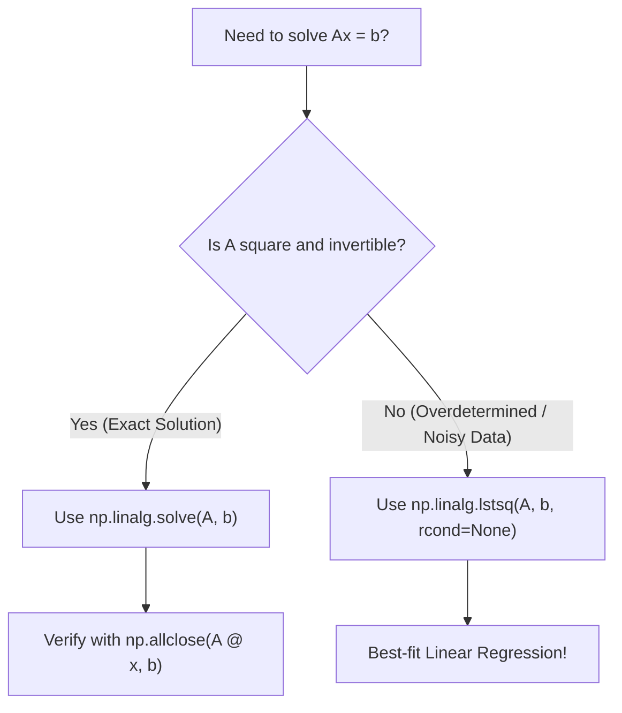
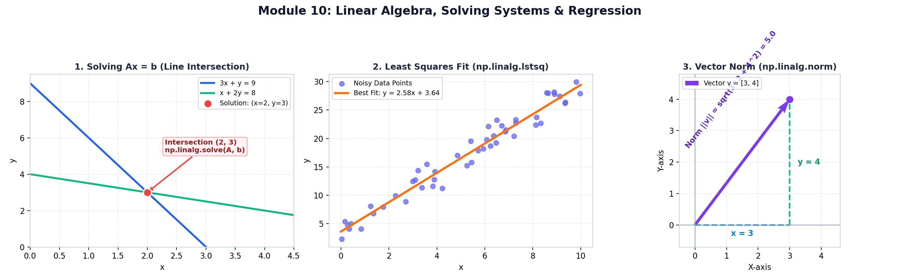

[⬅️ පෙර පාඩම: Random Numbers](09_Random_Numbers.md) | [🏠 මුල් පිටුව (Course Index)](README.md) | [➡️ ඊළඟ පාඩම: Statistics, Missing Data, Polynomials & FFT](11_Statistics_Missing_Data_Polynomials_FFT.md)

---

# 📐 Module 10: Linear Algebra (රේඛීය වීජගණිතය)

**Linear Algebra (රේඛීය වීජගණිතය)** කියන්නේ Machine Learning, Deep Learning, 3D Graphics, Physics, සහ Data Science වල "හදවත" වගේ!
බය වෙන්න එපා — මේක හරිම සරලයි. සරලවම කිව්වොත්:
- **Vector (දෛශිකය)** කියන්නේ අංක පේළියක් (1D array — උදා: `[3, 4]`).
- **Matrix (න්‍යාසය)** කියන්නේ අංක වගුවක් (2D array — උදා: `2×2` වගුවක්).

NumPy වල මේ ඔක්කොම මෙහෙයුම් තියෙන්නේ **`np.linalg`** කියන module එක ඇතුළේ. අපි ඒ හැමදේම සරල උදාහරණ එක්ක ඉගෙන ගමු!

---

## 1. Matrix Products (න්‍යාස ගුණ කිරීමේ ක්‍රම)

NumPy වල `*` (තරු ලකුණ) කියන්නේ **element-wise** (එකම තැන තියෙන අංක දෙක වැඩි කිරීම) මිසක් Matrix Multiplication නෙවෙයි!
**Matrix Multiplication (න්‍යාස ගුණිතය)** සඳහා අපි **`@`** ලකුණ පාවිච්චි කරනවා.

| Operation | API | තේරුම / භාවිතය |
| --- | --- | --- |
| Matrix Multiplication | `A @ B` හෝ `np.matmul(A, B)` | ප්‍රධාන න්‍යාස ගුණිතය (Neural Networks, Transformations) |
| Dot Product | `np.dot(a, b)` | 1D vectors වලට scalar dot product; 2D වලට `@` වගේ |
| Inner Product | `np.inner(a, b)` | අවසාන axis එක දිගේ ගුණ කර එකතු කිරීම |
| Outer Product | `np.outer(a, b)` | 1D vectors දෙකකින් 2D matrix එකක් හැදීම (`a[i] * b[j]`) |
| Kronecker Product | `np.kron(A, B)` | Block matrix එකක් හැදීම (Signal processing, Quantum) |
| Tensor Contraction | `np.tensordot(A, B, axes=...)` | උසස් මාන (N-D) arrays ගුණ කිරීම |

```python
import numpy as np

A = np.array([[1, 2],
              [3, 4]])
B = np.array([[5, 6],
              [7, 8]])

print("Element-wise (A * B):\n", A * B)      # එකම තැන අංක වැඩි වේ
print("Matrix mult (A @ B):\n", A @ B)       # Row × Column ගුණිතය

u = np.array([1, 2, 3])
v = np.array([4, 5, 6])
print("Dot product:", np.dot(u, v))          # 1*4 + 2*5 + 3*6 = 32
print("Outer product:\n", np.outer(u, v))    # 3x3 matrix
```

**Expected Output:**
```text
Element-wise (A * B):
 [[ 5 12]
 [21 32]]
Matrix mult (A @ B):
 [[19 22]
 [43 50]]
Dot product: 32
Outer product:
 [[ 4  5  6]
 [ 8 10 12]
 [12 15 18]]
```

---

## 2. Transpose, Trace, Diagonal, Determinant & Rank

Matrix එකක මූලික ලක්ෂණ බලන්න මේ functions ඕන වෙනවා:
- **`A.T` (Transpose - පෙරළුම් න්‍යාසය):** Rows ටික Columns බවටත්, Columns ටික Rows බවටත් මාරු කරනවා.
- **`np.trace(A)`:** ප්‍රධාන විකර්ණයේ (main diagonal) අගයන්ගේ එකතුව.
- **`np.diag(A)`:** ප්‍රධාන විකර්ණයේ අගයන් ගන්නවා (හෝ 1D array එකකින් diagonal matrix එකක් හදනවා).
- **`np.linalg.det(A)` (Determinant - නිශ්චායකය):** Matrix එකේ "වර්ගඵල/පරිමා විශාලන සාධකය". මේක **`0`** නම් ඒ matrix එක **Singular** — ඒ කියන්නේ ඒකට Inverse එකක් නැහැ!
- **`np.linalg.matrix_rank(A)` (Rank):** එකිනෙකට ස්වාධීන (independent) rows/columns කීයක් තියෙනවද?
- **`np.linalg.cond(A)` (Condition Number):** ගණනය කිරීමේදී පොඩි දෝෂයකින් උත්තරේ කොච්චර ලොකුවට අවුල් වෙන්න පුළුවන්ද? (ගොඩක් ලොකු අගයක් නම් "ill-conditioned" — අනතුරුදායකයි!).

```python
A = np.array([[3., 1.],
              [1., 2.]])

print("Transpose:\n", A.T)
print("Diagonal:", np.diag(A))
print("Trace:", np.trace(A))                     # 3 + 2 = 5.0
print("Determinant:", np.linalg.det(A))          # 3*2 - 1*1 = 5.0
print("Rank:", np.linalg.matrix_rank(A))         # 2
print("Condition Number:", round(np.linalg.cond(A), 2))
```

**Expected Output:**
```text
Transpose:
 [[3. 1.]
 [1. 2.]]
Diagonal: [3. 2.]
Trace: 5.0
Determinant: 5.000000000000001
Rank: 2
Condition Number: 2.62
```

---

## 3. Solving Linear Systems (`solve`), Inverse (`inv`, `pinv`) & Least Squares (`lstsq`)

පාසලේ 10 වසරේ සමගාමී සමීකරණ (Simultaneous Equations) මතකද?
$$3x + y = 9$$
$$x + 2y = 8$$

මේක Matrix ආකාරයෙන් $A\mathbf{x} = \mathbf{b}$ විදියට ලියන්න පුළුවන්:
$$A = \begin{bmatrix} 3 & 1 \\ 1 & 2 \end{bmatrix}, \quad \mathbf{b} = \begin{bmatrix} 9 \\ 8 \end{bmatrix}$$

මේක විසඳන්න `np.linalg.inv(A) @ b` කරනවට වඩා, **`np.linalg.solve(A, b)`** පාවිච්චි කරන එක **ගොඩක් වේගවත් සහ නිවැරදියි!**

**හැබැයි සමීකරණ ගොඩක් තිබිලා (උදා: Data points 50ක්), හරියටම හැම ලක්ෂ්‍යයක්ම උඩින් යන ඉරක් අඳින්න බැරි නම්?**
එතකොට අපි **`np.linalg.lstsq(X, y, rcond=None)` (Least Squares - අවම වර්ග ක්‍රමය)** පාවිච්චි කරනවා! ඒකෙන් දෝෂය (error) අවම වෙන **හොඳම සරල රේඛාව (Best-Fit Line / Linear Regression)** හොයලා දෙනවා.
*(Inverse නැති/සමචතුරස්‍ර නොවන matrices වලට Pseudo-Inverse හොයන්න `np.linalg.pinv(A)` තියෙනවා.)*





```python
import numpy as np

# 1. සමගාමී සමීකරණ විසඳීම: 3x + y = 9, x + 2y = 8
A = np.array([[3., 1.],
              [1., 2.]])
b = np.array([9., 8.])

x = np.linalg.solve(A, b)
print("Solution x:", x)                           # [2. 3.]
print("Verified (A @ x == b)?", np.allclose(A @ x, b))

# Inverse & Pseudo-inverse
A_inv = np.linalg.inv(A)
print("A @ A_inv:\n", np.round(A @ A_inv, 2))     # Identity matrix

# 2. Linear Regression (y = a*x + b) via Least Squares
rng = np.random.default_rng(0)
xs = rng.uniform(0, 10, 50)
ys = 2.5 * xs + 4 + rng.normal(0, 1, 50)          # ඇත්ත සූත්‍රය: 2.5x + 4 + noise

X = np.column_stack([xs, np.ones_like(xs)])       # Design matrix [x, 1]
coef, *_ = np.linalg.lstsq(X, ys, rcond=None)
print(f"Estimated slope: {coef[0]:.2f}, intercept: {coef[1]:.2f}")
```

**Expected Output:**
```text
Solution x: [2. 3.]
Verified (A @ x == b)? True
A @ A_inv:
 [[1. 0.]
 [0. 1.]]
Estimated slope: 2.52, intercept: 3.92
```

---

## 4. Matrix Decompositions (Eigenvalues, SVD, QR, Cholesky)

සංඛ්‍යාවක් ප්‍රථමක සාධක වලට කඩනවා වගේ ($12 = 2 \times 2 \times 3$), Matrix එකකුත් සරල කොටස් වලට කඩන්න පුළුවන්! මේකට **Matrix Decomposition (න්‍යාස වියෝජනය)** කියනවා:

1. **Eigen Decomposition (`np.linalg.eig`, `np.linalg.eigh`, `np.linalg.eigvals`):**
   - සරලව හිතන්න: Matrix එකකින් vector එකක් ගුණ කළාම ඒකේ දිශාව වෙනස් වෙනවා. හැබැයි සමහර විශේෂ දිශාවන් (**Eigenvectors**) තියෙනවා, ඒවා දිගේ දිශාව වෙනස් වෙන්නේ නැහැ — දිග විතරයි (**Eigenvalues** ගුණයකින්) අඩු/වැඩි වෙන්නේ!
   - **Symmetric matrix** (`A == A.T`, උදා: Covariance matrix) වලට හැමතිස්සෙම `eigh` පාවිච්චි කරන්න — ඒක වේගවත්, real numbers විතරයි දෙන්නේ, සහ eigenvalues පිළිවෙළට sort කරලම දෙනවා.
   - භාවිතය: **PCA (Principal Component Analysis)**, භෞතික විද්‍යාවේ කම්පන (vibrations).

2. **SVD — Singular Value Decomposition (`np.linalg.svd`):**
   - ඕනෑම shape එකක matrix එකක් $A = U \Sigma V^T$ විදියට කඩනවා (`U, s, Vt = np.linalg.svd(A)`).
   - භාවිතය: **Image Compression** (වැදගත්ම singular values ටික විතරක් තියාගෙන පින්තූර කුඩා කිරීම), **PCA**, සහ Netflix වගේ **Recommender Systems**.

3. **QR (`np.linalg.qr`) & Cholesky (`np.linalg.cholesky`):**
   - `qr(A)`: Matrix එක orthogonal $Q$ සහ upper-triangular $R$ ලෙස කඩයි (stable solvers සඳහා).
   - `cholesky(A)`: Symmetric positive-definite matrix එකක් $L L^T$ ලෙස කඩයි (correlated random sampling වලට ඉතා වේගවත්!).

```python
A = np.array([[3., 1.],
              [1., 2.]])   # Symmetric matrix!

# 1. Eigenvalues & Eigenvectors (Symmetric නිසා eigh)
vals, vecs = np.linalg.eigh(A)
print("Eigenvalues:", np.round(vals, 3))

# 2. SVD
U, s, Vt = np.linalg.svd(A)
print("Singular values:", np.round(s, 3))
# නැවත A සාදා ගැනීම: U @ diag(s) @ Vt
reconstructed = U @ np.diag(s) @ Vt
print("SVD Reconstructed matches A?", np.allclose(A, reconstructed))

# 3. QR & Cholesky
Q, R = np.linalg.qr(A)
L = np.linalg.cholesky(A)
print("Cholesky (L @ L.T == A)?", np.allclose(L @ L.T, A))
```

**Expected Output:**
```text
Eigenvalues: [1.382 3.618]
Singular values: [3.618 1.382]
SVD Reconstructed matches A? True
Cholesky (L @ L.T == A)? True
```

---

## 5. Norms, Matrix Powers, Batched Operations & Einstein Summation (`einsum`)

### A. Vector & Matrix Norms (`np.linalg.norm`)
**Norm (ප්‍රමිතිය)** කියන්නේ vector එකක "දිග" (length / magnitude) මනින ක්‍රමය.
- Default (`ord=2` — Euclidean / L2 norm): පයිතගරස් ප්‍රමේයය! `[3, 4]` වල දිග = $\sqrt{3^2 + 4^2} = 5.0$.
- `ord=1` (Manhattan / L1 norm): නගරයේ පාරවල් දිගේ යන දුර = $|3| + |4| = 7.0$.
- `ord=np.inf`: ලොකුම නිරපේක්ෂ අගය = $\max(|3|, |4|) = 4.0$.

### B. Matrix Powers (`np.linalg.matrix_power`)
Matrix එකක් ඒකෙන්ම `n` පාරක් ගුණ කරන්න ($A^n = A @ A @ \dots @ A$). **Markov Chains** (උදා: හෙට වැස්ස/අව්ව වෙන සම්භාවිතාවෙන් දවස් 50කට පස්සේ තත්ත්වය හොයන්න) වලට සුපිරි!

### C. Batched Operations
NumPy වල `np.linalg` functions වලට 3D array එකක් (shape `(batch, n, n)`) දුන්නොත්, `for` loop නැතුව **matrices සිය ගණනක් එකපාර** විසඳනවා!

### D. Einstein Summation (`np.einsum`)
ඕනෑම සංකීර්ණ matrix/tensor ගුණිතයක් පොඩි string එකකින් ලියන super-power එක:
- `'ij,jk->ik'`: Matrix multiplication (`A @ B`)
- `'ii->'`: Trace (`np.trace(A)`)
- `'ij->ji'`: Transpose (`A.T`)
- `'i,i->'`: Dot product (`np.dot(u, v)`)

```python
# Norms
v = np.array([3.0, 4.0])
print("L2 norm:", np.linalg.norm(v))                 # 5.0
print("L1 norm:", np.linalg.norm(v, ord=1))          # 7.0

# Matrix Power (Markov Chain transition matrix)
P = np.array([[0.8, 0.2],
              [0.4, 0.6]])
print("P^20 (Steady state):\n", np.round(np.linalg.matrix_power(P, 20), 3))

# Batched Determinants (2×2 matrices 3ක det එකපාර!)
batch = np.array([[[1, 2], [3, 4]],
                  [[2, 0], [0, 3]],
                  [[5, 1], [1, 2]]])
print("Batched dets:", np.round(np.linalg.det(batch), 2))

# Einstein Summation
A = np.array([[1, 2], [3, 4]])
B = np.array([[5, 6], [7, 8]])
print("einsum matmul:\n", np.einsum('ij,jk->ik', A, B))
```

**Expected Output:**
```text
L2 norm: 5.0
L1 norm: 7.0
P^20 (Steady state):
 [[0.667 0.333]
 [0.667 0.333]]
Batched dets: [-2.  6.  9.]
einsum matmul:
 [[19 22]
 [43 50]]
```

---

## 🧠 මතක තබා ගැනීමට පහසු ක්‍රම (Memory Hacks)

1. **`@` for Matrix, `*` for Element:** න්‍යාස ගුණ කරන්න හැමදාම `@` (at sign — "A **at** B").
2. **Don't Invert, Just `solve`!** $Ax = b$ විසඳන්න කවදාවත් `inv(A) @ b` ලියන්න එපා; `np.linalg.solve(A, b)` ලියන්න.
3. **`eigh` හි `h` = Hermitian / Symmetric:** Symmetric matrix එකක් දැක්කොත් `eig` වෙනුවට `eigh` පාවිච්චි කරන්න.
4. **Norm `[3, 4] -> 5`:** පයිතගරස් ත්‍රිකෝණය `3-4-5` මතක තියාගත්තොත් `np.linalg.norm` කවදාවත් අමතක වෙන්නේ නැහැ!

---

## ⚠️ සාමාන්‍යයෙන් වෙන වැරදි (Common Pitfalls)

> [!WARNING]
> **වැරැද්ද 1: Matrix multiplication වෙනුවට `*` පාවිච්චි කිරීම**
> `A * B` කළාම වෙන්නේ element-by-element වැඩි කිරීම මිසක් matrix multiplication නෙවෙයි! හැමතිස්සෙම `A @ B` පාවිච්චි කරන්න.

> [!WARNING]
> **වැරැද්ද 2: `A ** 2` සහ `matrix_power(A, 2)` පටලවා ගැනීම**
> `A ** 2` කරන්නේ හැම අංකයක්ම වර්ග කිරීමයි. Matrix එක `A @ A` විදියට ගුණ කරන්න නම් `np.linalg.matrix_power(A, 2)` පාවිච්චි කරන්න!

> [!WARNING]
> **වැරැද්ද 3: Singular Matrix එකකට `solve` හෝ `inv` දැමීම**
> `det(A) == 0` නම් `LinAlgError: Singular matrix` එනවා. ඒ වගේ වෙලාවට `np.linalg.lstsq` හෝ `np.linalg.pinv` පාවිච්චි කරන්න.

---

## 🏋️ ප්‍රායෝගික අභ්‍යාස (Practical Exercises)

### අභ්‍යාසය 0 (Warm-up): ලක්ෂ්‍ය දෙකක් අතර දුර
2D තලයේ ලක්ෂ්‍ය දෙකක් $p_1 = [1, 2]$ සහ $p_2 = [4, 6]$ අතර Euclidean දුර `np.linalg.norm` වලින් හොයන්න.

<details>
<summary>✅ පිළිතුර බලන්න (Click to see Solution)</summary>

```python
import numpy as np

p1 = np.array([1, 2])
p2 = np.array([4, 6])
dist = np.linalg.norm(p2 - p1)
print("Distance:", dist)  # 5.0
```
</details>

---

### අභ්‍යාසය 1: සමීකරණ 3ක පද්ධතියක් විසඳීම
පහත සමීකරණ 3 විසඳලා, `A @ x` මගින් උත්තරේ හරිද කියලා තහවුරු කරන්න:
- $2x + y - z = 8$
- $-3x - y + 2z = -11$
- $-2x + y + 2z = -3$

<details>
<summary>✅ පිළිතුර බලන්න (Click to see Solution)</summary>

```python
import numpy as np

A = np.array([[ 2.,  1., -1.],
              [-3., -1.,  2.],
              [-2.,  1.,  2.]])
b = np.array([8., -11., -3.])

x = np.linalg.solve(A, b)
print("Solution (x, y, z):", x)               # [2. 3. -1.]
print("Verified:", np.allclose(A @ x, b))     # True
```
</details>

---

### අභ්‍යාසය 2: Quadratic Curve Fit via `lstsq`
$y = 1.5x^2 - 3x + 2 + \text{noise}$ වලින් හැදුණු noisy data ටිකකට Design Matrix `[x**2, x, 1]` හදලා `np.linalg.lstsq` වලින් වර්ගජ වක්‍රයක් (quadratic curve) fit කරන්න.

<details>
<summary>✅ පිළිතුර බලන්න (Click to see Solution)</summary>

```python
import numpy as np

rng = np.random.default_rng(42)
x = rng.uniform(-5, 5, 100)
y = 1.5 * x**2 - 3.0 * x + 2.0 + rng.normal(0, 1.5, 100)

# Design matrix: [x^2, x, 1]
X = np.column_stack([x**2, x, np.ones_like(x)])
coef, *_ = np.linalg.lstsq(X, y, rcond=None)
print("Fitted [a, b, c]:", np.round(coef, 3))
# ~ [1.5, -3.0, 2.0]
```
</details>

---

### අභ්‍යාසය 3: PCA using `eigh` vs `svd`
`200×5` ප්‍රමාණයේ dataset එකක් හදලා, ඒක center කරලා (mean අඩු කරලා), Covariance matrix එකේ `np.linalg.eigh` වලින් PCA components හොයන්න. ඊටපස්සේ ඒක `np.linalg.svd` ප්‍රතිඵලයත් එක්ක සමානද කියලා බලන්න.

<details>
<summary>✅ පිළිතුර බලන්න (Click to see Solution)</summary>

```python
import numpy as np

rng = np.random.default_rng(0)
X = rng.normal(size=(200, 5)) @ rng.normal(size=(5, 5))

# 1. Center the data
Xc = X - X.mean(axis=0)

# 2. PCA via Covariance Matrix + eigh
cov = (Xc.T @ Xc) / (len(Xc) - 1)
eigvals, eigvecs = np.linalg.eigh(cov)
# ලොකුම eigenvalue එක මුලට එන විදියට reverse කරමු
order = np.argsort(eigvals)[::-1]
eigvals = eigvals[order]
pca_eigh = eigvecs[:, order]

# 3. PCA via SVD
U, s, Vt = np.linalg.svd(Xc, full_matrices=False)
svd_var = (s ** 2) / (len(Xc) - 1)
pca_svd = Vt.T

print("Explained variance match?", np.allclose(eigvals, svd_var))
# Eigenvectors වල ලකුණ (+/-) වෙනස් වෙන්න පුළුවන් නිසා abs බලමු
print("Components match?", np.allclose(np.abs(pca_eigh), np.abs(pca_svd)))
```
</details>

---

### අභ්‍යාසය 4: 3-State Markov Chain Steady State
කාලගුණ තත්ත්ව 3ක් (Sunny, Cloudy, Rainy) තියෙන Markov Chain transition matrix එකක් හදලා, `np.linalg.matrix_power` වලින් දීර්ඝකාලීන Steady State සම්භාවිතාව හොයන්න.

<details>
<summary>✅ පිළිතුර බලන්න (Click to see Solution)</summary>

```python
import numpy as np

# Rows: අද තත්ත්වය -> Columns: හෙට තත්ත්වය (හැම row එකේම එකතුව 1.0)
P = np.array([
    [0.7, 0.2, 0.1],  # Sunny
    [0.3, 0.4, 0.3],  # Cloudy
    [0.2, 0.3, 0.5],  # Rainy
])

P_steady = np.linalg.matrix_power(P, 50)
print("Steady State Distribution (Sunny, Cloudy, Rainy):")
print(np.round(P_steady[0], 4))
```
</details>

---

## 📋 සාරාංශ වගුව (Cheat Sheet Summary)

| අවශ්‍යතාවය | NumPy API | උදාහරණය |
| --- | --- | --- |
| Matrix Multiply | `@`, `np.matmul`, `np.dot` | `A @ B` |
| Outer / Inner / Kron | `np.outer`, `np.inner`, `np.kron` | `np.outer(u, v)` |
| Transpose / Trace / Diag | `.T`, `np.trace`, `np.diag` | `A.T`, `np.trace(A)` |
| Det / Rank / Cond | `det`, `matrix_rank`, `cond` | `np.linalg.det(A)` |
| Solve $Ax = b$ | `np.linalg.solve` | `x = np.linalg.solve(A, b)` |
| Least Squares (Regression) | `np.linalg.lstsq` | `coef, *_ = np.linalg.lstsq(X, y, rcond=None)` |
| Inverse / Pseudo-inv | `np.linalg.inv`, `pinv` | `np.linalg.pinv(A)` |
| Eigen / SVD | `eig`, `eigh`, `svd` | `U, s, Vt = np.linalg.svd(A)` |
| QR / Cholesky | `np.linalg.qr`, `cholesky` | `Q, R = np.linalg.qr(A)` |
| Vector / Matrix Norm | `np.linalg.norm` | `np.linalg.norm([3, 4])` |
| Matrix Power | `np.linalg.matrix_power` | `np.linalg.matrix_power(P, 20)` |
| Tensor Contraction | `np.einsum` | `np.einsum('ij,jk->ik', A, B)` |

---

[⬅️ පෙර පාඩම: Random Numbers](09_Random_Numbers.md) | [🏠 මුල් පිටුව (Course Index)](README.md) | [➡️ ඊළඟ පාඩම: Statistics, Missing Data, Polynomials & FFT](11_Statistics_Missing_Data_Polynomials_FFT.md)
