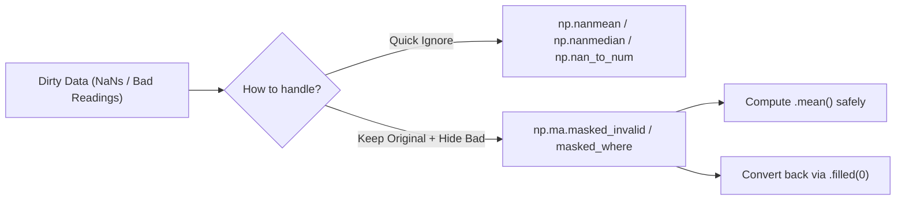
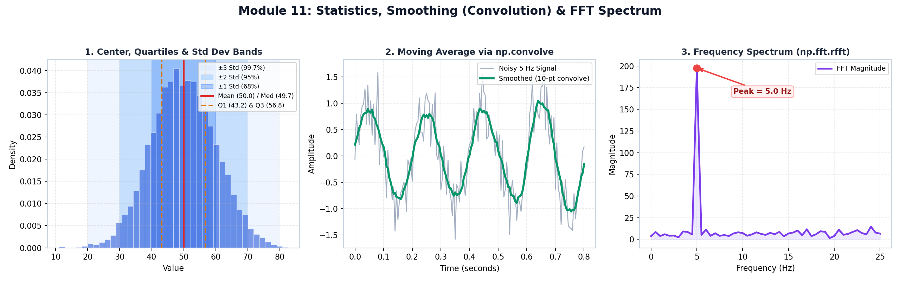

[⬅️ පෙර පාඩම: Linear Algebra](10_Linear_Algebra.md) | [🏠 මුල් පිටුව (Course Index)](README.md) | [➡️ ඊළඟ පාඩම: File I/O, Structured Arrays & Datetimes](12_File_IO_Structured_Arrays_Datetimes.md)

---

# 📊 Module 11: Statistics, Missing Data, Masked Arrays, Polynomials & FFT

සැබෑ ලෝකයේ data කවදාවත් පිරිසිදු නැහැ! සමහර තැන්වල අගයන් නැහැ (**Missing Data / `NaN`**), සමහර sensor readings වැරදියි, සමහර signals වල noise (ඝෝෂාව) පිරිලා.
මේ පාඩමේදී අපි NumPy පාවිච්චි කරලා:
1. Data වල සාරාංශය (**Statistics - සංඛ්‍යානය**) හොයන්න,
2. අඩු/වැරදි data (`NaN` සහ **Masked Arrays**) හසුරුවන්න,
3. වක්‍ර (**Polynomials**) සහ **Interpolation** කරන්න,
4. Noisy signal එකක් **Convolution** වලින් සුමට (smooth) කරලා, **FFT** වලින් ඒක ඇතුළේ හැංගිලා තියෙන frequency එක හොයන්න,
5. **Numerical Calculus** (අවකලනය/අනුකලනය) කරන්න ඉගෙන ගමු!

---

## 1. Descriptive Statistics & Degrees of Freedom (`ddof`)

Data set එකක් දිහා බලපු ගමන් ඒක තේරුම් ගන්න ප්‍රධාන මිනුම් දෙකක් ඕන:
1. **Center (මැද අගය):** `mean` (මධ්‍යන්‍යය), `median` (මධ්‍යස්ථය — outliers වලින් බලපෑම් නැහැ!), `average(x, weights=w)` (බර තැබූ මධ්‍යන්‍යය).
2. **Spread (විසිරීම):** `std` (**Standard Deviation - සම්මත අපගමනය**), `var` (**Variance - විචලතාව**), `ptp` (Peak-to-Peak = `max - min`), `percentile` (0–100%), `quantile` (0.0–1.0).

### `ddof=0` vs `ddof=1` (Degrees of Freedom) කියන්නේ මොකක්ද?
- **`ddof=0` (NumPy Default):** මුළු **Population (සමස්තය)** ම ඔයා ළඟ තියෙනවා නම් ($N$ වලින් බෙදනවා).
- **`ddof=1`:** ඔයා ළඟ තියෙන්නේ **Sample (නියැදියක්)** විතරක් නම් ($N - 1$ වලින් බෙදනවා — Statistics වල **Sample Standard Deviation** සඳහා මේක තමයි නිවැරදි!).

```python
import numpy as np

rng = np.random.default_rng(0)
x = rng.normal(50, 10, 1000)

print(f"Mean: {x.mean():.2f}, Median: {np.median(x):.2f}")
print(f"Pop Std (ddof=0): {x.std():.2f}, Sample Std (ddof=1): {x.std(ddof=1):.2f}")
print("Quartiles (25%, 50%, 75%):", np.round(np.percentile(x, [25, 50, 75]), 2))
print("Range (ptp = max - min):", round(np.ptp(x), 2))

# Weighted Average (උදා: විභාග ලකුණු වලට වෙනස් weights)
marks = np.array([80, 90, 70])
weights = np.array([0.2, 0.5, 0.3])
print("Weighted Average:", np.average(marks, weights=weights))
```

**Expected Output:**
```text
Mean: 49.49, Median: 49.55
Pop Std (ddof=0): 9.75, Sample Std (ddof=1): 9.76
Quartiles (25%, 50%, 75%): [42.63 49.55 56.25]
Range (ptp = max - min): 63.04
Weighted Average: 82.0
```

---

## 2. Correlation, Covariance & Histograms

- **`np.corrcoef(x, y)` (Correlation - සහසම්බන්ධතාව):** දත්ත දෙකක් අතර සම්බන්ධය `-1` සිට `+1` දක්වා මනිනවා. (`+1` = එකක් වැඩි වෙද්දී අනිකත් වැඩි වේ; `0` = සම්බන්ධයක් නැහැ; `-1` = එකක් වැඩි වෙද්දී අනික අඩු වේ).
- **`np.cov(x, y)` (Covariance - සහවිචලතාව):** එකට වෙනස් වෙන ප්‍රමාණය (unit එකට අනුව වෙනස් වේ).
- **`np.histogram(x, bins=...)`** & **`np.histogram_bin_edges`**: Data ටික පරාස (bins) වලට බෙදලා හැම පරාසයකම අගයන් කීයක් තියෙනවද ගණන් කරනවා.

```python
hours = np.array([1, 2, 3, 4, 5, 6])
scores = np.array([52, 58, 65, 72, 81, 88])

print("Correlation Matrix:\n", np.round(np.corrcoef(hours, scores), 3))
print("Covariance Matrix:\n", np.round(np.cov(hours, scores), 2))

counts, edges = np.histogram(scores, bins=3)
print("Histogram counts:", counts)
print("Bin edges:", np.round(edges, 1))
```

**Expected Output:**
```text
Correlation Matrix:
 [[1.    0.998]
 [0.998 1.   ]]
Covariance Matrix:
 [[  3.5  25.6]
 [ 25.6 188. ]]
Histogram counts: [2 2 2]
Bin edges: [52. 64. 76. 88.]
```

---

## 3. Missing Data (`NaN`) & Masked Arrays (`np.ma`)

Sensor එකක් වැඩ නොකර ගියාම data ඇතුළට **`np.nan`** (Not a Number) එනවා. සාමාන්‍ය `np.mean()` දැම්මොත් එක `NaN` එකක් නිසා මුළු උත්තරේම `nan` වෙනවා!

මේකට විසඳුම් දෙකක් තියෙනවා:
1. **`nan*` functions:** `np.nanmean`, `np.nanmedian`, `np.nanstd`, `np.nanpercentile`, `np.isnan`, `np.nan_to_num`.
2. **Masked Arrays (`np.ma`):** අගයන් මකන්නේ නැතුව, වැරදි/අඩු අගයන් උඩින් "වෙස් මුහුණක් (mask)" දාලා තාවකාලිකව වහලා තියෙනවා!
   - `np.ma.masked_invalid(a)`: `NaN` සහ `inf` ඔක්කොම auto-mask කරනවා.
   - `np.ma.masked_where(condition, a)`: කොන්දේසියකට අනුව mask කරනවා (උදා: සෘණ උෂ්ණත්වයන් හෝ outliers).
   - `m.filled(fill_value)`: Mask කරපු තැන්වලට වෙන අගයක් (උදා: `0` හෝ mean) දාලා සාමාන්‍ය array එකක් ගන්නවා.



```python
data = np.array([1.0, 2.0, np.nan, 4.0])

print("Regular mean:", np.mean(data))                 # nan!
print("nanmean:", round(np.nanmean(data), 3))         # 2.333
print("nan_to_num (0):", np.nan_to_num(data, nan=0.0))

# Masked Arrays
m = np.ma.masked_invalid(data)
print("Masked array:", m)
print("Masked mean:", round(m.mean(), 3))             # 2.333
print("Filled with -1:", m.filled(-1.0))

# කොන්දේසියක් මත mask කිරීම (උදා: 100ට වැඩි වැරදි sensor reading එකක්)
temps = np.array([28.5, 29.1, 999.0, 30.2])
clean_t = np.ma.masked_where(temps > 60, temps)
print("Clean temp mean:", round(clean_t.mean(), 2))   # 29.27
```

**Expected Output:**
```text
Regular mean: nan
nanmean: 2.333
nan_to_num (0): [1. 2. 0. 4.]
Masked array: [1.0 2.0 -- 4.0]
Masked mean: 2.333
Filled with -1: [ 1.  2. -1.  4.]
Clean temp mean: 29.27
```

---

## 4. Polynomials (බහුපද) & Interpolation

- **Polynomials:** දත්ත වලට වක්‍රයක් (trend curve) ගළපන්න.
  - නව ක්‍රමය (Recommended ✅): `np.polynomial.Polynomial.fit(x, y, deg)`
  - පැරණි ක්‍රමය: `np.polyfit`, `np.polyval`, `np.roots` (සමීකරණයේ මූල හොයන්න: $x^2 - 5x + 6 = 0 \rightarrow x = 2, 3$).
- **Interpolation (`np.interp`):** අපි දන්න ලක්ෂ්‍ය දෙකක් අතර මැද නොදන්නා අගයක් රේඛීයව අනුමාන කරන්න. (උදා: උදේ 8ට 26°C, උදේ 10ට 30°C නම්, උදේ 9ට කීයද? → 28°C!).

```python
from numpy.polynomial import Polynomial

# 1. Polynomial fit (Modern API)
x = np.array([0, 1, 2, 3, 4], dtype=float)
y = np.array([1, 3, 7, 13, 21], dtype=float)   # y = x^2 + x + 1
p = Polynomial.fit(x, y, deg=2)
print("Evaluated at x=5:", round(p(5), 2))     # 5^2 + 5 + 1 = 31.0

# 2. Roots of x^2 - 5x + 6 = 0
print("Roots:", np.roots([1, -5, 6]))          # [3. 2.]

# 3. Linear Interpolation
hours = np.array([8, 10, 12])
temps = np.array([26, 30, 34])
print("Temp at 9:00 & 11:00:", np.interp([9, 11], hours, temps))
```

**Expected Output:**
```text
Evaluated at x=5: 31.0
Roots: [3. 2.]
Temp at 9:00 & 11:00: [28. 32.]
```

---

## 5. Convolution (Smoothing), FFT (Frequency Analysis) & Window Functions

### A. Convolution (`np.convolve`) — Noise ඉවත් කර සුමට කිරීම
හිතන්න උෂ්ණත්ව sensor එකක අගයන් උඩ පහළ යනවා (noise). ළඟ ළඟ තියෙන අගයන් 10ක **Moving Average (චලන සාමාන්‍යය)** ගත්තම ඒ noise එක නැති වෙලා ලස්සන සුමට රේඛාවක් එනවා! NumPy වල `np.convolve(sig, np.ones(10) / 10, mode='same')` වලින් එක පේළියෙන් ඒක කරන්න පුළුවන්.

### B. FFT — Fast Fourier Transform (`np.fft`)
**සරල උදාහරණය:** හිතන්න ඝෝෂාකාරී කාමරයක කෙනෙක් පියානෝ එකේ එක ස්වරයක් (උදා: 5 Hz තරංගයක්) ගහනවා. කනට ඇහෙන්නේ ඝෝෂාව (Time domain). **FFT** කියන්නේ ඒ ශබ්දය ඇතුළේ තියෙන හැම ස්වරයක්ම (**Frequencies - සංඛ්‍යාත**) වෙන වෙනම පෙන්නන "මායා ප්‍රිස්මයක්" වගේ!
- `np.fft.rfft(sig)`: Real-valued signals වලට (වඩා වේගවත්, ධන frequencies විතරයි දෙන්නේ).
- `np.fft.rfftfreq(n, d=1/fs)`: ඒ frequencies ටික Hz වලින් දෙනවා.
- `np.fft.fft` / `ifft`: Complex signals සහ ආපසු time domain එකට ගන්න.
- `np.fft.fft2`: 2D Images වල frequency analysis සඳහා.
- **Window Functions (`np.hanning`, `np.hamming`, `np.blackman`):** FFT ගන්න කලින් signal එකේ දෙකෙළවර සුමටව 0 ට බස්සලා spectral leakage අඩු කරන්න පාවිච්චි කරනවා (`sig * np.hanning(len(sig))`).



```python
rng = np.random.default_rng(0)

# Noisy 5 Hz signal එකක් හදමු (sampling rate = 200 Hz, කාලය තත්පර 2)
fs = 200
t = np.arange(0, 2, 1 / fs)
sig = np.sin(2 * np.pi * 5 * t) + 0.3 * rng.normal(size=t.size)

# 1. FFT මගින් ප්‍රධාන සංඛ්‍යාතය (Dominant Frequency) සෙවීම
windowed = sig * np.hanning(sig.size)           # Hanning window යෙදීම
spec = np.abs(np.fft.rfft(windowed))
freqs = np.fft.rfftfreq(t.size, d=1 / fs)
dominant_freq = freqs[spec.argmax()]
print(f"Detected Dominant Frequency: {dominant_freq:.1f} Hz")

# 2. 10-point Moving Average Smoothing via np.convolve
smoothed = np.convolve(sig, np.ones(10) / 10, mode='same')
print("Original std:", round(sig.std(), 3), "-> Smoothed std:", round(smoothed.std(), 3))
```

**Expected Output:**
```text
Detected Dominant Frequency: 5.0 Hz
Original std: 0.774 -> Smoothed std: 0.677
```

---

## 6. Numerical Calculus (`diff`, `gradient`, `trapezoid`, `cumsum`)

සූත්‍රයක් නැතුව, data points ටිකකින්ම **Derivatives (ව්‍යුත්පන්න / වෙනස්වීමේ වේගය)** සහ **Integrals (අනුකලන / වක්‍රය යට වර්ගඵලය)** හොයන්න:
- `np.diff(y)`: ළඟ ළඟ අගයන් දෙකේ වෙනස (`y[i+1] - y[i]`). Length එක 1කින් අඩු වෙනවා.
- `np.gradient(y, x)`: සෑම ලක්ෂ්‍යයකම බෑවුම ($dy/dx$). Length එක වෙනස් වෙන්නේ නැහැ!
- `np.trapezoid(y, x)`: වක්‍රය යට වර්ගඵලය ($\int y\,dx$ — Trapezoidal rule). *(NumPy 2.0+ වල `np.trapz` වෙනුවට `np.trapezoid` භාවිතා වේ).*
- `np.cumsum(y)`: සමුච්චිත එකතුව (Cumulative sum).

```python
x = np.linspace(0, np.pi, 1000)
y = np.sin(x)

# sin(x) හි 0 සිට pi දක්වා අනුකලනය = 2.0!
area = np.trapezoid(y, x)
# sin(x) හි ව්‍යුත්පන්නය = cos(x) -> x=0 දී cos(0) = 1.0
dy_dx = np.gradient(y, x)

print(f"Integral of sin(x) [0, pi]: {area:.5f} (Exact: 2.0)")
print(f"Derivative at x=0: {dy_dx[0]:.5f} (Exact: 1.0)")
```

**Expected Output:**
```text
Integral of sin(x) [0, pi]: 2.00000 (Exact: 2.0)
Derivative at x=0: 1.00000 (Exact: 1.0)
```

---

## 🧠 මතක තබා ගැනීමට පහසු ක්‍රම (Memory Hacks)

1. **`ddof=1` for Sample:** "Sample නම් 1 අඩු කරන්න (`N - 1` → `ddof=1`)".
2. **`nan` එකක් තිබුණොත් `nan` function එකක්:** `mean` → `nanmean`, `std` → `nanstd`, `percentile` → `nanpercentile`.
3. **FFT = ශබ්දයකින් ස්වර වෙන් කිරීම:** Time Domain (කාලය) $\xrightarrow{\text{rfft}}$ Frequency Domain (Hz).
4. **Moving Average = `np.convolve(x, np.ones(k)/k, mode='same')`**: `k` අගය වැඩි වෙන තරමට curve එක smooth වෙනවා!

---

## ⚠️ සාමාන්‍යයෙන් වෙන වැරදි (Common Pitfalls)

> [!WARNING]
> **වැරැද්ද 1: Sample Std හොයද්දී `ddof=1` අමතක වීම**
> Pandas වල default `ddof=1` වුණාට, NumPy වල default **`ddof=0`**! ඒ නිසා කුඩා samples වලදී Pandas සහ NumPy උත්තර පොඩ්ඩක් වෙනස් වෙනවා. Sample stats වලට හැමදාම `ddof=1` දෙන්න.

> [!WARNING]
> **වැරැද්ද 2: `np.corrcoef` වල Rows සහ Columns පටලවා ගැනීම**
> `np.corrcoef(X)` සලකන්නේ හැම **row** එකක්ම එක variable එකක් විදියටයි! ඔයාගේ dataset එකේ columns ටික features නම් (උදා: `500×4`), **`rowvar=False`** දෙන්න අමතක කරන්න එපා!

> [!WARNING]
> **වැරැද්ද 3: `np.fft.rfft` ප්‍රතිදානයේ `np.abs()` නොගැනීම**
> FFT වලින් එන්නේ **Complex Numbers** (සංකීර්ණ සංඛ්‍යා)! ඒකේ ශක්තිය/විශාලත්වය (Magnitude) බලන්න හැමතිස්සෙම `np.abs(np.fft.rfft(sig))` ගන්න.

---

## 🏋️ ප්‍රායෝගික අභ්‍යාස (Practical Exercises)

### අභ්‍යාසය 0 (Warm-up): `NaN` සහිත දත්ත පිරිසිදු කිරීම
`arr = np.array([12.0, np.nan, 18.0, 20.0, np.nan, 14.0])` හි `NaN` අගයන් මඟහැර Mean සහ Median හොයලා, `NaN` තැන්වලට Mean අගය ආදේශ කරන්න.

<details>
<summary>✅ පිළිතුර බලන්න (Click to see Solution)</summary>

```python
import numpy as np

arr = np.array([12.0, np.nan, 18.0, 20.0, np.nan, 14.0])
m = np.nanmean(arr)
med = np.nanmedian(arr)
filled = np.where(np.isnan(arr), m, arr)

print(f"Mean: {m}, Median: {med}")
print("Filled array:", filled)
```
</details>

---

### අභ්‍යාසය 1: `500×4` Dataset එකක ප්‍රබලම Correlation Pair එක සෙවීම
`500×4` dataset එකක් හදලා (columns = features), `np.corrcoef(..., rowvar=False)` මගින් correlation matrix එක හොයලා, ප්‍රබලම සම්බන්ධතාවය (strongest pair, diagonal එක නැතුව) තියෙන feature දෙක හොයන්න.

<details>
<summary>✅ පිළිතුර බලන්න (Click to see Solution)</summary>

```python
import numpy as np

rng = np.random.default_rng(42)
X = rng.normal(size=(500, 4))
# Feature 2, Feature 0 එක්ක ප්‍රබල සම්බන්ධයක් හදමු
X[:, 2] = 0.85 * X[:, 0] + 0.3 * rng.normal(size=500)

corr = np.corrcoef(X, rowvar=False)
print("Correlation Matrix:\n", np.round(corr, 3))

# Diagonal (1.0) ඉවත් කරලා ලොකුම abs(corr) හොයමු
abs_corr = np.abs(corr.copy())
np.fill_diagonal(abs_corr, 0)
i, j = np.unravel_index(np.argmax(abs_corr), abs_corr.shape)
print(f"Strongest pair: Feature {i} & Feature {j} (r = {corr[i, j]:.3f})")
```
</details>

---

### අභ්‍යාසය 2: 3 Standard Deviations වලට එහා Outliers Mask කිරීම
Normal distribution එකකින් data 200ක් හදලා, ඒකට ලොකු outliers 3ක් එකතු කරන්න. ඊටපස්සේ Mean එකෙන් $3\sigma$ (3 Standard Deviations) වලට වඩා ඈතින් තියෙන අගයන් `np.ma.masked_where` වලින් mask කරලා අලුත් Mean එක ගණනය කරන්න.

<details>
<summary>✅ පිළිතුර බලන්න (Click to see Solution)</summary>

```python
import numpy as np

rng = np.random.default_rng(7)
data = np.concatenate([rng.normal(50, 5, 200), [120.0, 150.0, -30.0]])

mu, sd = data.mean(), data.std(ddof=1)
outlier_mask = np.abs(data - mu) > 3 * sd
masked = np.ma.masked_where(outlier_mask, data)

print(f"Original Mean: {mu:.2f}")
print(f"Outliers detected: {outlier_mask.sum()}")
print(f"Cleaned Mean (masked): {masked.mean():.2f}")
```
</details>

---

### අභ්‍යාසය 3: `rfft` මගින් Signal එකේ ප්‍රධාන සංඛ්‍යාතය සෙවීම
12 Hz සහ 30 Hz තරංග දෙකක් (12 Hz එක වඩා ප්‍රබලයි) + random noise එකතු කරලා signal එකක් හදලා, `np.fft.rfft` සහ `np.fft.rfftfreq` වලින් ප්‍රධාන සංඛ්‍යාතය 12 Hz කියලා හොයාගන්න.

<details>
<summary>✅ පිළිතුර බලන්න (Click to see Solution)</summary>

```python
import numpy as np

rng = np.random.default_rng(1)
fs = 500
t = np.arange(0, 2, 1 / fs)
sig = 2.0 * np.sin(2 * np.pi * 12 * t) + 0.8 * np.sin(2 * np.pi * 30 * t) + 0.5 * rng.normal(size=t.size)

spec = np.abs(np.fft.rfft(sig))
freqs = np.fft.rfftfreq(t.size, d=1 / fs)
dom_freq = freqs[spec.argmax()]
print(f"Dominant frequency: {dom_freq:.1f} Hz")
```
</details>

---

### අභ්‍යාසය 4: Degree 1, 3 සහ 9 Polynomials Fit කර Error සංසන්දනය කිරීම
Noisy cubic data එකකට (`deg=1`, `deg=3`, `deg=9`) polynomials fit කරලා, Train error සහ Test error (RMSE) සංසන්දනය කරන්න (Overfitting ඇස් දෙකෙන්ම දකින්න!).

<details>
<summary>✅ පිළිතුර බලන්න (Click to see Solution)</summary>

```python
import numpy as np
from numpy.polynomial import Polynomial

rng = np.random.default_rng(42)
x_train = rng.uniform(-3, 3, 25)
y_train = 0.5 * x_train**3 - 2 * x_train + rng.normal(0, 1.5, 25)

x_test = rng.uniform(-3, 3, 50)
y_test = 0.5 * x_test**3 - 2 * x_test + rng.normal(0, 1.5, 50)

for deg in [1, 3, 9]:
    p = Polynomial.fit(x_train, y_train, deg=deg)
    train_rmse = np.sqrt(np.mean((y_train - p(x_train))**2))
    test_rmse = np.sqrt(np.mean((y_test - p(x_test))**2))
    print(f"Degree {deg} | Train RMSE: {train_rmse:.3f} | Test RMSE: {test_rmse:.3f}")
# Degree 9 වල Train RMSE අඩු වුණත් Test RMSE ගොඩක් වැඩි වේ (Overfitting!)
```
</details>

---

## 📋 සාරාංශ වගුව (Cheat Sheet Summary)

| අවශ්‍යතාවය | NumPy API | උදාහරණය |
| --- | --- | --- |
| Center & Spread | `mean`, `median`, `std(ddof=1)`, `var`, `ptp` | `x.std(ddof=1)` |
| Percentiles / Weights | `percentile`, `quantile`, `average(weights=)` | `np.percentile(x, [25, 75])` |
| Relationships | `np.corrcoef`, `np.cov`, `np.correlate` | `np.corrcoef(X, rowvar=False)` |
| Histograms | `np.histogram`, `histogram_bin_edges` | `cnt, edges = np.histogram(x, 10)` |
| NaN Handling | `nanmean`, `nanmedian`, `isnan`, `nan_to_num` | `np.nanmean(data)` |
| Masked Arrays | `masked_invalid`, `masked_where`, `.filled()` | `np.ma.masked_invalid(data).mean()` |
| Polynomials | `Polynomial.fit`, `polyfit`, `polyval`, `roots` | `p = Polynomial.fit(x, y, 2)` |
| Interpolation | `np.interp` | `np.interp(9, [8, 10], [26, 30])` |
| Smoothing / Filtering | `np.convolve` | `np.convolve(s, np.ones(10)/10, 'same')` |
| Fourier Transform | `rfft`, `rfftfreq`, `fft`, `ifft`, `fft2` | `np.abs(np.fft.rfft(sig))` |
| Window Functions | `hanning`, `hamming`, `blackman` | `sig * np.hanning(len(sig))` |
| Numerical Calculus | `diff`, `gradient`, `trapezoid`, `cumsum` | `np.trapezoid(y, x)` |

---

[⬅️ පෙර පාඩම: Linear Algebra](10_Linear_Algebra.md) | [🏠 මුල් පිටුව (Course Index)](README.md) | [➡️ ඊළඟ පාඩම: File I/O, Structured Arrays & Datetimes](12_File_IO_Structured_Arrays_Datetimes.md)
