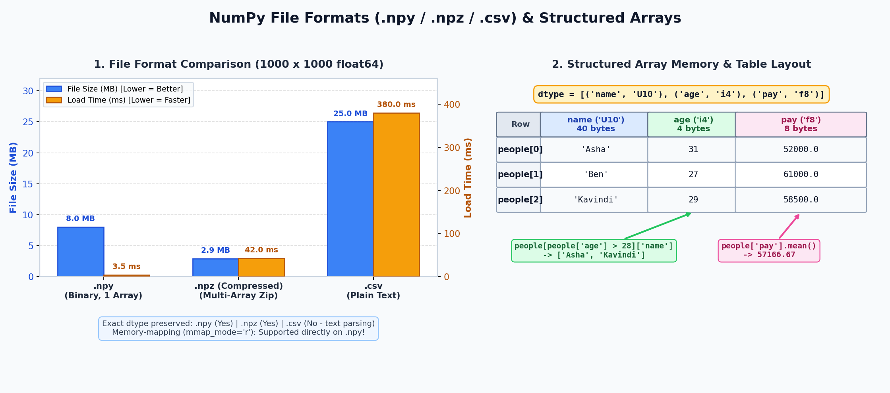
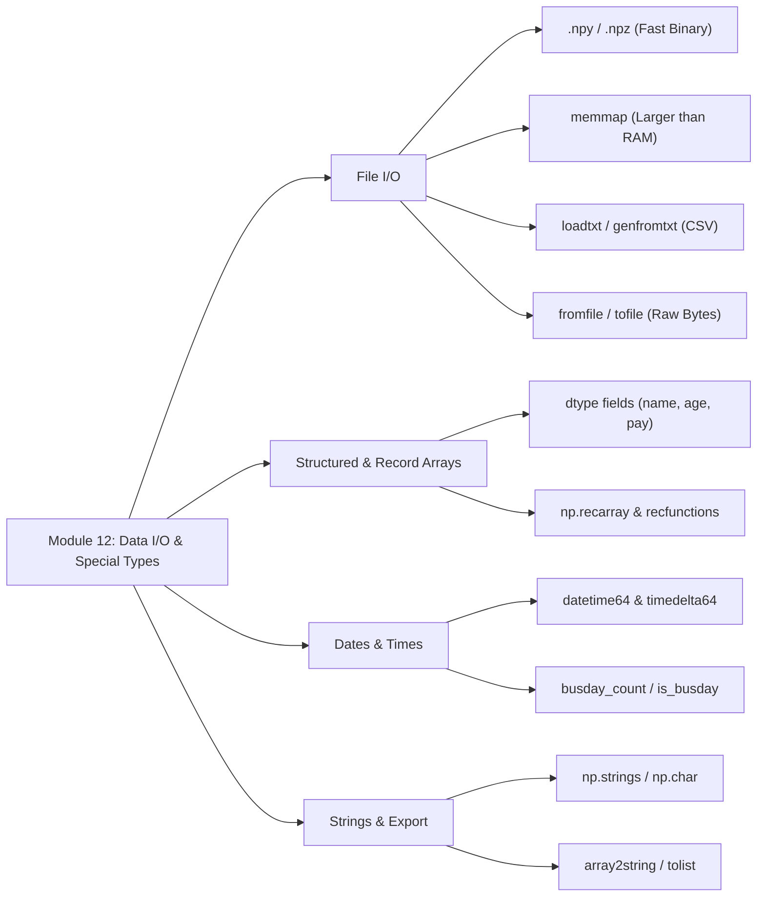
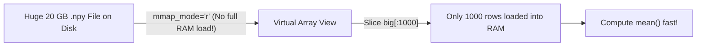

# පාඩම 12: File I/O, Structured Arrays සහ Datetimes

> **නැවිගේෂන් (Navigation):**
> [🏠 මුල් පිටුව (README)](README.md) | [⬅️ පෙර පාඩම: 11 - Statistics, Missing Data, Polynomials & FFT](11_Statistics_Missing_Data_Polynomials_FFT.md) | [➡️ ඊළඟ පාඩම: 13 - Performance & Advanced Topics](13_Performance_and_Advanced_Topics.md)

---

## 🎯 මේ පාඩමෙන් අපි මොනවද ඉගෙන ගන්නේ?

දත්ත (data) ගොඩක් අරගෙන NumPy වලින් ගණන් හදලා ඉවර වුණාම, ඒ ප්‍රතිඵල file එකක save කරගන්න ඕනේ. නැත්නම් කලින් save කරපු CSV file එකක් හෝ ගොඩක් ලොකු (RAM එකටවත් නොවදින!) binary file එකක් load කරගන්න ඕනේ. ඒ වගේම, Excel table එකක් වගේ එක එක column වලට වෙනස් data types (උදා: නම text, වයස integer, වැටුප float) තියෙන **Structured Arrays**, දින සහ වෙලාවල් හසුරුවන **`datetime64` / `timedelta64`**, වැඩ කරන දින (**Business days**), සහ **String arrays** ගැනත් අපි මේ පාඩමෙන් සරලවම ඉගෙන ගමු!



---

## 🗺️ මේ පාඩමේ සම්පූර්ණ සිතියම (Module Overview)



---

## 1. Binary Files: `.npy` සහ `.npz` (වේගවත්ම සහ නිවැරදිම ක්‍රමය)

CSV වගේ text file එකක array එකක් save කරනවට වඩා, NumPy වලම තියෙන **`.npy`** (එක array එකක් සඳහා) සහ **`.npz`** (arrays කිහිපයක් එකට zip කරලා save කරන්න) formats භාවිතා කරන එක ගොඩක් වේගවත්. ඒ වගේම `shape` එකයි `dtype` එකයි කිසිම වෙනසක් නැතුව ඒ විදිහටම රැකෙනවා!

### ප්‍රධාන Functions:
- `np.save('file.npy', arr)` — එක array එකක් binary විදිහට save කරනවා.
- `np.load('file.npy')` — `.npy` හෝ `.npz` file එකක් load කරනවා.
- `np.savez('bundle.npz', X=X, y=y)` — arrays කිහිපයක් එක file එකකට (uncompressed) save කරනවා.
- `np.savez_compressed('bundle.npz', X=X, y=y)` — arrays කිහිපයක් **compress** කරලා අඩු ඉඩක save කරනවා.

> [!WARNING]
> **ආරක්ෂාව ගැන සැලකිලිමත් වෙන්න (`allow_pickle=False`)!**
> `np.load` කරනකොට default විදිහට `allow_pickle=False` තියෙන්නේ. Python object arrays (pickle කරපු files) වල හානිකර code තියෙන්න පුළුවන් නිසා, ඔයාට 100% විශ්වාසදායක (trusted) files වලට විතරක් `allow_pickle=True` දෙන්න.

```python
import numpy as np

# Sample arrays දෙකක් හදමු
weights = np.array([0.25, -0.8, 1.4], dtype=np.float32)
X = np.arange(12).reshape(3, 4)
y = np.array([1, 0, 1])

# 1. තනි array එකක් .npy විදිහට save සහ load කිරීම
np.save('weights.npy', weights)
w_loaded = np.load('weights.npy')
print("Loaded weights:", w_loaded, "| dtype:", w_loaded.dtype)

# 2. Arrays කිහිපයක් .npz (compressed) විදිහට save සහ load කිරීම
np.savez_compressed('bundle.npz', X=X, y=y)

with np.load('bundle.npz') as bundle:
    print("Files inside bundle:", bundle.files)
    print("X shape:", bundle['X'].shape)
    print("y values:", bundle['y'])
```

**පේළියෙන් පේළිය පැහැදිලි කිරීම (Line-by-Line):**
- `np.save('weights.npy', weights)`: `weights` array එක `float32` type එකත් එක්කම binary format එකෙන් disk එකේ ලියනවා.
- `np.savez_compressed('bundle.npz', X=X, y=y)`: `X` සහ `y` කියන නම් දෙකෙන්ම arrays දෙක zip archive එකක් ඇතුළේ compress කරලා save කරනවා.
- `with np.load('bundle.npz') as bundle:`: `with` block එක පාවිච්චි කරන එක හොඳ පුරුද්දක්, මොකද වැඩේ ඉවර වුණාම file handle එක auto close වෙනවා. `bundle['X']` කිව්වම අපිට ඕන array එක විතරක් load වෙනවා!

**Expected Output:**
```text
Loaded weights: [ 0.25 -0.8   1.4 ] | dtype: float32
Files inside bundle: ['X', 'y']
X shape: (3, 4)
y values: [1 0 1]
```

---

## 2. Memory Mapping (`mmap_mode='r'` සහ `np.memmap`) — RAM එකට වඩා ලොකු Files!

හිතන්න ඔයාගේ computer එකේ RAM එක 8 GB යි, ඒත් dataset file එක 20 GB! සාමාන්‍ය විදිහට `np.load()` කළොත් RAM එක full වෙලා program එක crash වෙනවා (`MemoryError`).

මේකට විසඳුම තමයි **Memory Mapping**! File එක සම්පූර්ණයෙන්ම RAM එකට ගන්නේ නැතුව, හරියට ලොකු පොතක අපිට ඕන පිටුව විතරක් පෙරළලා බලනවා වගේ, අපි slice කරන කොටස විතරක් hard disk එකෙන් කියවනවා.



```python
import numpy as np

# ලොකු array එකක් save කරමු (උදාහරණයක් විදිහට)
huge_data = np.arange(1_000_000, dtype=np.float64)
np.save('huge.npy', huge_data)

# RAM එකට ඔක්කොම load නොකර read-only memory map කරමු
big = np.load('huge.npy', mmap_mode='r')
print("Type:", type(big))
print("First 1000 mean:", big[:1000].mean())

# Raw binary file එකක් කෙලින්ම memmap වලින් හදන්නත් පුළුවන්:
fp = np.memmap('raw_memmap.dat', dtype='float32', mode='w+', shape=(1000, 10))
fp[:] = 5.0
fp.flush()   # Disk එකට වෙනස්කම් ස්ථිරවම ලියන්න
print("Memmap sample:", fp[0, :3])
```

**Expected Output:**
```text
Type: <class 'numpy.memmap'>
First 1000 mean: 499.5
Memmap sample: [5. 5. 5.]
```

---

## 3. Text Files (CSV) සහ Raw Binary Files

සමහර වෙලාවට අපිට Excel හෝ වෙනත් system වලින් එන CSV/text files කියවන්න වෙනවා.
- `np.savetxt`: Array එකක් text/CSV file එකකට ලියන්න.
- `np.loadtxt`: පිරිසිදු (missing values නැති) text/CSV files වේගයෙන් කියවන්න.
- `np.genfromtxt`: හිස් තැන් (`missing_values`) තියෙන අපිරිසිදු CSV files කියවලා, ඒ හිස් තැන් වලට default අගයන් (`filling_values`) දාන්න.
- **Raw Binary (`tofile`, `fromfile`, `frombuffer`)**: කිසිම header එකක් නැති sensor dumps හෝ raw image bytes කියවන්න/ලියන්න.

```python
import numpy as np
from io import StringIO

# 1. Text / CSV save සහ load (loadtxt)
data = np.array([[1.5, 2.5, 3.5], [4.0, 5.0, 6.0]])
np.savetxt('scores.csv', data, delimiter=',', header='math,sci,eng', fmt='%.2f')
loaded_csv = np.loadtxt('scores.csv', delimiter=',', skiprows=1)
print("loadtxt result:\n", loaded_csv)

# 2. Missing values තියෙන CSV එකක් genfromtxt වලින් කියවීම
messy_csv = StringIO("10, 20, 30\n40, NA, 60\n70, 80, ")
clean_arr = np.genfromtxt(messy_csv, delimiter=',', missing_values=['NA', ''], filling_values=-1.0)
print("genfromtxt result:\n", clean_arr)

# 3. Raw binary (header නැත — dtype සහ shape අපි මතක තබා ගත යුතුයි!)
raw_arr = np.array([100, 200, 300], dtype=np.int32)
raw_arr.tofile('sensor.bin')
restored = np.fromfile('sensor.bin', dtype=np.int32)
print("fromfile result:", restored)

# Bytes buffer එකකින් කෙලින්ම array එකක් සෑදීම
buf = b'\x01\x00\x02\x00\x03\x00'
from_buf = np.frombuffer(buf, dtype=np.int16)
print("frombuffer result:", from_buf)
```

**Expected Output:**
```text
loadtxt result:
 [[1.5 2.5 3.5]
 [4.  5.  6. ]]
genfromtxt result:
 [[10. 20. 30.]
 [40. -1. 60.]
 [70. 80. -1.]]
fromfile result: [100 200 300]
frombuffer result: [1 2 3]
```

---

## 4. Structured Arrays, Record Arrays සහ `recfunctions`

සාමාන්‍ය NumPy array එකක හැම element එකම එකම type එකෙන් (උදා: ඔක්කොම `float64`) තියෙන්න ඕනේ. ඒත් **Structured Array** එකකදී, එක row (record) එකක් ඇතුළේ වෙනස් වෙනස් නම් සහ types තියෙන fields (columns) තියාගන්න පුළුවන් — හරියට C language එකේ `struct` එකක් හෝ පොඩි database table එකක් වගේ!

- **Structured Array**: `people['age']` විදිහට dictionary key එකක් වගේ column ගන්න පුළුවන්.
- **Record Array (`np.recarray`)**: `people.age` විදිහට dot (`.`) එකෙන් attribute එකක් වගේ ගන්න පුළුවන් (පහසුයි, හැබැයි සාමාන්‍ය structured array එකට වඩා චුට්ටක් slow).
- **`numpy.lib.recfunctions`**: Structured arrays join කරන්න, අලුත් fields එකතු කරන්න (`append_fields`), fields අයින් කරන්න (`drop_fields`) උදව් වෙනවා.

```python
import numpy as np
from numpy.lib import recfunctions as rfn

# Structured array එකක් සෑදීම (U10 = max 10 Unicode chars, i4 = int32, f8 = float64)
people = np.array(
    [('Asha', 31, 52000.0), ('Ben', 27, 61000.0), ('Kavindi', 29, 58500.0)],
    dtype=[('name', 'U10'), ('age', 'i4'), ('pay', 'f8')]
)

print("Mean pay:", people['pay'].mean())
print("Older than 28:", people[people['age'] > 28]['name'])

# Record array එකක් විදිහට view කිරීම (dot access)
rec = people.view(np.recarray)
print("Using dot access (rec.name):", rec.name)

# Field utility: අලුත් 'bonus' column එකක් එකතු කරමු
bonus = people['pay'] * 0.10
people_with_bonus = rfn.append_fields(people, 'bonus', bonus, usemask=False)
print("With bonus field:", people_with_bonus[['name', 'bonus']])
```

**Expected Output:**
```text
Mean pay: 57166.666666666664
Older than 28: ['Asha' 'Kavindi']
Using dot access (rec.name): ['Asha' 'Ben' 'Kavindi']
With bonus field: [('Asha', 5200.) ('Ben', 6100.) ('Kavindi', 5850.)]
```

---

## 5. Datetimes (`datetime64`), Timedeltas (`timedelta64`) සහ Business Days

NumPy වල දින සහ වෙලාවල් store කරන්නේ **64-bit integers** විදිහට. ඒ නිසා දින මිලියන ගාණක් එකතු කරන්න, අඩු කරන්න, compare කරන්න හරිම වේගවත්!

| Unit Code | තේරුම (Meaning) | උදාහරණය |
| --- | --- | --- |
| `'Y'`, `'M'`, `'W'`, `'D'` | අවුරුදු, මාස, සති, දින | `np.datetime64('2026-11-21')` |
| `'h'`, `'m'`, `'s'`, `'ms'` | පැය, මිනිත්තු, තත්පර, මිලිතත්පර | `np.timedelta64(5, 'h')` |

### වැඩ කරන දින (Business Days):
සති අන්ත (සෙනසුරාදා, ඉරිදා) සහ නිවාඩු දින අතහැරලා වැඩ කරන දින ගණන් කරන්න NumPy වලම built-in functions තියෙනවා:
- `np.busday_count(start, end, holidays=...)`: දින දෙකක් අතර වැඩ කරන දින ගණන.
- `np.is_busday(dates)`: ඒ දින වැඩ කරන දිනද කියලා `True`/`False` දෙනවා.
- `np.busday_offset(date, n)`: දීපු දිනයේ ඉඳන් වැඩ කරන දින `n` ක් ඉස්සරහට/පස්සට යන දිනය.

```python
import numpy as np

# 1. දින පරාසයක් සෑදීම (2026 නොවැම්බර් 1 සිට 7 දක්වා)
days = np.arange('2026-11-01', '2026-11-08', dtype='datetime64[D]')
print("Week days:", days)

# 2. Timedelta: දින 5 ක් එකතු කිරීම සහ පැය වලට හැරවීම
delta = np.timedelta64(5, 'D')
print("5 days in hours:", delta.astype('timedelta64[h]'))
print("5 days after Nov 1:", days[0] + delta)

# 3. Business days ගණන් කිරීම
work_days = np.busday_count('2026-11-01', '2026-11-30')
print("Working days in Nov 2026 (excl. 30th):", work_days)
print("Is each day a business day?", np.is_busday(days))

# Deadline: 2026-11-02 ඉඳන් වැඩ කරන දින 10 කට පස්සේ දිනය
deadline = np.busday_offset('2026-11-02', 10)
print("Deadline (+10 business days):", deadline)
```

**Expected Output:**
```text
Week days: ['2026-11-01' '2026-11-02' '2026-11-03' '2026-11-04' '2026-11-05'
 '2026-11-06' '2026-11-07']
5 days in hours: 120 hours
5 days after Nov 1: 2026-11-06
Working days in Nov 2026 (excl. 30th): 20
Is each day a business day? [False  True  True  True  True  True False]
Deadline (+10 business days): 2026-11-16
```

---

## 6. String Arrays (`np.strings` / `np.char`) සහ Printing / Exporting

Text array එකක් තියෙනකොට, Python loop දාන්නේ නැතුව හැම string එකම uppercase කරන්න, replace කරන්න, substring එකක් හොයන්න (`find`) **NumPy 2.x වල `np.strings`** (පරණ version වල `np.char`) පාවිච්චි කරනවා.

ඒ වගේම array එක ලස්සනට print කරන්න හෝ Python list එකකට export කරන්න `np.set_printoptions`, `np.array2string`, සහ `.tolist()` පාවිච්චි කරනවා.

```python
import numpy as np

# NumPy 2.x හි np.strings (පරණ version නම් np.char භාවිතා වේ)
str_mod = getattr(np, 'strings', np.char)

names = np.array(['  asha ', 'ben_01', 'kavindi'])
print("Upper:", str_mod.upper(names))
print("Replace:", str_mod.replace(names, '_', '-'))
print("Find 'a' index:", str_mod.find(names, 'a'))

# Printing & Exporting
vals = np.array([0.00001234, 3.14159265, 100.5])
np.set_printoptions(precision=3, suppress=True)
print("Formatted print:", vals)
print("As string:", np.array2string(vals, separator=', '))
print("As Python list:", vals.tolist())
```

**Expected Output:**
```text
Upper: ['  ASHA ' 'BEN_01' 'KAVINDI']
Replace: ['  asha ' 'ben-01' 'kavindi']
Find 'a' index: [ 2 -1  1]
Formatted print: [  0.      3.142 100.5  ]
As string: [  0.   ,   3.142, 100.5  ]
As Python list: [1.234e-05, 3.14159265, 100.5]
```

---

## 🧠 මතක තබා ගැනීමට පහසු ක්‍රම (Memory Hacks)

1. **`.npy` vs `.npz` vs `.csv`:**
   - **`.npy`** = **One** array (වේගවත්ම).
   - **`.npz`** = **Z**ip of multiple arrays (කිහිපයක් එකට).
   - **`.csv`** = **C**ompatible with humans/Excel (හැබැයි slow & ඉඩ වැඩියි).
2. **`mmap_mode='r'`:** "Disk එකේම තියාගෙන **R**ead කරන්න — RAM එක බේරගන්න!"
3. **`loadtxt` vs `genfromtxt`:** Clean data නම් **`load`** (`loadtxt`), අවුල්/හිස් තැන් තියෙන general data නම් **`gen`** (`genfromtxt`).
4. **Structured Array `dtype`:** `U10` = Unicode 10 chars, `i4` = 4-byte int (32-bit), `f8` = 8-byte float (64-bit).

---

## ⚠️ සාමාන්‍යයෙන් වෙන වැරදි (Common Pitfalls)

> [!WARNING]
> **වැරැද්ද 1: Raw binary (`tofile`/`fromfile`) කියවද්දී වැරදි `dtype` දීම!**
> `tofile` කරද්දී header එකක් save වෙන්නේ නෑ. `float64` විදිහට save කරපු file එකක් `fromfile(..., dtype=np.float32)` කියලා කියෙව්වොත් සම්පූර්ණයෙන්ම විකාර අගයන් එනවා. ඒ නිසා හැමවිටම `.npy` පාවිච්චි කරන්න!

> [!WARNING]
> **වැරැද්ද 2: `datetime64` වල `busday_count` අවසාන දිනය ඇතුළත් නොකිරීම!**
> `np.busday_count('2026-11-01', '2026-11-30')` කියනකොට Python වල `range()` වගේම **අවසාන දිනය (Nov 30) ඇතුළත් වෙන්නේ නැහැ**. Nov 30ත් ගන්න ඕනේ නම් end date එක `'2026-12-01'` දෙන්න!

---

## 💪 ප්‍රායෝගික අභ්‍යාස (Practical Exercises)

### අභ්‍යාසය 1
Arrays 3ක් (`a`, `b`, `c`) එක compressed `.npz` file එකක save කරලා, නැවත load කරනකොට ඒකෙන් `b` කියන array එක විතරක් print කරන්න.

<details>
<summary>✅ පිළිතුර බලන්න (Click to see Solution)</summary>

```python
import numpy as np

a = np.arange(5)
b = np.linspace(0, 1, 5)
c = np.eye(3)

np.savez_compressed('three_arrays.npz', a=a, b=b, c=c)

with np.load('three_arrays.npz') as data:
    only_b = data['b']
    print("Reloaded b:", only_b)
```
</details>

### අභ්‍යාසය 2
ලොකු array එකක් `(100_000, 4)` save කරලා, `mmap_mode='r'` වලින් open කරලා, RAM එකට කෑලි (blocks) විදිහට අරගෙන (උදා: rows 20,000 බැගින්) column means ගණනය කරන්න.

<details>
<summary>✅ පිළිතුර බලන්න (Click to see Solution)</summary>

```python
import numpy as np

rng = np.random.default_rng(0)
np.save('big_table.npy', rng.normal(10, 2, size=(100_000, 4)))

mm = np.load('big_table.npy', mmap_mode='r')
block_size = 20_000
col_sum = np.zeros(mm.shape[1], dtype=np.float64)

for start in range(0, mm.shape[0], block_size):
    col_sum += mm[start:start + block_size].sum(axis=0)

col_means = col_sum / mm.shape[0]
print("Block-computed column means:", col_means)
```
</details>

### අභ්‍යාසය 3
`name`, `price`, `stock` කියන fields තියෙන products structured array එකක් හදලා, `stock < 10` (low stock) තියෙන items විතරක් තෝරලා, ඒවා `price` එක අනුව අඩුම ගාණේ ඉඳන් වැඩිම ගාණට sort කරලා print කරන්න.

<details>
<summary>✅ පිළිතුර බලන්න (Click to see Solution)</summary>

```python
import numpy as np

products = np.array(
    [('Pen', 45.0, 50), ('Notebook', 250.0, 5), ('Eraser', 30.0, 8), ('Bag', 3500.0, 3)],
    dtype=[('name', 'U15'), ('price', 'f8'), ('stock', 'i4')]
)

low_stock = products[products['stock'] < 10]
sorted_low = np.sort(low_stock, order='price')
print("Low stock items sorted by price:\n", sorted_low)
```
</details>

### අභ්‍යාසය 4
`'2026-11-01'` සහ `'2026-12-01'` අතර වැඩ කරන දින ගණන හොයන්න — හැබැයි `'2026-11-11'` සහ `'2026-11-24'` කියන නිවාඩු දින (`holidays=`) දෙක අතහැරලා!

<details>
<summary>✅ පිළිතුර බලන්න (Click to see Solution)</summary>

```python
import numpy as np

holidays = ['2026-11-11', '2026-11-24']
working_days = np.busday_count('2026-11-01', '2026-12-01', holidays=holidays)
print("Working days excluding holidays:", working_days)
```
</details>

---

> **නැවිගේෂන් (Navigation):**
> [🏠 මුල් පිටුව (README)](README.md) | [⬅️ පෙර පාඩම: 11 - Statistics, Missing Data, Polynomials & FFT](11_Statistics_Missing_Data_Polynomials_FFT.md) | [➡️ ඊළඟ පාඩම: 13 - Performance & Advanced Topics](13_Performance_and_Advanced_Topics.md)
