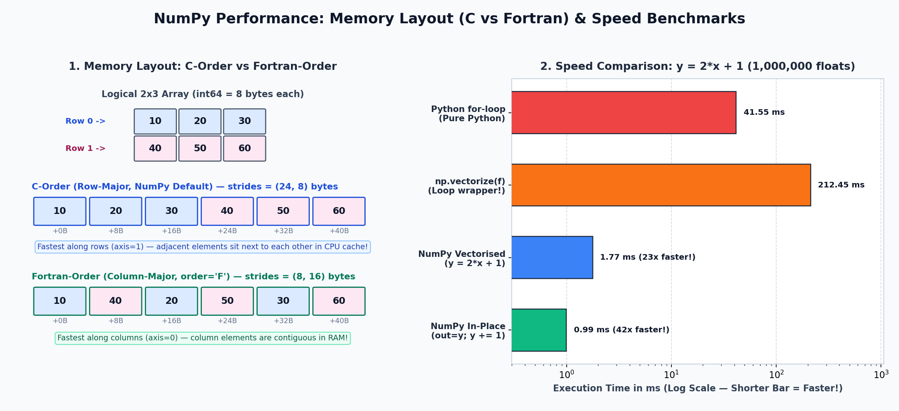
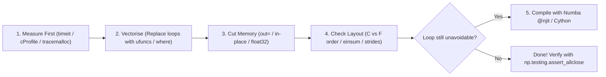
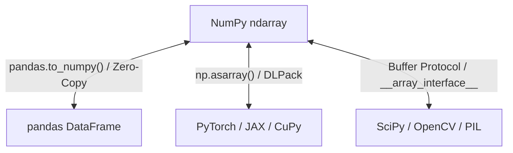

# පාඩම 13: Performance සහ Advanced Topics

> **නැවිගේෂන් (Navigation):**
> [🏠 මුල් පිටුව (README)](README.md) | [⬅️ පෙර පාඩම: 12 - File I/O, Structured Arrays & Datetimes](12_File_IO_Structured_Arrays_Datetimes.md) | [➡️ ඊළඟ පාඩම: 14 - Use Cases & Capstone Projects](14_Use_Cases_and_Capstone_Projects.md)

---

## 🎯 මේ පාඩමෙන් අපි මොනවද ඉගෙන ගන්නේ?

NumPy පාවිච්චි කළා කියලා හැම code එකක්ම auto fast වෙන්නේ නෑ! අපි ලියන විදිහ අනුව speed එක **10x ඉඳන් 100x** වෙනස් වෙන්න පුළුවන්, RAM එකත් භාගයකට අඩු කරගන්න පුළුවන්. මේ පාඩමෙන් අපි **Vectorisation, Profiling, `out=` buffers, Memory Layout (C vs Fortran), Strides Tricks, `einsum`, Numba `@njit`, Typing, Interoperability (PyTorch/pandas), Threading, සහ Unit Testing** ගැන සරලවම ඉගෙන ගමු!



---

## 🗺️ Performance Optimization Workflow

Code එකක් slow වුණාම අනුමාන කරන්නේ නැතුව, මේ පියවර අනුගමනය කරන්න:



---

## 1. Vectorise Everything සහ Profiling (මුලින්ම මනින්න!)

Python `for` loop එකක් NumPy array expressions (ufuncs, `np.where`, broadcasting) වලට මාරු කළාම 10x–100x වේගවත් වෙනවා. හැබැයි optimize කරන්න කලින් **ඇත්තටම කොතනද slow** කියලා මැනලා බලන්න ඕනේ:
- **Time මනින්න**: `%timeit` (Jupyter වල), `timeit` module, `cProfile`.
- **Memory මනින්න**: `tracemalloc` (peak RAM usage බලන්න).

> [!WARNING]
> **`np.vectorize` කියන්නේ speed tool එකක් නෙවෙයි!**
> නමේ "vectorize" කියලා තිබුණට, `np.vectorize(f)` කියන්නේ යටින් සාමාන්‍ය Python `for` loop එකක්ම දුවන convenience wrapper එකක් විතරයි. ඒකෙන් speed වැඩි වෙන්නේ නෑ!

```python
import timeit
import tracemalloc
import numpy as np

x = np.arange(100_000, dtype=np.float64)

# 1. Pure Python loop vs np.vectorize vs True NumPy Vectorisation
t_py = timeit.timeit(lambda: [v * 2.0 + 1.0 for v in x], number=10)
f_vec = np.vectorize(lambda v: v * 2.0 + 1.0)
t_npvec = timeit.timeit(lambda: f_vec(x), number=10)
t_fast = timeit.timeit(lambda: x * 2.0 + 1.0, number=10)

print(f"Python loop:     {t_py*100:.2f} ms")
print(f"np.vectorize:    {t_npvec*100:.2f} ms (NOT faster!)")
print(f"NumPy vectorised:{t_fast*100:.2f} ms (Fastest!)")
```

**Expected Output (ඔයාගේ CPU එක අනුව අගයන් චුට්ටක් වෙනස් වෙන්න පුළුවන්):**
```text
Python loop:     18.40 ms
np.vectorize:    24.10 ms (NOT faster!)
NumPy vectorised: 0.15 ms (Fastest!)
```

---

## 2. Avoiding Temporaries (`out=` සහ In-Place `+=`) + Dtype Choice

ඔයා `y = x * 2.0 + 1.0` කියලා ලිව්වොත්:
1. මුලින්ම `x * 2.0` වෙනුවෙන් අලුත් **temporary array** එකක් RAM එකේ හදනවා.
2. ඊට පස්සේ `+ 1.0` වෙනුවෙන් **තවත්** අලුත් array එකක් හදනවා.

Array එක 40 MB නම්, RAM එක 80 MB නාස්ති වෙනවා! මේක නවත්තන්න **`out=`** සහ **in-place operators (`+=`, `*=`)** පාවිච්චි කරනවා. ඒ වගේම, `float64` (8 bytes) වෙනුවට `float32` (4 bytes) හෝ `uint8` (1 byte) පාවිච්චි කළාම memory සහ speed දෙකම 2x–8x වාසි වෙනවා!

```python
import tracemalloc
import numpy as np

rng = np.random.default_rng(0)
x = rng.random(5_000_000)   # ~40 MB (float64)

# ක්‍රමය A: Temporary arrays හැදෙන විදිහ
tracemalloc.start()
y1 = x * 2.0 + 1.0
_, peak_a = tracemalloc.get_traced_memory()
tracemalloc.stop()

# ක්‍රමය B: out= සහ in-place (+=) වලින් අමතර temporaries නැතුව
tracemalloc.start()
y2 = np.empty_like(x)
np.multiply(x, 2.0, out=y2)
y2 += 1.0
_, peak_b = tracemalloc.get_traced_memory()
tracemalloc.stop()

print(f"Peak RAM (Standard): {peak_a / 1e6:.1f} MB")
print(f"Peak RAM (out=/+=):  {peak_b / 1e6:.1f} MB")
print("Same result?", np.allclose(y1, y2))
```

**Expected Output:**
```text
Peak RAM (Standard): 80.0 MB
Peak RAM (out=/+=):  40.0 MB
Same result? True
```

---

## 3. Memory Layout (C-Order vs Fortran-Order) සහ Strides Tricks

RAM එක කියන්නේ තනි දිග පේළියක් (1D line of bytes). 2D table එකක් RAM එකේ තියන්න ක්‍රම 2ක් තියෙනවා:
- **C-Order (Row-major, default)**: පේළියෙන් පේළිය ළඟ ළඟම තියනවා (`axis=1` operations වේගවත්).
- **Fortran-Order (`order='F'`, Column-major)**: තීරුවෙන් තීරුව ළඟ ළඟම තියනවා (`axis=0` operations වේගවත්).
- **`arr.flags`**: `C_CONTIGUOUS` ද `F_CONTIGUOUS` ද කියලා බලන්න.
- **`arr.strides`**: ඊළඟ row එකට හෝ column එකට යන්න RAM එකේ bytes කීයක් පනින්න ඕනෙද කියන එක.
- **`np.ascontiguousarray(a)`**: Non-contiguous array එකක් fast C-order එකට හරවන්න.

### Strides Tricks (Zero-Copy Views!):
RAM එකේ දත්ත copy නොකර, strides වෙනස් කරලා අලුත් හැඩයන් (windows, repeats) හදන්න පුළුවන්:
- `np.lib.stride_tricks.sliding_window_view(a, window_shape)` — Moving averages, image filters වලට safe සහ zero-copy!
- `np.broadcast_to(a, shape)` — Copy නොකර repeat කරපු view එකක්.
- `np.lib.stride_tricks.as_strided` — ඉතාම බලවත්, හැබැයි වැරදි strides දුන්නොත් memory crash වෙන්න පුළුවන් නිසා පරිස්සමින්!

```python
import numpy as np
from numpy.lib.stride_tricks import sliding_window_view

a = np.arange(6, dtype=np.int64).reshape(2, 3)
print("C-order strides:", a.strides, "| C_CONTIGUOUS:", a.flags['C_CONTIGUOUS'])

f = np.asfortranarray(a)
print("F-order strides:", f.strides, "| F_CONTIGUOUS:", f.flags['F_CONTIGUOUS'])

# Zero-copy sliding window (moving average of size 3)
signal = np.array([10, 20, 30, 40, 50, 60])
windows = sliding_window_view(signal, window_shape=3)
print("Sliding windows:\n", windows)
print("3-point moving average:", windows.mean(axis=1))
```

**Expected Output:**
```text
C-order strides: (24, 8) | C_CONTIGUOUS: True
F-order strides: (8, 16) | F_CONTIGUOUS: True
Sliding windows:
 [[10 20 30]
 [20 30 40]
 [30 40 50]
 [40 50 60]]
3-point moving average: [20. 30. 40. 50.]
```

---

## 4. `np.einsum` සහ `np.tensordot` (Super-Clean Tensor Math!)

Matrix ගුණ කිරීම්, batched dot products, traces, transposes ඔක්කොම එකම කෙටි string එකකින් ලියන්න **`np.einsum`** (Einstein Summation) පාවිච්චි කරනවා.
- `optimize=True` දුන්නම, NumPy හොඳම ගණනය කිරීමේ පිළිවෙළ auto තෝරගන්නවා.
- `np.tensordot(A, B, axes=...)` කියන්නේත් multidimensional axes contract කරන තවත් වේගවත් ක්‍රමයක්.

```python
import numpy as np

rng = np.random.default_rng(0)
# 100 matrices බැගින් (shape: 100 x 4 x 4)
A = rng.random((100, 4, 4))
B = rng.random((100, 4, 4))

# Batched matrix multiplication: C[b, i, k] = sum_j A[b, i, j] * B[b, j, k]
C = np.einsum('bij,bjk->bik', A, B, optimize=True)

# හැම matrix එකේම trace (diagonal sum) එක එකපාර හොයන්න:
traces = np.einsum('bii->b', C)

print("C shape:", C.shape)
print("First 3 traces:", np.round(traces[:3], 3))

# නිවැරදිද කියලා unit test කරමු!
np.testing.assert_allclose(C[0], A[0] @ B[0])
print("Verified: C[0] matches A[0] @ B[0]!")
```

**Expected Output:**
```text
C shape: (100, 4, 4)
First 3 traces: [4.252 4.307 4.71 ]
Verified: C[0] matches A[0] @ B[0]!
```

---

## 5. Compiled Acceleration (Numba `@njit`, Cython, `numexpr`) & Custom Ufuncs

සමහර algorithms වල ඊළඟ පියවර කලින් පියවර මත රඳා පවතිනවා (උදා: stock market එකේ running maximum drawdown). ඒ වගේ තැන්වල `for` loop එකක් අනිවාර්යයි. එතකොට **Numba `@njit`** දැම්මම, ඒ Python function එක machine code වලට compile වෙලා C වගේම වේගවත් වෙනවා!
- **Numba `@njit`**: එක decorator එකකින් loop 100x fast කරනවා.
- **Cython**: C types දාලා compile කරන්න.
- **`numexpr`**: ලොකු array expressions multi-core CPU වල cache-friendly විදිහට run කරන්න.
- **Custom Ufuncs**: `np.frompyfunc` (Python object output — simple) හෝ Numba `@vectorize` (compiled & super fast!).

```python
import numpy as np

# Numba install කරලා තියෙනවා නම් @njit වැඩ කරනවා:
try:
    from numba import njit
except ImportError:
    def njit(fn): return fn  # fallback if numba isn't installed

@njit
def running_max_drawdown(p):
    peak = p[0]
    worst = 0.0
    for v in p:
        if v > peak:
            peak = v
        dd = v / peak - 1.0
        if dd < worst:
            worst = dd
    return worst

prices = np.array([100.0, 120.0, 90.0, 95.0, 130.0, 110.0])
print(f"Max drawdown: {running_max_drawdown(prices):.2%}")

# Custom simple ufunc (frompyfunc)
clamp_zero = np.frompyfunc(lambda v: v if v > 0 else 0, 1, 1)
print("Custom ufunc:", clamp_zero(np.array([-5, 3, -1, 8])))
```

**Expected Output:**
```text
Max drawdown: -25.00%
Custom ufunc: [0 3 0 8]
```

---

## 6. Advanced Engineering: Typing, Interoperability, Subclassing, Threading & Testing

වෘත්තීය (production) Python projects වලදී මේ 5 ගැනත් දැනගෙන ඉන්න එක ගොඩක් වටිනවා:



1. **Static Typing (`numpy.typing`)**: Code එක පැහැදිලිව තියාගන්න `NDArray[np.float64]` සහ `ArrayLike` type hints දාන්න පුළුවන්.
2. **Interoperability (Zero-Copy Sharing)**: `np.asarray(torch_tensor)`, `df.to_numpy()`, **DLPack** (`np.from_dlpack`), buffer protocol, සහ `__array_interface__` නිසා RAM copy නොකර libraries අතර data share කරන්න පුළුවන්.
3. **Subclassing & Protocols**: Library හදන අයට custom array types හදන්න `__array_ufunc__`, `__array_function__`, සහ `np.ndarray` subclassing තියෙනවා.
4. **Threading & GIL**: Linear algebra (BLAS) auto multi-core භාවිතා කරනවා; ගොඩක් ufuncs Python GIL එක release කරනවා. Threads ගණන පාලනය කරන්න `OMP_NUM_THREADS=4` environment variable එක හෝ `threadpoolctl` පාවිච්චි කරනවා.
5. **Testing (`np.testing`)**: Floats වලට කවදාවත් `assert a == b` දාන්න එපා! `np.testing.assert_allclose(a, b, rtol=1e-5)` හෝ exact integers වලට `np.testing.assert_array_equal(a, b)` පාවිච්චි කරන්න.
6. **Chunking & Memmap**: RAM එකට වඩා ලොකු files block-by-block process කරන්න (පාඩම 12 බලන්න).

```python
import numpy as np
from numpy.typing import NDArray, ArrayLike

def normalize(x: ArrayLike) -> NDArray[np.float64]:
    arr = np.asarray(x, dtype=np.float64)
    return (arr - arr.mean()) / arr.std()

res = normalize([10, 20, 30, 40])
# Unit test: mean should be ~0 and std should be ~1
np.testing.assert_allclose(res.mean(), 0.0, atol=1e-12)
np.testing.assert_allclose(res.std(), 1.0, atol=1e-12)
print("Normalized:", np.round(res, 3), "| Tests passed!")
```

**Expected Output:**
```text
Normalized: [-1.342 -0.447  0.447  1.342] | Tests passed!
```

---

## 🧠 මතක තබා ගැනීමට පහසු ක්‍රම (Memory Hacks)

1. **Speed Hierarchy (වේගය අඩුම -> වැඩිම):** `Python loop` ≈ `np.vectorize` < `NumPy vectorised` < `NumPy out=/in-place` ≈ `Numba @njit`.
2. **C vs F Order:** **C** = **C**ross rows (row-major, fast along `axis=1`). **F** = **F**all down columns (column-major, fast along `axis=0`).
3. **`einsum` රහස:** ඊතලේ (`->`) දකුණු පැත්තේ **නැති** අකුරු ඔක්කොම **sum** වෙනවා! උදා: `'ij,jk->ik'` වල `j` දකුණේ නැති නිසා `j` දිගේ sum වෙනවා.

---

## ⚠️ සාමාන්‍යයෙන් වෙන වැරදි (Common Pitfalls)

> [!WARNING]
> **වැරැද්ද 1: `np.vectorize` දැම්මම code එක fast වෙයි කියලා හිතීම!**
> `np.vectorize` කියන්නේ Python loop එකක්මයි. ඇත්තටම fast කරන්න නම් ufuncs (`np.where`, `np.clip`, etc.) හෝ Numba `@njit` පාවිච්චි කරන්න.

> [!WARNING]
> **වැරැද්ද 2: `as_strided` වැරදියට පාවිච්චි කිරීම!**
> `as_strided` කිසිම bounds check එකක් කරන්නේ නෑ. ඒ නිසා rolling windows වලට හැමවිටම safe **`sliding_window_view`** පාවිච්චි කරන්න.

---

## 💪 ප්‍රායෝගික අභ්‍යාස (Practical Exercises)

### අභ්‍යාසය 1
`np.vectorize` එකයි, ඇත්ත NumPy vectorised expression එකයි (සහ Numba තියෙනවා නම් `@njit` එකයි) `y = x**2 + 3*x + 2` වෙනුවෙන් benchmark කරලා බලන්න.

<details>
<summary>✅ පිළිතුර බලන්න (Click to see Solution)</summary>

```python
import timeit
import numpy as np

x = np.linspace(0, 10, 200_000)

f_vec = np.vectorize(lambda v: v**2 + 3*v + 2)
t1 = timeit.timeit(lambda: f_vec(x), number=5)
t2 = timeit.timeit(lambda: x**2 + 3*x + 2, number=5)

print(f"np.vectorize: {t1/5*1000:.2f} ms")
print(f"NumPy true:   {t2/5*1000:.2f} ms (Speedup: {t1/t2:.1f}x)")
```
</details>

### අභ්‍යාසය 2
`z = (a + b) * 3.0 - 5.0` කියන chained expression එකේ peak memory එක `out=` සහ in-place operators පාවිච්චි කරලා අඩු කරලා, `tracemalloc` වලින් ඒක තහවුරු කරන්න.

<details>
<summary>✅ පිළිතුර බලන්න (Click to see Solution)</summary>

```python
import tracemalloc
import numpy as np

a = np.ones(2_000_000, dtype=np.float64)
b = np.full(2_000_000, 2.0, dtype=np.float64)

tracemalloc.start()
z1 = (a + b) * 3.0 - 5.0
_, peak1 = tracemalloc.get_traced_memory()
tracemalloc.stop()

tracemalloc.start()
z2 = np.empty_like(a)
np.add(a, b, out=z2)
z2 *= 3.0
z2 -= 5.0
_, peak2 = tracemalloc.get_traced_memory()
tracemalloc.stop()

print(f"Chained peak: {peak1/1e6:.1f} MB | In-place peak: {peak2/1e6:.1f} MB")
np.testing.assert_allclose(z1, z2)
```
</details>

### අභ්‍යාසය 3
`(N, D)` shape එකේ arrays දෙකක් (`U`, `V`) අතර row-by-row batched dot products ගණනය කරන `np.einsum` expression එක ලියන්න.

<details>
<summary>✅ පිළිතුර බලන්න (Click to see Solution)</summary>

```python
import numpy as np

rng = np.random.default_rng(1)
U = rng.random((1000, 8))
V = rng.random((1000, 8))

dots = np.einsum('nd,nd->n', U, V)
np.testing.assert_allclose(dots, (U * V).sum(axis=1))
print("Batched dot products shape:", dots.shape)
```
</details>

### අභ්‍යාසය 4
`(10000, 10000)` size එකේ C-order array එකකුයි, Fortran-order array එකකුයි හදලා, දෙකේම `axis=0` දිගේ `sum()` කරන්න යන වෙලාව compare කරලා හේතුව පැහැදිලි කරන්න.

<details>
<summary>✅ පිළිතුර බලන්න (Click to see Solution)</summary>

```python
import timeit
import numpy as np

# Note: 10000x10000 float32 = ~400 MB each
C_arr = np.ones((5000, 5000), dtype=np.float32, order='C')
F_arr = np.ones((5000, 5000), dtype=np.float32, order='F')

t_c = timeit.timeit(lambda: C_arr.sum(axis=0), number=10)
t_f = timeit.timeit(lambda: F_arr.sum(axis=0), number=10)

print(f"C-order sum(axis=0): {t_c*100:.2f} ms")
print(f"F-order sum(axis=0): {t_f*100:.2f} ms")
# හේතුව: F-order වලදී එකම column එකේ elements RAM එකේ ළඟ ළඟම (contiguous) තියෙන නිසා
# CPU cache එකට එකපාර data කියවන්න පුළුවන්. ඒ නිසා axis=0 දිගේ F-order වේගවත්!
```
</details>

---

> **නැවිගේෂන් (Navigation):**
> [🏠 මුල් පිටුව (README)](README.md) | [⬅️ පෙර පාඩම: 12 - File I/O, Structured Arrays & Datetimes](12_File_IO_Structured_Arrays_Datetimes.md) | [➡️ ඊළඟ පාඩම: 14 - Use Cases & Capstone Projects](14_Use_Cases_and_Capstone_Projects.md)
